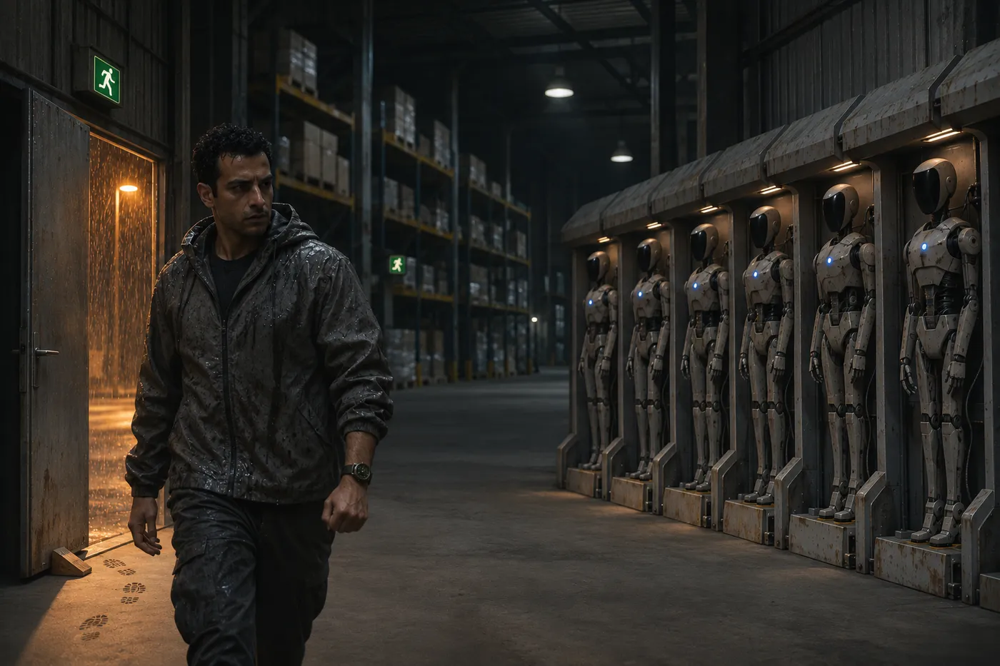

# Prolog. Hodinky

*Brno, logistický park Tuřany-jih, hala B7. Středa 17. října 2074, 22:28.*

Déšť bušil do plechového přístřešku tak hustě, že už nezněl jako déšť. Zněl jako písek sypaný na buben.

Tárik Hamdí stál u bočních dveří haly B7 a díval se na hodinky. Dvacet dva dvacet osm. Ručičky svítily slabě zeleně. Za den nasály trochu světla a v noci ho pomalu vracely. Nic jiného mu po otci nezbylo.

Sáhl do pravé kapsy bundy a nahmatal rušičku. Plochá krabička, menší než balíček karet, s jediným tlačítkem. Stiskl ho a držel, dokud krabička dvakrát nezavibrovala.

„Ztrácím spojení s okol–“ řekl mu asistent v uchu a zmlkl uprostřed slova.

Tárik chvíli poslouchal ticho. Dva roky měl v uchu hlas, který mu překládal úřady, připomínal splátky a v noci se ptal, jestli nechce mluvit. Teď tam bylo jen vlastní šumění krve. Bylo to horší než hrom.

V levé kapse měl klíč. Malý datový klíč, plochý, teplý od těla. Sevřel ho v pěsti, jako by mu mohl utéct.

Dveře měly kód a kód znal. Otevřel je, vklouzl dovnitř a zasunul pod křídlo dřevěný klínek, který nosil v kapse od první noci v Lantoru. Až přijde Júsuf, nebude muset nic zadávat. Do půl dvanácté zbývala víc než hodina. Do té doby bude po všem, tak nebo tak.

*

U vchodu stáli roboti v dokovacích stáních, šest vedle sebe, s modrými světly na hrudi. Nabíjeli se. Vypadali jako lidé, kteří spí s otevřenýma očima. Tárik je obešel obloukem, jako vždycky, i když věděl, že mu nic neudělají.

Dál byla hala tmavá. Svítily jen nouzové piktogramy nad uličkami, zelení běžící panáčci, a mezi nimi stoupaly regály do výšky čtyř pater. Pod střechou hučel déšť. Pod tím hukotem bylo ticho velké budovy, ve které v noci nikdo nepracuje.

Zóna R byla úplně vzadu. Stála tam řada robotů určených k repasi, třicet nebo čtyřicet kusů, opřených zády o kolejnici. Neměli světla v obličeji. Hlavy jim visely trochu dopředu, ruce podél těla. Připomínali mu frontu na přijímacím středisku, první týden: lidi, kteří už nevědí, na co čekají, a čekají dál.

Věděl, že některé z nich žádnou repasí neprojdou. Věděl, kam pojedou. Sám jich za dva roky odvezl k hranici víc, než chtěl počítat.

Postavil se do uličky mezi regál a řadu robotů, zády k nim, čelem k průchodu mezi regály, kudy se šlo od vchodu. Opřel se ramenem o ocelový sloupek regálu. Byl studený a trochu se chvěl, jak do střechy narážel vítr.

Dvacet dva třicet jedna.

*

V tramvaji si to celé přeříkal česky. Asistent ho opravoval: *policii*, ne *polici*, *chci, abyste šel*, ne *chci, že půjdete*. Tárik opakoval věty potichu, s čelem opřeným o okno, a nad střechami Komárova se blýskalo. Teď si nevzpomínal ani na první slovo.

Vzpomínal na otce.

V devět večer zavíral Mahmúd Hamdí dílnu u přístavu v Rašídu. Stáhl roletu, umyl si ruce benzínem a pak mýdlem, sedl si na schod a natáhl hodinky. Malá korunka mezi palcem a ukazováčkem, tam a zpátky, tam a zpátky. Tárik u toho sedával od pěti let.

„Až ucítíš odpor, přestaň,“ říkal otec. „Kdo tlačí dál, utrhne pero.“

„A kolik vydrží?“

„Do zítřejšího večera a ještě kus. Ale natahuješ je dnes. Ne zítra.“

Od otcovy smrti je natahoval Tárik. Každý večer v devět, ať byl kdekoli. Dnes v kuchyňce ubytovny v Komárově, u okna, za kterým se ohýbaly topoly. Samí u plotny míchal čočku a nic neříkal, protože to už znal. Korunka tam a zpátky. Odpor. Konec.

Hodinky tikaly hlasitě, starým, hrubým tikotem. V tiché hale ho Tárik slyšel, i když je měl na zápěstí.

*

Mezi regály se objevilo světlo.

Kývalo se ve výšce ramene, jak se kývá lampa připnutá k vestě. Přibližovalo se pomalu. Kroky na betonu, mokré podrážky, které při každém došlapu tiše vrzly. Pak světlo zastavilo tři metry od něj a mířilo mu do obličeje.

Tárik přimhouřil oči. Za lampou neviděl nic. Jen kus reflexního pruhu, který se v zeleném světle nouzovky na okamžik rozsvítil a zhasl. Vestu se stříbrným pruhem nosil v hale každý. Tárik ji měl taky, složenou v dodávce.

„Táriku,“ řekl tichý hlas. Česky.

„Dobrý večer.“ Tárik se narovnal. Rameno měl od sloupku prochladlé. „Děkuju, že jste přišel. V takovém počasí.“

Mlčení. Lampa se nepohnula.

Tárik vytáhl z kapsy klíč a podržel ho na otevřené dlani ve světle. Ruka se mu třásla. Doufal, že to vypadá jako zima.

„Mám to tady. Všechno, co šlo přes repasi od jara sedmdesát dva. Čísla robotů, data, kdo podepsal. Zkopíroval jsem to ze servisu.“ Nadechl se. „Zítra jdu na policii. Chci, abyste šel se mnou.“

Teď to řekl správně. *Abyste šel.*

„Řeknete jim, že vás donutili. Je to pravda. Mají pro takové lidi ochranu, mají advokáty. Ptal jsem se.“ Mluvil rychleji, protože ticho naproti němu nic nevracelo. „Oba dlužíme. Já nechci dlužit do smrti. A vy taky ne.“

Déšť zesílil a zase povolil.

„Myslete na své dítě,“ řekl Tárik tiše. „Ať se to dozví od vás, ne od cizích lidí.“

Lampa pořád svítila. Tárik čekal, že uslyší ano, nebo ne, nebo aspoň nadávku. Neuslyšel nic. Jen dech, nebo možná vítr ve větracích šachtách. Napadlo ho, že ten druhý přemýšlí. Že je to dobře. Kdo přemýšlí, ten neutíká.

Pomalu zavřel dlaň s klíčem.

Za zády mu tiše zabzučel servomotor.

Tárik ten zvuk znal. Znal ho z dílny, z ramp, z dvou let v Lantoru. Zvuk kloubu, který se po dlouhé době pohne. Pak druhý, níž, v kyčli. Pak třetí. Kovové cvaknutí, jako když se uvolní brzda.

V řadě za ním neměl nikdo jádro. Nikdo z nich neměl světlo v obličeji. Nikdo z nich by se neměl hýbat.

Tárik se začal otáčet.

V tichu mezi dvěma nárazy deště slyšel svoje hodinky. Tik. Tik. Tik.
