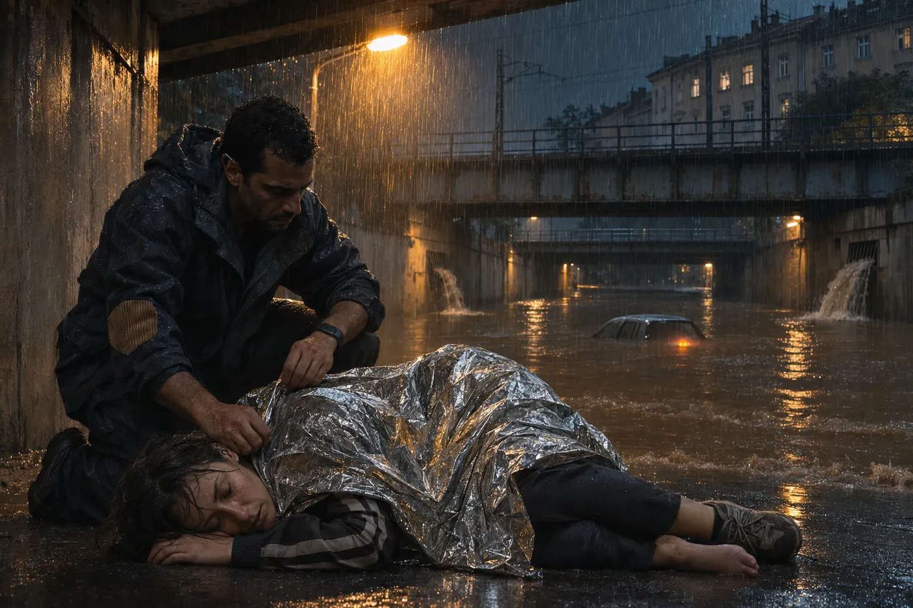

# 2. Bouře

*Brno, Komárov a Tuřany. Noc ze středy 17. na čtvrtek 18. října 2074.*

Tramvaj zastavila u Zvonařky a dál nejela.

„Provoz na trati do Komárova je přerušen,“ řekl ženský hlas z reproduktorů, česky a pak anglicky. „Voda na kolejích. Náhradní doprava není k dispozici. Omlouváme se.“

Dveře se otevřely do tmy a do deště. Ve voze kromě Júsufa seděli jen dva lidé, starý muž se psem a dívka se sluchátky přes celou hlavu. Dívka si něco řekla, asi svému asistentovi, a zůstala sedět. Tramvaj ji nejspíš odveze zpátky do centra. Starý muž vystoupil se psem a hned zmizel pod přístřeškem nádraží.

Júsuf stál ve dveřích a díval se na koleje. Leskly se. Mezi nimi stála voda, černá, rozbitá deštěm na tisíc kousků.

„Do Tuřan-jih je to odtud pět kilometrů,“ řekl asistent. „Pěšky asi hodinu a deset minut, v tomhle počasí víc. Silnice přes Komárov je místy zaplavená. Najdu vám cestu, která se vyhne nejhorším místům.“

„Ano.“

Bylo deset minut před jedenáctou. Do půl dvanácté to nestihne.

Vystoupil.

*

Déšť nepadal. Stál. Byl to sloup vody od mraku až k zemi, a když do něj Júsuf vešel, za tři kroky měl mokré džíny až ke kolenům a za deset kroků mu teklo za límec, i když měl kapuci utaženou až k obočí. Kabát vydržel déle. Byl to dobrý kabát. V Rašídu v něm stál na přídi člunu celé noci.

Asistent ho vedl po chodnících, které byly výš. „Doprava. Teď rovně dvě stě metrů. Přechod je zatopený, přejděte o padesát metrů dál, u lékárny.“ Mluvil klidně, krátce, a Júsuf ho poslouchal, jak poslouchal velitele na vysílačce. Nebylo potřeba rozumět. Stačilo jít.

V Komárově tekla voda ulicemi jako potoky. Nebyla hluboká, po kotníky, ale byla rychlá a nesla listí, plastové lahve a jednu dětskou botu. Júsuf vodu četl, jak ho to naučili v Rašídu a jak to potom roky učil on dobrovolníky. Kde je hladina hladká a napnutá, je proud. Kde se vlní a mračí, je pod ní překážka. A kde se voda nad dlažbou točí do kruhu a bublá, tam něco chybí.

U křižovatky se točila do kruhu.

Júsuf se zastavil. Uprostřed silnice, pod hnědou vodou, byl poklop kanálu. Tlak ze zaplavené kanalizace ho nadzvedl a odsunul a voda teď padala zpátky do díry, kterou nebylo vidět. Člověk, který by šel středem silnice, by šel po pevné zemi a pak by pod ním žádná nebyla.

„Ten kanál je otevřený,“ řekl asistentovi.

„Děkuji. Hlásím to městu.“ Asistent se na vteřinu odmlčel. „Hotovo. Robot údržby je na cestě. Pokračujte po levé straně, u zdí.“

Júsuf šel u zdí. Byl to starý zvyk. Při povodni se chodí podél domů, podél plotů, tam, kde je obrubník a kde pod vodou nečíhá žádná šachta.

Nebe se rozsvítilo. Bílé, celé, jako by někdo nad městem otevřel dvířka pece. Júsuf počítal. Jedna, dva. Hrom přišel na dvě a půl. Necelý kilometr.

*

Svitava byla vysoko. U mostu se zastavil, i když nechtěl, protože nemohl jinak. Řeka tekla hnědá a hustá, nesla větve a celý kus plotu a modrý barel, který se točil a nořil a zase vyskakoval. Voda sahala skoro ke spodku mostovky. Pod mostem hučela tak, že ten zvuk Júsuf cítil v hrudi.

Díval se na ni a pozorně ji četl. Rychlost. Barvu. Kde se láme o pilíř. Kolik ještě unese.

Dnes v noci z břehů nevystoupí. Hráze tady byly dobré a koryto hluboké, a někdo tu před lety udělal velkou práci. Viděl to na betonu, na kamenech, na tom, jak se řeka v zatáčce držela uprostřed.

V Rašídu hráze dobré nebyly.

„Pane Mansúre,“ řekl asistent. „Je jedenáct dvacet. Do cíle zbývají tři kilometry.“

Júsuf se odtrhl od zábradlí a šel dál.

*

Za Svitavou skončilo město a začala tma. Silnice mezi poli, vedle ní řada lamp, které se kývaly ve větru a házely na asfalt žluté skvrny. Pod dálnicí vedl podchod. Na jeho dně stála voda, ale jen po kotníky, a Júsuf jím prošel s rukou na zdi. Pak plot letiště, nekonečný, s nápisy, které déšť smáčel tak, že nešly přečíst. Pak lampy jinak, vyšší, bílé, a za nimi logistický park.

Tuřany-jih byly velké jako město. Haly stály v řadách, šedé a hladké, bez oken, každá s velkým číslem na boku. Mezi nimi široké silnice, po kterých přes den jezdily autonomní tahače. Teď stály pod přístřešky, desítky jich, v dlouhých řadách, s vypnutými světly. Vypadaly jako stádo, které čeká, až bouřka přejde. Jediné, co se v parku pohybovalo, byl déšť.

Brána pro pěší byla otevřená. Park se zamykal jen u hal.

„Hala B7 je třetí po pravé straně,“ řekl asistent. „Boční vchod je na severní stěně.“

Bylo jedenáct padesát jedna.

Dveře byly pootevřené. Pod křídlem byl zasunutý dřevěný klínek, tmavý od deště. Úzká škvíra světla, modrého a slabého.

Tárik na něj počkal. Nechal mu otevřeno.

Júsuf vešel.

*

Nejdřív ticho. Pak déšť, ale jinak, vysoko nad hlavou, na plechové střeše, tupý a nepřetržitý. Pak modrá světla.

U vchodu stáli roboti v dokovacích stáních. Šest kusů, vedle sebe, každý s modrým světlem na hrudi, a to světlo bylo jediné, co v té části haly svítilo. Júsuf se zastavil a díval se na ně. Byli vyšší než on. Stáli bez hnutí. Za čtyři měsíce jich viděl stovky a na jednu věc si nezvykl. Člověk se na stroj podívá a stroj se podívá taky, aniž by pohnul hlavou.

„Táriku?“ řekl do tmy. Arabsky, tiše.

Nic.

Šel dál. Za roboty začínala hala. Regály do výšky, jejich konce se ztrácely ve tmě. Nad uličkami svítily zelené piktogramy, běžící panáčci, kteří ukazovali k únikovým východům. Jinak tma. Velká, chladná, s pachem gumy a strojního oleje.

Ušel snad sto kroků, když mu v kapse kabátu dvakrát zavibrovala kapesní jednotka. Júsuf ji vytáhl. Na displeji svítil jeden řádek.

*Bez spojení s okolím.*

V uchu bylo ticho. Ne to ticho, kdy asistent mlčí, protože nemá co říct. Jiné. Prázdné. Júsuf si sáhl na sluchátko, jako by mohlo vypadnout. Seděl tam, kde měl.

Rozsvítil na jednotce svítilnu. Kužel bílého světla, malý, sahal pět metrů a pak se rozpadal.

„Táriku!“

Hlas se mu vrátil od regálů dvakrát a pak zanikl v dešti.

Na konci hlavní uličky visela cedule. *Zóna R – repase.* Pod ní šipka. Júsuf šel za šipkou. Říkal si, že Tárik tam čeká u nakládky. Že má sluchátko a nic neslyší, stejně jako on. Že se bude smát, až ho uvidí mokrého až po pás. Říkal si to, a přitom šel pomaleji a pomaleji, protože mu něco v zádech, něco starého a zvířecího, říkalo, že tady se nikdo smát nebude.

Řada robotů začínala za posledním regálem.

Stáli zády ke zdi, opření o kolejnici, desítky, a neměli světla. Žádná modrá. V místě, kde měli mít obličej, byla jen tmavá plocha, hladká, a v ní se zrcadlil kužel jeho svítilny, když po nich přejel. Hlavy jim visely dopředu. Ruce podél těla. Jako by usnuli vstoje.

Uprostřed řady jeden chyběl.

Júsuf posvítil do mezery a pak doleva, do uličky mezi řadou a posledním regálem.

Tam ho našel.

*

Robot stál u regálu. Stál nakloněný dopředu, ruce zaťaté do vodorovné ocelové příčky, jednu vlevo, jednu vpravo. Mezi jeho hrudí a příčkou byl Tárik.

Júsuf viděl nejdřív bundu. Tu šedou s kapucí, ve které Tárik přišel v červenci s pomeranči. Pak ruku, visící podél regálu, s prsty pootevřenými. Pak hlavu, svěšenou přes příčku. Robot ho tiskl hrudníkem k regálu tak těsně, jako by ho objímal zezadu, a byl tak nehybný, že vypadal jako součást haly. Na rameni měl šablonou nastříkané bílé písmo. *DR-14.*

Júsuf přiskočil a chytil robota za ruku. Táhl. Pak se opřel ramenem do jeho boku a zatlačil celou vahou. Bylo to jako tlačit do zdi. Robot vážil sto padesát kilo, možná víc. Ani se nezakymácel.

Sáhl Tárikovi na krk. Pod čelistí, dva prsty, tam, kde to dělal tisíckrát. Kůže byla chladná. Ne studená, chladná, jako kámen ve stínu. Počkal. Počítal do deseti a pak znovu do deseti. Pod prsty nic. Žádný tep, žádný dech. Posvítil mu do tváře. Oči měl otevřené a nedíval se. Rty tmavé.

Na zápěstí visící ruky se ve světle zalesklo rozbité sklíčko hodinek.

Júsuf ruku stáhl.

Viděl mrtvých hodně. Ve vodě, na střechách, v bahně, které po povodni zůstane v domech. Utopené děti, které vytáhl z kanálů, a staré lidi, kteří už nedokázali vylézt na půdu. Naučil se dívat na mrtvé tak, jak se dívá záchranář. Je to práce, a kdo pláče, nepomůže živým. Tohle se naučil a myslel si, že to umí.

Ale tohle byl Tárik. Kluk, co rozebral karburátor potmě.

„Inná lilláhi wa inná ilajhi rádžiún,“ zašeptal. Bohu patříme a k Němu se vracíme. Řekl to, protože se to říká, protože to tak říkal jeho otec a otcův otec. A protože nevěděl, co jiného dělat s rukama.

Rozhlédl se.

Tma. Řada robotů bez tváří. Regály. Nad ním déšť.

Kdo to udělal? Robot? Roboti bez světla se nehýbou, to věděl každý. Nebo hýbou? Co Júsuf věděl o robotech? Nic. Věděl o vodě. Někdo tu musel být. Někdo, kdo věděl, že Tárik přijde. Azíz? Proč by Azíz zabíjel svého řidiče? Proč by ho zval sem, k nákladu, a pak?

A pak si to představil a zatočila se mu hlava.

Policie. Muž s dluhem u převaděčů, žadatel bez rozhodnutí, v noci v cizí hale, u mrtvého, kterého zná z Rašídu. Kdo by mu věřil, že přišel pozdě? Že tu nikoho neviděl? Už slyšel otázky. Proč jste tam byl? Kdo vás poslal? Co jste měl nakládat? A pak papír, na kterém bude stát, že žádost o ochranu se zamítá. A Nur. Nur, kterou by tu neměl kdo hlídat kromě staré ženy přes chodbu. Nur s játry devítileté holčičky. Játra se jí zase začnou plnit mědí, protože doma ji nikdo léčit neumí.

Někde vzadu v hale, ve tmě, něco cvaklo.

Možná kapka. Možná plech na střeše. Možná nic.

Júsuf utíkal.

*

Běžel uličkou, se svítilnou v ruce, a kužel světla skákal po regálech a po zemi. Kolem zelených panáčků. Kolem cedule. Kolem šesti robotů s modrými světly, kteří se na něj dívali bez pohybu hlavy. Ven, do dveří, přes klínek, který mu skoro podrazil nohu.

Déšť ho udeřil do obličeje jako dlaň.

Jednotka v ruce zavibrovala. V uchu se rozezněl hlas, tak náhle, že sebou trhl.

„Spojení obnoveno. Byl jste šest minut bez spojení.“ A tišeji: „Pane Mansúre, jste v pořádku?“

Júsuf stál v dešti a dýchal. Na jazyku měl tři slova. *Zavolejte policii.* Bylo by to tak snadné. Asistent by to udělal za vteřinu, a správně, a slušně, a pak by přijeli a všechno by bylo pravda.

„Domů,“ řekl.

„Rozumím. Komárov je teď pod vodou, Svitava stoupla. Nejbezpečnější cesta vede přes Tuřany a Slatinu. Pěšky asi dvě hodiny. Mohu vám objednat vůz.“

„Ne. Pěšky.“

Bylo jedenáct padesát osm.

*

Šel jako stroj. Asistent ho vedl, *doleva, rovně, tady pozor, chodník končí*, a Júsuf šel a nemyslel. Myslet nešlo. Kdykoli začal, viděl ruku s otevřenými prsty a sklíčko, které se zalesklo. Tak počítal kroky. Počítal blesky. Počítal lampy.

Tuřany spaly. Okna tmavá, jen tu a tam modré světlo nočního režimu. Pak silnice ke Slatině, Tuřanka, mezi garážemi a ploty. Voda tu stála v kalužích, ne v proudech. Déšť polevil, pak zesílil, pak zase polevil.

Před ním silnice klesala pod železniční trať.

Podjezd byl krátký, tmavý, pod dvěma mosty, a jeho dno bylo pod vodou. Júsuf to poznal na sto metrů, podle toho, jak se lampy na hladině rozplývaly, místo aby se odrážely od asfaltu. A podle oranžového světla, které blikalo pod hladinou. Pomalu. Rovnoměrně.

Výstražná světla auta.

Rozběhl se.

Auto stálo v nejhlubším místě podjezdu, přídí dolů. Malé, šedé, městské. Voda sahala nad okna. Ze střechy zbýval pruh, sotva na dlaň, a přes něj se převalovaly vlny, protože se do podjezdu valila voda z obou stran, ze silnice a z mříží, které ji nestačily polykat a teď ji naopak chrlily nahoru. Uvnitř svítila slabá stropní lampička. V jejím světle viděl tvář, přitisknutou nahoru, ke střeše. Ústa otevřená. Ruka, která bušila do skla, pomalu, čím dál pomaleji.

„Vozidlo vyslalo nouzové volání před dvěma minutami,“ řekl asistent rychle. „Záchranná služba je na cestě. Odhad příjezdu třináct minut. Hasiči mají v kraji přes čtyřicet výjezdů.“

Třináct minut. Vzduch v autě nebude za třináct minut žádný.

Júsuf se rozhlédl. U zábradlí na začátku podjezdu ležela odlomená kostka obrubníku, hranatá, velká jako dvě pěsti. Zvedl ji. Byla těžká a dobrá.

Kabát nesundal. Nebyl čas a voda tu nebyla na plavání, jen na brodění.

Vešel do ní.

Studená. Říjnová, dešťová, ze silnice, s pachem benzínu a bláta. Sevřela mu stehna, pak břicho, pak hrudník, a stáhla mu plíce. Júsuf dýchal pomalu, nosem, jak se to učil. Chladový šok přejde. Kdo se v něm nadechne pod vodou, ten se utopí ve dvou metrech od břehu. Počkal, až přejde. Pak šel dál, bokem, s rukou nataženou před sebou, nohama hledal dno. Proud ho tlačil doleva. Nechal ho a opřel se o něj.

U auta mu voda sahala skoro po ramena.

Obešel ho ze strany spolujezdce. Tvář za sklem byla na straně řidiče. Ženská tvář. Viděl ji teď zblízka, v nažloutlém světle lampičky. Bílá. Oči otevřené a vyděšené. Pak se zavřely a tvář sklouzla ze střechy dolů, pod hladinu uvnitř.

Júsuf zvedl kostku nad vodu a udeřil do okna spolujezdce. Ne doprostřed. Do rohu, u rámu, tam, kde sklo nemá kam pružit.

Napoprvé se kostka odrazila. Napodruhé sklo zbělelo. Napotřetí se rozsypalo na tisíc malých kostiček, které se rozlétly do vody jako hrst rýže.

Voda se vrhla dovnitř. Auto se zhouplo a kleslo o kus níž. Júsuf se nadechl, ponořil hlavu a vsunul se oknem do kabiny.

Tma. Kalná voda, ve které světlo lampičky bylo jen žlutá skvrna. Chlad v obličeji. Hmatal. Sedadlo. Páka. Látka. Tělo. Rameno, krk, vlasy, které se mu omotaly kolem prstů. Bezpečnostní pás. Sjel po něm dolů k zámku, nahmatal tlačítko, zmáčkl. Nic. Zmáčkl znovu, silněji, a pás povolil.

Chytil ji pod pažemi a táhl.

Zasekla se kolenem o volant. Vrátil se, uvolnil ji, a vzduch v plicích mu začal pálit. Táhl znovu. Prošla. Rameno, hlava, trup, kolem střepů, které mu řezaly zápěstí. Vytáhl ji oknem ven a nahoru nad hladinu, a sám se vynořil a nadechl se tak, až to zabolelo.

Držel ji zezadu, hlavu na svém rameni, obličej nad vodou. Nedýchala. Byla těžká, jak jsou těžcí jen lidé, kteří už nic nedělají sami.

Šel s ní k okraji podjezdu, zády napřed, proti proudu. Krok. Krok. Voda klesala. Po pás. Po kolena. Pak asfalt, mokrý, ale pevný. Vytáhl ji do sucha, pod okraj mostu, kde na ně nepršelo, a položil ji na záda.

„Záchranná služba je tu za šest minut,“ řekl asistent. Bylo třicet jedna minut po půlnoci.

Júsuf ho neslyšel. Klečel u ní. Ženě mohlo být třicet. Tmavé vlasy, mokré, přilepené na čele. Na sobě sportovní bunda, na jedné noze bota, druhá bosá. Sklonil se k ní, jednu ruku na čelo, dva prsty pod bradu, zaklonil jí hlavu. Uchem k ústům, očima k hrudníku. Poslouchal a díval se a počítal. Deset vteřin. Nic se nezvedlo.

U utonulých se začíná pěti vdechy. Ne stlačováním. Tonoucímu člověku se srdce zastaví až proto, že mu chybí vzduch, a vzduch je to první, co mu je potřeba vrátit. Učil to dobrovolníky v Rašídu na gumové figuríně, které chyběla ruka. Teď to udělal, aniž by na to myslel.

Stiskl jí nos. Přitiskl ústa k jejím. Foukl. Hrudník se zvedl. Pustil. Znovu. Pět. Na pátý vdech jí z koutku úst vytekla voda.

Pak propletl prsty, položil dlaně na střed hrudníku a začal tlačit.

„Rytmus je dobrý,“ řekl asistent tiše. „Sto deset za minutu.“

Třicet. Dva vdechy. Třicet. Júsuf cítil, jak mu pod dlaněmi něco křuplo, chrupavka u žebra, a nezastavil. To se stává. Žebro se zahojí. Třicet. Dva vdechy. Pot mu tekl do očí, smíšený s deštěm, a on tlačil a počítal nahlas, arabsky, jak počítal vždycky.

„Mám záchranné službě předat stav pacientky?“ zeptal se asistent. „Jen stav a místo. Nic víc.“

„Ano.“

Třicet. Dva vdechy.

Pak se jí pod jeho rukama zachvělo tělo. Zakašlala. Z úst jí vyšla voda, hodně vody, a ona se dávila a kašlala a lapala po dechu. Júsuf ji převrátil na bok, hlavu dolů, aby jí voda vytekla, a držel ji tak, ruku na jejím rameni, dokud kašel nepovolil.

Dýchala. Mělce, rychle, s chrčením. Ale dýchala.

„Slyším ji dýchat,“ řekl asistent. „Předávám.“

Júsuf ji uložil do zotavovací polohy, horní koleno pokrčené, ruku pod tváří. Z vnitřní kapsy kabátu vytáhl záchrannou fólii. Nosil ji odjakživa, složenou do malého čtverečku, jako jiní nosí kapesník. Rozbalil ji, šustila ve větru, a zabalil do ní ženu až po bradu, stříbrnou stranou dovnitř.

Žena otevřela oči. Podívala se na něj. Neviděla ho. Viděla světlo za ním, lampu nad podjezdem, a pak možná jeho tvář, černou proti světlu.

„Pomoc jede,“ řekl česky. Pomalu, aby rozuměla. „Dýchejte. Jsou tady.“

Na konci ulice, za garážemi, se rozblikalo modré světlo. Pak siréna, vzdálená, rozmazaná deštěm.

Júsuf se zvedl.

Chvíli stál nad ní. Všechno v něm chtělo zůstat. Záchranář neodchází od pacienta, dokud ho nepředá. To je první pravidlo, ještě před pěti vdechy. Předá ho a řekne, co se stalo, kolik minut nedýchal, jak dlouho byl ve vodě. Taková informace zachraňuje život podruhé.

Asistent to už předal. Stav a místo. Nic víc.

Modré světlo zahnulo do ulice.

Júsuf se otočil a šel. Pak běžel, mezi garáže, do tmy za nimi, a za zády slyšel brzdy a dveře a hlasy, a nezastavil se, dokud je slyšel.

*

Domů šel přes Slatinu, přes Židenice, nahoru do kopce na Lesnou. Šel dlouho. Kabát na něm ztěžkl a nevysychal a záplata na lokti ho dřela do kůže. Ruce ho pálily. Zápěstí měl pořezané od skla a dlaně sedřené od kostky obrubníku. V kapse džín nahmatal něco měkkého, rozmočeného. Byl to papír od Azíze. Inkoust se rozpil na modrou kaši, ze které nešlo přečíst nic.

Asistent celou cestu mluvil jen tehdy, když bylo třeba. *Doprava. Tady je přechod. Tramvaje jezdí zase od jedné, můžete jet.* Júsuf nejel.

Ve dvě deset otevřel dveře do chodby v sedmém patře.

Dveře naproti se otevřely taky. Kroupová stála na prahu v županu, s brýlemi na nose, a za ní v kuchyni svítila lampa nad stolem. Spala málo. Říkala, že to má z nočních služeb, čtyřicet let jich bylo, a že tělo si to pamatuje déle než hlava.

Dívala se na něj. Na mokrý kabát, ze kterého kapalo na linoleum. Na obličej. Na ruce.

Na ruce se dívala nejdéle.

„Spí,“ řekla nakonec. „Nechte ji tu do rána.“

Júsuf kývl. Chtěl něco říct, aspoň děkuju, ale nevěděl, jakým jazykem.

Kroupová ještě chvíli stála. Pak zavřela dveře, tiše, jak se zavírají dveře u pokoje, kde spí dítě.
