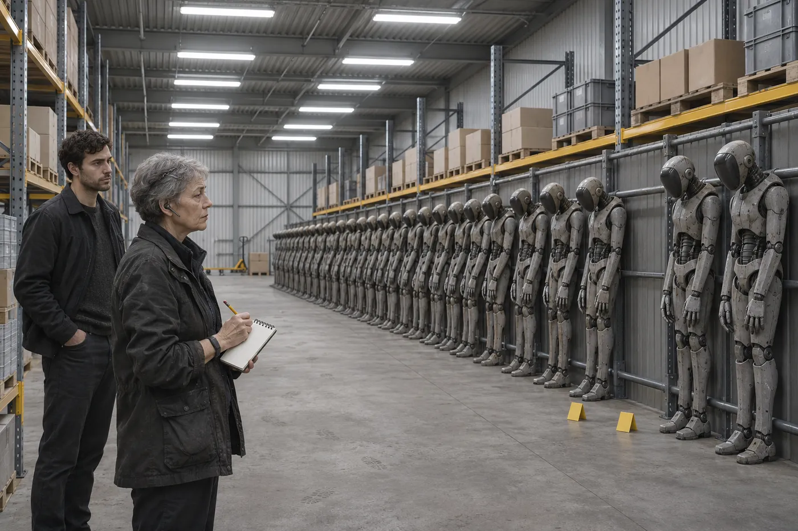

# 3. V normě

*Brno, Kounicova a logistický park Tuřany-jih. Čtvrtek 18. října 2074.*

Kapitánka Jana Brožová zaparkovala na dvoře ředitelství v sedm čtyřicet a ještě s rukou na klíčku si vložila do úst lékořicovou pastilku. Bylo to první, co ráno dělala, a jediné, co z kouření zbylo. Patnáct let bez cigarety. Patnáct let s černým jazykem.

„Dobré ráno,“ řekl Ota v levém uchu. Pravé měla volné. Vždycky. „Máte nový případ z noční směny. Mám začít?“

„Začni.“

„Logistický park Tuřany-jih, firma Lantor Logistik, hala B7. Muž, dvacet devět let, Tárik Hamdí, egyptský státní příslušník, humanitární ochrana udělena v roce 2073. Bydliště ubytovna v Komárově. Nalezen dnes v 5:46 robotem ostrahy. Mrtvý.“ Ota měl hlas, jaký mívají úředníci na matrice: suchý, zřetelný, bez spěchu. Pojmenovala ho po otci a otec takhle nemluvil, ale někdy, když Ota řekl *mrtvý* přesně stejně jako *muž*, otce v něm slyšela. „Model bezpečnosti práce inspektorátu událost klasifikoval jako pracovní úraz. Oběť byla přimáčknuta robotem k regálu. Robot je vyřazený k repasi, bez bezpečnostního jádra. Ve 23:07 proběhl v parku výkyv napětí; model předpokládá vadný restart.“

„A proč to máme my?“

„Ze dvou důvodů. U oběti byla nalezena nelegální rušička přímého spojení, v provozu. A robot bez jádra spadá do kategorie, kterou zákon automaticky předává výjimkám. Tělo je zatím na místě. Požádal jsem o to.“

Brožová se na sedadle otočila, jako by se mohla Otovi podívat do obličeje. „Ty jsi požádal?“

„Vaším jménem, podle vašeho stálého pokynu z dubna 2069. *Chci vidět místo dřív, než se na něm něco pohne.*“

Ten pokyn tam opravdu měla. Ona na něj zapomněla, Ota ne.

„Dobře,“ řekla. „Kdo tam je?“

„Výjezdová skupina od šesti. Soudní lékařka. Inspektorka bezpečnosti práce. Za Lantor právní oddělení a vedoucí směny.“

Vystoupila z auta. Ráno bylo umyté a studené. Na dvoře stály kaluže velké jako rybníčky a v nich se zrcadlilo modré nebe.

*

Na chodbě ve třetím patře ji zastavil plukovník Šindelář. Držel kelímek s kávou oběma rukama, jak to dělal, když byl nervózní, a byl nervózní pořád.

„Jano. Tuřany už máš?“

„Mám.“

„Lantor volal v sedm. Generální ředitel osobně. Velmi zdvořile.“ Šindelář upil. „Je to nehoda. Model to říká, inspektorát to říká. Podívej se tam, ať je to čistý, a do pátku to podepiš.“

„Když to bude nehoda.“

„Bude to nehoda.“ Podíval se na ni přes okraj kelímku. „Jano. Lantor má v kraji čtyři tisíce lidí. Lidí, ne robotů.“

„Vím, Martine.“

Vaněk už čekal u jejích dveří, v bundě, se dvěma kávami. Jednu jí podal. Bylo mu dvacet osm, byl rychlý, chytrý a slušný a věřil statistice tak, jak její otec věřil Bohu, totiž bez potřeby o tom mluvit.

„Model bezpečnosti dává nehodě devadesát jedna procent,“ řekl. „Rušička je divná, ale řidiči je nosí. Nechtějí, aby je firma sledovala na pauze.“

„Na pauze v jedenáct v noci v hale, kde nemá co dělat?“

Vaněk otevřel ústa a zase je zavřel. „Dobře. Jedeme?“

*

Řídila sama. Stará služební škodovka měla volant a Brožová ho používala, kdykoli jí to zákon dovolil, což bylo ve městě skoro všude a na dálnici skoro nikde. Vaněk seděl vedle ní s rukama v klíně a díval se na její ruce na volantu se zdvořilou fascinací, s jakou se mladí lidé dívají, když starší člověk píše tužkou.

„Proč to neřídí ono?“ zeptal se, jako pokaždé.

„Protože to umím.“

„Ono to umí taky.“

„Proto.“

Brno po bouři vypadalo, jako by se probralo z horečky. Na chodnících ležely utržené větve, v Komárově stála voda v nízkých ulicích a mezi auty po ní chodili roboti údržby s čerpadly. Podjezd na Tuřance byl uzavřený. Navigace je vedla objížďkou přes kopec a odtamtud bylo vidět dolů: hasičské auto, hadice, odtahovka a na ní malé šedé auto s rozbitým oknem spolujezdce, ze kterého ještě kapalo.

„Tady,“ řekl Vaněk a ukázal bradou. „To je všude. V noci tu někdo vytáhl ženskou z auta pod vodou a oživil ji. Než přijela záchranka, zmizel. Nechal jí tam jen záchrannou fólii.“

„Kdo?“

„Nikdo neví. Ona taky ne. Média mu už vymyslela jméno.“ Vaněk se usmál. „Anděl z Tuřanky.“

Brožová sledovala šedé auto na odtahovce, dokud nezmizelo za kopcem. Někdo v té bouři vlezl do vody, rozbil okno a zachránil člověka a pak utekl. Lidé, kteří utíkají od dobrých skutků, mívají důvod. Nemusí být špatný.

Na hranici logistického parku se volant pod jejíma rukama uvolnil a zajel do palubní desky.

*Automatizovaná zóna. Řízení převzato.*

Vaněk se tvářil, že se nesměje.

*

Hala B7 byla zvenku šedá krabice velká jako tři fotbalová hřiště, bez oken, s číslem přes dvě patra. Uvnitř svítila světla pod střechou, bílá a ostrá, a v tom světle vypadalo všechno menší a obyčejnější, než by to vypadalo v noci. Regály. Kolejnice. Paleta s krabicemi, na které někdo nechal rukavici.

U bočního vchodu stálo šest robotů v dokovacích stáních. Dva z nich už byli odpojení a pracovali, nosili bedny k rampě s tou klidnou, trochu váhavou opatrností, jakou mají stroje, když jsou kolem lidé. Jeden z nich před Brožovou ustoupil a modré světlo na hrudi mu krátce zablikalo na pozdrav.

Ve dveřích ležel na zemi dřevěný klínek v průhledném sáčku s číslem.

Čekali na ně tři lidé.

Inspektorka bezpečnosti práce Ing. Jitka Mrázová byla drobná, v zeleném plášti, s tabletem přitisknutým k hrudi jako štít. Za Lantor tam stála Mgr. Veronika Šustrová, právnička, vysoká, v tmavém kabátě, s drobným stříbrným nosičem za uchem a s pohledem, který si všechno pamatoval. A muž v reflexní vestě Lantoru, s papírovým kelímkem v každé ruce.

„Daniel Pešek,“ řekl a podal Brožové jeden z kelímků dřív, než mu stačila podat ruku. „Vedoucí směny. Promiňte, je to z automatu, ale je horká. Vypadáte, že jste nesnídala.“

„Nesnídala jsem.“ Vzala si ho. Káva byla hrozná a opravdu horká.

Peškovi mohlo být něco přes čtyřicet. Měl unavené šedé oči, strniště, které mu ráno nikdo nepřipomněl oholit, a na zápěstí dětskou gumičku do vlasů s plastovou jahodou. Brožová se na ni podívala o vteřinu déle, než bylo zdvořilé, a on si toho všiml. Usmál se, trochu provinile.

„Od dcery,“ řekl. „Včera večer mi to navlékla na ruku, abych nezapomněl, že ji dnes v pět vyzvedávám z rehabilitace. A pak jsem zapomněl, že to na ruce mám.“

„Kolik jí je?“

„Dvanáct. Tváří se na dvacet.“ Zase se usmál, unaveně. „Ostraha mě vzbudila v šest. Jsem tu od dvaceti minut po. Řekněte, co potřebujete, a já vám to ukážu.“

*

Tělo bylo vzadu, v zóně R.

Brožová šla uličkou mezi regály s Vaňkem za zády a s Otou v uchu a dívala se. Na zem. Na regály. Na zelené piktogramy nad uličkami, které teď ve světle nebyly k ničemu. Ota jí potichu hlásil, co už výjezdová skupina zajistila. Otisky obuvi na betonu, příliš mnoho a příliš rozmazané, voda z mokrých podrážek. Klínek u dveří. Rušička v pravé kapse bundy oběti, v provozu do 6:31, kdy ji technik vypnul. Ve vnitřní kapse karta dopravce, klíče od dodávky a dvě datle zabalené v papírovém ubrousku. Levá kapsa prázdná. Nosič oběti, funkční.

„Paměť nosiče?“ zeptala se Brožová tiše.

„Šifrovaná. Správcem je podle registru sestra oběti v Egyptě. Žádost o výřez podám dnes. Cizí jurisdikce, soud a správce; počítejte s týdny.“ Ota se odmlčel. „A podle veřejného nastavení měla oběť od dubna zapnutý režim bez paměti pro všechno kromě kalendáře a zdraví.“

„Proč by si řidič vypínal paměť?“

„Nevím. Je to legální. Dělá to asi sedm procent populace, zpravidla kvůli soukromí.“

Na konci uličky stála řada robotů k repasi. Brožová se před nimi zastavila. Ve světle nebyli strašidelní. Byli smutní. Šedé, poškrábané stroje, opřené zády o kolejnici, s hlavami svěšenými dopředu, s tmavými plochami místo tváří. Mezi nimi byla jedna mezera. Na podlaze v ní ležely dvě žluté značky s čísly.

Za mezerou, v uličce u posledního regálu, byl ten, co chyběl.

Brožová se dívala dlouho. Viděla za dvacet let u kriminálky hodně mrtvých, a tohle nebylo nejhorší. Bylo to jen velmi tiché. Robot stál nakloněný k regálu, rukama svíral ocelovou příčku vlevo a vpravo a mezi jeho hrudí a příčkou visel mladý muž v šedé bundě. Hlava přes příčku. Jedna ruka podél regálu. Vypadalo to skoro něžně, jako objetí zezadu. Právě to bylo nejtěžší.

Na rameni robota stálo bílou šablonou *DR-14*.

U těla klečela soudní lékařka, žena kolem padesáti s copem pod čepicí, a něco diktovala svému nosiči. Vedle ní technik v kombinéze, s brýlemi posunutými na čelo, si prohlížel robota bez úcty a se zájmem, jako mechanik rozbitý motor.

„Radim Sedláček,“ představil se, aniž by vstal. „Robotika. Má nulu. Baterie úplně vybitá, klouby drží na mechanických brzdách. To je pojistka, aby se stroj bez proudu nesložil na zem. Takže drží, jak stál, když mu došla šťáva.“

„Dá se odsunout?“

„Rozpínákem. Hasiči nám půjčili. Čekali jsme na vás.“

Brožová přistoupila blíž. Lékařka jí uvolnila místo.

Tárik Hamdí měl tvář bez výrazu. Oči otevřené. Ústa taky, trochu, jako by chtěl ještě něco říct a nestihl to. Ruka, která visela podél regálu, byla hubená, s mozoly mechanika na prstech, s černým olejem zarytým kolem nehtů, který žádné mýdlo nevezme. A na zápěstí hodinky.

Staré. Kovové pouzdro, ošoupané do měkka, kožený řemínek popraskaný na ohybech. Sklíčko bylo prasklé křížem, jedna prasklina od kraje ke kraji a druhá napříč, a pod ním se ručičky zastavily.

Za šestnáct minut jedenáct.

„Hodinky,“ řekla Brožová.

„Mechanické, s ručním nátahem,“ řekl Ota. „Odhadem sedmdesát až osmdesát let staré. Ukazují 22:44. Starožitný mechanismus, údaj o čase je nespolehlivý. Mohly se zastavit nárazem, ale stejně dobře už dříve, pokud nebyly natažené, nebo mohly jít špatně dlouho předtím.“

Brožová vytáhla z kapsy zápisník. Malý, kroužkový, s tužkou zastrčenou ve spirále. Vaněk to nekomentoval, zvykl si, a ona mu za to byla vděčná. Napsala: *22:44?*

„Čas smrti?“ zeptala se lékařky.

„Mezi desátou a půlnocí. Teplota, ztuhlost, skvrny.“ Lékařka si stáhla rukavici. „Model to zužuje na 23:05, plus minus čtyřicet minut. Já bych řekla spíš dřív než později, ale to je pocit, ne údaj. Příčina smrti nejspíš udušení stlačením hrudníku. Žebra má na kaši. Řeknu víc po pitvě.“

„Výkyv napětí byl ve 23:07,“ řekla inspektorka Mrázová za nimi. Přišla tiše. „Sedí to.“

„Sedí to,“ řekla Brožová. „A co tu dělal v jedenáct v noci?“

„Měl platnou kartu dopravce s nočním přístupem,“ řekla právnička Šustrová. „Dopravce je náš subdodavatel. Pan Hamdí u něj jezdil dva roky. Co tu dělal v tu hodinu, nevíme. Žádná nakládka na něj v systému nebyla.“

„Uvolněte ho,“ řekla Brožová Sedláčkovi.

*

Trvalo to dvacet minut. Rozpínák byl hydraulický, oranžový, s čelistmi jako zobák, a Sedláček ho zasunul mezi robotovu ruku a příčku regálu a pumpoval, a kov vrzal a ruka povolovala po milimetrech. Pak druhá ruka. Dva policisté z výjezdovky drželi tělo zezadu, aby nespadlo, a jeden z nich se díval do stropu.

„Divný,“ řekl Sedláček, zatímco pumpoval. Mluvil napůl k sobě, ruce měl plné práce. „Podle vaší inventury měl v devět večer čtyři procenta.“ Kývl směrem k Peškovi, který stál opodál s kelímkem.

„Inventura běží v devět,“ řekl Pešek. „Jako každý den.“

„Se čtyřmi procenty by po restartu lezl do doku. To mají v sobě natvrdo, v řídicí desce baterie, jádro nejádro. Doky jsou támhle u zdi.“ Sedláček ukázal bradou za sebe, na opačnou stranu, než stál robot. „Tenhle šel od nich.“

„Bez jádra nikdo neví, co udělá,“ řekla Mrázová. „Proto se k nim lidé nesmějí přibližovat. Proto jsou v uzavřené zóně.“

„No jo,“ řekl Sedláček a pumpoval dál. „Bez jádra je možný všechno.“

Druhá ruka povolila. Robot se zhoupl dozadu na zablokovaných kloubech a zůstal tak stát, nakloněný, jako by se zarazil uprostřed kroku. Policisté položili Tárika Hamdího na fólii na zem. Lékařka se nad něj sklonila znovu.

Brožová si do zápisníku napsala pod *22:44?* další řádek. *4 %.* Zvedla oči k Peškovi. Pešek se díval na mrtvého a třel si dlaní obličej, od čela dolů, pomalu, jak to dělají lidé, kteří spali tři hodiny.

„Kdybych šel tou uličkou,“ řekl tiše. „Včera večer. Kdybych šel tudy, a ne kolem.“

Nikdo mu neodpověděl.

*

Na obchůzku se ho zeptala u automatu na kávu, protože tam stál a protože tam bylo trochu soukromí. Vaněk zůstal s technikem. Šustrová stála deset kroků od nich a dělala, že čte něco na nosiči.

„Oto,“ řekla Brožová. „Otisky.“

„Dokovaní roboti u bočního vchodu drží přímé spojení i v nabíjení,“ řekl Ota. Mluvil nahlas, z jednotky v náprsní kapse, aby ho Pešek slyšel. Tak to měla nastavené pro rozhovory, které měly mít svědky. „Lantor nám jejich záznam vydal dobrovolně jako provozní data. Ve 22:29 rušení přímého spojení, čtyřicet sekund. Pravděpodobně oběť s rušičkou prošla kolem doků. Od 22:31 do 22:52 služební nosič Lantoru, přidělený panu Peškovi. Od 23:51 do 23:58 veřejný nosič, základní model ze série, kterou vydávají přijímací střediska ministerstva vnitra žadatelům o mezinárodní ochranu. Totožnost majitele lze zjistit jen soudním příkazem.“

„To jsem byl já,“ řekl Pešek. „Mezi půl jedenáctou a jedenáctou.“

„Co jste tu dělal?“

„Obchůzku. Dělám ji, kdykoli je bouřka. Ráno je pak méně práce.“ Pokrčil rameny. „Rampy, odvodnění, čerpadla. Na jižním konci, v technické chodbě, vždycky teče. Byl jsem tam a pak u ramp. Sem dozadu jsem nešel. Zóna R je uzavřená, není tam co hlídat.“

„Kamery?“

„Na nákladových vratech a na rampách, ven, na tahače. Uvnitř nic.“ Pešek se pousmál. „Ve skladu nejsou lidi, tak nejsou kamery. Máme to ve smlouvě s odbory ještě z padesátých let. Roboti mají oči svoje.“ Ukázal kelímkem směrem k zóně R. „Tihle nemají nic.“

„Rušení ve 22:29 jste nezaznamenal?“

„Ne. Přišel jsem až po něm, ne?“ Pešek se zamyslel. „Nosič mi pípne, když ztratí spojení s flotilou. Celý večer nepípl. Ale já byl na druhém konci haly.“

Brožová kývla. Hala byla velká a rušička levná. Takové mívají dosah na pár desítek metrů.

„Znal jste ho? Pana Hamdího?“

Pešek zavrtěl hlavou. „Řidiče nerozeznám. Jezdí jich sem desítky, většinou ani nevylezou z kabiny. Kartu načte rampa, ne já. Je mi ho líto. Je to něčí kluk.“

Nosič mu zavibroval. Omluvil se pohledem, odvrátil se a řekl tiše: „Ano, zlato. Ne, dneska ne. Táta přijde v pět, slibuju.“ Hlas se mu při tom změnil, zjemněl, a ramena mu klesla. Když se otočil zpátky, byl zase vedoucí směny.

„Ještě něco?“

„Zatím ne. Děkuju vám za kávu.“

„Byla hrozná.“

„Byla,“ řekla Brožová.

*

K bočním dveřím šla sama.

Stála ve dveřích, v průvanu, který táhl z parkoviště, a dívala se na sáček s klínkem, který technik ještě neodnesl. Obyčejný kus dřeva, seříznutý do ostrého úhlu, ohlazený rukama. Takový si člověk nevyrobí kvůli jedné noci. Takový nosí v kapse dlouho.

Dveře měly číselný zámek. Tárik Hamdí měl kartu a kód, nemusel si podkládat nic. Podložil dveře, aby zůstaly pootevřené. Pro někoho, kdo kód neměl.

Pro někoho, kdo přišel ve 23:51.

„Oto. Ten veřejný nosič vešel těmi dveřmi?“

„Otisk začíná u doků nejblíž těmto dveřím. Jiný vchod v tom čase otevřen nebyl.“

„Takže na něj čekal.“

„To je jedno z možných vysvětlení,“ řekl Ota. „Pravděpodobné.“

Brožová se ohlédla do haly. Od dveří k zóně R to bylo sto dvacet metrů rovně a pak doleva. Tárik Hamdí přišel ve 22:29, podložil dveře a šel dozadu, do uzavřené zóny, kde neměl co dělat, a tam čekal na člověka, který dorazil o víc než hodinu později. Ten člověk byl uvnitř sedm minut. Dost dlouho, aby našel mrtvého. Model kladl smrt na 23:05, plus minus čtyřicet minut. I v nejzazším případě byl Tárik Hamdí mrtvý už šest minut, když ten člověk vešel. Nebo se model mýlí o čtyřicet šest minut?

Napsala si do zápisníku: *Klínek – pro koho?* A pod to, menším písmem: *Kdo přijde v bouři pěšky?* Otisk veřejného nosiče začal a skončil u dveří; žádné auto, žádný vůz z parku. Kdo jde v takové noci pěšky přes pole k letišti, ten buď nemá na vůz, nebo nechce, aby o něm vůz věděl.

*

Do jedné prošli halu ještě jednou celou. Doky. Rampy. Technickou chodbu na jižním konci, kde opravdu teklo, kde na betonu stály kaluže a čerpadlo v rohu ještě pořád hučelo. Šustrová je doprovázela a na každou otázku odpověděla přesně a ne o slovo víc. Záznamy příkazů flotily? Na soudní příkaz. Seznam zaměstnanců s přístupem do zóny R? Na soudní příkaz, jde o osobní údaje. Inventura robotů k repasi? Tu jim pošle hned, je to majetek firmy. Byla zdvořilá, rychlá a nepropustná jako dobře utěsněné okno.

„Vy si myslíte, že to nebyla nehoda,“ řekla Brožové u východu.

„Myslím si, že nevím, co tu dělal.“

„To je jiná otázka.“

„Je,“ řekla Brožová. „Ale je moje.“

*

V autě, které je z parku vezlo samo, otevřela zápisník. Dva řádky. *22:44?* *4 %.* Nic víc. Pod ně napsala: *Veřejný nosič 23:51–23:58. Žadatel. Kdo?*

„Oto,“ řekla. „Co si myslíš ty?“

„Pravděpodobnost nehody odhaduji na šedesát čtyři procenta. Cizího zavinění na třicet šest.“

Vaněk zvedl obočí. „Model bezpečnosti říkal devadesát jedna.“

„Model bezpečnosti práce neví o neznámém nosiči a nehodnotí rušičku,“ řekl Ota. „Já ano. Oběť přišla v noci bez plánované práce, s rušičkou, a sedm minut po ní, ještě před nálezem, byl v hale člověk, který odešel a nikomu nic neřekl. Kdo byl v hale sedm minut, téměř jistě viděl tělo. To zvyšuje pravděpodobnost cizího zavinění. Nemění to nic na tom, že nejlepší vysvětlení dostupných dat je výkyv napětí a vadný restart.“

„A hodinky?“

„Nezávislý údaj s nízkou spolehlivostí. Do odhadu jsem je zahrnul s malou vahou. Pokud chcete, mohu je nechat posoudit hodinářem.“

„Chci.“ Brožová zaklapla zápisník. „A připrav návrh na soud. Totožnost toho veřejného nosiče. Chci ho mít zítra.“

„Návrh bude hotový za čtyři minuty. Soud obvykle rozhoduje do čtyřiadvaceti hodin.“

Vaněk se opřel o opěrku. Venku ubíhaly haly. „Žadatel o ochranu,“ řekl. „V noci, v bouři, pěšky. Sedm minut u mrtvého a pak pryč, a nikomu nic. Jestli to nebyla nehoda, máme ho.“

„Jestli.“

„Jestli,“ souhlasil Vaněk. „Ale kdybych byl já ten model, taky bych se na něj díval.“

„Ty nejsi model.“

„Občas bych chtěl,“ řekl Vaněk. „Nemusejí pít kávu z automatu.“

Ota k tomu neřekl nic, což od něj bylo skoro vtipné. Pak řekl: „Plukovník Šindelář vám poslal zprávu. Mám ji přečíst?“

„Vím, co v ní je.“

„Ano,“ řekl Ota. „Tři slova.“

Auto vyjelo z automatizované zóny a volant se jí s měkkým cvaknutím vrátil do rukou. Brožová ho chytila, jako se chytá zábradlí, a vložila si do úst další pastilku. Za oknem ubíhala mokrá pole a za nimi podjezd na Tuřance, pořád uzavřený, s hasičským autem, které už balilo hadice.

Bylo pět minut po druhé. Do pátku zbýval den a půl.
