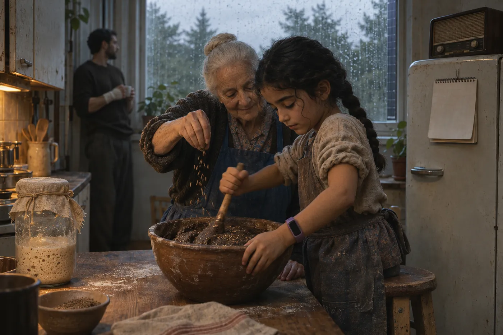

# 6. Neznámý zachránce

*Brno, Lesná a Komárov. Sobota 20. a neděle 21. října 2074.*

„Žito se nehněte,“ řekla Kroupová. „Žito se míchá. Kdo žito hněte jako pšenici, ten má pak na rukou lepidlo a v troubě cihlu.“

Nur stála na stoličce u kuchyňského stolu, s rukávy vyhrnutými nad lokty, a míchala vařečkou v hliněné míse. Těsto bylo tmavé, husté a lepkavé a vařečka v něm stála, když ji pustila. Kroupová jí přes rameno sypala hrst kmínu.

„Proč se nehněte?“

„Protože žito nemá lepek. Pšenice má v sobě takovou gumu, ta drží bubliny. Žito ne. Žito by se ti v troubě rozteklo jako kaše.“ Kroupová ukázala na sklenici na lince, ve které pod utěrkou bublal kvásek. „Proto kvásek. Kyselina to žito podrží. Bez kvásku žádnej žitnej chleba není, jenom placka.“

Júsuf seděl u okna na židli, kterou mu Kroupová přidělila, a díval se. Bylo devět ráno, sobota. Ruce měl ovázané a Kroupová mu zakázala na cokoli sahat, protože prý by jí do chleba nakrvácel. V kuchyni bylo teplo od trouby, která se rozpalovala, a vonělo to kmínem a kyselým těstem a čajem. Na lednici hrálo rádio.

Bylo to dobré ráno. Júsuf si to v duchu opakoval. Nur míchá těsto. Nur bude zdravá. Kroupová mu v pátek před policistkou nelhala, a přesto ho neprozradila. Policistka odešla a nevzala ho s sebou. Dnes je sobota a nikdo nepřijde.

*…a ještě zpráva z Brna,* řeklo rádio. *Petra Laštovicová, žena, kterou ve středu v noci neznámý muž vytáhl z auta v zaplaveném podjezdu na Tuřance, dnes ráno zveřejnila záznam z palubní kamery svého vozu. Prosí svého zachránce, aby se přihlásil. Podle jejích slov chce jen poděkovat. Na záznamu je vidět…*

Kroupová natáhla ruku k rádiu. Nedotkla se ho. Ruka jí zůstala viset ve vzduchu.

„Mimi,“ řekla Nur. „To video.“

„Je to záznam z auta pod vodou,“ řekl náramek. „Je v něm strach, ale dobře to dopadne. Chceš ho vidět?“

„Chci.“

Náramek se rozsvítil a promítl obraz na stůl, na moučnou desku vedle mísy. Malý obdélník, zrnitý, zelený.

Júsuf vstal. Nechtěl vstát a vstal.

Kabina auta. Kalná voda, zelenohnědá, a v ní žlutá skvrna stropní lampičky. Nahoře, u střechy, ženská tvář, bílá, s otevřenými ústy. Pak náraz. Obraz se otřásl. Druhý náraz. Třetí, a okno spolujezdce se rozpadlo na mrak drobných bílých kostiček, které se rozvířily ve vodě jako sníh v těžítku. Oknem dovnitř vnikla ruka. Rukáv tmavého kabátu, nafouklý vodou. Ruka hmatala, našla pás, sjela po něm dolů. Na vteřinu se dostala do světla lampičky. Na lokti rukávu, na tmavé látce, se objevil světlý ovál.

Pak tma, vír bublin a nic.

Obraz se změnil. Šum, vítr, vzdálená siréna. Černá obrazovka a přes ni bílé titulky. Zvuk byl z nosiče té ženy, nahraný, když ležela na zemi. Mužský hlas, zadýchaný, pomalý, s přízvukem, který Júsuf slyšel ve vlastních ústech každý den.

*Pomoc jede. Dýchejte. Jsou tady.*

Pak nemocniční pokoj. Žena na posteli, opřená o polštáře, s tmavými vlasy staženými dozadu a s náplastí na čele. Byla mladší, než si myslel. Mluvila pomalu, protože ji bolelo dýchání.

„Jmenuju se Petra Laštovicová. Ve středu v noci jsem se topila. Nevím, kdo jste. Neviděla jsem vám do obličeje. Mám jen tohle.“ Zvedla ruku a ukázala na kameru. „Ten rukáv. A váš hlas. Nevím, proč jste odešel. Je mi to jedno. Nemusíte se ničeho bát. Já vám jen chci poděkovat. Prosím.“

Obraz zhasl.

V kuchyni bylo ticho. Jen kvásek ve sklenici tiše bublal a trouba cvakala, jak se rozpalovala.

Nur stála na stoličce s vařečkou v ruce a dívala se na místo na stole, kde před chvílí svítil obraz. Na mouku. Nepodívala se na otce. Júsuf čekal, že se otočí. Neotočila se. Vařečka jí v ruce ztěžkla. Nur se sklonila nad mísu.

Kroupová se taky dívala na stůl. Dlouho. Potom zvedla oči k Júsufovi a Júsuf věděl, na co myslí. Na drobné rovné stehy, které na tom oválu udělala vlastníma rukama, s brýlemi na nose, při rádiu. Poznala je. Na zrnitém zeleném záznamu z auta pod vodou poznala svoje stehy.

„Hněteš málo,“ řekla Kroupová.

„Říkala jste, že se žito nehněte.“

„Tak mícháš málo. Míchej. Ať je to hladký.“

Nur míchala. Kroupová vypnula rádio.

*

Chleba šel do trouby v jedenáct. Nur seděla na zemi před sklem a dívala se dovnitř, jak těsto pomalu roste a praská na povrchu, a Mimi jí vyprávěla něco o bublinách. Júsuf stál u okna. Kroupová k němu přišla s utěrkou v rukou, jako by šla utírat parapet.

„Ten kabát,“ řekla potichu, „byste pár dní neměl nosit.“

„Ano.“

„Na tu záplatu se v Brně podívá každej druhej. Oni ji tam ukazujou každou hodinu. Chtějí vám dát medaili.“ Kroupová utřela parapet, který byl čistý. „Nechte si ho ve skříni. Mám po manželovi bundu. Bude vám krátká, ale je teplá.“

„Paní Kroupová. Včera…“

„Včera jsem nelhala,“ řekla. „Abyste věděl. Řekla jsem, co bylo. Jenom ne všechno.“ Podívala se na něj přes brýle. „To je rozdíl, kterej se v mým věku vyplatí znát. Vy ho znáte taky.“

Júsuf mlčel.

„A ta paní z kriminálky taky,“ dodala Kroupová. „Ta není hloupá. Ta je z doby, kdy policajti ještě něco uměli.“

Odešla k troubě. Nur se k ní otočila a zeptala se, kdy už to bude, a Kroupová řekla, že až to bude.

*

Večer seděl v kuchyni sám. Nur spala. Chleba ležel na lince, zabalený v utěrce, kulatý a tmavý, s prasklinou přes vršek, kterou Nur označila za zlomené srdce. Kabát byl na dně skříně, pod dekou.

„Pozná mě někdo?“ zeptal se asistenta. „Z toho videa.“

Asistent chvíli mlčel. Ne dlouho.

„Obličej na záznamu není. Rukáv s tou záplatou pozná, kdo vás v tom kabátě viděl. Hlas pozná, kdo vás slyšel mluvit česky. Je to málo lidí, ale pár jich je. Policie to ví i bez videa. Kapitánka Brožová to věděla v pátek.“

„Jak víš, že to věděla?“

„Řekla vám, ať se vám ty ruce dobře hojí,“ řekl asistent. „Slyšel jsem to. A slyšel jsem, jak jste se nadechl.“

Júsuf si prohlížel obvázané ruce.

Policistka ví. Azíz ví, že byl v hale. Rámí ho viděl běžet. Stará žena přes chodbu ví všechno a nic neříká. Jen on sám neví nic. Neví, proč Tárik přišel tak brzo. Neví, na koho čekal v té tmě, mezi regály, víc než hodinu před půl dvanáctou. Neví, proč měl ruku otevřenou a prázdnou.

A dokud to neví, je pro všechny ten, kdo tam byl.

„Tárik bydlel v Komárově,“ řekl. „Na ubytovně. Se Samím. Kuchař. Znám ho z léta.“

„Pan Hamdí měl veřejně uvedenou adresu ubytovny u Svitavy, za Mariánským náměstím,“ řekl asistent. „Spolubydlícího najdu, pokud chcete. Ale pan Nasr má podle veřejného nastavení zablokované zprávy od neznámých lidí. Jeho asistent vám nic nedoručí.“

„Půjdu tam.“

„Rozumím.“ Asistent se odmlčel. „Mohu vám poradit, jak s ním mluvit?“

Júsuf se zamračil. Mluvit uměl. S lidmi mluvil celý život, se zraněnými, s matkami, které hledaly děti, s otci, kteří nechtěli opustit střechu. S tím přece rada nebyla potřeba.

„Mluv,“ řekl.

„Panu Nasrovi zemřel před třemi dny člověk, se kterým bydlel dva roky. Policie u něj už byla. Lidé v takové situaci se obvykle víc bojí, než truchlí, a strach je dělá zavřené. Řekněte mu hned ve dveřích, kdo jste a odkud ho znáte. Neptejte se na nic, dokud nebudete sedět. A nechte ho sedět blíž ke dveřím než vy. Kdo se bojí, mluví snáz, když ví, že může odejít.“

Júsuf o tom přemýšlel. Pak kývl.

Byla to dobrá rada. Taková, jakou by mu dala Amal.

*

V neděli po poledni vystoupil z tramvaje na Mariánském náměstí. Měl na sobě bundu po panu Kroupovi, šedou, vatovanou, která voněla naftalínem a starou skříní. Rukávy mu končily nad zápěstím a byl z nich vidět obvaz. V ruce nesl Nuřin chleba zabalený v utěrce. Nur zůstala u Kroupové, u karet a u kvásku. U nich doma se do domu, kde někdo umřel, jídlo nosí. Tři dny se tam nevaří.

Komárov ještě nevyschl. Na omítce domů byla vidět hnědá čára, rovná jako podle pravítka, ve výšce kolen. Júsuf si ji přečetl jako vždycky. Tak vysoko voda stála. Tam stála nejdéle, a pak opadla a nechala tu čáru, protože bahno se usadí tam, kde se voda zastaví. Před domy ležely pytle s pískem a na chodníku stál robot s čerpadlem a pumpoval vodu ze sklepa do kanálu. Hadice se pod ním chvěla jako živá.

Ubytovna byla třípatrová, hnědá, se zamřížovanými okny v přízemí, a stála na konci ulice, kde začínala hráz Svitavy. Za ní rostly topoly, vysoké, ještě skoro zelené, a nad nimi táhly mraky.

Samí bydlel ve druhém patře. Júsuf zaklepal.

Dveře se otevřely na škvíru. Bezpečnostní řetízek. Ve škvíře půl obličeje, hubeného, s červenýma očima a s neoholenou bradou.

„Jsem Júsuf,“ řekl arabsky. „Z Rašídu, od Mahmúdovy dílny u přístavu. V létě jsme se viděli u Azíze. Vařil jsi tam mulúchíju a já ji pochválil, a tys řekl, že je to málo slané.“

Samí na něj zíral. Pak uviděl chleba v utěrce.

„To je pro tebe,“ řekl Júsuf. „Upekla ho moje dcera.“

Řetízek zacinkal.

*

Pokoj byl malý. Dvě postele, dvě skříňky, okno do topolů. Jedna postel byla rozestlaná, druhá holá, jen matrace, bez povlečení. Na skříňce u holé postele stála sklenice s vodou a v ní seděla tužka. Nic víc.

Samí si sedl na svou postel, na kraj, blíž ke dveřím. Júsuf si sedl na židli u okna. Asistent mlčel.

Samímu bylo třicet, byl hubený a na předloktí měl staré popáleniny od plotny, bílé a lesklé. Držel chleba v klíně jako dítě a nejedl ho.

„Říkají, žes ho zabil,“ řekl nakonec. Potichu. Do chleba.

„Kdo to říká?“

„Rámí. Byl tu včera. Ptal se, jestli jsi tu nebyl a co ti říkám.“

Júsuf se předklonil, lokty na kolenou. Ruce mu visely mezi koleny, obvázané.

„Přišel jsem pozdě,“ řekl. „Tramvaj stála. Když jsem přišel, byl už mrtvý. Robot ho držel u regálu, hrudníkem, takhle.“ Ukázal to rukama. „Byl chladný. Nedýchal dlouho, Samí. Vím, jak dlouho, vím to z vody. Nemohl jsem mu pomoct.“ Nadechl se. „Přísahám na svoji dceru.“

Samí se na něj dlouho díval. Pak sklopil oči k chlebu a odlomil z něj kousek kůrky a držel ho v prstech.

„Natáhl si hodinky,“ řekl. „V devět. Jako každý večer. Já vařil čočku. Stál u okna, tady v kuchyňce na chodbě, a točil tou korunkou tam a zpátky, a já se ani nedíval, protože to dělal každý večer. Dva roky. Pak řekl, že jde.“

„V devět?“

„V půl desáté. Ptal jsem se ho, proč tak brzo, když nakládáte v půl dvanácté. A on řekl, že má předtím schůzku.“

Júsuf se nehýbal.

„S kým?“

„S někým z firmy. Tak to řekl. *S někým z firmy, co to tam řídí.*“ Samí pokrčil rameny. „Jméno neřekl. Nikdy neříkal jména. A že pak s tebou naloží, jak to Azíz chtěl, aby nikdo nic nepoznal. A ráno půjdou na policii.“

„Kdo půjde?“

„On a ten člověk z firmy. Oba.“ Samí se krátce, ošklivě zasmál. „Chtěl skončit, Júsufe. Od jara. Říkal, že nechce vozit ty roboty do smrti. Že se to dá skončit, když se to udělá chytře. Zkopíroval si něco z firmy, nějaké záznamy, celé měsíce, na klíč. Takový malý, placatý.“ Ukázal mezi palcem a ukazováčkem. „Ukazoval mi ho. Nosil ho pořád u sebe. I spát s ním chodil, pod polštářem. Říkal, že když půjdou dva a budou mít tohle, tak jim policie uvěří.“

„Řekl jsi to policii?“

„Ne.“ Samí zavrtěl hlavou. „Byl tu policajt. Mladý, slušný. Ptal se, jestli měl Tárik nepřátele. Ukazoval mi na nosiči seznam věcí, co u něj našli. Rušičku. Kartu. Klíče od dodávky.“ Samímu se zlomil hlas. „Moje datle. Dal jsem mu je na cestu. Ptal se mě, jestli jsou ode mě, a já řekl, že ano, a pak jsem musel jít na záchod, aby neviděl, jak brečím.“

„A klíč?“

„Klíč tam nebyl.“ Samí zvedl oči. „Na tom seznamu nebyl. Datle tam byly. Klíč ne.“

Júsuf viděl ruku visící podél regálu. Prsty pootevřené. Prázdné.

„Měl ho u sebe,“ řekl Samí. „Já vím, že ho měl u sebe. Viděl jsi ho? Měl ho v ruce?“

„Ne,“ řekl Júsuf. „Ruku měl otevřenou.“

Samí nerozuměl. Júsuf to nevysvětloval. Sám tomu ještě nerozuměl. Jenom věděl, že ve čtvrtek ve tři ráno, nad umyvadlem, s pinzetou v ruce, se mu ta ruka vracela pořád dokola a on nevěděl proč. Teď to věděl. Ve vodě to viděl mnohokrát. Matky, které držely děti. Muži, kteří drželi peněženky, provazy, kliky dveří, a drželi je i potom, když už nedýchali, a on jim musel prsty rozevírat jeden po druhém. Ne vždycky. Ale Tárik by tu věc nepustil. Spal s ní pod polštářem.

Někdo mu tu ruku otevřel.

„Samí. Ví o tom Azíz? O policii? O klíči?“

„Nevím.“ Samí se zachvěl. „Tárik se ho bál. Říkal, že Azíz nesmí vědět nic, dokud to nebude hotové. Ale Azíz ví hodně věcí, Júsufe. Azíz ví věci, které mu nikdo neřekl.“

Za oknem, dole na ulici, zabouchly dveře auta.

*

Samí byl u okna dřív než on. Odhrnul záclonu o prst a hned ji pustil.

„Rámí,“ řekl. „A Hamdan. Jdou sem.“

Júsuf nahlédl za záclonu. Dole u chodníku stálo tmavé auto a od něj šli k ubytovně dva muži. Rámí v černé bundě, s rukama v kapsách. Druhý starší a širší, s holou hlavou. Ten se nedíval na dveře. Díval se nahoru, do oken.

„Viděli tě jít dovnitř,“ řekl Samí. Hlas mu přeskakoval. „Hlídají mě, Júsufe. Od čtvrtka tu někdo pořád je. Kdyby tě tu našli…“

„Je tu jiný východ?“

„Kuchyňka. Na konci chodby. Dveře na dvůr k popelnicím.“ Samí ho strkal ke dveřím pokoje. „Dvůr je zavřený, branka k řece je na zámek. Ale u popelnic je zeď. Přes zeď do zahrádek, ze zahrádek na hráz.“

„Pojď se mnou.“

„Mě nechají. Já tu bydlím.“ Samí otevřel dveře na chodbu. „Jdi.“

Júsuf šel.

Chodba. Linoleum. Zápach cibule a saponátu. Na schodišti dole zaduněly kroky, dvoje, rychlé. Kuchyňka na konci chodby, malá, s plotnou a s oknem do topolů, a Júsuf ji minul a nepodíval se na okno, u kterého si Tárik natahoval hodinky. Zadní dveře. Kovové schody dolů, kluzké od mokrého listí. Dvůr.

„Mám přivolat policii?“ řekl asistent rychle.

„Ne.“

„Rozumím. Zeď je vpravo, za kontejnery. Nahoře je sklo.“

Bylo. Stará zeď z cihel, vysoká přes dva metry, a na jejím vrcholu zalitá do betonu řada střepů, zelených a hnědých, z lahví. Někdo ji tak kdysi postavil proti zlodějům a nikdo ji pak nezboural.

Za ním bouchly dveře kuchyňky.

Júsuf vylezl na kontejner. Plast pod ním zapraskal. Shodil z ramen bundu pana Kroupy, přehodil ji přes střepy, opřel se o ni oběma rukama a vytáhl se nahoru. Dlaně mu vzplály, obvazy se svezly. Střepy se zakously do vaty, ne do něj. Přehodil nohu, druhou, a seskočil.

Bundu stáhl za sebou. Roztrhla se. Nechal ji roztrhnout.

Zahrádky. Záhony v bahně, zplihlé rajčatové keře, kůlna, plechová vana. Rovně přes ně k náspu hráze.

„Doleva po hrázi,“ řekl asistent. „Za tři sta metrů je lávka.“

Za zdí někdo zakřičel arabsky. Pak rána, jak někdo skočil na kontejner.

Júsuf vyběhl na hráz.

Svitava byla pořád vysoko, hnědá, rychlá, a nesla větve. Pěšina po koruně hráze byla rozbahněná a boty mu klouzaly. Za sebou slyšel dusot. Ohlédl se jen jednou. Rámí byl na hrázi, sto metrů za ním, a běžel. Byl mladší. Byl rychlejší.

Lávka. Úzká, betonová, s kovovým zábradlím, přes řeku na druhý břeh. Júsuf k ní dobíhal, když na jejím druhém konci uviděl holou hlavu. Hamdan. Ten šel kolem po ulici a čekal tam.

Mezi nimi lávka. Za ním Rámí. Pod ním řeka.

Júsuf se nezastavil. Sjel po svahu hráze dolů, po zadku, po mokré trávě, a vešel do vody.

*

Studená. Ještě studenější než ve středu. Sevřela mu stehna, břicho, hruď a vyrazila mu dech. Júsuf ho nechal jít. Nadechl se pomalu, nosem, a nechal chladový šok přejít, jak přechází vždycky, když se mu člověk nebrání.

Proud ho chytil a táhl. Nebránil se ani tomu. Nechal se nést pět metrů, šest, až k pilíři lávky, a tam se zachytil betonu a přetáhl se na jeho druhou stranu. Po proudu.

Za pilířem byla voda jiná. Klidná, vracela se, točila se pomalu zpátky proti proudu. Tak to voda dělá za každou překážkou, za kamenem, za pilířem, za tělem. Kdo to neví, ten se bojí, že ho strhne. Kdo to ví, ten se za pilířem může postavit jako za dveřmi. Júsuf stál po prsa ve vodě, zády k betonu, v tom víru, a nad ním byla lávka.

Kroky. Nad hlavou. Pak druhé, z druhé strany.

„Kam šel?“ Rámí, zadýchaný.

„Neviděl jsem ho. Neviděl jsem nikoho.“ Hamdanův hlas byl hlubší, klidnější. „Do zahrádek?“

„Byl na hrázi. Viděl jsem ho na hrázi.“

Ticho. Jen řeka. Júsufovi se začaly třást čelisti. Zaťal zuby, aby necvakaly.

„Tak skočil do řeky,“ řekl Hamdan. „Ve vodě je jako doma, ne? To říkal Azíz.“

„V tomhle se utopí.“

„Tak se utopí.“ Hamdan si odplivl. Plivanec dopadl do vody kousek od pilíře a proud ho odnesl. „Azíz chtěl, ať ho přivedeme. Ne ať ho honíme po Komárově za bílého dne. Nějaká žena v zahrádkách na nás volala, žes jí přeskočil plot. Do deseti minut tu bude hlídka.“

„A co Azízovi řeknu?“

„Že víme, kde bydlí,“ řekl Hamdan. „To on ví taky.“

Kroky odešly. Oboje, stejnou stranou.

Júsuf počítal. Do šedesáti, pak znovu. Pětkrát. Nohy přestal cítit při třetí šedesátce. Ruce ho přestaly pálit při čtvrté, a to bylo horší znamení než bolest. Při páté se pustil pilíře, nechal se odnést kousek dolů, ke břehu pod vrbami, a vylezl po kořenech na trávu.

Klečel tam a třásl se. Z bundy, kterou nesl zmuchlanou v ruce, tekla voda. Obvazy byly pryč. Dlaně krvácely znovu, slabě, rozmáčené.

„Slyším, že se třesete,“ řekl asistent. „Nejbližší teplé místo je zastávka tramvaje na Mariánském náměstí, šest set metrů, je tam vyhřívaná čekárna. Tramvaj jede za jedenáct minut. Pane Mansúre, mohu vám zavolat vůz.“

„Ne.“

„Pak jděte rychle. Pohyb vás zahřeje.“

Šel rychle.

*

Kroupová přivedla Nur v sedm. Júsuf už byl osprchovaný a převlečený a ruce měl ovázané novou gázou z krabičky od robota z Bohunic. Bunda pana Kroupy visela v koupelně přes vanu, tam, kde ve čtvrtek visel kabát. Kroupová ji uviděla otevřenými dveřmi a nic neřekla. Podívala se na roztržený rukáv, na vatu, která z něj trčela, a pak na Júsufa.

„Zítra vám ji zašiju,“ řekla jen. „Stejně byla k ničemu.“

Nur byla celý večer tichá. Snědla večeři. Vyčistila si zuby. Řekla mu dobrou noc ve dveřích pokoje, rychle, a zavřela. Ne docela. Nechala škvíru, jako vždycky.

Júsuf seděl v kuchyni. Na lince ležel chleba. Polovina zbyla. Druhou polovinu nechal v Komárově, u Samího v klíně.

S chlapem z firmy, co to tam řídí.

Kdo to tam řídí? Někdo, kdo má klíče, kód, roboty. Někdo, kdo tam smí být v noci. Někdo, s kým chtěl Tárik jít na policii. A kdo možná vzal mrtvému klíč z ruky.

Jednotka na stole zavibrovala.

„Nur vám píše,“ řekl asistent. „Přes Mimi.“

Na displeji svítil jeden řádek.

*Tati, to jsi ty?*

Júsuf se díval na ta slova a pak na dveře jejího pokoje, na škvíru, ve které bylo vidět slabé fialové světlo náramku. Byly to tři metry. Tři kroky přes předsíň. Mohl vstát, otevřít dveře, sednout si na kraj postele, jako si sedal v Rašídu, když se vrátil ze služby a ona ještě nespala, a říct jí to. Ano. To jsem já. Kabát se záplatou od paní Kroupové. Mohl.

Nevstal.

„Napiš jí,“ řekl tiše asistentovi. „Spi, habíbti. Zítra je škola.“

„Odesláno.“

Ve škvíře za dveřmi se fialové světlo na okamžik rozsvítilo jasněji. Pak zhaslo.
