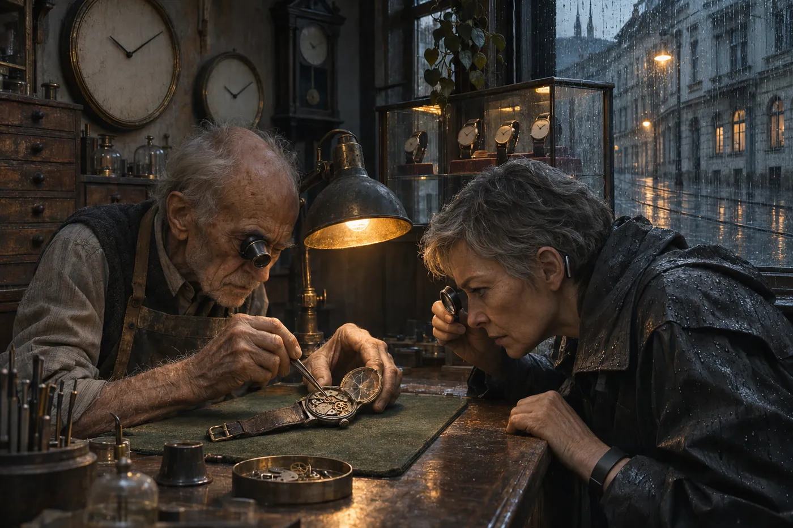

# 7. Hodinky

*Brno, Kounicova a Pekařská. Pondělí 22. a úterý 23. října 2074.*

Brožová ještě nestačila pověsit kabát a Ota už mluvil. „V neděli ve 14:20 přijala linka oznámení z Komárova. Zahrádkářská kolonie u Svitavy. Oznamovatelka viděla dva muže přelézt zeď ze dvora ubytovny a honit třetího po hrázi. Hlídka byla na místě za devět minut. Nikoho nenašla.“

„Která ubytovna?“

„Ta, kde bydlel Tárik Hamdí.“

Brožová se zastavila s kabátem v ruce.

„Popis?“

„Oznamovatelka je starší paní, na dálku špatně vidí. Ten, koho honili, byl vysoký a měl šedou bundu, která mu byla malá. Řekla *cizinec*. Ti dva za ním taky. Jeden mladý, jeden s holou hlavou. Ten vysoký podle ní skočil do řeky. Hlídka prošla břeh až k jezu.“

Za oknem kanceláře pršelo, jemně, jak prší po velké bouři, když už nebe nemá sílu. Brožová pověsila kabát a sedla si.

Vysoký cizinec. Skočil do řeky, ve které po středě ještě tekla půlka Vysočiny. A nikdo ho nevylovil.

„Ať hlídka z Lesné projede dvakrát za noc kolem jeho domu,“ řekla. „Nic víc. Jen ať projede.“

„Zadám. Bez důvodu v záznamu?“

„Důvod je ochrana svědka v řízení o úmrtí. Napiš to tak.“

„Pan Mansúr není svědek.“

„Byl v hale. Je svědek, dokud nevím, co je víc.“

Ota zapsal. Pak řekl: „Mám také katastr. Byt v Komárově, který jako první kontaktní adresu uvedl pan Mansúr, pan Hamdí a dalších devět žadatelů, patří Azízovi Fahmímu. Padesát let, egyptský občan, trvalý pobyt ve Federaci od roku 2058. Živnost: zprostředkování práce a ubytování. V roce 2069 a 2072 prověřován pro lichvu a nelegální zaměstnávání cizinců. Nikdy obviněn. Svědci v obou případech odvolali.“

„Odvolali,“ řekla Brožová.

„Oba.“

„Předvolej ho. Jako pronajímatele oběti. Na zítra.“

*

Pitevní protokol přišel v devět. Soudní lékařka ho k tomu ještě řekla nahlas, z ústavu na Tvrdého, přes nosič, mezi dvěma pitvami, a bylo slyšet, jak si přitom myje ruce.

„Traumatická asfyxie. Hrudník stlačený zezadu proti příčce. Zlomená žebra třetí až osmé vpravo i vlevo, pohmožděné plíce. Drobné tečkovité krvácení v obličeji, na spojivkách, na krku. To dělá tlak, když krev nemá kam odtéct z hlavy.“ Voda přestala téct. „Obranné zranění skoro žádné. Odřenina na hřbetu pravé ruky a na zápěstí, pod hodinkami. Udeřil se o něco tvrdého, nebo ho to něco přimáčklo.“

„Čas?“

„Pořád mezi desátou a půlnocí. Jedl čočku, je napůl natrávená. To odpovídá jídlu tak hodinu, dvě před smrtí.“ Lékařka si odfrkla. „A než se zeptáte: ne, z čočky vám to na minuty neurčím. Žaludek nejsou hodiny. Každý tráví jinak, a když se člověk bojí, žaludek se zastaví úplně.“

„Bál se?“

„To z žaludku nevyčtu, paní kapitánko. Jen že mohl.“

Ota jí pak promítl na zeď rekonstrukci.

Udělal ji v noci. Model haly B7 v šedých plochách, regály jako hřebeny, řada robotů v zóně R. Postava Tárika Hamdího, průsvitná, modrá, stojí v uličce mezi regálem a řadou, zády k robotům. Časová osa dole. Ota ji pustil.

22:29, rušení u doků. Modrá postava jde halou dozadu a zastaví se. Pak dlouho nic. Postava stojí. Čeká. Ota čas zrychlil a čísla dole běžela.

23:07. Výkyv napětí. Na okamžik se rozblikala nouzová světla po celé hale. V řadě za postavou se jeden robot pohne. Nakloní se dopředu, udělá dva kroky, zvedne ruce. Vadný restart, řekl Ota. Bez jádra stroj neví, kde je člověk. Úchopový reflex. Ruce sevřou příčku regálu a mezi nimi a hrudí je modrá postava. Pak robotovi dojde energie a zůstane tak stát.

Bylo to čisté. Bylo to tak čisté, že by to podepsal každý.

„Sedí to na zranění,“ řekl Ota. „Sedí to na čas smrti podle modelu i podle lékařky. Sedí to na výkyv.“

„A na čtyři procenta?“

„Robot po restartu míří do doku. Vadný restart je ale vadný. Model inspektorátu s tím počítá jako s odchylkou.“

„A na to, že stál čtyřicet minut v uzavřené zóně a čekal?“

„Čekal na někoho, kdo neměl kód. Na pana Mansúra, který přišel ve 23:51.“

Brožová se dívala na modrou postavu u regálu. Stála tam v Otově hale celou dobu, od 22:29 do 23:07, a nehýbala se. Ota ji tak namaloval, protože nevěděl, co dělala. Nikdo to nevěděl. Byla to nejdelší a nejprázdnější část celé rekonstrukce. Osmatřicet minut, ve kterých člověk s rušičkou v kapse a s kartou dopravce stojí ve tmě a čeká.

„Oto. Kdy mi to dá ten hodinář?“

„Posudek je hotový. Pan Vavřín se ptal, jestli si pro hodinky přijdete osobně. Prý to lépe vysvětlí, když je budete mít před sebou.“

„Hodinář, co chce, abych přišla osobně.“

„Je mu sedmdesát tři let,“ řekl Ota.

„To jsem si myslela.“

*

Hodinářství bylo na Pekařské, v přízemí starého domu, kousek od nemocnice u Svaté Anny. Výloha byla úzká a za ní na sametu ležely hodinky, které nikdo nepotřeboval, protože čas každý nosil v uchu. Přesto tam ležely. Nad dveřmi cinkl zvonek. Opravdový, na pružině.

Uvnitř tikalo. Ne jedny hodiny, desítky. Na stěnách kyvadlové, na pultu kapesní, v otevřených krabicích náramkové, a každé tikaly trochu jinak, takže to nebyl tikot, ale šumění, jako cvrčci v letní trávě.

Josef Vavřín seděl za pultem s lupou v oku. Byl malý, hubený, s bílými chloupky na hřbetech rukou, a když lupu vyndal, oko mu ještě chvíli zůstalo přimhouřené.

„Paní kapitánka,“ řekl. „Posaďte se. Ne, tam ne, tam máte za zády kukačky. Tady.“

Hodinky ležely před ním na kousku černé látky. Otevřené. Zadní víčko vedle, strojek vystavený světlu lampy. Brožová se na něj podívala a neviděla nic než drobná kolečka, zlatá a stříbrná, a uprostřed malý kroužek, který se nehýbal.

„Švýcarský strojek,“ řekl Vavřín. „Ze začátku století, možná z roku dva tisíce. Ruční nátah, žádný automat. Rezerva chodu kolem čtyřiceti hodin. To znamená, že když je natáhnete úplně, jdou čtyřicet hodin, než se zastaví samy.“ Ukázal pinzetou na malý kroužek uprostřed. „Tohle je setrvačka. To je srdce. Kmitá tam a zpátky, pětkrát, šestkrát za vteřinu, a podle ní jdou ručičky. Kmitá na ose a ta osa má na koncích čepy, tenké jako vlas.“

Podal jí lupu. Brožová si ji přiložila k oku, nemotorně, a Vavřín jí trpělivě posunul hodinky pod světlo.

„Vidíte ten horní čep?“

Viděla. Nebo spíš neviděla. Na místě, kde mělo být něco, nebylo nic. Jen ulomený pahýlek, lesklý.

„Zlomený,“ řekl Vavřín. „To se stane při tvrdé ráně. Mají protiotřesové uložení, to už se tenkrát dělalo, pero, které ránu ztlumí. Ale na sto padesát kilo robota to stavěné není. Na to není stavěné nic.“ Vzal si lupu zpátky. „Když se čep zlomí, setrvačka se zastaví hned. V tu vteřinu. A s ní ručičky.“

„Nemohly se zastavit dřív? Že nebyly natažené?“

„Pak by byl čep celý.“ Vavřín se na ni podíval, jako by to bylo jasné každému. „Hodinky, které dojdou, se zastaví v klidu, paní kapitánko. Pero se rozvine a je ticho. Tyhle se nezastavily. Tyhle zastavila rána.“ Pinzetou se dotkl pera v bubínku. „A pero je skoro plné. Kdo je natáhl, natáhl je ten den. Večer.“

„A jak přesně šly?“

„To je dobrá otázka.“ Vavřín se pousmál. „Ten strojek je čistý. Někdo ho nechal před pár lety vyčistit a seřídit, a dobře. Takové hodinky ujedou pár vteřin za den, když se o ně člověk stará. A o tyhle se staral. Vidíte korunku? Je ohlazená do lesku. Kdo je denně natahoval, ten je i nařizoval.“ Pokrčil rameny. „Jak často, to vám neřeknu. To vám řekne ten, kdo ho znal.“

„A sklíčko?“

„Minerální. Prasklo tlakem, ze strany. Ne pádem, to by bylo hvězdičkou od jednoho bodu. Tohle je kříž. Něco ho přimáčklo k něčemu tvrdému.“ Vavřín zaklapl víčko. Opatrně, jako se zavírají oči mrtvému. „Za šestnáct minut jedenáct, paní kapitánko. Tehdy přišla ta rána. Za to vám ručím. Napsal jsem to tam i se svým podpisem.“

Brožová vyšla na Pekařskou. Pořád jemně pršelo. V kapse kabátu měla igelitový sáček s hodinkami a cítila je přes látku. Lehké. Lehčí, než by čekala.

*

Videohovor s Rašídem domluvil Ota přes správcovský registr. Paní Hiba Hamdí souhlasila s rozhovorem v sedm večer brněnského času. Brožová seděla v kanceláři sama. Vaněk odešel, Šindelář taky. Na zdi před ní se rozsvítil obraz.

Kuchyně. Bílé kachlíky, sporák, na sporáku hrnec, nad ním pára. Žena kolem pětatřiceti, v tmavém šátku, s očima tak opuchlýma, že je měla skoro zavřené. Za ní, rozmazaně, dvě děti, které někdo odvedl z místnosti. Zvuk ulice za oknem, motorky, někdo volal na někoho.

„Paní Hamdí,“ řekla Brožová. „Upřímnou soustrast.“

Ota to řekl arabsky, svým hlasem, jen trochu měkčím. Hiba kývla. Pak řekla něco dlouhého a Ota překládal do levého ucha, zatímco ona ještě mluvila.

„Ptá se, kdy jí vydáte tělo. Je to šestý den. U nich se pohřbívá do druhého dne. Její matka nespí. Ptá se, jestli ho tam máte v ledu jako rybu.“

„Řekni jí, že pitva je hotová. Tělo uvolním zítra ráno. Úřady jí pomohou s převozem, a pojišťovna dopravce to zaplatí.“

Ota to řekl. Hiba si zakryla ústa rukou a chvíli tak seděla. Pak ruku spustila.

Brožová se zeptala na výřez. Na paměť nosiče, na kalendář, na zdravotní záznamy. Řekla to opatrně, jak to říkala mnohokrát jiným lidem: že bez výřezu možná nikdy nezjistí, proč tam Tárik byl, a že výřez bude jen to, co je nezbytné.

Hiba poslouchala. Pak zavrtěla hlavou.

„Říká ne,“ přeložil Ota. „Zatím ne. Říká, že lidé, se kterými bratr jezdil, mají lidi i v Rašídu. Její muž prodává na trhu ryby. Ptá se, kdo jí zaručí, že to, co bude v paměti jejího bratra, neuslyší někdo, kdo by neměl.“

„Nikdo jí to nezaručí,“ řekla Brožová. „Řekni jí to takhle.“

Ota to řekl. Hiba se na ni přes obrazovku podívala, poprvé přímo, a řekla jedno slovo.

„Děkuje,“ přeložil Ota. „Prý jste první, kdo jí nelže.“

„Hlídal bratrovi asistent srdce? Sledoval mu tep?“

Hiba se krátce, trpce usmála.

„Ne. Vypnul to. Prý nechtěl, aby někdo věděl, kdy se bojí. Ani stroj.“

Brožová kývla, sáhla do kapsy kabátu přehozeného přes opěradlo, vytáhla sáček a položila hodinky na stůl, do záběru kamery.

Hiba se k obrazovce naklonila tak blízko, že její tvář vyplnila celou zeď.

Řekla něco. Tiše. Ota chvíli mlčel, než začal.

„Jsou otcovy. Otec je nosil čtyřicet let. Natahoval je v devět večer, když zavíral dílnu. Na schodu, s rukama od benzínu. Bratr u toho sedával jako malý. Když otec umřel, natáhl je Tárik ten večer sám, v devět, a od té doby každý večer. Nikdy nevynechal.“

„Nikdy?“

Hiba mluvila dál. Ota překládal.

„Nikdy. Ani na lodi. Ani v táboře v Itálii, kde jim brali věci, je schovával v botě a natahoval je pod dekou. Volávali si v neděli v devět, a ona v telefonu slyšela, jak cvaká korunka. Smála se mu. Říkala mu, že je jako dědeček.“

„Nařizoval je? Podle čeho?“

Hiba odpověděla hned, jako by na tu otázku čekala.

„Podle polední modlitby. Každý pátek. Otec je nařizoval podle muezzina z mešity u přístavu. Tárik v Brně podle telefonu, v pátek v poledne, ale říkal tomu stejně. Říkal, že hodinky musí vědět, kdy je pátek.“

Pátek. Středa byla pět dní po pátku. Pár vteřin denně, řekl Vavřín. Za pět dní nanejvýš minuta.

„Kdy se zastavily?“ zeptala se Hiba. Česky to Brožová slyšela od Oty, ale ve tváři té ženy to bylo vidět dřív.

„Ve 22:44,“ řekla Brožová.

Hiba se dívala na hodinky na stole v Brně, tisíce kilometrů od své kuchyně.

„Pak tehdy umřel,“ řekla. Ota to přeložil stejně tiše, jak to řekla ona. „Ty hodinky se nezastavily nikdy. Ani když umřel otec. Chci je zpátky.“

„Dostanete je,“ řekla Brožová. „Až to skončí. Slibuju.“

*

Obrazovka zhasla. V kanceláři byla tma a déšť na okně.

„Oto,“ řekla Brožová. „Zastavily se ve 22:44. Natažené v devět, nařízené v pátek, zastavené ránou. Tehdy umřel. Ne ve 23:07.“

„Hodinky jsou nezávislý údaj s nízkou spolehlivostí,“ řekl Ota. „Posudek pana Vavřína je kvalitní, ale vychází z předpokladů. Výpověď paní Hamdí o nařizování je výpověď pozůstalé, nikoli záznam. Mechanický údaj nemá ověřený původ.“

„Je to jediný údaj, který si nikdo nezapsal.“

Ota mlčel.

„Všechno ostatní, co mám, je něčí záznam,“ řekla Brožová. „Inventura Lantoru. Otisky z doků Lantoru. Model inspektorátu. Výkyv napětí z distribuční sítě. Všechno to někdo někam zapsal, a co je zapsané, to se dá i přepsat, smazat, opravit, vysvětlit. Tohle ne. Tohle neví nic o síti. Tohle se zastavilo, když to dostalo ránu, a od té doby to stojí.“

„Rozumím vašemu argumentu,“ řekl Ota po chvíli. „Pokud přijmu 22:44 s vahou, kterou navrhujete, výkyv napětí přestává být vysvětlením. Pravděpodobnost cizího zavinění stoupá na padesát osm procent. Pan Mansúr jako pachatel klesá na třicet jedna procent. Mohl být v hale dříve bez nosiče. To vyloučit nemohu.“

„A kdo v hale ve 22:44 byl s nosičem?“

„Oběť. A od 22:31 do 22:52 služební nosič pana Peška.“

Brožová si otevřela zápisník a napsala to. Tužkou, pomalu. *22:44 – Hamdí. Peškův nosič 22:31–22:52.* Pod to: *Kdo bez nosiče?*

„Pan Pešek byl v hale v mandátu,“ řekl Ota. „Jeho přítomnost je vysvětlená. Obchůzka při bouři, technická chodba na jižním konci, na druhé straně haly než zóna R.“

„Vysvětlená,“ řekla Brožová. „Ano.“

*

Ráno v úterý stál DR-14 v dílně kriminalistické techniky na rámu z ocelových trubek, k zemi připoutaný popruhy. Vypadal jinak než v hale. Menší. Do zad mu vedly kabely ke stolu, na kterém blikaly zelené kontrolky.

Radim Sedláček měl brýle zase na čele a v ruce plecháček čaje z termosky.

„Dobrý,“ řekl. „Chcete vědět, jestli šel do doku. Šel by. Ověřil jsem to na třech kusech stejný série, co má Lantor taky v řadě. Dáte jim restart, deska baterie si přečte stav, a když je pod deset procent, jde se domů. Jádro nejádro. To je v železe, ne v softwaru. Výrobce to tam dává, aby mu stroje neumíraly uprostřed skladu.“

„Takže výkyv napětí…“

„Výkyv ho mohl probudit. To jo. Ale probuzenej by se otočil a šel k dokům. Ne dva kroky dozadu na regál.“ Sedláček usrkl z plecháčku. „Jediný, co má přednost před deskou, je servisní kanál. Příkaz zvenku. Ten desku přebije, protože technik občas potřebuje robota s vybitou baterkou přesunout jinam. A ten kanál nezaruší ani krabička, co měl ten kluk v kapse. Levný rušičky hluší síť a přímý spojení, licencovaný servisní pásmo flotily nechávají bejt, jinak by se ve skladu zastavil každej robot, kolem kterýho řidič projde.“

„Kdo může poslat příkaz servisním kanálem?“

„Kdo má servisní mandát k flotile. Vedoucí, technici, servis výrobce.“ Pokrčil rameny. „Nebo kdo má tablet s ukradeným klíčem. Na trhu se to sežene, když víte kde. Tihle roboti bez jádra se po skladu sami od sebe neprocházejí, paní kapitánko.“

„Zůstane po takovém příkazu stopa?“

„V robotovi ne. Robot bez jádra nemá vlastní záznam, to je na nich to krásný.“ Sedláček ukázal plecháčkem na stůl s kontrolkami. „Ve flotile jo. Systém flotily si zapisuje každej příkaz. Pokud ho někdo nesmaže.“

„Ty záznamy má Lantor.“

„Má.“ Sedláček se na ni podíval přes brýle. „A Lantor je dá jenom na soud. To víte líp než já.“

Robot na rámu měl tmavou plochu místo tváře, a v ní se odráželo světlo zářivek.

Někdo ho poslal.

*

Azíz Fahmí přišel ve dvě, přesně, s advokátem. JUDr. Klimeš byl mladý, vlídný a měl drahý oblek a nosič, o kterém Brožová věděla, že stojí víc než její auto. Azíz měl na sobě sako, vousy zastřižené nakrátko a velké, klidné ruce, které si položil na stůl hřbety nahoru. Usmál se na ni. Byl to zdvořilý úsměv, unavený, jako úsměv muže, který přišel na úřad zařídit něco nepříjemného.

„Pan Fahmí chce pomoci,“ řekl Klimeš. „Pan Hamdí u něj na začátku bydlel. Je mu to velmi líto.“

„Byl to dobrý kluk,“ řekl Azíz česky. Mluvil dobře, s přízvukem, ale bez chyb. „Pomohl jsem mu najít práci. U dopravce. Pracoval poctivě.“

„Kde jste byl ve středu večer, pane Fahmí?“

Klimeš položil na stůl jednotku a Ota se k ní připojil dřív, než se Brožová stihla zeptat.

„Můj klient byl od osmi večer do dvou do rána na svatbě svého synovce,“ řekl Klimeš. „Sál restaurace v Chrlicích. Sto dvacet hostů. Můj klient dobrovolně předkládá záznam polohy svého nosiče za celou noc.“

„Původ záznamu je ověřený,“ řekl Ota Brožové do ucha. „Nosič byl od 19:52 do 2:14 v Chrlicích. Tři kilometry od haly B7.“

Tři kilometry. Brožová se podívala na Azízovy ruce na stole. Byly klidné.

„Ověřený původ dokládá, kdo ten záznam vytvořil,“ řekla. „Ne kdo ten nosič nosil.“

„Sto dvacet hostů, paní kapitánko,“ řekl Klimeš vlídně. „Fotografie. Video z tance. Mohu vám je poskytnout.“

„Poskytněte.“

Azíz se usmál víc.

„Znáte Júsufa Mansúra?“

„Bydlel u mě. Dva týdny v létě. Jako mnozí.“ Azíz pokrčil rameny. „Lidé přijedou, nemají kde spát. Pomůžu jim. Pak jdou.“

„A půjčujete jim peníze?“

„Na to můj klient odpovídat nebude,“ řekl Klimeš.

„V neděli odpoledne honili dva muži někoho po hrázi za ubytovnou, kde bydlel Tárik Hamdí,“ řekla Brožová. „Jeden mladý. Jeden s holou hlavou.“

„Komárov je velký,“ řekl Azíz. „Mladých je hodně. Holých taky.“ Naklonil se dopředu, jen trochu. „Paní kapitánko. Já vím, co hledáte. Hledáte toho, kdo tam v té hale v noci byl. Já tam nebyl. Byl jsem na svatbě a tancoval jsem. Ptejte se těch, kdo tam byli.“

Řekl to klidně. Neřekl žádné jméno. Nepotřeboval.

Když odešli, stála Brožová u okna a dívala se, jak Azíz Fahmí na dvoře nastupuje do auta. Nenastoupil dozadu, jak to dělají bohatí. Sedl si dopředu, vedle místa řidiče, a auto se rozjelo samo.

Tři kilometry. Sto dvacet hostů. Síť má ruce. Azíz Fahmí nemusel v té hale být. Stačilo, aby tam byl někdo, kdo nemá nosič. Nebo někdo, kdo ho má a smí tam být.

Šindelář ji zastihl na chodbě, ještě než se stačila vrátit ke stolu. Viděl Azíze odcházet z okna své kanceláře.

„Tak?“

„Alibi s ověřeným původem. Svatba v Chrlicích, sto dvacet svědků.“

„A Mansúr lže.“ Šindelář si promnul kořen nosu. „Jano, mám na stole žádost Lantoru o uzavření věci a dotaz od náměstka, proč výjimky šest dní drží v Tuřanech pracovní úraz. Co mu mám říct?“

„Že ten člověk umřel ve 22:44. Ne ve 23:07.“

„Podle čeho?“

„Podle hodinek.“

Šindelář se na ni díval dlouho. Nebyl hloupý. Byl jen unavený a vedli ho lidé, kteří byli unavení ještě víc.

„Podle hodinek,“ zopakoval. „Dobře. Napiš mi to tak, aby to pochopil náměstek. A zítra mi řekni, co s tím uděláš. Protože jestli neumřel ve 23:07, tak ho někdo zabil, a já chci vědět kdo dřív, než mi to řeknou noviny.“

„Zítra jedu do Lantoru.“

„Opatrně,“ řekl Šindelář. „Mají čtyři tisíce lidí a dobré právníky. A já mám jen tebe.“

*

Večer seděla v kanceláři zase sama. Na stole před ní ležely v sáčku hodinky a vedle nich zápisník.

*22:44 – hodinky (Vavřín, Hiba).*

*DR-14 – poslaný. Servisní kanál. Kdo má mandát?*

*Azíz – Chrlice, 3 km. Síť má ruce.*

*Mansúr – 23:51.*

*22:44 – v hale: Pešek?*

Dívala se na ten poslední řádek dlouho.

Viděla ho před sebou. Unavené šedé oči, strniště, kafe z automatu, které jí podal dřív, než mu stačila podat ruku. Gumička s plastovou jahodou na zápěstí. *Ano, zlato. Táta přijde v pět, slibuju.* A jak si potom třel obličej dlaní, od čela dolů, a řekl: *Kdybych šel tou uličkou.*

Ve 22:44 byl v té hale. Na jejím druhém konci, u čerpadel, v bouři, která bušila do plechové střechy tak, že nebylo slyšet vlastní kroky. Neviděl nic. Neslyšel nic. Mohlo to tak být. Hala měla rozlohu tří fotbalových hřišť. Takhle to nejspíš bylo.

Jen jí to nešlo z hlavy. Byl tam, když se ty hodinky zastavily. On, a nikdo jiný, koho by zapsal nějaký stroj.

Neměla proti němu nic. Žádný motiv, žádnou stopu, žádný důvod. Člověk na obchůzce v mandátu, otec, který spěchá na rehabilitaci. Měla jen čas. Jedno číslo, které si nikdo nezapsal, a jedno, které si zapsali všichni.

„Oto,“ řekla. „Co mám proti panu Peškovi?“

„Nic,“ řekl Ota. „Jeho přítomnost v hale je v mandátu a časově vysvětlená.“

„Vím.“

„Pak se ptáte proč?“

„Ptám se, abych to slyšela nahlas.“

Vzala sáček s hodinkami do ruky. Ručičky ukazovaly za šestnáct minut jedenáct. Stály tak od středy a žádný model je nepřiměje ukázat jiný čas.
