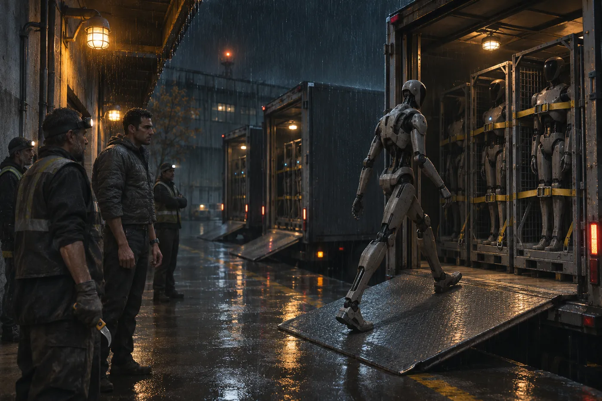

# 10. Sklad

*Brno, Lesná a Tuřany-jih. Noc ze středy 24. na čtvrtek 25. října 2074.*

Bílé auto s modrým pruhem projelo pod okny ve 23:05.

Júsuf počkal, až se na konci parkoviště otočí a zmizí mezi borovicemi. Pak počkal ještě pět minut, protože tak to dělal na vodě, když se proud uklidnil: nikdy hned, vždycky ještě chvíli. Nur spala u Kroupové od půl desáté. Rozloučila se s ním ve dveřích, rychle, *dobrou*, a Kroupová za jejími zády zvedla obočí.

Oblékl si svetr a přes něj bundu pana Kroupy. Zašitý rukáv byl tuhý. Bunda měla na prsou náprsní kapsu na zip, starou, s mosazným jezdcem, a do ní vložil jednotku, horní hranou nahoru, a zip nechal o dva prsty pootevřený. Podíval se do zrcadla v předsíni. Z kapsy nebylo vidět nic. Jen tma pod látkou.

Kabát ležel na dně skříně, pod dekou. Otevřel skříň. Tmavá modrá, kapuce, a pod dekou kousek světlého manšestru na lokti, který teď znalo půl města. Zavřel skříň.

„Nahrávej od chvíle, kdy v Tuřanech vystoupím z auta,“ řekl. „Obraz i zvuk. Dokud neřeknu dost.“

„Rozumím,“ řekl asistent. „Od vystoupení v parku Tuřany-jih. Pane Mansúre, nabídka advokáta platí i teď.“

„Vím.“

Po schodech šel pěšky, všech sedm pater. Výtah by cinkl.

*

Rámí čekal na konečné v Čertově rokli, v tom samém tmavém autě. Seděl vzadu a žvýkal. Když Júsuf nastoupil, podal mu přes sedadlo pracovní rukavice, nové, ještě svázané plastovým poutkem, a nepodíval se na něj.

Auto jelo nočním Brnem samo. Husovice, Židenice, mokré ulice, ve kterých se odrážely semafory, které nikomu nesvítily. Rámí pořád žvýkal. Na krku měl zase ty červené skvrny jako v úterý v autě. Jednou otevřel ústa, jako by chtěl něco říct, a pak je zase zavřel.

Logistický park v noci nespal. Mezi halami jezdily autonomní tahače s oranžovými majáky na střechách kabin, pomalu, každý ve své dráze, a za nimi se táhly návěsy dlouhé jako tramvaje. Auto vjelo bránou pro vozidla a zahnulo za B7, na východní stranu, kde Júsuf nikdy nebyl.

Byl tam dvůr, betonový, osvětlený jen napůl. Ke třem rampám stály couvnuté tři tahače s modrým nápisem LANTOR na kabinách. Zadní dveře návěsů měly otevřené a uvnitř svítilo slabé světlo. Vrata nad rampami byla vytažená nahoru a za nimi byla hala, černá jako studna.

Júsuf vystoupil. Jednotka v kapse se ho nijak nedotkla, nijak nezavibrovala. Věděl jen, že teď nahrává.

Na rampě stál Hamdan. Holou hlavu měl pod čepicí, přes bundu pracovní vestu a v ruce nůž na popruhy, krátký, s čepelí zahnutou jako zobák. Vedle něj dva muži, které Júsuf neznal. Starší, hubený, s šedým copem. A tlustý kluk v kšiltovce.

„Plavec,“ řekl Hamdan arabsky. Nepodal mu ruku. „Tak ses vrátil z řeky.“

Júsuf mlčel.

Na rampě u vrat stál na zemi otevřený kufřík. V něm černá krabice s krátkou anténou a se zelenou diodou. Rušička. Ne plochá krabička do kapsy, jakou měl Tárik. Větší.

„Pravidla.“ Hamdan ukázal nožem k hale. „Rušička jede na celou halu. Nosiče jsou hluché. Kdo chce, ať ho má u sebe, ale kdo ho vytáhne z kapsy, toho hodím k robotům. Nemluví se. Nesvítí se, jenom čelovky na zem. Dělá se rychle.“ Podíval se na Júsufa. „A ty děláš vedle mě.“

Vstoupili pod vrata. Po třech krocích se Júsufovi v uchu ozval asistent, tenký a rychlý.

„Ztrácím spoj–“

Ticho.

*

Hala byla tmavá jako tehdy. Zelené piktogramy nouzových východů, regály do čtyř pater, studený vzduch, který voněl olejem a kartonem a ještě něčím, mokrým betonem. Čelovky na hlavách mužů dělaly na podlaze bílé kruhy a ty kruhy se pohybovaly sem a tam jako ryby v kalné vodě.

A daleko, na konci hlavní uličky, svítilo jiné světlo.

Bylo malé a nízko. Ve výšce ramene. Lampa připnutá k vestě. Pod ní se občas mihl reflexní pruh a ještě níž slabě světélkovala modrá obrazovka tabletu. Nad lampou nebylo nic. Jen tma ve tvaru člověka.

Júsuf se díval. Hamdan ho chytil za loket.

„Tam se nedívej. Tam se nikdy nedívej.“

Pak přišel první robot.

Vynořil se z tmy uličky, kde začínala zóna R, a šel. Vysoký, tmavý, s plochou místo tváře. Neměl na hrudi žádné světlo. Kroky měl dlouhé a trochu tuhé, jako člověk, který jde po ledu a nechce, aby to bylo vidět. Servomotory mu v kolenou tiše bzučely. Prošel kolem mužů, ani se neotočil, vystoupil na rampu, přešel kovový můstek do návěsu a vstoupil do jednoho z kovových stojanů, které tam stály v řadě jako klece na drůbež na trhu v Rašídu. Zastavil se. Stál.

„Teď,“ řekl Hamdan.

Popruhy. Ploché, žluté, s ráčnou. Přes hrudník, přes stehna, háky do kolejnic v podlaze návěsu, a pak ráčna, cvak, cvak, cvak, dokud popruh nezazpíval. Robot byl studený. Pod rukavicemi cítil Júsuf kov a pod kovem něco, co se ještě hýbalo, drobně, jako se hýbe sval.

Daleko v hale se lampa pohnula. Robot ve stojanu vydechl. Jinak se to říct nedalo. Servomotory v něm zhasly jeden po druhém, kolena povolila o centimetr, a robot si do popruhů sedl, jak si sedne člověk, který usne ve stoje.

Hamdan uřízl zobákem přečnívající popruh. Druhý robot už stoupal po rampě.

*

Dělali rychle. Nemluvilo se. Čtrnáct robotů, pět, pět a čtyři. Po čtvrtém přestal Júsuf cítit studený kov přes rukavice. Po šestém mu začala zase krvácet levá dlaň, pod krytím, pod rukavicí, teplo a lepkavo. Nevšímal si toho. Tahal ráčnu.

Po každém robotovi se podíval do haly. Krátce, jen očima. Lampa stála pořád na konci uličky. Někdy se pohnula, o kus doleva, o kus doprava. Pak vždycky z tmy vyšel další.

*S chlapem z firmy, co to tam řídí.*

Tenhle to tam řídil. Tenhle stál na konci uličky a roboti šli, protože on chtěl. Tárik šel ve 21:30 z kuchyňky v Komárově za někým, kdo to tam řídí, a Tárik je mrtvý. A ten, kdo to tam řídí, stojí teď sto metrů od něj a nemá tvář.

Jednotka v náprsní kapse viděla rampu, návěs, Hamdanovy ruce, popruhy. Viděla Rámího, když se k ní otočil. Viděla roboty. Lampu na konci uličky viděla taky, Júsuf si byl jistý. Ale jen jako světlou tečku. Z kapsy, na sto metrů, ve tmě.

Devátý robot se zasekl.

Vystoupil na rampu jako ostatní a došel k můstku. Můstek byl ze silného plechu a mezi rampou a návěsem dělal schod, malý, na dva prsty, protože návěs po osmi robotech klesl na pérech. Robot na něj položil nohu. Noha mu sklouzla o kus zpátky. Položil ji znovu, stejně, přesně stejně, a sklouzla znovu. A znovu.

Zakymácel se. Ruce mu vyletěly do stran, jak hledal rovnováhu, a pravá narazila do stěny návěsu. Ozvalo se to jako rána kladivem do sudu. Tlustý kluk v kšiltovce uskočil a spadl na zadek. Robot stál na můstku jednou nohou, druhou hrabal po plechu a ruce mu škubaly, nahoru a dolů, nahoru a dolů, a servomotory v něm ječely vysoko, jako vrtačka v betonu.

Hamdan zaklel. Podíval se dozadu, do haly. Lampa na konci uličky se nepohnula.

„Za něj,“ řekl Hamdan. „Nikdo před něj. Nikdo k rukám.“

Obešel robota zezadu, těsně, tak blízko, že by se ho mohl dotknout bradou. Tam ty škubající ruce nedosáhly. Júsuf šel za ním, protože mu Hamdan řekl, že dělá vedle něj, a protože někdo musel robota chytit, až padne. Hamdan sáhl robotovi na záda. Pod lopatkami, nad bateriovým blokem, byl malý kryt, čtverec velký jako dlaň. Hamdan na něm cvakl západkou a odklopil ho. Uvnitř byla páčka. Červená, ve tvaru písmene T. Vedle ní svítil úzký sloupec zelených diod, plný až nahoru.

Hamdan ji vzal mezi palec a ukazováček a otočil o čtvrt otáčky.

Robot zhasl. Ne jako ti v popruzích, pomalu. Naráz. Ruce mu spadly, kolena se podlomila a celý se sesul dolů, na můstek, s dlouhým kovovým zvukem, jako když se sesype lešení. Júsuf ho chytil pod pažemi, než se převalil přes hranu rampy.

Byl těžký. Júsuf to znal. Kolena pokrčit, záda rovně, držet u těla, zvedat nohama a ne zády. Rámí chytil robota za nohy, starší s copem za pás, a Hamdan zaklapl kryt na zádech a řekl *nahoru*. Vtáhli ho do návěsu a do stojanu ho nedostali, tak ho položili vedle na podlahu, na bok, a připoutali ho tam jako zraněného na nosítka.

Júsuf se narovnal. Bolela ho záda a v levé dlani mu tlouklo. Ten zelený sloupec pod krytem mu nešel z hlavy. Na trhu v Rašídu nikdo nevezl motor na díly s plnou nádrží. Jenže nebyl čas na to myslet.

„Popruhy,“ řekl Hamdan. Ukázal nožem do haly. „Na paletě u třetího regálu je další role. Přines ji.“

*

Paleta stála u regálu v půlce cesty, tam, kam už nedosvítily čelovky od rampy. Júsuf k ní šel a čelovku držel na zem, jak bylo řečeno. Role popruhů ležela nahoře. Vzal ji do levé ruky.

Pak se nevrátil.

Zahnul za regál, do boční uličky, a čelovku vypnul. Tma. Zelený piktogram někde nad ním. Šel podél regálu, prsty pravé ruky na studené příčce, krok, krok, krok. Za regálem doleva. Další ulička. Lampa byla teď blíž, mnohem blíž. Viděl, jak se pod ní pohybuje bledé světlo tabletu. Viděl ruce v rukavicích. Slyšel bzučení servomotorů, další robot vycházel z řady a lampa se za ním pomalu otáčela.

Čtyřicet metrů. Třicet.

Zastavil se za regálem, za stohem kartonů. Mezi kartony byla škvíra a ve škvíře bylo vidět na konec uličky, na žlutou policejní pásku, kterou někdo přetrhl a nechal viset k zemi, na řadu tmavých robotů a na muže v reflexní vestě.

Stál bokem. Lampa mu svítila dopředu, na roboty, a jeho tvář nad ní byla černá. Nebyla vidět ani brada, ani nos. Jen tvar hlavy proti slabému světlu z tabletu, kapuce nebo čepice, Júsuf to nepoznal. Vesta. Pruh. Ruce na tabletu, klidné, rychlé, jako ruce člověka, který tohle dělal mnohokrát.

Kapsa byla moc nízko. Kartony by zakryly všechno.

Roli popruhů položil k nohám. Rozepnul zip a vytáhl jednotku. Zvedl ji ke škvíře mezi kartony. Palec mu sklouzl po obrazovce a obrazovka se rozsvítila. Malý bílý obdélník, v té tmě jasný jako zápalka. Přikryl ho dlaní. Světlo mu prosvítalo mezi prsty růžově. Držel jednotku kamerou ke škvíře a počítal.

Jedna. Dvě. Tři.

Lampa se otočila. Pomalu, k dalšímu robotovi v řadě. Její světlo přejelo po regálu, po kartonech, nad jeho hlavou, a Júsuf se nehýbal, nedýchal, a světlo šlo dál.

Patnáct. Šestnáct.

Muž v hale sklonil hlavu k tabletu. Další robot vyšel z řady.

Dvacet. Dvacet jedna.

„Co to máš?“

Za ním. Arabsky. Rámí.

*

Júsuf se otočil. Rámí stál v uličce dva kroky od něj, s vypnutou čelovkou, a díval se mu do ruky. Na jednotku. Na růžové světlo mezi prsty.

Júsuf ji strčil pod bundu. Rámí skočil.

Chytil ho zezadu, kolem hrudníku, oběma rukama, a stiskl. Byl mladý a silný a držel ze strachu, celou silou a bez rozmyslu.

„Hamdane!“ zakřičel. „Hamdane, natáčí!“

Ve vodě to funguje vždycky. Kdo tě drží, chce nahoru, ke vzduchu. Jdeš dolů a pustí tě, protože dolů nechce. Na suchu to funguje napůl. Júsuf zastrčil bradu, vyrazil oběma lokty nahoru proti Rámího předloktím a zároveň se nechal spadnout, celou vahou, dolů, z kolen. Rámí ho na vteřinu držel. Pak se mu Júsuf vysmekl, jako se člověk souká z mokrého svetru.

Rámího loket ho cestou trefil do pusy. Ucítil krev. Otočil se, chytil Rámího za bundu a hodil ho do regálu. Kartony se sesypaly. Rámí zmizel pod nimi s heknutím.

Kroky. Těžké, rychlé, od rampy. Bílý kruh čelovky skákal po podlaze.

Júsuf utíkal. Do tmy, pryč od lampy, pryč od rampy. Ulička. Doleva. Regál. Neviděl nic, jen zelené piktogramy, malé panáčky, kteří běží ke dveřím. Za ním dusot. Pak se bílý kruh vynořil přímo před ním, z boční uličky. Hamdan to vzal zkratkou.

Hamdan nemluvil. Rozmáchl se. Júsuf viděl v kruhu čelovky zahnutou čepel a zvedl levou ruku, jak se zvedá ruka proti větvi, která letí na obličej.

Nebolelo to. Bylo to jen teplé. Jako když se člověku na předloktí vylije horký čaj. Bunda pana Kroupy mu končila nad zápěstím. Zobák projel těsně pod jejím okrajem, rukávem svetru, napříč přes vnější stranu předloktí.

Júsuf kopl. Do kolena, z boku. Hamdan zařval a ztratil rovnováhu, a Júsuf ho minul, vrazil do něj ramenem a byl za ním.

Teď už věděl, kde je. Hlavní ulička, ta, kterou tehdy šel. Od bočních dveří sto dvacet metrů, rovně a doleva. Obráceně to bylo doprava a rovně. Běžel. Pravou rukou si držel levou, a mezi prsty mu teklo teplo.

Před ním se objevila modrá světla. Šest robotů v dokovacích stáních, šest modrých světel na šesti hrudích. Proběhl kolem nich. Dveře. Kovová tyč přes celou šířku, nouzové otvírání. Opřel se do ní celou vahou a dveře se otevřely ven, do větru.

*

Venku byla zima a černé nebe a mokrý vítr od letiště. Júsuf běžel podél severní stěny haly a pak přes silnici mezi halami. Za ním bouchly dveře. Rámí.

Po silnici jel tahač. Oranžový maják na kabině, světla, za ním návěs, dlouhý, bílý. Jel pomalu, jak tu jezdily všechny. Júsuf vběhl do jeho dráhy.

Tahač zabrzdil. Tvrdě, s hlubokým syknutím vzduchu, a zastavil tři metry od něj. Ozval se z něj hlas, klidný, ženský.

„Osoba v jízdní dráze. Zastavuji.“

Júsuf přeběhl před kabinou na druhou stranu. Rámí doběhl k návěsu. Šestnáct metrů bílé stěny mezi nimi. Rámí se vrhl dopředu, ke kabině, aby ji oběhl, a vběhl tahači přímo do světel, a tahač stál, a stál, a stál, protože Rámí stál v jeho dráze.

„Osoba v jízdní dráze,“ řekl tahač.

Júsuf byl mezi halami. Další silnice. Další tahač, tenhle jel proti němu a zastavil se taky, a teď stály dva, napříč, jako zátaras z plechu, a Rámí za nimi křičel arabsky něco, co se v té zimě rozpadlo na kusy.

Ozval se jiný zvuk. Hluboký, z dálky, od východní strany B7. Motory. Júsuf se ohlédl.

Ze dvora za halou vyjížděly tři tahače s modrým nápisem LANTOR. Za sebou, v koloně, pomalu, s oranžovými majáky, jako by se nic nestalo. Odjížděly. Čtrnáct robotů v popruzích, pět, pět a čtyři. Někdo v hale stiskl na tabletu, co měl stisknout, a ty stroje jely, protože tak bylo naplánováno.

Kolona zahnula na silnici přímo k němu.

Júsuf se rozhlédl. Na kraji silnice stály odstavené návěsy, bez tahačů, na podpěrách, řada za řadou. Vběhl mezi ně. Pod jeden. Lehl si na mokrý asfalt, na záda, mezi podpěry, a nad ním byla tma a podlaha návěsu a pach gumy.

Kolona projela. Pomalu. Kola, kola, kola, na dosah ruky. Pak se zastavila.

„Osoba v jízdní dráze. Zastavuji.“

Hamdan. Júsuf viděl jeho nohy ve světle majáků, jak kulhá podél kolony, jak se zastaví u každé mezery mezi návěsy a svítí čelovkou dovnitř. Bílý kruh přejel po asfaltu. Po podpěrách. Po kole o tři návěsy dál.

Júsuf se nehýbal. Levou ruku si tiskl pravou k hrudi. Krev mu stékala po zápěstí do rukávu svetru.

Hamdan se zastavil. Kruh čelovky se zastavil taky, dva návěsy od něj. Pak se Hamdan narovnal a Júsuf uslyšel tichý cvak a jeho hlas, jiný, ztišený. Mluvil do nosiče. Sem ven už rušička nedosáhla.

„Azízi. Je to on. Natáčel nás. Uvnitř. Rámí ho viděl.“ Pauza. „Ne. Nemám to. Utekl.“ Dlouhé ticho. „Ano. Rozumím. Ano.“ Hamdan si odplivl. „Zrádce. Říkal jsem ti to v neděli.“

Poslouchal. Pak řekl: „Dobře. Na Lesnou.“

Od konce silnice se blížilo bílé světlo. Robot ostrahy parku. Nízký, na kolech, se dvěma reflektory a s modrým světlem na stožáru, a jel přímo ke koloně, která stála kvůli Hamdanovi.

Hamdan zhasl čelovku. Vystoupil z dráhy. Kolona se s povzdechem brzd rozjela. Když kolem projel poslední návěs, Hamdan už tam nebyl.

Júsuf ležel pod návěsem a díval se, jak robot ostrahy objíždí místo, kde stál Hamdan, jak svítí reflektory do mezer mezi návěsy, pomalu, metodicky. Robot ho nesměl zastavit. Nesměl ho chytit ani držet. Směl jen vidět a zapsat. Júsuf se přetočil na břicho a plazil se pod návěsy na druhou stranu, od podpěry k podpěře, a když vylezl, byl u plotu letiště.

*

Šel podél plotu. Byl vysoký a nekonečný, s nápisy, které Júsuf znal z té noci. Nad ním přistávalo letadlo. Světla, hluk, který se do něj opřel jako vítr. Pak bylo zase ticho.

„Jsem tu,“ řekl mu do ucha asistent. Tiše. „Spojení se vrátilo, když jste vyběhl z haly. Mlčel jsem. Byl jste blízko lidí, kteří vás hledali. Krvácíte. Tep sto padesát dva. Zastavte se, prosím.“

Júsuf se zastavil. Sedl si do trávy pod plot. Vyhrnul rukáv svetru.

Rána vedla přes vnější stranu levého předloktí, kus nad zápěstím, dlouhá jako jeho prostředníček. Krev byla tmavá a tekla. Nestříkala. Tekla rovnoměrně, jako voda z kohoutku, který někdo zapomněl dotáhnout. Júsuf se na ni díval očima, kterými se díval na cizí rány. Tmavá a tekoucí je žíla. Světlá a stříká v rytmu srdce, to je tepna, a pak je málo času. Tohle byla žíla.

„Tlak přímo na ránu,“ řekl asistent. „Máte čím?“

V kapse bundy měl kus žlutého popruhu. Uřízl ho Hamdan a Júsuf ho zastrčil do kapsy, snad jen aby neležel na podlaze. Složil rukáv svetru přes ránu, přes něj popruh, a utáhl ho zuby a pravou rukou, pevně, ale ne tak, aby mu zbělely prsty.

„Dobře,“ řekl asistent. „Ruku držte výš než srdce. Tep sto čtyřicet. Rána potřebuje šít, do několika hodin. Mohu zavolat záchrannou službu. Nebo kapitánku Brožovou. Obojí hned.“

„Ne.“

„Pane Mansúre…“

„Co je na nahrávce?“

„Padesát jedna minut. Rampa, tři tahače Lantoru, čtrnáct robotů bez jádra. Tváře pana Hamdana a pana Rámího. Dva další muži. Robot, kterého vypnuli. Muž s lampou je na záznamu dvaadvacet vteřin. Postava, vesta, reflexní pruh, lampa na rameni, tablet, ruce v rukavicích. Obličej ne. Je ve stínu nad lampou.“

„Nic?“

„Obličej ne.“

Júsuf zavřel oči.

„A já?“

„Vy jste na záznamu taky,“ řekl asistent. „Jak utahujete popruhy. Jak nesete toho robota. Kamera byla u vás na prsou, takže vás většinou není vidět. Ale je vás slyšet a jsou vidět vaše ruce. Říkal jsem vám to.“

„Říkal.“

Nad letištěm blikalo červené světlo na stožáru. Rozsvítit, zhasnout. Rozsvítit, zhasnout.

*Na Lesnou.*

„Zavolej paní Kroupové.“

Bylo deset minut před druhou. Kroupová to vzala po druhém zazvonění, jako by seděla u telefonu.

„Kroupová.“

„To jsem já. Júsuf.“

Ticho. Jen dech. Pak:

„Holka spí.“

„Paní Kroupová. Do rána nikomu neotvírejte. Nikomu.“

„Já v noci neotvírám ani faráři,“ řekla Kroupová. „Je vám něco?“

„Ne.“

„Lžete,“ řekla. „Slyším to. Jako tehdy ve dvě. Mám na někoho zavolat?“

„Ne. Jen neotvírejte.“

Kroupová chvíli mlčela. Když znovu promluvila, byl to skoro šepot:

„Ve tři tu jezdí policajti. Budu u okna.“

Zavěsila.

Júsuf seděl v trávě s rukou nad hlavou, opřenou o pletivo plotu. Krev pod popruhem prosakovala jen pomalu. Bylo mu zima a třásly se mu nohy.

„Najdou mě přes tebe?“ zeptal se.

„Přes síť vás nikdo cizí najít nesmí, bez soudu ne,“ řekl asistent. „Ale pan Fahmí přes soud nechodí. Offline režim vám vezme zprávy, platby a kontakt s úřady. Mapy, navigaci, překlad a zdravotní dohled vám nechá. Budu u vás pořád.“

„Vypni síť.“

„Offline. Je 1:58.“

Ve sluchátku nic nezmizelo. Hlas byl stejný. Jen Júsuf věděl, že teď nikdo na světě neví, kde je. Ani Azíz. Ani Brožová. Ani Nur.

Vstal. Opřel se o plot a počkal, až se mu přestane točit hlava. Pak šel podél pletiva, pryč od parku, do tmy, kde za polem začínaly první domy Tuřan.

Azíz to věděl. Teď už to věděl.
