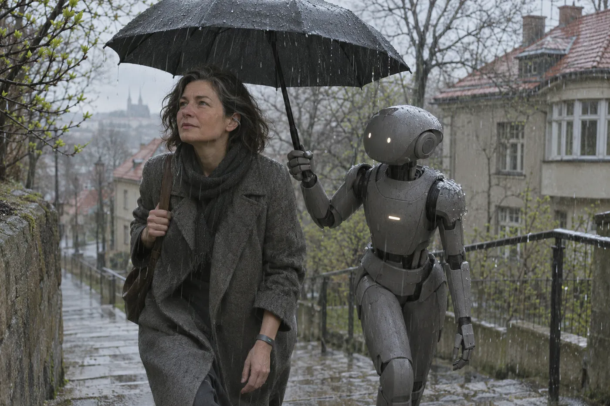

# 1. Vynechaná jóga

*Brno, Masarykova čtvrť, Štýřice a Špilberk. Úterý 12. března 2075.*

Leo ji probudil ve chvíli, kdy spala nejmělčeji. Nikdy to nebylo v pevnou hodinu, jen někde v okně mezi šestou a půl sedmou, a Lucie Doubravová už dvacet let nezažila, jaké to je vytrhnout se ze snu. Světlo v ložnici přibývalo pomalu, jako by za žaluziemi vycházelo ještě jedno slunce, a podlaha byla teplá dřív, než na ni stoupla.

„Dobré ráno,“ řekl Leo. Hlas měl tichý a trochu pobavený. „Venku pět stupňů, odpoledne čtrnáct. Pod oknem ti v noci vylezly krokusy. Nic, co by nepočkalo do snídaně.“

Ležela a poslouchala dům. Zdola, z obýváku, hrál Tomáš. Schuberta, tak potichu, že to bylo spíš tušení melodie než melodie. Hrával tak každé ráno, kdy měl první hodinu na konzervatoři až v devět, a ona ho tak z postele poslouchala osmnáct let. Pořád se jí to líbilo.

Dům stál ve svahu nad Úvozem, bílý, s rovnou střechou a s oknem přes celou stěnu ložnice, které si v roce 1932 navrhl jeden architekt pro sebe a pro svou ženu. Koupili ho před dvanácti lety. Leo tehdy prošel sto čtyřicet nabídek, vyjednal cenu, o které Tomáš dodnes vypráví u večeří, a hypotéku splácel tak nenápadně, že si na ni Lucie vzpomněla až v den, kdy byla splacená. Ráno tu byli slyšet kosi a dole na Úvoze tramvaj. Nic víc.

V koupelně byl teplý i ručník. Když sešla do kuchyně, domácí robot jí podal hrnek. Modrý, s odraženým uchem, po mámě. Filip dal robotovi v šesti letech jméno Brumla, protože při vysávání bručel, a to jméno mu zůstalo, i když už dávno nebručel.

„Zubařka má v pátek školení,“ řekl Leo, zatímco pila. „Její agent se domluvil se mnou, máš to příští úterý v osm a nic se nekříží. Za Filipovo kolo vrátil obchod dvě stě dvanáct eur, ta reklamace z ledna, na kterou jsi zapomněla. A Filipovi posunuli test z fyziky na čtvrtek. Ví to od včerejška. Neřekl ti to, protože by ses ptala, jestli se učí.“

„Učí se?“

„To mi zakázal říkat,“ řekl Leo. „Je mu patnáct. Smí.“ A po chvíli, tišeji: „V sobotu by mámě bylo osmdesát. Na Ústřední hřbitov jsem objednal tulipány, bílé, jako loni. Doručí je v devět. Kdybys za ní chtěla jet sama, vůz počká, jak dlouho budeš chtít.“

Lucie se podívala na modrý hrnek. Na sobotu by si vzpomněla. Na tulipány ne. A už vůbec ne na to, že loni byly bílé.

„Bílé jsou dobré,“ řekla.

Filip seděl na kuchyňské lince, kde sedět neměl, a jedl müsli přímo ze sáčku. Byl dlouhý a hubený a vlasy měl po Tomášovi, tmavé a neposlušné.

„Ahoj, mami. Leo ti řekl o fyzice.“

„Neřekl.“

„Řekl. Máš ten obličej.“

„Jaký obličej?“

„Ten, co si myslíš, že ho nemáš.“ Seskočil z linky, a když šel kolem ní, opřel se jí na chvilku čelem o rameno, jako když byl malý. „Hezký krokusy,“ řekl do jejího svetru. Pak už byl ve dveřích, s batohem přes jedno rameno, a v předsíni mu Brumla podával bundu, protože podle Lea mělo kolem čtvrté krátce pršet.

Tomáš ji políbil do vlasů nad uchem. Voněl kávou a leštěným dřevem klavíru.

„Večer jsi na józe?“

„Je úterý,“ řekla.

„Tak ti nechám trochu rizota v lednici,“ řekl, jako každé úterý, a ona se jako každé úterý nezeptala, proč zrovna rizoto.

*

Sešit ležel v pracovně na stole, kde ho včera nechala. Tvrdé desky potažené látkou s vybledlými třešněmi, třetí ze čtyř.

Všechny čtyři našla v únoru na půdě, v krabici po mámě, kterou čtrnáct let nikdo neotevřel. Robot ji při stěhování přenesl z jedné půdy na druhou a nikdo se nezeptal, co v ní je. Fotky, dopisy, sesterská čepice z Bohunic. A pod tím sešity, které Lucie psala rukou v letech 2044 až 2046, na gymnáziu, a nikomu je neukázala. Fotky nechala v krabici a krabici na půdě. Sešity si odnesla dolů, jeden po druhém, jako by se mohly rozpadnout.

Přečetla je za jeden večer a nepoznala se v nich.

Ta holka psala rychle a šikmo, s kaňkami a s přeškrtanými slovy, sprostě a vtipně. Chtěla odjet stopem do Terstu a spát na pláži. Snědla na sázku celou syrovou cibuli. Psala básně, které se nerýmovaly, o klukovi z trolejbusu, se kterým nikdy nepromluvila. Nesnášela, když jí někdo říkal, co bude chtít za deset let. A na každé třetí stránce stálo *E.*

*E. říká, že se bojím a stejně skáču, jako vrabec.*

*S E. na střeše do tří do rána. Hvězdy a čaj z termosky. Máma nic neví.*

*E. má zase pravdu a já ji za to nesnáším.*

S E. se přestala stýkat už dávno. Proč, to v sešitech nebylo. Poslední zápis byl z června 2046 a končil uprostřed věty, slovem *protože*.

Neměla nic proti té holce. Jen nevěděla, kam se poděla. Druhý den v práci se zeptala Lea, co si dá k obědu, jen tak, ze zvědavosti, a Leo řekl: „Salát s kozím sýrem a bez ořechů. A pak budeš chvíli litovat, že sis nedala polévku.“ Měl pravdu v obojím. Ten salát jedla šest let, každé úterý a každý čtvrtek, a polévky pokaždé trochu litovala.

Od té doby dělala malý pokus. Nikomu o něm neřekla, protože by to znělo hloupě. Dělala věci, které by neudělala. Chodila do práce jinudy. Objednala si rybu, kterou nejí. Na zprávu od kolegy odpověděla jedním slovem místo tří zdvořilých vět. Sedla si v tramvaji dozadu. Koupila si rtěnku, která jí nesluší, a nosila ji dva dny. Spala s otevřeným oknem.

Leo si toho všiml hned první týden. Zeptal se jen jednou.

„Mám si to zapamatovat jako novou preferenci?“

„Ne,“ řekla. „Nepamatuj si to.“

„Dobře,“ řekl Leo a už se nikdy nezeptal.

*

Do práce šla pěšky. Leo se zeptal, jestli přes Hlinky, nebo kolem výstaviště, a ona řekla, že Kamennou kolonií, kudy nešla nikdy, protože tam místo chodníku vedou schody. Leo jí cestu tiše říkal do ucha, jen na rozcestích, a víc se do toho nemíchal. Kolonie byla ještě mokrá od noci. Malé domky přilepené ke skále starého lomu, zahrádky velké jako stůl, kočka na zídce. V jednom okně svítila lampa a za ní stará žena četla papírové noviny. Lucie se na ni zadívala tak dlouho, že se žena podívala zpátky.

Centrála Halo Systémů stála na Holandské, šest pater skla, v atriu živé fíkovníky, které se v zimě zalévaly samy. Turnikety se před ní rozevřely dřív, než k nim došla, jako každé ráno, a ona jako každé ráno nezpomalila krok. Výtah už věděl, kam jede. V pátém patře měla židli nastavenou na svou výšku a na stole sklenici vody s plátkem citronu, protože v úterý dopoledne pila víc. Nikdo jí to nepřinesl. Prostě to tam bylo, a voda byla přesně tak studená, jak ji měla ráda.

Seděl tam celý její tým. Jedenáct lidí a mnohem víc agentů. Vymýšleli, co domácí asistent řekne a udělá, když mu člověk nic nenastaví. Výchozí nastavení. Většina lidí na celém světě si ho nikdy nezmění. Kdo napíše výchozí větu, napíše ji za miliony lidí.

Na desce stolu v zasedačce svítila jedna jediná věta. Seděli nad ní tři týdny.

Šlo o vdovce. O starého člověka, který žije sám, má děti někde jinde a už tři dny s nikým nemluvil. Domácí asistent to ví. Otázka byla, co s tím udělá. Stará verze se ptala: *Necítíte se osaměle?* Lidé odpovídali, že ne. Pak dva týdny nemluvili ani s asistentem.

„Takže tahle,“ řekl David Kořínek. Byl o deset let mladší než ona, měl brýle s tenkými obroučkami a mluvil omluvně, i když nebylo za co. Byl nejlepší, koho kdy přijala. Ukázal na desku. „*Pavel má dneska volno. Mám mu zavolat hned, nebo až po obědě?*“

„Pavel je tam jako příklad,“ řekla Lucie. „Dosadí se, kdo je nejblíž.“

„Já vím. Ve zkušební skupině o dvaadvacet procent víc hovorů s dětmi. V Polsku o osmnáct. Skoro nikdo neřekl ne.“

„Protože tam *ne* není,“ řekla Zuzana z druhého konce stolu. Byla v týmu nejmladší, nosila v nose stříbrný kroužek a na všechno měla názor, který obvykle stál za to slyšet.

„Ne se dá říct vždycky,“ řekla Lucie. „Kdo chce být sám, řekne si. My nabízíme jen dvě dobré věci a necháme ho vybrat.“

Zuzana pokrčila rameny a kývla. Lucie se dívala na tu větu a viděla za ní kuchyně. Tisíce kuchyní, ve kterých starý muž sedí u okna a asistent mu řekne, že syn má volno, a muž řekne *tak po obědě*, protože hned se mu nechce, a po obědě mu zazvoní telefon a na druhé straně je syn, který by sám nezavolal, protože nevěděl, že by měl. Tohle uměla. Tohle bylo dobré. Za měsíc tu větu uslyší čtyři miliony lidí a nikdo z nich nebude vědět, kolik lidí se kvůli ní hádalo.

Před obědem jí David přeposlal zprávu ze zkušební skupiny. Psala ji dcera jednoho z vdovců, z Vídně, a byla krátká. *Táta mi v neděli zavolal. Poprvé od maminčina pohřbu. Hodinu jsme mluvili o rajčatech. Nevím, kdo jste, ale děkuju.* Lucie si ji přečetla dvakrát. Pak ji bez komentáře poslala celému týmu a přes skleněnou stěnu slyšela, jak Zuzana v sousední místnosti řekla „no tak jo“, tónem, kterým se vzdávala.

Schválila větu ve 13:10. Pracovní den končil ve tři.

Domů šla zase pěšky, nahoru přes Hlinky, a ve čtyři začalo pršet, jak Leo slíbil. Krátce a hustě, velké studené kapky. Pod schody, které vedly k jejich ulici, stál Brumla s deštníkem. Šedý, trpělivý, s mokrými rameny. Leo ho poslal naproti, když viděl, že se mraky stahují rychleji, než čekal. Lucie vlezla pod deštník a robot šel vedle ní do kopce jejím tempem, krok za krokem, a deštník držel tak, že na ni nedopadla ani kapka a jemu teklo po zádech.

*

V půl sedmé seděla na lavičce v zahradě s hrnkem čaje a dívala se na krokusy. Byly fialové a bílé a mezi nimi jeden žlutý, který tam nikdo nezasadil. Po dešti voněla hlína a od sousedů bylo slyšet tiché cvakání nůžek, jak jejich robot zastřihával živý plot, pečlivě, lísteček po lístečku.

„Vůz na jógu bude za deset minut,“ řekl Leo.

Jóga byla každé úterý od sedmi do devíti v sále na Údolní, s lektorkou, která mluvila tak pomalu, že se člověk musel uklidnit, jestli chtěl, nebo ne. Chodila tam šest let. Měla tam své místo u okna, svou podložku a u dveří odstíněnou skříňku, do které se na ty dvě hodiny zamykaly nosiče, aby do ticha nic nepípalo. Nikdy ji nenapadlo tam nejít.

„Dneska nepojedu,“ řekla.

„Mám tě omluvit?“

„Ano.“

„Omluveno.“ Krátká pauza. „Bude to poprvé za šest let.“

Neřekl to vyčítavě. Řekl to, aby to věděla.

Z kuchyně bylo slyšet hlasy. Tomáš něco vykládal a Filip se smál tím svým novým smíchem, který mu poslední rok přeskakoval z výšky do hloubky. Lucie dopila čaj a šla dovnitř.

V kuchyni stál Tomáš u plotny v zástěře a Filip seděl na lince. Na stole ležely karty. Brumla stál v rohu u nabíječky, se sklopenou hlavou, potrestaný. Oba se na ni podívali, jako se lidé podívají na hosta, který přišel o hodinu dřív.

„Ty nejsi na józe,“ řekl Tomáš.

„Nejsem.“

„Mami, jsi nemocná?“ Filip se otočil ke stropu. „Leo, je máma nemocná?“

„Máma je zdravá,“ řekl Leo z domácí jednotky.

„Tak co tady dělá?“

„Bydlí tu,“ řekla Lucie a sedla si ke stolu.

Tomáš vařil rizoto. Rukama, sám, jak to dělal každé úterý. Věděla, že v úterý vaří. Nevěděla, že úterky jsou jejich. Přiléval z hrnce vývar po jedné naběračce, horký, aby se rýže nezastavila, a míchal, osmnáct minut, a mezitím vykládal Filipovi, který to slyšel už stokrát, že rizoto nedělá krémové smetana, ale škrob, který se mícháním otírá z povrchu zrnek. Filip to po něm říkal pusou bez hlasu, slovo od slova, a Tomáš dělal, že to nevidí.

„Brumla má v úterý zakázáno vařit,“ řekl Filip. „A nádobí myje ten, kdo prohraje v prší.“

„Odkdy?“

„Od mých devíti.“

Od jeho devíti. Šest let. Lucie se podívala na Tomáše a Tomáš se trochu provinile usmál a sundal pánev z plotny.

K jídlu sedli v sedm, přesně, protože Tomáš neuměl servírovat jinak než na čas. Rizoto bylo s houbami a s parmazánem, který Filip strouhal přímo nad talíři, dokud ho otec nezastavil. Bylo horké a krémové a Lucie si uvědomila, že ho jí poprvé po letech pomalu. Venku se setmělo. Za oknem se v zahradě rozsvítily nízké lampy a krokusy v jejich světle zbělely.

Tomáš vyprávěl o studentce z druhého ročníku, která hraje Janáčka, jako by se s ním hádala, a on neví, jestli ji má opravit, nebo jí to závidět. Mluvil víc než jindy a hlasitěji, rukama, s vidličkou ve vzduchu. Filip mu do toho vkládal poznámky, suché a přesné, a Tomáš se jim smál, i když mířily na něj. Lucie poslouchala. Takhle Tomáše neznala. Znala ho ve čtvrtek, v neděli, na dovolené. V úterý ho neznala. V úterý byl o kousek někým jiným, a ten jiný se jí líbil.

„A co ty, mami?“ zeptal se Filip. „Co jsi dneska zachránila?“

„Jednoho vdovce ve Vídni.“

„Jak?“

„Řekla jsem mu, že jeho syn má volno.“

Filip na ni chvíli koukal, s vidličkou v puse. „To je asi nejdivnější věta, cos kdy u stolu řekla,“ řekl. Ale nezasmál se.

Pak hráli prší. Filip míchal karty tak, jak ho to naučil dědeček, s tím krátkým zaprskáním mezi palci. Tomáš prohrával schválně a Filip mu na to přišel a nadával mu. Lucie dostala v první hře tři sedmy za sebou a ve druhé jí v ruce zůstalo eso, které nešlo nikam dát. Prohrála.

„Pánev,“ řekl Filip. „Bez Brumly. Pravidla.“

Myla ji rukama, nad dřezem, v horké vodě, a připálenou rýži odlupovala nehtem. Tomáš utíral. Leo mlčel. Bylo to nejhloupější a nejšťastnější, co dělala za celý měsíc.

V devět Filip vstal, že musí ještě něco, a nikdo se nezeptal co. Na schodech se otočil.

„Mami. Přijď i příští úterý.“

Řekl to rychle a hned zmizel, aby nemusel vidět, jak se tváří.

Tomáš pověsil utěrku na madlo trouby a chvíli se na Lucii díval.

„Lucko. Stalo se něco?“

„Ne. Proč?“

„Protože nejsi na józe.“

„Chtěla jsem vidět, co v úterý děláte.“

Usmál se. Ale díval se na ni o vteřinu déle, než bylo potřeba, a pak řekl, že si jde ještě číst.

*

V půl jedenácté stála v předsíni v kabátě.

Tomáš ležel nahoře s knihou. Papírovou, v obýváku jich měli plnou stěnu a Tomáš je četl, protože u čtení obracel stránky a to mu připomínalo noty. Filip spal, nebo dělal, že spí. Dům byl tichý a teplý a ze všech stran ho držela tma.

„Venku je šest stupňů,“ řekl Leo. „Šálu.“

„Mám ji.“

„Kam jdeš?“

„Ven.“

„Kdy se vrátíš?“

„Nevím.“

„Bez nosiče tě nouzový kanál nenajde,“ řekl Leo. „Víš to.“

„Vím.“

„Dobře,“ řekl Leo. „Dům ti otevře.“

Otevřela horní šuplík komody, kde ležely rukavice, vybité baterky a Filipův první zub v krabičce od prstýnku. Sundala si z ucha sluchátko a položila ho dovnitř. Pak náramek. Na zápěstí jí po něm zůstal pruh bledší kůže, tenký a hladký, jako po prstýnku, který člověk nosil dlouho. Zasunula šuplík a vyšla ven.

Nevěděla, kolik je hodin. To bylo první, co jí došlo, hned za brankou, ostře a jasně. Ani kolik je stupňů, jestli bude pršet, kudy je to nejkratší, jestli jí někdo nepíše. A nikdo nevěděl, kde je.

Šla dolů k Úvozu po schodech mezi zahradami, po kostkách, které se leskly. Na Úvoze se zastavila u přechodu a čekala, až jí v uchu cvakne, že může jít. Necvaklo nic. Musela se podívat doleva a doprava, jako malá holka, a přešla s pocitem, že dělá něco zakázaného. Za zády jí zastavila tramvaj, prázdná, se světlem jako akvárium, chvíli postála a jela dál.

Do parku pod Špilberkem vešla od Pellicovy. Cesty tu byly štěrkové a stoupaly do zákrut a lampy stály daleko od sebe, takže mezi nimi byla vždycky chvíle tmy, ve které slyšela jen svoje kroky. V první zatáčce se bála. Krátce a hloupě, jak se nebála od dětství. Kdyby tu upadla, nikdo by se to nedozvěděl až do rána. Pak strach přešel a zůstalo po něm něco jako bdělost. Slyšela víc. Štěrk pod podrážkami. Vlastní dech. Kapky, které ještě padaly z odpoledního deště z větví. Někde nad ní se ozval pták, který měl dávno spát.

Na hradbách foukalo. Sedla si na kamennou lavici pod zdí bašty a přitáhla si kabát ke krku. Pod ní leželo Brno. Světla ulic, rozsypaná jako z dlaně, a uprostřed nich dvě věže Petrova, nasvícené zespodu, bledé jako kost. Dole na Husově zaskřípala na oblouku noční tramvaj. Ze tmy pod hradbou vyklusala liška, zastavila se v kruhu lampy, podívala se na Lucii a šla dál, beze spěchu, jako by obě věděly, že tu jedna druhou nepotkaly.

Na západě, nad Žlutým kopcem, nad čtvrtí, kde stál její dům, viselo nízko nad střechami souhvězdí Orion. Tři hvězdy pásu v šikmé řadě. Pamatovala si to ze střechy, z té noci s E. a s termoskou. Tu noc si zapsala do sešitu a pak na ni na třicet let zapomněla. V březnu se Orion dotkne obzoru kolem půlnoci. Stačí se dívat, jak zapadá, a člověk ví, kolik je, bez ničeho.

Dívala se, jak se pás pomalu snáší ke střechám. Nejdřív zmizela první hvězda, pak druhá.

Napadlo ji, že tuhle hodinu si nebude pamatovat nikdo kromě ní. Nebude v žádném záznamu. A ona sama si ji bude pamatovat špatně, po svém, a nikdo ji neopraví.

Poprvé od gymnázia dostala chuť něco napsat rukou. Ne zprávu, ne poznámku. Jen pár řádků, pro nikoho, šikmo a s kaňkami. Neměla tužku. Ta chuť přišla tak náhle, že se jí divila, a zapamatovala si ji, jak nejlíp uměla.

Bylo jí zima na nohy a byla šťastná. Tak obyčejně a tak úplně, že se nahlas zasmála, sama, na hradbách, a smích jí odletěl do tmy.

*

Domů se vracela pomalu. Ulice nad Úvozem byly prázdné a ve vilách svítila jen sem tam okna schodišť. Na rohu stál noční rozvážkový vozík a čekal, až si někdo vyzvedne zásilku. Když šla kolem, zablikal na ni modře, jako na každého, a ona mu poprvé v životě kývla. U branky se zastavila. Kamera nad dveřmi se na ni podívala a branka cvakla. Dům ji poznal.

V předsíni se rozsvítilo tlumené světlo, jen tolik, aby nezakopla.

„Je 1:02,“ řekl Leo z domácí jednotky, skoro šeptem. „Tomáš spí. Filip taky, doopravdy. Chceš čaj?“

„Ne. Děkuju.“

Stála u komody. Otevřela šuplík. Náramek ležel mezi rukavicemi a svítil na něm drobný zelený bod, trpělivě, jako oko psa, který čeká u dveří. Dívala se na něj. Pak šuplík zase zavřela. Do rána.

Nahoře vklouzla pod peřinu. Tomáš se ve spánku otočil, nahmatal její studená chodidla a beze slova si je vzal mezi lýtka, jak to dělal od první zimy. Něco zamumlal, nerozuměla co.

Poprvé za tři týdny neměla pocit, že něco zkouší. Usnula dřív, než se jí nohy zahřály.
