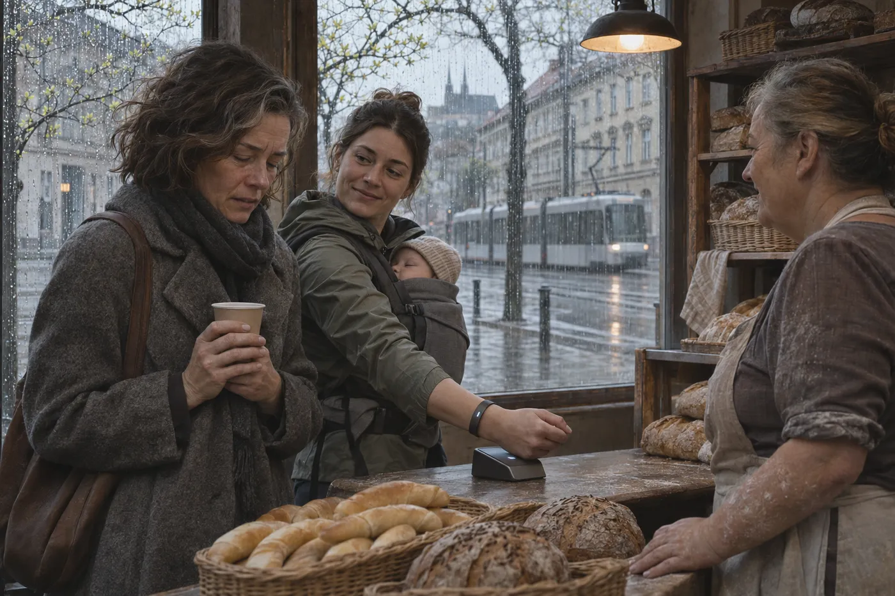

# 2. Anomálie

*Brno, Masarykova čtvrť, Hlinky a Holandská. Středa 13. března 2075.*

„Promiň,“ řekl Leo. „Vím, že jsi spala pět hodin. V osm máš poradu s Varšavou.“

Lucie otevřela oči. Světlo v ložnici už bylo celé, Tomášova půlka postele prázdná a ještě teplá. Hlava jí ztěžkla, jak se zvedla, ale pod tou tíhou bylo něco lehkého, co si přinesla z hradeb a co tam pořád bylo. Ještě cítila v nose studený vzduch a štěrk pod podrážkami.

V županu sešla do předsíně a otevřela šuplík. Náramek byl studený. Navlékla si ho na zápěstí, na ten bledý pruh kůže, a sluchátko zasunula do ucha. Na náramku se rozsvítilo 6:11.

„Dobré ráno,“ řekl Leo v uchu. „Vítej zpátky.“

Pak bylo ticho. Krátké, ale Lucie ho slyšela, protože Leo nikdy nemlčel uprostřed. Za dvacet let nemlčel uprostřed ani jednou.

„Moment,“ řekl.

„Co je?“

„Nemůžu obnovit ověření. Zkouším to znovu.“

Stála v předsíni bosá na teplé dlažbě a čekala. Z kuchyně bylo slyšet, jak Brumla vytahuje z myčky hrnky. Na náramku se objevil řádek, bílý na šedé.

*Tento nosič je dočasně omezen. Vaše osobní paměť je v bezpečí.*

Tu větu znala. Napsala ji. V roce 2071, s Davidem, ještě než do týmu přišla Zuzana. Seděli nad ní tři týdny, stejně jako nad tím vdovcem. První verze lidi děsila, tahle je ve zkouškách uklidňovala o třetinu víc. To malé *vaše* bylo její rozhodnutí, protože velké znělo jako z úřadu. Přečetla ji teď na vlastním zápěstí a na vteřinu se jí opravdu ulevilo. Ta vteřina ji vyděsila víc než všechno ostatní.

„Leo.“

„Jsem tady. Lokálně jsem v pořádku. Síť tenhle nosič odmítá.“ Mluvil pomalu a přesně, jak mluvil vždycky, když si nebyl jistý a nechtěl to zakrývat. „Kód pozastavení je konflikt identity. Někde je druhý nosič s tvými klíči. Systém ověřování rozhodl, že ten pravý je on.“

Lucie se zasmála. Krátce, nahlas, jako se člověk zasměje, když mu někdo řekne, že je ráno večer.

„To je hloupost.“

„Taky si to myslím. Ale z tohohle nosiče to nikomu nedokážu. Síť se mnou mluví jen tím jedním řádkem.“

*

Tomáš stál v kuchyni s hrnkem a díval se na ni přes okraj.

„Zavolej do Halo,“ řekl.

„Já jsem Halo.“

„Tak zavolám já.“

Zavolal z domácí linky, ze svého účtu, nahlas, aby slyšela. Ozval se agent zákaznické péče Halo, příjemný ženský hlas, který Lucie znala, protože ho její tým před čtyřmi lety ladil. Agent byl laskavý a rychlý a vysvětlil Tomášovi, že o identitě paní Doubravové může mluvit jen s paní Doubravovou.

„Stojí vedle mě,“ řekl Tomáš.

„Rozumím,“ řekl agent. „Potřebuji ji ověřeným kanálem.“

„Jejím kanálem je ten nosič, co jste jí zablokovali.“

„Rozumím,“ řekl agent znovu, se stejnou laskavostí. „Paní Doubravová může podat námitku osobně na kontaktním místě systému ověřování. Nejbližší je na Kounicově. Mohu vám poslat otevírací dobu.“

Tomáš zavěsil. Podíval se na Lucii, jako by čekal, že se zasměje, a ona se nezasmála.

„Tak ti objednám vůz,“ řekl. „Na můj účet.“

Vůz přijel v 7:40, jako každé ráno, šedý a tichý, a zastavil u branky. Lucie vyšla k němu v kabátě. Dveře se neotevřely. Na okně se rozsvítil text.

*Cestující neověřen. Jízda zrušena. Omlouváme se.*

Vůz chvíli stál, jako by váhal. Pak se rozjel a zmizel za zatáčkou, k někomu jinému.

Lucie zůstala stát na chodníku. Za ní ve dveřích stál Tomáš a pak Filip, s batohem přes jedno rameno a s vlasy na jednu stranu.

„Mami, tebe někdo ukrad?“ Filip se rozzářil. „Někde chodí tvoje kopie, která je víc ty než ty? To je nejlepší věc, co jsem kdy…“

Podíval se jí do obličeje a zbytek věty spolkl.

„Promiň,“ řekl.

„V pořádku.“

Tomáš řekl, že zůstane doma. Měl v osm první hodinu, dva studenty před přijímačkami a jednoho, který ráno nemluví, dokud nezahraje stupnice. Lucie viděla, jak mu to v obličeji počítá, a řekla mu, ať jede. Řekla to rychle, aby nemusel přemýšlet, a jemu se viditelně ulevilo.

„Volej mi,“ řekl. „Přes dům. Přijedu hned.“

„Je to chyba,“ řekla. „Do oběda to bude pryč.“

Věřila tomu. Byl to nosič Halo, v síti, kterou zčásti postavila Halo, a v Halo existoval tým, který se staral o konflikty identity. Znala jeho vedoucí. Chodily spolu na oběd.

*

Nejdřív zkusila tramvaj. Na zastávce na Úvoze nastoupila do první, která přijela, a dveře se za ní zavřely. Náramek jí zavibroval.

*Jízdné nelze uhradit.*

Tramvaj se nerozjela. Z reproduktoru nad dveřmi se ozval klidný hlas, ne hlasitý, ale dost hlasitý: „Prosíme cestující bez platné jízdenky, aby vystoupili. Děkujeme.“ Nikdo se na ni nepodíval. Všichni věděli, komu to patří. Vystoupila a tramvaj se rozjela, s lidmi, kteří se po ní teprve teď otáčeli.

Pak šla pěšky.

Leo ji vedl dolů k Mendlovu náměstí a odtud přes Hlinky, z map v nosiči, offline, a fungoval stejně dobře jako vždycky. Upozornil ji na rozkopaný chodník u Pekařské, na tramvaj, která za minutu vyjede zpoza rohu, na to, že ji tlačí levá bota a že to dělá pokaždé, když spí málo. To všechno uměl sám. Jinak neuměl nic.

„Kdo by to dělal, Leo?“

„Nevím. Odsud vidím jen tebe.“

Než došla na Hlinky, zastavila se v pekárně u Mendlova náměstí. Prodávala tam živá prodavačka, starší paní s moukou na předloktí, a měli tam rohlíky, které Lucie kupovala Filipovi, když byl malý. Bylo tam teplo a vonělo to kmínem. Lucie si objednala kávu a přiložila náramek ke čtečce.

*Platba zamítnuta.*

Zkusila to znovu, protože to člověk vždycky zkusí znovu.

*Platba zamítnuta.*

Prodavačka se podívala na náramek. Byl to prémiový Halo, matný, bez ozdob, a stál nejspíš víc, než ta paní vydělá za měsíc. Pak se podívala Lucii do obličeje.

„To je dobrý,“ řekla žena za Lucií. Mladá, v běžecké bundě, s dítětem v nosítku na břiše. Přiložila svůj náramek. Pípnutí. „Mám to.“

„Děkuju. Já vám to…“

„To nic.“ Žena se usmála. Byl to milý úsměv, opravdu milý, a byla v něm ta tichá lítost, s jakou se lidé dívají na někoho, komu se rozbil život a ještě o tom neví. „Každému se to někdy stane.“

Nestane, pomyslela si Lucie, když šla ven s horkým kelímkem v ruce. Nikomu se to nestane. Proto se na mě tak dívá.

Kávu dopila až na Holandské. Byla dobrá. To ji rozzlobilo.

*

Turnikety v atriu se před ní nerozevřely.

Došla k nim stejným krokem jako každé ráno a narazila stehnem do skleněného křídla, které zůstalo stát. Nebolelo to. Za ní se zastavil muž z účetního oddělení, kterého znala od vidění, a obešel ji k vedlejšímu turniketu. Ten se před ním otevřel. Muž se ohlédl.

Recepční robot, štíhlý a bílý, s modrou značkou na čele, k ní přijel od pultu.

„Dobré ráno, paní Doubravová,“ řekl. Oslovil ji jménem. Poznal ji. Jen ji nesměl pustit. „Vaše identita je pozastavena. Prosím, posaďte se. Kolegyně z bezpečnosti už jde.“

Řekl to nahlas. Ne křikem, ale tak, aby to slyšeli ti dva u vedlejšího turniketu. Lucie si i v tu chvíli všimla, že by to tak nenastavila. Dala by to jen na displej, tichým písmem, pro jednoho člověka. Někdo v téhle budově, možná o dvě patra níž, rozhodl jinak, a měl pro to jistě dobrý důvod, bezpečnost, průhlednost, něco. Nikdy se ho nezeptala, protože se jí to netýkalo.

Posadila se do křesla pod fíkovníkem. Fíkovník kapal; zrovna se zaléval. Lidé chodili kolem k turniketům, ve dvojicích, s kelímky, a turnikety se před nimi otvíraly a zavíraly s tichým vzdechem. Někteří se na ni podívali. Většina ne. Lucie seděla rovně a s kelímkem v klíně a cítila, jak jí po zádech leze teplo až do vlasů.

Kolegyně z bezpečnosti byla Adéla Machalová. Mladá, s culíkem a s tváří, kterou Lucie znala z výtahu. Podala jí ruku, což nemusela.

„Paní Doubravová. Pojďte prosím se mnou.“

Vzala ji do zasedačky ve druhém patře. Skleněné stěny, stůl, dvě židle, na stole sklenice vody bez citronu. Po chodbě za sklem chodili lidé a nakukovali dovnitř jako do výlohy. Na stěně se rozsvítila obrazovka.

Ing. Robert Klíma, šéf bezpečnosti, seděl ve své kanceláři o patro výš. Lucie ho znala patnáct let. Chodili na stejné porady o tom, co se smí a nesmí, a on tam většinou mlčel a pak řekl jednu větu, která rozhodla. Měl šedivé vousy zastřižené nakrátko a hlas, který nikdy nespěchal.

„Lucie,“ řekl. „Mrzí mě to.“

„Roberte, co se děje?“

„V 6:12 přišlo oznámení systému ověřování. Konflikt identity. Dva nosiče s tvými klíči, sto třicet čtyři kilometrů od sebe. Systém porovnal oba s tvým profilem.“ Podíval se stranou, na něco, co měl na stole. „Ten druhý odpovídá na devadesát devět celých devět. Tvůj na devadesát jedna.“

Lucie neřekla nic.

„Rozhodl ve prospěch toho druhého. Míra jistoty přes devadesát sedm procent. Lidský přezkum to nepotřebovalo.“

„Ten druhý,“ řekla Lucie, „mi odpovídá líp než já.“

„Podle systému.“

„Kde je?“

„Nevím. Ví to systém a vydá to soudu. Nám ne.“ Klíma si promnul kořen nosu. „Musím tě do vyjasnění odpojit od všeho. Budova, systémy, data týmu. Je to pravidlo pro lidi s přístupem ke kritickým systémům. Podepisovala jsi ho taky.“

„Já vím.“

„A ještě jedna věc. Kdybys nám dala nosič, naši technici by se podívali, co v něm je. Jestli do něj někdo nelezl.“

„Je v něm moje paměť.“

„Nikdo by ji nečetl. Jen klíče a firmware.“

Lucie se podívala na náramek. Na ten bílý řádek, který tam pořád svítil. *Vaše osobní paměť je v bezpečí.*

„Ne,“ řekla.

Klíma ji chvíli pozoroval. Pak kývl.

„Je to tvoje právo,“ řekl. „Policie oznámení dostala taky, automaticky. Nediv se, kdyby se ozvali.“

Obrazovka zhasla. Adéla Machalová stála u dveří a dívala se do země.

Devadesát jedna. Lucie seděla nad sklenicí vody bez citronu a počítala, ale nebylo co počítat. Tři týdny. Jiná cesta do práce. Ryba. Rtěnka. Jedno slovo místo tří vět. Okno otevřené přes noc. Vynechaná jóga. Šuplík. Každá ta maličkost někde zapsala čárku a z čárek vyšlo devadesát jedna, a vedle toho stálo devadesát devět celých devět, a mezi těmi dvěma čísly by se rozhodla stejně. Sama by to tak nastavila. Možná to tak kdysi sama nastavila.

Byla to ona, kdo se od sebe vzdálil. Ten druhý zůstal na místě.

„Paní Doubravová,“ řekla Adéla tiše. „Budu potřebovat váš služební tablet. A musím vás doprovodit ven.“

Ven vedla cesta přes páté patro. Lucie se zeptala, jestli nemůžou jet výtahem rovnou dolů, a Adéla řekla, že tablet je zamčený ve skříňce u Luciina stolu a skříňku otevře jen bezpečnost, osobně. Šly tedy přes open space. Lucie šla mezi stoly, kolem desky, na které ještě svítila včerejší věta o vdovci a jeho synovi, a jedenáct lidí se dívalo do svých obrazovek tak usilovně, že je to muselo bolet za krkem.

David vstal.

„Lucie, co se…“

„Prosím,“ řekla Adéla. „Teď ne.“

David si zase sedl. Zuzana se na Lucii podívala jedinkrát, rychle, s otevřenou pusou, a pak se otočila k oknu.

Před budovou Adéla řekla, že je jí to líto. Znělo to upřímně a Lucie jí za to byla vděčná a zároveň ji nesnášela. Pak se za Lucií zavřely skleněné dveře, které ji nepoznávaly.

*

Domů šla do kopce. Začalo mrholit, jemně, tak jemně, že to nebylo vidět, jen cítit na tvářích. Leo ji vedl. Neříkal nic, co nemusel. Jednou se zeptala, jestli ví, kolik je teď na jejím účtu, a on řekl, že to ví jen do 6:11, kdy byl naposledy v síti, a že tehdy tam bylo tolik, kolik bylo vždycky. Pak už se neptala.

Na Hlinkách ji předjel cizí domácí robot s nákupem v náručí a uhnul jí z cesty. Kolem projel vůz, pak další. Někde za ní zvonila tramvaj. Celé město se pohybovalo a ona šla po svých, krok za krokem, a poprvé v životě si všimla, jak je ten kopec dlouhý.

U branky se zastavila.

Kamera nad dveřmi se na ni podívala. Cvaklo to. Branka se otevřela.

Lucie chvíli stála. Pak vešla a dveře domu se jí otevřely taky a v předsíni se rozsvítilo světlo a podlaha byla teplá. Brumla jí přišel naproti a vzal jí z ramen mokrý kabát a pověsil ho tam, kde vždycky visel.

„Lokálně jsi to ty,“ řekl Leo. Teď už z domácí jednotky, z celého domu, plným hlasem. „Síť tvrdí opak.“

„A čemu věříš ty?“

„Domu,“ řekl Leo. „Dům tě zná dvanáct let. Tvůj krok na schodech, tvůj hlas, jak držíš hrnek. Tvoji paměť mám celou tady. Síť zná jen čísla. Jenže dům za tebe nesmí nic podepsat.“

Sedla si v kuchyni ke stolu. Brumla jí postavil před nos čaj, mátový s medem, jaký pila, když byla nemocná. Leo to věděl. Dům to věděl. Seděla v domě, který ji znal líp než kdokoli na světě, a za jeho zdmi ji nepoznával nikdo.

Sešit s třešněmi ležel v pracovně, kde ho včera nechala. Došla si pro něj a otevřela ho na náhodné stránce, jako se kdysi otevíraly knihy, aby člověku něco poradily. *Dneska jsem se bála jít k tabuli a šla jsem. E. říká, že strach je jenom tělo, které ještě neví, co hlava. Hlava to taky neví, ale nemá to přiznat.* Šikmé písmo, kaňka u slova *hlava*. Lucie zavřela sešit a položila na něj dlaň.

„Smíš volat z Tomášovy linky?“

„Smím. Povolil mi to v sedm čtyřicet, když odjížděl.“

„Tak mi sežeň Ivetu Šimkovou.“

Iveta vedla v Halo tým, který se staral o konflikty identity. Jednou za měsíc spolu chodily na oběd do bistra na Holandské a Iveta pokaždé vyprávěla o lidech, kterým se ztratilo jméno, a obě se tomu smály, protože se to vždycky do oběda vyřešilo.

Iveta to vzala po prvním zazvonění.

„Lucko. Já vím.“ Mluvila potichu, jako by stála na chodbě. „Nemůžu ti nic říct. Klíma to v sedm zamkl. Nemáš to u nás, máš to v karanténě u bezpečnosti.“

„Ty jsi viděla to porovnání.“

Ticho.

„Viděla,“ řekla Iveta. „Jen souhrn. Složky, ne obsah.“

„A?“

„Dělám to dvanáct let. Padělky mívají dobrý hlas a špatný rytmus. Nebo dobrý rytmus a špatná slova.“ Iveta se nadechla. „Tenhle má všechno. Hlas. Slova. Jak dlouho čteš zprávu, než odpovíš. Kam dáváš čárky. Ty máš tenhle měsíc čárky jinde, Lucko.“

„Takže mu věříš.“

„Věřím tobě. Ale kdybych měla rozhodnout podle toho, co vidím, rozhodla bych stejně.“ Někdo k Ivetě na druhé straně promluvil a ona mu tlumeně, přes dlaň, odpověděla. „Promiň. Musím jít. Ozvi se, až to půjde.“

Zavěsila dřív, než se Lucie stačila zeptat, kdy to půjde.

„Zavolej Tomášovi,“ řekla.

Tomáš přijel v jednu. Kvůli ní zrušil celé odpoledne na konzervatoři. Vešel do kuchyně v kabátě a objal ji, i se židlí, i s hrnkem, a dlouho ji nepouštěl. Pak si sedl naproti a ptal se, a ona mu všechno řekla, kromě čísel. Čísla si nechala pro sebe, protože by je musela vysvětlit, a to ještě nedokázala.

„Kdo by tohle dělal?“ zeptal se. „Proč zrovna ty?“

„Nevím.“

„Někdo z práce? Někdo, komu jsi neschválila…“ Nedořekl to. Představa, že by jeho žena mohla mít nepřítele, se mu do hlavy nevešla, a bylo to na něm vidět. Tomáš se celý život vyhýbal hádkám tak obratně, že si toho skoro nikdo nevšiml. Lidé, kteří se nehádají, si nepřátele neumějí představit.

„Do zítřka to opraví,“ řekl nakonec. „Je to systém. Systémy se opravují.“

Řekl to tak, jak se to říká dětem.

Filip přišel ve dvě. Hodil batoh do předsíně, vešel, přejel je oba pohledem a pak šel k lince a začal dělat toasty. Sám, rukama, bez Brumly, i když to neuměl. Spálil první a druhý. Třetí položil před ni na talíř.

„Jez,“ řekl.

Tomáš šel nahoru zavolat své matce, protože to tak dělal, když nevěděl, co dělat. Filip si sedl k Lucii. Chvíli seděl rovně. Pak, když bylo slyšet, že je otec nahoře, opřel se jí hlavou o rameno a zůstal tak, beze slova. Byl teplý a voněl pubertou a spáleným chlebem. Když na schodech zavrzal krok, sedl si zase rovně a ukázal bradou na toast.

„Ten jsem nespálil,“ řekl. „Abys věděla. To byl ten nejlepší.“

*

V půl třetí promluvil Leo do kuchyně.

„Volá ti někdo na Tomášovu linku. Policie. Kapitánka Brožová, Krajské ředitelství. Jinou cestu k tobě nemají.“

„Přepoj to.“

Ozval se starší ženský hlas, nízký, trochu chraplavý. Mluvil pomalu, s mezerami, jak mluví lidé, kteří si u toho něco zapisují.

„Paní Doubravová? Jana Brožová, kriminální policie. Omlouvám se, že vás ruším. Vím o vašem nosiči.“

„Tak to víte víc než já.“

Krátká pauza. Mohl to být úsměv. „Asi ano. Volám kvůli něčemu jinému. Znáte Milana Štěpánka?“

To jméno jí nic neřeklo. Řekla to.

„Pošlu vám jeho fotku. Na stěnu v kuchyni, jestli dovolíte.“

Lucie dovolila. Na stěně se rozsvítila tvář. Muž kolem pětatřiceti, hubený, s krátce střiženými vlasy a s tmavými kruhy pod očima, jaké mívají lidé, kteří léta špatně spí. Usmíval se na fotku tak, jak se lidé usmívají na úřední fotky, napůl. Lucie se na něj dívala. Ruce. Pamatovala si ruce, ne obličej. Rukavice bez prstů a pod nimi prsty se stopami po pájce.

„Myslím,“ řekla pomalu, „že dělal u nás. V Halo. V servisu nosičů, ve třetím patře, před lety. Pár let jsem ho potkávala ve výtahu. Nikdy jsme spolu nemluvili.“

„Jste si jistá?“

„Ne.“

„Dobře. Pan Štěpánek v noci zemřel. Spadl z balkonu v Králově Poli.“

Lucie se podívala na Tomáše. Tomáš se díval na fotku na stěně.

„To je mi líto,“ řekla. „Ale proč voláte mně?“

„To vám řeknu tady, na Kounicově. Pošlu pro vás kolegu, za hodinu. Jmenuje se Vaněk. Přijede autem, které vás pustí dovnitř. A paní Doubravová, ještě jedna otázka, než přijede. Kde jste byla v noci mezi jedenáctou a půlnocí?“

Lucie se podívala do předsíně. Na komodu. Na šuplík, který byl zavřený a prázdný.

„Venku,“ řekla.

„S kým?“

„Sama.“

„S nosičem?“

Viděla Orion, jak se dotýká střech. Lišku v kruhu lampy. Svoje studené nohy.

„Bez,“ řekla.

Na druhé straně bylo dlouho ticho. Lucie slyšela, jak tam někdo něco píše. Tužkou, napadlo ji. Ten zvuk znala jen z dětství.

„Za hodinu,“ řekla kapitánka Brožová. „Vezměte si s sebou něco teplého. Můžeme tu být dlouho.“

Obraz na stěně zhasl. Milan Štěpánek zmizel uprostřed svého napůl úsměvu.

„Pojedu s tebou,“ řekl Tomáš.

Filip stál ve dveřích kuchyně a díval se na ni. Neřekl nic ironického. To bylo horší než cokoli, co mohl říct.

„Nosič si vezmi,“ řekl Leo. „Venku ti lokálně pořád pomůžu. Mapy, paměť, překlad. A nouzový kanál ti nechali.“

Lucie si sáhla na zápěstí. Náramek tam byl, studený, s bílým řádkem, který nezhasl celý den.

*Vaše osobní paměť je v bezpečí.*

Zakryla ho rukávem.

Vaněk přijel v půl čtvrté. Mladý muž v bundě, se slušným, trochu nesmělým úsměvem, který se nehodil k policii. Na chodníku před brankou se představil jí i Tomášovi a podal jim ruku. Pak otevřel zadní dveře auta. Sám, rukou.

Auto ji pustilo. Bylo to první mimo dům, co ji ten den pustilo dovnitř, a vezlo ji na policii.
