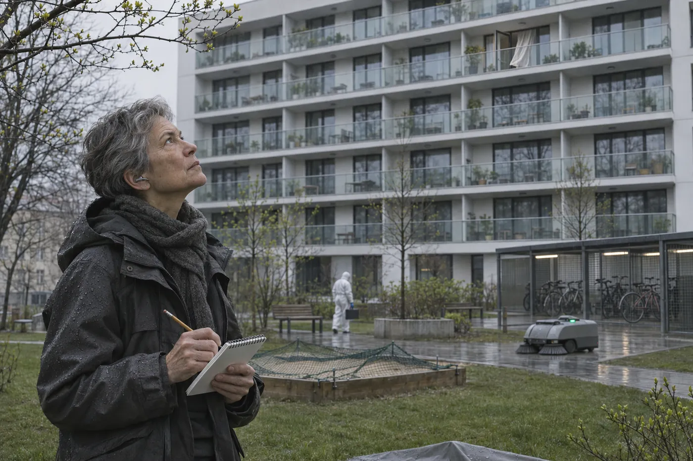

# 3. Balkon

*Brno, Královo Pole a Kounicova. Středa 13. března 2075.*

Ota začal, ještě než Brožová vyjela ze Žabovřesk.

„Královo Pole, novostavba nad Palackého třídou, vnitroblok. Muž, třicet čtyři let, Milan Štěpánek, bydliště Husovice. Nalezen v 5:31 domovním robotem, který zametá dvůr. Pád z osmého patra. Hlídka na místě v 5:44. V 5:58 model kriminální služby vyhodnotil událost jako sebevraždu, pravděpodobnost osmdesát sedm procent.“

„A pak?“

„V 6:12 oznámil systém ověřování identity podezření z padělání identity. Týká se ženy, která má byt v osmém patře pronajatý. Lucie Doubravová, osmačtyřicet let, Masarykova čtvrť. V 6:20 model obě oznámení spojil. Padělaná identita na místě úmrtí spadá ze zákona do výjimek. Tělo je zatím na místě. Požádal jsem o to.“

„Mým jménem,“ řekla Brožová dřív, než to stačil říct on. „Podle pokynu z devětašedesátého.“

„Ano.“

Na Palackého třídě zastavila na červenou a nadechla se zhluboka, jen aby zjistila, jestli to ještě bolí. Nebolelo. Dvě prasklá žebra z konce října se zahojila do Vánoc a připomínala se jen na schodech, nebo když se smála, což nebylo často. Kázeňské řízení skončilo v lednu. Šindelář s ní od té doby mluvil o půl tónu zdvořileji, a to bylo horší než výtka.

Vložila si do úst pastilku a rozjela se.

*

Dům byl nový, devět pater bílé omítky a balkony se skleněným zábradlím, všechny stejné jako zásuvky v kartotéce. Do vnitrobloku se vcházelo průjezdem. Za ním byl trávník, pískoviště pod sítí proti kočkám, kolárna a kontejnery na tříděný odpad. Na trávníku mezi pískovištěm a zdí domu ležela pod šedou fólií postava.

U kolárny stál domovní robot, nízký, s plochou hlavou a s koštětem v ruce, přesně tak, jak ho v půl šesté zastavili. V koši na zádech měl ještě sesbírané listí. Hlídka mu nechala na hrudi rozsvícené modré světlo, aby bylo vidět, že je svědek.

Soudní lékařka byla tatáž jako loni v Tuřanech. Cop pod čepicí, rukavice, klečela na mokré trávě na igelitu. Kývla na Brožovou, jako se kývá na známou z tramvaje.

„Pád z výšky,“ řekla. „Hlava, hrudník, pánev. Okamžitě, nebo skoro. Čas bych tipovala kolem půlnoci, ale tipovat nemusím, že?“

„Domácí jednotka v bytě ve třetím patře zaznamenala zvuk nárazu ve 23:37:52,“ řekl Ota. „Majitelka záznam vydala dobrovolně. V noci si myslela, že někdo shodil popelnici.“

Lékařka nadzvedla fólii. Milan Štěpánek ležel na boku, s jednou nohou pod sebou, jak noha ležet nemůže. Tmavá bunda, džíny, tenisky. Jedna teniska mu spadla a ležela o tři metry dál, u pískoviště, tkaničkami nahoru. Obličej měl otočený do trávy. Brožová byla za to ráda.

„Tohle je zajímavější,“ řekla lékařka a vyhrnula mu levý rukáv.

Na vnitřní straně zápěstí měl čtyři modřiny. Oválné, v řadě, velké jako konečky prstů. Na hřbetu téže ruky tři rovnoběžné škrábance, zarudlé, s tenkou krustičkou.

„Čerstvé,“ řekla lékařka. „Obojí. Hodiny, ne dny.“

„Od nehtů?“

„Škrábance ano. A pod nehty pravé ruky má něco, co tam nepatří. Kůži, možná trochu krve.“ Ukázala na igelitové sáčky, které mu přetáhla přes ruce. „Zkusila jsem rychlý analyzátor. Je to směs, jeho a někoho dalšího, a toho druhého je málo. Ze směsi rychlý stroj nic nevyčte. Musí to do laboratoře.“

„Kdy to budu mít?“

„Na směsi mají jeden přístroj pro celou Moravu.“

„S nejvyšší prioritou v sobotu 23. března,“ řekl Ota.

„Deset dní,“ řekla Brožová.

„Deset dní,“ řekla lékařka.

„Model hodnotí modřiny jako úchop zábradlí při pádu,“ dodal Ota. „Škrábance jako starší, nesouvisející zranění.“

„Nejsou starší,“ řekla lékařka.

„Zahrnuji to.“

Věci z kapes ležely vedle těla v průhledných sáčcích. Klíče od dveří, staré, kovové, na kroužku s otvírákem na pivo. Balíček žvýkaček. Kapesní jednotka nosiče v koženém pouzdře. A šedé pletené rukavice bez prstů, prošoupané na palcích, jaké nosí lidé, kteří potřebují v zimě pracovat rukama.

Lékařka přetáhla fólii zpátky.

Brožová došla ke kolárně. Robot otočil plochou hlavu jejím směrem a modré světlo na hrudi mu zablikalo.

„Kapitánka Brožová, kriminální policie,“ řekla. „Co jsi viděl?“

„V 5:31 jsem při zametání dvora narazil na člověka,“ řekl robot. Měl příjemný, trochu dutý hlas, jako by mluvil z krabice od bot. „Nereagoval na oslovení. Nedýchal. Přivolal jsem záchrannou službu a správce domu. Nedotkl jsem se ho. Jen jsem zvedl botu, abych ji nezametl, a pak jsem ji položil zpátky, kde ležela.“

„A v noci?“

„V noci jsem v doku v kolárně. Dok nemá okno. Při nabíjení nic nezaznamenávám.“ Robot chvíli mlčel. „Kdybych měl dok venku, byl bych u něj ve 23:38.“

Brožová se na něj podívala. Nic víc v tom nebylo, jen počty. Robot to řekl tónem, jakým by hlásil, kolik je stupňů.

V okně ve třetím patře stála žena v županu a držela si ho u krku. Když Brožová zvedla hlavu, neuhnula pohledem.

„To já,“ řekla shora, ne nahlas. „Ta popelnice. Já jsem se ani nepodívala. Otočila jsem se na druhý bok.“

„Kdybyste se podívala, nic byste neviděla,“ řekla Brožová. „Byla tma.“

Žena kývla, jako by jí to pomohlo, a zatáhla záclonu.

Brožová vytáhla zápisník, kroužkový, s tužkou ve spirále, a napsala: *zápěstí – 4 prsty. Škrábance. Pod nehty – 23. 3.* Pak se podívala nahoru. Osmé patro. Jeden balkon měl otevřené dveře a záclona za nimi se hýbala.

Vaněk přišel průjezdem s rukama v kapsách a s nosem červeným od rána. Zastavil se u ní a díval se nahoru taky.

„Byt na její jméno a její nosič v bytě,“ řekl. „Ota mi to poslal po cestě. Ještě motiv a máme ji.“

„Nebo někdo chtěl, abychom ji měli.“

„Taky,“ řekl Vaněk. „Ale většinou ne.“

*

Výtah jel tiše a voněl čisticím prostředkem. Byt 34 byl na konci chodby, dveře otevřené, technik z výjezdovky na kolenou v předsíni. Dva pokoje, nábytek z půjčovny, šedý a bez jediné stopy po člověku. Na posteli přehoz natažený do pravých úhlů. V lednici nic. Ještě tu byla cítit nová malba.

„Pronajatý třetího března přes platformu, na měsíc od čtvrtého,“ řekl Ota. „Identitou L. D., zaplaceno předem z jejího účtu. Pronajímatelova jednotka zapisuje jen dveře. Kdo otevřel, kdy a čím. Do bytu nevidí, to zákon u nájemních bytů nedovoluje. Záznam za včerejší noc: ve 23:04 vstup kódem, host. Ve 23:10 vstup nosičem nájemkyně. Ve 23:21 otevřeny balkonové dveře. Ve 23:40 nosič nájemkyně byt opustil. Balkonové dveře zůstaly otevřené do rána.“

„A předtím tu byla?“

„Nájemkyně tu byla poprvé včera ve 23:10.“

Brožová si to spočítala. Náraz ve 23:37:52. Odchod ve 23:40. Dvě minuty a osm vteřin.

„Volal někdo z bytu záchranku?“

„Ne.“

Na odkapávači v kuchyňce stála jedna sklenice, umytá a obrácená dnem vzhůru. Druhá stála venku na balkonovém stolku, s kapkou vody na dně.

„Na té venku otisky oběti,“ řekl technik, aniž by se zvedl. „Ta na odkapávači je čistá. Umytá, utřená. Na klice balkonových dveří taky nic. Otřená, nebo rukavice.“

Brožová vyšla na balkon. Zábradlí bylo z kaleného skla, s ocelovým madlem nahoře, a sahalo jí skoro k prsům. Přes takové zábradlí člověk nespadne. Přes takové musí přelézt, nebo ho přes ně někdo musí přehodit. Opřela se o madlo a nahnula se. Žebra se ozvala, tupě, jako připomínka z října. Přehodit přes tohle dospělého muže chtělo sílu. Nebo chvíli, kdy se nedržel, protože se zrovna vytrhával z něčích rukou. Milan Štěpánek nebyl velký. Byl hubený, lehký, s pažemi technika, ne stěhováka. Podívala se dolů. Trávník, fólie, pískoviště. Modré světlo robota u kolárny. Odsud vypadalo všechno malé a pořádné, jako hračky po úklidu.

Vrátila se do kuchyně. Na tu umytou sklenici se dívala dlouho.

Mrtvý se nevrátí, aby si umyl sklenici. Umyje ji ten, kdo zůstal, a ví, co dělá. A pak odejde. Za dvě minuty a osm vteřin.

Napsala si: *Kdo myje sklenici?*

*

„Teď ta identita,“ řekla v autě. Bylo půl desáté a Vaněk seděl vedle ní a jedl rohlík, opatrně, aby nedrobil.

„V 6:12 systém ověřování zjistil dva nosiče s klíči paní Doubravové,“ řekl Ota. „Jeden v Brně, v Masarykově čtvrti. Druhý sto třicet čtyři kilometrů odsud. Porovnal oba s jejím profilem. Za pravý označil ten vzdálený, shoda devadesát devět celých devět. Ten v Masarykově čtvrti pozastavil jako pravděpodobný padělek. Shoda devadesát jedna.“

„Který z nich byl v noci tady?“

„Nevím. Mají stejné klíče. Jednotka bytu zapisuje klíče, ne krabičku.“

„A kde je ten pravý teď?“

„Od 6:14 mimo síť. Poslední známé místo je chráněný údaj. Návrh na soud jsem podal v 7:02.“

Brožová se opřela o volant.

„Takže pravá Lucie Doubravová si tady pronajala byt, přišla sem, a když z balkonu spadl chlap, umyla si sklenici a odešla. A falešná sedí doma v Masarykově čtvrti.“

„Podle systému identity,“ řekl Ota. „Fyzicky je paní Doubravová jedna. Bydlí v Masarykově čtvrti.“

„Tak se na tu jednu podíváme.“

„Ještě zprávy. Soudkyně ve službě povolila v 9:20 výřez komunikace oběti s identitou L. D. za poslední měsíc. Pět zpráv.“

Zprávy naskočily na malém displeji jednotky, kterou měla v náprsní kapse. Řádek pod řádkem, šedé písmo.

*3. 3., 21:14, L. D.: Dostal jsi, co jsi chtěl. Tím to končí.*

*3. 3., 21:20, M. Š.: Nekončí.*

*12. 3., 15:52, L. D.: Potřebuju to ukončit. Dnes večer.*

*12. 3., 16:01, L. D.: Adresu a kód ti posílám. V jedenáct.*

*12. 3., 22:49, M. Š.: Jedu. A nezkoušej nic.*

„Třetího března odešlo z účtu paní Doubravové na účet oběti čtyři tisíce eur,“ řekl Ota. „Týž den byl sjednán pronájem.“

Vaněk přestal žvýkat.

„Vydíral ji,“ řekl.

„To je jedno z vysvětlení,“ řekl Ota. „Oběť pracovala v letech 2063 až 2071 jako technik nosičů v Halo Systémech, kde paní Doubravová vede tým. Propuštěn při automatizaci servisu. Od té doby bez stálého zaměstnání, dluhy kolem jednadvaceti tisíc. Zdravotní správce soudní lékařce potvrdil, že se v letech 2072 a 2073 léčil s depresí. Model po zahrnutí nových údajů: sebevražda třicet jedna procent. Pravděpodobnost, že se paní Doubravová na smrti Milana Štěpánka podílela: osmdesát tři procent.“

„A ten druhý nosič?“

„Je v odhadu. Paní Doubravová navrhuje chování domácích asistentů pro jednoho z největších poskytovatelů v Evropě. Ví o nosičích víc než téměř kdokoli v kraji. Duplikát si mohla připravit sama.“

„Proč by si dělala duplikát, který ji pak systém zablokuje?“

„Nevím,“ řekl Ota. „Proto je to osmdesát tři, a ne devadesát.“

„A jeho vlastní nosič?“

„Sluchátko leželo v trávě dva metry od těla, jednotka v kapse bundy. Paměť šifrovaná. Správcem je podle registru jeho matka.“

Vaněk dojedl rohlík a složil papírek na čtverec.

„Kdyby to nebyla ona,“ řekl, „byla by to nejsmolnější ženská v Brně.“

*

Matka bydlela v Hodoníně. Bylo jí dvaasedmdesát let a ještě o ničem nevěděla. Ota nabídl, že to vyřídí hodonínská hlídka. Brožová řekla, že zavolá sama. Hovor trval devět minut. Potom seděla v autě na parkovišti za Kounicovou a chvíli nežvýkala nic.

Šindelář zavolal ve 12:40. Neptal se, jak se má.

„Halo Systémy, Jano. Vedoucí týmu.“

„Ano.“

„Víš, kolik lidí v kraji má doma Halo? Moje máma má Halo. Polovina tvého domu má Halo.“ Slyšela, jak odkládá kelímek. „Do večera chci vědět, jestli ji zadržíme. Dřív, než se toho chytnou média. Ty už vědí, že v Králově Poli někdo spadl. Zatím nevědí, z čího bytu.“

„Ještě jsem s ní nemluvila.“

„Tak s ní mluv.“

Ve 14:30 zavolala Lucii Doubravové přes domácí linku manžela, protože jinou cestu k ní neměla. Lucie Doubravová měla hlas ženy, která celý den mluví s automaty a teď nevěří, že slyší člověka. Milana Štěpánka si pamatovala jen z výtahu. Na otázku, kde byla v noci, řekla *venku*, a po dlouhém tichu *bez*. Brožová si to zapsala tužkou, a zatímco psala, měla dojem, že ten zvuk slyší i Lucie na druhé straně.

*

Výslechová místnost byla na konci chodby, s oknem do dvora, kde rostl jediný javor. Lucie Doubravová seděla u stolu a držela kelímek s čajem oběma rukama, ale nepila.

Byla vysoká a štíhlá, s vlasy barvy lískového oříšku, prokvetlými na spáncích, ostříhanými tak přesně, že to musel dělat člověk. Šedý svetr, tmavé kalhoty, nic, co by bylo vidět. Takhle se oblékají lidé, kterým oblečení vybírá někdo s dobrým vkusem a oni s ním souhlasí. Oči měla zarudlé, ale suché. Manžel čekal na chodbě, na lavici, s rukama sepjatýma mezi koleny.

Ota mluvil nahlas z jednotky na stole. Brožová to tak měla nastavené pro rozhovory se svědky.

„Paní Doubravová,“ řekla Brožová, „podáváte vysvětlení. Nejste obviněná. Přesto máte právo na advokáta. Veřejný je k dispozici zdarma, do dvaceti minut.“

„Nepotřebuju advokáta.“

„To si myslí leckdo.“

„Chci to mít za sebou,“ řekla Lucie. „A nemám čím zaplatit ani tramvaj.“

„Paní Doubravová advokáta odmítla v 16:04,“ řekl Ota.

Lucie se na jednotku podívala, jako by teprve teď pochopila, že tam někdo je.

Brožová jí řekla, co ví. Ne všechno. Byt v Králově Poli na její jméno, otisk jejího nosiče ve 23:10 a ve 23:40, pád ve 23:37. Lucie poslouchala a nehýbala se. Jen když Brožová řekla *osmé patro*, sevřela kelímek tak, že praskl, a čaj jí vytekl po prstech na stůl. Ani si toho nevšimla. Vaněk jí podal kapesník.

„Nikdy jsem tam nebyla,“ řekla. „Nevím, kde ten dům je.“

„Kde jste byla?“

„Doma. V půl jedenácté jsem šla ven.“

„Kam?“

„Na Špilberk. Na hradby. Seděla jsem tam, dokud nezapadl Orion. Pak jsem šla domů. Vrátila jsem se v jednu.“

„Viděl vás někdo?“

„Liška.“

Vaněk se zasmál a hned toho nechal. Lucie se nesmála.

„A nosič jste nechala doma.“

„V šuplíku v předsíni.“

„Proč?“

Lucie se dlouho dívala na kaluž čaje na stole.

„Chtěla jsem vědět, jaké to je.“

„A jaké to je?“

„Ticho,“ řekla Lucie.

Brožová si pamatovala, jaké to je. Do třiceti neměla v uchu nikoho. Měla v kapse telefon, který mlčel, dokud ho nevytáhla, a cesty, které musela znát sama. Takové bylo celé její mládí. Nenapsala si nic.

„Váš nosič v šuplíku,“ řekla místo toho, „mi potvrdí kdo?“

„Leo. Můj asistent. Dům.“

„Na soudní příkaz. A i tak mi řeknou, kde ležel nosič. Ne to, kde jste byla vy.“

Lucie kývla. Věděla to. Bylo na ní vidět, že to ví líp než Brožová.

„Systém tvrdí,“ řekla Brožová, „že se poslední tři týdny chováte jinak než dřív. Že proto je padělek ten váš.“

„Ano.“

„Proč se chováte jinak?“

Lucie se podívala k oknu, na javor.

„V únoru jsem našla deník,“ řekla. „Z gymnázia. Psala jsem ho já. Nepoznala jsem se v něm.“ Usmála se, jen koutkem, a nebylo to veselé. „Tak jsem začala dělat věci, které bych neudělala. Malé věci. Jiná cesta do práce. Jiné jídlo. Vynechala jsem…“ Zarazila se. „Je to hloupé.“

„Mně to hloupé nepřipadá,“ řekla Brožová, a myslela to vážně.

„Odchylka chování v týdnech před činem je známý jev,“ řekl Ota. „Pro úplnost.“

Lucie se na jednotku podívala znovu. Tentokrát tak, jak se člověk dívá na kolegu, který má pravdu a neměl by.

Brožová jí poslala na desku stolu zprávy. Lucie je četla. Všech pět, pomalu, jednu po druhé. U třetí se zastavila.

„*Potřebuju to ukončit,*“ řekla nahlas. „Tohle je moje věta. Takhle píšu. Tečka za *ukončit*, tečka za *večer*. Já to píšu takhle.“ Podívala se na Brožovou. „Ale nenapsala jsem to.“

„Čtyři tisíce eur třetího března?“

„Nevím o nich. Nevidím na svůj účet od rána.“ Pak tišeji: „Neviděla jsem tam celý měsíc. Leo to dělá za mě.“

„Znala jste ho? Pana Štěpánka?“

„Od vidění. Z výtahu. Měl rukavice bez prstů.“

Brožová si vzpomněla na šedý sáček na trávě. Neřekla nic.

Lucie zavřela oči. „Nikdy jsem mu nenapsala ani slovo.“ Pak je zase otevřela. „Měl někoho?“

„Matku.“

„Ví to?“

„Od poledne.“

Lucie kývla a dívala se na své ruce. Za dvacet let se na to zeptal málokdo z lidí, kteří seděli na téhle židli. Brožová si to zapsala, i když nevěděla proč.

„Měl pod nehty kůži,“ řekla Brožová. „Někoho, kdo se s ním v tom bytě přetahoval. Jestli ženskou, nebo mužskou, zatím nevíme. Výsledek bude za deset dní.“

Lucie zvedla hlavu.

„Vezměte si vzorek,“ řekla.

„Nemusíte. Bez soudního příkazu…“

„Chci.“ Lucie odložila rozmáčknutý kelímek a vyhrnula si rukávy svetru, oba, až k loktům, rychle, jako to dělají lidé, kteří se chystají umývat nádobí. Položila ruce na stůl, dlaněmi nahoru. „A tohle si taky prohlédněte.“

Brožová se podívala. Předloktí bledá, hladká, s jemnými chloupky. Na levém zápěstí pruh světlejší kůže od náramku, který teď ležel na stole vedle kelímku. Žádný škrábanec. Žádná modřina. Nehty krátké, čisté, nenalakované, jeden u palce okousaný. Pak Lucie ruce otočila. Hřbety taky čisté. Jen na kotníku pravého ukazováčku drobná zahojená jizvička, stará, bílá.

„Od cibule,“ řekla Lucie, když viděla, kam se Brožová dívá. „Bylo mi sedmnáct.“

Technička z kriminalistického ústavu přišla za šest minut. Stěr z vnitřní strany tváře, dvakrát, tyčinkou s vatou, do zkumavky s čárovým kódem. Lucie u toho držela ústa otevřená a dívala se do stropu jako u zubaře.

„Porovnání pojede stejnou frontou,“ řekl Ota. „Sobota 23. března.“

V 17:40 ji Brožová pustila. Neměla důvod ji držet a věděla, že ho do rána mít bude.

„Nikam neodjíždějte,“ řekla u dveří.

„Kam?“ Lucie si stahovala rukávy. „Nepustí mě ani do tramvaje.“

Manžel na chodbě vstal. Lucie k němu šla a on ji objal a ona se nechala, s rukama podél těla. Odcházeli spolu chodbou k výtahu, on o půl kroku za ní, jako by ji kryl zezadu.

*

„Vaše hodnocení?“ zeptal se Ota, když zůstali sami. Vaněk šel s Doubravovými dolů.

„Nemá škrábance.“

„Pod nehty může být kůže kohokoli. Nemusela to udělat vlastníma rukama. Mohla tam poslat někoho, kdo nosí její druhý nosič. Můj odhad se nemění. Osmdesát tři.“

„Můj jo.“

„Na kolik?“

Brožová se dívala z okna na javor. Byl ještě holý a na nejnižší větvi seděla vrána a čistila si zobák o kůru.

„Na půl,“ řekla.

Vaněk se vrátil za půl hodiny. Odvezl Doubravovy domů. „Celou cestu mlčela,“ řekl. „Jen na Úvoze řekla, že tamhle nahoře bydlí ta liška.“ Pokrčil rameny a sedl si na roh stolu. „Je chytrá, Jano. Je chytrá a je to ona.“

„Možná.“

Šindelář čekal na chodbě u kávovaru. Kelímek držel oběma rukama.

„Pustila jsi ji.“

„Neměla jsem proč ji držet.“

„Máš byt na její jméno, nosič na místě, zprávy, čtyři tisíce eur a ženskou, která v noci chodí po Špilberku bez nosiče a nikdo ji neviděl.“ Šindelář mluvil tiše a zdvořile, jak to teď s ní dělal. „Média se to dozvědí zítra. Halo se to dozvědělo dneska. Zítra ráno chci mít návrh na zadržení. Na stole. Do osmi.“

„Budeš ho mít.“

Šindelář na ni chvíli koukal. Pak kývl a odešel.

„Návrh mám připravit?“ zeptal se Ota.

„Napíšu ho sama.“

„Soud obvykle rozhoduje do poledne následujícího dne.“

„Já vím.“

V kanceláři si sedla, rozsvítila lampu a otevřela zápisník. Napsala návrh, celý, věcně, protože data byla data a zákon byl zákon, a soud měl právo vidět je všechna. Na konec připsala tři řádky, které nikdo nechtěl. Bez škrábanců. Dobrovolný vzorek. V bytě jen otisky oběti.

Pak si do zápisníku pod všechno napsala ještě jednu větu a dvakrát ji podtrhla.

*Kdo je ta druhá?*

Vložila si do úst pastilku. Za oknem se nad Kounicovou rozsvěcovaly lampy, jedna po druhé. Večer se zatáhlo a Orion nebyl vidět.
