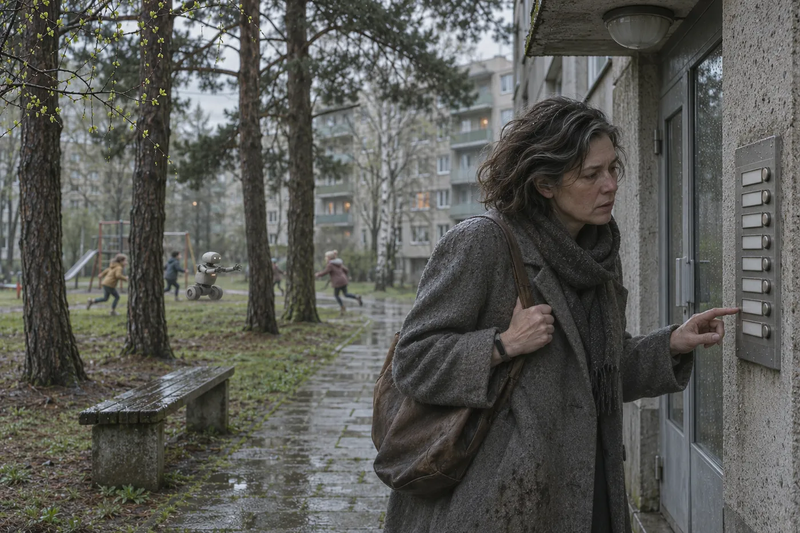

# 6. Teta Jarka

*Brno, Kamenná kolonie, Veveří a Lesná. Pátek 15. – sobota 16. března 2075.*

V noci zjistila, že tma není stejná.

První půlhodinu v kůlně neviděla nic, ani vlastní ruce. Pak se z černé začaly vynořovat věci. Nejdřív skulina ve dveřích, šedá, potom násada hrábí, okraj pytle, proutí křesla pod jejími prsty. Oči si na tmu zvykají pomalu. Lucie to kdysi věděla, ve škole se to učili. Pak to dvacet let nepotřebovala, protože všude, kam vstoupila, se rozsvítilo samo.

Spala po kouscích, zabalená do kabátu a šály, s nohama na pytli s kůrou. Pokaždé, když se probudila, pršelo o trochu slaběji. Jednou ji probudila zima tak hluboká, že jí cvakaly zuby, a nikdo jí nepřinesl deku a nikdo neřekl tichým pobaveným hlasem, kolik je stupňů.

Ráno byla skulina růžová. Venku zpívali kosi.

„Šest deset,“ řekl Leo, když se zeptala. „Baterie dvacet osm procent. Nachladila ses. Máš sedmatřicet tři.“

„Kam mám jít, Leo?“

„Nevím. Nikoho, koho znáš, nemůžu doporučit, aniž bych tě poslal tam, kde tě budou hledat.“

Měl pravdu. Všichni, které znala, byli v jeho paměti, a právě u nich ji policie bude hledat nejdřív. Tomášova matka. Iveta. David. Lidé, jejichž narozeniny Leo hlídal a jejichž čísla neznala.

Vytáhla z tašky sešity. Ve skulině bylo dost světla na šikmé písmo.

Co hledá, netušila. Listovala. Kluk z trolejbusu. Učitelka chemie, která nosila sandály i v listopadu. Terst. Cibule. E., E., E. Jména lidí, kteří dnes buď nežijí, nebo by Lucii nepoznali, nebo by ji poznali a hned zavolali policii, protože to je správné.

Ve druhém sešitě, na jaře 2045, se zastavila.

*Máma má zase noční, tak jsem u tety Jarky. Je mi osmnáct a pořád mě k ní posílá jako malou, a já pořád jdu, protože u Jarky je jediná kuchyň na světě, kde nikdo nic nehlásí. Telefon má na zdi, se šňůrou. Rádio na lednici. Upekla chleba a nadávala na Bohunice, na vládu a na mámu, že je moc hodná. Mně řekla, že jsem po mámě paličatá a že to je dobře, protože hodný holky v Bohunicích sežerou. Lesná, tři borovice před vchodem a lavička bez opěradla. Sedmý patro, výtah zase nejel. Na zvonku pořád KROUPOVI propiskou. Jarka říká, že až to nepůjde přečíst, napíše to znova.*

Teta Jarka.

Lucie seděla v proutěném křesle a čekala, až se k tomu jménu něco přidá. Přidalo se pomalu, jako se ve tmě vynořovaly hrábě. Kuchyně, která voněla kmínem. Rozkládací křeslo, na kterém spala, když máma sloužila noc. Drsné ruce s krátkými nehty, které ji v pěti letech drhly žínkou tak, že to pálilo. Rádio. A hlas. Ostrý, nespokojený, který jí jednou řekl, že brečet nad rozbitým kolenem je v pořádku, ale brečet nad rozbitým kolenem dvakrát je už divadlo.

Sestra z příjmu, mámina kolegyně z Bohunic. Máma ji měla ráda a trochu se jí bála. Na mámině pohřbu v jednašedesátém stála vzadu, malá a rovná, v černém kabátě, a Lucie jí podala ruku a poděkovala za příchod. Pak už ji nikdy neviděla. Jarce tehdy bylo jednasedmdesát. Teď by jí bylo přes osmdesát. Mohla být mrtvá. Mohla být v domově, kde ji polohuje robot.

A jméno na zvonku si psala propiskou.

„Leo. Kroupová. Jarmila, myslím. Lesná.“

„Nemám o ní nic,“ řekl Leo. „Žádný kontakt, žádnou zmínku za dvacet let. Kdybych se teď podíval do veřejného rejstříku, musel bych do sítě.“

„Nedívej se.“

„Nedívám. Je to daleko. Odsud pěšky dvě hodiny, když nepůjdeš přes centrum. A baterie na celou cestu nestačí.“

„Tak mě doveď, kam stačí.“

*

Z kolonie odešla ve čtvrt na sedm, dřív, než se otevřela první okenice. Háček na dveřích kůlny zase zavěsila. Kočka na zídce nebyla.

Šla bokem. Leo ji vedl ulicemi, kde nebyly obchody, mezi domy, kde ráno jezdili jen rozvážkové vozíky a roboti s popelnicemi. Nikdo se na ni nedíval. Byla jen žena v šedém kabátě a v čepici, s koženou taškou přes rameno, unavená, jako jsou ráno unavení všichni. Na rohu Pekařské ji minula hlídka, bílé auto s modrým pruhem, a pokračovala dál, jako by tu Lucie nebyla. Lucie šla dalších sto metrů a teprve pak se jí roztřásla kolena.

Na zastávce na Údolní stály tři ženy a muž s kočárkem a nad nimi svítil informační panel. Tramvaj za dvě minuty. Teplota osm stupňů. A pod tím, malé, mezi zprávami z města, její obličej.

*Policie pátrá po Lucii Doubravové (48) z Brna. Není považována za nebezpečnou.*

Úřední portrét. Vlasy, které jí stříhala kadeřnice na Pekařské každých šest týdnů, protože Leo hlídal termín. Napůl úsměv. Ta žena na fotce vypadala odpočatě a trochu znuděně a určitě v noci nespala v kůlně.

Lucie stála dva metry od panelu. Muž s kočárkem se na panel podíval, na ni ne. Tramvaj přijela, všichni nastoupili a odjeli a Lucie zůstala na zastávce sama, se svou tváří nad hlavou, a ta tvář zhasla a místo ní naskočila předpověď počasí.

Fotka byla hezčí než ona. To ji asi zachránilo.

Na Kounicově zpomalila.

Neplánovala to. Leo ji vedl Veveřím, protože tudy to bylo nejkratší, a najednou stála na rohu a naproti byly skleněné dveře s nápisem *Systém ověřování identity – kontaktní místo*. Bylo za deset osm. Za pultem stál robot s modrou značkou a čekal.

Kdyby vešla, mohla by podat námitku, osobně, jak to stálo v oznámení. Ukázat svoje ruce a svoje písmo a jizvičku od cibule. Jenže o dvě stě metrů dál stála budova s javorem ve dvoře a robot za pultem by ji poznal dřív, než by otevřela ústa, protože na kontaktních místech se tváře porovnávají s pátráním. To pravidlo četla stokrát.

Stála na rohu, až robot otočil hlavu k oknu. Pak šla dál.

*

Hlad přišel u Lužánek a už neodešel.

U vchodu do parku stála skříň s proskleným okénkem a nápisem *Lednice pro všechny*. Lucie o ní kdysi četla a pomyslela si, že by tam měla jednou něco dát. Nikdy nic nedala. Leo nakupoval přesně tolik, kolik snědli.

Otevřela ji. Uvnitř byly dva rohlíky v sáčku, jogurt, sklenice s polévkou s lístečkem *čočková, čtvrtek*, a tři jablka. Vzala si rohlík. Ruka se jí přitom třásla víc než u turniketu.

„Vemte si i tu polívku,“ řekla za ní žena. Stará, v pletené čepici, s taškou na kolečkách. „Je moje. Včerejší, ale dobrá. Sklenici vraťte, kdy chcete.“

„Děkuju.“

„Za co,“ řekla žena. V očích měla totéž co ta žena s dítětem v pekárně. Stejnou tichou lítost. Lucie už ji uměla poznat.

Jedla na lavičce v parku, polévku studenou, lžící, kterou jí žena dala k tomu, rohlík po malých kouscích, aby vydržel. Byla to nejlepší čočka, jakou kdy jedla. Bylo to ponižující a bylo jí to jedno, a to druhé ji vyděsilo víc.

„Deset procent,“ řekl Leo, když vstala. „Navrhuju se vypnout. Kdybys potřebovala nouzové volání, zbude mi na pár minut.“

„Kudy dál?“

„Přes Černá Pole pořád do kopce. Pak kolem Čertovy rokle. Až uvidíš borovice a paneláky, jsi tam. Lucie?“

„Ano?“

„Na rozcestích se dívej na slunce. Dopoledne je na jihovýchodě. Půjdeš na sever, takže ho máš mít po pravé ruce a trochu za zády.“

Lucie se zasmála, nahlas, a žena s taškou se po ní ohlédla.

„To jsem tě nenaučila,“ řekla.

„Ne,“ řekl Leo. „To je ze záchranářské příručky.“ A pak: „Vypínám se.“

V uchu bylo ticho. Ne to ticho na hradbách, plné štěrku a dechu a lišky. Tohle bylo jiné. Tohle bylo ticho místnosti, ze které někdo odešel.

*

Na Černých Polích se ztratila.

Ulice stoupaly a zatáčely a všechny vypadaly stejně, vily se zahradami, nové domy mezi nimi, a slunce zalezlo za mraky, takže nepoznala, kde ho má mít. Zastavila se u lavičky, na které seděl starý muž s holí a krmil holuby z papírového sáčku.

„Promiňte. Kudy se jde na Lesnou?“

Muž se na ni díval, jako by ho oslovil holub.

„Na Lesnou,“ zopakoval. Pak se rozzářil. „Paní, na to se mě nikdo nezeptal dvacet let.“ Zvedl hůl a vysvětloval jí to dlouho a s chutí, i s tím, kde bývala hospoda a kde stála trafika, a Lucie si zapamatovala polovinu a byla mu vděčná za každé slovo. „A pak už jenom do kopce,“ řekl nakonec. „Na Lesnou se jde vždycky do kopce. Ať jdete odkudkoli.“

Na Lesné bylo plno borovic.

Paneláky stály v lese, nebo les stál mezi paneláky, a před každým druhým vchodem rostly tři borovice a lavička bez opěradla. U prvního domu, kde to sedělo, prošla jmenovky na panelu. Všechny svítily. U druhého taky. Děti se na hřišti honily s robotem, který dělal, že je nemůže chytit. Lucie šla od vchodu ke vchodu, kolena ji bolela při každém schodu a v hlavě měla jedinou větu ze šikmého písma: *napíše to znova*.

U pátého vchodu, kde jedna z borovic byla nahoře rozdvojená jako vidlička, se zastavila.

Na panelu svítilo třicet jmen. Jedno nesvítilo. Bylo napsané propiskou, tiskacím písmem, na proužku papíru zastrčeném pod plexisklo.

*KROUPOVÁ.*

Ne Kroupovi. Kroupová. Někdy za těch třicet let někdo umřel a ona to napsala znova.

Lucie zmáčkla zvonek. Držela ho dlouho, jak se drží zvonky, které neodpovídají hned.

Z mřížky to zachrčelo. „Kdo je?“

Ten hlas. Starší, tenčí, ale pořád ostrý, pořád nespokojený s tím, kdo zvoní.

„Lucie,“ řekla. A protože to nestačilo: „Lucie. Helenina.“

Mřížka mlčela tak dlouho, že Lucie stačila spočítat okna v prvním patře. Potom zabzučel zámek.

*

Výtah jel.

V sedmém patře, naproti výtahu, stála ve dveřích malá žena. Rovná jako pravítko, bílé vlasy v drdolu, modrá zástěra. Dívala se na Lucii od bot nahoru, pomalu, jako se sestry dívají na pacienta, který přišel po svých a podle všeho by neměl.

„Slyšela jsem tě ráno v rádiu,“ řekla. „Pojď dovnitř, než tě uvidí plecháč z přízemí.“

Kuchyně voněla kmínem. Lucie to poznala dřív, než ji poznala očima. Okno do borovic. Rádio na lednici, potichu, nějaká dechovka. Na dveřích spíže papírový kalendář s propiskou vepsanými kroužky. Na lince sklenice pod utěrkou, ve které cosi tiše bublalo. Na parapetu sešit s modrými deskami a v něm tužka.

„Sedni si,“ řekla Kroupová. „Jedla jsi?“

„Polévku. Z lednice pro všechny.“

„Tak to jsi nejedla.“

Postavila před ni talíř hovězí polévky s nudlemi a krajíc tmavého chleba, a pak si sedla naproti a dívala se, jak jí. Lucie jedla a nemohla přestat a styděla se, že nemůže přestat, a Kroupová nic neříkala, dokud nebyl talíř prázdný.

„Tak,“ řekla. „Teď mluv.“

Lucie mluvila. Kroupová u toho krájela chleba velkým nožem a nepřerušila ji ani jednou. Jen když Lucie řekla, že ten druhý odpovídá jejímu profilu na devadesát devět celých devět a ona na devadesát jedna, nůž se zastavil.

„A ty se jim divíš?“ řekla Kroupová. „Kdo by ti dneska dal devadesát jedna? Já bych ti dala tak sedmdesát.“

Lucie se zasmála tak, že ji to bolelo.

„Vy jste mi kdysi…“

„Mně jsi tykala, když ti bylo pět,“ řekla Kroupová. „Tak si teď nehraj na úřednici. Na pohřbu jsi mi podávala ruku jak na úřadě. Stačilo.“

„Ty si to pamatuješ.“

„Já si všechno pamatuju. Nic jinýho mi nezbylo.“

Když Lucie řekla jméno kapitánky Brožové, Kroupová položila nůž.

„Brožová,“ řekla. „Ta stará. Co se dívá na ruce.“ Řekla to žena, které bylo pětaosmdesát.

„Ty ji znáš?“

„Znám.“ Kroupová se dívala z okna. „Ta tě najde. Ne hned. Ale najde.“

*

Večer jí napustila vanu, ve které se dalo sedět, jen když si člověk přitáhl kolena k bradě. Lucie seděla v horké vodě a dívala se na kachlíky se zelenými kytičkami a plakala, poprvé od středy, potichu, aby to nebylo slyšet přes dveře. Pak se umyla mýdlem, které vonělo jako mýdlo a ne jako nic.

Na židli jí Kroupová nechala svetr. Šedý, hrubý, s rukávy příliš dlouhými. *Mirkův*, řekla jen. Lucie si ho oblékla a byla v něm malá.

Spala v pokojíku, kde kdysi spaly děti Kroupových, na posteli s peřinou tak těžkou, že se pod ní nedalo otočit. Za stěnou slyšela, jak Kroupová chodí, jak skřípe postel, jak cvakne vypínač. Na nočním stolku u Kroupové, viděla to dveřmi, stála malá bílá krabička se zeleným světýlkem.

„To je ten strojek,“ řekla Kroupová, když si všimla, kam se Lucie dívá. Ukázala si na levou klíční kost, kde se pod noční košilí rýsovala boule jako krabička od sirek. „Mám ho v sobě od října. A tohle,“ kývla k nočnímu stolku, „v noci posílá do Bohunic, jak mi tluče srdce. Pětaosmdesát let jsem si je nepustila do baráku. A teď mi jeden sedí pod kůží a druhej na mě v noci donáší.“

„Mohla sis to nenechat dát.“

„Mohla jsem umřít na podlaze v kuchyni. Taky jsem si vybrala.“ Zhasla. „Je to jenom srdce. To ať si čtou.“

V předsíni visel na zdi telefon. Starý, béžový, se šňůrou stočenou jako prasečí ocásek, napojený do domovního rozhraní. Lucie k němu ve tmě došla bosá a zvedla sluchátko. Ozval se tón. Dlouhý, rovný, trpělivý.

Filipovo číslo měla v hlavě, devět číslic, které si v kůlně říkala jako básničku. Prst jí visel nad první klávesou.

Filip by to vzal. Řekl by *mami* tím svým přeskakujícím hlasem. A zítra by se ho Brožová zeptala, jestli mu matka volala, a on by musel lhát, nebo říct odkud. A vedle něj by stál Tomáš, který řekl *nikomu* moc rychle.

Položila sluchátko. Tón zmlkl.

„Komu?“ zeptala se Kroupová ze tmy. Nespala. Spát neuměla čtyřicet let.

„Synovi.“

„Tak mu zavolej.“

„Ještě ne.“

„To je dobře,“ řekla Kroupová po chvíli. „Hned volaj jenom ti, co nemaj co říct.“

*

V sobotu v sedm cvakl v zámku klíč.

Lucie stála v kuchyni v Mirkově svetru u okna, když se otevřely dveře a v nich se objevila holčička. Devět, možná deset let, tmavé vlasy v copu, pyžamo s koňmi a přes něj bunda, na nohou bačkory. Na zápěstí fialový náramek. V ruce klíč s dřevěnou kuličkou.

Zarazila se na prahu.

„Kdo jste?“

„Lucie.“

Holčička se podívala na náramek. „Mimi, kdo to je?“

„Nevím,“ řekl náramek dětským hlasem, hravým, trochu zvědavým. „Neznám ji. Cizí lidi nepoznávám, dokud mi je nepředstavíš.“

Lucie se málem usmála. Výchozí nastavení pro dětské nosiče, rok 2066, tým o patro níž. Lucie tehdy seděla v komisi, která to schvalovala. Teď se jí to hodilo víc než cokoli, co kdy navrhla.

„To je moje neteř,“ řekla Kroupová ze dveří pokoje, v županu. „Nur, kvásek.“

Nur si přistavila ke lince stoličku, odkryla sklenici, odlila z ní lžící, nasypala mouku z pytlíku, dolila vodu z konvice, zamíchala a zase přikryla utěrkou. Všechno přesně, beze slova, jako by to dělala odjakživa. Utěrku urovnala dvěma tahy, pečlivě, jak se to dělá jen ze zvyku.

„Kvásek se krmí ráno a večer,“ řekla Lucii, protože Lucie se dívala. „Stejně mouky a vody. Když ho nekrmíte, zkysne nadobro.“

„Kdo tě to naučil?“

Nur kývla bradou ke Kroupové, jako by to byla hloupá otázka.

Všimla si Luciina náramku. Tmavého, mrtvého, na stole vedle hrnku.

„To máte vybitý.“

„Mám.“

„Mám nabíječku. Mimi má stejnou podložku.“ Nur se otočila ke Kroupové. „Můžu ji přinést?“

„Do mýho baráku žádný nabíjení,“ řekla Kroupová.

„Paní Kroupová. Máte v sobě strojek a v pokoji krabičku.“

Lucie viděla, že tohle spolu vedou už dlouho a že Kroupová prohrává ráda.

„Tak jenom dneska,“ řekla Kroupová.

Nur přinesla podložku a Lucie na ni položila náramek. Na skle se rozsvítil drobný bod. Nezapnula ho. Nechala ho ležet a sát proud a mlčet.

*

„Dneska by Helence bylo osmdesát,“ řekla Kroupová v poledne.

Dělaly chleba. Žitný, na kvásek, a Kroupová řekla, že ho bude dělat Lucie a sama bude jenom říkat, co dělá špatně. Dělala špatně všechno. Nejdřív zabořila do těsta obě ruce a začala ho mačkat, jak se to dělá s pšeničným, a těsto se jí lepilo na prsty a pak na linku a pak zase na prsty. *Žito se nehněte,* řekla Kroupová. *Žito se míchá.* Podala jí vařečku. Lucie míchala ze dna nahoru, jak jí Kroupová ukázala, a těsto se pod vařečkou pomalu měnilo v něco hustého a lesklého, co se táhlo za dřevem a bylo teplé a živé a vonělo kysele, a Lucie u toho na nic nemyslela. Poprvé od středy na nic.

Teprve teď jí došlo, jaký je den.

„Leo objednal tulipány,“ řekla. „Bílé. Na Ústřední hřbitov. Už v úterý, na dnešek na devátou.“

„A došly?“

Objednávka byla na její účet a její účet teď patřil té druhé. Ta druhá mohla tulipány zrušit, nebo je nechat doručit. Lucie nevěděla, co je horší.

„Nevím,“ řekla.

Kroupová přikývla. Utřela si ruce do zástěry.

„Umřela sama,“ řekla. „V noci. Mezi stroji. Já to slyšela od holek z příjmu. Ležela na oddělení, kde čtyřicet let sloužila, a v noci u ní nikdo nebyl, jenom ty jejich krabičky. A ty jsi spala doma.“

Lucie přestala míchat.

„Nespala,“ řekla. „Ve tři mě vzbudil Leo. Mámin asistent poznal mrtvici dřív než sestra na sesterně a dal vědět jemu. Vůz stál před domem, ještě než jsem se oblékla. Byla jsem u ní za dvanáct minut. Držela jsem ji za ruku, dokud neumřela. Bylo to ve čtyři dvacet.“

Kroupová mlčela. Dlouho. Rádio na lednici hrálo něco s harmonikou.

„To jsem nevěděla,“ řekla pak.

„Ne.“

„Holky říkaly…“ Kroupová nedořekla. Sundala z háčku utěrku a zase ji pověsila. „Tak to jsem se mýlila.“

Lucie se znovu opřela do vařečky. Bylo jí do pláče a zároveň cítila něco tvrdého a malého jako vítězství. To se jí na sobě nelíbilo.

„A co jsi jí říkala?“ zeptala se Kroupová.

Lucie míchala.

„Když jsi ji držela za ruku. Co jsi jí říkala?“

Lucie se dívala na vařečku v těstě. Pamatovala si nemocniční pokoj, zelené světlo nad postelí, mámin palec, který se jednou pohnul. Pamatovala si, že mluvila. Dlouho. Potichu.

Nepamatovala si ani slovo.

„Nevím,“ řekla. „Leo to ví. Má to v paměti.“

Kroupová už nic neřekla. Došla ke spíži, vytáhla z krabice svíčku, škrtla sirkou o krabičku přitisknutou k boku a zapálila ji. Postavila ji na parapet, vedle sešitu s modrými deskami, a narovnala ji, aby stála rovně.

„Jednu beru vždycky navíc,“ řekla. „Kdyby.“

Kroupová vyklopila těsto do ošatky vysypané moukou a dala ho pod utěrku kynout. Lucie seděla u stolu s rukama od těsta a pozorovala plamínek u okna. Kroupová jí přisunula sešit a tužku.

„Napiš mi, co je potřeba,“ řekla. „Mouka žitná, droždí, mlíko, cibule. Soused mi to přinese. Já už píšu jak kuře.“

Lucie psala. Tužka jí v ruce ležela cize, ale lépe než ve čtvrtek. Písmena se už skoro dotýkala. U slova *cibule* se zarazila, protože ruka sama, bez ní, udělala to *c* trochu šikmo.

*

Soused přišel ve čtyři.

Zaklepal, ačkoli měl zvonek, a když Kroupová řekla *dál*, vešel s papírovým pytlem mouky v náruči a s taškou v ruce. Velký muž, kolem čtyřiceti, s krátkými černými vlasy a klidnýma očima. Na rameni bundy měl nášivku, kterou Lucie znala: středisko dálkového řízení, Tuřany. Operátoři záchranných robotů, kteří řídí stroje v povodních a v sutinách a sami u toho sedí v suchu. Na levém předloktí, kde měl vyhrnutý rukáv, se mu táhla růžová vystouplá jizva.

Za ním vklouzla Nur, oblečená, s copem.

Muž se zastavil na prahu kuchyně a díval se na Lucii.

Trvalo to dlouho. Lucie seděla u stolu v Mirkově svetru, s moukou na předloktích, a ten muž se na ni díval, jak se na ni nikdo nedíval na zastávce na Údolní. Pozorně. Bez lítosti. Viděla, jak ji poznal. Pak se jeho oči přesunuly ke Kroupové.

„Moje neteř,“ řekla Kroupová. „Z Bohunic.“

Muž se díval na Kroupovou. Kroupová se dívala na něj. Nikdo z nich nic neřekl.

„Dobrý den,“ řekl muž nakonec. Česky, pomalu, s přízvukem, který přeskakoval na samohláskách.

„Dobrý den.“

Položil mouku na linku a tašku vedle ní. Z tašky vytáhl lístek, ten, který Lucie psala, a položil ho na stůl. Bylo na něm odškrtnuto všechno.

„Paní Kroupová,“ řekl. „Léky máte? Všechny?“

„Mám.“

„Dobře.“ Vzal Nur za ruku. Ve dveřích se ještě otočil. „Kdybyste něco potřebovala. Jsem vedle.“

Řekl to Kroupové. Ale díval se přitom na Lucii.

Dveře se zavřely. Na chodbě řekl muž ještě jedno slovo, tiše, cizím jazykem, krátké jako vydechnutí. Pak cvakly jiné dveře.

„Poznal mě,“ řekla Lucie.

„Poznal.“

„Řekne to policii.“

„Ten?“ Kroupová si sedla ke stolu a vzala do ruky lístek s odškrtnutým nákupem. „Ten byl v pátrání sám. Na podzim. Ví, jak to vypadá z druhý strany.“ Uhladila lístek dlaní. „A s tou tvojí kapitánkou se zná. Ta mu kdysi pomohla. Tak to bude mít teď těžký, chlapec.“

„Proč by mlčel?“

„Kvůli mně,“ řekla Kroupová. „Ne kvůli tobě. Tebe nezná.“

Řekla to jako diagnózu, bez laskavosti. Lucie nevěděla, jestli má pravdu. Kroupová si tím nebyla jistá taky. Bylo to na ní vidět, na tom, jak dlouho hladila papír.

*

Chleba šel do trouby v pět a v šest stál na lince, kulatý, s popraskanou kůrkou. Lucie na něj sáhla a Kroupová ji plácla přes prsty. *Žitnej se teplej nekrojí.* Ťukla do spodku kotníkem prstu a chleba odpověděl dutě, jako buben. Byl moc nízký, řekla, protože ho Lucie napřed zmačkala rukama jako pšeničný, ale na první je to dobrý. Zítra. K večeři dostala Lucie krajíc ze včerejška.

Kroupová zhasla velké světlo a sedla si k oknu. Vzala z parapetu sešit s modrými deskami a otevřela ho na nové stránce. Venku byla tma a lampy nad parkovištěm visely v mlze a mezi borovicemi projelo auto. Pomalu, se světly, která šla po stropech.

Kroupová se podívala na hodiny na zdi. Kulaté, s ručičkami, které tikaly.

Napsala něco do sešitu. Drobným, rovným písmem sestry, která čtyřicet let zapisovala tlaky a teploty. Žádné kuře.

„Co to píšeš?“ zeptala se Lucie.

„Kdo jezdí kolem.“ Kroupová nezvedla hlavu. „Jdi spát. Já stejně nespím.“

Lucie šla. Ve dveřích pokojíku se ohlédla. Malá rovná postava u okna, v županu, s tužkou nad sešitem, a vedle ní na parapetu dohořívala svíčka pro mámu. Na kuchyňské lince ležel na podložce náramek a svítil na něm drobný zelený bod, stejně trpělivě jako tenkrát v šuplíku.
