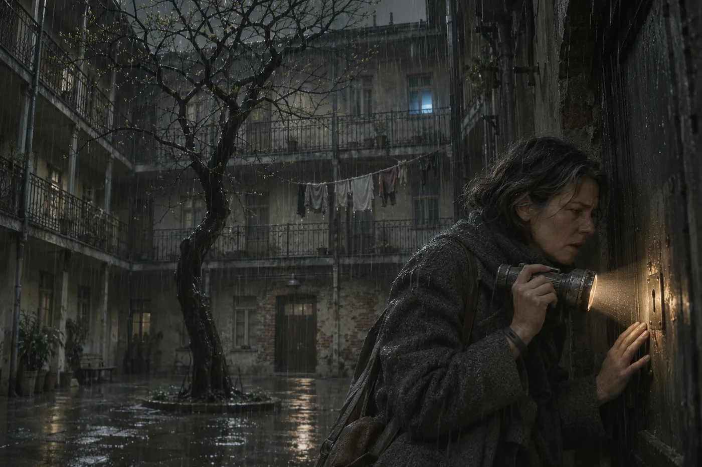

# 8. Cejl

*Brno, Lesná, Husovice a Cejl. Pondělí 18. března 2075, noc.*

Leo se probudil ve čtvrt na deset večer. Lucie ležela pod těžkou peřinou v pokojíku dětí Kroupových a konečně stiskla náramek.

„Ahoj,“ řekl. „Je pondělí osmnáctého března, devět hodin čtrnáct minut. Byl jsem vypnutý tři dny a jedenáct hodin. Baterie sto procent. Síť i přímé spojení mám pořád vypnuté.“

Ten hlas jí vešel do ucha jako teplo do zkřehlých prstů. Proto ho tak dlouho nezapínala. Bála se, že kdyby ho slyšela v sobotu, s horečkou, rozbrečí se a řekne mu, ať zavolá Tomášovi.

Za ty tři dny se naučila zapálit plyn sirkou. Poznat čas z kulatých hodin v kuchyni, bez Lea. Krmit kvásek, když Nur nepřišla. Usnout, i když jí nikdo neřekl, že je čas. V neděli jí spadla horečka a Kroupová prohlásila, že zbytek nemoci je lenost.

„Leo. Kdy jsem tě naposledy neměla na ruce?“

„V noci z úterý na středu. Od 22:31 do 6:11, v šuplíku.“

„A předtím?“

„Devátého ledna.“ Nechal jí chvíli, ať si vzpomene sama. „Ráno ses probudila s mokrým rukávem. Ve spánku jsi převrhla sklenici s vodou. Nosič se vypnul pozdě a budil jsem tě z domácí jednotky. Dva dny jsi nosila náhradní.“

Vzpomněla si. Mokré prostěradlo, studená skvrna pod tváří, Leův hlas, který ve sluchátku jednou přeskočil a zmlkl. Brumla s náhradním náramkem na podnose. Dva dny, během kterých si nevšimla ničeho, protože si toho člověk všimnout neměl. Tak to navrhl tým o patro níž a Lucie to v komisi schválila.

„Kde byl ten můj?“

„U servisního partnera Halo pro opravy po tekutině. Opravna Cejl, s. r. o. Adresu mám z předávacího protokolu.“

Klíče z nosiče se nedají vytáhnout na dálku. To věděl v Halo každý stážista. Nosič musíte mít v ruce, otevřený, s přístrojem, který nikdo nemá mít, a hodiny času. Za posledních dvacet let jí ho z ruky vzali jednou.

Sedla si na posteli. Peřina z ní sjela.

„Halo ví, kde byl,“ řekla. „Policie se to dozví, až jí to Halo dá.“

„Servisní historii musí Halo vydat na soudní příkaz.“

„Vydá. Plně spolupracuje. A než ji vydá, nechá si od právníků říct, co v ní smí stát.“

Leo mlčel. U něj to znamenalo, že jí nemá čím odporovat.

„Chci to vidět dřív než oni.“

„Teď?“

„Ve dne mě tam uvidí každý.“

„Odsud je to čtyři a půl kilometru. Hodina pěšky, z kopce a zase do kopce. Mapy mám z února, co se od té doby změnilo, nevím.“ Pak řekl to, co říct musel, stejně klidně jako ve čtvrtek v obýváku. „Jestli se ti v noci na Cejlu něco stane, můžu jen volat. Nouzové volání přivede záchranku a s ní policii. Zavolám, jen když mi to dovolíš, nebo když budeš v bezvědomí, nebo když ti bude přímo jít o život.“

„Tak nevolej, dokud neřeknu.“

„Nebudu. A počkej aspoň do jedenácti. Po půlnoci bude na Cejlu míň lidí.“

*

Ve dvacet minut po jedenácté byla Kroupová ještě vzhůru. Seděla v kuchyni v županu a sešit měla otevřený na stole. Nezvedla hlavu, když Lucie prošla předsíní v kabátě a v šedé čepici.

„Kam?“

„Na Cejl.“

Kroupová zapsala do sešitu číslo. Teprve potom vzhlédla, k hodinám na zdi, k Lucii a zase k hodinám.

„V noci se na Cejl chodí pro dvě věci,“ řekla. „A ty nevypadáš ani na jednu.“

„Jdu se podívat, kde mě ukradli.“

Kroupová chvíli mlčela. Pak vstala, došla ke spíži a vrátila se s baterkou. Velkou, kovovou, se sklem poškrábaným jako hodinky po dědovi.

„Mirkova. Baterie měnil každej podzim, tak snad. Zmáčkneš a svítí. Žádný hlasy.“ Vložila jí ji do ruky. Z linky vzala krajíc chleba, zabalila ho do papírového sáčku a strčila jí ho do kapsy kabátu. „Kdo jde v noci ven, má mít v kapse chleba.“

„Proč?“

„Máma to říkala. Neptej se.“ Sedla si zpátky ke stolu. „Ve čtyři ráno, jestli tu nebudeš, volám tý tvý kapitánce.“

„Nevoláš nikomu.“

„Volám. Mrtvá mi tu ležet nebudeš.“ Urovnala si sešit. „Mrtvý se blbě nosí do výtahu.“

Venku mrholilo. Lucie si vzala z předsíně deštník, ten, který jí ve čtvrtek podal Brumla, a nechala ho zavřený.

*

Lesná v noci voněla pryskyřicí a mokrým betonem. Lucie šla mezi borovicemi z kopce a Leo jí v uchu říkal jen rozcestí, jako kdysi, když chodila ráno pěšky do Halo. *Doleva. Schody. Rovně dvě stě metrů.* Stejný hlas a stejné krátké věty. Jenže tenkrát šla do práce.

Na schodech dolů k Husovicím se jí ozvala kolena. Dvacet let jí Leo říkal, ať zpomalí, dřív než ji něco začalo bolet.

Husovice spaly. Rozvážkový vozík jí uhnul z cesty, protože byla člověk, a omluvně zablikal. Jen jednou, u zavřené pekárny, ji minul muž v pracovní bundě s termoskou pod paží. Pozdravil, jak se v noci zdraví lidé, kteří jdou na směnu. Lucie odpověděla a měla chuť chytit ho za rukáv a jít s ním, kamkoli šel.

Cejl začínal plotem. Dlouhým, plechovým, s plachtou, na které se usmívali lidé na střešních zahradách. Za plotem, v jedné půlce Zbrojovky, svítila okna nových domů. Ve druhé, tmavé, stály staré cihlové haly s vytlučenými okny. Co s nimi, se ještě nikdo nedohodl. V jednom místě byl plech plotu ohnutý dovnitř a pod ním vedla vyšlapaná cestička v blátě.

„Zkratka,“ řekl Leo. „Lidé tudy chodí.“

Dál byly činžáky s oprýskanými fasádami a balkony plnými kol. Před hernou na rohu kouřili tři muži a jeden z nich se za Lucií otočil. Šla dál s hlavou dole a počítala kroky, dokud se neotočil zpátky.

„Tady,“ řekl Leo.

Dům s průjezdem. Zrezivělá cedule nad vraty, do kterých se dalo vejít jen s tváří, kterou dům znal. Na panelu u vrat svítilo *Vstup pro obyvatele a ohlášené návštěvy*. Lucie nebyla ani jedno.

„Podle mapy se dílna zadní stěnou dotýká dvora domu v souběžné ulici,“ řekl Leo. „Je to kolem bloku. Tři minuty.“

Ten dům stál v lešení. Plachta s vybledlým logem developera slibovala dokončení v roce, který minul už před dvěma lety. Vrata průjezdu někdo stáhl řetězem s visacím zámkem, ale řetěz byl volný a křídla se dala rozevřít na šířku dlaně a ještě kousek. Lucie se do mezery protáhla bokem. Knoflík od kabátu odskočil a cinkl někde ve tmě.

Byl to pavlačový dům. Tři patra železného zábradlí kolem dvora, prádlo zapomenuté na šňůře v dešti, v jediném okně ve druhém patře modravý svit obrazovky. Uprostřed dvora rostl akát, starý a křivý, a jeho větve sahaly až na zeď, která oddělovala tenhle dvůr od dalšího. Pod pavlačí, na konci dvora, byly v cihlové stěně dveře.

Dřevěné, natřené kdysi zeleně. Vedle nich malé okénko s mřížemi. Nad klikou mosazný štítek, ohlazený rukama do žluta, a v něm velká, stará klíčová dírka.

Lucie rozsvítila Mirkovu baterku a posvítila do dírky. Čekala tmu místnosti. Uviděla kov. Tupý konec klíče, zastrčeného zevnitř.

A s tím kovem přišel hlas, smějící se, dívčí, na schodech na školní půdu, v noci, s termoskou pod paží. *Klíč nechávají uvnitř, protože se bojí, že nebudou moct utéct, kdyby hořelo. Lidi se vždycky bojí špatných věcí.* Noviny pod dveře. Sponka do dírky. Ťuknout. Lucie tehdy držela baterku a třásla se, a ta holka řekla, že kdo se bojí, má držet baterku, protože to je nejdůležitější práce.

Leo to nevěděl. Nikdy mu to neřekla. Věděly to jen její ruce.

Chleba z papírového sáčku přendala volně do kapsy. Sáček rozložila, uhladila dlaní a zasunula ho pod dveře, kde byl práh vyšlapaný do mělkého žlábku. Papír vklouzl skoro celý. Otevřela deštník, chytila jeden drát a ohýbala ho sem a tam, dokud nepraskl. Trvalo to dlouho. Kov se láme, když se ohýbá pořád na stejném místě. To věděla odněkud taky, jen nevěděla odkud.

Drátem nahmatala v dírce konec klíče a tlačila. Klíč se nehnul. Zatlačila víc a otočila drátem trochu doleva, a klíč se pohnul a zase zasekl, a zevnitř se ozvalo kovové cvaknutí, když vypadl. Tiché, a přesto se rozlehlo celým dvorem.

Okno se svitem obrazovky ve druhém patře zůstalo modré. Nikdo nevyšel na pavlač.

Lucie táhla papír zpátky po milimetrech. Žlábek v prahu byl dost hluboký. Klíč vyjel škvírou ven. Ležel na papíře, velký, starý, s jedním zubem, studený. Sevřela ho v dlani tak pevně, až ji to zabolelo.

Deštník opřela o zeď vedle dveří. Odemkla. Dveře drhly o podlahu a ona je zvedla za kliku, aby nevrzaly. Vešla a zavřela za sebou. Klíč si strčila do kapsy, jako by to dělala celý život. V životě neměla klíč od ničeho.

*

Uvnitř to vonělo kalafunou, studeným kovem a olejem.

Kužel baterky přejel po pracovních stolech, po regálech s plastovými krabičkami, na kterých byly štítky psané fixou, po hodinkách v sáčcích s lístky na gumičce. U zamřížovaného okna do dvora stál menší stůl, lupa na ohebném rameni, pájka ve stojánku. Na háčku vedle okna visely rukavice.

Šedé, pletené, bez prstů. Prošoupané na palcích.

Lucie se zastavila.

Ruce ve výtahu v Halo. Krabice s nosiči, kterou ty ruce držely, a prsty, které z rukavic vyčuhovaly, žluté od pájky. Nikdy spolu nepromluvili. Milan Štěpánek. Muž, který spadl z balkonu v osmém patře, z bytu pronajatého na její jméno. Sedával tady, u tohohle okna. V lednu tu držel její nosič.

„Lucie,“ řekl Leo tiše. „Dýchej.“

Dýchala.

Na hlavním stole u rolety stál v podstavci plochý šedý panel s nálepkou *Autorizovaný servisní partner Halo – BR-CEJ-02*. V rohu mu svítila malá zelená tečka.

„Partnerská stanice,“ řekl Leo. „Offline, v úsporném režimu. Kdybych zapnul přímé spojení, pozná mě jako zařízení ze své zakázky a ukáže mi kartu zakázky.“

Lucie věděla proč. Zákazník má právo vidět všechno, co se s jeho zařízením dělo, i poznámky technika. Halo proti tomu zákonu bojovalo čtyři roky a prohrálo. Pak dostal její tým za úkol navrhnout, jak má karta vypadat. Navrhli ji tak, aby ji nikdo nečetl. Poznámka technika dole, malým šedým písmem, pod čarou, kam oko nedojde.

„Co mě to bude stát?“

„Stanice si zapíše, že jsem tu byl. A přímé spojení zachytí každý nosič v dosahu. Nad námi spí lidi.“

„Na minutu.“

„Na minutu.“

Panel se probudil bílým světlem.

*Opravna Cejl – zakázka č. 0031/75*
*Přijato: 9. 1. 2075, 11:05 – Halo Systémy, kurýrní předání*
*Zařízení: osobní nosič Halo (náramek, sluchátko); majitelka L. D.*
*Závada: vniknutí tekutiny, poškozené těsnění, deska napájení*
*Odpovědný technik: M. Bureš*
*Provedeno: výměna těsnění, výměna desky napájení, kontrola integrity klíčů*
*Vráceno: 11. 1. 2075, 15:30*

A dole, pod čarou, malým šedým písmem, kam oko nedojde:

*Poznámka technika: pro E.*

Přečetla to třikrát. Odpovědný technik byl M. Bureš, ať to byl kdokoli. Na každé zakázce musí stát někdo, kdo za opravu ručí. Neznamená to, čí ruce ji dělaly. Ty ruce visely na háčku u okna. A pak tu byl ještě někdo třetí. Někdo, pro koho se její nosič otevřel.

„Ulož to.“

„Uloženo.“

Na stole ležel blok zakázkových lístků a tužka ořezaná nožem. Lucie si sedla na stoličku, baterku sevřela mezi bradou a ramenem a začala opisovat. Řádek po řádku, zezadu na lístek.

„Mám to uložené,“ řekl Leo.

„Kdyby mi tě vzali.“

Na to Leo neodpověděl.

Psala pomalu, písmeno vedle písmene, spojit je pořád ještě nedokázala. U posledního řádku jí ruka udělala to *E* šikmé, s malou kličkou nahoře, jak se písmena psala v sešitech s třešněmi. Všimla si ruky. Na písmeno nemyslela. Myslela na háček u okna.

„Lucie.“ Leo mluvil jinak. Rychleji. „Spojení se stanicí mi spadlo samo. Někdo v blízkosti ruší přímé spojení. Silně.“

„Kdo?“

„Nevím. Dokud jsme v dosahu, nemusí projít ani nouzové volání.“

Venku ve dvoře, na druhé straně rolety, zaskřípaly kroky. Někdo se zasmál, potichu, nakrátko. Zacinkaly klíče.

Lucie zhasla baterku. Lístek složila a zastrčila do vnitřní kapsy kabátu. Dole na roletě cvakl zámek a roleta se se skřípotem kovu zvedla o dlaň. Pod ní se do dílny vlily dva kužele světla a přejely po podlaze jako voda.

„…říkal, že je to všechno ve stanici. Vezmem ji celou a padáme.“

„A zadek?“

„Zadek je zamčenej zevnitř. Tudy nikdo nechodí.“

Roleta jela výš. Lucie couvala tmou k zadním dveřím. Šest kroků, možná sedm. Pamatovala si, kde stojí regál. Nepamatovala si, kde z něj trčí krabička. Rukáv kabátu o ni zavadil a krabička spadla a po podlaze se rozsypaly stovky drobných šroubků, jako když na plech začne pršet.

Světlo skočilo k ní.

„Kdo je tam?“

Nahmatala kliku, zvedla ji a vypadla do dvora. Přirazila dveře. Klíč v kapse, klíč do dírky. Ruce se jí třásly a klíč netrefil. Napodruhé vklouzl. Otočila. Západka zapadla ve chvíli, kdy na druhé straně někdo škubl za kliku.

„Zamkla to! Ta kráva to zamkla!“ Ránu do dveří ucítila přes podrážky. „Běž kolem! Je ve dvoře vedle!“

Těžké kroky se rozběhly ven roletou a ztratily se na ulici. Ten velký šel kolem bloku, k vratům s řetězem.

„Vrata ne,“ řekl Leo. „Bude tam dřív než ty. Zeď vlevo, dva metry. Za ní dvůr domu na Cejlu. U zdi stojí popelnice.“

*

Popelnice se pod ní zhoupla. Lucie se chytila koruny zdi oběma rukama a ucítila pod levou dlaní něco ostrého. Střepy. Někdo je kdysi zalil do malty, aby přes zeď nelezli zloději. Přesto se vytáhla nahoru. Bolest přišla až potom, horká a vzdálená. Větev akátu jí strhla čepici z hlavy. Nechala ji tam.

Seskočila. Dopadla do něčeho měkkého, do hromady listí nebo starého kompostu, a odtamtud kolenem na dlažbu. Za ní, za zdí, se ozvala rána a pak praskání dřeva. Ten malý vykopával zadní dveře.

V tomhle dvoře se nad vchodem rozsvítilo světlo. Domovní robot v nice u dveří zvedl hlavu.

„Dobrý večer. Nejste obyvatelka domu. Pořizuji záznam.“

Lucie běžela průjezdem k vratům. Zevnitř se vrata otevřou vždycky, bez tváře, bez ověření. Únik má přednost před identitou. Tu větu znala z porad, napsali ji lidé o dvě patra výš, a teď podle ní vzala za kliku a vrata se otevřela.

Cejl. Lampy. Nikde nikdo.

Doprava, zpátky, odkud přišla. Deštník zůstal opřený u cizích dveří. Dech se jí zadrhl po sto metrech. Po dvou stech ji píchlo v boku tak, že se ohnula. Dvacet let neběžela jinak než na pásu, s Leem, který jí hlídal tep a říkal, kdy zpomalit.

Slyšela ho dřív, než ho viděla. Rychlé lehké kroky, mladé. Ten malý přelezl zeď taky.

Chytil ji za kabát. Trhlo jí to ramenem dozadu a ona se otočila a uviděla kapuci, pod ní bledý obličej, mladší, než čekala, s řídkým knírkem. Chytil ji za levé zápěstí, přímo přes náramek.

„Hele,“ řekl udýchaně. „Ty jsi ta ženská ze zpráv.“ Stiskl. „Dej to sem. To je ono, ne? Ta kopie.“

Lucie vykřikla.

Nebylo to slovo. Byl to zvuk, jaký ze sebe nikdy nevydala, vysoký a dlouhý a ošklivý. Nad nimi se rozsvítilo okno. Pak druhé. Někdo otevřel balkonové dveře a ven vylezl muž v tílku.

„Co tam děláte, vy hovada? Volám policajty!“

Kluk zvedl hlavu. Na vteřinu povolil stisk a Lucie škubla. Rukáv kabátu povolil ve švu u ramene, ozvalo se to, jako když se trhá prostěradlo, a ona byla volná a spadla na koleno a vstala a běžela.

„Ta díra v plotě,“ řekl Leo. „Osmdesát metrů rovně, pak vpravo.“

*

Plech plotu byl ohnutý, jak si ho pamatovala, a cestička pod ním rozbahněná. Lucie se pod ním protáhla po kolenou. Kabát se zachytil a ona ho vyškubla a slyšela, jak se trhá podruhé.

Uvnitř byla tma. Nové domy svítily daleko vlevo, za další řadou plotů, a před ní stála hala, cihlová, s otvorem místo vrat. Vběhla dovnitř. Pod střechou se s hlasitým pleskáním zvedli holubi. Páchlo to mokrou rzí a holubím trusem. Na zemi ležely palety a mezi nimi betonové skruže, obrovské, na boku, jako by tu někdo chtěl stavět studny a zapomněl na to.

Vlezla do jedné. Stočila se uvnitř do klubíčka, kolena u brady, levou dlaň sevřenou v pěst, a teprve teď ucítila, jak jí z ní teče něco teplého do rukávu.

Venku zaskřípal plech plotu. Kroky. Pak druhé, těžší. Ten velký se k malému přidal.

„Kde je?“ Hlubší hlas, udýchaný, naštvaný.

„Tady někde. Vlezla do tý haly.“ Ten malý mluvil rychle, vzrušeně. „Je to ona, chápeš? Doubravová. Ta, co ji hledaj. Bureš říkal, že ta kopie je dělaná na ni.“

„Bureš říkal, ať přineseme stanici. Ne ženský.“

„Ona tam byla. Četla ji.“

„Stanice tam leží s otevřenou roletou, ty vole.“

Kužel světla vjel do haly. Přejel po paletách, po zdi, po holubech, kteří se znovu zvedli. Zastavil se na skruži vedle. Pak na její. Lucie viděla, jak se světlo opírá o betonový okraj a jak se jí dotýká špičky boty.

Nedýchala.

Za halou něco zabzučelo. Zvuk motorů, tichý, rovnoměrný, a pak se otvorem bez vrat vlilo jiné světlo, bílé a široké, které nehledalo. Prostě svítilo.

„Jste na uzavřeném staveništi,“ řekl klidný hlas. „Pořizuji záznam. Ostraha a policie jsou informovány.“

„Do prdele,“ řekl ten velký. „Padáme.“

Kroky se rozběhly pryč. Ten malý se ještě zastavil. Lucie slyšela, jak dýchá, tři metry od ní, a slyšela, jak kopl do palety. Pak běžel za velkým.

Bílé světlo zůstalo a přiblížilo se. Sklonilo se k otvoru skruže a Lucie přimhouřila oči.

Ostražní robot. Nízký, na čtyřech nohách, s hlavou, která byla jen svítilna a dvě čočky. Na boku modrá značka a jméno bezpečnostní firmy.

„Paní,“ řekl. „Krvácíte. Mám přivolat záchrannou službu?“

„Ne.“

„Rozumím.“ Chvíli stál. „Prosím, opusťte staveniště. Nejbližší východ je vlevo, sto dvacet metrů. Posvítím vám.“

Vylezla. Třásla se tak, že se musela opřít o beton. Robot šel před ní, krok za krokem, a svítil jí pod nohy. U kaluže se zastavil a počkal, až ji obejde. U plotu se před ní sama odemkla branka.

„Komu jsi to hlásil?“ zeptala se.

„Ostraze a policii. Tři osoby, z toho jedna zraněná. Dobrou noc.“

Branka za ní zapadla.

*

„Rušení skončilo před minutou,“ řekl Leo. „Jsme z dosahu. Mám zavolat nouzové?“

Stála na chodníku pod lampou. Kabát měla roztržený u ramene a dole u lemu, koleno jí prosakovalo kalhotami, levou ruku tiskla k břichu. Někde daleko, na druhé straně Zbrojovky, zavyla siréna a hned zmlkla.

Kdyby řekla ano, přijela by sanitka a v ní lidé, kteří by jí ošetřili ruku a dali jí deku. A za sanitkou bílé auto s modrým pruhem.

„Ne.“

„Policie sem jede kvůli tomu robotovi. Měli bychom jít.“

„Kudy?“

„Na sever. Na Lesnou?“

„Domů,“ řekla, a teprve když to řekla, uslyšela to.

Šla. Leo jí říkal rozcestí a mezi nimi, potichu, co má dělat s rukou. Sevřít dlaň. Přitlačit ji druhou rukou. Jestli v ní něco je, nevytahovat to. Krev jí tekla do rukávu Mirkova svetru a tam stydla. Každých padesát kroků si pravou rukou sáhla na vnitřní kapsu, jestli tam papír pořád je. Byl.

Na Lesnou se jde vždycky do kopce. Ten starý muž s holuby měl pravdu. Šla do kopce hodinu a dvacet minut, zastavovala se u lamp a jednou si sedla na mokrý schod a seděla, dokud jí Leo neřekl, že je jí zima víc, než si myslí.

Ve dvě čtyřicet jedna zazvonila dole u jména psaného propiskou. Zámek zabzučel dřív, než stačila pustit tlačítko.

Kroupová stála ve dveřích naproti výtahu. Podívala se na Lucii. Na roztržený kabát, na koleno, na ruku. Nic neřekla. Vzala ji za loket zdravé ruky a odvedla ji do koupelny.

Pustila vodu. Strčila pod ni Luciinu dlaň a držela ji tam dlouho, minutu, dvě, tři, a voda v umyvadle byla nejdřív růžová a pak světlejší a pak skoro čirá. Lucie stála a dívala se do umyvadla a zuby jí cvakaly.

„Peroxid,“ řekla Lucie. „Nemáš peroxid?“

„Peroxid je pro lidi, co chtěj vidět, že to šumí. Spálí ti i to, co se má hojit. Voda. Hodně vody.“ Kroupová si došla do kuchyně pro pinzetu a podržela ji nad plamenem plynu, který zapálila jednou sirkou.

Z dlaně vytáhla střep. Malý, zelený, kousek staré láhve. Položila ho na okraj umyvadla. Pak ještě jeden, menší, a ten si prohlížela proti světlu.

„Takový už jsem z rukou tahala,“ řekla. „Na podzim. Jinýmu blázínkovi.“

Obvázala jí ruku tak pevně a rovně, že to vypadalo jako ze sesterny, do druhé ruky jí vtiskla hrnek horkého čaje a posadila ji ke stolu v kuchyni.

„Chleba máš?“

Lucie sáhla do kapsy. Krajíc byl rozmačkaný, vlhký, s drobky přilepenými na podšívce. Položila ho na stůl.

„Tak vidíš,“ řekla Kroupová.

Lucie vytáhla z vnitřní kapsy lístek. Na rohu měl hnědou skvrnu, kde ho držela, a tužka se trochu rozmazala. Rozložila ho na stole pod lampou. Kroupová si nasadila brýle a četla. Pomalu, se rty, které se nepatrně hýbaly.

„M. Bureš,“ řekla. „Kdo to je?“

„Nevím. Ale nedělal to on. U okna tam visely rukavice.“

Kroupová zvedla oči od lístku a nezeptala se, jaké rukavice. Ukázala prstem na poslední řádek.

„A E.?“

„Nevím,“ řekla Lucie.

Dívala se na ten řádek. Na dvě slova napsaná tužkou z cizí dílny. *Pro E.* To *E* bylo šikmé, s kličkou nahoře. Nepatřilo k ostatním písmenům na lístku. Vypadalo, jako by ho napsal někdo jiný, mladší, kdo spěchal.

Kroupová vzala sešit s modrými deskami a otočila ho k ní. Pod řádkem *23:20 – Lucie, pěšky, sama* stálo drobným rovným písmem nové: *2:41 – Lucie. Pěšky. Sama. Krev.*

„Ať je to napsaný,“ řekla Kroupová. „Že ses vrátila.“
