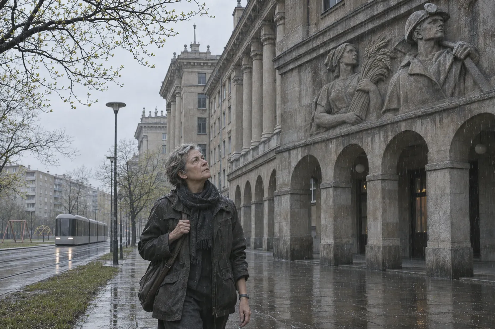

# 11. Ostrava

*Dálnice D1, Ostrava-Svinov a Poruba. Čtvrtek 21. března 2075.*

Jméno měl Ota ve středu v sedm ráno, dřív než Brožová dopila čaj.

„Ročenka gymnázia za školní rok 2045/46,“ řekl. „Ve třídě paní Doubravové byla jediná dívka se jménem na E. Eliška Richterová, nar. 2027 v Brně. Veřejné údaje: bydliště Ostrava-Poruba. V letech 2060 až 2071 zaměstnankyně Halo Systémy, ostravská pobočka, oddělení profilování chování. Pracovní poměr skončil v říjnu 2071 při automatizaci oddělení. Bez záznamu v rejstříku. Má starou veřejnou stránku, nabízí konzultace na volné noze. Poslední úprava v roce 2072.“

Halo. Brožová si do zápisníku pod písmeno *E.* napsala jméno a pod jméno to jedno slovo. Pak se na ty dva řádky dlouho dívala.

Ve tři odpoledne zavolala Brožová na číslo ze stránky, přes služební linku. Eliška Richterová to vzala po druhém zazvonění. Měla hluboký, trochu chraplavý hlas a nechala Brožovou domluvit.

„Lucie,“ řekla potom. Jen to jméno. „Četla jsem to. Že ji hledáte. Nevěřila jsem tomu.“

„Ráda bych si s vámi promluvila. Jako se svědkyní. Nemusíte.“

„Přijeďte. Kdykoli. Jsem doma.“ Krátký smích, bez radosti. „Jsem pořád doma.“

Šindelář ji pustil hned. Kamarádka z gymnázia, a bydlí v Ostravě, kde se pohybuje nosič, který se vydává za Doubravovou. Ať jede. Ale sama, Vaněk mu hledá toho malého v kapuci. Brožová řekla, že chtěla jet sama tak jako tak, a Šindelář řekl, že to ví, a zavěsil.

*

Na dálnici ji auto k volantu nepustilo.

Za Brnem se zařadilo do koordinovaného pruhu, srovnalo rychlost s řadou vozů před sebou a za sebou a jelo, tiše, rovně, sto čtyřicet, ve vzdálenosti, kterou by ručně nikdo neudržel. Brožová seděla s rukama na kolenou jako na návštěvě. Za Vyškovem začalo pršet. Stěrače se rozběhly samy.

Levá ponožka jí zvlhla už na parkovišti na Kounicově. Boty ševci zase nedonesla. Vytáhla z kapsy pastilku, rozbalila ji a dívala se, jak se kapky na předním skle slévají do čar a čáry utíkají do stran.

Zápisník měla otevřený na klíně. *E. Eliška Richterová. Halo. Profilování.* O stránku dřív stála Ivetina věta: *Lucie bez chyb. Někdo, kdo ji měl rád. Nebo nenáviděl.* A v hlavě jí zůstalo, co Iveta řekla potom a co si Brožová nezapsala. Že takových lidí moc není. A ti, co jsou, většinou pracují pro nás.

Pracovala. Do jednasedmdesátého.

„Oto. Kdyby někdo z oddělení profilování dostal výpověď, co se stane s jeho přístupy?“

„Podle veřejných pravidel Halo se přístupy ruší v den ukončení pracovního poměru. Proběhne audit. U oddělení, které se automatizuje celé, se ruší naráz.“

„A kdyby si někdo nechal zadní vrátka?“

„Pak by to věděl jen on. A Halo, pokud by to zjistilo.“

Brožová se dívala z okna na mokré pole, na řadu větrníků, které se točily pomalu a všechny stejně.

V deset dvacet promluvil Ota znovu.

„Představenstvo Halo Systémy ukončilo pracovní poměr Lucie Doubravové. Šest hlasů pro, jeden proti.“

Jeden proti. *Já budu hlasovat proti. Budu jediný.* Klíma nelhal. Brožová nevěděla, jestli ji to uklidnilo, nebo naopak.

Lucie Doubravová teď neměla jméno, peníze, dům ani práci. Zbyla jí pořezaná ruka. Její čepice ležela v sáčku na útvaru.

U Ostravy auto sjelo z koordinovaného pruhu, zablikalo a předalo jí řízení. Vzala volant do rukou a poprvé od Brna se jí ulevilo.

Svinov.

Silnice vedla pod mosty, po kterých jezdily tramvaje vysoko nad hlavou, a pod nimi stálo nádraží. Dlouhá střecha, sklo, davy lidí s kufry a s dětmi a s kelímky, autobusy, které se k nástupištím přisouvaly samy, jeden za druhým. Brožová zpomalila víc, než musela.

Na vytištěném výpisu, který měla v tašce, stál Svinov čtyřikrát mezi ranními obnovami. Pak vlak ve 20:15. Návrat ve 2:24. Odpojení ve středu ráno, necelé dvě minuty poté, co se ten nosič dozvěděl, že vyhrál.

Někdo za ní zatroubil. Brožová přidala plyn a jela dál, do Poruby.

Poruba začínala domy, které vypadaly, jako by je stavěli pro jiné lidi a jiné století. Široká třída, sloupy, oblouky, na fasádách kamenní horníci a ženy se snopy, umytí deštěm do šeda. Do oken těch domů někdo vlepil tenké fólie, které pily slunce i z mraků, takže horníci teď stáli pod tmavým sklem jako pod brýlemi. Za nimi začínaly paneláky, řada za řadou, a mezi nimi hřiště, na kterých se v dešti nehonil nikdo, ani robot.

*

Byl to panelák o osmi patrech, na kraji sídliště, kde za parkovištěm začínal pás stromů. Šedý, s balkony, na kterých nic nebylo. Výtah jel. Na chodbě v šestém patře voněla něčí polévka a dveře na konci byly pootevřené, jako by za nimi někdo čekal od rána.

Brožová ji poznala dřív, než promluvila.

Holka z fotek, o třicet let starší. Vysoká, hubená, tmavé vlasy prošedivělé, ostříhané nakrátko a trochu nerovně, nůžkami, ne u kadeřníka. Tmavozelený svetr s rukávy staženými přes prsty. Oči unavené, ale pozorné, s jemnými vráskami v koutcích, jaké mívají lidé, kteří se kdysi hodně smáli.

„Paní kapitánko.“ Podala jí ruku, studenou. „Pojďte dál. Promiňte, je tu zima. Topím do sedmnácti.“

V předsíni visel na věšáku šedý kabát a pod ním stály boty. Na podlaze, u zdi, byl světlejší obdélník linolea, tam, kde kdysi stál dok domácího robota a kam deset let nesvítilo slunce.

„Prodala jsem ho loni,“ řekla Eliška, když viděla, kam se Brožová dívá. „Byl na splátky. Na splátky mi došly peníze dřív než jemu baterie. Člověk se divně rychle naučí, kde má vlastní hrnky.“

Kuchyň byla malá a čistá. Na parapetu stál v květináči malý fíkovník s listy jako rozevřené dlaně. Eliška postavila na plyn konvici, starou, s píšťalkou, a čekala u ní s rukama zastrčenými v rukávech.

„Můžu to nahrávat?“ zeptala se Brožová a položila služební jednotku na stůl. „Nemusíte s tím souhlasit.“

„Nahrávejte.“ Eliška se otočila. „Nahrávejte všechno. Já už si stejně nic nepamatuju sama.“

*

„Lucie byla ta rozumná,“ řekla Eliška, když seděly naproti sobě nad hrnky. „Já jsem vymýšlela blbosti a ona je dělala se mnou. I když se bála. Hlavně když se bála.“ Usmála se do čaje. „Uměla se bát a stejně skočit. To jsem na ní měla nejradši.“

„Byly jste si blízké.“

„Čtyři roky v jedné lavici. Pak každá jiná škola, ale v Brně, takže pořád spolu. Dva roky jsme spolu bydlely v podnájmu, kde nebyl ani agent na dveřích, jenom klíč. Byly jsme jeden člověk. Tak jsme to tenkrát říkaly.“

„Lezly jste spolu někdy tam, kam se nesmělo?“

Eliška zvedla obočí. Pak se zasmála, poprvé nahlas, a ten smích byl o třicet let mladší než ona.

„Všude. Na střechu gymplu, na školní půdu. Půda byla zamčená a klíč nechávali zevnitř v zámku, kdyby hořelo. Tak jsem ji naučila noviny pod dveře a sponku do dírky.“ Zavrtěla hlavou. „Držela mi baterku a třásla se, že nás chytí. Nikdy nás nechytili.“

Brožová si to nezapsala. Nechala to v hlavě, vedle obrazu tmavomodrého deštníku s jedním chybějícím drátem, opřeného o zeď v pavlačovém dvoře.

„Proč se ptáte?“

„Chci vědět, jaká byla.“

„Lepší než já,“ řekla Eliška. „Jenom o tom nevěděla.“

„Proč jste se přestaly vídat?“

„Pak se vdala.“ Eliška otočila hrnek v dlaních. „Lidi se rozejdou, když se jedna vdá a druhá ne. Nic dramatického. Měla najednou dům a dítě a práci, kde ji poslouchaly miliony lidí. Já jsem měla Ostravu.“

„Pracovala jste pro stejnou firmu.“

„Jiný svět. Ona dělala věty, které lidi slyší. Já jsem dělala čísla, která lidi neslyší.“ Eliška otočila hlavu k oknu, k pásu stromů za parkovištěm. „Profilování chování. Skládala jsem z dat, jak se kdo zachová. Kdy si objedná kafe, kdy zavolá mámě, kdy se rozvede. Byla jsem v tom dobrá. Pak to začal dělat model. Líp než já. A je to tak, umí to líp. To je na tom to nejhorší, víte? Kdyby to dělal hůř, mohla bych se zlobit.“

Brožová neřekla nic. Myslela na Otu v jednotce na stole, na čísla, kterým nevěřila a která uměla číst. Myslela na to, kolik let jí asi zbývá, než ji někdo zdvořile pošle domů s tím, že model to zvládne líp, a bude mít pravdu. Pak bude topit do sedmnácti a stříhat si vlasy sama a nikdo se nezeptá proč.

„A teď?“ zeptala se. „Čím se živíte?“

„Korekturami. Pro jedno nakladatelství v Praze, které ještě tiskne knížky na papír a chce, aby je předtím četl člověk.“ Eliška kývla ke stolku u okna. Ležel na něm štos vytištěných stránek, tužka a pravítko. „Platí málo. Ale platí. A čtu přitom knížky, které bych jinak nečetla.“

„A konzultace?“ zeptala se Brožová. „Na té vaší stránce.“

„Nikdo nechce profilářku, když má model. Měla jsem ji smazat.“

Na parapetu u fíkovníku stála šachovnice s rozehranou partií. Bílé i černé figurky, žádná druhá židle.

„Kdy jste spolu mluvily naposledy?“

Eliška zvedla oči.

„V únoru,“ řekla. „Volala mi. Po dvaceti letech.“

Brožová čekala.

„Pozdě večer. Z nějakého cizího čísla, ne ze svého. Řekla, ať to nikomu neříkám. Ani Leovi.“

„O čem mluvila?“

„Že našla na půdě staré sešity. Ten deník, co si psala na gymplu. A že se v něm nepoznává.“ Eliška položila hrnek. „Že si připadá jako kopie. Jako by ta holka ze sešitů byla ta pravá a ona jen něco, co po ní zbylo. Chtěla vědět, jaká byla. Ptala se mě, jestli si pamatuju, jaká byla.“

„Co jste jí řekla?“

„Pravdu. Že byla statečnější, než si myslí.“ Eliška se odmlčela. „Byla… promiňte, to je ošklivé slovo. Byla nestabilní. Mluvila rychle a pak dlouho nic. Plakala a smála se. Bála jsem se o ni. Chtěla jsem jí pak zavolat zpátky, ale to číslo nikomu nepatřilo.“

Brožová si vzpomněla na místnost s javorem za oknem. Na ženu v šedém svetru, která jí vyprávěla o deníku a o pokusu. *Chtěla jsem vědět, jaké to je.* Sedělo to. Sedělo to tak přesně, že se Brožové sevřel žaludek.

„Můžu ten hovor vidět?“

„Jestli to jde.“ Eliška natáhla levou ruku po stole, k jednotce, a rukáv jí sjel k zápěstí. Na hřbetu ruky měla náplast, obyčejnou, tělové barvy, trochu odlepenou na rohu. „Souhlasím. Ať se podívá.“

„Záznam v nosiči paní Richterové,“ řekl Ota. „Příchozí hovor v pátek 22. února ve 22:47, délka osmnáct minut. Z veřejné linky bez identity volajícího. Místo linky bez soudního příkazu nezjistím.“

Brožová si to zapsala. Dvaadvacátý únor. Pár dní poté, co Lucie Doubravová začala dělat věci, které by neudělala.

„Spálila jste se?“ Kývla k náplasti.

Eliška sklopila oči ke své ruce, jako by ji viděla poprvé, a stáhla rukáv zpátky přes prsty.

„Trouba,“ řekla. „Pořád zapomínám, že na mě nikdo nehlídá.“

*

„Znala jste Milana Štěpánka?“

Eliška se zamyslela. Poctivě, s nakrčeným čelem.

„Ne,“ řekla. „Mělo by mi to něco říkat?“

„Pracoval v Halo. V Brně, do jednasedmdesátého.“

„V Halo nás bylo dvanáct tisíc.“ Eliška se omluvně usmála. „Já jsem znala lidi z ostravského patra a z kantýny. Brno bylo daleko.“ Pak se jí obličej změnil. „To je on? Ten muž z Králova Pole?“

Brožová přikývla.

„Bože.“ Eliška si přitiskla rukáv k ústům. „Já myslela, že to je někdo cizí.“

„Musím se zeptat, kde jste byla v úterý dvanáctého března večer.“

„Doma.“ Eliška to řekla hned, nijak dotčeně, skoro s úlevou. „Celý večer. Celou noc. Můžete se podívat i na to.“

Znovu natáhla ruku k jednotce. Ota potvrdil souhlas.

„Nosič paní Richterové byl v bytě od 17:52 v úterý do 7:31 ve středu. Bez pohybu mimo byt, bez komunikace kromě noční aktualizace ve 3:00. Domácí jednotka je bez kamer, zaznamenává spotřebu a světla. Světla v bytě zhasla ve 23:48.“

„Chodím spát pozdě,“ řekla Eliška. „Čtu. Na papíře, jestli vám to něco řekne.“

„Řekne,“ řekla Brožová.

Na stěně nad stolem viselo pár fotek v levných rámečcích. Moře. Nějaká stará žena na lavičce, asi matka. A jedna menší, vybledlá do oranžova, jak blednou fotky, které visí roky naproti oknu.

Tři mladí lidé na kamenné zídce, za soumraku. Za nimi tmavá tráva a malý stan, ze kterého svítila lucerna. Vysoká tmavá dívka uprostřed, se zakloněnou hlavou a zavřenýma očima, smála se. Vedle ní kluk v kšiltovce s malou bílou skvrnou nad kšiltem, s cigaretou, s obličejem napůl ve stínu. A na kraji zídky světlovlasá dívka s koleny pod bradou, která se nedívala do objektivu.

„Kdo to je?“

Eliška se otočila za jejím pohledem. Chvíli tu fotku pozorovala, jako by ji dlouho neviděla, ačkoli visela tři metry od jejího stolu.

„Já, Lucie a jeden kluk. Jedno léto po škole.“ Hlas jí trochu zhrubl a ona si odkašlala. „Lucie mi ji kdysi nechala. Měla ji ve věcech, když se stěhovala, a řekla, ať si ji vezmu. Že já si ji zasloužím víc.“

Brožová se dívala na tu světlou dívku na kraji. Na kolena pod bradou, na to, kam se dívala. Fotka byla malá a vybledlá a ten kluk měl obličej ve stínu.

„A ten kluk?“

„Jeden z party.“ Eliška pokrčila rameny. „Už ani nevím, jak se jmenoval. Kouřil a hrál na kytaru. Tenkrát hrál na kytaru každý druhý.“

„Ještě jedna věc,“ řekla Brožová. „Mluvila s vámi Lucie někdy o Pálavě?“

Eliška se na ni podívala. Na vteřinu se jí v obličeji nepohnulo nic, a pak se pohnulo všechno najednou, úsměv, oči, ruce na hrnku.

„O Pálavě.“ Zavrtěla hlavou, jako nad něčím, na co dávno zapomněla. „Byla tam jednou. S Tomášem a s jeho kamarády, ještě než spolu chodili. Já tam nebyla. Ale vyprávěla mi to. Že odtamtud v noci utekla, sama, na první vlak. Lucie utíkala vždycky, když se jí něco začalo moc líbit. To bylo to její skákání. Někdy skočila dopředu, někdy pryč.“

„Komu dalšímu to vyprávěla?“

„To nevím. Asi komukoli, kdo se zeptal. Byla to taková její historka.“

Brožová si do zápisníku napsala *Pálava – vyprávěla*. Pod to otazník. Pak otazník přeškrtla. Na tohle jí tahle žena odpovědět nemohla. Zůstalo jen *Pálava – vyprávěla*.

*

Čaj vychladl. Eliška ho dolila z konvice a ruce se jí přitom trochu třásly, možná zimou.

„A Filip?“ zeptala se. „Jak to nese? Je mu patnáct, ne?“

„Říkala vám o něm?“

„V únoru. Mluvila o něm víc než o sobě.“ Eliška se usmála, krátce, dovnitř. „Že je chytřejší než oni dva dohromady a stydí se za to.“

„Nese to,“ řekla Brožová. „Líp, než bych čekala.“

„To bude po ní.“ Eliška se dívala do hrnku. „Já děti nemám. Kdybych je měla, chtěla bych, aby byly po ní.“ Pak dodala tiše, k ubrusu: „Paní kapitánko. Myslíte, že to udělala?“

„Nevím.“

„Lucie by nikomu neublížila.“ Eliška zvedla hlavu. Oči měla mokré a nestyděla se za to. „Ani tomu technikovi, co skočil. Vůbec ne jemu. Ona se bojí výšek, víte? Na každém výletě se držela zábradlí oběma rukama, až jí zbělaly klouby. Smála se a držela se.“

Brožová si vzpomněla na fotku z krabice. Ocel, rezavé trubky, nebe. Světlá dívka u zábradlí, ruce sevřené kolem trubky. Tahle žena to pamatovala přesně, po třiceti letech, i s těmi klouby.

„Viděla jsem fotku,“ řekla.

„Z Vítkovic?“ Eliška se poprvé opravdu usmála. „Bože. To jsme byly blázni.“

Brožová vstala. Eliška ji doprovodila do předsíně a podala jí deštník, který Brožová nechala opřený u dveří. Venku pršelo hustě a rovně.

„Najdete ji?“ zeptala se Eliška ve dveřích.

„Najdu.“

„Až ji najdete…“ Eliška zaváhala. Prsty jí v rukávech zajely hlouběji, až z nich nebylo vidět nic. „Nic. Řekněte jí, že jsem se ptala.“

Dveře se zavřely tiše, bez cvaknutí, jak se zavírají dveře, které někdo drží až do konce.

*

V autě seděla dlouho a nestartovala. Déšť bubnoval do střechy. V šestém patře se v okně kuchyně mihla tmavá postava s hrnkem a pak zmizela.

Zavolal Vaněk. Toho malého měli. Hlídka ho zadržela v poledne v Husovicích, před bistrem Burešova švagra, s nelegální rušičkou v kapse bundy a s odřenými dlaněmi. Shoda s profilem ze zdi na Cejlu osmdesát procent. Mlčel. Advokáta chtěl, ale ne veřejného, chtěl si ho vybrat sám, a ten jeho měl dorazit až zítra odpoledne.

„Osmačtyřicet hodin,“ řekl Vaněk. „Do soboty do poledne ho musíme pustit, nebo dát soudu.“

„Co tam říká o té noci?“

„Nic. Jenom jednu věc, když ho vezli. Že on žádnou ženskou nedržel, že ji jenom chtěl zastavit. A že kdyby věděl, kdo ji poslal, nemusel by ji honit.“

„Kdo ji poslal,“ zopakovala Brožová.

„Takhle to řekl. Pak zavřel pusu a od té doby kouká do zdi.“

Když Vaněk zavěsil, seděla ještě chvíli s jednotkou v ruce.

„Tvoje hodnocení,“ řekla.

„Pravděpodobnost, že se paní Richterová podílela na smrti Milana Štěpánka nebo na vzniku duplikátu: šest procent.“

„Šest.“

„Nosič byl celou noc z 12. na 13. března v bytě. Ve výpisu nosiče A není nic, co by vedlo k ní. Bez záznamu v rejstříku. Přístupy k datům Halo jí byly zrušeny v roce 2071 s auditem celého oddělení. Model, který napodobuje paní Doubravovou na devadesát devět celých devět procent, potřebuje data z posledních měsíců, ne čtyři roky stará. Všechno, oč jste požádala, vydala dobrovolně a hned. Znalost Pálavy už nemusí ukazovat na úzký okruh lidí. Pokud je výpověď pravdivá, paní Doubravová o Pálavě vyprávěla.“

„Pokud.“

„Ověřit ji nelze.“

Brožová se dívala na stěrače. Pak na mapu na displeji, na silnici, po které sem přijela. Z Poruby na Svinov to byly tři kilometry.

„Svinov,“ řekla. „Čtyři ranní obnovy, vlak tam, vlak zpátky, odpojení. A ona bydlí za rohem.“

„Svinovem projde celá západní Ostrava,“ řekl Ota. „Poruba, Svinov, Třebovice, Martinov, Pustkovec, okolní obce. Kdo odsud jede do Brna, nastupuje tam. Přes sto tisíc lidí má Svinov jako nejbližší velké nádraží. Ostatní ranní obnovy nosiče A jsou rozložené po celém městě, hlavní nádraží, Stodolní, Zábřeh, Nová Karolina. Bydliště se z nich určit nedá. Ten, kdo nosič nosí, vybírá místa s davem, ne místa blízko domova.“

„Ale započítal jsi to.“

„Započítal. Bez toho by to byla čtyři procenta.“

Brožová se skoro usmála. Ota byl na straně čísel, i když se čísla hodila jen napůl.

A ona byla na čí straně? Seděla v autě pod oknem ženy, která topí do sedmnácti, a bylo jí té ženy líto. Nesnášela, když jí byl někdo líto, protože pak hůř viděla. Za dvacet let u kriminálky ji lítost zklamala dvakrát. Jednou to byl muž, který plakal nad mrtvou ženou tak dlouho, až mu všichni věřili. Podruhé žena, která neplakala vůbec, a Brožová ji kvůli tomu podezírala tři týdny, než přišla na to, že ta žena jen neumí plakat před lidmi.

Otevřela zápisník a napsala pod jméno ze středy: *E. R. – 6 %. Topí do 17. Prodala robota. Stříhá se sama.* Chvíli držela tužku nad papírem. Pak připsala ještě jedno slovo, které nebylo stopa ani číslo, a které by Ota nezapočítal. *Sama.*

Zapnula motor. Auto se jí poslušně dalo do rukou.

Cestou zpátky jela pod mosty u Svinova pomalu, jako ráno. Pod dlouhou střechou nádraží se valily davy, mokré deštníky, kufry na kolečkách, děti s batohy, roboti s vozíky zavazadel, stovky obličejů, ze kterých kamery ukládaly jen proud. Z třetího nástupiště zrovna odjížděl vlak do Brna.

Brožová se za ním dívala, dokud ji auto zdvořile neupozornilo, že na semaforu svítí zelená.
