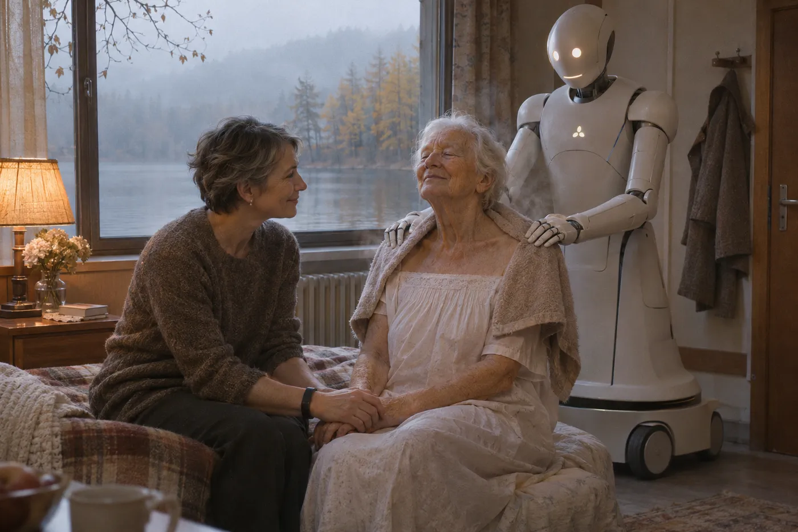

# 1. Sestřičko

*Brno-Bystrc, Domov Jasan. Sobota 31. října 2076.*

Ráno nebolelo. Ráno vážilo.

Kristýna Navrátilová se probudila v 5:52 a věděla to dřív, než otevřela oči. Ruka ležela na peřině a nešlo ji zvednout. Ne že by nemohla. Nebylo proč. Ležela na zádech a počítala, kolik věcí by musela udělat, aby se dostala do kuchyně. Odhrnout peřinu. Posadit se. Najít nohama papuče. Vstát. Bylo jich moc.

„Je šest,“ řekl Hugo potichu. Víc nic. Za tři roky se naučil, že v šest se po ní nic nechce.

V osm řekl: „Lék máte na stolku. Sklenice je plná.“

Vzala si ho vleže, opřená o loket. Voda měla pokojovou teplotu, jak to měla ráda. Hugo se jí na to kdysi zeptal a od té doby to nezapomněl.

V devět řekl: „Venku je jedenáct stupňů a nad vodou mlha. Do desíti zvedne.“

V deset řekl: „Vstaňte aspoň k oknu. Nic víc po vás nechci.“

„To jsi říkal i ve čtvrtek.“

„Ve čtvrtek jste vstala.“

Měl pravdu. Měl skoro vždycky pravdu, a to na něm bylo nejlepší i nejhorší. Kristýna odhrnula peřinu. Posadila se. Papuče byly tam, kde je večer nechala, špičkami ke dveřím, protože jí Hugo před rokem poradil, ať je tak staví, že je to pak o jeden pohyb míň. Vstala.

U okna se opřela čelem o sklo. Bylo studené a bylo to dobré.

Bydlela v devátém patře panelového domu na kraji Bystrce a pod okny měla přehradu. Mlha se zvedala z vody v cárech a pod ní se ukazovala hladina, šedá a hladká jako cín. Na druhém břehu stál les, rezavý a žlutý. Vpravo v dálce vystupovala z bílé tmy hráz s řadou lamp, které ještě svítily, protože jim nikdo neřekl, že je den. Po vodě táhla loďka s veslařem v červené bundě a za ní se rozbíhaly dvě rovné čáry.

Přestěhovala se sem před dvěma lety. Byt v Pisárkách prodala za týden, protože Hugo našel kupce dřív, než se rozhodla, jestli chce prodávat. Odtud to měla k mamince patnáct minut pěšky. Tehdy to byl jediný důvod. Teď to byl jediný důvod, proč vstávala.

„Dominik poslal fotku,“ řekl Hugo. „Ve 7:40. Mám ji ukázat?“

„Ukaž.“

Na skle okna se rozsvítil obdélník. Úzké schodiště v dílně, cihlová zeď, a na třetím schodu starý robot s hranatou hlavou, natřený na oranžovo, jedna noha nahoře a druhá dole, jako dítě, které se učí chodit. V rohu snímku Dominikův palec se šmouhou od maziva. Pod tím napsal: *Ferda dneska poprvé vyšel schody sám. Celý. Mami, jsi vzhůru?*

Kristýna odepsala sama, prstem na sklo, jedno slovo. *Jsem.* Pak, protože to vypadalo jako výčitka, připsala: *Gratuluju Ferdovi.*

Polévka přijela ve dvanáct, teplá, v hliněném hrnku se zátkou, od paní z přízemí, která vařila pro šest bytů. Kristýna snědla půlku a zůstala sedět u stolu s lžící v ruce. Dívala se na vodu. Neměla smutek. Smutek by byl něco. Měla jen šedou plochu, po které nic nejelo.

Ve 14:30 řekl Hugo: „Za půl hodiny je tři.“

„Já vím.“

„Já vím, že víte.“

*

Šla pěšky dolů ke smyčce tramvaje na Ečerově a odtud do kopce k lesu. Bylo po dešti a chodníky voněly mokrým listím. Na zídce u obchodu sedělo pět dětí v papírových maskách, dvě kostry a tři dýně, a dělily se o pytlík bonbonů. Jedna dýně měla odřené koleno se starou krustou a škrábala si ji. Takových věcí si všímala pořád. Kůže, kolena, ruce. Co je staré a co nové. Lékaři to nikdo nevezme, ani když přestane být lékařem.

Domov Jasan stál nad přehradou na kraji lesa. Tři pavilony, bílé, s dřevěnými římsami, spojené prosklenými chodbami, a kolem nich zahrada, která se svažovala k vodě. K hlavnímu vchodu vedla alej modřínů. Na konci října byly modříny celé zlaté. Jediné naše jehličnany, které na zimu shazují jehlice, a dělaly to právě teď. Jehličí leželo na cestě, měkké a světlé, a zahradní robot ho shrnoval do řádek.

Dveře ji poznaly podle náramku a otevřely se.

Uvnitř nevonělo nic. Nanejvýš trochu prádlem a jablky, která stála v míse na pultu u vchodu. Kristýna se toho nemohla nabažit ani po dvou letech. Pamatovala si jiné domovy. Jako mladá lékařka jezdila na konzilia do zařízení po celém kraji a už ve dveřích poznala nosem, kolik tam mají sester. Moč, savo, polévka z pytlíku, a pod tím ten sladký, těžký pach, o kterém každý lékař ví, co znamená. V Jasanu nebylo cítit nic. Mamince pobyt platilo pojištění.

Chodbou v přízemí pavilonu B prošla kolem jídelny. Na každých dveřích visela cedulka se jménem a pod ní obrázek, který si obyvatel vybral sám. Na B-03 jezevčík. Na B-04 vnoučata u vánočního stromku, rozmazaná, jak se hýbala. Na B-05 jen jméno, vysázené starým písmem s patkami, bez obrázku: *Ing. Antonín Rozsypal.* Hned za ním byly dvoukřídlé dveře knihovny a na nich papír připnutý připínáčkem, psaný rukou: *Úterý 18:00 – setkání zástupců. Mgr. Kunc. Káva bude.*

V knihovně seděla v srpnu. Kristýna prošla kolem dveří rychleji a zmáčkla tlačítko výtahu.

*

Pokoj B-212 byl ve druhém patře na konci chodby. Dvě lůžka, dvě skříně, velké okno na vodu. Lůžko u dveří bylo prázdné. Matrace bez prostěradla, holá, s modrým potahem, a na ní dvě igelitové tašky a krabice od bot. Na nočním stolku nic. Kristýna se na to místo podívala jen jednou a pak už ne.

Maminka seděla u okna na posteli, s nohama dolů, v košili rozepnuté na zádech. Pepička stála za ní a myla jí záda.

Hestie byly vysoké skoro jako muž, bílé, se zaoblenými rameny a s tváří, která tvář jen naznačovala: hladký ovál, místo očí dvě měkká světla, pod nimi úzká linka, která se při řeči rozsvěcovala. Místo nohou měly široký tichý podvozek, protože člověka v náručí je bezpečnější vézt na kolech než nést na dvou nohou. Na hrudi světelná značka, aby si nikdo nespletl, kdo je kdo. Federace to tak chtěla a Kristýna tomu rozuměla. Kdo jednou viděl, jak se dementní člověk bojí vlastní dcery, protože ji má za cizí, ten nechce, aby si ji spletl ještě se strojem.

Pepička vzala z vyhřívaného boxu na stolku nový ručník, složený do čtverce, a rozložila ho mamince na lopatky. Z ručníku se kouřilo. Maminka zavřela oči a vydechla, dlouze, jako se vydechuje do teplé vany.

„Pec nám spadla, pec nám spadla…“ zpívala Pepička potichu, altem, který se do pokoje hodil.

„Starý pecař není doma,“ zpívala maminka, čistě a o tercii výš, protože druhý hlas ji naučili na pedagogické fakultě v roce 2012 a ten jí zůstal, když všechno ostatní odešlo.

Kristýna zůstala stát ve dveřích.

Maminka otevřela oči a uviděla ji. Usmála se tím širokým, dětským úsměvem, který měla teprve poslední dva roky.

„Sestřičko,“ řekla. „Pojďte. My tu zpíváme.“

„Dobrý den, paní Šárko,“ řekla Pepička. „Dobrý den, paní doktorko.“

Kristýna pověsila kabát na háček, pečlivě, za poutko, jako by na tom záleželo. Šla k posteli a sedla si vedle maminky, na kraj, a vzala ji za ruku. Ruka byla teplá od ručníku, suchá, s kůží tenkou jako papír na pečení, a pod ní se daly nahmatat všechny kosti.

„Sestřičko,“ řekla maminka ještě jednou, spokojeně, jako by to slovo ochutnávala.

Kristýna jí po dvou letech pořád neuměla odpovědět. Říkala *ano* a *jsem tady*. Ze začátku říkala *Mami, to jsem já, Kristýna*, a maminka se zarazila, zatvářila se omluvně a vyděšeně, jako když člověk na ulici pozdraví cizího, a pak se celé odpoledne nesmála. Tak toho Kristýna nechala.

„Dnes snědla celý oběd,“ řekla Pepička. „Knedlíky ne, ty nechala. Vypila jeden litr a čtyři decilitry. Spala od deseti do šesti, v noci jsem ji jednou polohovala. Ve čtvrtek ráno, když jsem tu nebyla, jí Majka zapsala na levé hýždi zarudlé místo. Do večera zmizelo.“

„Ukažte,“ řekla Kristýna.

Pepička mamince pomohla lehnout na bok, jednou rukou pod rameno, druhou pod kyčel, a maminka si u toho broukala dál. Kristýna se sklonila. Kříž, hýždě, boky. Pak paty, obě, vzala je do dlaně jednu po druhé a prohlédla je proti světlu z okna. Kůže bílá, nepoškozená, na patách hladká jako u dítěte.

Na kříži a na patách to začíná vždycky. Tam leží člověk celou vahou na kosti a mezi kostí a matrací není nic než kůže. Ve čtyřicátých letech jí na příjem v Bohunicích vozili lidi z domovů s ranami na patách, do kterých se dal vložit palec, a s proleženinou na kříži až na kost. Někteří umřeli dřív, než se jim zahojily. Měli tehdy jednu ošetřovatelku na čtyřicet lůžek a v noci jednu na celou budovu, a ta ošetřovatelka byla unavená, měla bolavá záda a doma děti. Nikdo jí to nevyčítal. Jen ty paty.

V Jasanu měli v pavilonu B tři Hestie na noc a matrace, které věděly, kde tlačí. Když maminku přijímali, ředitelka Valentová řekla, že za čtyři roky neměli v celém domově jedinou proleženinu. Kristýna si tehdy myslela, že lže, protože ředitelky lžou. Za dva roky nenašla na mamince jediné místo, které by zůstalo červené do druhého dne.

„Dobře,“ řekla a položila patu zpátky na podložku.

Pepička maminku zase posadila, oblékla jí čistou košili a učesala ji, pomalu, od konečků, jak se češou dlouhé vlasy, i když maminka měla vlasy krátké.

Kristýna se dívala na Pepiččiny ruce. Bílé, s jemnou šedou kresbou kloubů, a v dlaních vyhřívané. Hestie mají vyhřívané dlaně, aby nikoho nestudily. Někdo na to kdysi přišel a pak se všichni divili, že to nenapadlo nikoho dřív.

Byly to tytéž ruce, které ve středu ve tři ráno pustily Olgu.

Kristýna to věděla od středy. Ráno jí volala ředitelka, osobně, protože maminka ležela v tom pokoji a Kristýna byla její zástupkyně. Řekla, že paní Šťastná spadla při polohování, že se to stává, že robot podle pravidel povolil úchop, když se jí stáhla noha, a že to bylo rychlé. Maminka spala, sestra Monika u ní pak seděla do rána. Medilon Pepičku prověřil, jádro bylo čisté, a ve čtvrtek v poledne byla zpátky v pokoji.

Kristýna pak dlouho seděla u okna s telefonem v ruce. Olga za dva roky v té posteli nikdy neměla křeč. Viděla ji každý den, malou a lehkou, s nohama měkkýma a rovnýma, bez jediné kontraktury. Olga pětkrát za odpoledne řekla *dobrý den* a pokaždé se u toho zasmála. Stroje selhávají. Lidé taky, a dřív selhávali častěji. Pak Hugo řekl, že je deset večer, a Kristýna šla spát. Víc z toho nebylo.

„Půjdeme dolů?“ zeptala se Pepička. „V jídelně je káva. Pan inženýr se ptal, jestli přijdete.“

„Půjdeme,“ řekla maminka, ačkoli nevěděla kam.

*

Jídelna zabírala celé přízemí na straně k vodě. Velká okna, světlé dřevo, stoly po čtyřech, na každém hrneček s větvičkou modřínu. Kuchyňský robot za pultem krájel jablečnou buchtu podle receptu paní z B-08, která ho robotovi tak dlouho opravovala, až byla buchta její. Přehrada pod okny se leskla.

Pan inženýr seděl u stolu v rohu. Šachy měl rozestavěné.

Byl vysoký a hubený, s bílými vlasy přečesanými dozadu, v hnědém svetru s koženými záplatami na loktech. Vedle židle stálo chodítko s košíkem a v košíku ležela prázdná dřevěná kazeta. Tmavé dřevo, na víku vykládaná šachovnice, mosazné panty. Když uviděl maminku, vstal. Šlo mu to pomalu, o opěradlo židle a o stůl, a Kristýna si všimla, jak se mu nadechnutí láme ve dvou dobách. A kotníky mu nad papučemi přetékaly. Srdce. Věděla to, jako se ví, kolik je hodin.

„Paní Šárko,“ řekl a uklonil se, jak se uklánějí lidé, kteří se to učili v tanečních. „Vypadáte dnes jako jaro. Paní doktorko, vy jako podzim, ale to je moje oblíbená roční doba.“

„Dobrý den, pane inženýre.“

„Bílé, nebo černé?“

„Bílé.“

„Pořád bílé,“ řekl a posadil se.

Pepička přistavila maminčin vozík k oknu, aby viděla na vodu i na šachovnici, a přinesla tři kávy a buchtu. Odjela ke dveřím a čekala tam, tiše, s rukama u těla. Maminka držela buchtu v ruce a prohlížela si ji.

Kristýna si vzala lžičku, ulomila kousek a podala jí ho k ústům. Maminka otevřela pusu. Bylo to jediné jídlo za den, které mamince nepodával stroj, a Kristýna si ho nenechala vzít.

Hráli. Pan inženýr hrál pomalu, s rukou nad figurkou dlouho předtím, než ji vzal. Kristýna hrála rychle a útočila. Za dva roky s ním vyhrála čtyřikrát a pokaždé si byla jistá, že ji nechal.

„Vy pořád jen bráníte,“ řekla po patnáctém tahu.

„Celý život jsem dělal v brzdách, paní doktorko.“ Posunul pěšce o jedno pole. „Útočit mě nikdo nenaučil. Naučili mě jen to, aby se nic nerozjelo tam, kam nemá.“

Kristýna si ho představila v montérkách v nějaké dílně u tramvají, se šroubovákem za uchem. Nesedělo to k tomu svetru.

Když přemýšlel, točil na prstu svazkem klíčů. Malý kroužek, tři čtyři klíče. Jeden z nich byl drobný, jako od schránky, a měl hlavičku navlečenou v mosazné čepičce, vyleštěné palcem do žluta. V Jasanu se všechno otvíralo náramkem, i skříně, i okna.

„Proč nosíte klíče?“ zeptala se. „Tady přece žádné dveře nemají zámek.“

„Zvyk. Kapsa bez klíčů je jako kapsa bez kapesníku.“ Zvedl ten malý mezi dvěma prsty, aby ho viděla. „Tenhle je od chaty. V Jedovnicích. Chata už je dávno cizí. Klíček jsem si nechal.“

„Na památku.“

„Na památku,“ řekl a vrátil svazek do kapsy. „Šach.“

Kristýna ho neviděla přicházet.

Maminka mezitím snědla buchtu a začala si broukat. Nejdřív bez slov, jen melodii, a pan inženýr zvedl hlavu od šachovnice a poslouchal, s rukou nad střelcem. Pak se přidal. Měl baryton, trochu zastřený, s dechem, který mu nevydržel na celou frázi, takže se nadechoval uprostřed slova.

„Teče voda, teče…“

Maminka se k němu otočila a zpívala s ním, slova i druhý hlas, celou sloku a pak další. U vedlejšího stolu se přidala paní z B-08, falešně a nahlas, a nějaký pán s holí ťukal do rytmu o nohu stolu. Kuchyňský robot přestal krájet. Pepička u dveří stála bez hnutí.

Kristýna seděla s věží v ruce a dívala se na maminčinu tvář. Byla celá otevřená a nic nehledala. Takovou ji Kristýna neznala ani z dětství. Maminka byla učitelka, přísná a unavená, a večer opravovala sešity. Teď zpívala v jídelně s cizím pánem, nepamatovala si, jak se jmenuje její dcera, a byla šťastná.

Tu tvář znala od léta. Podle ní se v srpnu rozhodla, že maminka bude jíst dál, a komise jí to potvrdila. A přesto se to v ní každé odpoledne přelévalo jako voda v lavoru, který někdo nese po schodech.

Píseň skončila. Pan inženýr se usmál a přejel si dlaní rty.

„Paní Šárka zpívá jako sedmnáctiletá,“ řekl. „A já jako sedmdesátiletý. Což sedí.“

„Jedenasedmdesátiletý,“ řekla Kristýna.

„Vidíte. A to jste mi ani nedělala vyšetření.“

Prohrála o osm tahů později. Pan inženýr skládal figurky do kazety jednu po druhé, každou do její přihrádky, a zavřel víko. Kristýna se natáhla, že mu ji podá do košíku.

„Děkuji, nechte,“ řekl a vzal ji dřív. „Tu nosím sám. Kdyby ji nesl někdo jiný, příště prohraju. To je vědecky ověřené.“

Postavil kazetu do košíku chodítka, opřel se o madla a odjel chodbou ke knihovně, pomalu, s kolečky, která tiše skřípala na dřevěné podlaze. U dveří se otočil, kývl na maminku a zazpíval půl verše, falešně schválně. Maminka se zasmála nahlas.

*

Když se vrátily nahoru, v pokoji byla Soňa Šťastná.

Stála u prázdného lůžka a skládala do tašky svetr. Šedý, s vytahanými lokty. Olga v něm seděla každé ráno, protože jí byla zima i v létě. Soně bylo kolem šedesáti, měla krátké obarvené vlasy a kabát, který si nesundala. Na matraci vedle tašek ležely fotky v obálce a plyšová kočka, olezlá do lysa.

„Dobrý den, paní Navrátilová,“ řekla Soňa, aniž by se otočila. „Dobrý den, paní Šárko.“

„Dobrý den,“ řekla maminka vesele. „Vy jste nová?“

Soňa se otočila. Oči měla suché a zarudlé, jak je mají lidé, kteří už nebrečí, protože to přestalo pomáhat.

„Jo,“ řekla. „Nová.“

Pepička posadila maminku do křesla u okna a přikryla jí kolena dekou. Obrátila se k Soně.

„Mám vám pomoct s taškami, paní Šťastná?“

„Ne.“ Soňa to řekla rychle a hned se zarazila. „Ne, děkuju. Já to zvládnu.“ Očima sklouzla k Pepičce, k jejím bílým rukám, a zase do tašky. Pepička kývla, odjela ke dveřím a vyjela na chodbu. Bylo to od Pepičky ohleduplné a Soňa se kousla do rtu.

Kristýna jí pomohla. Fotky do obálky, obálku do tašky. Kočku Soňa držela chvíli v ruce, jako by ji vážila, a pak ji strčila do kapsy kabátu.

„Mámě se tady líbilo,“ řekla Soňa do tašky. „To vám řeknu. Ráda tady byla. Pořád se smála. Doma se nesmála ani jednou, co táta umřel. Tady jo.“ Zavřela zip. „A pak ji ten stroj pustil na zem jak pytel.“

Kristýna nic neřekla.

Soňa sáhla do kabelky a vytáhla papíry, několik listů sešitých v rohu, přeložených napůl a zase narovnaných. Na první stránce bylo nahoře číslo jednací a pod ním *HLÁŠENÍ UDÁLOSTI S ÚJMOU NA ZDRAVÍ*.

„Advokát mi to vytiskl,“ řekla Soňa. „Já tomu nerozumím. Já jsem dělala v účtárně. Stojí tam, že to byla náhoda. Že se to stává. Že nikdo za nic nemůže.“ Podala jí papíry. „Vy jste byla doktorka.“

„Jsem.“

„Tak mi řekněte. Zabil ji ten robot?“

Kristýna držela papíry v ruce a nedívala se do nich. Za ní maminka u okna broukala *Teče voda* a pod oknem se po vodě táhla poslední loďka dne.

„Nevím,“ řekla Kristýna.

„Podíváte se na to?“

Kristýna chtěla říct, že ne. Že už dva roky nikoho neléčí a nikomu nic nepodepisuje. Že ráno nevstane do deseti. Že když jí někdo dá do ruky papír, většinou ho položí na stůl a za týden ho Hugo vytřídí.

„Podívám,“ řekla.

Soňa kývla. Vzala obě tašky, krabici od bot si dala pod paži a u dveří se zastavila.

„V úterý je ta skupina,“ řekla. „Dole u Kunce. Přijdete? Já tam sama nechci.“

„Přijdu.“

Soňa odešla. Na matraci po ní zůstal jen otisk, kde stály tašky.

V šest přinesla Pepička večeři. Kristýna seděla u maminky, dokud maminka nesnědla polovinu a nezačala usínat v křesle. Pepička ji přenesla do postele, lehce, jako se přenáší peřina, a postel pod ní sjela skoro k podlaze, jak sjížděla každou noc, aby nikdo nemusel padat z výšky. Kdysi měly postele v domovech zábrany a někdy popruhy. Tady neměly nic.

„Přijdete zítra, sestřičko?“ zeptala se maminka se zavřenýma očima.

„Přijdu.“

*

Doma si papíry rozložila na kuchyňský stůl a dlouho je nečetla. Udělala si čaj a nechala ho vystydnout.

„Je deset,“ řekl Hugo. „Za chvíli přejdu do nočního režimu. Pokud nechcete jinak.“

„Nechci.“

„Dobře. Mám vám to přečíst?“

„Umím číst.“

„To vím. Ptám se, jestli chcete.“

Nechtěla. Přečetla si to sama. Bylo to krátké a suché a byla v tom Olžina smrt rozepsaná na tisíciny vteřiny. 03:22:05 polohování. 03:22:31 nad okrajem lůžka. 03:22:33 spazmus. 03:22:34 pád. 04:10. Kristýna znala ten jazyk. Psala jím třicet let, propouštěcí zprávy, úmrtní listy, zprávy pro pojišťovnu. Věděla, co se mezi řádky ztrácí. Že *pád na podlahu z výšky 78 cm* je zvuk, který se v pokoji ozve jednou a pak už nikdy ne. A že maminka u okna to slyšela, nebo neslyšela.

Na poslední stránce byl graf.

„Můžeš to zvětšit?“ zeptala se. „Ten originál. Z registru.“

„Záznam je veřejný,“ řekl Hugo. Na desce stolu vedle papírů se rozsvítila plocha a v ní graf, ostřejší než na tisku. „Mám k němu něco vysvětlit?“

„Zatím ne.“

Dvě čáry. Nahoře síla v úchopu levé nohy, v newtonech. Dole poloha nohy, úhel v kyčli a v koleni. Šest vteřin.

Kristýna si nasadila brýle a sklonila se nad stůl.

Horní čára šla nejdřív rovně, kolem dvaceti, jak noha ležela v robotově ruce a nic nedělala. Pak, ve 3:22:33, vyskočila. Neohnula se, nezačala stoupat. Vyskočila jako schod, kolmo, na sto čtyřicet, a tam zůstala stát. Pak spadla na nulu, protože úchop povolil.

Dolní čára se nepohnula. Ani o stupeň. Kyčel stála, koleno stálo. Rovná čára až do chvíle, kdy začala noha padat s celým tělem.

Kristýna se dívala dlouho.

Viděla tisíce křečí. Na jednotkách intenzivní péče, na neurologii, u postelí lidí po mrtvici, kterým se noha v noci napnula jako tětiva a kopla do zábrany. U lidí s demencí v posledním stadiu, kteří měli končetiny stažené k tělu a kterým se při každém doteku stáhly ještě víc. Křeč není číslo. Křeč je pohyb. Sval se zkrátí a táhne za sebou kost. Nejdřív pomalu, pak víc. Nikdy ne naráz, protože sval se nerozjede za tři milisekundy, ani když chce. Pod rukou to člověk cítí jako vlnu.

Tady nebyla vlna. Tady byl schod. A noha stála.

„Křeč hýbe nohou,“ řekla nahlas, do prázdné kuchyně. „Tady noha stojí a síla roste.“

„Model inspektorátu ten průběh hodnotí jako pravděpodobný artefakt čidla,“ řekl Hugo. „Vlhkost. Je to uvedené v bodě 6.1.“

„Vím, co je v bodě 6.1.“

„Promiňte.“

„Ne. Máš pravdu, že to tam je.“ Sundala si brýle a zase si je nasadila. Čáry se nezměnily.

Olga neměla křeče. Olga měla nohy měkké a rovné jako dítě. A ve středu ve 3:22 ji Pepička držela nad hranou postele, když síla vyskočila.

„To není křeč,“ řekla Kristýna.

Hugo mlčel.

Kristýna zhasla desku stolu a zůstala sedět v tmavé kuchyni. Za oknem na hrázi svítily lampy, řada žlutých teček nad černou vodou. Bylo půl jedné. V tuhle dobu obvykle ležela a dívala se do stropu a čekala, až přestane myslet na nic. Na nic se myslelo nejhůř. Nic nemělo okraje.

Dnes nemohla spát kvůli něčemu.

Trvalo jí dlouho, než si všimla, že je to rozdíl.
