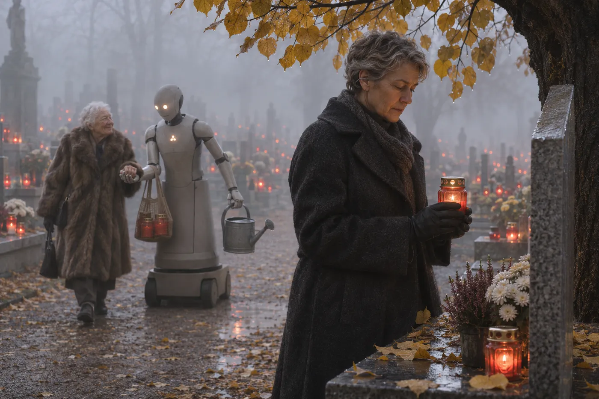

# 2. Dušičky

*Brno, Ústřední hřbitov a Kounicova. Pondělí 2. listopadu 2076.*

Na Ústřední hřbitov přijela v sedm, aby tam ještě nikdo nebyl. Byli tam všichni.

Mlha ležela na Vídeňské tak nízko, že tramvaje vyjížděly z bílé zdi a zase do ní zajížděly. U hlavní brány prodávala žena z vozíku věnce a chryzantémy a vedle ní stál automat na svíčky. Brožová si koupila svíčku od ženy, protože ta žena měla zmrzlé prsty a automat ne. Červené sklo, bílý vosk, plechové víčko s dírkami. Žena jí vrátila drobné z kapsy zástěry.

Hlavní alejí se šlo pomalu. Lidé v kabátech, lidé s konvemi, děti, které chtěly běhat a nesměly. Robot hřbitovní správy, nízký a zelený, jezdil po štěrku s vozíkem a sbíral dohořelá sklíčka z loňska, z předloňska, ze všech let, kdy je tu někdo nechal. Mezi hroby se plazilo světlo tisíců svíček a mlha z něj dělala jednu velkou oranžovou zář, jako by pod hřbitovem něco hořelo.

Hrob byl v sedmém oddělení, u zdi pod lípou. Šedá žula, dvě jména. Otcovo nahoře, velkým písmem, mámino pod ním, menším, protože tak to máma chtěla. Na kameni ležely mokré lipové listy. Brožová je smetla rukavicí, postavila svíčku k nohám písmen a zapálila ji sirkou. Sirky nosila jen kvůli tomuhle. Jednou za rok, krabička vydržela pět let. Otec to dělal stejně. Kouřil do padesáti, a když přestal, nosil dál v kapse sirky. Bez nich mu něco chybělo.

Plamen se chytil, chvíli váhal a pak stál rovně. Když se nad ním narovnávala, ozvala se jí kolena, pravé víc. Dřív se ozývala jen na schodech.

Stála nad tím s rukama v kapsách. Otec umřel v jedenapadesátém, na infarkt, v kanceláři na Cejlu, nad spisem o loupeži v trafice. Bylo mu šedesát. Do výsluhy mu zbývalo osm měsíců. Brožové bylo tehdy třicet devět a dodnes nevěděla, jestli se na výsluhu těšil, nebo jestli se bál, co bude potom. Nikdy o tom nemluvil. Otec o ničem nemluvil, jen chodil do práce a v neděli opravoval kola.

Jí bylo od února čtyřiašedesát. V únoru bude pětašedesát. Šindelář to v září řekl u kávovaru, mezi řečí o počasí. *V únoru máš nárok, Jano. Jen abys věděla.* Věděla.

Kolem prošla stará paní v kožichu. Vedle ní jel pečovatelský robot, šedý, s konví v jedné ruce a s taškou svíček v druhé, a když se paní zastavila, aby si odpočinula, zastavil se taky a čekal. Nepospíchal. Nepodepřel ji, dokud se o něj sama neopřela. Pak jí podal ruku, jako se podává ruka na plese, a šli dál.

Brožová se za nimi dívala, dokud nezmizeli v mlze. Za dvacet let. Kdyby měla štěstí, tak za dvacet.

Ota na hřbitově mlčel. Jednou ho tu požádala, ať mlčí, a on si to zapamatoval na všechny další roky. Ozval se, až když prošla bránou zpátky na Vídeňskou.

„Na útvaru na vás čeká žena. Od 7:10.“

„Kdo ji pustil?“

„Recepce. Má na to právo. V neděli podala podnět k přezkumu incidentu robota, model inspektorátu ho zamítl a zákon jí pak dovoluje mluvit s člověkem. Na Kounicově jste dnes první člověk ve službě.“

„Jak se jmenuje?“

„MUDr. Kristýna Navrátilová. Padesát sedm let, Bystrc. Geriatrička. Do roku 2073 primářka geriatrie ve Fakultní nemocnici Bohunice. Od roku 2074 bez registrovaného úvazku.“

Brožová si vložila do úst pastilku a nastartovala.

*

Navrátilová seděla na lavici pod oknem, s kabátem zapnutým až ke krku a s kabelkou na kolenou. Na kabelce ležely papíry v průhledné fólii. Vstala, když Brožová vyšla z výtahu. Nevstala rychle, ale vstala hned, jako člověk, který čekání vzal jako práci.

Drobná, šedivé vlasy ostříhané nakrátko, žádné líčení. Kabát starý a dobrý, boty vyčištěné. Oblékla se pečlivě. Brožová znala lidi, kteří se oblékají pečlivě, protože jinak by se neoblékli vůbec.

„Kapitánka Brožová,“ řekla Brožová. „Pojďte dál.“

V kanceláři si Navrátilová sedla na kraj židle a položila fólii na stůl. Ota mluvil nahlas z jednotky vedle lampy, jak to Brožová měla nastavené pro lidi, kteří přišli sami od sebe.

„Paní doktorko,“ řekla Brožová, „nejste obviněná ani svědkyně. Přišla jste s podnětem. Co chcete, abych udělala?“

„Abyste se na to podívala.“ Navrátilová vytáhla papíry z fólie a otočila je k ní. Hlášení, čtyři stránky, poslední s grafem. „Ve středu ve tři ráno spadla v Domově Jasan v Bystrci z postele osmdesátisedmiletá žena. Robot ji při polohování pustil. Umřela za čtyřicet osm minut. Ležela dva roky v posteli vedle mé matky.“

„Je mi líto.“

„Mně taky.“ Řekla to suše, bez pauzy. „V neděli jsem napsala inspektorátu. Odpověď přišla za minutu.“

Ukázala jí ji. Pod hlášením byl vytištěný ještě jeden list, krátký.

*Průběh odpovídá známému artefaktu silového čidla. Shluk událostí v zařízení je po korekci v mezích očekávání. Podnět nebyl přijat k šetření. Děkujeme, že jste se obrátila na Inspektorát bezpečnosti.*

„Artefakt,“ řekla Navrátilová. „Za minutu. Za tu minutu to nečetl nikdo, kdo by kdy držel v ruce lidskou nohu.“

„Proč jste přišla sem?“

„Protože u vás prý sedí lidi.“

Brožová se skoro usmála. Přetáhla si graf k sobě.

„Vysvětlete mi to. Pomalu. Jsem policajtka, ne doktorka.“

Navrátilová se naklonila přes stůl a položila na papír ukazováček. Nehet měla ostříhaný nakrátko a rovně, až k masu.

„Nahoře je síla, kterou robot cítí v ruce. Drží jí levou nohu pod kolenem. Dvacet newtonů, to je skoro nic, noha jen leží. Tady,“ prst se posunul, „to vyskočí na sto čtyřicet. Za tři milisekundy. Robot si myslí, že má pacientka křeč, že se mu brání. Podle pravidel ji pustí, aby jí nezlomil nohu. To je správně. Takhle to má dělat.“

„A dole?“

„Dole je, kde je noha. Úhel v kyčli a v koleni.“ Prst sjel na spodní čáru a přejel ji celou, zleva doprava. „Nehne se. Ani o stupeň. Křeč hýbe nohou, paní kapitánko. Sval se stáhne a táhne kost. Tady noha stojí a síla roste.“

„Oto?“

„Skokový průběh síly se vyskytuje přibližně u dvaadvaceti procent všech uvolnění úchopu při spazmu,“ řekl Ota. „Model ho přisuzuje vlhkosti v silových čidlech ramene. Hestie myjí mokrá těla. Pacientku robot třináct minut před pádem myl. Vlhké čidlo hlásí sílu, která nepůsobí. Končetina se pak nepohne, protože ve skutečnosti na ni nic netlačí. Tvar křivky odpovídá artefaktu. Pravděpodobnost, že jde o artefakt: devadesát jedna procent.“

Navrátilová se na jednotku zadívala jako lékař na studenta, který odříkal učebnici a má pravdu.

„Já vím, co je artefakt,“ řekla. „Třicet let jsem četla monitory. EKG se rozskáče, když se pacient poškrábe na hrudi. Saturace spadne, když má studené prsty. Artefakty jsou všude. Ale přicházejí kdykoli.“ Poklepala na graf. „Tenhle nemá důvod přijít zrovna ve chvíli, kdy ji drží nad hranou.“

Ota mlčel.

Brožová se na graf dívala dlouho. Dvě čáry. Jedna skočila, druhá ne. A pod tím osmdesát sedm let a čtyřicet osm minut.

„Kdy se robotovi stane, že ji drží nad hranou?“

„Při každém polohování, na pár vteřin. Zvedne ji, přetočí, položí. Jinak leží v posteli skoro na zemi. Postele na noc sjíždějí dolů, aby nikdo nespadl z výšky.“ Navrátilová stáhla ruku z papíru. „Vlhkost by se mohla ozvat, když ji myje. Když ji obléká. Když ji zvedá na vozík. Hestie ji drží v rukou půl hodiny denně. Ozvala se ve vteřině, kdy byla v sedmdesáti osmi centimetrech nad podlahou.“

„Oto?“

„Námitka je logická. Model s ní počítá. Z jedné události ale nelze určit, jestli jde o vzorec, nebo o shodu.“

„Tak se podíváme, jestli je jedna,“ řekla Brožová. „Oto, kdo tohle v inspektorátu má?“

„Odbor robotů v péči. Vedoucí oddělení posuzování je od letoška Ing. Jitka Mrázová.“

Brožová zvedla oči od papíru.

„Tuřany?“

„Tatáž.“

*

Mrázová se objevila na desce stolu po druhém zazvonění. Seděla v kanceláři s oknem do dvora a za ní na stěně visel kalendář s fotkou koček. Byla pořád drobná a pořád měla tablet přitisknutý k hrudi, jako by ji měl před něčím chránit. Jen vlasy jí za dva roky zešedivěly.

„Kapitánko,“ řekla. Nebyla překvapená. „Čekala jsem, že mi dneska někdo zavolá. Nevěděla jsem, že vy.“

„Mám tu paní doktorku Navrátilovou. Kvůli Jasanu.“

„Vím. Viděla jsem její podnět v neděli večer.“ Mrázová pohlédla mimo kameru, tam, kde seděla Navrátilová. „Paní doktorko, odpověď vám psal model. Já jsem ji pak četla a podepsala bych ji. Promiňte. Nechci, abyste si myslela, že se na to nikdo nepodíval.“

„Podívala jste se na graf?“

„Na graf, na průběh, na celé hlášení. A pak na registr.“ Mrázová položila tablet na stůl před sebe a něco na něm otevřela. „Vysvětlím vám, proč jsem to nechala, jak to je. Jestli mě pak budete mít za úřednici, budete mít pravdu.“

„Poslouchám,“ řekla Brožová.

„Jasan měl letos tři pády s úmrtím. Všechny v pavilonu B. Všechny se stejným průběhem.“ Mrázová četla z tabletu, věcně. „Druhého března, E. K., osmdesát devět let, první patro, robot B-1. Čtrnáctého července, J. B., devadesát tři let, druhé patro, robot B-3. A dvacátého osmého října O. Š., osmdesát sedm, druhé patro, B-2. Všechny tři se skokem síly. Všechny tři uzavřené bez zavinění.“

Navrátilová se na židli narovnala. Když padlo *J. B.*, zvedla hlavu a zůstala tak. Brožová to viděla koutkem oka.

„Tři ze tří se skokem,“ řekla Brožová.

„V Jasanu myjí v noci. Mají to v pravidlech, žádný obyvatel nesmí spát mokrý, a proto tam nikdo nemá proleženiny.“ Mrázová zvedla ruku, než stačila přijít námitka. „A kde se v noci myje, tam vlhnou čidla. Model to má v datech ze stovek domovů.“

„A tři různé stroje.“

„Tři různé stroje, dvě patra. Kdyby byla vadná jedna Hestie, padalo by to u jedné. Tady není společný robot, není nic, co by se dalo opravit.“ Mrázová se nadechla. „Teď ta věc, kvůli které jsem to podepsala. Řeknu to pro obě.“

Odložila tablet.

„Hoďte si mincí desetkrát. Když vám padne desetkrát orel, budete koukat, to je jedna ku tisíci. Teď si představte, že hází dva tisíce šest set lidí. Dva nebo tři z nich těch deset orlů hodí určitě. Ne proto, že mají falešnou minci.“

„A těch dva tisíce šest set…“

„Je počet domovů ve Federaci, kde jezdí Hestie. Když se díváte jen na Jasan, vypadají tři mrtví za osm měsíců jako vzorec. Model se dívá na všechny a ptá se, kolik domovů by mělo takový shluk, i kdyby šlo jen o náhodu. Vychází mu jich kolem šedesáti. Jasan je jeden z nich.“

„A těch šedesát někdo prověřil?“ zeptala se Brožová.

„Model.“ Mrázová se poprvé usmála, krátce. „Proto mi teď voláte vy, a ne on.“

„A proč umřeli? Pádů je víc, ne?“

„Pádů je hodně. Většina skončí modřinou. Model počítá pády, ne mrtvé. Všichni tři brali léky na ředění krve, ve stáří je bere každý třetí. Krev se pak hůř sráží a malé krvácení pod lebkou se nezastaví.“

„To je pravda,“ řekla Navrátilová tiše. Vypadalo to, že to říká hlavně sobě.

„Vím, že je,“ řekla Mrázová. Nebylo to nepřátelské.

„Paní inženýrko,“ řekla Brožová, „co byste potřebovala, abyste to otevřela znovu?“

„Nový fakt. Něco, co v registru není a co model neviděl.“ Mrázová si tablet zase přitiskla k hrudi. „Technické šetření bez nového faktu otevřít nesmím, na to mám předpis a ten předpis je rozumný. Jinak bychom tu otevírali šedesát domovů každý měsíc a v žádném by nikdo nespal. Surová data jader má Medilon. Já mám jen to, co mi poslali do hlášení. Kdybyste měla soudní příkaz na surová data, dívala bych se s vámi. Ráda.“

„Děkuju.“

„Za Tuřany jsem vám to dlužila,“ řekla Mrázová. „Můj model tehdy taky mlčel a vy jste to za mě odnesla. Tak teď už ne.“

Obraz zhasl.

*

Brožová nechala Navrátilovou v kanceláři s Vaňkem, který mezitím přišel, a s kávou, které se nedotkla, a šla na chodbu.

Šindelář stál u kávovaru s kelímkem v obou rukou. Od loňského jara s ní mluvil o půl tónu zdvořileji a ona si na to nezvykla.

„Bystrc,“ řekl dřív, než stačila otevřít pusu. „Ota mi to poslal. Domov seniorů a robot.“

„Ano.“

„Medilon, Jano.“ Upil. „Víš, kolik má v kraji Hestií? V Bohunicích jich jezdí šedesát. Moje tchyně má jejich domácí model a mluví s ním víc než se mnou.“

„Nikoho nechci zavírat. Chci se podívat.“

„Dcera té paní, co spadla, má advokáta. Ve čtvrtek ráno, den po smrti, ohlásil žalobu na Medilon o odškodné. To je rychlé, nemyslíš? Ty rodiny chtějí, aby to byl robot. Robot má pojištění.“ Šindelář se díval do kelímku. „A model mluví jasně. Model bezpečnosti, model inspektorátu, Ota. Všichni říkají to samý.“

„Ota říká devadesát jedna.“

„Devadesát jedna je jasně.“

„Devadesát jedna je devět ze sta,“ řekla Brožová. „Kolik takových devítek jsme loni měli na stole?“

Šindelář si to spočítal. Bylo na něm vidět, že si to spočítal a že se mu výsledek nelíbí.

„Dva dny,“ řekl. „Do středy večer. Prověříš, co můžeš, bez humbuku. Žádný Medilon na chodbě, žádní novináři v Jasanu. A když nic nenajdeš, napíšeš to tý paní doktorce slušně a lidsky. Ty to umíš.“

„Umím.“

„A Jano.“ Šindelář konečně zvedl oči od kelímku. „Nechceš přece ty poslední měsíce honit robota, co nikoho nezabil.“

„Mám před sebou posledních pár měsíců?“

„To jsem neřekl.“

„Řekl jsi to v září,“ řekla Brožová. „U tohohle automatu.“

Šindelář zvedl kelímek, jako by si připíjel, a odešel.

Brožová zůstala u automatu. Kávu si nenapustila.

„Co se dá stihnout do středy?“

„Návrh na soudní příkaz k surovým datům jader tří robotů za tři noci,“ řekl Ota. „Výřez: časy událostí, plus minus hodina. Soud bude chtít přiměřené podezření, že nejde o nehodu. Graf a vyjádření lékařky s třicetiletou praxí mohou stačit. Nemusí. Soudkyně ve službě rozhoduje obvykle do druhého dne.“

„Připrav ho. Podepíšu ho dneska.“

„Medilon dostane od soudu oznámení, že data byla vyžádána. Bez humbuku to nebude.“

„Bez humbuku to nebylo nikdy,“ řekla Brožová. „Jen to Martin neví.“

„Plukovník Šindelář to ví,“ řekl Ota. „Proto řekl dva dny, a ne jeden.“

Brožová se na chvíli zastavila s rukou na klice kanceláře. Pak ji stiskla.

*

Navrátilová seděla tak, jak ji nechala, na kraji židle, s rukama na stole. Vaněk stál u okna a předstíral, že něco čte v tabletu.

„Mám do středy,“ řekla Brožová. „Nic vám neslibuju.“

„Nic jsem nechtěla.“

„Chtěla jste, aby se na to někdo podíval. Dívám se.“ Brožová si sedla. „Vaše matka leží na tom pokoji?“

„B-212. U okna.“

„A ta paní, co spadla, ležela u dveří.“

„Ano.“

„Kdo z rodiny chodí k vaší matce?“

„Já. Každý den ve tři. Syn v neděli, když může. Nemůže často.“

„Jaký je to domov?“

Navrátilová se na ni podívala, jako by čekala jinou otázku.

„Dobrý,“ řekla. „Lepší než všechno, co pamatuju. Proleženinu tam nemá nikdo. Moje matka je čistá, najedená a v noci se nebojí. Když se ve tři ráno vzbudí a zpívá, robot zpívá s ní, a ve tři ráno je stejně trpělivý jako v poledne. Nikoho tam nepřivazují. Nikdo tam nesmrdí.“ Mluvila tiše a rovně, jako by diktovala. „Jako mladá doktorka jsem jezdila do domovů, kde měla jedna ošetřovatelka v noci celou budovu. Tohle není ono. Tohle je něco, o čem jsme tehdy jen mluvili na konferencích.“

Brožová si vzpomněla na mámu. Poslední rok doma, v bytě v Žabovřeskách, s pečovatelkou na čtyři hodiny denně a s ní samotnou na zbytek. Na noci, kdy máma nevěděla, kde je, a ona k ní vstávala a ráno jela na výjezd. Kdyby tehdy existovalo něco takového, dala by ji tam. Možná by se za to styděla. Dala by ji tam stejně.

„A přesto jste tady.“

„A přesto jsem tady.“

„Ta jména, co četla Mrázová. E. K. a J. B. Znáte je?“

Navrátilová se dívala na svoje ruce na stole.

„V domově se umírá,“ řekla potom. „To je na domovech to nejobyčejnější. Lidi tam umírají, rodiny přijdou, vyklidí skříň, a za týden je na lůžku někdo jiný. Nikdo se neptá jak. Já jsem se taky neptala.“ Zvedla hlavu. „Zítra se zeptám.“

„Nedělejte nic, co by…“

„Zeptám se lidí v čekárně,“ řekla Navrátilová. „Na to nepotřebuju soudní příkaz.“

Brožová kývla. Na to opravdu nepotřebovala.

Navrátilová vstala, sáhla po fólii s papíry a začala je do ní zasouvat. Brožová ji sledovala. Ruce měla malé, se suchou kůží na kloubech, s krátkými nehty. Zasouvala papíry pomalu a pečlivě, roh po rohu, a dvakrát přitom uhladila list dlaní, jako se uhlazuje prostěradlo pod nemocným. Byly to ruce, které celý život sahaly na lidi. Na břicha, na zápěstí, na čela. Brožová to poznala, protože to bylo na nich vidět jako mozoly na rukou zedníka. A bylo na nich vidět ještě něco. Že už dlouho nesáhly na nikoho, na koho by sahat musely.

Lékařka, která přestala. Brožová nevěděla proč. Nebylo to její.

U dveří se Navrátilová zastavila. Na chodbě šel od výtahu starý muž s holí, nějaký svědek nebo něčí otec, a na prahu se mu hůl smekla po linoleu. Navrátilová ho chytila pod loktem dřív, než stačil upadnout. Neřekla nic. Podržela ho, dokud nestál, pustila ho a šla dál.

Vaněk se od okna otočil.

„Tak to je doktorka,“ řekl.

„Byla,“ řekla Brožová.

„Tohle se neodnaučí.“

„Ne,“ řekla Brožová. „To asi ne.“

Když byli sami, Vaněk si sedl na roh stolu a houpal nohou.

„Moje babička je na čekačce do Jasanu,“ řekl. „Do toho v Líšni. Dva roky. Máma tam volá každý měsíc, jestli se neuvolnilo místo.“ Pokrčil rameny. „Tam se neuvolňuje. Tam se umírá.“

„To je totéž.“

„No právě.“ Vaněk kývl k prázdnému stolu, kde předtím ležel graf. „Devadesát jedna, Jano. A Mrázová. A šedesát domovů. Co tam chceš najít?“

„Nevím.“

„Oto?“

„Můj odhad se nemění,“ řekl Ota. „Nemám data, která by neměl model. Pro úplnost: fáze úkonu je ve veřejné části všech tří hlášení stejná. Polohování, nad okrajem lůžka.“

Vaněk přestal houpat nohou.

„To ale nic neprokazuje,“ pokračoval Ota. „Když robot pustí nohu člověku, který leží v posteli, nic se nestane a do registru se nic nehlásí. V registru jsou jen pády. A spadnout jde jen z okraje.“

Brožová zvedla oči k jednotce. Ota jí dřív takové věty nedodával. Nebo dodával, a ona neposlouchala.

„Takže kolikrát to skočilo, když ležely v posteli…“

„…v registru není. To je v surových datech jádra. Ta má Medilon.“

„To je dobrá otázka,“ řekl Vaněk, a znělo to, že ho to mrzí.

Brožová vytáhla zápisník. Kroužkový, s tužkou ve spirále, nový, první stránka. Napsala nahoru datum a pod něj:

*Noha stojí. Síla roste.*

*3× B. 3 roboti. 3× nad hranou.*

Chvíli seděla s tužkou nad papírem. Pak připsala:

*Proč zrovna tam?*

*Kolikrát to skočilo v posteli?*

Do středy zbývaly dva dny. Za oknem do dvora se mlha pořád nezvedla a javor v ní stál holý.
