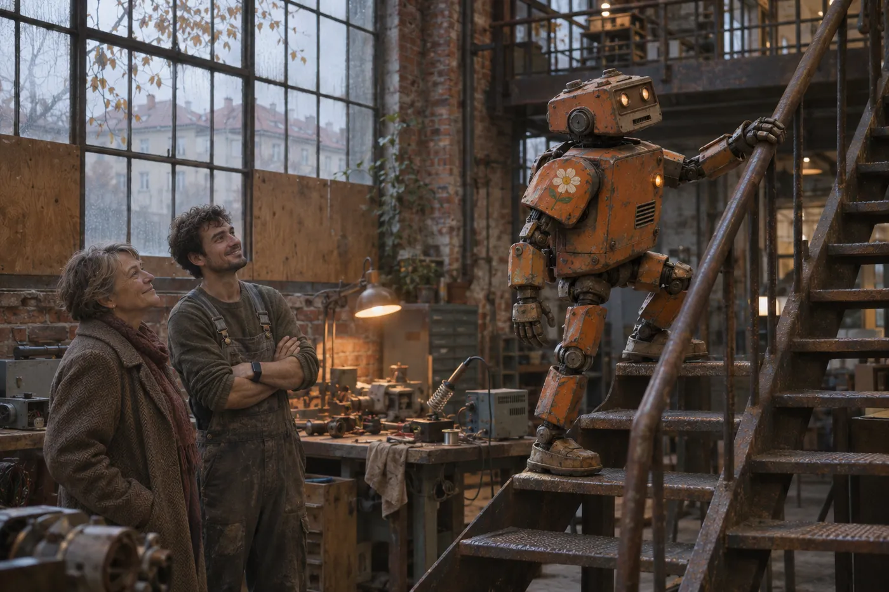

# 5. Dílna Svitava

*Brno-Husovice a Bystrc. Pátek 6. – sobota 7. listopadu 2076.*

Zpráva od Brožové ležela na nosiči od středy večer a Kristýna ji za dva dny otevřela víckrát, než by komukoli přiznala. *Není to vlhkost. Případ je otevřený. B.* Šest slov. Víc jí kapitánka napsat nesměla a Kristýna to věděla. Právě proto v nich hledala, co tam nebylo.

Zbytek se dozvěděla ve čtvrtek odpoledne v Jasanu. Inspektorka Mrázová ji zastavila na chodbě u výtahu, protože Kristýna byla maminčina zástupkyně a měla právo vědět, proč technici rozebírají Pepičce ruce. Řekla jí to ve čtyřech větách. Čtyři čidla skočila ve stejné milisekundě. Šetření je otevřené. Medilon hledá chybu v kalibraci. A kontrolní součty jader jsou čisté, celý rok.

Ve čtvrtek večer zavolala Dominikovi.

„Mami?“ Ozval se hned, s nějakým hlukem za zády, s kovem a se smíchem. „Stalo se něco babičce?“

„Ne. Potřebuju vědět, jak funguje ruka Hestie.“

Hluk za ním se vzdálil, jak někam odešel.

„Přijď zítra do dílny,“ řekl. „Ráno. A něco sněz, než pojedeš.“

V pátek se probudila v 5:40 a ležela do šesti, protože tíha byla na svém místě jako každé ráno. Pak vstala. Hugo řekl *dobré ráno* a nic víc. Snědla půl rohlíku, protože to Dominikovi slíbila, a zbytek nechala na lince.

Z Ečerovy jela tramvají přes celé město. V centru přestoupila a dál jela podél Svitavy, kolem starých cihlových továren, ze kterých se za jejího mládí stávaly byty a ateliéry a ze kterých teď byly zase dílny. Nad Husovicemi stál na kopci kostel se dvěma věžemi a dohlížel na čtvrť.

*

Dílna Svitava sídlila v bývalé přádelně na nábřeží. Vysoké okenní tabulky se železnými příčlemi, polovina z nich zaslepená překližkou, a nad vraty plechová cedule, kterou někdo ručně přetřel: *DÍLNA SVITAVA – družstvo. Opravujeme, co se dá.* Ve vratech byla menší dvířka a ta byla otevřená.

Uvnitř vonělo. To bylo první, čeho si všimla. Olej, horká pájka, káva a ještě něco sladkého, jako připálený cukr. Po dvou letech v Jasanu, kde nevonělo nic, ji to udeřilo do nosu jako vzpomínka.

Hala byla dlouhá a pod stropem vedly staré traverzy s kladkami. Pod nimi stály ponky a na ponkách ležely kusy robotů. Ruka bez prstů. Hlava bez tváře, jen se dvěma čočkami. Trup s otevřeným hrudníkem, ze kterého visely svazky drátů jako střeva. Na jednom ponku seděl starý domácí robot, celý, se složenýma rukama v klíně, a vedle něj stál starý pán v kabátě a držel ho za rameno jako psa u veterináře.

Dominik ji uviděl dřív než ona jeho. Přišel přes halu velkými kroky, v montérkách s vyhrnutými rukávy, se šmouhou maziva na předloktí, a objal ji. Voněl pájkou.

„Mami. Ty jsi tady.“

„Řekla jsem, že přijdu.“

„Říkáš to často.“ Podržel ji za ramena a prohlédl si ji, rychle a odborně, tak jak to kdysi dělávala ona jemu, když přišel ze školy. Zkontroloval jí oči, barvu, ruce. Kristýna věděla, odkud to má, a málem se zasmála. „Jedla jsi?“

„Půl rohlíku.“

„To se počítá jako ne.“

Bylo mu dvacet devět. Měl po ní drobné kosti a po někom jiném smích, hlasitý a snadný, a za poslední rok mu ramena zesílila. Kristýna se na něj dívala a myslela si, že je šťastný. Nebylo to slovo, které by na někoho použila lehce. U něj nemusela hledat jiné.

„Pojď,“ řekl. „Napřed ti ukážu Ferdu. Jinak by se urazil.“

Ferda stál u zadní zdi pod schodištěm, které vedlo na pavlač. Byl menší než Hestie a těžší, hranatý, s trupem jako skříňka a s hlavou jako krabice od bot, a byl natřený oranžovou barvou, kterou na něj někdo nanesl štětcem. Na jednom rameni měl nakreslenou kytičku.

„To Vilma,“ řekl Dominik. „Předsedkyně. Natřela ho, když ho vytáhli ze šrotu. Říkala, že šedý robot je smutný robot.“

„Je to Hestie?“

„Je to dědeček Hestie.“ Dominik ho poplácal po hranaté hlavě. „Kinetis KX. Ročník padesát dva. Kinetis byla brněnská firma, v jednašedesátém ji koupil Medilon a z jejích strojů postavil Hestie. Ferda má pořád svoje původní tělo. Jádro jsme mu dali otevřené, certifikované, a nohy jsme mu přestavěli sami. Ferdo, schody.“

Ferda se otočil. Udělal to pomalu, se zabzučením, jako by se nejdřív musel rozmyslet. Pak zvedl jednu nohu na první schod, přenesl váhu a zvedl druhou. Šel nahoru podél cihlové zdi, schod za schodem, opatrně, jako starý člověk, který ví, že se nesmí splést. Nahoře na pavlači se zastavil a otočil hlavu dolů.

Kristýna ty schody poznala z fotky. Cihlová zeď, třetí schod. Jedna noha nahoře, druhá dole.

„Na tohle jsme dělali od jara,“ řekl Dominik. Neschovával pýchu a Kristýna ho za to měla ráda. „Hestie schody nepotřebuje. Jezdí na kolech, v domově je všude rovno a výtah. Ale pan Šebela z Cejlu bydlí ve čtvrtém patře bez výtahu, je mu osmdesát a pojišťovna mu dá robota jen na kolech. Takže mu pošleme Ferdu.“

„Ferdu?“

„Ferdova dvojčata. Ferda je vzor.“ Dominik zamával nahoru. „Dobrý, Ferdo. Dolů.“

Ferda šel dolů ještě pomaleji. U třetího schodu od konce se zastavil, chvíli stál a pak pokračoval.

„Tam se mu to vždycky zasekne,“ řekl Dominik. „Neví proč. My taky ne. Ale nikdy nespadl.“

Starý pán u ponku se mezitím odkašlal, tak jak se odkašlávají lidé, kteří nechtějí rušit, a přitom už nemůžou čekat.

„Pane Dominiku. On zase nezavře ruku.“

„Hned, pane Vrba.“ Dominik se omluvil očima a šel k němu. Kristýna šla za ním.

Robot pana Vrby byl starý domácí model, šedý, s odřeným lakem na loktech, a na ponku seděl tak, jak ho tam někdo posadil. Pravou ruku měl otevřenou a prsty se mu chvěly, jako by chtěl něco chytit.

„Od pondělí mu nejde podat hrnek,“ řekl pan Vrba. „Upustí ho. Já mu říkám, že to nevadí, ale on se pak omlouvá. Celý večer se omlouvá.“

Dominik vzal robotovi ruku do dlaní, otočil ji, sundal kryt na zápěstí a podíval se dovnitř baterkou. Z kapsy montérek vytáhl pinzetu a něco malého, co vypadalo jako kus gumičky.

„Šlacha,“ řekl. „Teda lanko, ale my tomu říkáme šlacha. Natáhla se. Je mu kolik, dvacet?“

„Dvacet dva.“

„Tak to má právo.“ Za pět minut měl novou šlachu napnutou a kryt zpátky. „Zkuste to.“

Pan Vrba podal robotovi plecháček z ponku. Robot ho vzal, zavřel kolem něj prsty, pomalu, celé, a podržel ho. Pan Vrba se na to díval, jako by mu někdo vrátil ztracené brýle.

„Kolik?“

„Dvě eura za lanko,“ řekl Dominik. „Práce je družstevní.“

„To není cena.“

„To je naše cena,“ řekl Dominik a usmál se. Pan Vrba mu potřásl rukou a pak ještě robotovi, protože to tak asi dělal vždycky.

Kristýna stála opodál a dívala se na syna. Na to, jak sahal na stroj. Opatrně a bez ostychu, tak jak se má sahat na staré tělo, když v něm něco bolí.

*

U Dominikova ponku byla židle s rozbitým opěradlem a Dominik ji pro matku podložil složenou bundou. Na ponku ležela ruka. Ne lidská, ale tvar měla lidský: dlaň, čtyři prsty a palec, šedé, s klouby z kovu a s otevřenými kryty, pod kterými se lesklo něco jako zlaté nitky.

„Ruka KX,“ řekl Dominik. „Hestie má skoro stejnou, jen hezčí. Co přesně chceš vědět?“

Kristýna mu to řekla. Graf, skok, noha, která stojí. Čtyři čidla ve stejné milisekundě. Že to není vlhkost a že inspektorát otevřel šetření a že Medilon hledá chybu v kalibraci. Řekla to stejně, jako to kdysi říkala na poradách primářů, krátce a v pořadí. Dominik ji nepřerušil. Jen se mu postupně ztrácel z tváře úsměv a místo něj tam přišlo něco opatrného.

„Ukaž mi, kde jsou ta čidla,“ řekla nakonec.

Dominik vzal pinzetu a ukázal. Dvě v dlani, pod polštářkem. Dvě v prstech, v článcích nad klouby. Malé destičky, každá pod vlastní vrstvou průhledné pryskyřice.

„Čidlo je hloupé,“ řekl. „Kousek kovu a na něm drátek tenký jako vlas. Kov se pod tlakem maličko prohne a drátku se změní odpor. Tenzometr. Vymysleli ho před sto lety a nic lepšího pořád nemáme.“ Ťukl pinzetou do jedné destičky. „Pošle jádru signál a jádro si ho přepočítá.“

„Podle čeho?“

„Podle tabulky.“

Otevřel na desce ponku okno a v něm se objevily sloupce čísel. Kristýna si nasadila brýle. Čtyři sloupce, pro každé čidlo jeden, a řádky, stovky řádků. Signál vlevo, síla vpravo.

„Tohle je Ferdova kalibrační tabulka. Takovou má každá ruka. Kolik signálu je kolik síly.“ Dominik projel prstem dolů. „Hestie to má stejně. Od sedmdesátého druhého, kdy skončily bezpečnostní opravy pro staré kinetisáky, musí Medilon KX podle zákona dokumentovat. Těla, ruce, čidla, tabulky, konektory. Proto Ferda nežije ve šrotu.“

„Takže kdyby někdo tu tabulku změnil…“

„…vypadalo by to přesně takhle.“ Dominik to řekl tiše. „Jenže tabulku hlídá kontrolní součet. Jádro si ji každou chvíli přepočítá a když nesedí, zastaví se a hlásí to. Na tohle je jádro. Aby se nic nezměnilo potichu.“

„Inspektorka říká, že součty jsou čisté. Celý rok.“

„Tak tabulka změněná není.“ Dominik pokrčil rameny, ale nebylo to lhostejné pokrčení. „Nebo nevím. Mami, já nevím. Já opravuju Ferdy. Hestie jsou nejlepší stroje, co kdo kdy postavil, a já jsem na jejich jádro nikdy nesáhl.“

Kristýna se dívala na čísla. Rozuměla jim asi jako notám. Věděla, že to něco znamená, a věděla, že ona to nepřečte.

„Co je tohle?“ Ukázala na kabel, který vedl od Ferdy ke zdi, k šedé skříňce na podlaze.

„Dok. Ferda se tam nabíjí.“ Dominik se sehnul a vytáhl konektor. Široký, plochý, se dvěma velkými kontakty na proud. Na boku měl řadu drobných kolíčků, tenkých jako špendlíky. „Tyhle dva jsou na nabíjení. A tyhle malé jsou výrobní. Fabrika přes ně kdysi do jádra něco nahrávala, když robot sjel z linky. U nás nedělají nic. Hestie mají v doku skoro stejný konektor, jen hezčí. Všechno mají hezčí.“

Zasunul konektor zpátky. Ferda se pod schody tiše rozsvítil.

„Medilon říká, že pošle opravu kalibrace,“ řekla Kristýna.

„Opravu kalibrace.“ Dominik se krátce zasmál, bez radosti. „Na něco, co v kalibraci nenašli.“

Utíral si ruce do hadru, i když je měl čisté.

„Mami,“ řekl. „S tímhle nechoď za nikým dalším. Ne od nás. Ne na fórum.“

„Proč?“

„Protože až se ukáže, že někdo Hestii něco udělal, Medilon se podívá, kdo má na stole dokumentaci k jejímu dědečkovi.“ Kývl hlavou k Ferdovi, k ponkům, k celé hale. „My ji tu máme na stole. Všichni. To je smysl celého družstva. Medilon nám to hodí na krk dřív, než stačíš říct Kinetis. Je velký a má pravdu, že otevřené věci jdou zneužít. Jenom nemá pravdu v tom, kdo to zneužívá.“

„Já to nikomu neřeknu.“

„Ty ne. Ty nikomu nic neříkáš.“ Usmál se, aby to nebolelo, a trochu to stejně bolelo. „Ale já tu nejsem sám.“

*

V poledne přinesla Vilma hrnec.

Byla to malá široká žena kolem sedmdesátky, s brýlemi na čele a s rukama elektrikářky, popálenýma a zjizvenýma na hřbetech. Postavila hrnec na vařič v rohu haly a zavolala přes celou dílnu jedno slovo: „Polívka!“ Odněkud se vynořili čtyři lidé, které Kristýna předtím neviděla, a starý pán z ponku i se svým robotem.

Byla to gulášovka. Vilma ji nalévala do plecháčků, a když přišla řada na Kristýnu, podívala se jí do tváře a nalila jí plný.

„Vy jste Dominikova máma,“ řekla. „Má vaše ruce.“

„Má moje kosti.“

„Ruce,“ řekla Vilma. „Kosti má každý.“

Kristýna si sedla na bednu u vrat. Polévka byla horká a pálivá a bylo v ní víc papriky, než by si kdy dala sama. Snědla ji. Pak nahlédla do prázdného plecháčku a zjistila, že by snědla ještě jeden.

Šla si přidat. Vilma jí nalila bez řečí.

Dominik seděl na schodech nad Ferdou a jedl a mluvil s klukem, kterému mohlo být dvacet, o převodovkách. Smál se. Starý pán mu přes halu zamával a vedle něj zamával i jeho robot, prsty pěkně u sebe. Dominik jim zamával zpátky. Kristýna se na to dívala a myslela na to, že její syn má práci, kterou nikdo nepotřebuje, protože pojišťovna by panu Šebelovi dala robota na kolech, a že ji dělá, jako by na ní závisel svět. A že pro pana Šebelu ze čtvrtého patra na ní svět opravdu závisí.

Sama měla kdysi práci, kterou všichni potřebovali. Pak ji převzali modely a roboti a dělali ji líp. Tak si to dva roky říkala. Celá pravda to nebyla. Ta by nebyla tak jednoduchá.

Dominik k ní přišel s plecháčkem v ruce a sedl si vedle ní na bednu.

„Jsi bledá,“ řekl.

„Jsem stará.“

„Bledá. Spíš?“

„V úterý jsem spala u babičky. V křesle.“

Dominik se na ni podíval. Pochopil to rychleji, než by chtěla.

„Kvůli tomu?“

„Babička leží ve stejném pokoji. A byla před stejnou komisí.“ Kristýna mu to nechtěla říkat. Řekla to. „Všichni tři, co spadli, byli před komisí, Dominiku.“

Dominik se díval na Ferdu pod schody.

„Tak to už není kalibrace,“ řekl.

„Nevím, co to je.“

„Mami.“ Položil jí ruku na předloktí, lehce, tak jako ona kdysi pokládala ruku pacientům, když jim chtěla říct něco špatného. „Robot neví, jestli mu čidla lžou. Nemůže to vědět. Věří jim, protože nic jiného nemá. Když mu řeknou, že babička tlačí, pustí ji. Tak je postavený a je to správně.“

„Vím.“

„Tak u toho buď. Ty, nebo někdo. Někdo, kdo má ruce.“

Doprovodil ji k vratům. Venku foukalo od řeky a Dominik si přes montérky přehodil bundu, kterou předtím podložil její židli.

„V neděli přijdu za babičkou,“ řekl. „Opravdu. Ne *když můžu*.“

„Neslibuj.“

„Neslibuju. Říkám to.“ Políbil ji na tvář a voněl pájkou a gulášovkou. „A večer mi napiš, že jsi jedla. Nemusí to být pravda. Jen ať vím, že si na to vzpomeneš.“

Za ním v hale stál pod schody Ferda a měl zvednutou ruku. Nemávl, jen ji držel nahoře, oranžovou a hranatou. Dominik ho to buď naučil, nebo se to naučil sám. Kristýna se nezeptala.

*

Napadlo ji to v tramvaji. Nebo si to tam spíš poprvé dovolila říct nahlas.

Seděla u okna a dívala se na Svitavu, šedou a rychlou, s listím, které se točilo u pilířů mostů. Robot neví, jestli mu čidla lžou. Pozná to jen někdo, kdo má pod tím tělem vlastní ruce. Kdo ucítí, že noha stojí, a že tedy není co pouštět.

„Hugo. Spoj mě s ředitelkou Valentovou.“

„Je pátek, 13:12. Paní ředitelka má jednání do půl druhé. Mám jí nechat vzkaz?“

„Ne. Počkám.“

Valentová zavolala sama ve 13:34. Mluvila klidně, jako vždycky, a Kristýna si ji představila s brýlemi na šňůrce na hrudi.

„Paní doktorko. Ráda vás slyším.“

„Paní ředitelko, jako zástupkyně matky v doméně péče žádám o změnu. Maminku smí robot v noci polohovat jen za přítomnosti člověka. Sestry, nebo mě. Od dnešní noci.“

Chvíli bylo ticho. Ne nesouhlasné, spíš počítající.

„Inspektorát tu byl včera celý den,“ řekla Valentová. „Dva technici a paní inženýrka Mrázová. Prošli všem třem robotům v béčku ruce, prošli docky, matrace, záznamy. Nic nenašli.“

„Mluvila jsem s ní.“

„Říkám to, protože to potřebuju říct nahlas i sobě.“ Valentová se nadechla. „Vyhovíme. Je to vaše právo a je to rozumné, i když vám neřeknu, že tomu úplně rozumím. Noční sestra má na starosti tři pavilony. Polohování paní Šárky posuneme tak, aby u toho mohla být. Kolem třetí, jako dosud. Když u toho budete vy, sestra nemusí.“

„Děkuju.“

„Paní doktorko.“ Hlas se jí trochu změnil. „Když tu v noci spíte, nespíte. To poznám na lidech. Prosím vás, dávejte na sebe pozor. Já tu nemám dost křesel na všechny, kdo se o někoho bojí.“

Kristýna zavěsila. Tramvaj zastavila na Mendlově náměstí a do vozu nastoupila žena s dítětem v kočárku. Dítě spalo s pěstičkami u hlavy. Kristýna se na něj dívala až do Pisárek a pak už jen na vodu.

V Jasanu byla ve tři. Maminka zpívala s Pepičkou *Okolo Hradce* a Kristýna jí dala lžičkou svačinu a obohacený nápoj a večer ji nechala spát.

*

V sobotu ráno jí Hugo v osm řekl, že lék má na stolku a sklenice je plná.

Kristýna seděla na posteli s nohama na zemi, oblečená, protože vstala v sedm a nevěděla, co s tím. Dívala se na tabletku. Malá, bílá, s rýhou uprostřed. Dva roky ji brala každé ráno. Dva roky jí dovolovala vstát v deset místo vůbec.

„Je mi líp,“ řekla.

„Vidím to,“ řekl Hugo. „Spíte o hodinu déle, vstáváte o dvě hodiny dřív a od úterý jíte třikrát denně.“

„Tak ji možná nepotřebuju.“

Hugo odpověděl klidně a bez důrazu, jako by četl z jejího vlastního starého lékařského sešitu:

„Antidepresiva se po zlepšení nevysazují. Pokračuje se nejméně šest měsíců po tom, co příznaky ustoupí, jinak se nemoc často vrací. A nejčastěji je lidé vysadí právě ve chvíli, kdy je jim líp. Tohle jste mi před dvěma lety řekla vy. Když jsem se vás ptal, na co si u vás mám dávat pozor.“

Kristýna se na tabletku dívala ještě chvíli. Pak ji vzala a zapila vodou pokojové teploty.

„Nesnáším, když máš pravdu.“

„To mi říkáte často,“ řekl Hugo. „Snídani?“

„Snídani.“

Snědla dva krajíce chleba s máslem a s medem a vajíčko. U toho stála u okna a dívala se na hráz. Lampy už nesvítily, byl den. Hlad měla pořád. Bylo to tak obyčejné, že se tomu skoro zasmála. Pak si vzpomněla, že tohle kdysi psala do zpráv o pacientech. *Chuť k jídlu se vrací.* Nikdy si nemyslela, že si to přečte zevnitř.

*

Odpoledne v jídelně prohrála s panem inženýrem podruhé za týden. Ve čtvrtek prohrála, jak slíbila. Dnes prohrála, protože ji vůbec nebavilo bránit.

„Útočíte jako pomsta,“ řekl, když jí bral dámu. „To je krásné na pohled a špatné na šachovnici.“

„Já vím.“

„Vy dnes všechno víte, paní doktorko. Je vám líp.“

„Proč si to všichni myslí?“

„Protože jste snědla dvě buchty.“ Zavřel kazetu a postavil si ji do košíku chodítka. „Ve čtvrtek jednu. Minulou sobotu žádnou. Já počítám všechno, paní doktorko.“

Maminka se zasmála, ačkoli nevěděla čemu, a pan inženýr se zasmál s ní.

Nahoře v pokoji jí Kristýna dala lžičkou obohacený nápoj. Maminka pila pomalu, po malých doušcích, a mezi nimi se dívala na vodu. Pak najednou vzala Kristýnu za ruku, tu, která držela lžičku.

„Vy máte studené ruce, sestřičko.“

„Venku je zima.“

„Musíte si je zahřát. Takhle.“ Maminka sevřela její ruku mezi svými dlaněmi a dýchla na ni, jako se dýchá dětem na zmrzlé prsty, když přijdou ze sáňkování. Kristýna si to pamatovala. Kopec za domem v Králově Poli, mokré palčáky, maminčin dech. Maminka si to nepamatovala. Ale ruce si to pamatovaly za ni.

Kristýna seděla bez hnutí a nechala si ruku zahřívat, dokud ji maminka sama nepustila.

Večer Pepička přenesla maminku do postele, postel sjela skoro k podlaze a Pepička se otočila ke Kristýně.

„Paní doktorko, včera v noci jsem paní Šárku polohovala za přítomnosti sestry Moniky. Dnes to bude stejné, kolem třetí. Je to tak správně?“

„Je to tak správně.“

„Dobře.“ Pepička ztlumila světlo nad maminčinou postelí. „Je to dobrý pokyn,“ řekla. „Lidské ruce vědí věci, které moje nevědí.“

Kristýna na ni pohlédla. Hladký ovál tváře, dvě měkká světla, světelná značka na hrudi.

Kristýna šla domů pěšky, alejí modřínů, pod kterými už leželo skoro všechno jehličí. U Ečerovy si v obchodě koupila rohlík a snědla ho cestou.
