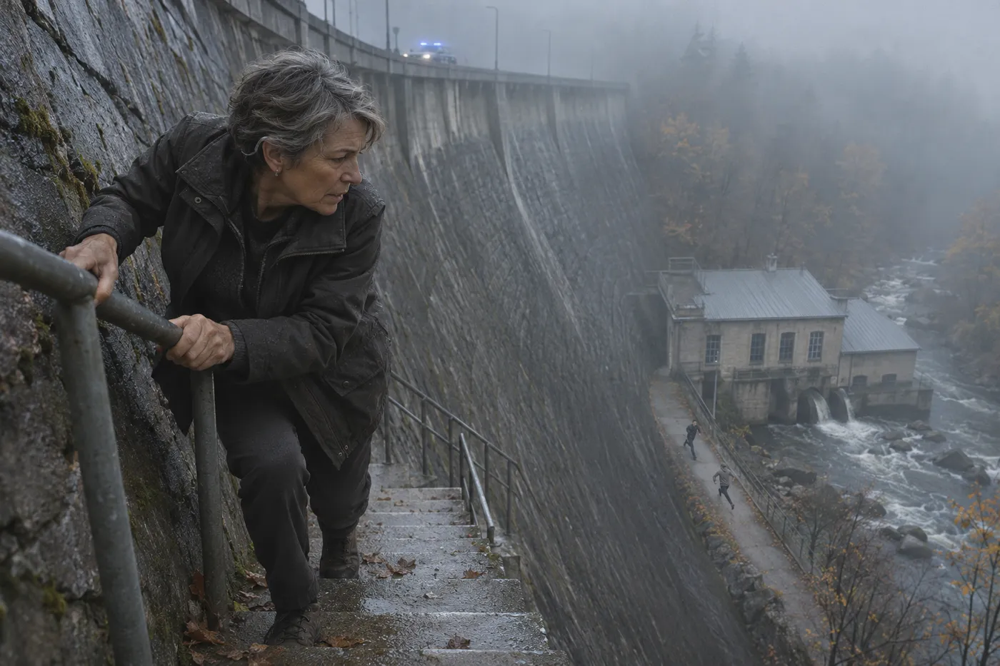

# 6. Hráz

*Brno-Bystrc, přehrada. Pondělí 9. listopadu 2076.*

Výřez z Patrikovy PAI přišel v 8:41, když stáli na křižovatce u Ečerovy a Brožová čekala na zelenou. Řídila sama. Vaněk seděl vedle ní s kelímkem kávy v obou rukou a díval se z okna na smyčku tramvaje, jako by ji viděl poprvé.

„Soud vydal, co jsme chtěli, a nic navíc,“ řekl Ota. „Komunikace o robotech od ledna do března a poloha nosiče v noci z prvního na druhého března. Mám číst?“

„Čti.“

„Jedenáctého února, 23:14. Zpráva na anonymní kanál, který policie zná jako nabídku odemykačů. *Umíte i Hestii?* Odpověď dvanáctého února v 9:02: *Osobně. Napiš kdy.* Patrik Kubíček odpověděl ve 22:30 téhož dne jedním slovem: *Zítra.* Další komunikace s tím kanálem není.“

„A noc na druhého?“

„Nosič byl od 22:40 do 6:15 v jeho tehdejším podnájmu v Židenicích. Bez pohybu.“

„Nosič.“

„Nosič,“ řekl Ota. „Ne on.“

Vaněk upil kávy. „Takže se šel podívat. Třináctého února. Za necelé tři týdny mu spadla babička z rukou Hestie.“

„Kterou on chtěl umět odemknout,“ řekla Brožová. Naskočila zelená. „Uvidíme, jestli lže.“

„Lže každý,“ řekl Vaněk. „Otázka je, o čem.“

Brožová zahnula dolů k vodě. Víkend měla klidný a nechtěla ho. V sobotu jí Mrázová poslala tři řádky: technici prošli v Jasanu ruce, docky i matrace, nic nenašli, oprava kalibrace od Medilonu je v certifikaci. V neděli večer volal Petr z Lisabonu, jako každou neděli, a ptal se, kdy konečně přijede. Za ním bylo slyšet moře, nebo to byl jen vítr v jeho kuchyni.

„V únoru možná,“ řekla mu.

„Proč zrovna v únoru?“

„Protože v únoru můžu.“

Petr řekl *aha*, tím tónem, kterým říkal *aha* už jako dítě, když pochopil víc, než chtěla. Nic dalšího se neptal. Brožová mu za to byla vděčná a trochu ji to mrzelo.

*

Dům na Přístavní stál nad přístavištěm, starý cihlový činžák se čtyřmi patry a s balkony obrácenými k vodě. Před ním parkovala bílá dodávka s modrým nápisem *KUBÍČEK – STĚHOVÁNÍ KLAVÍRŮ* a vedle dodávky stál na chodníku nízký zelený robot z půjčovny, na pásech, s plochými rameny a s blikajícím oranžovým světlem. Stál tam jako pes, kterého někdo uvázal a zapomněl.

Vaněk zůstal dole. Chtěl si projít dodávku, aspoň zvenku, a Brožová ho nechala.

Byt byl ve druhém patře. Dveře byly otevřené a za nimi se ozývala nadávka, tichá a vytrvalá, jako by se někdo hádal s věcí.

Patrik Kubíček klečel v předsíni u pianina. Starý černý nástroj s mosaznými svícny po stranách notového pultu, zabalený do přikrývky a ovázaný popruhy. Pianino stálo nakřivo, jednou nohou na prahu, a zjevně se dál nechtělo.

„Dobrý den,“ řekla Brožová. „Kapitánka Brožová, policie.“

Patrik zvedl hlavu. Bylo mu třicet jedna a vypadal na míň. Hubený, šlachovitý, s tmavými vlasy pod pletenou čepicí, v pracovní bundě s reflexními pruhy. Ruce měl velké, s odřenými klouby. Chvíli na ni hleděl. Pak se mu tvář zavřela, rychle a hladce, jako dveře, které to dělají často.

„Jasně,“ řekl. „Babička.“

„Babička.“

Postavil se a otřel si ruce o kalhoty. „Pojďte dál. Teda kudy. Tudy.“ Ukázal přes pianino. Brožová ho obešla. Pravé koleno se při tom ozvalo, krátce a ostře, a ona se tvářila, že ne.

Obývák byl skoro prázdný. Na tapetě zůstaly světlejší obdélníky po obrazech a jeden tmavší po skříni. V rohu stály krabice popsané fixou, *KUCHYŇ*, *KNIHY*, *BABIČKA – NEVYHAZOVAT*. Na parapetu uschlá pelargonie v hliněném květníku. Z okna byla vidět přehrada, šedá a klidná, přístaviště s lodí zakotvenou na zimu, a vpravo hráz.

„Ota vás teď poučí,“ řekla Brožová. „Nejste obviněný. Podáváte vysvětlení. Můžete mít advokáta.“

Ota ho poučil. Patrik poslouchal s rukama v kapsách a kýval.

„Advokáta nepotřebuju,“ řekl. „Nic jsem neudělal. Na advokáta nemám, a když už, tak dlužím jinejm.“

„Kde jste byl v noci na druhého března?“

„Doma. V Židenicích. Spal jsem.“ Řekl to rychle, jako něco, co si přeříkal. „Ráno mi volal táta. Že babička spadla.“

„Měl jste ji rád?“

Otázka ho zaskočila. Očima zabloudil ke krabici s nápisem *BABIČKA – NEVYHAZOVAT*.

„Jo,“ řekl. „Učila mě na tohle.“ Kývl hlavou k předsíni, k pianinu. „Byla učitelka klavíru. Sedm let jsem sem do tohohle bytu chodil na hodiny a nikdy jsem se to pořádně nenaučil. Tak teď ty klavíry aspoň nosím.“

„Byt vám odkázala.“

„Odkázala mi ho, protože táta nic nechtěl.“ Patrik pokrčil rameny. „A protože věděla, že mám dluhy. To víte, ne? Máte to tam.“

„Mám.“

„Tak vidíte. Prodám ho, zaplatím, co dlužím, a zbytek…“ Mávl rukou. „Zbytek nic. Zbytek je hypotéka na dodávku.“

Brožová si sedla na jedinou židli, která v pokoji zbyla. Kolena jí poděkovala.

„Kde je váš otec? Nebere telefon.“

„Mně taky ne.“ Patrik se opřel o parapet vedle uschlé pelargonie. „Je na chatě u Vranova. Od léta. Má tam rybník a ticho. Signál tam je, jenom ho nechce. Do tý skupiny v Jasanu chodil i po pohřbu. Pak přestal. Pak přestal se mnou mluvit. Nebo já s ním. To už nevím, kdo dřív.“

„Pane Kubíčku, znáte někoho, kdo odemyká roboty?“

„Ne.“

„Odemyká. Odstraňuje pojistky. Jádra.“

„Vím, co to znamená. Neznám nikoho takovýho.“

„Psal jste někdy někomu, jestli umí odemknout Hestii?“

„Ne,“ řekl Patrik. „Proč bych…“

„*Umíte i Hestii?*“ řekla Brožová. „Jedenáctého února, čtrnáct minut po jedenácté večer.“

Patrik zbledl. Bylo to vidět i pod tou čepicí. Bledost mu začala na krku a stoupala nahoru, a on se podíval k oknu, pak ke dveřím, pak na ni.

„Musím přeparkovat,“ řekl. „Stojím v zákazu.“

A byl pryč.

Neutekl předsíní, kde stálo pianino. Utekl kuchyní. Brožová slyšela, jak třeskly balkonové dveře, a když se dostala do kuchyně, viděla jen jeho záda na balkoně a pak jeho ruce na zábradlí. Pod balkonem byla zahrada, o patro níž střecha kůlny a za ní svah dolů k vodě.

Přeskočil zábradlí, dopadl na kůlnu a seskočil do zahrady.

„Vaňku,“ řekla Brožová. „Zahrada. Utíká dolů k vodě.“

„Mám ho,“ řekl Vaněk. Ota mu to předal dřív, než to dořekla.

Brožová šla po schodech. Ne zábradlím, ne přes kůlnu. Po schodech, protože jí bylo šedesát čtyři a protože kdyby skočila na tu kůlnu, nedoskočila by už nikam.

*

Venku foukalo od vody. Vaněk byl na nábřežní cestě, sto metrů před ní, a Patrik sto metrů před Vaňkem. Běželi po asfaltu podél přehrady, kolem zavřených stánků, kolem lodi na zimu zakotvené u mola, směrem k hrázi.

Brožová běžela. Na rovině to šlo. Na rovině to vždycky šlo.

„Kam vede ta cesta?“

„Na hráz,“ řekl Ota. „Hráz má dva konce, na straně Bystrce a na straně Kníniček. Uprostřed jsou ze strany pod hrází schody dolů k řece. Hlídka z Kníniček je na cestě, čtyři minuty.“

„Ať jedou na druhý konec.“

„Už jedou.“

Patrik vběhl na hráz. Brožová ho viděla, jak se zmenšuje na dlouhé rovné koruně nad vodou. Vaněk za ním. Vaněk byl rychlý, Patrik byl rychlejší, a vítr šel proti nim.

Na koruně šla proti Patrikovi žena se psem na vodítku. Pes se rozštěkal a skočil mu pod nohy, Patrik zakopl, chytil se lampy a běžel dál. Žena za ním něco křičela. Pak se otočila, uviděla Vaňka a přitáhla psa k sobě. Kolem projel na kole starý pán v čepici s bambulí, zpomalil a otočil se v sedle, aby viděl, jak to dopadne. Uklízecí robot, který jezdil po koruně a sbíral listí, zastavil a čekal, až všichni proběhnou. Byl jediný, kdo nedělal nic zbytečného.

Když Brožová doběhla k začátku hráze, lapala po dechu a v pravém koleni měla hřebík. Zastavila se, opřela se rukou o kamenné zábradlí a pohlédla dolů. Na jedné straně voda přehrady, klidná, skoro až ke koruně. Na druhé straně hloubka. Stěna hráze šla dolů šikmo, šedá a vlhká, a pod ní, hluboko, tekla Svratka mezi kameny a vedle ní stála budova elektrárny s plechovou střechou. Otec ji sem brával koupat. Říkal, že hráz stavěli čtyři roky a dodělali ji, když už byla válka, a že lidi nevěřili, že takovou vodu udrží.

Udržela ji.

Na druhém konci hráze se rozsvítila modrá světla. Hlídka.

Patrik se zastavil. Brožová to viděla. Uprostřed hráze stál a díval se před sebe na modrou a za sebe na Vaňka, a pak se otočil k zábradlí na straně pod hrází, tam, kde byly schody.

„Jde dolů,“ řekla.

„Schody vedou dolů k elektrárně, na kníničský břeh,“ řekl Ota. „Odtamtud jsou dvě cesty. Podél řeky po proudu, kam za dvě minuty dojede hlídka. Nebo přes lávku na bystrcký břeh a do lesa. Lávka je tři sta metrů pod hrází.“

„A já?“

„Vlevo od vás, hned u začátku hráze, jsou schody dolů na bystrcký břeh. Když půjdete dolů, budete u lávky dřív než on.“

Brožová sklopila oči ke schodům. Úzké betonové stupně, mokré od mlhy, se zábradlím z trubky, a dole cesta podél vody. Bylo jich hodně.

„Kolik?“

„Sto dvanáct.“

„Ty to víš?“

„Je to v pasportu stavby.“

Brožová se chytila zábradlí a šla dolů.

Do schodů nahoru by to bylo horší pro plíce. Dolů to bylo horší pro kolena. Doktorka na preventivce jí loni řekla, že na schodech dolů nese koleno několikanásobek váhy těla, víc než nahoru, a že by si měla pořídit hůl na túry. Brožová si tehdy myslela, že hůl na túry je první krok k chodítku. Teď by ji brala. Každý schod šel do pravého kolena jako klínek. Levé se po čtyřicátém přidalo. Držela se zábradlí oběma rukama a šla bokem, jako se chodí po ledu, a nepočítala. Ota počítal za ni. Napadla ji ta stará paní z hřbitova, v kožichu, s robotem, který jí podal ruku jako na plese. Za dvacet let, říkala si tehdy. Teď by brala, kdyby jí tu ruku podal někdo hned, na sedmdesátém schodu nad Svratkou, a nestyděla by se.

„Osmdesát. Patrik je na břehu u elektrárny. Vaněk je na schodech nad ním.“

„Kam jde?“

„K lávce.“

Brožová přestala jít bokem a začala jít rychle. Ze schodů sešla na cestu, mokrou a posypanou listím, a pravé koleno se pod ní na vteřinu podlomilo. Nespadla. Chytila se kmene olše a šla dál, kulhavě, rychle, podél řeky, která tu hučela, jako by se zlobila, že ji drželi.

Lávka byla úzká, ocelová, natřená na zeleno a opřená o jeden pilíř uprostřed řeky. Brožová k ní došla ve chvíli, kdy na ni z druhé strany vběhl Patrik.

Uviděl ji a zastavil se uprostřed.

Byla to chvíle, kterou Brožová znala. Člověk, který utíká, a najednou nemá kam. Za ním na druhém břehu doběhl Vaněk a taky se zastavil a dýchal jako měch. Před Patrikem stála stará ženská, sotva se držela na nohou a rukou se opírala o zábradlí. Patrik to viděl. Brožová viděla, že to vidí. Viděla, jak si to spočítal: jí do cesty, nebo přes zábradlí.

Podíval se dolů. Pod lávkou tekla Svratka, šedá a rychlá, a mezi vlnami vystupovaly kameny.

„Tam je metr vody,“ řekla Brožová. Neměla dech, tak to řekla pomalu. „A kameny. Spadnete na ně z pěti metrů. Zlomíte si nohy, když budete mít štěstí. A pak budete ležet ve vodě, která má sedm stupňů, a za tři minuty nebudete cítit ruce.“

Patrik se chytil zábradlí.

„Nevraždil jsem babičku.“

„To jsem neřekla.“

„Ale myslíte si to.“

„Já si myslím, že jste utekl z vlastního bytu přes kůlnu a že já kvůli vám šla sto dvanáct schodů dolů,“ řekla Brožová. „Víc si zatím nemyslím nic.“

Chvíli stál. Pak pustil zábradlí, sedl si na plech lávky, s nataženýma nohama, a schoval hlavu do dlaní.

Vaněk k němu došel pomalu, jako se chodí ke psovi, který kousl a pak se lekl sám sebe, a sedl si vedle něj. Brožová zůstala stát. Kdyby si sedla, už by nevstala.

*

„Klavíry,“ řekl Patrik po chvíli. Mluvil do dlaní. „Já chtěl Hestii na klavíry.“

„Vysvětlete to.“

Zvedl hlavu. Oči měl červené od větru, ne od pláče.

„Víte, kolik váží pianino? Dvě stě kilo. Křídlo tři sta, čtyři sta. Nosíme to ve dvou s robotem z půjčovny, a ten robot je kráva. Unese to, ale neprojde zatáčkou na schodech v činžáku a neumí to položit tak, aby nepraskla podlaha. Minulej měsíc jsem jednomu panu v Žabovřeskách vyrval zárubeň, a zárubeň je dražší než moje dodávka.“ Patrik se nadechl. „Hestie unese sto padesát kilo a nese to jako miminko. Cítí, co drží. Ví, kdy povolit. Je nejšetrnější stroj, co kdo postavil. Kdybych měl dvě, nesu klavír po schodech bez škrábnutí.“

„Hestie nejsou na prodej.“

„Nový ne. Ojetý jo. Když domov vymění starou, jde do šrotu. Ve šrotu se dá koupit, jenže je zamčená na péči o lidi. Na náklad nejde. Na náklad by ji musel někdo odemknout.“ Patrik se zasmál, krátce a hloupě. „Tak jsem se zeptal. Jestli to umí.“

„A šel jste se podívat.“

„Jednou. Třináctýho února. To víte taky, že jo.“

„Vím, že jste napsal *zítra*.“

„Byli ve starý vápence v Maloměřicích. Pod lomem, za tou zarostlou kolejí. Tam jsou takový staré pece, jako komíny zalezlý do kopce.“ Patrik si přetřel obličej. „Dva chlapi a jeden mluvil. Řekl, že Hestii mi neudělá, ať přinesu něco jinýho. A na něco jinýho chtěl osm tisíc. To je jak nová dodávka. Tak jsem odešel a už jsem tam nebyl. To je celý.“

„Proč jste nám to neřekl hned?“

„Protože jste řekla Hestie.“ Patrikovi to zjevně připadalo jako ta nejjednodušší věc na světě. „A babičku pustila Hestie. A já jsem měl dluhy a dostal jsem byt a v únoru jsem psal odemykačům. Kdo by mi věřil? Vy byste mi věřila?“

Brožová neodpověděla.

Pod lávkou hučela řeka. Na druhém břehu u elektrárny se objevili dva uniformovaní z hlídky, zastavili se a čekali. Vaněk jim zamával, že je to v pořádku.

„Babička chtěla umřít,“ řekl Patrik potichu. „Měla to napsaný. *Nechci být krmena strojem.* Psala to ještě, když hrála. Táta ji nechal krmit. Řekl, že se na něj usmívá.“ Hrábl si na čepici a stáhl ji. „Já jsem s tátou od ledna nemluvil. Kvůli tomu. A pak spadla a já jsem si první vteřinu myslel… že je to dobře. Že konečně.“

Zvedl oči k Brožové.

„To je hnusný, co?“

„Je to pravda,“ řekla Brožová. „To není totéž.“

Patrik si zase nasadil čepici. Chvíli se díval na vodu pod sebou.

„V tu noc jsem byl doma,“ řekl. „Fakt. Byla tam se mnou holka. Nela. Zeptejte se jí. Druhej den ráno, když volal táta, mi vařila čaj a já jsem nevěděl, jestli mám brečet.“

„Oto?“

„Pro noc na druhého března nemám mandát k jiným osobám,“ řekl Ota. „Mohu paní pozvat k podání vysvětlení.“

„Pozvi ji.“ Brožová se otočila k Patrikovi. „A vy jí nevolejte dřív než my.“

„Nebudu.“ Patrik se skoro usmál. „Ona by mi stejně nevěřila, že jsem tu běžel před policií. Já nikdy neběhám. Já nosím.“

*

Šli zpátky po cestě podél řeky. Pomalu, protože jinak to nešlo. Patrik šel mezi nimi a mlčel. Na konci lávky se k nim přidali dva z hlídky a Brožová jim řekla, že žádné zadržení nebude, že pan Kubíček jde dobrovolně na Kounicovu podat vysvětlení do protokolu.

Vaněk se k ní naklonil, když byli kus napřed.

„Nezadržíme ho?“

„Za co? Za otázku a za běh?“

„Utekl policii.“

„Utekl z vlastního bytu. Nikdo mu neřekl, že nesmí.“ Brožová šlápla na pravou nohu a sykla. „Zákon na strach nemá paragraf, Lukáši. A kdyby měl, seděla by půlka Brna.“

Vaněk zaváhal a pak, protože byl Vaněk, řekl: „Jano, ty schody…“

„Mlč.“

„Byla jsi tam dřív než on. To jsem chtěl říct.“

„Byla jsem tam dřív, protože mi to Ota spočítal,“ řekla Brožová. „Já bych tam došla zítra.“

Ota se neozval. Brožová si myslela, že by se ozval, kdyby uměl být rád.

„Odhad,“ řekla.

„Patrik Kubíček,“ řekl Ota. „Snižuji na sedm procent. Kdo se ptá, jestli někdo umí odemknout Hestii, sám to neumí. Do vápenky šel jednou, odešel bez obchodu a další kontakt nemá. Zbývá byt a dluhy. To je motiv, ale ne způsob.“

„A ten, kdo to udělal v Jasanu, se ptát nepotřeboval,“ řekla Brožová.

„Ten to uměl,“ řekl Ota. „Nebo měl někoho, kdo to umí.“

„Maloměřice.“

„Dílna odemykačů ve staré vápence je kriminálce známá od jara. Mají tam rozpracovaný případ krádeží nákladních robotů. Zatím na něj neměli lidi. Teď je mít budou.“

„Domluv mi to s nimi. Na středu, jestli to půjde. A technika.“

„Domluvím.“

Kus šli mlčky. Pod nohama šustilo mokré listí olší.

„Oto. Co víme o Jasanu v noci?“

„Nic,“ řekl Ota. „Soud nám dal ruce tří robotů na dvě hodiny kolem tří pádů. Nic o tom, kdo byl v domově, kdo jel výtahem, kdo měl službu. Na to by byl potřeba nový návrh a nový důvod.“

„Ruce,“ řekla Brožová. „Víme, co dělaly ruce. Nevíme, kdo k nim v noci chodil.“

„V obytné části domova nejsou kamery,“ řekl Ota. „To je zákon. A pravidla domova.“

„Vím. Navrátilová říkala, že tam nikdo nesmrdí a nikoho nepřivazují. Taky tam nikoho nenatáčejí.“ Brožová zvedla oči k hrázi. „Napiš mi, co by ten návrh potřeboval. Až budu mít důvod, chci ho mít hotový.“

*

Patrika odvezla hlídka. Vaněk šel pro auto na Přístavní a pro kafe ze stánku u přístaviště, který jako jediný ještě nezavřel na zimu. Brožová zůstala sedět na lavičce u paty hráze, protože tam byla lavička a protože ji o to kolena prosila.

Hráz nad ní stála šedá a vysoká. Z téhle strany byla vidět celá, šikmá stěna z kamene a betonu. Přes sto třicet let tam stála a držela vodu, ve které se otec koupal jako kluk a pak s ní, a teď v ní ležela zima.

Na hrázi stála plošina na pásech a v koši plošiny montér v oranžové vestě měnil světlo v jedné z lamp. Třetí od kraje. Brožová se na něj dívala, jak pracuje, pomalu a bez spěchu, a pak, jak plošina sjíždí dolů a montér si sundává rukavice.

Vytáhla zápisník. Pod *Patrik – 38* napsala *7* a pod to:

*Kdo se ptá, neumí.*

*Kdo to umí?*

Nakonec připsala ještě jednu věc, malými písmeny, ne pro případ:

*Hůl na túry.*

Vaněk přišel se dvěma kelímky. Podal jí jeden a sedl si vedle ní. Chvíli pili mlčky.

„Patrikova babička hrála na klavír,“ řekl Vaněk. „A máma Soni Šťastné nechtěla, aby ji myl stroj. A Bartoš nechtěl antibiotika.“ Díval se na hráz. „Všichni to měli napsaný. A pak je stejně někdo držel naživu.“

„To je práce zástupců.“

„Jasně. Jenom…“ Vaněk zakroutil kelímkem. „Moje babička je pořád na čekačce do Jasanu. A máma má v kolonce všechno vyplněný. Úplně všechno. Ve čtyřiceti si to sepsala s asistentem jako nákupní seznam.“

„A ty?“

„Mně je třicet.“

„Mně bylo taky,“ řekla Brožová.

Vaněk se na ni podíval, jako by čekal, že něco dodá. Nedodala nic. Dopila kafe, postavila prázdný kelímek na lavičku a vstala. Šlo to napoprvé, i když by to nikomu nedoporučila.

Nahoře na hrázi se rozsvítily lampy, všechny najednou, uprostřed dne. Montér je zkoušel. Pak zase zhasly.
