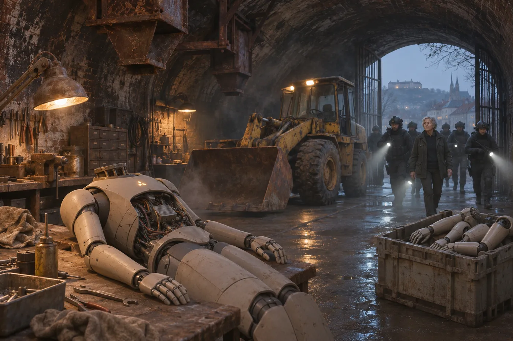

# 8. Vápenka

*Brno-Maloměřice, stará vápenka pod lomem. Středa 11. listopadu 2076.*

Ve tři čtvrtě na šest byla ještě tma a pod lomem v Maloměřicích mrholilo tak jemně, že to nebyl déšť. Bylo to jen vlhko, které si sedalo na všechno.

Brožová stála u zadních dveří neoznačené dodávky na štěrkové cestě za posledními domy a pila čaj z víčka termosky. Kolena ji bolela od pondělí. Pravé víc. Ráno na schodech v Žabovřeskách to zkoušela bokem jako na hrázi, a soused z prvního patra, který venčil psa, se na ni díval tak, že radši šla normálně.

„Tamhle,“ řekl kapitán Pazdera a ukázal bradou do tmy.

Pazdera dělal majetkovou kriminalitu dvacet let a bylo to na něm vidět. Malý, podsaditý, s knírem, jaký v kraji nosil snad už jen on, a s bundou, která pamatovala lepší zimy. Od jara mu v Brně a okolí zmizelo sedmnáct nákladních robotů. Šest se jich našlo bez jader ve skladech na Slovensku, ostatní nikde.

Za cestou vedla kolej. Spíš to, co z ní zbylo: dva rezavé pruhy v trávě, mezi pražci břízky do pasu, a místy ani to ne. Za kolejí se zvedal svah k lomu, černý a se svislými stěnami nahoře, a v jeho úpatí stály pece. Čtyři, možná pět. Brožová je v šeru nedokázala spočítat. Široké kamenné válce, nahoře užší, se začouzenými ústími, zapuštěné do svahu až do půli, jako by se tam schovávaly. Komíny zalezlé do kopce. Patrik to řekl přesně.

Ten lom znala. Před čtyřiceti lety tu v uniformě cvičili slaňování a tahali se přes hranu na laně i bez lana. Tehdy se na pece dole nikdo nedíval.

„Proč jsou zalezlé do kopce?“

„Shora se do nich sypal kámen. Z lomu rovnou do pece, vozíkem po rovině, nikdo nic nezvedal.“ Pazdera ukázal nahoru, kde nad pecemi vedla ve svahu stará terasa. „Dole se vytahovalo vápno. Pod pecemi je chodba, takový tunel podél všech. Tam mají dílnu. Proud, topení, vrata pro dodávku.“ Pokrčil rameny. „Kdo to stavěl, myslel na všechno. Jenom na nás ne.“

„Pozor na signál,“ řekl Ota do levého ucha. „Zdi budou silné přes metr. Podle kriminálky mají u vrat rušičku a zapínají ji, když přijede dodávka. Kdybych zmlkl, nahrávám dál.“

„Kdybys zmlkl, poznám to.“

„O tom nepochybuji.“

Za dodávkou se oblékali čtyři ze zásahové jednotky: helmy, štíty, tichá a nacvičená práce rukou. Opodál stála technička Tereza Kociánová z odboru forenzní techniky, mladá, s culíkem pod kapucí, a kontrolovala dlouhou izolovanou tyč s háčkem na konci. Tyč vypadala jako česák na jablka z vysokých větví.

„Na co je to?“ zeptal se Vaněk.

„Na baterku.“ Kociánová ji zvedla. „Robot bez jádra nemá nouzový vypínač. Teda má. Tlačítko na hrudi a hlasový příkaz, všechno tam je. Jen to nikam nevede, protože to vedlo do jádra a jádro je v krabici. Takže se jde zezadu a háčkem se vytrhne konektor baterie.“ Usmála se, krátce. „Zezadu. To je na tom to podstatné.“

Vaněk přikývl a tvářil se, že si to zapisuje.

Pazdera pohlédl na hodinky. „V noci jim přivezli nakladač. Ukradli ho předevčírem ze stavby ve Slatině. Uvnitř jsou nejmíň tři. Dva kluci, co dělají ruce, a starej.“

„Zámečník.“

„Bohdan Hrbek. Je mu přes šedesát a dřív opravdu dělal zámečníka. U výtahů.“ Pazdera si přitáhl límec. „Jádro z robota vytáhne za dvacet minut a zapečetěný kryt potom vrátí tak, že to na první pohled nepoznáte. Vy jdete za mnou, kapitánko, a na nic nesaháte.“

„Já nikdy na nic nesahám.“

„To mi o vás říkali,“ řekl Pazdera. „Taky mi říkali, že to není pravda.“

Brožová dopila čaj a vrátila víčko na termosku. Včera odpoledne byla na Kounicově Nela, Patrikova přítelkyně. Malá, rozhodná, s kufříkem kosmetičky, protože šla rovnou z práce. Potvrdila noc, čaj i to, že Patrik ráno nevěděl, jestli má brečet. Ota mu nechal sedm procent. Brožová taky.

*

Šli podél koleje. Pod nohama jim křupal štěrk a mezi štěrkem bylo bílo. Starý vápenný prach, rozbahněný deštěm, se jim lepil na boty jako mouka.

Otec bílil sklep v Žabovřeskách každé jaro. Vápno hasil ve starém kbelíku na dvoře. Hodil do něj šedé hrudky, nalil na ně vodu, a vápno začalo samo od sebe vřít. Syčelo a kouřilo, bublalo jako polévka, a nikde žádný oheň. Brožové bylo šest a chtěla se podívat zblízka. Otec ji chytil za rameno. *Nechoď tam. Vypálí ti to oči.* Pálené vápno k ohni nic nepotřebuje, řekl jí tehdy. Stačí mu voda.

Vrata do tunelu byla plechová a natřená na šedo. Vedle nich stála dodávka bez značek, couvnutá až k plechu, aby se dalo vykládat suchou nohou. Zpod vrat prosvítal úzký pruh žlutého světla a bylo slyšet rádio. Někdo si uvnitř pouštěl dechovku.

Zásahová jednotka se rozestavila. Jeden nasadil k vratům hydraulický rozpínák. Pazdera zvedl ruku a podíval se na hodinky.

V šest nula nula ruku spustil.

„Policie!“

Rozpínák zavrčel a plech vrat se s pištěním prohnul. Zámek povolil a vrata odjela stranou. Dovnitř vtrhlo světlo baterek, rozkazy a dusot bot, a v té chvíli Ota zmlkl.

Brožová to poznala podle ticha v uchu. Nebylo to obyčejné ticho. Bylo to ticho, ve kterém někdo chybí.

Tunel byl dlouhý a klenutý, z cihel začernalých od sazí, a dalo se v něm stát vzpřímeně. Ve stropě i v boční zdi zely v pravidelných rozestupech železné rámy výsypů, kterými kdysi z pecí padalo vápno. Pod nimi teď stály ponky. Na jednom ležel domácí humanoid bez hlavy, s otevřeným hrudníkem. Na podlaze stála přepravka plná rukou, šedých a béžových, s prsty, které trčely ven. Vedle ní byla menší přepravka a v ní ležely v řadách malé šedé krabičky s vylomenými pečetěmi. Jádra. Ležela tam jako něco, co z těla nemělo vyjít.

Uprostřed tunelu stál nakladač.

Žlutý, do pasu vysoký podvozek na čtyřech kolech, dvě těžká ramena s úchopy a mezi nimi hlava s kamerami. Stál vedle ocelového kontejneru na šrot, velkého skoro jako auto a plného plechů, a nehýbal se.

Lidé se hýbali.

Starý muž v montérkách u zadního konce tunelu se otočil, uviděl světla a utíkal. Malý, šedivý, s bradkou, a rychlejší, než by mu kdo hádal. Zmizel v boční zdi, v jednom ze železných rámů, a dva ze zásahovky vyrazili za ním. Druhý muž zalezl za ponk a zvedl ruce dřív, než mu to kdo řekl. Třetí, mladý, v černé mikině s kapucí, stál u kontejneru s tabletem v ruce.

„Na zem!“ zařval Pazdera. „Polož to!“

Kluk tablet nepoložil. Podíval se na policisty ve vratech a pak na nakladač.

„Kontejner,“ řekl. Hlas mu přeskočil. „K vratům. Tlač!“

Nakladač se pohnul.

Brožová stála u boční zdi nad přepravkou s jádry. Šla se podívat, jestli mezi nimi není něco bílého. Nebylo. Teď zvedla hlavu a viděla, jak ramena nakladače sjíždějí k bočnici kontejneru, jak úchopy sevřely železo, a jak se kontejner s hrozným skřípěním pohnul po betonu směrem k vratům.

Šel šikmo. Tunel nebyl o moc širší než kontejner a kontejner se při prvním metru stočil zadním rohem ke zdi. K ní.

Brožová ustoupila. Za zády ucítila cihly. Vpravo od ní byla přepravka s jádry, vlevo roh železného rámu výsypu, a před ní se blížil kontejner. Roh, rezavá hrana, plech. Mezera mezi ním a zdí se zužovala. Metr. Tři čtvrtě metru.

Udělala krok doleva, k rámu, a kabát se jí zachytil. Cítila, jak ji to škublo zpátky. Nějaký hák nebo zbytek pantu ve starém železe ji držel za cíp, jako by ji vzal za ruku.

„Stůj!“ křičela Kociánová ze vrat. „Nouzové zastavení! Stop!“

Nakladač nezastavil. Neměl čím.

Brožová zatáhla. Kabát nepovolil. Půl metru. Slyšela kontejner, cítila ho, cítila studený plech, který jí táhl vzduch od obličeje, a myslela na úplně hloupou věc: že jí za tenhle kabát nikdo nic nedá.

Někdo ji chytil za límec a za loket a trhl.

Kabát se roztrhl. Brožová přepadla dozadu a dolů, do výklenku pod železným rámem, a narazila bokem na jeho spodní hranu. Bolest jí projela pod pravou paží a zůstala tam. Nad ní byl Vaněk, nahrbený ve výklenku, s rukama pořád v jejím kabátě. Kontejner projel kolem. Jeho roh škrábl o rám, jiskry se rozprskly po cihlách a vzduch smrděl rzí. Pak byl pryč.

Narazil do vrat. Plech zaduněl a zásahovka uskočila. Kontejner se zastavil o zárubeň a nakladač tlačil dál. Kola se protáčela, kvílela a pod nimi se kouřilo, jak se po betonu pálila guma. Celé to stálo na místě a řvalo.

Kociánová obíhala nakladač zezadu. Pomalu, s tyčí před sebou, v širokém oblouku. Nakladač ji neviděl, nebo ji viděl a bylo mu to jedno. Měl jedinou věc, kterou má dělat, a dělal ji. Kociánová zasunula háček pod zadní kryt, pod hranu, kde se kryt nadzvedal, a škubla.

Kvílení ustalo. Nakladač se zastavil a ruce mu ztěžkly, ale kontejner nepustil.

V tunelu bylo najednou slyšet jen rádio. Dechovka hrála dál.

Kluka s tabletem měl na zemi Pazdera. Skočil na něj sám, tak jak se skáče na míč, a tablet odletěl pod ponk. Kluk ležel na břiše, tvář na betonu, a brečel.

„Jano,“ řekl Vaněk. Pořád ji držel. „Jano. Jsi v pořádku?“

„Pusť mi kabát.“

Pustil.

Brožová se pokusila nadechnout a nešlo to. Šlo to jen do půlky. Něco pod pravou paží se vzepřelo a bolest řekla dost. Znala ji. Znala ji přesně, i s tím, kde začíná a kam vystřelí. Říjen sedmdesát čtyři, hala B7, robot, který ji přimáčkl ke stolu, a pak dva měsíce spaní vsedě. Stejné místo. Tělo si to pamatovalo líp než ona.

„Žebro,“ řekla.

„Zavolám…“

„Za chvíli.“

Ota se vrátil, když jeden ze zásahovky našel u vrat šedou krabičku s anténami a vypnul ji.

„Jsem zpět,“ řekl Ota. „Jedenáct minut jsem jen nahrával. Vaše tepová frekvence je sto dvacet osm. Volám záchranku.“

„Volej,“ řekla Brožová. Neměla sílu se hádat.

*

Zámečník utekl pecí.

Ti dva ze zásahovky došli za ním k železnému rámu v boční zdi. Byl to vstup do šachty jedné z pecí, kterým se kdysi lezlo dovnitř čistit. Ve stěně šachty byly zarezlé stupačky a vedly nahoru, ke světlu ústí, na terasu nad pecemi. Než se policista v helmě a s výstrojí do šachty protáhl, byl Zámečník nahoře, na terase a v lese nad lomem. Dron ho viděl dvě minuty mezi stromy. Pak ho ztratil v mlze, která se v lomu držela jako mléko v hrnku.

„Od jara,“ řekl Pazdera. Stál u šachty a díval se nahoru. Neznělo to naštvaně, spíš unaveně. „Od jara mi leze komínem.“

Brožová seděla na převrácené přepravce u vrat. Záchranář, mladý chlap s rukama teplýma jako kamna, jí rozepnul roztržený kabát a přiložil pod pravou paži malou sondu. Na displeji v jeho brýlích se něco přelévalo.

„Naštípnuté,“ řekl. „Bez posunu. Plíce v pořádku.“ Posunul sondu o kousek. „Tady už jste to jednou měla.“

„Před dvěma lety.“

„Tak to máte zkušenost.“ Podal jí na dlaň dvě tabletky a kelímek vody. „Snímek byste měla mít. V Bohunicích vás vezmou hned.“

„Odpoledne.“

„Paní kapitánko…“

„Odpoledne,“ řekla Brožová. „Já vím, co je naštípnuté žebro. Bolí šest týdnů a nic se s tím nedělá.“

Záchranář hledal posilu u Vaňka. Vaněk se díval jinam.

Vaněk stál u zdi a měl ruce v kapsách, protože se mu třásly. Brožová to viděla, když je tam strkal.

„Lukáši.“

„Hm.“

„Ten kabát mi zaplatí stát?“

Vaněk se na ni podíval a zasmál se, krátce a moc nahlas, a otřel si obličej rukávem.

„Asi ne.“

„To jsem si myslela.“ Brožová se nadechla, do půlky, opatrně. „Díky.“

Kývl. Nic neřekl. Bylo to od něj dobré.

*

Kociánová procházela dílnu jako lékařka, která přišla po bitvě.

V přepravce bylo čtrnáct jader. Dvanáct z nakladačů a skladových robotů, jedno z domácího humanoida na ponku, jedno z ostrahy. Ke každému měla Kociánová během pár minut výrobní číslo a ke každému číslu Ota během dalších pár minut hlášení o krádeži. Ruce v přepravce byly z pěti různých modelů. Ani jedna nebyla bílá.

„Hestie ne,“ řekla Kociánová. „Nic. Ani šroubek.“

„Jistě?“

„Hestii bych poznala i potmě. Má ty vyhřívané dlaně. Uvnitř jsou topné fólie a ty nemá nikdo jiný.“ Kociánová vzala jednu šedou ruku z přepravky a otočila ji v prstech. „Tohle je pro sklady. Hrubá práce. Hestie je jemná mechanika. Tady na to nemají ani nářadí.“

Pod ponkem, kam odletěl tablet, ležel ještě sešit. Kroužková vazba, desky od oleje, a uvnitř, tužkou, drobným pečlivým písmem, data, typy robotů, ceny. Zámečník si zakázky psal rukou. Brožová se na ten sešit dívala dlouho, s něčím, co nebylo daleko od uznání.

Ota si ho přečetl stránku po stránce, jak mu je Brožová obracela před kamerou jednotky. Na předposlední straně, u února, stál řádek:

*13. 2. – kluk, stěhování – Hestie – NE.*

O kus níž, v březnu, byl další. A v červnu ještě jeden. Pokaždé *Hestie* a pokaždé *NE*, podtržené dvakrát.

„Ptá se jich hodně lidí,“ řekl Ota.

„A dostanou to samé.“

Brožová zavřela sešit a podala ho Kociánové do sáčku. Přes Otu poslala Mrázové krátkou otázku, jestli některá Hestie z Jasanu kdy opustila budovu. Odpověď přišla dřív, než ji odvezli.

*Ne. Všechny tři jsou v Jasanu od instalace v roce 2072. Údržby, kontroly i kontrola po pádu se dělaly na místě. Proč? J. M.*

*Později*, odepsala Brožová.

Hestie z Jasanu tudy neprošly. Prošly jinudy. Nebo nikudy.

*

Snímek jí v Bohunicích udělali ve dvě. Naštípnuté šesté žebro vpravo, bez posunu, staré zhojené zlomeniny na pátém a šestém. Lékař, který byl mladší než Petr, jí řekl totéž, co záchranář, jen delšími slovy. Předepsal jí prášky na bolest a dal jí do ruky dechový trenažér, plastovou trubici s kuličkou, kterou má každou hodinu vyfouknout nahoru. Žebra se neobvazují, řekl, a čekal, že se bude hádat. Nehádala se.

Ve čtyři seděla na Kounicově naproti klukovi z vápenky.

Marek Žilka, dvacet čtyři let, bez stálého bydliště, dvakrát podmínka za krádež. Bez kapuce vypadal na sedmnáct. Měl světlé řasy a nehty okousané do masa, a když mluvil, díval se na desku stolu. Vedle něj seděla veřejná advokátka, starší žena v šedém kostýmu, která si všechno zapisovala na papír. Brožová ji měla ráda od první minuty.

Žilka už byl obviněný. Obecné ohrožení, nakladač, kontejner, policisté ve vratech. To byl Pazderův případ a Pazdera si ho vzal. Brožová chtěla jen deset minut a advokátka jí je dala.

„Pane Žilko, mě nezajímají nakladače.“

Žilka zvedl oči. Poprvé.

„Zajímá mě Hestie.“

„Hestie nikdo nedělá,“ řekl hned. Moc rychle, jako něco, co je pravda a co se konečně může říct. „Fakt. Ani šéf. Ptá se každej druhej, protože jsou nejlepší. Unesou hodně, jsou šetrný, nikdy se nerozbijou. Lidi by za odemčenou Hestii dali, co by chtěl. A on vždycky řekne ne.“

„Proč?“

Žilka zaváhal. Advokátka na něj kývla, že může.

„Protože to neumí. Nikdo to neumí. Šéf říká…“ Zarazil se. Podíval se na advokátku, pak na Brožovou. „Šéf říká, že na Hestii nikdo nic nemá. Leda s výrobním klíčem, a ty nejsou.“

Ota mlčel, protože Brožová mlčela.

„S jakým klíčem?“

„Nevím. S výrobním.“ Žilka si začal kousat nehet a advokátka mu jemně stáhla ruku dolů. „Že fabrika měla nějaký klíče, kterýma se tam dalo dostat zevnitř, když se ty roboti dělali. A že je pak zničili. Říká to vždycky, když se někdo ptá na Hestii. Že ty nejsou. A říká to, jako by ho to mrzelo.“

„Viděl jste někdy takový klíč?“

„Já? Ne.“ Žilka se uchechtl. „Já jsem viděl tak šroubovák. Já dělám ruce.“

Brožová vytáhla zápisník. Žebro se ozvalo, když se natáhla po tužce, a ona si to nechala pro sebe. Napsala:

*Leda s výrobním klíčem.*

*A ty nejsou.*

Pod to, menším písmem: *Kdo je zničil? Kdy?*

„Ještě něco, pane Žilko. Kdo vám poručil tlačit ten kontejner?“

Žilka sklopil oči ke stolu.

„Nikdo,“ řekl. „Já se lek.“

Advokátka položila tužku. Brožová se dívala na kluka s okousanými nehty a s tváří odřenou od betonu, a věřila mu. Lek se. Lidé, kteří se leknou, dělají nejhorší věci na světě, a pak u stolu na Kounicově brečí, že nechtěli.

„Děkuji,“ řekla. „To je všechno.“

*

V autě na dvoře Kounicovy seděla bez nastartovaného motoru a dýchala do půlky. Na čelním skle ležely kapky a v nich žlutá světla dvora.

„Co z toho máme,“ řekla.

„Odemykači Hestie nedělají,“ řekl Ota. „Podle sešitu ji odmítli nejméně třikrát. Žádná Hestie z Jasanu nikdy neopustila budovu. Jestli někdo změnil to, co čtou čidla, neudělal to ve vápence a nikdo kvůli tomu robota nerozebíral. Udělal to v Jasanu někdo, kdo k jádru smí.“

„Kdo smí?“

„Technik a regionální ředitel. Ing. Lisický na jádra fyzicky nesahá. Sahá na ně Radovan Tesař. Je jediný, kdo jádra Hestií v Jasanu otevírá, zná jejich kalibraci a má pečeť. Tesař, padesát dva procent.“

„Půlka a kousek.“

„Půlka a kousek je všechno, co mám. Ostatní nejsou nikdo.“

„Jeho údržby jsou v únoru a v srpnu. Kubíčková spadla v březnu. Bartoš v červenci, pět měsíců po té únorové. Šťastná v říjnu.“

„Pokud by změnil něco při údržbě a ono to čekalo, časy to nevylučují,“ řekl Ota. „Pokud to nečekalo, musel by být v Jasanu i v noci. To nevím. Nemám jeho polohu, nemám jeho noci, nemám nic než protokoly.“

„Tak se ho zeptej. Slušně. Jestli nám ty noci dá sám.“

„Napíšu mu zítra ráno přes Ing. Lisického.“

„A to s tím klíčem.“

„Výrobní klíč k Hestii nemám v žádném veřejném záznamu,“ řekl Ota. „Mám dokumentaci Medilonu k jádru Hestie, kde se o výrobním přístupu nepíše nic. Mohu se zeptat Ing. Mrázové.“

„Zeptej se jí. A Lisického ne. Zatím ne.“

Brožová nastartovala. Kolena jí po celém dni v sedě ztuhla a pravé zaprotestovalo na spojce. Žebro se přidalo, když otočila volantem. Vyjela z dvora na Kounicovu, do večerního provozu, a ruce měla na volantu. Řídila sama, i když by jí dnes nikdo nevyčítal, kdyby ne.

*

Doma v Žabovřeskách se nedalo ležet. Zkusila to. Lehla si na záda opatrně, jako se klade něco, co se může rozbít, a žebro se ozvalo ještě dřív, než se dotkla polštáře. Na boku to bylo horší. Na druhém boku ještě horší.

Vstala a sedla si do otcova křesla u okna. Bylo staré, s vysedlým sedákem a s opěradlem, o které se dalo opřít celými zády. Před dvěma lety v něm spala dva měsíce. Teď si vzala deku, lékořicovou pastilku a zápisník a usadila se, jako by to tak měla v plánu.

„Lékař doporučil…“ začal Ota.

„Vím, co doporučil.“

„Doporučil hlavně ten trenažér. A zhluboka se nadechovat, jednou za hodinu, i když to bolí.“

„To mi říkal.“

„Neřekla jste mu, že to uděláte.“

Brožová se zhluboka nadechla. Bolelo to. Vydechla a za chvíli to přešlo.

„Spokojený?“

„Za hodinu znovu,“ řekl Ota.

Otevřela zápisník a přejela očima, co napsala odpoledne. *Leda s výrobním klíčem. A ty nejsou.* Pod tím *Tesař 52* a otazník. Patrik – 7. Vápenka – ne.

Kdo se ptá, neumí. To platilo pořád. Patrik se ptal, v březnu a v červnu se ptali další, a odpověď byla pořád stejná. Na Hestii nikdo nic nemá.

A přesto někdo měl.

Za oknem se v ulici rozsvítila lampa a pak druhá. Brožová si vzpomněla na otce na dvoře, na kbelík s vápnem, které vřelo bez ohně. Ruku měla tehdy na rameni, jeho ruku, těžkou a teplou. Ukazoval jí, jak se to dělá, a držel ji, aby nešla blíž.

Napsala do zápisníku ještě jeden řádek, pomalu, aby se jí netřásla ruka:

*Kdo má klíč, který není?*

Zhasla lampu a seděla ve tmě. Za hodinu se nadechla zhluboka, protože jí to Ota připomněl, a za další hodinu taky. Kolem třetí usnula, vsedě, s dekou přes kolena.
