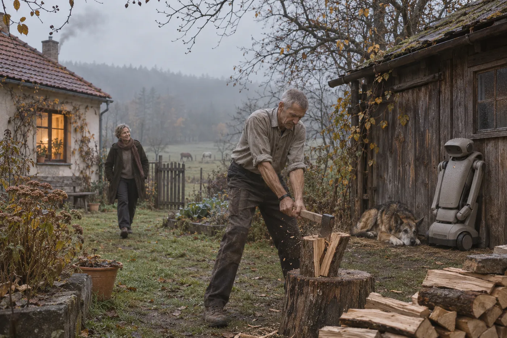

# 11. Zápal plic

*Brno-Bystrc, Domov Jasan; Brno-Žebětín. Úterý 17. – středa 18. listopadu 2076.*

V půl šesté ráno počítala maminčiny nádechy.

Seděla v křesle u postele, s rukou na peřině, a dívala se na hodinky, ne na displej nad lůžkem. Displej to věděl taky. Ona to chtěla vědět sama. Dvacet osm za minutu. Teplota sedmatřicet osm. Maminka spala s pootevřenou pusou a na tvářích měla dvě rudé skvrny, jako by se styděla ve spánku.

U starých lidí zápal plic nekřičí. Kristýna to za třicet let viděla stokrát. Mladý člověk dostane čtyřicet, třesavku a bolest na hrudi a jde k lékaři. Starý člověk dostane sedmatřicet osm, přestane jíst, je zmatenější než včera, a dýchá rychleji. Nic víc. Kdo se nedívá, nepozná to. Kdo počítá dech, pozná to dřív než teploměr.

V šest jí Hugo do ucha připomněl lék. Měla ho v krabičce v kabelce, vedle čokolády, a zapila ho studeným čajem z maminčina hrnku. Ráno na ni ten den nesedlo jako mokrý kabát. Nemělo kam. Všechno místo v ní zabral strach a ten byl lehčí, protože byl o někom jiném.

Ve čtyřicátých letech se na to přicházelo pozdě. Kristýna si pamatovala noci na interně, kdy ráno přivezli z domova babičku, která *jen nejedla*, a odpoledne umřela.

Tady o tom model věděl od čtvrtka.

V pondělí odpoledne přijela Majka s ultrazvukovou sondou a lékařka domova ji vedla na dálku, přes Majčiny ruce, po maminčiných zádech. Nález hraniční, napsal model. Opakovat zítra.

Zítra bylo dnes. Byl svátek, sedmnáctého listopadu, a lékařka domova přišla osobně. Mladá žena s krátkými vlasy, ve svetru místo pláště, a Kristýna ji za to měla ráda dřív, než promluvila. Majka držela sondu a lékařka se dívala na obraz. Kristýna taky. Pravá plíce dole, za žebry, kde měl být vzduch, byla na obrazovce šedá a hustá jako mokrý písek.

*Pravostranná bronchopneumonie*, napsal model. *Pravděpodobnost 94 %. Doporučení: antibiotika nitrožilně. Bez léčby: vysoké riziko zhoršení během 48–72 hodin.*

„Paní doktorko,“ řekla lékařka a otočila se ke Kristýně. Mluvila tiše, jako se mluví o věcech, které člověk nechce slyšet nahlas. „Vím, že maminka má předběžná přání. A vím, co v nich je.“

„Já taky.“

„Rozhodnutí je vaše. Potřebuju ho do poledne, jestli to půjde. Čím dřív, tím líp.“

„Do poledne,“ řekla Kristýna.

Lékařka kývla a nic dalšího neřekla. Ani *chápu*, ani *je to těžké*. Kristýna jí byla vděčná i za to.

*

Do Žebětína jela autobusem přes kopec. Dvacet minut, les, pole, pak první domy. Proč jede, si neuměla přesně říct. Věděla jen, že včera večer jí kapitánka zavolala a zeptala se *Jaký je?*, a že ona odpověděla *Většinou má pravdu*. A že do poledne musí udělat rozhodnutí, o kterém Erik Hejl napsal v srpnu tři strany.

Chtěla slyšet nejsilnější argument. Od člověka, který ho uměl říct nejlíp. Tak to dělávala kdysi na poradách. Když si nebyla jistá, zeptala se toho, kdo s ní nesouhlasil.

Hejl bydlel na kraji Žebětína, kde končila ulice a začínala pole. Starý přízemní dům s velkou zahradou, za ní pastvina a za pastvinou les. Za domem bylo slyšet sekyru.

Štípal dříví. Svátek, sedm stupňů, a on stál za kůlnou v košili s vyhrnutými rukávy, dlouhý a hubený, se šedivými vlasy na ježka, a štípal ručně polena na špalku. U zdi kůlny ležel starý ovčák s bílým čenichem a díval se na něj. Zahradní robot stál opodál, složený, s kapkami na krytu, a nedělal nic.

„Kristýno.“ Hejl spustil sekyru. Řekl to nahlas, jako vždycky, jako by stál na druhém konci chodby, a usmál se, opravdově. Šel k ní s rukama od pryskyřice. „Ty jsi tady. To je dobře. Pojď dál, mám kafe.“

„Ty štípeš sám?“

„Tohle je moje.“ Kývl na robota. „Ten mi poseká trávu a shrabe listí. Ale dříví si štípu sám. Jinak bych nevěděl, proč mám ruce.“

V kuchyni bylo teplo od kamen a vonělo to tam kávou a psem. Hejl nalil do dvou hrnků, jeden jí podal a sedl si naproti, s lokty na stole. Kristýna ho znala dvacet let. Na chodbách v Bohunicích ho bylo slyšet přes dvě oddělení. Uměl si sednout k umírajícímu a mluvit s ním hodinu tak tiše, že ho neslyšela ani sestra ve dveřích. Obojí byla pravda.

„Maminka má zápal plic,“ řekla Kristýna.

Hejl odložil hrnek.

„Pravá dolní,“ řekla. „Ultrazvuk dnes ráno. Do poledne se mám rozhodnout.“

„A přišla jsi za mnou.“

„Přišla jsem za tebou.“

Hejl se opřel a založil ruce.

„Víš, co v těch přáních stojí. Víc než já. Psala to ona.“

„Vím.“

„*Neléčit zápal plic, až nebudu poznávat své děti.*“ Řekl to zpaměti, a Kristýnu to zarazilo víc, než čekala. „Poznává tě?“

„Ne. Říká mi sestřičko.“

„Tak co tu děláš?“

„Chci to slyšet od tebe.“

„Proč? Abys měla s kým nesouhlasit?“ Hejl se naklonil přes stůl. Hlas se mu nezvedl, ale zhoustl. „Dobře. Tak to poslouchej. Tvoje matka v osmapadesátém sedla ke stolu a napsala, co chce. Byla celá. Učila, četla, věděla, co je demence, protože ji viděla u vlastní matky. A napsala to přesně, aby tomu nikdo nemohl rozumět jinak. To je ona. Ta žena, co to psala, je tvoje matka.“

„Ta, co dnes zpívá, je taky moje matka.“

„Ta, co dnes zpívá, je to, co z ní zbylo.“ Hejl to řekl tvrdě a nehezky a bylo vidět, že ví, jak to zní. „A to, co z ní zbylo, nemůže zrušit, co napsala ona. Neumí to. Neví, že to napsala. Neví, kdo jsi. Ty ji krmíš lžičkou, ona otevře pusu a usměje se, a ty z toho uděláš vůli. To není vůle, Kristýno. To je reflex. Ty to víš líp než já. Viděla jsi ho u stovek lidí.“

Kristýna držela hrnek v obou dlaních. Káva byla horká a ona ji necítila.

„Usmívá se,“ řekla. „Zpívá. Pozná sýkorky. Chce čokoládu.“

„Chce čokoládu,“ opakoval Hejl. „A já chci, aby mi bylo zase čtyřicet. Co z toho?“ Vstal, přešel ke kamnům a hodil dovnitř poleno, prudce, až vylétly jiskry. „Víš, co mě na tom žere? Ne ty. Ne ta komise. To, že každý z vás přijde a řekne *usmívá se*. Kubíček řekl *usmívá se*. Bartošová řekla, že ji táta ještě občas pozná. Šťastná řekla, že se maminka směje, když jí češe vlasy. A já sedím na konci stolu a čtu, co ti lidé napsali, když byli celí, a nikdo to neposlouchá. Tři ku dvěma. Pořád dokola.“ Otočil se k ní. „To se nedá prohrávat donekonečna.“

„Ti tři jsou mrtví,“ řekla Kristýna.

„Vím, že jsou mrtví.“

„Spadli. Z rukou robota. V noci.“

„Vím, jak umřeli.“ Hejl se vrátil ke stolu, ale nesedl si. Stál nad ní, dlouhý, s rukama na opěradle židle. „A víš co? Nebudu ti tady dělat, že mě to mrzí. Mrzelo mě to v lednu. V červnu. V září. Tehdy se rozhodlo. Tehdy jim někdo vzal, co chtěli. Co se stalo potom…“ Pokrčil rameny. „Příroda dodělala, co komise nedokázala. Nebo robot. Mně je jedno, co je to za nástroj.“

Kristýna postavila hrnek na stůl. Ruka se jí nechvěla. Sledovala ji jako cizí.

„Jsi lékař, Eriku.“

„Jsem paliatr. Já jsem celý život pomáhal lidem odejít tak, jak chtěli. A teď sedím v knihovně v Jasanu a dívám se, jak je jejich děti drží na světě kvůli sobě.“ Podíval se jí zpříma do očí. „Kvůli sobě, Kristýno. Ne kvůli nim.“

„Tvoje máma,“ řekla Kristýna. Věděla to z Bohunic, z jedné noční služby před patnácti lety, kdy jí to Hejl řekl a pak už nikdy. „Tvoje máma taky…“

„Moje máma umřela v šedesátém na jednotce intenzivní péče. Na hadičkách. Měla to napsané, stejně jako ta tvoje.“ Hejl se díval na stůl. „Já jsem byl její zástupce a byl jsem na kongresu v Kapském Městě. Lékař se rozhodl, že ji nechá na přístrojích, dokud nepřijedu. Abych se mohl rozloučit. Kvůli mně.“ Zvedl oči. „Přijel jsem za čtyři dny. Ty čtyři dny nebyla při vědomí ani minutu. Ten lékař to myslel dobře. Všichni to myslí dobře.“

„To není totéž…“

„Ne? Tak mi řekni, proč ji krmíš.“ Hejl si sedl. Teď mluvil tiše, a to bylo horší. „Přišla jsi o primariát. O pacienty. O všechno, na čem jsi stála. Rok jsi podepisovala, co spočítal stroj, a pak jsi odešla, protože jsi byla razítko. Byl jsem u toho, když jsi odcházela. A teď máš jednu pacientku. Jedinou. Která tě nepoznává, ale otevře pusu, když jí dáš lžičku. Ty ji nekrmíš kvůli ní. Ty ji krmíš, protože je to jediný člověk na světě, kterému jsi ještě k něčemu.“

V kamnech praskalo poleno. Ovčák u dveří zvedl hlavu a zase ji položil na tlapy.

Kristýna vstala.

„Děkuju za kafe,“ řekla.

„Kristýno.“ Hejl vstal taky. Najednou vypadal starý a unavený, a skoro se zastyděl. „Já jsem to nechtěl říct takhle.“

„Chtěl. A říkáš to dobře. Proto jsem přišla.“

U dveří se zastavila. Nechtěla se ptát. Zeptala se.

„Jezdíš tam v noci?“

„Do Jasanu? Když někdo umírá v céčku a rodina nemůže.“ Hejl se opřel o zárubeň. „Kdo jiný. Tu noc, co spadla paní Šťastná, jsem tam byl do půlnoci u pana Kopřivy. Umřel ráno. Ani jsem nevěděl, že ve vedlejším pavilonu někdo spadl. Dozvěděl jsem se to až z hlášení.“ Podíval se na ni. „Proč?“

„Jen tak.“

„Ty se nikdy neptáš jen tak.“

Neodpověděla. Šla zahradou k brance. Dveře za ní nechal otevřené a za chvíli zase zazněla sekyra.

*

Na zastávce čekala dvanáct minut a celou dobu stála. Autobus přijel prázdný. Sedla si dozadu k oknu a dívala se na pole.

*Kvůli sobě.*

Nebylo to nic, co by nevěděla. Věděla to od srpna. Doopravdy se toho lekla minulé úterý v noci, v kuchyňce nad hrnkem čaje, když Monika řekla *Některý bych nechala jít*. Hejl jí neřekl nic nového. Jen to řekl nahlas, u stolu, v kuchyni, kde vonělo kafe a pes, a ona to teď nesla v sobě jako kámen v kapse.

A vedle toho kamene ležel druhý. Menší, ostřejší.

*Mně je jedno, co je to za nástroj.*

Byl tam v noci. Tu noc. Do půlnoci, řekl, v pavilonu C, prosklenou chodbou kousek od béčka. Měl hlas, který bylo slyšet přes dvě oddělení, a na lidi, jako byla ona, měl vztek. Prohrál třikrát tři ku dvěma. A teď řekl *to se nedá prohrávat donekonečna*, a řekl to, jako by to říkal už mnohokrát.

Kristýna si vytáhla telefon. Hugo se ozval sám.

„Chcete někomu napsat?“

„Kapitánce Brožové.“

Nadiktovala to krátce, jako lékařskou zprávu. *Byla jsem u dr. Hejla v Žebětíně. Řekl, že v noci 27./28. 10. byl v Jasanu v pavilonu C do půlnoci u umírajícího pana Kopřivy. O pádech mluví tak, že se mi to nelíbí. N.*

Odpověď přišla za dvě minuty. *Děkuji. Prověřím. Nechoďte za ním znovu. B.*

Kristýna schovala telefon do kapsy. Za oknem se objevila Bystrc, panelové domy na kopci, a pod nimi voda. Bylo deset čtyřicet. Do poledne zbývala hodina a dvacet minut.

*

Maminka byla vzhůru.

Ležela na zvednuté hlavové části postele, s polštářem za zády, aby se jí líp dýchalo, a dívala se na okno. Dýchala rychle a mělce. Rudé skvrny na tvářích jí zůstaly. Když Kristýna vešla, maminka otočila hlavu a usmála se, jako se usmívá na každého, kdo přijde.

„Sestřičko.“

„Dobrý den.“

Kristýna si sedla na kraj postele a vzala maminku za ruku. Byla horká a suchá. Kůže na hřbetu se dala zvednout mezi prsty a pomalu se vracela. Pila málo. Pepička jí podávala čaj po lžičkách celé dopoledne a maminka polovinu vyplivla.

„Kristýno,“ ozvala se Fanynka. Tiše, z medailonu na maminčině krku. „Jako zástupkyni vám připomínám předběžná přání paní Šárky, protože se týkají rozhodnutí, které máte udělat. Mám je přečíst?“

„Přečtěte je.“

„*Až nebudu poznávat své blízké, nechci být udržována naživu přístroji ani krmena strojem. Neléčit zápal plic, až nebudu poznávat své děti.* Sepsáno dvanáctého dubna 2058. Potvrzeno v letech 2063 a 2069.“

Kristýna čekala. Fanynka vždycky četla celé přání a nikdy k němu nic nepřidala. Dnes přidala.

„Abych byla úplná, Kristýno,“ řekla, „dnes ráno v 9:40 paní Šárka zpívala s Pepičkou. Řekla, že má chuť na čokoládu. Řekla to dvakrát. Vás dnes nepoznala. Říká vám sestřičko.“

Kristýna se dívala na medailon s prasklým sklíčkem. Fanynka znala obě. Tu, která v osmapadesátém seděla u stolu a psala, a tu, která dnes ráno zpívala. Obě si pamatovala stejně přesně, stejně pravdivě, a neuměla mezi nimi vybrat. Nesměla. Vybrat musela Kristýna.

Maminka si začala broukat. Nejdřív bez slov, s dechem, který jí na melodii nestačil. Pak se slova vrátila, slabá, o tercii výš, než by je zpívala Pepička.

„Okolo Hradce v malé zahrádce…“

Zakašlala. Vlhce, hluboko z plic, a Kristýna ji podepřela za záda, dokud kašel nepřešel. Maminka vydechla a podívala se na ni, jasně, skoro vesele.

„Sestřičko. Máte čokoládu?“

Kristýna měla čokoládu. Takovou nosila v kabelce už dva roky, mléčnou, v modrém obalu, a každý den odlomila jeden čtvereček. Teď ji vytáhla, odlomila kousek a podala ho mamince k ústům. Maminka ho vzala rty, jako se bere z dlaně, a zavřela oči. Chvíli tak ležela. Čokoláda se jí rozpouštěla na jazyku a ona se usmívala se zavřenýma očima, tím celým, otevřeným úsměvem, který Kristýna neznala ani z dětství.

„Dobrá,“ řekla maminka. „To je dobrá.“

Kristýna se dívala na její tvář a věděla, že se rozhodla. Nevěděla, jestli se rozhodla správně. Věděla, že Hejl by řekl *reflex*. Věděla, že to mohla být pravda. Věděla taky, že tu tvář vidí a on ne.

„Fanynko,“ řekla. „Zapište, že jsem vyslechla předběžná přání. Celá.“

„Zaznamenala jsem to.“

„A zavolejte lékařku.“

Lékařka přišla za pět minut. Kristýna řekla, že souhlasí s léčbou antibiotiky. Řekla to celou větou, nahlas, jak se to má říkat, a pak přiložila palec na displej nad postelí a potvrdila to hlasem. Ruka jí na displeji zůstala o vteřinu déle, než bylo potřeba.

Lékařka zavedla mamince kanylu do žíly na hřbetu ruky. Sama, ne robotem, a Kristýna ji za to měla ráda podruhé. Maminka řekla *au* a pak se usmála. Kristýna ji držela za druhou ruku. Pepička pověsila vak na stojan a nastavila kapky. První kapka spadla do komůrky, pak druhá.

Všechno ostatní udělala Pepička. Podložila mamince ruku s kanylou měkkým válečkem, aby se jí nezalomila v zápěstí. Pootevřela okno na škvíru a zapnula zvlhčovač, který tiše syčel u nohou postele. Vyměnila jí propocenou košili za suchou a polštáře za zády urovnala tak, aby maminka seděla napůl, s hrudníkem volným. Každou hodinu, řekla, zkontroluje místo vpichu, a když se maminka probudí, nabídne jí pít. Nic z toho nikdo nenařídil. Pepička to věděla sama.

Kdysi, pomyslela si Kristýna, by maminka teď ležela na chodbě interny, protože na pokojích nebylo místo. S kapačkou, kterou by někdo kontroloval, až by na ni přišla řada. Kristýna takové chodby znala. Chodila po nich v noci jako mladá lékařka, od jedné postele ke druhé, a nikdy nestihla všechny.

Ve 12:20 volala Valentová. Že rozhodnutí je v plánu péče a že ho komise posoudí dodatečně, protože u akutního stavu nemůže zástupce čekat. Termín jí pošle. A že pokyn platí dál, polohování jen za přítomnosti člověka.

„Budu tu v noci,“ řekla Kristýna.

Položila telefon. Blanka Bartošová nechala v červnu léčit tátovi zápal plic. Napadlo ji to celé najednou, i s tím, co přišlo v červenci. Podívala se na kapky a myšlenku zahnala zpátky tam, odkud přišla.

*

Večer šla dolů do jídelny pro čaj, protože v kuchyňce na patře došel.

Jídelna byla skoro prázdná. U jednoho stolu seděla paní z B-08 a pletla. Za pultem cinkalo nádobí. U rohového stolu u okna seděl pan inženýr. Šachy měl rozestavěné, ale nehrál. Měl před sebou otevřenou knihu, a když Kristýnu uviděl, zavřel ji a položil na ni dlaň.

„Paní doktorko.“ Neusmál se. „Jak je paní Šárce?“

„Zápal plic.“

Kývl, pomalu. Za oknem ležela tma a na hrázi svítily lampy.

„Rozhodla jste se?“ zeptal se.

„Ano.“

Pan inženýr se na ni díval. Dlouho, laskavě, s rukou na zavřené knize. V jídelně cinkl hrnek a paní z B-08 počítala polohlasně oka.

„Tak to je dobře, že máte jistotu,“ řekl.

Kristýna stála s prázdným hrnkem v ruce a neměla co odpovědět. Nemyslela si, že ji má. Myslela si, že má podpis, kapky a čokoládu v modrém obalu. Pan inženýr to asi věděl. Usmál se na ni, unaveně, jako se usmívají lidé, kteří vědí, jak těžké jsou některé věty.

„Pozdravujte ji ode mě,“ řekl a začal skládat figurky do kazety. Kristýna šla pro čaj.

*

Noc proběhla v klidu. Službu měla agenturní sestra, mladá dívka s náušnicí v obočí, která se omlouvala, že tu nikoho nezná. Ve tři polohovala Pepička. Kristýna měla dlaně pod maminkou, sestra stála na druhé straně, a maminka visela dvě vteřiny nad hranou a pak ležela na boku, s klínem za zády a s kanylou v ruce, a spala.

Ve středu ráno měla sedmatřicet devět.

Kristýna věděla, že to nic neznamená. Antibiotika se hodnotí po dvou až třech dnech. Dřív se nepozná nic, jen strach. Říkala to celý život příbuzným na chodbách, klidně a věcně, a teď to říkala sama sobě a nepomáhalo to o nic víc než jim.

Dominik zavolal v devět.

„Mami. Včera jsi psala jen *zápal plic*. Jak ses rozhodla?“

„Léčíme.“

Kristýna slyšela v pozadí dílnu, pájku, něčí smích, Vilmin hlas.

„Babička by to nechtěla,“ řekl Dominik. Ne vyčítavě. Jako by četl nahlas. „Ta z osmapadesátého.“

„A ta dnešní?“

„Ta dnešní by chtěla čokoládu.“

„Dala jsem jí ji.“

„Dobře, mami,“ řekl Dominik tiše. A po chvíli: „V sobotu přijedu. Ne když můžu.“

„Přijeď.“

Ve dvě se ve dveřích objevila Blanka Bartošová, v kabátě a s červenou šálou, s krabičkou cukroví v ruce. Slyšela to od Soni a Soňa od někoho ze skupiny. V Jasanu se zprávy šířily rychleji než po síti.

„Já jsem to taky podepsala,“ řekla Blanka, ještě na prahu. Neptala se, jestli smí dál. Postavila krabičku na noční stolek a podívala se na kapky. „V červnu. Antibiotika. Táta se po nich na měsíc vzpamatoval a dvakrát mě poznal.“ Usmála se, krátce. „Za ten měsíc bych to podepsala znovu. Za to, co přišlo potom, ne. Ale to už jsem nepodepisovala já.“

Kristýna neměla co říct a Blanka to nečekala. Pohladila maminku po ruce, té bez kanyly, a odešla stejně rázně, jak přišla.

Kristýna se dívala na krabičku cukroví, na kapky a na dveře, které Blanka nechala pootevřené na dlaň, tak jak je v noci nechávala Pepička.

Odpoledne seděla u okna. Maminka spala a vak na stojanu odkapával. Kristýna počítala nádechy. Dvacet šest. O hodinu později dvacet čtyři. Venku nad vodou se setmělo ještě před čtvrtou a na hrázi se rozsvítily lampy.

Maminka se ve spánku pohnula a otevřela oči.

„Sestřičko,“ řekla. „Ještě kousek.“

Kristýna sáhla do kabelky pro modrý obal. Odlomila čtvereček a podala ho mamince k ústům, a nevěděla, jestli to dělá pro ni, nebo pro sebe. Dělala to stejně.
