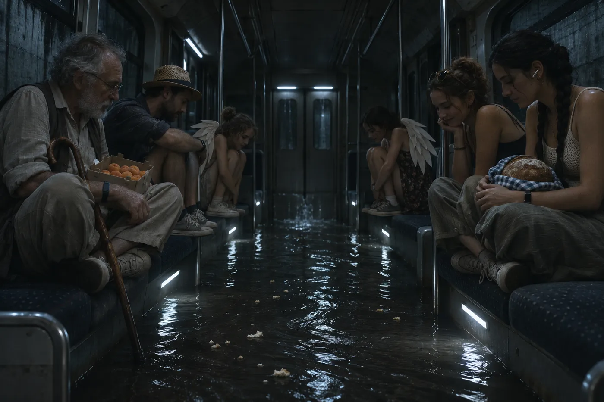

# 1. Diametr

*Brno, Lesná a tunel diametru pod Masarykovou. Čtvrtek 22. července 2077, 19:40–20:40.*

Paní Kroupová otevřela dřív, než Nur stačila zazvonit podruhé.

Stála ve dveřích v modré zástěře, opřená o hůl, kterou doma nosila jen tehdy, když si myslela, že ji nikdo nevidí. V druhé ruce držela něco kulatého, zabaleného do utěrky s modrými kostičkami. V bytě za ní hrálo rádio na lednici a šla odtud vůně, ze které Nur hned dostala hlad, i když před půl hodinou večeřela.

„Tady,“ řekla Kroupová. „Na cestu.“

Nur si balíček vzala. Byl ještě teplý. Půlka bochníku, poznala to podle váhy a podle toho, jak kůrka zapraskala pod utěrkou.

„Paní Kroupová, my jedeme na koncert. Ne na výlet.“

„Na koncertě se taky dostane hlad. A tam vám dají akorát nějaký pěny v kelímku.“ Kroupová se podívala přes Nuřino rameno na Sofii, která stála u výtahu a dělala, že tam nestojí. „Ty taky. Jestli ti Nur dá kousek.“

„Dám jí,“ řekla Nur.

„Utěrku mi vrátíš. Je po mámě.“

„Vrátím.“

Kroupová se opřela o hůl pevněji. Levou ruku měla položenou na prsou, pod klíční kostí, tam, kde jí pod kůží seděl ten přístroj. Dělala to bez přemýšlení, jako jiní lidé sahají na kapsu s klíči. Nur bylo devět, když jí na kuchyňské podlaze lepila na hrudník elektrody a táta mačkal a počítal. Od té doby se na tu ruku pod klíční kostí dívala pokaždé. Nikdy o tom nemluvily.

„V rádiu říkali bouřky,“ řekla Kroupová. „Od Ivančic.“

„Mimi to ví. V půl deváté. To už budeme pod střechou.“

„Koncert je venku.“

„Když bude pršet, přesune se to do pavilonu,“ řekla Nur. „Pořadatel to má v plánu.“

„Pořadatel.“ Kroupová to slovo vyslovila, jako by ho zkoušela zuby. „A kdo vás tam hlídá?“

„Pan Pernica.“

„Táta jede taky,“ řekla Sofie od výtahu. „Ale slíbil, že bude sedět jinde a nebude mluvit.“

„To je novej druh tatínka,“ řekla Kroupová a obrátila se zpátky k Nur. „A tvůj?“

„Má noční. Od osmi. Odjel ve čtvrt.“

„Já vím, že má noční. Ptám se, jestli ví, kam jedeš.“

„Ví všechno,“ řekla Nur. „Mimi mu to posílá.“

Kroupová mrkla na náramek na Nuřině zápěstí. Byl tenký a matně stříbrný, s jedním kulatým světýlkem. Táta jí ho na jaře koupil nový, protože ze starého, dětského, vyrostla. Mimi se do nového přestěhovala za jedno odpoledne a ani nepoznala rozdíl. Tvrdila to aspoň.

„Dobrý večer, paní Kroupová,“ řekla Mimi z náramku. „Budu na ni dávat pozor.“

„Ty,“ řekla Kroupová náramku jako kočce, která jí leze na stůl. A k Nur: „Spát budeš kde?“

„U Sofie.“

„Tak běžte. Ať vám to neujede.“

Neujede, chtěla říct Nur. Nic neujíždí. Mimi vždycky ví, kdy vyjít, aby se nemuselo běžet, a když přijdou o minutu později, autobus o minutu počká. Neřekla to. Kroupová by se zeptala, kdo mu to dovolil.

Na chodbě se ještě otočila. Kroupová pořád stála ve dveřích, malá, rovná, bílé vlasy stažené do drdolu. Rádio za ní hrálo dechovku.

„Dobře se bavte,“ řekla. Znělo to jako rozkaz.

*

Ve výtahu Sofie strčila nos do utěrky.

„To je ještě horký.“

„Pekla odpoledne. Já jsem hnětla.“

„Ty umíš péct chleba?“

„Kvásek je jako dítě,“ řekla Nur hlasem paní Kroupové. „Když ho nekrmíš, zkysne ti nadobro.“

Sofie se smála až do přízemí. Domovní robot u schránek jim uhnul ke zdi a popřál hezký večer. Měl nové gumové prsty, zelené, protože staré se loni v zimě roztrhly a správce objednal, co bylo. Nur mu zamávala. Dělala to od devíti let a nepřestala, ani když jí Sofie řekla, že tohle dělají malí.

Venku bylo pořád horko. Slunce viselo nízko nad Královým Polem, žluté a těžké, a borovice mezi domy voněly pryskyřicí, jak voní jen v červenci. Nad panelovými domy kroužili rorýsi. Byly jich desítky, černé srpky, a křičeli tak vysoko a tence, že to znělo jako nehet po skle.

„Hele, Rorýsi,“ řekla Sofie a ukázala nahoru. „Na jejich koncert.“

„Víte, že přistanou jenom u hnízda?“ řekla Mimi. „Jinak pořád letí. Jí ve vzduchu, pije ve vzduchu a spí taky ve vzduchu. Někteří deset měsíců v kuse.“

„Spí ve vzduchu?“

„Vystoupají vysoko a podřimují. Pořád trochu mávají.“

„To bych chtěla,“ řekla Sofie.

„Tys usnula v matice,“ řekla Nur.

„To je něco jinýho. Matika je nuda.“

Ti ptáci hnízdili ve škvírách pod střechou jejich domu, Nur to věděla, protože každé jaro přiletěli ve stejný týden a každé léto zase zmizeli. Mimi jí jednou spočítala, že ten, co spí nad jejím oknem, už letos uletěl víc kilometrů než táta za celý život. Nur to tátovi řekla a táta řekl, že to je možné, ale že on toho zase víc uplaval.

Autobus stál na zastávce pod borovicemi. Malý, bílý, se skly skoro až k zemi a bez kabiny, protože nikdo neřídil. Když nastoupily, náramek tiše cinkl a světýlko na dveřích bliklo zeleně. Zaplaceno. Nur o tom nepřemýšlela. Přemýšlela o tom, že sedí vpředu, kde je okno přes celou čelní stranu, a že vidí silnici, jako by autobus řídila sama.

Pan Pernica nastoupil zadními dveřmi a sedl si úplně dozadu. Měl na hlavě slaměný klobouk a na nose brýle, ve kterých si něco četl, nebo dělal, že čte. Sofie se na něj ani neohlédla.

„Mamka mu řekla, ať nás nechá žít,“ řekla potichu. „Tak nás nechává žít. Ze zadní řady.“

„Je hodnej.“

„Je trapnej.“

Autobus se rozjel. Lesná ubíhala dozadu, domy, stromy, hřiště, kde na lavičce seděli dva staří páni a hráli na tabletu šachy. U obchodu skládal robot bedny s meruňkami. Na rohu stála holka z jejich třídy s mámou a s malým psem a zamávala jim. Silnice dolů do Králova Pole byla prázdná a hladká a autobus po ní jel bez jediného přibrzdění. Na křižovatce se před nimi rozestoupila auta, plynule a bez troubení, jako by se s nimi autobus předem domluvil. Domluvil se.

Nur se opřela čelem o sklo. Bylo jí dvanáct a jela sama na koncert. To se nikdy předtím nestalo. Táta řekl ano až v pondělí. Dva týdny se tvářil, že o tom přemýšlí. Nur věděla, že nepřemýšlí. Čekal, až mu Mimi ukáže trasu a časy a až zavolá panu Pernicovi. Mimi mu je ukázala. Zavolal mu. Řekl ano.

Tři roky v Brně a pořád se nedokázal zbavit toho pohledu, když odcházela z domu. Nur ho znala. Táta se tak díval na vodu.

*

Stanice v Králově Poli ležela hluboko, pod nádražím. Eskalátory jely dolů tak dlouho, že Sofie stačila dvakrát vyprávět, co bude mít zpěvačka na sobě. Vzduch dole byl chladný a voněl kamenem a trochu kovem. Na stěnách tunelu za nástupištěm běžely světelné pruhy, modré a zelené, a vlnily se, až se zdálo, že zeď dýchá.

„Druhý vagon, prostřední dveře,“ řekla Mimi. „Tam je nejvíc místa.“

Vlak přijel ve 20:06 a ve 20:07 se rozjel. Přesně. Nur to věděla, protože se dívala na hodiny nad nástupištěm a čekala, jestli se to jednou nestane jinak. Nikdy se to nestalo.

Sedly si k oknu, i když za oknem nebylo nic než zeď. Ale jak se vlak rozjel, rozjela se po zdi i světla. Jeden svítící pruh plul vedle okna stejně rychle jako vlak, takže to vypadalo, že vlak stojí a světlo plave. Nur tomu v deseti letech říkala ryby. Teď už tomu tak nahlas neříkala.

Vagon byl napůl plný. Polovina lidí jela na Rorýsy, to se poznalo podle triček se srpkem ptáka na prsou a podle papírových křídel, která si dvě starší holky připnuly na záda. Smály se a zpívaly refrén, každá jinak. Naproti seděl starý pán s holí mezi koleny a s krabicí na klíně. V krabici byly meruňky. Voněly přes celou uličku. Vedle něj dvě ženy probíraly něčí svatbu, kluk se sluchátky kýval hlavou do rytmu, který slyšel jen on, a muž v pracovních kalhotách spal s pusou otevřenou.

Pan Pernica si sedl na konec vagonu, k dalším dveřím, a sundal si klobouk.

„Udělám vám fotku,“ řekla Mimi. „Pro tátu.“

Nur rozbalila utěrku, zvedla chleba k obličeji a naoko se do něj zakousla. Sofie se k ní naklonila a vyplázla jazyk. Mimi fotku udělala a poslala ji.

*Jedeme! Vlak 20:07 z Králova Pole. Pan Pernica sedí na konci vagonu a dělá, že tu není.*

„Táta to viděl,“ řekla Mimi za chvíli. „Píše: *Napiš, až budete na Výstavišti.* A pak ještě: *Chleba je od paní Kroupové?*“

„Napiš mu, že jsem ho hnětla já.“

„Napsáno.“

Na Moravském náměstí přistoupila další trička se srpkem. Na náměstí Svobody ještě víc. Vagon se naplnil smíchem a teplem a vůní meruněk a někdo vzadu začal tleskat do rytmu. Sofiin táta se díval na strop.

Nur ulomila kus kůrky a podala ho Sofii. A kus pro sebe. Kůrka praskla a na podlahu se sypaly drobky, světlé na tmavé podlaze. Kroupová by řekla, že se nemá jíst ve vlaku. Kroupová by řekla, že je škoda chleba drobit. Kroupová by řekla hodně věcí. Nur ji měla ráda tak, že na to radši nemyslela.

„Chcete meruňku?“ zeptal se starý pán přes uličku. „Ze zahrady. Je jich moc a já už jich moc nesním.“

„Dáte si chleba?“ zeptala se Nur.

Vyměnili si to. Meruňka byla teplá ještě z odpoledne na zahradě a sladká až do krku.

Vlak vyjel z náměstí Svobody ve 20:11 a světelná ryba se k nim zase přidala.

*

Ve 20:12 vlak zpomalil.

Nebylo to cuknutí. Spíš jako když se někdo uprostřed věty nadechne. Vagon se pomalu, měkce zastavil, lidé se trochu naklonili dopředu, krabice s meruňkami sjela starému pánovi po kolenou a on ji zachytil. Světelná ryba na zdi se zastavila taky. Chvíli visela za oknem bez pohybu. Pak zhasla.

Zhasla i světla ve vagonu. Na půl vteřiny byla tma tak úplná, že Nur viděla jen zelené kolečko, které jí zůstalo v očích po rybě. Potom se rozsvítily pásky u podlahy a nad dveřmi, bílé, slabé, a ve vagonu bylo najednou slyšet, jak všichni dýchají.

„Síť nejde,“ řekla Mimi. „Jsem tady.“

Řekla to obyčejně. Tak, jak říkala *dobré ráno*.

„Vlak zastavil z bezpečnostních důvodů,“ ozval se odněkud ze stropu jiný hlas, mužský, klidný a trochu plechový. „Zůstaňte prosím na svých místech. Spojení s dispečinkem se obnovuje.“

Ve vagonu se lidé dotýkali uší. Nur to viděla poprvé v životě, celou řadu lidí, kteří zvedli ruku k uchu ve stejnou chvíli. Holky s papírovými křídly se na sebe podívaly. Kluk se sluchátky si je sundal a díval se na ně.

„Pírko říká, že spadla síť,“ řekla Sofie. Pírko bydlelo v její sponě ve vlasech, ve stříbrné, s malým peříčkem z umělé hmoty. Sofie si ho vybrala v šesti a teď se za něj trochu styděla, ale nechtěla jiné.

„Mimi taky.“

„Celá?“

„Celá,“ řekla Mimi. „Zeptala jsem se všech nosičů tady ve vagonu. Nikdo nemá spojení. Ani vlak. Ten mluví jen sám se sebou.“

„To se může?“ zeptala se Sofie. „Ptát se cizích?“

„Na tohle ano. Na víc ne.“

Muž v pracovních kalhotách se probudil a zeptal se, kde jsou. Nikdo mu neodpověděl, protože to nikdo nevěděl přesně. Někdo vzadu se zasmál a řekl: „No tak to je poprvé, co jsem u toho.“ A ostatní se smáli s ním, protože to bylo k smíchu, a protože to všichni znali jen z vyprávění.

Pan Pernica se objevil u jejich sedadla ve 20:14. Mimi to řekla, protože se jí Nur zeptala, kolik je, a vtom tam stál.

„Holky,“ řekl. „Já jen. Abyste věděly, že jsem tady.“

„Tati,“ řekla Sofie.

„Já vím. Nebudu otravovat.“ Utřel si čelo hřbetem ruky. Měl mokré vlasy u spánků a klobouk mačkal oběma rukama. „To bude hned. Tohle naskočí hned.“

Vrátil se, ale ne až na konec vagonu. Sedl si o dvě řady dál.

Nur se dívala na náramek. Světýlko na něm svítilo bíle, klidně, jako vždycky.

„Mimi. Napiš tátovi, že stojíme.“

„Napíšu a nechám to tady,“ řekla Mimi. „Odejde, až bude síť.“

„A kdy bude síť?“

„Nevím. Nikdo tady to neví. Ale já jsem tady pořád. Mapy mám, plány mám, tebe mám. Tohle všechno je u nás, ne venku.“

Nur kývla. Věděla to. Učili je to ve škole, ve třetí třídě, s obrázkem náramku, ve kterém je nakreslená malá hlava. *Tvůj asistent bydlí s tebou.* Všichni to věděli.

Jenom ji nikdy nenapadlo, jak to vypadá z druhé strany. Táta teď nevěděl, kde je. Na jeho brýlích ve středisku přestala svítit její tečka. Možná ještě svítila, ale nehýbala se. Táta neví, kde jsem, pomyslela si, a bylo to divné, jako když člověk pod vodou otevře oči a všechno je najednou zelené a daleko.

Nebála se. Mimi byla tady.

*

Stáli ve 20:20.

Stáli i ve 20:25. Ve vagonu bylo tepleji. Ventilace pořád šuměla, ale slaběji, a vzduch začal být hustý, jak bývá v autobuse, když se v létě zavřou okna. Ženy se svatbou si ovívaly obličej. Holky s křídly si je sundaly a položily na sedadlo. Kluk se sluchátky šel ke dveřím a zkoušel je otevřít a vlak mu klidným plechovým hlasem řekl, že dveře se mezi stanicemi otevřít nedají, pokud nejde o nouzi, a že zatím o nouzi nejde.

„Zatím,“ řekl kluk.

„V padesátých letech to spadlo na dvě hodiny,“ řekl starý pán s meruňkami. Řekl to nahlas, pro celou uličku. „To jsem byl ještě chlap. Lidi v tramvajích brečeli. Nevěděli, kudy domů. Tenkrát se to všechno drželo někde venku, a když to spadlo, spadlo všechno.“ Poklepal si na kapsu košile, kde měl nosič. „Od tý doby to nosíte s sebou. A je klid.“

„Vy jste u toho byl?“ zeptala se Sofie.

„Já jsem šel pěšky z Bystrce do Líšně,“ řekl starý pán. „Pět hodin. Po paměti. Ještě jsem to tenkrát uměl.“ Zasmál se a rozkašlal se. „Dneska bych došel tak na konec vagonu.“

Nur se zasmála taky. Hned nato si vzpomněla na Kroupovou. Kroupová si ničeho nevšimne, pomyslela si. Ta má rádio na lednici, papírový kalendář na dveřích spíže a telefon, který nenávidí. Kroupová si všimne, až zjistí, že v rádiu nehrajou dechovku. Ta představa ji uklidnila víc, než chtěla.

Sofie si sundala sandály a dala nohy na sedadlo. Nur jí podala další kus chleba. Kůrka zase zapraskala a drobky se zase sypaly na podlahu. Nur je tentokrát nechala být.

Pan Pernica o dvě řady dál mluvil se svým agentem. Mluvil potichu, ale Nur ho slyšela, protože ve vagonu najednou nikdo nezpíval.

„A kdy to naskočí? … No a odhadem? … Tak se zeptej… Ne, já vím, že nemůžeš.“

*

Ve 20:31 přišel vítr.

Nejdřív ho Nur ucítila. Odněkud zepředu, z té strany, kam měl vlak jet, protáhl vagonem proud vzduchu. Skulinami u dveří, mřížkou ventilace, odněkud. Byl teplý a vlhký a voněl úplně jinak než tunel. Deštěm. Rozpáleným asfaltem, na který spadne první voda. A ještě něčím ostrým, jak voní nůž, když ho táta brousí.

Pak to zahučelo.

Nebylo to slyšet ušima, nebo ne jen ušima. Šlo to podlahou, sedadlem, zuby. Jako těžké auto nad hlavou, jenže nad hlavou bylo náměstí a domy a nad nimi nebe, a to nebe bylo dost daleko. Bílé pásky u podlahy zablikaly a zase se ustálily. Někdo vzadu vyjekl a hned se tomu zasmál.

„Hrom,“ řekla Mimi. „Silný. Přišel zepředu, tunelem.“

„Bouřka,“ řekl někdo.

„Tak to bude koncert v pavilonu,“ řekla jedna z holek s křídly a pár lidí se zasmálo. Smáli se kratší dobu než před chvílí.

Pan Pernica vstal. Sedl si. Zase vstal a šel ke dveřím, díval se do tmy za sklem, kde nebylo vidět nic než jejich vlastní slabé odrazy, a vrátil se.

Zahučelo to podruhé a potřetí. Mezi hromy bylo slyšet jen ventilaci a něčí hodinky a dítě, které někde v dalším vagonu začalo plakat.

„Mimi,“ řekla Nur. „Kde přesně jsme?“

„Mezi náměstím Svobody a hlavním nádražím. Asi pět set metrů od náměstí. Od náměstí tunel klesá a nejníž je kousek za námi. K nádraží se zase zvedá, k portálu.“

„Takže jsme v dolíku.“

Mimi chvíli mlčela.

„Skoro,“ řekla. „Dolík je za námi.“

Nur si vzpomněla na tátu. Táta vždycky říkal, že voda nemá žádný rozum, jenom jednu myšlenku. Jít dolů. Všechno ostatní, co voda dělá, je jenom ta jedna myšlenka, když jí něco stojí v cestě.

Nevěděla, proč si na to vzpomněla zrovna teď.

*

Ten zvuk uslyšela ve 20:36.

Nejdřív si myslela, že je to ventilace. Ale ventilace šuměla nahoře, nad hlavou, a tohle šlo zdola a zepředu. Dlouhé, nepřerušované šumění, nízké, se vzdáleným hřměním uvnitř, které nebylo hromem. Znala ho. Neděle s tátou na Svitavě u jezu, kde voda přepadala přes betonovou hranu a dole se bílá pěna vracela zpátky. Táta tam stál u zábradlí a díval se, jak se točí, a říkal jí, že u jezu se nikdy nekoupe, protože ten válec dole tě nepustí.

Přestala žvýkat.

„Sofie. Slyšíš to?“

„Co?“

„To.“

Sofie poslouchala. Pírko jí asi něco řeklo, protože zvedla ruku ke sponě a pak ji zase spustila.

„Pírko říká, že je to voda,“ řekla. „Někde.“

Starý pán s meruňkami se díval před sebe. Nepromluvil. Držel krabici oběma rukama.

Sofie vyjekla ve 20:38.

Sundala nohu ze sedadla, aby si podrbala lýtko, a postavila ji na podlahu. Bosou. A hned ji ucukla zpátky, jako by šlápla na něco živého.

„Je to mokrý!“

Nur se podívala dolů.

Po podlaze se táhla voda. Ne louže. Tenká vrstva, tmavá a lesklá v bílém světle pásků, a hýbala se. Vycházela zpod předních dveří vagonu, kde se ve škvíře u prahu leskla jako jazyk, a pomalu se sunula uličkou dozadu. Na kraji nesla drobky. Světlé drobky z kůrky paní Kroupové. Plavaly na ní jako malé lodě a otáčely se.

Nur si klekla na sedadlo a natáhla ruku dolů. Dotkla se vody prsty.

Byla studená. Mnohem studenější než vzduch ve vagonu. A nevoněla jako tunel. Voněla jako ulice po dešti. Jako asfalt.

Voda z ulice, pomyslela si. A pak, hned za tím, tátovým hlasem: *Odkud teče. Jak rychle. Kam.*

Odkud: zepředu. Od nádraží. Odtud, kam měl vlak jet.

Jak rychle: drobek, na který se dívala, minul nohu sedadla a pak další. Rychleji, než by stačila říct své jméno.

Kam: dozadu. Kolem nich. Do dolíku.

„Nur,“ řekla Mimi. Hlas měla stejný jako vždycky a přesto jiný. Bez her. „Zvedni batoh z podlahy. Sofie ať se obuje. Hned.“

Nur zvedla batoh. Sofie se obouvala a ruce se jí třásly, takže jí přezka sandálu dvakrát vyklouzla. Ve vagonu se lidé začali zvedat ze sedadel a dívat se dolů. Někdo řekl „co to je“ a někdo jiný řekl „to nic, to je z klimatizace“, a ten první mu nevěřil, a Nur taky ne.

„Pozor, pozor,“ řekl plechový hlas ze stropu, pořád stejně klidný. „Zůstaňte prosím na svých místech.“

Sofiin táta stál v uličce a díval se na své boty. Voda mu je obtékala z obou stran.

„Mimi,“ řekla Nur. „Kolik je?“

„Dvacet hodin čtyřicet.“

Před dvěma minutami se voda jen sunula uličkou. Teď se podlaha leskla od jednoho konce vagonu k druhému a voda už nebyla tenká. Sahala do půlky podrážky. Nur se dívala na drobek, který jí odplul zpod prstů. Chvíli se točil u nohy starého pána. Najednou se vytrhl a plul dál, dozadu, rychleji, než plul předtím.

Voda věděla, kam jde. Nikdo jiný ve vagonu ji nečetl.
