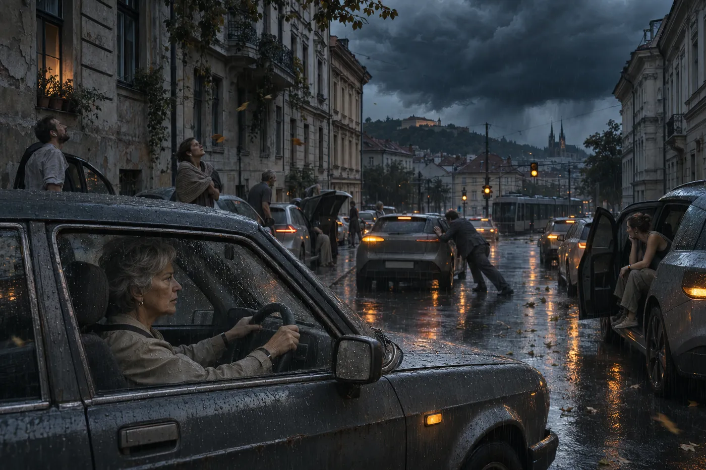

# 2. Ticho

*Brno, Žabovřesky, Kounicova a centrum. Čtvrtek 22. července 2077, 19:30–21:30.*

Řetěz byl suchý a rezavý na třech článcích, a Brožová je mazala jeden po druhém, kapku po kapce, jak to dělal otec.

Na dvoře za domem bylo ještě v půl osmé třicet čtyři stupňů. Dlažba hřála přes podrážky. Otcovo kolo stálo vzhůru nohama na sedle a řídítkách, jak ho otec stavěl každou neděli, a Brožová seděla vedle na stoličce s plechovkou oleje a s hadrem přes koleno. Kolo nikam nepotřebovala. Potřebovala, aby se kolo točilo.

„Zítra v devět porada útvaru,“ řekl Ota. „V jedenáct výslech svědka ve věci Hrubeš, advokát potvrdil. Měsíční výkaz jsem odeslal. Prohlídka služebního vozu je domluvená na úterý, dovezou vám náhradní.“

„Náhradní nechci.“

„Poznamenal jsem si, že náhradní nechcete. Prohlídka se dá udělat na místě, za tři hodiny. Domluvím to.“

„Domluv.“

„A syn poslal fotku. Mám ji popsat?“

„Popiš.“

„Balkon v Lisabonu. Citroník v květináči, má čtyři plody. Pan Petr drží jeden v ruce. Píše: *Úroda.*“

Brožová se usmála do řetězu. Petr ve třiceti osmi pěstoval citrony a posílal jí fotky, jako jí v osmi posílal výkresy. Ota jí ty fotky popisoval tak, jak by je popsal otec. Suše, ve třech větách. Nikdy ho to nenaučila.

„Odepiš mu, že čtyři citrony nejsou úroda.“

„Odesláno.“

Takhle to šlo celý den. Takhle to šlo roky. Výkaz se sám napsal, prohlídka se sama domluvila, svědek měl advokáta dřív, než se Brožová stihla zeptat. Ona ráno vstala, vzala si do ucha Otu a do kapsy zápisník, a všechno, co nebylo práce, se mezitím udělalo samo. V únoru jí bylo šedesát pět. Šindelář jí vymohl rok navíc a ona ho brala jako dárek, ne jako trest. Večery jako tenhle k tomu patřily. Horko, olej, hadr, a v uchu suchý hlas, který ví, co bude zítra.

Přes zahrady od kopce se ozvalo zapraskání, jedno, druhé. Krátké, suché výboje, jako když se na plotně smaží sádlo. Šlo to od Jeřábka, dva domy výš, z otevřeného okna v podkroví, kde měl stanici.

„Kapitánko,“ řekl Ota. „Hydrometeorologický ústav vydal výstrahu. Silné bouřky od jihozápadu, přívalový déšť, kroupy, nárazy větru. Čelo bouře je čtyřicet kilometrů od Brna. Doporučuji zavřít okna.“

Brožová se narovnala a pohlédla přes střechy. Na jihozápadě, nad Kohoutovicemi, stál mrak. Byl obrovský, bílý nahoře a skoro černý dole, a jeho vrch se rozléval do stran jako hlava hřebíku, do kterého někdo udeřil kladivem. Slunce na něj svítilo z boku a barvilo ho do zlata.

„Zavřete si okna, paní kapitánko,“ ozvalo se od plotu nahoře.

Jeřábek stál u své branky v tílku a v pracovních kalhotách na kšandách. Vysoký, kostnatý, se strništěm bílým jako mouka a s brýlemi na šňůrce. Bylo mu osmdesát čtyři let a vypadal, jako by mu jich bylo osmdesát čtyři od narození. Za ním se nad domem zvedal stožár s anténami, hrabičky a tyče a jeden dlouhý drát natažený k ořešáku. Jeho žena kdysi stříhala růže u plotu. Od její smrti rostly, jak chtěly.

„Děkuju,“ řekla Brožová.

„Neděkujte. Praská to na krátkých vlnách už hodinu. Každý blesk v tom mraku je slyšet v rádiu jako lusknutí. Je ještě za Ivančicemi a já ho slyším.“ Jeřábek se podíval na mrak, jako by ho osobně urazil. „Za půl hodiny je tady. Vám to řekla krabička, mně to řekl drát.“

Otočil se a šel do domu.

Byla to nejdelší řeč, kterou spolu za rok vedli. Od loňského července si říkali dobrý den. Jen dobrý den, on první, ona druhá, a každý se při tom díval někam jinam.

*

Ve 20:12 mluvil Ota o úterku.

„…takže technik přijede v osm a vůz bude zpátky v jedenáct. Mám vám…“

Pak nic.

Nebylo to ticho, na jaké byla zvyklá. Ota uměl mlčet, celé hodiny, když chtěla. Jeho ticho mělo tvar. Tohle byla díra.

V uchu cvaklo a ozval se jiný hlas. Plochý, bez dechu, bez Otova nepatrného zaváhání před každou větou.

„Spojení se sítí policie ztraceno. Nahrávám.“

Brožová položila hadr. Odepnula si jednotku z límce košile a otočila ji displejem k sobě. Malý černý displej, na kterém se jindy střídala jména, časy, řádky z rejstříků. Teď na něm svítil jen čas, červená tečka a jeden řádek.

*20:12 ● Bez spojení. Nahrávám.*

Ťukla do ní. Číslice se nezměnily. Ťukla znovu.

„Oto.“

Nic.

„Oto, slyšíš mě?“

Z otevřeného kuchyňského okna nad dvorem se ozvala domácí jednotka, ten druhý hlas, který měla doma na nákupy a na Petrovy narozeniny a který nikdy nenosila do práce.

„Výpadek sítě,“ řekla domácí jednotka. „Pracuji v místním režimu. Spotřebiče fungují. Mám zavřít okna?“

„Zavři.“

Okna se zavřela. Brožová stála na dvoře s jednotkou v dlani a cítila, jak jí srdce bije o něco rychleji, než by mělo. Nebylo to kvůli síti. Sítě padaly. Padaly vzácně a na minuty, a pak naskočily, a lidé o tom vyprávěli u večeře. Bylo to kvůli tomu, že řekla *Oto* dvakrát. Dvakrát, jako stará paní, která volá kočku, co se nevrátí.

Šedesát pět let, pomyslela si. Přes dvacet let u kriminálky. A stačí, aby ti v uchu přestal mluvit agent, a stojíš na dvoře jako u zavřených dveří.

Připnula si jednotku zpátky na límec. Šla přes průchod na ulici.

Ulice byla plná lidí, kteří tam ještě před minutou nebyli. Stáli na chodnících, ve dveřích, u branek, a dotýkali se uší. Paní Šebestová z přízemí naproti držela v ruce hrnek a dívala se do něj. Dole u křižovatky stálo u obrubníku auto se zapnutými výstražnými světly. Za ním druhé. Rozvážkový robot uprostřed chodníku zastavil s balíkem v náručí, otočil se ke zdi, aby nikomu nepřekážel, a čekal.

„Paní Brožová,“ zavolala Šebestová. „Vám to taky nejde?“

„Taky.“

„A kdy to pojede?“

„Nevím.“

Šebestová se na ni dívala. Policistka přece musí vědět. Brožová taky čekala, že bude vědět. Nevěděla nic. Nevěděla, jestli je to Žabovřesky, Brno, nebo celý kraj. Nevěděla, jestli je to porucha, nebo útok. Ota by to věděl za čtyři vteřiny. Ota by to věděl a řekl by jí pravděpodobnost.

*

Škodovka stála u jejího domu. Dole, kde byla zeď a kde nikomu nepřekážela. Tak ji parkovala od loňska.

Měla klíčky v ruce a lehkou bundu ze zadního sedadla přes rameno, když na ni Jeřábek zavolal.

„Paní kapitánko. Počkejte.“

Scházel od domu ke brance rychle, na svůj věk až moc rychle, a nohy se mu trochu pletly. V ruce měl něco žlutého. Zastavil se u branky, dva domy výš, a natáhl tu věc přes plot jako prodavač chleba přes pult.

Brožová k němu vyšla. Neměla na to čas. Šla.

Byla to vysílačka. Malá, žlutá, velká jako dlaň, s krátkou gumovou anténou a s kolečkem nahoře. Na boku měla přelepenou nálepku s číslem tři, napsaným fixou.

„Kanál tři,“ řekl Jeřábek. „Budu poslouchat.“

„Pane inženýre…“

„Neříkejte mi pane inženýre. Říkáte mi tak, jen když se chcete hádat.“ Strčil jí vysílačku do ruky. Byla těžší, než vypadala. „Vaše krabička je mrtvá. Vidím to na vás. Stojíte, jako by vám někdo vzal hůl.“

„Spadla síť.“

„Spadla. Aspoň celý kraj. Na dvoumetru je slyšet Jihlava a Olomouc a všichni se ptají, co je s Brnem.“ Ukázal palcem za sebe, nahoru ke stožáru. „A ten váš policejní Pegas, nebo jak se tomu teď říká, jede. Má vlastní vysílače a vlastní baterie. To jsme ještě stavěli my, když jste vy chodila do školy. Hlas pojede. Data ne.“

Brožová se dívala na tu žlutou věc v dlani. Krabička. Jeřábek nadával na krabičky, kam až její paměť sahala, a teď jí jednu dal.

„Co s tím mám dělat?“

„Mluvit. Zmáčknete tady, mluvíte, pustíte. Nemluvte dlouho a nepřerušujte mě.“ Jeřábek si nasadil brýle a zase je sundal. „Půl wattu, anténa natvrdo, tak to chce zákon. Ve městě to dojde přes pár ulic, víc ne. Ale já sedím na kopci a mám uši na střeše. Kdekoli dole budete, já vás uslyším. Vy mě možná ne, ale já vás ano.“

„Proč?“

Zeptala se rovně. Stará otázka, ze služby. Ptej se rovně, a lidé ti rovně odpoví, nebo ti ukážou, že nechtějí.

Jeřábek pohlédl dolů do ulice. Na lidi u branek, na auta s blikajícími světly, na robota u zdi.

„Protože celá ulice teď bude stát a čekat, až jim to krabičky zase řeknou,“ řekl. „A vy pojedete dolů. Vy jediná odsud, s tím vaším volantem.“ Odfrkl si. „Chci vědět, co se tam děje. A nemyslete si, že jsem vám odpustil to parkování.“

„To mě ani nenapadlo.“

„Čtyřicet let jsem jezdil na Polní den. Vždycky jsem byl na kopci první. Loni jsem měl ve dvoře půjčenou dodávku, naloženou, stožár na střeše, a přijel jsem tam ve tři odpoledne, protože vaše škodovka stála přes moji bránu. Každé jiné auto by odjelo samo, kdybych na něj zavolal. Vaše tam stálo jako pomník.“

„Spala jsem. Vrátila jsem se ve tři ráno.“

„Já vím, kdy jste se vrátila. Slyšel jsem vás. Bouchla jste dveřmi a šla jste spát a já jsem v pět bušil na vaše okno, a vy jste mi z něj řekla, kam si můžu strčit…“ Zarazil se. „Kanál tři. Nemusíte se hlásit. Jen ji nevypínejte.“

Brožová vysílačku strčila do vnitřní kapsy bundy, k zápisníku. Jeřábek se otočil a šel nahoru k domu, kolem neostříhaných růží. Ve dveřích se ještě otočil.

„A nejezděte do podjezdů,“ řekl. „Voda nemá ráda volanty.“

*

Škodovka naskočila na první otočení klíčku.

Uprostřed palubní desky zůstala tmavá obrazovka, na které jindy svítila mapa, hlášení a fotky hledaných. Pod ní, ve starém pouzdře, kam už léta nikdo nesahal, ožilo policejní rádio. Zašumělo a pak se z něj ozval ženský hlas, unavený a pevný.

„Všem. Opakuji, všem. Výpadek datové sítě v celém kraji. Hlasová síť funguje. Všichni příslušníci se hlásí do služby, na svém útvaru nebo na nejbližším obvodním oddělení. Hlášení jen hlasem. Opakuji…“

Brožová sáhla po mikrofonu. Chvíli si nemohla vzpomenout, jak se drží. Pak si vzpomněla.

„Kounicova, Brožová. Žabovřesky, jsem v autě, jedu.“

Šum. A jiný hlas. Mužský, známý, s tou únavou, kterou Šindelář nosil v hlase od rána do večera, i když byl odpočatý.

„Jano.“

„Martine.“

„Kounicova je na záloze. Nemáme nic. Ani rejstříky, ani kamery, ani polohy hlídek. Vím jen, kdo se mi ohlásí do rádia.“ Odmlčel se. „Vyzvedni Vaňka, čeká u vchodu. A pak centrum. Masarykova, Zelňák, Svoboďák. Lidi nemůžou platit, obchody se zavírají a mám první hlášení, že se na Masarykově rozbíjejí výlohy.“

„Kolik mám lidí?“

„Vaňka a dvě hlídky, co tam jsou. Všechno ostatní je na silnicích u aut. Půlka kraje stojí u krajnice a půlka té půlky neví, jak se otevírají dveře ručně.“

„Jedu.“

Vyjela.

Ulice dolů ke Kounicově se proměnila v parkoviště. Auta stála u obrubníků, jedno za druhým, se zapnutými výstražnými světly, která blikala každé jinak, takže po ulici běhaly oranžové kapky. Některá zastavila uprostřed pruhu, protože u krajnice nebylo místo. Lidé u nich stáli nebo seděli uvnitř s otevřenými dveřmi. Muž v obleku tlačil své auto rukama, sám, a auto se nehýbalo, protože brzdy držely, jak měly. Semafory na křižovatce blikaly žlutě. Všechny, ve všech směrech.

Škodovka byla jediná, která jela.

Lidé se na ni otáčeli. Někdo jí zamával. Žena s kočárkem na ni něco volala a Brožová nerozuměla co. Ruce na volantu, oči na silnici, a v hlavě starý pocit, který znala z dětství. Otec ji vozil do školy, pořád ručně, a ona se dívala na auta kolem, ve kterých nikdo neřídil, a připadala si jako v kočáře taženém koňmi. Teď to bylo naopak. Všechno kolem stálo. Jen ona se hýbala.

Na tramvajové zastávce seděla holčička. Mohlo jí být deset. Seděla na lavičce sama, s batohem na klíně, a tramvaj, ve které jela, stála dvacet metrů od zastávky s otevřenými dveřmi a prázdná.

Brožová zastavila a stáhla okno.

„Kam jdeš?“

„Domů. Na Vychodilovu.“ Holčička zvedla zápěstí. Náramek na něm svítil zeleně. „Kropenka mě vede. Jenom jsem si sedla, protože jsem se lekla.“

„Kudy tě vede?“

„Horem. Ne podchodem.“

„Proč ne podchodem?“

„Protože bude pršet a v podchodu se drží voda,“ řekla holčička, jako by to věděl každý. „A Kropenka říká, že mám jít hned.“

„Tak jdi hned.“

Holčička vstala a šla. Do kopce, rychle, s batohem na zádech, a náramek jí na zápěstí blikal do rytmu kroků. Brožová se za ní chvíli dívala. Holčičku v deseti letech nikdo nevodil. Vodila se sama, s malým hlasem na ruce, a ten hlas věděl o podchodech víc než půlka dospělých v ulici.

Bez sítě, pomyslela si. A pořád to funguje.

*

Bouře přišla od Kohoutovic.

Nejdřív vítr. Zvedl se odnikud, jako by někdo otevřel dveře do rozpálené pece, a hned nato byl studený. Stromy podél silnice se ohnuly všechny stejným směrem. Prach a listí letěly po ulici a jedna ze stojících tramvají se zakymácela na kolejích.

Setmělo se. V půl deváté v červenci, kdy mělo být ještě světlo, se udělala tma jako v listopadu.

Pak voda.

Nespadla. Přijela. Bílá stěna, která se valila ulicí proti ní a narazila do čelního skla tak, že stěrače nestačily. Brožová zastavila. Nebylo vidět na metr. Na střechu škodovky začalo bubnovat, nejdřív jako hrst rýže a pak jako kladiva. Kroupy. Velké jako ořechy, bílé, poskakovaly po kapotě a po silnici a kutálely se do kanálu, který už nebral nic.

Seděla s rukama na volantu a poslouchala. Rámus byl takový, že by Otu stejně neslyšela. To ji z nějakého důvodu potěšilo.

Když kroupy na chvíli přestaly, rozjela se. Krokem. Ulicí dolů tekla voda od obrubníku k obrubníku, hnědá, s listím a s kroupami, a nesla s sebou všechno, co bylo na chodníku lehčí než voda. Z kanálových mříží tryskaly fontány.

V dolíku u křižovatky stálo auto. Bílé, malé, u krajnice, s blikajícími světly. Voda mu sahala nad práh dveří a stoupala. Uvnitř někdo seděl.

Brožová zastavila nad dolíkem, kde silnice stoupala, natáhla si bundu a vystoupila do deště. Déšť byl teplý, kroupy bolely. Bušily jí do ramen. Brodila se k autu, po kolena, a voda se jí opírala do nohou silou, jakou nečekala. Zaťukala na okno.

Uvnitř seděla žena. Starší, s kabelkou na klíně, oběma rukama ji svírala. Auto mluvilo. Brožová to slyšela přes sklo, klidný ženský hlas: „Doporučuji vystoupit. Voda stoupá. Vystupte na stranu chodníku.“ Říkalo to pořád dokola. Žena se nehýbala.

Brožová otevřela dveře. Voda se jí přelila do auta přes práh.

„Pojďte,“ řekla. „Policie. Pojďte ven.“

„Ono mi říkalo, ať vystoupím,“ řekla žena. „Ale padá to. Ty kroupy.“

„Vím. Pojďte.“

Vzala ji za loket. Žena vystoupila do vody a vyjekla, jak byla studená, a Brožová ji vedla do kopce, ke škodovce, krok za krokem, a kroupy jim bubnovaly do hlav. U škodovky ji posadila na zadní sedadlo. Žena se třásla a svírala kabelku.

„Děkuju,“ řekla. „Ono mi to říkalo. Já jsem se bála.“

„Mělo pravdu,“ řekla Brožová. „Příště ho poslechněte.“

Žena bydlela tři ulice odtud. Brožová ji tam vysadila pod stříšku domu a jela dál. Jednotka na límci ukazovala 20:44.

*

Kounicova byla bez proudu. Jen v přízemí svítilo pár oken, slabě a nažloutle, a nad vchodem jedna nouzová lampa. Vaněk stál pod ní s policejní radiostanicí v ruce a s deštníkem, který vítr obrátil naruby a který stejně nepouštěl.

Nastoupil a deštník hodil dozadu.

„Ahoj.“

„Ahoj.“

Chvíli jen seděl a kapalo z něj. Bylo mu jednatřicet. Byl rychlý, chytrý a statistice věřil tak, jak Brožová věřila tužce, a teď vypadal jako člověk, kterého bez brýlí postavili do mlhy.

„Můj agent jede,“ řekl. „Soukromý. Mapy, poznámky, všechno, co mám u sebe. Služební je pryč. Nevím, kde je která hlídka. Nevím, kdo je kdo. Zastavím někoho na ulici a nevím, jak se jmenuje, dokud mi to neřekne.“ Zasmál se. „Jak kdybych šel do práce se zavázanejma očima.“

„Lidi se tak ptali dvě stě let.“

„Jo. A taky dvě stě let lhali.“ Podíval se na ni ze strany. „Víš, že s tebou mluvím poprvé bez překladu?“

„Bez čeho?“

„Normálně mi agent k tvým větám píše poznámky. Co tím myslíš. Ty mluvíš v půlkách. Řekneš *jedeme* a myslíš tím, že mám zavolat soudci, sehnat hlídku a nevolat ti, dokud to nebude hotový. A on mi to napíše.“

Brožová na něj krátce pohlédla a zase na silnici.

„A teď?“

„Teď nevím, co myslíš.“

„Jedeme,“ řekla Brožová.

Vaněk se rozesmál. Byl to dobrý smích, krátký, a v autě po něm bylo tepleji.

*

Centrum bylo tmavé.

Ne celé. Dole, na konci Masarykovy, svítilo na zálohu hlavní nádraží, bíle a ostře, a někde u Zelného trhu hořelo světlo v pár oknech. Ale ulice mezi tím ležely ve tmě, jakou Brožová ve městě neviděla od dětství. Lampy nesvítily. Výlohy nesvítily. Svítila jen světla stojících aut a stovky malých světel v rukou lidí, kteří si posvítili nosičem nebo náramkem, a ta světla se hýbala po chodnících jako lucerny.

Déšť polevil. Už nepadaly kroupy, jen voda, hustá a teplá. Ulice tekly.

Jela pomalu, krokem, mezi lidmi. Lidé tu byli všude. Vyšli z kaváren, z restaurací, z tramvají, které stály s otevřenými dveřmi, a nevěděli, kam jít. Před samoobsluhou na rohu se tlačil hlouček. Automatické dveře byly zamčené, protože obchod nemohl ověřit platby, a uvnitř za sklem stál muž v zástěře se zapalovačem a svítil si na ceduli, kterou psal fixou. *JEN HOTOVĚ*. Lidé venku mu ukazovali zápěstí a on vrtěl hlavou.

O dva domy dál stál před malým bistrem jiný muž, starší, a opřený o dveře psal něco na papír. Kolem něj lidé s kelímky a s talíři.

„Co dělá?“ zeptal se Vaněk.

„Píše si dluhy.“ Brožová zpomalila. „Jméno a kolik. Zaplatí mu zítra.“

„On jim věří?“

„Na papíře ano.“

Vaněk se díval, jak muž píše. Byl to pohled, jakým se lidé dívají na staré řemeslo ve skanzenu.

Na náměstí Svobody stála voda po kotníky. Lidé se tlačili v průjezdech, pod markýzami a na schodech domů. U vstupu do diametru, uprostřed náměstí, se zvedla ocelová stěna, kterou Brožová za devět let nikdy neviděla. Zábrana proti vodě. Vyjela ze země sama, když voda stoupla, a teď stála kolem schodů dolů jako nízký plot. Voda do ní narážela a nemohla přes ni.

„Diametr stojí,“ řekl Vaněk. „Hlásili to na rádiu, když jsem čekal. Dva vlaky v tunelu. Řeší to hasiči a železnice.“

Brožová se na zábranu dívala, dokud ji nemusela objet.

„Aspoň tam to drží,“ řekla.

Vtom to uslyšeli.

Kovový zvuk. Dlouhý, trhavý, jako trhaný plech. Z Masarykovy. Za ním křik, ne vyděšený, spíš rozjařený, a další trhnutí. Lidé v průjezdech se otočili tím směrem a hned zase pryč.

Brožová zastavila na rohu Masarykovy a vystoupila. Vaněk za ní.

Ulice dolů k nádraží byla tmavá a mokrá a leskla se. V půlce stála výloha s elektronikou. Před ní, v kruhu světel z nosičů, stál robot.

Byl vysoký. Vyšší než člověk, šedý a hranatý, s rukama, které byly delší, než by měly být. Na prsou neměl žádnou světelnou značku. Žádné světlo v obličeji, žádné barvy. Tmavý tvar ve tmě. Držel v rukou spodní hranu rolety a táhl. Roleta se ohýbala a skřípala, až se na jedné straně vytrhla z kolejnice, a robot ji odhodil stranou jako papír. Kolem něj stáli čtyři kluci v kapucích s taškami. Smáli se.

„Policie!“ zavolala Brožová.

Kluci se otočili. Robot ne. Robot sáhl po skle výlohy.

„Ten nemá světlo,“ řekl Vaněk tiše vedle ní. Znělo to, jako by mluvil o zvířeti bez hlavy.

Na prsou, ve vnitřní kapse bundy, jí něco zašumělo. Brožová tam sáhla a nahmatala místo pastilek něco tvrdého a hranatého. Jeřábkova vysílačka. Zapomněla, že ji má.

Slabě a se šumem, jako z druhého konce dlouhé chodby, z ní vyšel hlas.

„Brožová, tady Jeřábek. Zkouška. Slyšíte mě?“

Robot rozbil sklo. Zvuk šel ulicí až k nádraží a vrátil se.

Brožová zmáčkla tlačítko na boku.

„Slyším.“

„Pět tři,“ řekl Jeřábek. „To znamená, že vám rozumím každé slovo, ale slyším vás slabě. Co se tam děje?“

Brožová se dívala na tmavý tvar uprostřed Masarykovy, na kluky s taškami, na střepy, které se leskly ve světlech jako kroupy.

Jednotka na límci jí ukazovala 21:30. Nic jiného neuměla.
