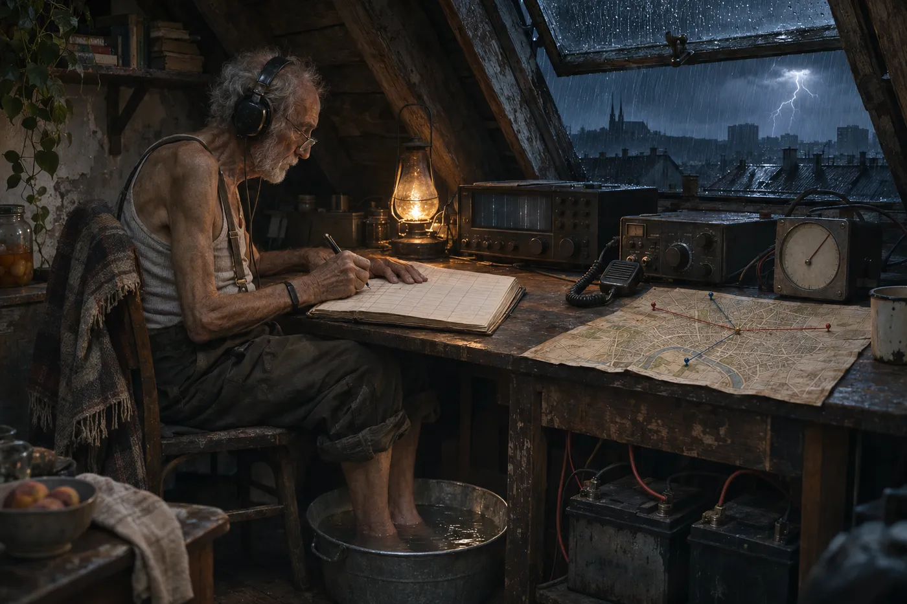

# 4. Staniční deník

*Brno-Žabovřesky, podkroví Jeřábkova domu na kopci. Čtvrtek 22. července 2077, 20:12–22:50.*

Ve 20:12 se spektrum vyprázdnilo.

Jeřábek to uviděl dřív, než to uslyšel. Seděl v podkroví u stolu, v tílku, s nohama v lavoru studené vody, a díval se na obrazovku širokopásmového přijímače. Byl to jediný přístroj ve stanici mladší než jeho kalhoty. Po obrazovce se odshora sypal vodopád signálů, každý jako svislá stopa, a nahoře, v pásmech, kde žila síť, ležel odjakživa koberec. Hustý, šedivý, bez jediné mezery. Miliony krabiček, které si povídají. Jeřábek se na ten koberec díval celá desetiletí tak, jako se jiní dívají na smog nad městem.

Teď se koberec roztrhl. Zmizel jeden pruh, pak druhý, pak celé bloky najednou, jako když na sídlišti zhasínají okna. Za deset vteřin bylo nahoře skoro čisto. Jen pár osamělých čárek, které hledaly, s kým by mluvily, a nikoho nenašly.

Za celý život u rádia to neviděl. Někdo vypnul město.

Sundal brýle ze šňůrky, nasadil si je a otevřel deník. Velký sešit v tvrdých deskách, ručně linkovaný do sloupců. Čas, stanice, kmitočet, směr, zápis. Takhle psal od patnácti let, nejdřív na závodech v honu na lišku, kde se každý zaměřený směr musel zapsat s minutou, a pak už pořád. Co člověk stihne doslova, píše doslova. Jindřiška říkala, že je jako převáděč. Všechno slyší, všechno pošle dál a sám neřekne nic.

*20:12 · široké pásmo · Datová pásma prázdná. Základnové stanice zmizely. Síť?*

*20:13 · Jihlava · 2 m, 145,500 · 290° · Ptá se, co je s Brnem. U nich jede.*

*20:14 · Olomouc · 2 m, 145,500 · 60° · Totéž. Brno nehlásí nic.*

Slezl po schodech, protože dole na ulici stála sousedka s mrtvou jednotkou v dlani.

*20:17 · PMR 3 · Předána PMR Brožové (soused. dva domy níž). Poslouchám na střeše.*

*

Vrátil se nahoru celý udýchaný a byl na sebe naštvaný, že ho to tak vzalo. Dal jí vysílačku. Policajtce, co mu loni zablokovala bránu a z okna mu řekla, kam si může strčit Polní den. Proč, to nevěděl. Věděl jen, že dole na ulici stojí lidi a čekají, a že jediná, která odsud pojede dolů do města, je ona.

Udělal to, co dělal vždycky, když se dělo něco velkého. Pustil prohledávání a nechal přijímač projíždět pásma, kde mluví lidi, kteří něco opravují. Krabičkám nevěřil. Věřil lidem, kteří k nim nosí šroubovák. A kdo chce vědět, kdy to naskočí, musí poslouchat ty, kdo to nahazují.

Na čtyři sta padesáti šesti megahertzech se přijímač zastavil sám.

„…všem, tady dispečink. Ztráta páteře. Kdo je venku, hlaste se po jednom.“

Analogové rádio, otevřené, nešifrované, s tím starým cvakáním na konci každého vysílání. Takové, jaké stavěli, když byl Jeřábek mladý. Páteřní síť Morava. Měli dispečink v Benešově ulici, v budově, kde kdysi sedávala stará telekomunikační firma a kde Jeřábek v pětadvacátém pomáhal tahat optiku dolů do kolektorů. Otočil anténu. Sto dvacet čtyři stupně. Benešova.

Takže i podnik má zálohu, pomyslel si. Rádio z dob, kdy se ještě věřilo, že se něco může pokazit.

*20:18 · PSM dispečink · 456,250 · 124° · „Všem, ztráta páteře. Kdo je venku, hlaste se po jednom.“*

*20:19 · PSM Ryšánek · „Dispečink, Ryšánek. Jedu ze Slatiny dodávkou, ručně, budu tam za půl hodiny.“*

*20:20 · PSM Ryšánek · „Jirko, máš rozpis záloh? Kobližná a Moravák vypadly.“*

*20:21 · PSM Kadlec · „Kadlec. Rozpis mám před sebou. Mají jet na baterky. Dálkovou správu zkouším.“*

*20:22 · PSM Fanda · „Slatina jede na náhradní trase. Jdu ven podívat se na kabel.“*

Všechno to šlo z jednoho místa. Podnik měl na střeše v Benešově převáděč a do kolektorů za ním vedl kabel s naříznutým pláštěm, který vyzařuje po celé délce. Kdo mluvil dole, ozval se ze střechy. Kmitočet a směr si u podniku proto napsal jednou a dál už ne.

Zapnul dvoumetr a vzal mikrofon.

„Výzva Brno. Tady Jeřábek, Žabovřesky. Kdo poslouchá Brno, ať se ozve. Výpadek sítě, sbírám stanice.“

Chvíli šum. A dřív než kdokoli jiný hlas, který znal nejdéle ze všech.

„Holeček, Líšeň. Slyším tě pět devět, ty starej. Taky ti zhasly krabičky?“

„Mně nikdy nesvítily.“

„Já vím. Proto volám tebe.“

Holeček mu v roce 2011 na mistrovství v Jeseníkách utekl o čtyřicet vteřin. Od té doby si tykali a od té doby si nic neodpustili. Bydlel v Líšni na svahu pod Hády, měl tam stožár o dva metry nižší a tvrdil, že lepší.

Ozvali se další. Zouhar z Lesné, padesátník, který měl anténu na balkoně ve čtvrtém patře panelového domu a se kterým Jeřábek mluvil třikrát za rok. Paní Kotasová z Bohunic, bývalá učitelka fyziky, kousek od nemocnice. Šimek z Holásek, kilometr od letiště, kluk, kterému bylo teprve čtyřicet. Jeřábek je zapsal jednoho po druhém a k Šimkovi si na okraj připsal *letiště?*. Kdyby bylo potřeba.

*20:24 · Holeček, Líšeň · 2 m, 145,500 · 90° · 59. Líšeň bez sítě, proud jede.*

*20:25 · Zouhar, Lesná · 2 m, 145,500 · 68° · 57. Lesná bez sítě.*

*20:26 · Kotasová, Bohunice · 2 m, 145,500 · 184° · 58. Bohunice bez sítě.*

*20:27 · Šimek, Holásky · 2 m, 145,500 · 142° · 55. Bez sítě. Letadla stojí.*

*20:28 · všem · 2 m · Pracovní kmitočet 145,375. Volací nechat volné.*

*

Nejdřív kroupy. Rachotily na střeše nad hlavou, až se podkroví třáslo. Blesk udeřil tak blízko, že v reproduktoru krátkých vln to neprasklo, ale bouchlo. Jeřábek vytáhl z lavoru nohy, utřel si je do ručníku a šel k oknu odpojit drát k ořešáku.

Za bouřky se antény uzemňují. To pravidlo nikdy neporušil. Drát odpojil a přehodil na zem. Stožár s dvoumetrem, sedmdesáticentimetrovou směrovkou a bleskojistkou nechal, jak byl.

Žárovka nad stolem zhasla ve 20:33. Přepnul stanici na dvě autobaterie pod stolem, které jezdily na Polní den, a zapálil petrolejku. Stanice ani nemrkla.

*20:38 · Kotasová · Vítr strhl střechu sportovní haly u školy. Sanitky jezdí.*

*20:41 · PSM dispečink · „Kapucínskej taky nehlásí. Dálkově nic.“*

*20:44 · Holeček · Líšeň bez proudu. Kroupy jak vejce.*

*20:47 · PSM Lojza · „Řečkovice. Tma. Kabel je přeseknutej jak sekerou. Měla by se na to podívat policie.“*

*20:49 · PSM Ryšánek · „Lojzo, nesahej na to. Vyfoť a vypadni.“*

Krátce před devátou zabušil někdo dole na branku.

Jeřábek sešel dolů s petrolejkou. U branky stála paní Šebestová z přízemí naproti, v pláštěnce přes noční košili, a za ní dva další lidi z ulice, které znal jen od vidění. Kroupy přestaly. Lilo.

„Pane inženýre,“ řekla Šebestová. „Vy máte to rádio.“

„Mám.“

„Syn je v Olomouci. Jestli by mu šlo dát vědět, že jsme v pořádku. Bude se bát. On se vždycky bojí.“

„V Olomouci síť jede,“ řekl Jeřábek. „Jen do Brna nic nedojde. Napište mi jméno a číslo.“

Napsala mu to na mokrý papír. Ti dva za ní chtěli taky. Jeden dceru v Praze, druhý se chtěl jen zeptat, kdy to pojede.

„Až to někdo opraví,“ řekl Jeřábek.

„A kdo?“

„Ti, co jsou teď v Benešově ulici a nadávají,“ řekl Jeřábek. „Jděte domů a zavřete okna.“

*20:56 · Olomouc · Předávám pro syna Šebestové: rodiče v pořádku, Žabovřesky bez sítě a bez proudu. Olomouc pošle zprávu sítí.*

*20:58 · Olomouc · Předávám do Prahy: Novotní v pořádku. Přes Prahu potvrdí.*

*21:04 · PSM Kadlec · „Slatina a Bohunice na náhradní. Řečkovice čekám. Na Kobližnou se dálkově nedostanu ani na Moravák.“*

*21:06 · PSM Ryšánek · „Rozumím. Za deset minut jsem v Benešovy.“*

*21:15 · Olomouc · Syn Šebestové odpověděl: „Mami, díky Bohu. Zůstaňte doma.“*

Šel to Šebestové říct osobně, přes ulici, v pláštěnce, s petrolejkou. Stála ve dveřích a poslouchala, a když jí to řekl, chytila ho za ruku. Měla ji studenou a mokrou. Jeřábek nevěděl, co s rukou dělat, tak ji nechal, ať ji drží.

„Vy jste anděl,“ řekla.

„Jsem stará stanice s autobaterií,“ řekl Jeřábek a šel.

Nahoru do podkroví šel pomaleji než předtím. Ne kvůli kolenům.

*21:24 · Kotasová · Od hasičů u nemocnice: diametr stojí, dva vlaky v tunelu.*

*

V půl desáté vzal do ruky svou žlutou PMR, dvojče té, kterou dal sousedce.

Vysílat smí jen z ní. Poslouchat ale smí, čím chce. Kanál tři měl naladěný na přijímači, který bral ze střechy, a ten slyšel daleko.

„Brožová, tady Jeřábek. Zkouška. Slyšíte mě?“

Šum. A slabě, se zvukem deště a s něčím, co znělo jako rozbité sklo:

„Slyším.“

„Pět tři. Co se tam děje?“

*21:33 · Brožová, Masarykova · PMR 3 · 127° · 53. Robot bez světelné značky trhá rolety, rozbil výlohu elektroniky. Čtyři kluci s taškami. Dvě hlídky na celé centrum.*

*21:35 · PMR 8 · Mladé hlasy: „Rado, roleta jde!“ – „Neřvi to do toho.“*

„Ti kluci,“ řekl Jeřábek do PMR. „Mají něco v rukou? Ovladač, brýle, cokoli?“

Chvíli ticho.

„Tašky,“ řekla Brožová. „Nic jiného.“

„Takže ho neřídí oni. A bez sítě ho odněkud řídit musí někdo jiný. Rádiem.“ Jeřábek pustil vysílací tlačítko a dodal si sám pro sebe: „A rádio, holenku, já slyším.“

Prohledávání ho dovedlo, kam čekal. Čtyři sta třicet tři celá devadesát dva. Pásmo, kde se odjakživa válely klíčenky od garáží, teploměry, dětské hračky a všechno levné, co potřebuje kousek rádia. Leželo uprostřed radioamatérského pásma sedmdesáti centimetrů, jako cizí kufr uprostřed obýváku. Jeho směrovka na sedmdesát centimetrů tam slyšela, jako by byla stavěná přímo na to.

Bzučelo to tam. Krátké husté dávky, jedna za druhou, jako vosa v plechovce.

„Brožová. Teď se hýbe?“

„Teď… zvedá ruku. K další roletě.“

Dávky zhoustly.

„A teď?“

„Stojí.“

Dávky zřídly.

Jeřábek se opřel o opěradlo a chvíli jen poslouchal. V osmdesáti čtyřech mu srdce bušilo jako v osmnácti v lese v Jeseníkách, když ve sluchátkách zapípala liška.

*21:41 · ? · 433,920 · Datové dávky. Rytmus podle pohybu robota (potvrzeno s Brožovou). Řídicí spoj.*

*21:44 · PSM Ryšánek · „Hájku, kde jsi?“*

*21:45 · PSM Hájek · „Hájek. Jsem dole ve sklepě u vstupu, čekám na pokyn.“*

*21:46 · PSM Ryšánek · „Čekej. Ještě to zkusíme odsud.“*

Natočil směrovku. Rotátor na střeše zabručel a ručička na ciferníku vedle stolu se pomalu otáčela. Maximum signálu bylo tupé, jak bývá u směrovky vždycky. Široké a líné. Kdo hledá maximum, najde kopec, ne vrchol. Jeřábek hledal, kde signál spadne. Pootočil doleva, dokud dávky neklesly o kus, a zapsal si stupně. Pootočil doprava, dokud neklesly stejně, a zapsal si je taky. Střed mezi nimi. Tak to dělal v lese, s anténou v ruce a s mapou na kolenou, a tak to dělal i teď, s nohama zase v lavoru.

Sto třicet pět.

Bylo to na centrum. Na Masarykovu, nebo kousek za ni. Jenže z jednoho místa je jen směr. A mezi domy směr lže, o pět stupňů, když má člověk štěstí, a o dvacet, když nemá.

*21:52 · ? · 433,920 · 135° · Zaměřeno. Střed mezi poklesy 129/141. Centrum. Potřeba druhý směr.*

*21:53 · Brožová · Předán směr 135. Na vás nebo kousek za vámi. Čekat na kříž.*

*21:56 · Holeček · Žádám zaměřit 433,920. Holeček: „Musím vytáhnout anténu z půdy. Dej mi čtvrt hodiny.“*

„Čtvrt hodiny,“ řekl Jeřábek do mikrofonu. „Za čtvrt hodiny jsi v Jeseníkách byl v cíli.“

„Za čtvrt hodiny jsem byl v cíli před tebou,“ řekl Holeček. „Konec.“

*

Zouhar z Lesné se na pracovním kmitočtu ozval ve 22:02. Hlas měl jiný než předtím. Opatrný.

„Vítku, mám tu paní. Vylezla za mnou do čtvrtýho patra. O holi. Po schodech, výtahy nejedou. Chce mluvit sama. Můžu jí dát mikrofon?“

„Dej.“

Chvíli šum a šoupání, jak se mikrofon podával z ruky do ruky. Pak hlas. Starý, ženský, udýchaný, a tak tvrdý, že by se o něj dal brousit nůž.

„Tady Kroupová. Lesná. Nevím, jak se to dělá, tak to říkám normálně.“

„Normálně je dobře,“ řekl Jeřábek. „Povídejte.“

„Hledám holku. Nur Mansúrová, dvanáct let. Jela v osm diametrem z Králova Pole, na Výstaviště, na ty Rorýse. Má spát u Pernicovéch, jenže tam nic nevědí. Pernicová je doma a brečí. S holkou je jejich Sofie a pan Pernica. Táta je na noční v Tuřanech, u těch robotů, a já se mu nedovolám. Mně se nedovolá nikdo, já nemám ty krabičky.“

„Já taky ne,“ řekl Jeřábek.

Chvíli bylo ticho.

„Tak to jsme na tom stejně,“ řekla Kroupová.

Psal. Pero škrábalo a Jeřábek si všiml, že píše úhledněji než obvykle, jako by na tom něco záleželo.

„Diametr stojí,“ řekl. „Dva vlaky v tunelu. Hasiči o nich vědí. Tunel má únikové cesty.“

„To vím taky,“ řekla Kroupová. „Já se neptám, co vědí hasiči. Já se ptám, kde je holka.“

Jeřábek se podíval na petrolejku. Plamen se třásl, protože střechou foukalo.

„Nevím,“ řekl. „Pošlu to všem, co poslouchají. Kdo uslyší o soupravě 20:07 nebo o té holce, dá vědět sem. A já to pošlu k vám, Zouharovi.“

„Já tu budu sedět,“ řekla Kroupová. „Pan Zouhar mi dal čaj.“

*22:04 · Kroupová přes Zouhara · Hledá Nur Mansúrovou (12), vlak 20:07. Otec Júsuf, středisko robotů Tuřany, nedovolá se.*

*22:06 · všem · 145,375 + 145,500 · Vysláno hledání. Kdo uslyší o soupravě 20:07, hlásit sem.*

Na okraj, vedle řádku s Kroupovou, si napsal: *Brožová?* Policajtka měla na krku roboty a na celé centrum dvě hlídky. A diametr dělali hasiči. Otazník nechal, jak byl.

Kotasová se ozvala ve 22:10. Mluvila rychle, jako na hodině, když zvonilo.

„Vzkaz od nemocnice. Byla jsem tam, přinesla jsem jim baterky. Fakultní nemocnice Bohunice svolává všechny lékaře a sestry, kdo může přijít. Mají plno z té haly a z aut. Ať to každý řekne sousedům.“

Jeřábek to zapsal a poslal dál. Holečkovi do Líšně, Šimkovi do Holásek, Zouharovi na Lesnou, Olomouci, ať to pošle sítí do Brna, až to půjde. Na chvíli pustil mikrofon.

Z reproduktoru se ozvala Lesná, zase ten tvrdý starý hlas.

„Já jsem v Bohunicích dělala sestru čtyřicet let,“ řekla Kroupová. „Já bych šla.“ Odmlčela se. „Ale nedojdu.“

Jeřábek neřekl nic. Nebylo co.

*22:14 · PSM Kadlec · „Pavle, dálkově to nepůjde. Musí se tam dolů ručně.“*

*22:16 · PSM Ryšánek · „Vím. Jirko, drž dispečink. Půjdu s Hájkem na Kobližnou, Hájek pak na Kapucínskej.“*

*22:17 · PSM dispečink · „Pavle, nosiče do skříňky. Ať mi to pak nepíšou.“ – Ryšánek: „Jo, jo.“*

*22:21 · PMR 8 · „Mlčo, máme plný. Jedem na Zelňák?“ – „Jedem. Lékárna.“*

*22:22 · Brožová · Předáno: na osmičce mluví kluci, šéfovi říkají Rado a Mlčo. Jdou na Zelný trh, lékárna.*

*22:25 · Šimek · Letiště tma. U střediska robotů svítí, mají vlastní proud.*

Šimek to řekl jen tak, mezi řečí, a Jeřábek to zapsal, protože zapisoval všechno. Středisko robotů u letiště svítí. Očima přejel z řádku s Kroupovou na Šimka a zpátky.

Kdyby bylo potřeba.

*

Holeček se ozval ve 22:33. Udýchaný, jako by běhal po kopci, a možná běhal.

„Mám to. Dvě stě čtyřicet osm. Poklesy dvě stě čtyřicet dva a dvě stě padesát čtyři. Sedí to jak prdel na hrnci, Vítku.“

Jeřábek měl na stole rozloženou papírovou mapu Brna, starou, z doby, kdy se mapy ještě kupovaly v trafice. Na ní dva špendlíky. Jeden u sebe v Žabovřeskách, druhý u Holečka pod Hády. Natáhl od každého nit. Nitě byly z Jindřiščiny krabice na šití, která stála na skříni osm let a kterou do dneška neotevřel. Sto třicet pět od sebe. Dvě stě čtyřicet osm od Holečka.

Nitě se zkřížily nad Zelným trhem. Ne na Masarykově. Výš. Na kopci.

„Petrov,“ řekl nahlas do prázdného podkroví.

Petrov stál nad Zelným trhem jako maják. Kdo chce odtamtud řídit robota dole v ulicích, vidí mu z kopce na záda a nemá mezi sebou a ním jediný dům. Ten, kdo to vymyslel, nebyl hloupý. Jen nepočítal se dvěma dědky s anténami.

*22:30 · PSM Ryšánek · „Hájku, jdeme dolů.“ – Hájek: „Jdu.“*

*22:35 · Brožová · Předáno: řídicí vysílač na Petrově, kříž 135 ode mě, 248 od Holečka. Potvrdila, jde nahoru.*

*22:38 · PSM dispečink · „Pozor, voda v kolektoru u Zelňáku. Teče to shora.“*

*22:41 · PSM Ryšánek · „Hájku, ozvi se.“*

*22:43 · PSM Hájek · Slabě, trhaně: „…Hájek… Kapucínskej… voda po kotníky… jdu na rozvaděč…“*

*22:44 · PMR 8 · „Rado! Nějaký světla na Petrský!“ – „Drž hubu a jeď.“*

*22:45 · ? · Dávky husté. Řídí naplno.*

Seděl s levou rukou na rotátoru a s pravou na peru a poslouchal tři věci najednou. Dávky na čtyři sta třiceti třech, které zase zhoustly. Kanál tři, kde bylo ticho, protože Brožová teď šla do kopce a neměla volnou ruku. A podnik, stejně ze sto dvaceti čtyř stupňů jako všechno ostatní.

*22:47 · PSM Ryšánek · „Kobližná. Záloha mrtvá, baterky jsou starý, pod novejma štítkama. Ráno potřebuju papíry k březnový zakázce.“*

*22:47 · PSM dispečink · „Rozumím, Kobližná.“*

*22:48 · ? · Dávky přestaly. Naráz.*

Naráz. Ne tak, jak přestává signál, když vysílač odchází. Tak, jako když někdo vytrhne šňůru ze zásuvky.

Jeřábek držel pero nad papírem a nedýchal.

Ve 22:49 zašuměl kanál tři.

„Jeřábku.“ Brožová. Udýchaná, a za jejím hlasem déšť a ještě jiný hlas, mladý, který něco pořád dokola opakoval a brečel u toho. „Máme ho. Petrov, u katedrály. Seděl pod zdí s brýlemi na očích a ani nás neslyšel přijít. Kluk.“

Jeřábek zmáčkl tlačítko.

„Rozumím. Na čtyři sta třiceti třech je ticho.“

„Děkuju.“

Nevěděl, co na to říct. Pustil tlačítko.

*22:50 · ? · Ticho.*

Zapsal poslední řádek a položil pero.

V podkroví bylo dusno a smrdělo petrolejem. Voda v lavoru zteplala. Na stole ležela mapa s Jindřiščinými nitěmi a vedle ní deník, popsaný od osmi večer víc než za celý loňský rok. Šebestová, Olomouc, nemocnice, Kroupová z Lesné. Kluk na Petrově. Podnik v Benešově ulici, který pořád ještě nic nenahodil a který Jeřábek zapisoval napůl bez poslouchání. Ruka to uměla sama.

Jeřábek si sundal brýle a promnul si oči.

Osm let mu nikdo nezaklepal na branku. Dnes večer tři lidi najednou. Někdo mu řekl, že je anděl. Někdo mu dal do ruky mokrý papír a věřil, že to zařídí. A on to zařídil.

Líbilo se mu to. To na tom bylo nejhorší. Venku se topilo město a jemu bylo poprvé po letech dobře.

Nasadil si brýle zpátky. Na pracovním kmitočtu volal Zouhar, jestli už je něco o vlaku. Jeřábek vzal mikrofon.

„Zatím nic,“ řekl. „Ať paní sedí. Jsem tady.“
