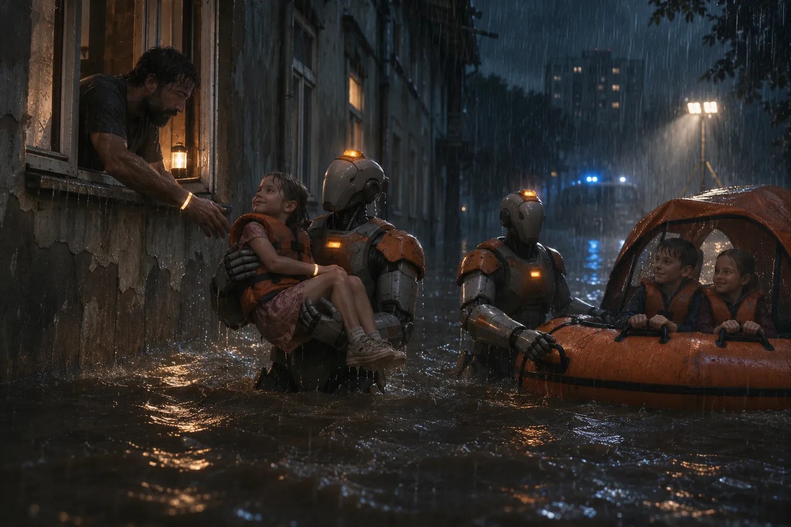

# 7. Komárov

*Brno-Tuřany, řídicí středisko, a Komárov u Mariánského náměstí. Čtvrtek 22. července 2077, 21:58 – pátek 23. července, 00:40.*

Okno se otevřelo dřív, než Sedmička dosáhla rukama na parapet.

Vyklonil se z něj muž. Tmavé vlasy, mokré vousy, tričko přilepené k ramenům. V náručí držel holčičku, mohlo jí být šest nebo sedm, a holčička se mu držela kolem krku a dívala se dolů na robota ve vodě, na světlo na jeho hlavě a na šedooranžová ramena, která se k ní natahovala.

Muž něco řekl. Arabsky. Júsuf to slyšel v kokpitu dřív, než mu Sabr začal překládat, a Sabr to poznal a zmlkl.

„Bože, ať je to pravda. Ať je to opravdu člověk.“

Júsuf se naklonil k mikrofonu.

„Je to člověk,“ řekl arabsky. Robot to pod oknem v Komárově řekl jeho hlasem, jen hlasitěji a s kovovou ozvěnou. „Jmenuji se Júsuf. Jsem z Rašídu. Sedím u letiště a vidím vás. Podejte mi ji.“

Muž se chvíli nehýbal. Pak se zasmál, nebo zavzlykal, Júsuf to nepoznal.

„Faríd,“ řekl muž. „Faríd Haddád. Z Homsu.“ Odtrhl holčičku od krku. „Amiro. Jdi k panu Júsufovi.“

Holčička nechtěla. Držela se otcova trička oběma pěstmi. Faríd ji vzal za zápěstí a jemně, prst po prstu, ji od sebe uvolnil, a pak ji spustil z okna dolů, do vzduchu nad vodou.

Júsuf pohnul rukama dřív, než ji Faríd pustil.

Třetina vteřiny. Tolik trvalo, než pohyb jeho rukavic doletěl přes relé na stožáru u Svratky do rukou Sedmičky. Za klidného dne to nevadilo. Teď to znamenalo, že kdyby čekal, až uvidí holčičku padat, chytil by ji o kus níž, než chtěl. Tak ji nechytal tam, kde byla. Chytal ji tam, kde bude. Jako na člunu v deltě, když se loď zvedá na vlně a člověk musí podat ruku do místa, kde se loď ocitne, ne tam, kde zrovna je.

Sedmička ji chytila pod pažemi. Holčička vyjekla. Rukavice Júsufovi ohlásily její váhu jako tlak v dlaních, lehký, tak lehký.

„Amiro,“ řekl arabsky. „Podívej se na mě. Tady, na světlo. Jdeš na loďku.“

Za Sedmičkou čekala Devítka s rozloženým vorem. Oranžový, nafukovací, s madly po okrajích a se stříškou na jednom konci. Každý z obou robotů vozil jeden složený na zádech. Sedmička posadila Amiru pod stříšku a holčička se chytila madla, jak jí Júsuf řekl, a dívala se nahoru na okno, kde už otec podával další dítě.

„Čtyři na vor,“ řekl Júsuf česky, do okna, a pak ještě arabsky. „Nejdřív děti. Nejmenší.“

*

Devítka vyrazila s prvním vorem ve 22:06.

Júsuf ji vedl a Sedmičku nechal u okna s druhým vorem. Devítka táhla vor za lano, u zdí domů, kde byl proud slabší, a Júsuf ji střídavě viděl jejíma očima a očima Sedmičky, v rozděleném obraze v brýlích. Napravo okno, ruce, děti. Nalevo voda, voda, voda, a na jejím konci, dvě stě padesát metrů daleko ve Kšírově ulici, modrá světla.

Hasiči stáli na kraji vody. Tam, kde se silnice zvedala a voda končila na hraně jako na pláži. Tři muži v helmách, sanitka, deky, a nad tím vším reflektor na stojanu, který svítil do tmy přes vodu, aby roboti věděli, kam jít.

„Přebíráme,“ řekl hasič, když Devítka přitáhla vor k hraně. Řekl to robotovi a robot to Júsufovi přinesl do ucha i s deštěm. „Kolik jich tam je?“

„Čtrnáct dětí,“ řekl Júsuf. „Dvacet šest dospělých. Jedna paní na kyslíku ve druhém patře.“

„Kolik máte baterie?“

Sabr to věděl dřív, než se Júsuf zeptal.

„Sedmička osmdesát jedna procent, Devítka sedmdesát devět. Ve vodě a s nákladem asi dvě hodiny a čtyřicet minut.“

„Dost,“ řekl hasič. „Musí to být dost.“

Rotreklová stála za Júsufovým kokpitem s termoskou. Neslyšel ji přijít, jako ji nikdy neslyšel. Zapsala si do sešitu čas.

„22:11. První čtyři.“

*

Šlo to.

Vor tam, vor zpátky. Devítka a Sedmička se střídaly, jedna u okna, druhá na cestě, a Júsuf přeskakoval mezi nimi jako mezi dvěma veslaři. Faríd v okně podával děti a jiné ruce mu je podávaly zezadu, z pokoje, kde se v nouzovém světle nosičů tísnili všichni, kdo v domě byli. Nějaká žena zpívala. Júsuf ji slyšel přes mikrofon Sedmičky, tiše, česky, ukolébavku, kterou neznal, a děti v pokoji se při ní nehýbaly.

Druhý vor ve 22:19. Třetí ve 22:28.

Ve třetím jela žena s miminkem. Nechtěla ho dát robotovi samotného a Júsuf ji neprosil. Malé dítě patří k matce, to nemusel nikdo psát do protokolu. Sedmička ji spustila z okna i s dítětem v šátku na prsou, opatrně, celou, a žena se ve voru schoulila pod stříšku a nepustila dítě ani na okamžik.

Čtvrtý vor jel ve 22:37. V něm poslední dvě děti, dva bratři, deset a dvanáct let, a ten starší se ohlédl na okno a pak na robota a řekl česky:

„Řídí vás fakt člověk?“

„Fakt,“ řekl Júsuf.

„A kde?“

„U letiště. V křesle.“

Kluk se zamyslel.

„To je dobrý,“ řekl. „To bych chtěl taky.“

„Čtrnáct,“ řekla Rotreklová za jeho zády ve 22:43, když hasiči převzali poslední děti. Ne nahlas. Pro sebe a pro sešit.

Iva vedle něj seděla v brýlích a ruce se jí hýbaly v rukavicích. Bohunice. Hala se střechou na podlaze. Júsuf na ni krátce pohlédl a viděl, že má mezi rty pořád tu žvýkačku, ale nežvýká. Neřekla mu nic. Slíbila to.

Nur, pomyslel si. Jen jednou, jedno slovo, a hned ho zahnal, jako se zahání moucha od obličeje. Sabr to viděl na jeho tepu a nechal ho. Až po chvíli řekl:

„Pane Mansúre. Druhé patro.“

*

Paní Hedvika Skálová měla devadesát jedna let a nechtěla nikam.

Júsuf to slyšel od Farída a pak od ní samotné, když Sedmička zvedla hlavu k oknu ve druhém patře. Okno bylo otevřené a v něm, v křesle přistrčeném k parapetu, seděla malá stará žena s hadičkou pod nosem. Koncentrátor u jejích nohou tiše vrněl a blikal oranžově.

„Já už nikam nejdu, pane,“ řekla. Česky, spisovně, jasně, jako se mluví ve škole. „Já jsem tady v tom domě jedenáct let. A dneska v noci tady umřu, v suchu, na židli. Ne ve vodě, v gumovém člunu.“

Její PAI byla starý přívěsek na krku a mluvila s robotem přímým spojením. Júsufovi v brýlích naskočily řádky. *Saturace 91 %. Koncentrátor: baterie 14 %, odhad 26 min.*

„Paní Skálová,“ řekl Júsuf. Česky, pomalu, a Sabr mu podsouval slova, která neznal. „Ten přístroj vám bude dýchat ještě dvacet šest minut. Pak budete dýchat sama.“

„Tak budu dýchat sama.“

Nesměl ji vzít. Věděl to. Kdyby ji Sedmička zvedla z křesla proti její vůli, bylo by to donucení, a to robot nesmí, ani když je to pro člověka zjevně dobré. Ani v povodni. Paní Skálová byla při smyslech. Mluvila líp než on. Mohla zůstat.

Júsuf v brýlích zavřel oči. Viděl tmu a v ní, na kraji, pořád obraz z robota. Okno, křeslo, oranžové světýlko.

„Amira se na vás ptá,“ řekl.

Nebyla to pravda. Nebo to pravda byla. Neslyšel ji to říkat, ale slyšel ji v okně, když ji Faríd podával, jak volala „teto Hedviko“, a Faríd jí řekl, že teta Hedvika přijde potom.

Stará žena se na robota dívala dlouho.

„To dítě nemá babičku,“ řekla nakonec. „Tak jsem jí to já. Na hodiny.“ Sundala si hadičku a zase si ji nasadila. „Tak pojďte, ať to mám za sebou. Ale přístroj jde se mnou.“

„Přístroj jde s vámi.“

Sedmička vlezla do domu oknem v prvním patře. Rám byl starý a dřevěný a robot ho musel vylomit, aby se protáhl. Júsuf to udělal bez rozmýšlení. Záchranný robot vstupuje do domu jako hasič, a hasič se na rámy neptá. Uvnitř stáli lidé namačkaní u stěn a uhýbali mu z cesty, mokří, v dekách, a jedna žena se ho dotkla na rameni, když šel kolem, jako se lidi dotýkají sochy svatého.

Schody do druhého patra byly dřevěné. Staré, úzké, s vyšlapanými stupni. Pod dvěma sty kily zaskřípaly už na prvním.

„Ke zdi,“ řekl Júsuf. Sabrovi, nebo sobě.

Stupně drží nejvíc tam, kde leží na nosníku. U zdi a u zábradlí, ne uprostřed, kde se prohýbají. To ho naučil děda v Rašídu, když spolu opravovali schody na půdu, a teď vedl Sedmičku nahoru po krajích, krok za krokem, se zpožděním v každém pohybu. Schody skřípaly a držely.

Paní Skálová vážila tolik co velký pes. Sedmička ji zvedla z křesla i s dekou a koncentrátor jí dala na klín, a stará žena se ho chytila oběma rukama jako kabelky.

„Jsem záchranný robot,“ řekl Júsuf, protože to říkal vždycky. „Řídí mě člověk.“

„To jste už říkal,“ řekla paní Skálová. „Dávejte pozor na schody.“

*

Ve 23:02 se obraz poprvé zadrhl.

Sedmička stála ve vodě pod oknem, s paní Skálovou v náručí, a čekala na Devítku s vorem. Júsuf viděl, jak se ze tmy u Kšírovy vynořuje oranžová skvrna. A pak se mu obraz ze Sedmičky na okamžik zastavil a skočil dál.

„Zpoždění roste,“ řekl Sabr. „Půl vteřiny. Osm desetin.“

Obraz se rozpadl do čtverečků a zase složil. Júsuf pohnul rukou a čekal. Sedmička se pohnula, až když už nečekal. Vteřina a půl.

„Co to je?“

„Rušení na pásmu spoje. Silné, širokopásmové. Zdroj je blízko, na Mariánském náměstí. Někde mezi Sedmičkou a stožárem.“

Obraz zčernal ve 23:04.

*SPOJENÍ ZTRACENO. BEZPEČNÝ REŽIM.*

Rukavice zvadly. Pedály ztratily odpor. Júsuf seděl v kokpitu u letiště a v rukou neměl nic, a pět kilometrů odtud stál ve vodě po prsa robot a držel v náručí devadesátiletou ženu s přístrojem, kterému zbývalo pár minut.

Sedmička ji nepustí. Věděl to. Bezpečný režim neznamená, že robot padne. Znamená, že stojí, drží, co drží, a čeká. Drží ji nad vodou a bude ji tam držet, dokud mu nedojde baterie. Věděl to stejně jistě, jako věděl, že paní Skálová teď sedí v náručí stroje, který zmlkl, ve tmě, v dešti, a neví proč.

„Tep sto čtyřicet,“ řekl Sabr. „Pane Mansúre. Dýchejte. Devítka spojení má.“

Devítka spojení měla. Slabé, se zpožděním, které skákalo, ale měla. Stála na otevřené vodě, dál od náměstí, a její anténa viděla na stožár jinou cestou. Júsuf se do ní přepnul celý a obrátil ji k náměstí.

Na rohu, na druhé straně Mariánského náměstí, svítilo v okně zastavárny slabé světlo. Před ní stál ve vodě po stehna robot. Vysoký, šedý, hranatý, bez světelné značky. Na ramenou měl připoutanou krabici se třemi krátkými anténami a táhl rukama za mříž výlohy.

„Rušička,“ řekla Rotreklová za ním. Viděla to na velké obrazovce nad kokpitem, kam šel obraz z jeho brýlí. „Aby je nikdo nenahrával. Hajzlové.“ Řekla to bez zvýšení hlasu. „Policie tam nebude dřív než za hodinu, jestli vůbec.“

„Je to stroj,“ řekl Júsuf.

„Je to stroj,“ řekla Rotreklová. „Udělej, co musíš. Na lidi nesahej.“

Na lidi tam nebylo kde sahat. Kolem zastavárny nikdo nebyl. Ten, kdo robota řídil, seděl někde v suchu s brýlemi na očích, stejně jako Júsuf.

Devítka vyrazila přes náměstí.

Voda byla hlubší, než čekal. Uprostřed náměstí šla Devítce přes prsa a nadnášela ji, a Júsuf cítil v pedálech, jak plováky v trupu zabírají a nohy ztrácejí dno. Šel po kraji, u laviček, které byly pod vodou a které cítil jako tvrdé hrany pod chodidly. Zpoždění skákalo.

Robot u zastavárny ho uviděl. Nebo ten, kdo ho řídil. Pustil mříž a otočil se k Devítce čelem.

„Pane Mansúre, nemá bezpečnostní jádro,“ řekl Sabr. „Nehlídá sílu.“

„Vím.“

Devítka natáhla ruku po krabici na jeho ramenou. Šedý robot ji odrazil. Rychle, tvrdě, nehlídanou silou, a Devítka se zapotácela. Júsuf ji chtěl chytit, chtěl jí přenést váhu na druhou nohu, ale jeho pohyb dorazil pozdě. Pod pravým chodidlem měla Devítka kapotu auta. Klouzala.

Devítka upadla.

Obraz v brýlích se převrátil a zhnědl. Pod vodou. Rukavice Júsufovi ohlásily pád jako ránu do celého těla, i když v kokpitu se nepohnul. Hnědá tma, bubliny, vzdálené hučení. A pak plováky v trupu udělaly, co měly. Devítka se zvedla. Obraz se prodral hladinou, čočky plné vody, a Júsuf ji postavil na nohy dřív, než stačil pomyslet, že by to nešlo.

Šedý robot stál a čekal. Nehýbal se. Ten, kdo ho řídil, se díval, co Devítka udělá.

Júsuf se nadechl. Do čtyř, jak to chtěl Sabr.

Zpoždění. Celou dobu se snažil zpoždění porazit. To nejde. Vlnu taky neporazíš. Vlnu čteš. Ten druhý měl taky zpoždění, možná menší, možná větší, ale měl ho, protože i on seděl někde daleko a jeho pohyby taky musely přeletět vzduchem. Kdo řídí přes rádio, je vždycky o kus pozadu za sebou samým.

Devítka udělala krok doleva. Šedý robot se pohnul doleva za ní. Pozdě. O kus, který Júsuf viděl.

Devítka udělala krok doprava. Šedý robot doprava. Pozdě.

Třetí krok Júsuf neudělal. Jen ho naznačil, ramenem, a zatímco šedý robot ještě reagoval na pohyb, který nepřišel, Devítka chytila krabici na jeho ramenou oběma rukama a zatáhla.

Popruh praskl. Šedý robot se otočil a chytil Devítku za předloktí. Júsuf ucítil v rukavici, jak mu ho drtí. Nehlídaná síla, bez jádra, bez hranice. Devítka hlásila tlak na kloubu, osmdesát procent, devadesát. Júsuf ruku nepustil. Strhl krabici k sobě, k vodě, a ponořil ji pod hladinu. Celou, i s anténami, a držel ji tam.

Rádio neprojde vodou. Pár desítek centimetrů vody stačí a signál neprojde.

Šedý robot znehybněl. Uprostřed pohybu, s rukou na Devítčině předloktí, jako když se zastaví hodiny. Řídil ho přes tutéž krabici, kterou teď Júsuf držel pod vodou.

V pravé polovině brýlí se rozsvítil obraz.

*SPOJENÍ OBNOVENO. Sedmička.*

Bylo 23:11.

*

Paní Skálová byla živá.

Seděla v náručí Sedmičky, mokrá do pasu, s dekou přes ramena, a koncentrátor u ní nevrněl. Baterie došla ve 23:08. Júsuf to viděl v řádcích od jejího přívěsku. *Saturace 86 %. Dýchá sama.*

„Tak co,“ řekla, když se robot znovu pohnul. „Už jste zpátky?“

„Už jsem zpátky.“

„Stál jste tu jako svatý na mostě,“ řekla paní Skálová. „Já jsem se modlila. Nemodlila jsem se čtyřicet let.“

Sedmička ji nesla sama. Nečekala na vor. Dvě stě padesát metrů, u zdí, kde byl proud slabší, s třetinou vteřiny zpoždění, které už zase bylo jen třetinou. Hasiči vyběhli do vody naproti, po kolena, a jeden měl v rukou zelenou láhev s kyslíkem. Nasadili jí masku dřív, než Sedmička stačila zastavit.

„23:17,“ řekla Rotreklová. Zapsala si to.

Devítka stála na náměstí u zastavárny a držela pod vodou krabici. Júsuf ji tam nechal stát ještě minutu. Krabici pak pustil a ta zůstala ležet na dně. Šedý robot stál vedle, nehybný, s rukou napřaženou do prázdna.

„Sedmička šedesát dva procent,“ řekl Sabr. „Devítka čtyřicet osm. Devítka má poškozený loketní kloub, má o třetinu menší sílu v pravé ruce. Ale jde.“

*

Zbytek šel pomalu.

Dospělí se z okna nespouštěli tak snadno jako děti. Byli těžší, báli se víc a víc se ptali. Jeden muž chtěl s sebou kufr. Júsuf mu řekl, že kufr ne, a muž ho nechal na parapetu a ještě dvakrát se na něj ohlédl.

Žena se psem se v okně objevila ve 23:52.

Malý, hladký, hnědý jezevčík, kterého držela pod bundou, takže mu koukala jen hlava. Byla mladá, mohlo jí být dvacet. Měla na tváři rozmazanou řasenku a v očích úplně pevné rozhodnutí.

„Bez Žofky nejdu,“ řekla.

„Vor je pro lidi,“ řekl hasič na kraji vody. Slyšel to přes Devítku. „Zvířata potom. Pokud bude čas.“

„Tak tady zůstanu.“ Žena si psa přitiskla k prsům a jezevčík se jí pod bradou otočil a olízl jí krk. „Já ji nepustím. Ona to nepochopí. Myslí si, že ji tu nechám.“

Júsuf se podíval na baterii Sedmičky. Na okno. Na ženu, která se pevně držela něčeho malého a teplého v noci, kdy všechno ostatní teklo pryč.

„Pes jede s vámi,“ řekl.

Hasič na kraji vody něco řekl. Júsuf ho neposlouchal.

„Vy mi ji nevezmete?“

„Nevezmu. Držte ji. Neříkejte mi, kolik váží.“

Žena se poprvé usmála. Kývla. Sedmička ji spustila z okna do voru i se psem pod bundou a jezevčík celou cestu ke Kšírově nevydal ani hlásku. Jen koukal z bundy na vodu a na světla a na šedooranžové rameno robota, který táhl lano.

Rotreklová si to zapsala. Neřekla ani slovo.

*

Faríd Haddád vylezl z okna poslední, v 0:27.

Zůstal v pokoji až do konce. Spočítal všechny, kdo šli před ním, a říkal je Júsufovi arabsky, jeden po druhém, čísla a jména, jako korálky na modlitební šňůře. Nakonec se otočil, podíval se do prázdného pokoje, na mokré matrace a na kufr na parapetu, a slezl.

„Čtyřicet,“ řekl ve voru. „Všichni.“

„Čtyřicet,“ řekl Júsuf.

„Odkud jste říkal? Z Rašídu?“

„Z Rašídu.“

„Rašíd je u moře,“ řekl Faríd. „Tam se umí s vodou.“

„Tam se s vodou umírá,“ řekl Júsuf. Řekl to dřív, než to stačil zastavit. Pak dodal: „A taky umí.“

Faríd se na robota díval, jako by se díval na člověka.

„Ať vás Bůh chrání,“ řekl. „Vás a vaše děti.“

Júsuf nic neřekl. Sedmička táhla vor ke Kšírově, k modrým světlům, a déšť už jen mžil.

„0:31,“ řekla Rotreklová. „Komárov čtyřicet ze čtyřiceti.“

Někdo v sále zatleskal. Jednou, dvakrát, a pak přestal, protože nikdo jiný netleskal. Kocourek se otočil v kokpitu a zvedl palec. Pořád měl na sobě brýle, i když neměl na co se dívat.

*

„Sedmička osm procent,“ řekl Sabr. „Devítka šest. Do depa to obě dojdou. Je to šest set metrů.“

Júsuf je vedl. Jednu, pak druhou, přes Komárov ke Svratce, kde stála stanice s depem na vyvýšeném břehu, suchá. Voda opadávala. Ne moc, o kousek, ale Júsuf to viděl na zdech, kde zůstával tmavý pruh nad hladinou. Na střeše auta, kde předtím seděla kočka, už kočka nebyla.

Sedmička a Devítka zajely do depa v 0:38. Dok je přijal, cvakly zámky a na obrazovce se rozsvítilo *VÝMĚNA BATERIÍ: 14 MIN.*

Rotreklová stála vedle jeho kokpitu. Pila čaj z víčka termosky a dívala se na mapu na čelní stěně. Na mapě, pod centrem, svítila šedá čára diametru. Nikdo na ní nebyl. Žádný bod.

„Po výměně diametr,“ řekla. „Sedmička a Devítka. Vlak stojí, ve vlaku jsou lidi. Hasiči se k nim portálem nedostali. Půjdeš ty.“

„Rozumím,“ řekl Júsuf.

Sundal si brýle. Sál se kolem něj objevil najednou, tlumené světlo, kokpity, mapa, a vypadal cizí, jako když se člověk vynoří z vody a chvíli neví, kde je.

Iva seděla vedle něj. Měla brýle na čele a držela v ruce kus papíru, přeložený napůl. Dívala se na něj. Neřekla nic.

Júsuf se na papír podíval. Pak na Ivu.

Byl venku z Komárova. Sám jí řekl, ať mu to řekne, až bude venku. A za čtrnáct minut bude zase dole, v tunelu, v tom vlaku, a bude potřebovat ruce, které se netřesou.

„Ještě ne,“ řekl.

Iva kývla. Papír nepustila.

Júsuf se podíval na žlutou rybu na opěrce. Pak si nasadil brýle zpátky a díval se na odpočet v rohu obrazovky, jak ubývá.
