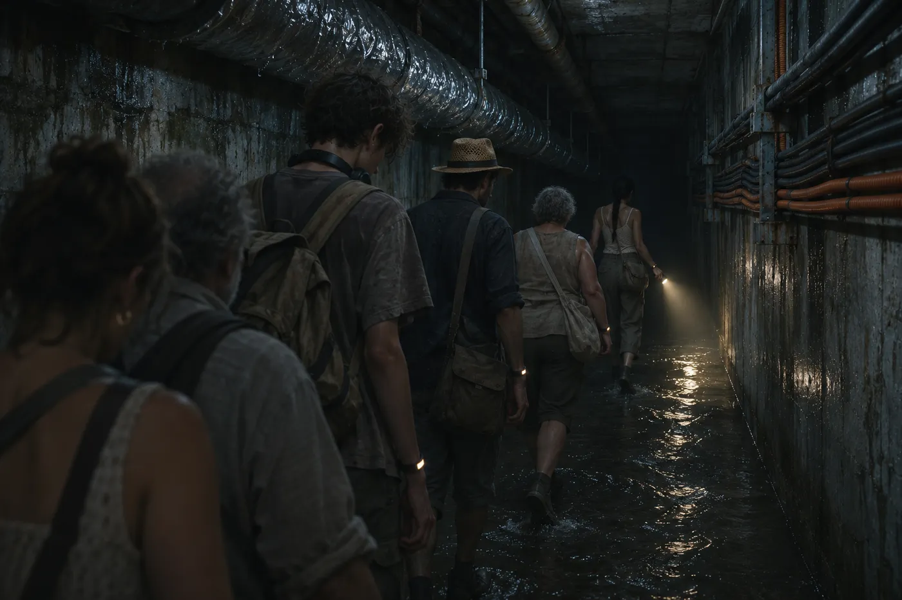

# 8. Kolektor

*Brno, kolektory pod centrem a Kapucínské náměstí. Čtvrtek 22. července 2077, 23:10 – pátek 23. července, 00:15.*

Kolektor bzučel.

Nur to slyšela celou dobu, pod šplícháním kroků a pod dechem třiceti lidí za zády. Hluboké tiché vrnění šlo odněkud ze zdí a z trubek nad hlavou, jako lednička v noci. Trubky vedly po stropě v dlouhých řadách. Některé byly tenké jako její zápěstí, jiné tlusté jako sud a obalené stříbrnou fólií. Z těch tlustých šlo teplo. Když na ně posvítila, viděla, jak se nad nimi chvěje vzduch.

„Horkovod,“ řekla Mimi. „Teplá voda pro domy nahoře. Neopírej se o něj.“

Nur se o něj neopírala. Šla ale blízko a nechala teplo, ať jí dýchá na mokré rameno. Tričko se jí lepilo na záda a kraťasy byly těžké od vody z tunelu. Zuby jí cvakaly, i když jim to zakazovala.

Chodba byla úzká. Dva lidé se do ní vešli vedle sebe, jen když jeden šel bokem. Vpravo vedly ve žlabech kabely, černé, šedé a oranžové, svázané do svazků, a na zdi byla každých pár desítek metrů nastříkaná bílá písmena a čísla. *K 14. K 15.* Nur je četla nahlas, protože to Mimi chtěla.

„Jdete dobře,“ řekla Mimi. „Podle Basova plánu je to ke Kobližné ještě asi tři sta metrů. Tam jsou výstupy. A tam by mělo být sucho.“

„To už jsi říkala.“

„Říkám to znovu, protože se ti to líbilo.“

Líbilo. Nur to slovo držela v hlavě jako bonbon. Sucho.

Po padesáti metrech podala svítilnu Sofii. Ruka ji od toho světla bolela až do lokte. Sofie ji vzala a šla první a Nur šla za ní a opakovala jí, co říká Mimi. Doprava kolem skříně. Pozor, trubka nízko. Hlavu dolů. Pan Pernica šel za nimi a mlčel. Jednou se zeptal, jestli má svítilnu vzít on, protože je vyšší. Sofie řekla, že ne, že to mají. Pan Pernica kývl a šel dál.

Za nimi Libuše vedla pana Pohanku. Nur slyšela jeho dech, krátký a pískavý, a Libuši, která mu po každých deseti krocích něco řekla. Že už to bude. Že na poště by taky stál ve frontě. Pan Pohanka jí jednou odpověděl, že na poště aspoň sedí, a Libuše se zasmála tak hlasitě, že se několik lidí ohlédlo.

Oskar šel kousek před nimi, sehnutý, protože byl vysoký, a pořád se díval na strop.

„Tohle jsme dělali v deváté,“ řekl. „Celý pololetí. Nákresy, fotky, Bas to má všechno. A já si říkal, že sem nikdy nevlezu.“

„Tak teď jsi tu,“ řekla Sofie.

„Jo,“ řekl Oskar. „Je to menší, než jsem myslel.“

*

Vodu zaslechla Nur ve 23:24.

Nejdřív si myslela, že je to horkovod. Nebyl. Takový zvuk dělá okap, když prší dlouho. Někde před nimi, za zatáčkou, tekla voda shora dolů a dopadala na beton.

Podlaha pod nohama zvlhla. Brzy se na ní objevila tenká vrstva vody, lesklá ve světle, a ta vrstva se hýbala. Tekla stejným směrem jako oni, dopředu, ke Kobližné.

Nur se zastavila a posvítila dolů. Odkud teče. Jak rychle. Kam.

Teklo to z prasklin pod zdí a zezadu ze tmy, odkud přišli. Ne rychle. Líně, jako by mělo čas. A teklo to dopředu a z kopce. Chodba tam klesala. Nur to nepoznala na podlaze, poznala to na vodě.

„Mimi. Kobližná je níž.“

„Je,“ řekla Mimi. „Uzel leží níž než chodby kolem. Voda se tam slévá.“

„Říkalas sucho.“

„Říkal to Bas. Plán je z loňska.“ Mimi se odmlčela a pak řekla tišeji, věcně: „Voda je po kotníky. Stoupá pomalu. Výstupy jsou v uzlu i za ním. Jděte dál.“

Šli dál. Voda za zatáčkou sahala Nur přes kotníky, studená, a nesla na hladině prach a kousky něčeho bílého, možná izolace. Ze stropu tam teklo. Ze spáry vedle trubek se sypal tenký proud vody a rozprskával se o žlab s kabely. Lidé ho obcházeli a stejně je postříkal.

Ve 23:38 řekla Mimi: „Nur.“

Jinak než předtím. Nur se zastavila tak prudce, že do ní Oskar narazil zezadu.

„Někdo volá o pomoc,“ řekla Mimi. „Nouzové volání. Není to nikdo z nás. Je to cizí nosič. Kousek před vámi, v uzlu.“

„Kdo?“

„Nevím, kdo to je. Vím, že je to nouze.“

Nur vzala Sofii svítilnu z ruky a rozběhla se. Voda jí šplíchala až na kolena. Slyšela za sebou Sofii a Oskara a Libušin hlas, který volal, ať neběží, a neposlechla.

*

Uzel byla místnost. Po chodbě to byl skoro sál.

Strop byl výš, zdi dál od sebe, a podél nich stály šedé skříně, vysoké jako dospělý člověk, s mrtvými okénky. Nalevo byla stěna z drátěného pletiva a za ní dlouhé řady něčeho šedého a hranatého, jako cihly v policích. Na pletivu visela žlutá cedule s černým trojúhelníkem. *NEBEZPEČÍ VÝBUCHU. ZÁKAZ VSTUPU S NESCHVÁLENOU ELEKTRONIKOU.* V rohu vedl ke stropu železný žebřík a nahoře nad ním byl kulatý poklop. Kolem poklopu kapala voda, pořád, jako z puštěného kohoutku.

Pod žebříkem ležel muž.

Ležel na zádech, jednu ruku ve vodě, druhou přes břicho. Měl na sobě světlou košili s krátkým rukávem, mokrou do půli prsou, a pracovní kalhoty s mnoha kapsami. Voda kolem něj byla klidná a sahala mu ke krku. Oči měl pootevřené. Nad levým uchem měl vlasy tmavé a slepené. V pravém uchu mu svítil nosič, malé světýlko, které blikalo červeně, pořád stejně rychle, jako srdce.

„Jeho asistent volá o pomoc,“ řekla Mimi. Hlas měla klidný a rychlý, jako když táta čte hlášení. „Dal mi svou zprávu. Musím jeho zprávu vzít s sebou. Zákon.“

„Co je mu?“

„Nedýchá.“

Nur klekla do vody. Voda byla studená tak, že jí vyrazila dech, a pak už ji necítila. Muž byl těžký a velký a nehýbal se. Neviděla, jestli se mu hýbe hrudník. Přiložila mu tvář k puse, jak ji to učil táta, a dívala se přitom na jeho košili. Nic. Žádný vzduch na tváři. Žádný pohyb.

„Mimi.“

„Nedýchá,“ řekla Mimi znovu. „Masáž. Hned. Ruce doprostřed hrudníku, na kost. Lokty rovně. Mačkej celou vahou.“

Sofie přiběhla za ní a zůstala stát s rukama u pusy. Přiběhl Oskar a Libuše, a Libuše se nezastavila, jen klekla k Nur do vody.

„Dej mi světlo,“ řekla Nur.

Sofie se probrala, vzala jí svítilnu a rozhlédla se, kam ji dát. Jediné suché místo v celém uzlu byl betonový schod pod žebříkem, o kus výš než podlaha. Ležel na něm velký klíč, ocelový, delší než Nur předloktí. Sofie postavila svítilnu vedle něj a natočila ji na muže.

Nur položila ruce na jeho hrudník. Jednu na druhou, prsty propletené, jak to dělal táta na Kroupové na kuchyňské podlaze. Tehdy lepila elektrody a dívala se, jak mačká táta. Teď tu táta nebyl. Teď to byla ona.

Zatlačila.

Hrudník povolil pod jejíma rukama míň, než čekala. Byl tvrdý jako dveře. Přenesla váhu do ramen a cítila, jak se něco pod dlaněmi propadá a zase vrací.

„Jedna,“ řekla Mimi. „Dva. Tři. Hlouběji. Čtyři. Pět. Dobře. Takhle.“

Mimi počítala a Nur mačkala. Rytmus byl rychlejší, než by si myslela. Rychlejší než chůze, skoro jako běh. Za ní se sbíhali další lidi, voda šplíchala, někdo plakal, žena s holčičkou zůstala stát u vchodu do uzlu a otočila holčičku obličejem k sobě. Nur to všechno slyšela a nevnímala nic z toho. Jen ten rytmus a hlas v uchu.

„Dvacet osm. Dvacet devět. Třicet. Dva vdechy.“

Zaklonila mu hlavu, jednou rukou pod bradou, a druhou mu stiskla nos. Rty měl studené. Chutnaly po vodě a po něčem kovovém. Foukla. Viděla, jak se mu košile na hrudi zvedla. Foukla znovu.

„Masáž,“ řekla Mimi.

Při čtrnáctém stlačení mu něco vyklouzlo z kapsy košile. Bílý cár, zmuchlaný papírek. Spadl do vody vedle jeho krku a začal se otáčet a odplouvat. Nur po něm sáhla a strčila si ho do kapsy kraťasů, k mokré utěrce, a už mačkala dál. Věci se ve vodě nenechávají, protože je voda odnese. To bylo celé. Ani se na něj nepodívala.

„Šestnáct. Sedmnáct.“

*

Po dvou minutách řekla Mimi: „Vystřídej se.“

„Já můžu.“

„Můžeš. Ale po dvou minutách mačká každý mělčeji, i když si myslí, že ne. Ruce se unaví dřív, než to člověk pozná. Proto se záchranáři střídají. Libuše je vedle tebe.“

Libuše se nezeptala. Přesunula se po kolenou a položila ruce tam, kde je měla Nur, a Nur sundala ty svoje. Prsty se jí třásly. Libuše mačkala jinak než ona. Těžce, pomalu, celým tělem, jako by hnětla těsto ve velké míse. Mimi teď počítala nahlas, z náramku, aby ji Libuše slyšela, a Libuše počítala s ní.

Po Libuši to zkusila Sofie. Byla menší než Nur a lehčí a Nur viděla, že nemačká dost hluboko. Mimi jí to řekla a Sofie zavřela oči a opřela se do toho celou vahou, až jí kolena sjela po dně.

Ozval se pan Pernica.

„Ukaž,“ řekl. Klekl si vedle Sofie, do vody, v mokrých kalhotách. „Pusť mě. Já jsem těžší.“

Sofie se na něj podívala a odsunula se. Pan Pernica položil ruce na mužův hrudník a začal. Nur čekala, že to bude dělat špatně, ale nedělal. Mačkal pravidelně a hluboko, s rovnými lokty, a počítal s Mimi polohlasně, jako když se modlí. Měl mokré brýle a nesundal si je.

„Kurz první pomoci,“ řekl mezi dvacítkou a třicítkou, a nikomu se nedíval do očí. „Na úřadě. Každé dva roky.“

Nur foukala vdechy. Pak zase mačkala ona, po ní Oskar, po něm Libuše. Čas se rozpadl na třicítky a dvojky. Voda stoupala. Nur to poznala podle toho, že jí při klečení došla až na stehna. Oskar si klekl muži za hlavu a podložil mu ji koleny, aby mu voda nešla do obličeje.

„Mimi. Je tu defibrilátor?“

„Hledala jsem. Není. Ani v plánech ho Bas nemá.“

„A jeho asistent? Neví, co mu je?“

Mimi chvíli mlčela.

„Jeho asistent mi dal zprávu pro záchranáře,“ řekla pak. „Tu ti nesmím říct. Není pro tebe, je pro ně. Promiň.“

„Je mrtvej?“

„Mačkej,“ řekla Mimi. „Nic lepšího pro něj teď nikdo udělat nemůže.“

Nur mačkala.

*

Ve 23:50 se v chodbě naproti objevilo světlo.

Žluté, kulaté, rozhoupané, ve výšce hlavy. Přicházelo z druhé strany uzlu, odkud oni ještě nešli, a bylo slyšet, jak se blíží vodou. Těžké kroky, rychlé. Pak hlas, zadýchaný, mužský:

„Pavle! Pavle, kde seš?“

Do uzlu vtrhl muž s čelovkou. Byl mokrý až do prsou, oranžová bunda mu visela na ramenou jako mokrý hadr a v ruce držel krátké rádio s anténou. Zastavil se. Světlo z jeho čela přejelo po lidech, po Libuši, která mačkala, po Nur, která klečela u hlavy, po muži ve vodě. A zůstalo na něm.

„Ježišmarja,“ řekl muž s čelovkou. „Ježišmarja, Pavle.“

Byl u nich ve dvou krocích. Klekl si a Nur ucítila mátu. Silnou a sladkou, jako z otevřeného pytlíku bonbonů. Voněl jimi celý, i ten jeho dech, rychlý a roztřesený.

„Já,“ řekl Libuši. „Pusťte mě. Já to umím.“

Libuše se odsunula. Muž s čelovkou položil ruce na hrudník a mačkal. Byl silnější než všichni ostatní a Nur viděla, jak se pod jeho rukama hrudník propadá. Počítal nahlas, rychle, jedna, dva, tři, a mezi čísly říkal jméno, pořád dokola, jako by ho mohl zavolat zpátky.

„Kde ste se tu vzali?“ zeptal se mezi dvěma třicítkami. Nedíval se na ně. Díval se na muže ve vodě.

„Z diametru,“ řekla Nur. „Z vlaku. Šli jsme únikovou cestou.“

„Kolik vás je?“

„Třicet.“

Muž s čelovkou na okamžik přestal. Zvedl hlavu a podíval se po nich všech, po starém pánovi opřeném o Libuši, po holčičce na rukou u vchodu, po Oskarovi, po dvou holkách, které se držely za ruce. Nakonec sklopil oči k vodě kolem svých kolen.

„Voda stoupá,“ řekl. „Tady nemůžete bejt. Musíte ven.“

„Tady je žebřík,“ řekla Sofie.

„Ten poklop je pod ulicí a nad ním teče řeka. Ten nikdo neotevře.“ Mačkal dál. Mluvil mezi stlačeními, po kouscích. „Tudy, odkud jdu. Rovně, pak doprava. Kolem Zelňáku je to hluboký, po pás. Držte se trubek na levý straně. Za tím je žebřík na Kapucínský. Poklop jde zevnitř. Tlačte.“

„Ale on…“ řekla Nur.

„Já tu zůstanu,“ řekl muž. „Jděte.“

Nur se nehýbala. Měla ruce položené na mužově rameni, ani nevěděla od kdy. Bylo studené a mokré a pod košilí tvrdé.

„Nur,“ řekla Mimi. „Musíme jít. On to udělá. Voda stoupá o centimetr za pět minut. Pan Pohanka se třese.“

Libuše ji vzala za ramena. Ne silně. Tak, jak se bere dítě, které se nechce zvednout od hry.

„Pojď, holka,“ řekla Libuše. „Udělalas, co šlo.“

Nur vstala. Sofie vzala svítilnu ze schodu a podala jí ji. Nur ji nevzala. Sofie šla první.

Ve dveřích chodby se Nur otočila.

Uzel ležel ve tmě a v té tmě svítila jen žlutá čelovka. Kývala se nahoru a dolů, nahoru a dolů, pořád ve stejném rytmu. A pod ní, slabě, blikalo to malé červené světýlko v mužově uchu.

„Pavle,“ říkal hlas. „No tak, Pavle. No tak.“

*

U Zelného trhu byla voda po pás.

Po pás dospělým. Nur do prsou, Sofii až pod bradu. Chodba tam klesala do dolíku a voda v něm stála a zároveň tekla k uzlu za nimi. Ze stropu do ní padal proud, silný, s hukotem, rovnou z kulaté šachty nad hlavou. Nur posvítila nahoru. Vysoko nahoře, na konci šachty, bylo vidět kousek nebe. Ne černé. Šedé a třesoucí se, plné slabých světel, a do toho světla pršelo.

„Zelný trh,“ řekla Mimi. „Je nad vámi. Ta světla jsou lidi.“

Držely se trubek na levé straně, jak řekl muž s čelovkou. Trubky byly studené a kluzké a Nur si na ně zavěsila celou ruku. Oskar nesl holčičku na ramenou, vysoko, aby na ni voda nedosáhla, a holčička mu držela hlavu oběma rukama a nebrečela. Pan Pernica šel za Sofií a jednou ji chytil za tričko, když uklouzla, a nepustil, dokud nestála. Libuše s jednou ze žen vedla pana Pohanku. Pan Pohanka se v nejhlubším místě zastavil a řekl, že dál nepůjde, a Libuše mu řekla, že tady se stát nedá, protože tady je mokro, a on šel.

Za dolíkem se chodba zvedla a voda klesla. Ke kolenům, ke kotníkům. Pak žebřík.

Byl úzký, železný a vedl nahoru do tmy. Oskar vylezl první. Nur slyšela, jak nahoře funí a tluče do něčeho dlaněmi, a pak zaskřípění, kovové a dlouhé, a do šachty spadl vzduch. Mokrý, studený, voněl deštěm a listím. A s ním kapky a hukot bouřky.

„Otevřeno!“ zakřičel Oskar shora. „Jsme venku!“

Lezli nahoru jeden po druhém. Žena s holčičkou na zádech. Holky. Libuše šla pod panem Pohankou a strkala mu nohy z příčky na příčku, a Oskar ho nahoře tahal za ruce, a pan Pohanka po celou cestu říkal tiše, že je mu osmdesát devět. Pak Sofie a pan Pernica. Nur šla poslední.

Z poklopu vystrčila hlavu do deště v 0:05.

Bylo to náměstí. Malé, šikmé, dlážděné, a voda po něm tekla v potocích dolů. Nad ním stál kostel s velkými schody, a když se zablesklo, ukázal se celý, bílý a holý, jako vystřižený z papíru. Nur se vyškrábala na dlažbu a zůstala klečet. Déšť jí bušil do zad. Byla to nejkrásnější věc, jakou kdy cítila.

„Kapucínské náměstí,“ řekla Mimi. „Jsi venku.“

Ostatní stáli kolem poklopu, schoulení, mokří, a nevěděli, kam jít. Nur slyšela pana Pohanku, jak se směje. Nebo kašle. Na druhé straně náměstí, pod lampou, která nesvítila, stáli dva policisté v reflexních vestách. Jeden mluvil do vysílačky. Druhý se díval na ně.

Za dvě minuty se z poklopu za Nur vynořila čelovka.

Muž z uzlu vylezl sám. Nikdo s ním nebyl. Vytáhl se na dlažbu, postavil se a zůstal stát. Čelovka mu svítila do deště. Pak se rozběhl přes náměstí k policistům. Běžel špatně, nohy se mu pletly, a jednou málem upadl.

Nur se dívala na jeho záda. Nikdo jí nic neřekl. Nemusel.

„Mimi.“

„Jsem tady.“

„Pořád to neseš?“

„Nesu,“ řekla Mimi. „Nesmím to smazat. Nikdo to nesmí smazat. Ponesu to, dokud to nepředám záchranářům nebo policii.“

Nur se podívala na policisty. Muž s čelovkou u nich stál a mával rukama a jeden z policistů ho držel za loket.

„Tak jim to dej. Jsou támhle.“

„Zkusila jsem to,“ řekla Mimi. „Poslala jsem to do jejich jednotek. Jejich jednotky bez sítě nic nepřijímají. Jen nahrávají. Musím to předat policistovi nahlas, tak, aby to převzal sám. Musíš mě k němu vzít.“

Nur vstala. Nohy ji neposlouchaly. Udělala dva kroky přes náměstí.

Ten policista, co se předtím na ně díval, k nim přiběhl. Mladý, s vodou kapající z kšiltu. Podíval se na ni a na Sofii a na holčičku na Oskarových ramenou.

„Kolik vás je? Je někdo zraněnej? Ne? Tak dovnitř, holky, dovnitř, jste celý modrý.“ Ukázal ke kostelu. „Kapucíni otevřeli. Tam je sucho. Hned.“

„Já…“

„Hned,“ řekl policista. A už se otáčel ke starému pánovi.

Ze dveří vedle kostela vycházela světla. Malá, žlutá, rozhoupaná. Svíčky v lucernách. Nesli je muži v hnědých hábitech, s provazy kolem pasu, a jeden měl dlouhé šedé vousy, ve kterých se lesklo světlo. Šel k nim přes náměstí, v sandálech, vodou, jako by to byla cesta do kuchyně.

„Pojďte dál,“ řekl. „Pojďte, děti. U nás je sucho a teplo. Pojďte všichni.“

Vzal Nur za ruku. Měl ruku velkou a teplou a Nur se nechala vést.

„Mimi,“ řekla potichu. „Policajt.“

„Já vím,“ řekla Mimi. „Teď ne. Teď potřebuješ teplo. Zpráva počká. Nikdo ji nesmaže, ani já. Až budeš moct, najdeme policistu, který ji převezme.“

*

Uvnitř voněl vosk.

Byla to dlouhá chodba s nízkou klenbou a s obrazy na zdech, které se ve světle svíček hýbaly. Na lavicích podél zdí ležely deky. Hnědé, staré, drsné. Mniši je rozdávali a nikdo se neptal komu. Někdo přinesl hrnek s něčím horkým a sladkým a strčil ho Nur do dlaní.

Sedla si na lavici. Sofie si sedla vedle ní a přitiskla se k ní ramenem, a přes ně přes obě hodil někdo jednu deku. Pan Pernica stál opodál a díval se na Sofii, jako by se bál, že se rozplyne. Nakonec si šel sednout ke zdi.

Nur držela hrnek a nepila.

Ruce se jí hýbaly. Neviděla to, cítila to. Lehce, v zápěstích, nahoru a dolů, nahoru a dolů. Jedna, dva, tři. Hlava počítala dál, i když už nechtěla. Čtyři, pět, šest. Nemohla ji zastavit.

„Nur,“ řekla Mimi. „Jsi v teple. Dýchej.“

Dýchala. Hrnek pálil do dlaní a to bylo dobře.

V kapse kraťasů měla utěrku paní Kroupové. Mokrou, zmuchlanou, studenou přes látku. A pod ní ještě něco. Něco tenkého, co šustilo, když se pohnula. Sáhla si na kapsu přes deku a nechala tam ruku ležet.

Nevytáhla to. Nevěděla, co to je, a nechtěla to vědět. Chtěla jen, aby ruce přestaly počítat.

Bylo 0:15. Venku hřmělo a za zdí kláštera tekla voda z kopce dolů a někde pod tím vším, pod dlažbou, pod náměstím, ležel v uzlu muž s červeným světýlkem v uchu.

„Pořád to nesu,“ řekla Mimi, když se Nur nezeptala.
