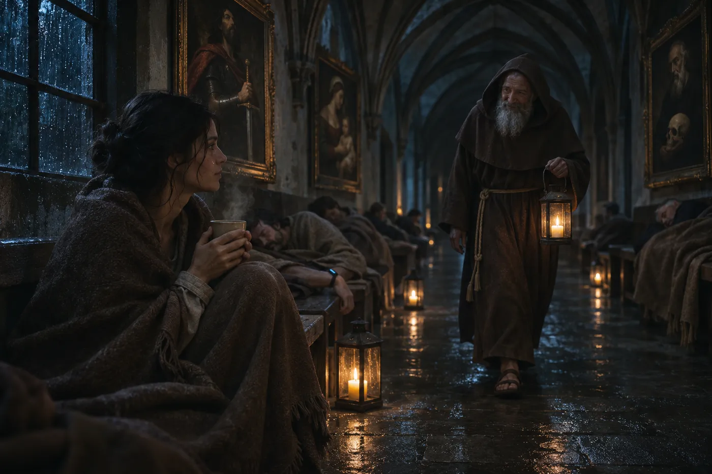

# 13. Kapucíni

*Brno, kapucínský klášter a krypta. Pátek 23. července 2077, 0:15–2:45.*

Ruce počítaly dál.

Nur seděla na lavici pod dekou, s hrnkem v dlaních, a cítila to v zápěstích. Nahoru a dolů. Malý pohyb, skoro žádný, jako když se na klíně houpe kočka. Dvacet tři, dvacet čtyři. Hrnek se jí v rukou chvěl a horký čaj z něj šplíchal na deku.

„Polož ho,“ řekla Mimi. „Na lavici vedle sebe. A ruce si dej pod stehna.“

Položila ho. Ruce si strčila pod stehna, na drsnou mokrou látku kraťasů, a sedla si na ně. Počítaly dál, ale teď je aspoň nikdo neviděl.

Chodba byla dlouhá a nízká a klenba nad ní vypadala jako žebra velké ryby. Na zdech visely obrazy, tmavé, se zlatými rámy, a svíčky v lucernách na zemi z nich dělaly něco, co se hýbalo. Muž s mečem. Žena s dítětem. Starý muž s lebkou v ruce, který se na Nur díval, jako by věděl, kde byla. Podél zdí seděli lidé z vlaku, zabalení do hnědých dek, a nikdo moc nemluvil. Pan Pohanka spal opřený o Libuši s otevřenou pusou a chrápal. Libuše se nehýbala, aby ho nevzbudila.

Sofie spala taky. Přitiskla se Nur k rameni a dýchala jí na krk, teple. Pan Pernica seděl u zdi naproti a díval se na Sofii. Kdykoli se Nur podívala jeho směrem, díval se pořád na Sofii. Asi se celou noc nepodíval na nic jiného.

Voněl tu vosk. A ještě něco, starého a suchého, jako papír v knihovně.

„Mimi.“

„Jsem tady.“

„Pořád to neseš?“

„Nesu. A teď už nejen já. Nesou to všechny nosiče tady v chodbě, protože jsem jim to musela dát, když jsme přišli. Pírko, Bas, Ťapka. Libuše. Pan Pernica. Všichni.“

„A můžou si to přečíst?“

„Nikdo z nás si to nesmí přečíst pro sebe. Jen to nést a předat.“

Nur se podívala na lidi pod dekami. Třicet lidí a v každém z nich, v náramku, ve sponě, v uchu, malý kousek toho muže z uzlu. Nevěděla, jestli je to hezké, nebo strašné.

„Pavel,“ řekla.

„Cože?“

„Jmenoval se Pavel. Ten pán s čelovkou na něj tak volal. Pavle.“

„Ano,“ řekla Mimi po chvíli. „Asi se tak jmenoval.“

*

Kolem půl jedné prošel chodbou mnich s dlouhými šedými vousy. Ten, co ji na náměstí vzal za ruku. Měl v jedné ruce kus papíru a v druhé tužku a u každého se zastavil a ptal se na jméno. Psal pomalu, velkým písmem, a když to jméno neznal, nechal si ho hláskovat.

„Pro rodiny,“ řekl, když došel k Nur. Sedl si na bobek, až mu zapraskalo v kolenou. „Máme vysílačku. Malou, na prohlídky krypty, abychom si dole mohli říct, kdo kde je. Zkusím z okna, jestli nás někdo uslyší. Asi ne. Ale zkusím to.“

„Nur Mansúrová,“ řekla Nur. „Mansúrová se píše s čárkou nad u.“

Mnich to napsal. S čárkou.

„A ty?“ Ukázal tužkou na Sofii.

„Sofie Pernicová. Spí.“

„Ať spí.“ Zapsal ji taky a pak pana Pernicu, který se představil sám, tiše, aby Sofii nevzbudil. Mnich se zvedl, opřený rukou o koleno. „Já jsem bratr Kosma. Kdybys něco potřebovala, řekni.“

Odešel chodbou a jeho sandály plácaly po kamení. Nur ho sledovala, dokud nezmizel za rohem.

„Na prohlídky krypty,“ řekla. „Mimi, co je krypta?“

„Sklep pod kostelem, kde jsou pohřbení lidi.“

„Tady?“

„Tady pod námi. Mniši a pár dalších. Jsou tam skoro tři sta let. Jsou to mumie, Nur. Vysušení. Je to jedna z nejznámějších věcí v Brně.“

Nur se podívala na podlahu. Byla z velkých kamenných desek, ohlazených tisíci nohama.

„Ty jsi to věděla celou dobu?“

„Věděla. Neřekla jsem ti to, protože jsi to nepotřebovala vědět.“

*

Bratr Kosma se vrátil v 0:38.

Ne pomalu jako předtím. Šel rychle, skoro běžel, sandály plácaly a vousy mu poskakovaly na prsou. Zastavil se před Nur a dýchal.

„Ty jsi Nur,“ řekl. „Nur Mansúrová.“

„Jo.“

„Někdo nás slyšel. Radioamatér z Líšně. Ptal se po tobě jménem.“ Bratr Kosma se usmíval tak, že mu oči zmizely ve vráskách. „Hledá tě babička.“

Nur se zamračila.

„Já nemám babičku.“

„Paní Kroupová,“ řekl bratr Kosma. „Z Lesné. Celou noc tě hledá.“

Nur na něj zírala.

Paní Kroupová. Která nemá nosič, protože ho nechce. Která sotva sleze ze sedmého patra. Která neumí poslat zprávu jinak než přes zeď. Hledala ji. Celou noc.

„To není babička,“ řekla Nur. Hlas se jí zlomil v půlce a ona ho nechala zlomený. „To je paní Kroupová.“

A pak brečela. Poprvé za celou noc. Ne kvůli vodě, ne kvůli tunelu a ne kvůli tomu muži dole. Kvůli tomu, že ji hledala paní Kroupová, a ona to nevěděla, a celou dobu to bylo pravda.

Sofie se probudila a nevěděla proč, a objala ji stejně. Pan Pernica vstal od zdi a pak si zase sedl. Bratr Kosma stál a čekal a nic neříkal.

„A táta?“ zeptala se Nur, když mohla.

„Ptali se po něm. Je v Tuřanech, že? Zkusí mu to dát vědět.“

„On to neví?“

„Zatím ne,“ řekl bratr Kosma. „Ale bude.“

Za pět minut se vrátil znovu, tentokrát s mladším mnichem, který nesl v náručí něco hnědého.

„Vzkaz od paní Kroupové,“ řekl bratr Kosma a tvářil se vážně, jako by předčítal z Bible. „Suché ponožky. Nenechat sedět na kameni. A nic studeného do pusy.“

Mladší mnich jí podal ponožky. Byly vlněné, hnědé, tlusté a obrovské. Když si je Nur natáhla, sahaly jí až ke kolenům a pata ponožky jí seděla kus nad kotníkem. Píchaly. Pod zadek jí bratr Kosma strčil pletenou podložku, jakou mají babičky na židlích, a jednu dal i Sofii.

Nur se smála. Slzy jí přitom tekly dál, ale smála se. Paní Kroupová byla někde na Lesné, v jiném domě, bez nosiče, a stejně jí tady oblékala ponožky.

„Vypadáš jak trpaslík,“ řekla Sofie.

„Ty taky.“

„No a?“

Mladší mnich odešel a bratr Kosma se otočil, že půjde za ním.

„Nur,“ řekla Mimi. „Teď už ti je teplo. Popros bratra Kosmu, ať zavolá policistu. Tu zprávu musím předat člověku osobně.“

Nur to řekla. Bratr Kosma se nic nevyptával, jen kývl a odešel ke dveřím na náměstí. Za chvíli byl zpátky, s mokrými rameny.

„Nikdo tam není,“ řekl. „Ten starší policista odešel na náměstí Svobody, prý kvůli nějakému zadrženému klukovi. Ten mladý zrovna slézal do poklopu s nějakým pánem v tmavé bundě. A ten s obvázanou rukou už u poklopu nesedí.“ Podrbal se ve vousech. „Pošlu to vysílačkou tomu pánovi do Líšně. Ten už bude vědět, komu to dát.“

„Děkuji,“ řekla Mimi.

*

Spát nešlo.

Nur zavřela oči a viděla červené světýlko. Otevřela je a viděla svíčky. Ruce už nepočítaly, ale kdykoli si na ně vzpomněla, začaly zase. Mimi jí pustila do ucha šum moře, tiše, a pak ho zase vypnula, protože Nur řekla, že to zní jako voda v tunelu.

Oskar seděl kousek od nich a taky nespal. Byl vysoký i vsedě a deku měl přes hlavu jako kapuci.

„Tady je ta krypta s mumiema, ne?“ řekl do tmy. Nikomu konkrétnímu. „Byli jsme tu ve čtvrtý třídě. Jedna holka omdlela.“

„Která?“ zeptala se jedna z holek s křídly. Křídla měla pořád na zádech, mokrá a pomačkaná, papírová.

„Nevím. Nějaká.“

„Já bych se chtěla podívat,“ řekla ta holka.

„Teď? Ty seš blázen.“

„Teď,“ řekla holka. „Stejně nikdo nespí.“

Bratr Kosma šel zrovna kolem s lucernou a zastavil se. Slyšel to. Podíval se na ně, na pět dětí pod dekami, a chvíli to vypadalo, že řekne ne.

„Pět minut,“ řekl potom. „Kdo se bojí, zůstane nahoře. A nikdo na nic nesahá.“

Nur nechtěla jít. Šla, protože šla Sofie.

Schody vedly dolů, úzké a strmé, a čím níž byli, tím byl vzduch chladnější. Ne vlhký jako v kolektoru. Suchý. Lucerna bratra Kosmy kreslila po stěnách žlutý kruh a ten kruh šel dolů s nimi.

„Proč tu není voda?“ zeptala se Nur. „Venku je všude.“

„Kostel stojí na kopci,“ řekl bratr Kosma. „A ti, kdo stavěli tuhle kryptu, udělali ve zdech průduchy. Vzduch tu pořád proudí. Proto je tu sucho. A proto se bratři, co tu leží, nerozpadli, jen vyschli. Nikdo je nebalzamoval. To udělal vzduch.“

Dole byla klenba ještě nižší než v chodbě. Oskar se nesehnul včas a bouchl se hlavou o kámen tak, že to zadunělo.

„Au. Do prdele.“

„Oskare,“ řekl bratr Kosma.

„Promiňte. Au.“

A pak je uviděli.

Leželi na zemi. Ne v rakvích. Přímo na zemi, vedle sebe, v hnědých hábitech s kápěmi, takových, jaký měl bratr Kosma, jen starých a tmavých. Ruce měli na prsou, v rukou růžence. Pod hlavou každý jednu cihlu. Obličeje měli hnědé a lesklé jako stará kůže na botách a natažené přes kosti, a pusy pootevřené, jako by se chtěli na něco zeptat.

Holka s křídly vypískla a schovala se Oskarovi za záda. Křídla se jí zachytila o rám dveří a jedno se s papírovým zašustěním utrhlo. Sofie chytila Nur za ruku tak silně, že to bolelo.

Nikdo se chvíli nehýbal.

„Mně upadlo křídlo,“ řekla holka zpoza Oskara nešťastně.

A Oskar se začal smát. Nejdřív potichu, pak víc, s rukou na hlavě, kde se bouchl. Pak se smála i Sofie, a ta holka bez jednoho křídla, a jejich smích se v klenbě rozléhal a vracel, jako by se smáli i ti dole na zemi. Bratr Kosma nic neříkal. Jen stál s lucernou a čekal, až to přejde, a v jeho vousech se lesklo světlo.

„Lidi se smějí, když se bojí,“ řekla Mimi Nur do ucha. „Je to normální. Mozek si tak pouští páru.“

Nur se nesmála. Dívala se na toho nejbližšího. Měl ruce složené na prsou, prsty hnědé a tenké, a mezi nimi dřevěné korálky. Ležel tu skoro tři sta let a nikdo po něm nechtěl, aby dýchal.

Nebála se ho. To bylo divné. Měla by se bát. Ale tenhle umřel a ležel tady, jak měl, s cihlou pod hlavou, a všichni, kdo kolem něj prošli, věděli, že je mrtvý, a nic po něm nechtěli. Ten muž v uzlu ležel ve vodě s otevřenýma očima a v uchu mu blikalo světýlko, které pořád volalo. Tohohle se nebála. Toho druhého ano.

Na zdi nad mnichy bylo něco napsané. Velká písmena, stará, a bratr Kosma na ně posvítil, když viděl, kam se dívá.

*CO JSTE VY, BYLI JSME I MY. CO JSME MY, BUDETE I VY.*

„To je strašný,“ řekla Sofie.

„To je pravda,“ řekl bratr Kosma. „To je něco jiného.“ Zvedl lucernu. „Pět minut. Nahoru.“

*

V 1:13 skoro spala.

Seděla na své pletené podložce opřená o zeď, Sofie na jejím rameni, ponožky až ke kolenům, a svíčky se jí rozmazávaly. Mimi mlčela. Někde v chodbě chrápal pan Pohanka. Někde venku za zdí ještě pršelo, ale už jinak. Tišeji.

Ucítila, že si někdo vedle ní klekl. Vousy. Vosk. Teplá ruka na rameni, lehce, aby se nelekla.

„Nur,“ zašeptal bratr Kosma. Skoro do ucha. „Od táty. Táta ví. Táta přijde ráno.“

Nur neotevřela oči. Nechala ta slova, ať jí jdou dovnitř, jedno po druhém.

„Jo,“ řekla. Nebo si myslela, že to řekla.

A pak spala.

*

„Nur.“

Mimi. Tiše, ale ne tak tiše, aby to šlo přeslechnout.

„Nur, vzbuď se. Přišla policistka. Ptá se po tobě.“

Nur otevřela oči. Svíčky dohořely do půlky. Sofie spala na jejím rameni s otevřenou pusou. Bylo 2:25.

„Znáš ji,“ řekla Mimi.

Chodbou šla stará paní. Šedé vlasy přilepené k čelu, mokrá bunda, kalhoty tmavé od vody až nad kolena. Šla pomalu a trochu kulhala a dívala se po lidech pod dekami, po každém zvlášť, jako by je počítala. V ruce držela malý sešit. Když došla k Nur, zastavila se.

Nur ji poznala dřív, než si vzpomněla odkud. Pak si vzpomněla. Lesná, kuchyň, táta s obvazem na zápěstí. Bylo jí devět a ta paní seděla u jejich stolu a paní Kroupová přinesla chleba. A loni zase, u paní Kroupové.

„Vy jste byla u nás,“ řekla Nur. „Loni u paní Kroupové. A poprvé, když mi bylo devět. Máte pistoli.“

Stará paní se na ni dívala. Koutky jí cukly.

„Mám,“ řekla.

„Pořád ji necháváte spát?“

„Pořád.“ Sedla si vedle ní na lavici, opatrně, kvůli kolenu. „Brožová. Jana. Pamatuješ si to?“

„Pamatuju si tu pistoli.“

„To stačí.“ Brožová sklopila oči k jejím ponožkám. K hnědé vlně až ke kolenům. „Paní Kroupová?“

„Jak to víte?“

„Někdo mi to řekl.“ Položila si sešit na koleno. „Jak ti je, Nur?“

Nur nevěděla, co na to říct. Ruce se jí pod stehny pohnuly.

„Dělala jsem mu masáž,“ řekla. „Tomu pánovi. Pavlovi.“

„Vím.“

„Nestihla jsem to.“

Brožová chvíli mlčela. Nedívala se na ni lítostivě. Dívala se na ni tak, jak se dívá táta, když mu Nur řekne něco, co je pravda, a on si to potřebuje promyslet.

„O tom ještě nevím nic,“ řekla potom. „A ty taky ne. Tak to zatím nechme.“

„Paní kapitánko,“ řekla Mimi. Nahlas, z náramku, tak, aby to slyšely obě. „Jsem Mimi, osobní asistentka Nur Mansúrové. Nesu nouzovou zprávu z nosiče muže, kterého jsme ve 23:40 našli v kolektoru v uzlu Kobližná. Jste policistka. Chcete ji převzít?“

„Chci. Za chvíli.“ Brožová se rozhlédla. Pan Pernica u zdi naproti usnul vsedě, s brýlemi na nose. Došla k němu a dotkla se jeho ramene. „Pane Pernico. Posaďte se k ní, prosím. Táta tu není, tak jste u ní za tátu vy.“

Pan Pernica zamrkal, nasadil si brýle rovně a přesedl si k Nur z druhé strany, vedle Sofie. Nic se neptal.

„Nur,“ řekla Brožová. „Nejdřív se tě na pár věcí zeptám. Na to, cos viděla ty. Nemusíš odpovídat.“

Neptala se jako policajti ve filmech. S pauzami, a pokaždé řekla, že Nur nemusí odpovídat.

Odkud přišli do uzlu. Od vlaku, zleva, kolem horkovodu. Kdo tam byl, když přišli. Nikdo, jen on. Kdo přišel potom.

„Pán s čelovkou,“ řekla Nur. „Voněl mátou. Jako vy.“

Brožová se skoro usmála.

„Odkud přišel?“

„Z druhý strany. Odkud jsme pak šli ven. Rovně a doprava, kolem Zelňáku, na Kapucínský.“ Nur si to vybavila celé, žluté světlo kývající se ve výšce hlavy. „Volal Pavle, ještě než tam byl. Pavle, kde seš.“

„Kolik bylo hodin?“

„Mimi?“

„23:50,“ řekla Mimi.

Zapsala si to a zeptala se na něco, co Nur nečekala.

„Ten klíč. Na schodu pod žebříkem. Sahal na něj někdo?“

„Ne. Sofie k němu postavila světlo. Bylo to jediný suchý místo.“

„Jediné suché místo,“ zopakovala Brožová. „Už když jste tam přišli?“

„Už když jsme přišli. Všude jinde byla voda.“

Brožová kývla a otočila v sešitě na prázdnou stránku.

„Teď ta zpráva,“ řekla.

„Bez sítě vás nemůžu ověřit,“ řekla Mimi. „Řekněte mi prosím jméno a služební číslo.“

Řekla je. Jméno, hodnost a dlouhé číslo, zpaměti, bez zaváhání.

„Nur,“ řekla Mimi. „Znáš ji?“

„Znám,“ řekla Nur. „Byla u nás.“

„Děkuju. Vaše jednotka bez sítě zprávu nepřijme. Přečtu vám ji nahlas a ukážu na displeji. Můžete si ji opsat. Vaše jednotka si mě nahraje. Nur, ta zpráva je pro paní kapitánku, ne pro tebe. Chceš, abych tě poslala pryč?“

„Nemusíš to slyšet,“ řekla Brožová.

„Já u něj byla,“ řekla Nur.

Brožová se na ni dívala ještě chvíli, potom na pana Pernicu. Pan Pernica pokrčil rameny, jako že to je na Nur. Nakonec kývla, olízla si palec a vzala do ruky tužku.

Náramek se rozsvítil. Na malém displeji běžely řádky, bílé na černé, a Mimi je četla. Hlasem, jakým četla nikdy nic. Rovným, pomalým, bez jediného zaváhání.

*NOUZOVÁ ZPRÁVA – PŘEDAT ZÁCHRANNÉ SLOŽCE.*

*Muž, 51 let.*

*23:13 násilné zranění hlavy, pravděpodobně úder. Bezvědomí.*

*23:31 zástava oběhu.*

*Poloha: kolektor, uzel Kobližná.*

*Na místě byla druhá osoba bez nosiče. Mužský hlas, uživateli známá, oslovena „Jirko“. Odešla 23:17 směrem k Benešově.*

*Nebezpečí pro záchranáře možné.*

Brožová psala písmeno po písmenu a Nur viděla, jak se tužka u jednoho slova zastavila. Úplně. Stála nad papírem, jako když Nur v písemce narazí na příklad, který už jednou počítala.

„Jirko,“ řekla Brožová. „Oslovena Jirko.“

„Ano,“ řekla Mimi. „Tak to v ní stojí.“

„A směr. K Benešově.“

„Směrem k Benešově. Ve 23:17.“

Napsala to a dvakrát podtrhla.

Nur seděla a ty řádky jí šly hlavou jako stanice ve vlaku. Čísla, která nic neznamenala. Uzel. Benešova. Jirko. Nevěděla, kdo je Jirko. Jedno slovo se jí ale zachytilo a nechtělo pustit.

„Úder,“ řekla. „Takže nespadl. Někdo ho praštil.“

Brožová zvedla hlavu od sešitu.

„To nevím,“ řekla. „Stojí tam *pravděpodobně*.“

„Ale je to tak.“

Neodpověděla. Nur si všimla, že neřekla ne.

*

Brožová psala dál. Nur se dívala na její tužku a na její ruku, starou, se žilkami, a myslela na paní Kroupovou. Na to, jak ji hledala celou noc a jak jí poslala ponožky. Na to, že jí musí vrátit utěrku. Po mámě. Utěrka byla pořád v kapse, mokrá a zmuchlaná, a paní Kroupová by ji takhle nechtěla.

Sáhla do kapsy kraťasů a vytáhla ji. Chtěla ji aspoň poskládat.

Z utěrky něco vypadlo. Malý bílý cár papíru, zmuchlaný do kuličky. Spadl jí na deku do klína a zůstal tam ležet.

Nur se na něj dívala.

Vzpomněla si. Ne najednou. Po kouscích. Čtrnácté stlačení. Něco bílého, co vyklouzlo z kapsy košile a začalo se točit na vodě a odplouvat. Její ruka, která to chytila a strčila do kapsy, protože věci se ve vodě nenechávají. Ani se na to nepodívala. Celou noc to tam leželo pod utěrkou a ona na to zapomněla.

„To mu vypadlo,“ řekla. „Z košile. Když jsem mačkala.“

Brožová se nepohnula. Sáhla do zadních desek sešitu a vytáhla tenkou gumovou rukavici. Natáhla si ji. Vzala papírek Nur z klína dvěma prsty a na koleni ho rozbalila.

Byl to štítek. Nalepovací, bílý, s černým tiskem, na jedné straně pomačkaný a na druhé ještě trochu lepkavý. Nur se nakláněla, aby viděla, a Brožová ji nechala.

*Akumulátory vyměněny 3/2076*

A pod tím menším písmem, propiskou, dopsáno rukou:

*převzal: J. K.*

Seděla a dívala se na to. Dlouho. Svíčka vedle nich zapraskala. Pan Pohanka v chodbě přestal chrápat a zase začal.

„Co to je?“ zeptala se Nur.

„Štítek,“ řekla kapitánka. Hlas měla úplně klidný. „Z baterie.“

Z desek sešitu vytáhla malou papírovou obálku. Štítek do ní vložila, obálku zavřela a napsala na ni tužkou čas: 2:38.

„Proč ne do sáčku?“ zeptala se Nur. Viděla v televizi sáčky. Průhledné.

„Je mokrý. V plastu by zplesnivěl. V papíru vyschne.“ Obálku vsunula mezi stránky sešitu, k zápisu z Mimi, sešit zavřela a otočila se k Nur celým tělem.

„Nur.“

„Jo?“

„Udělala jsi dneska v noci dvě věci správně. Mačkala jsi, když nikdo jiný nevěděl jak. A nenechala jsi tohle ve vodě.“ Natáhla ruku. Ne k objetí. Rovně, jako se podává ruka dospělému. „Děkuji vám.“

*Vám.* Nur si toho všimla. Nikdo jí nikdy neřekl vám. Jen paní učitelka ve škole, když se zlobila, a to bylo jiné.

Podala jí ruku. Kapitánka ji stiskla. Pevně, krátce, jednou.

„Táta přijde ráno,“ řekla.

„Já vím. Řekl mi to bratr Kosma. Do ucha.“

„Tak to víš.“ Brožová se zvedla z lavice, s rukou na koleni, úplně stejně jako předtím bratr Kosma. „Kdyby se tě na ten papír ptal kdokoli jiný, řekni, že ho má Brožová. Nikomu jinému nic. Ani když bude hodný.“

„Proč?“

Chvíli to vypadalo, že odpoví.

„Protože jsem to řekla,“ řekla nakonec.

*

Odešla chodbou ke dveřím. U dveří, venku pod stříškou, seděl na schodech někdo zabalený v hnědé dece. Nur ho viděla jen kouskem, mezi dveřmi a zárubní, ve světle lucerny. Široká záda. Mokré vlasy. Pak otočil hlavu ke kapitánce, do světla, a Nur ho poznala.

Ten pán s čelovkou. Jen čelovku teď neměl. Seděl tam venku u kláštera a nešel dál.

Brožová se u něj zastavila. Sklonila se a něco mu řekla. Pán s čelovkou zvedl hlavu. Chvíli se na ni díval a pak kývl a vstal a deku si nechal na ramenou. Šli spolu ven do tmy, do deště, ona napřed a on za ní, a dveře kláštera se za nimi zavřely.

Bylo 2:45.

Sofie se na jejím rameni pohnula a něco zamumlala ze spaní. Svíčky dohořívaly. Nur seděla v obrovských ponožkách na pletené podložce a utěrku paní Kroupové držela v klíně. Poskládala ji. Napůl, na čtvrt. Modré kostičky nahoru.

„Mimi,“ řekla potichu. „Dala jsi jí to?“

„Dala. Je převzatá. Ponesu ji dál, dokud nepřijde síť. Pak ji pošlu tam, kam patří, a smažu ji, až to bude smět.“

„Mimi.“

„Jsem tady.“

„Kdo je Jirko?“

Mimi chvíli mlčela. Venku za zdí kláštera stékala voda z kopce dolů a bylo to slyšet, jako když v noci teče kohoutek.

„Nevím,“ řekla Mimi. „Ví to paní kapitánka. Nebo to zjistí.“
