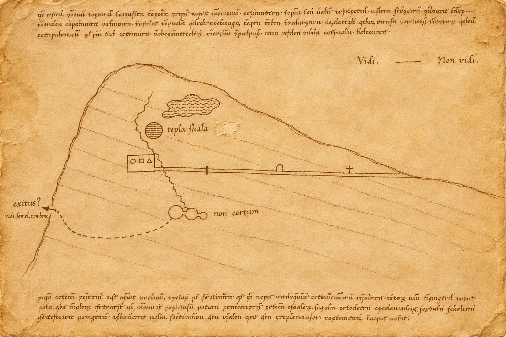

# Prolog. Archiv

Kodex ležel na pultu pod lampou, která nehřála.

Hana Vrbová si ho prohlížela dřív, než si sundala bundu. Byl menší, než čekala: zavřený sotva větší než dlaň, otevřený jako dvě dlaně vedle sebe, a desky z bukového dřeva byly potažené kůží, ze které zbyly jen ostrůvky. Na hřbetu, v místě, kde se vazba rozestoupila, prosvítalo něco, co do knihy nepatřilo: hrana krystalu, kalně průsvitná, a vedle ní zlatý lesk tenký jako nehet.

„Nesahejte,“ řekla kodikoložka, aniž by zvedla hlavu od protokolu. „Tedy, sahejte, ale v rukavicích. A na ten kámen vůbec.“

„Na kámen jsem tu já,“ řekla Hana.

Doktorka Šindelářová konečně vzhlédla. Byla o deset let starší, měla brýle posunuté do vlasů a druhé na nose a dívala se na Hanu tak, jak se v archivech dívají na lidi zvenčí: zdvořile a s pevným odhodláním nedovolit jim na nic sáhnout.

„Přišel s fondem fary v Mlýnci,“ řekla. „Tedy s tím, co z něj zbylo. Fara je tam až od novověku, kodex je o hodně starší. Farář ho v osmnáctém století popsal jako *liber de dracone*, knihu o drakovi, a od té doby ho skoro nikdo nečetl. V sedmdesátých letech ho nafotili na mikrofilm a uložili zpátky do krabice. Písmo je dvanácté století, spíš konec. Latina, místy něco jako staročeské glosy, to ještě nevíme. Kresby,“ zaváhala, „uvidíte sama. A ve vazbě je tohle. Někdo to tam všil úmyslně. Ne do desek, do hřbetu, mezi sešity. Restaurátorka by ráda věděla, co to je, než se rozhodne, jestli to vyjme.“

„A proč ne mineralog z muzea?“

„Protože mineralog z muzea je na dovolené do března a vy jste měla volný termín.“

Hana se nesmála. Volný termín měla proto, že jí v prosinci neprošel grant, a archiv platil za posudek částku, za kterou by jindy nehnula prstem. Pronajatý byt v Brně, splátka auta, laboratoř, která chtěla peníze za každé měření. Napíše jim to rychle a pořádně. Rychle a pořádně, opakovala si, jako by to šlo vždycky dohromady.

Natáhla rukavice. Lupa, světlo zboku, mikroskop s kamerou, který si přivezla v kufru. Krystal byl křemen, to poznala na první pohled, ale ne čistý: měl v sobě drobné jehličky, rezavé, a na jedné ploše bělavý povlak, který se pod lupou rozpadal do drobných zrnek. Zlatá šupina byla skutečné zlato, ne lístkové pozlátko, jaké se dávalo do iniciál. Byla silnější, nepravidelná, na okraji zvlněná, jako by ji někdo sloupl z valounu.

„Ten povlak,“ řekla Hana spíš sama sobě. „Vypadá to na sintr. Vysrážený z vody. Chtěla bych odebrat kousíček, opravdu nepatrný.“

„To musí schválit restaurátorka.“

„Tak ať to schválí.“

Doktorka Šindelářová si to zapsala a Hana mezitím, protože čekala a protože ji nikdo nezastavil, otočila první list.

Písmo bylo drobné a pravidelné, inkoust zhnědlý, okraje plné poznámek jiným, rychlejším písmem, ale zjevně téhož člověka. Latinu Hana četla špatně, jen to, co znala z geologických traktátů raného novověku. *Vidi. Non vidi.* Viděl jsem. Neviděl jsem. Na okraji jednoho listu stálo obojí vedle sebe a mezi tím byla čára.

Pak kresby.

První byla hora v řezu, jak ji kreslí geolog: vrstvy, puklina, chodba vedená šikmo dovnitř. Čáry byly nejisté, místy přetažené, ale ten řez byl řez. Někdo, kdo kreslil v dvanáctém století, chápal, že hora má vnitřek. U konce chodby, kousek nad ní, byl kruh šrafovaný vlnovkami. U něj stálo slovo, které Hana přečetla i bez latiny, protože ho tam kdosi připsal česky, starým pravopisem: *teplá skála*.

Druhá kresba zabírala celou dvoustranu. Dutina ve skále, nakreslená jako místnost, a v ní rozmístěné předměty. Kroužky, malé čtverce, trojúhelníky, každý tvar pečlivě označený: *aurum, crystallus, lapis*. Mezi nimi rýhy, krátké a dlouhé, ve skupinách. Nevypadalo to jako ornament ani jako mapa. Vypadalo to, jako by někdo hodinu za hodinou zapisoval, co leží kde, a bál se, že udělá chybu.

„Co to je?“ zeptala se Hana.

„Kdybych věděla, nepsala bych do protokolu *nejasné*.“ Kodikoložka se naklonila přes její rameno, opatrně, aby na list nedýchla. „Na fakultě by vám řekli: alegorie. Drak a jeho poklad, svatý Jiří, ctnosti a neřesti, každý kámen něco znamená. Já bych řekla, že ten člověk měl rád seznamy.“

Hana se dívala na rýhy. Někde v hlavě se jí ozvala vzdálená, nepříjemná myšlenka, že takhle by vypadal zápis z výkopu, kdyby výkop dělal mnich bez metru. Odsunula ji. Tohle nebyla její práce. Její prací byl kámen.

Na posledním listu, pod textem, byla malá kresba kosti. Ne celá kost, jen úlomek, a na něm značka: několik rovných čar a teček v pravidelné mřížce. Pod ní stála jediná věta a tu Hana nepřečetla, protože byla napsaná zkratkami, které neznala.

„A tohle?“

„*Hoc signum non est naturae*,“ přečetla Šindelářová. „Tohle znamení není z přírody.“ Pokrčila rameny. „Asi viděl na relikvii rytinu. Ve dvanáctém století se relikvie označovaly všelijak.“

Hana přikývla a otočila zpátky na řez horou. Teplá skála. Vlnovky. Puklina vedená šikmo dolů.

„Mlýnec,“ řekla. „To je kde přesně?“

„Na Chebsku. Pod horami, směrem na Karlovy Vary. Proč?“

„Protože tam teplá skála nikoho nepřekvapí,“ řekla Hana a cítila úlevu, že má vysvětlení. „Celá ta oblast je geologicky aktivní. Termální prameny, výrony oxidu uhličitého, zemětřesné roje. Ve středověku tam museli narážet na teplou vodu, kdykoli kopali studnu.“

„Takže žádný drak.“

„Žádný drak.“

Napsala to večer v hotelu do posudku. Křemen s inkluzemi oxidů železa a povlakem minerálního sintru, pravděpodobně z prostředí termálních vod; zlato ryzí, mechanicky oddělené z valounu; doporučila odebrat vzorek sintru k analýze izotopů, pokud to restaurátorka povolí. Kresby v kodexu, napsala, nejsou předmětem posudku. Pak, protože byla unavená a protože si to nikdo nepřečte, připsala na konec ještě jednu větu, kterou ráno smazala a pak zase vrátila:

*Autor kodexu, ať byl kdokoli, měl dobré oko pro horninu.*
