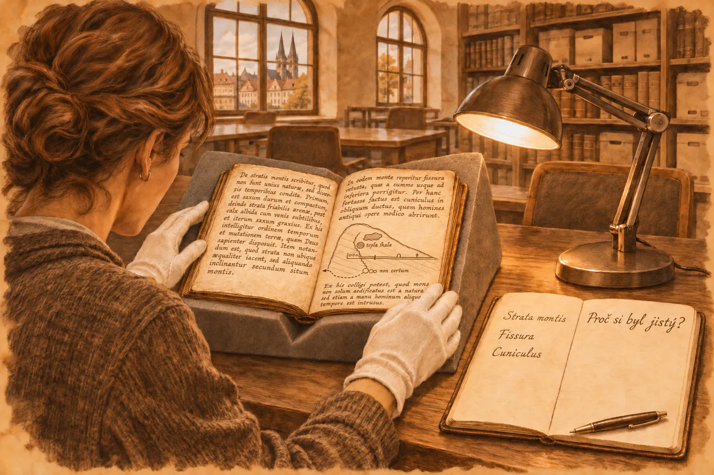

# Epilog II. Archiv

Kodex ležel na stejném pultu jako v lednu a lampa nad ním pořád nehřála.

Venku byl duben. Hana jela z Brna vlakem skoro šest hodin, s přestupem v Praze, protože v e-mailu stálo *výsledky přišly, restaurátorka by ráda rozhodla, co dál* a protože posudek, za který už dostala zaplaceno, nebyl hotový, dokud v něm chyběla čísla. Čísla měla v deskách pod paží. Izotopy uhlíku a kyslíku ze sintru, který z krystalu odebrali skalpelem. Bylo ho tak málo, že restaurátorka ještě teď kroutila hlavou, že to vůbec stačilo.

„Tak?“ řekla doktorka Šindelářová. Brýle měla tentokrát jen jedny.

„Hluboký uhlík,“ řekla Hana. „Ten povlak se vysrážel z vody, která nesla oxid uhličitý z velké hloubky. Z pláště. Stejnou izotopovou signaturu mají mofety kolem Chebu, Soos, Hartoušov. A ty jehličky v křemeni jsou oxidy železa, jaké rostou v hydrotermálních žilách.“ Položila desky na kraj pultu, daleko od kodexu. „Ten kámen je odsud. Z Oháreckého riftu. Z místa, kde z hloubky stoupá teplá voda a plyn. Přesněji to říct neumím.“

„A kde přesně?“

„To vám řekne jen on.“ Hana kývla ke kodexu. „Pokud to tam napsal.“

Šindelářová se poprvé, co ji Hana znala, usmála.

„Napsal,“ řekla. A podala jí složku. „Kolegyně z fakulty to přes zimu přepsala a přeložila. Pracovní verze. Nic necitujte.“

*

Hana četla v rukavicích, ačkoli držela jen papír. Kodex ležel vedle, otevřený, a ona se do něj dívala u každého odstavce, jako by si potřebovala ověřit, že překlad nelže.

První věta byla oslovení.

*Tobě, kdo přijdeš po mně a budeš to číst. Napsal jsem, co jsem viděl. A co jsem neviděl, zvlášť.*

„To je topos,“ řekla Šindelářová přes rameno. „Písaři se tak obraceli na čtenáře. *Lector*, ty, kdo čteš. A datuje se sám, sedmdesátý druhý.“

Hana nic neřekla. Četla dál.

Listina o relikvii, kterou autor prohlásil za podvrh, protože svědky psala jedna ruka a úvod byl opsaný i s chybou z řezenského formuláře. Slepý knihovník, který četl prsty. Mrtvá zvířata v prohlubni na slatině a svíčka, která zhasínala vždycky ve stejné výšce a ještě tři kroky za okrajem, jako by tam tekla voda, kterou nikdo nevidí. *Svíce to pozná dřív než člověk.* Hana se nad tou větou zastavila a cítila, jak se jí něco stáhlo v hrdle, protože to byla pravda, a protože to v roce 1172 někdo zjistil tak, že tam klečel. Hned pod tím, na samostatném řádku: *Můj dopis převorovi o drakovi byl mylný.*

Hana si nevzpomínala, kdy naposledy četla v odborném textu větu, ve které autor bez okolků píše, že se mýlil.

Pak štola. Kroky, kapky, vědra, měřené modlitbou. Skála, která byla teplá, ačkoli se v ní nepálilo. Chvění pod dlaní. Voda, která přibývala.

Hana to všechno znala. Hydrotermální fluida, která stoupají po zlomech a ohřívají horninu kolem sebe. Zemětřesné roje, které tu v západních Čechách přicházejí co pár let, tisíce otřesů tak slabých, že je člověk ucítí jen dlaní na skále. Štola, která se zakousne do nasyceného kolektoru, a voda pod tlakem, která si najde cestu. Tohle se stávalo všude, kde se kopalo. Tady to jen někdo zapsal.

Pak světlo.

Četla to dvakrát. Světlo uvnitř skály. Spousta světel jako hvězdy. Devět jich pomalu padá. Kraj shora, hory a voda. Oblé domy v rovných řadách. Jedno světlo, které přichází odjinud. Třikrát totéž. Světlo, které stoupá skrz skálu.

*Co to je, nevím.*

A pod tím, bez vysvětlení: *Viděl jsem tvář pana Konráda.*

„Kdo je Konrád?“

„Nevíme,“ řekla Šindelářová. „Ministeriálů toho jména bylo na Chebsku víc, než by člověk chtěl.“

Na stránce v kodexu, kde to stálo, bylo písmo jiné, menší, jako by se ruka bála.

Světelné jevy při zemětřesení jsou popsané. Málo a nespolehlivě; o mechanismu se vede spor – piezoelektřina v křemeni, uvolňování náboje v namáhané hornině. A k tomu nevětraná štola, ve které se drží oxid uhličitý u dna, horko, strach, kahan. Lidé v takovém vzduchu vidí věci. Hana to věděla. Věděla to tak dobře, že ji to skoro uklidnilo.

Byla to pravda. Všechno, co si teď myslela, bylo pravda.

Jen ten člověk, který tam klečel a měl na to o sto důvodů víc než ona, napsal *nevím*.

*

Dvoustranu s dutinou otevřela teprve teď, s překladem vedle.

Kosti těžké jako kámen. Lebka dlouhá jako předloktí. Vrstvy hlíny, stovky vrstev, tenkých jako list. Bílá krusta na krystalech. *Byli. Nejsou.* U toho odstavce stálo na okraji *vidi* a *non vidi* a mezi nimi ta čára, kterou viděla v lednu. Kosti viděl. Draka neviděl. Čára mezi tím, co je v zemi, a tím, co si o tom vypráví ves.

Fosilní lokalita, pomyslela si Hana. Chebská pánev je plná třetihorních jílů a v jílech leží kdeco. A zároveň už neměla sílu tu druhou myšlenku odsouvat, tu z ledna. Tohle byl zápis z výkopu. Mřížka natažená provazem, osm na pět loktů. Značky pro typy nálezů. *Sic* u rozdvojené rýhy, aby si nikdo nemyslel, že se přepsal. Ona sama psala *sic* do terénního deníku. Naučil ji to první vedoucí na exkurzi v Krkonoších, starý pán, který kouřil dýmku a měl deník rozdělený svislou čarou na dvě půlky: vlevo, co vidíš, vpravo, co si myslíš. *A nikdy to nepleť dohromady, děvče, nebo budeš psát romány.*

A pak ty křížky.

Většina byla označená jen křížkem: *vybráno*, psala kolegyně do poznámky. Ale sedm jich mělo vedle sebe dvě drobná slova. *A me.*

Ode mne.

Hana se na ně dívala dlouho. Ten člověk zdokumentoval, co z naleziště vzal on sám. Vlastní rukou zapsal vlastní zásah. Kolik lidí to dělá, napadlo ji. Kolik lidí, které zná, s doktoráty, s granty, s laboratořemi.

Pod mřížkou, malým písmem: *Tuto dutinu prorazil Ješek, můj bratr.*

„Je tam i jméno,“ řekla Hana.

„Jediné jméno v celé knize, které má u sebe *můj*,“ řekla Šindelářová. „Kolegyně si toho všimla.“

*

„Pergamen,“ řekla Šindelářová, když Hana dočetla, a otočila kodex hřbetem k lampě. „Restaurátorka vám to chtěla říct sama, ale musela odjet. Je špatný. Tlustý, nerovný, jehněčí, nedorobený. Jeden list má díru a text ji obtéká. Tohle nedělal klášter. Kromě jednoho sešitu uprostřed, ten je klášterní, lepší, s kresbami. Zbytek si udělal sám.“ Ukázala tužkou, aniž by se dotkla, do rozestouplého hřbetu. „A pod tím krystalem je látka. Hrubé vlněné sukno, šedé. Z oděvu, nejspíš. Někdo to tam přilepil, aby se kůže nedřela o kámen.“

Hana se dívala na tu šedou nitku vedle hrany krystalu. Nevěděla, čí to byl oděv. Nevěděla, proč by ho kdo stříhal kvůli knize.

„Restaurátorka se rozhodla,“ řekla Šindelářová. „Nebude to vyjímat. Patří to tam.“

„Patří,“ řekla Hana.

Ještě jedno slovo jí zbývalo, a ještě jedna věta.

To slovo stálo na okraji vedle *vyšli jsme*, samo, bez ničeho dalšího. *Tacui.* Mlčel jsem.

„O čem?“

„To nenapsal,“ řekla Šindelářová. „Proto se tomu říká mlčet.“

A ta věta byla na posledním listu, pod kresbou úlomku kosti s mřížkou čar a teček. *Tohle znamení není z přírody.* Hana ji četla v lednu a nevěnovala jí pozornost. Teď si všimla okraje. Vedle každé věci v celé knize něco stálo, *viděl jsem*, *neviděl jsem*, *slyšel jsem*, *vzal jsem*, *řekl jsem*. Vedle téhle nestálo nic.

Člověk, který o světle v hoře napsal *nevím*, tady nenapsal ani *viděl jsem*. Napsal to, jako se píše, kolik je dva a dva.

„Ta kost,“ řekla Hana. „Je ve fondu?“

„Ne.“ Šindelářová zavřela desky kodexu, pomalu, a položila na ně dlaň. „Inventář z osmnáctého století uvádí jen knihu. Kost nikde. Možná se ztratila dřív. Možná ji někdo vzal. Možná je pořád někde, kde ji nikdo nehledá.“

*

Kodex odnesla do depozitáře Šindelářová sama. Hana šla s ní až ke dveřím, dál nesměla. Krabice z nekyselé lepenky, štítek, signatura. Za dveřmi regály až ke stropu a ticho, jaké mají jen archivy a kostely.

Doplněk posudku napsala ve vlaku. Křemen s inkluzemi oxidů železa, sintr vysrážený z vod s uhlíkem hlubokého původu, provenience v oblasti Oháreckého riftu vysoce pravděpodobná. Doporučila datovat sintr metodou uran-thorium, pokud se najdou prostředky. Věděla, že se nenajdou.

Pak zavřela notebook a vytáhla z batohu terénní deník, ten, který vozila všude, i když už roky nebyla v terénu. Otevřela ho na čisté straně a udělala svislou čáru, od horního okraje k dolnímu.

Vlevo napsala: *teplá skála – hydrotermy. Mrtvá zvířata – CO₂. Světlo – zemětřesné jevy? hypoxie? Krystal – rift.*

Všechno to byla pravda. Všechno to uměla vysvětlit.

Vpravo napsala jen: *Proč si byl jistý?*

Dívala se na to, zatímco za oknem ubíhaly kopce, a pak deník zavřela a dlouho se nedívala nikam.
