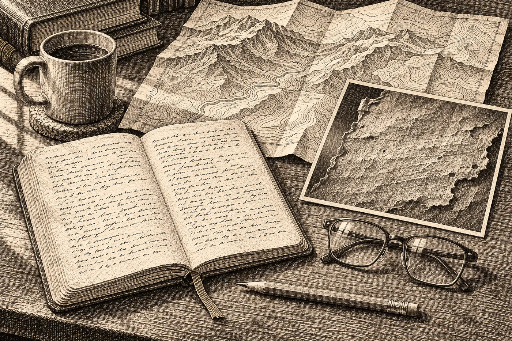

# Epilog II. Rub

V srpnu bylo v bytě takové horko, že Hana pracovala v noci s otevřeným oknem a s mokrým ručníkem přes opěradlo židle. Dole na ulici hrál někdo z otevřeného auta pořád tutéž písničku, odjížděl a vracel se. Hana přestala slyšet slova a slyšela jen basu, jako tlukot, který procházel zdí.

E-mail přišel ve středu odpoledne. Bez pozdravu, jako všechny.

*Kolega z toho druhého archivu dostal od restaurátorky výjimku. Šest listů z lékárníkovy knihy (šestý je menší, jiný papír, přeložený) nafotili znovu, obě strany, v bočním světle, protože si restaurátorka při kontrole stavu všimla něčeho na rubu. Posílám. Nic necitujte. UV nedovolí, originál je křehký. — L. Š.*

*P. S. Wehrl. Kolega na něj narazil v jiném fondu, jen tak, při něčem jiném. Zemřel v únoru 1596. Víc nic.*

Hana si přečetla postskriptum dvakrát, i když nečekala, že jí bude něco říkat. A neříkalo jí nic. Únor 1596. Necelý rok po soudu. Horní úředník, jeden z mnoha. Zavřela e-mail a otevřela přílohu.

*

Dvanáct snímků. Šest listů, každý dvakrát.

Líce znala ze skenu, který měla od června ve složce *Mlýnec*. Hustá kupecká ruka, sloupce čísel, německé zkratky, které Šindelářová v regestu přeložila jen zčásti. *Bad. Oben.* Lázeň, nahoře. Jména žen, u nich krejcary. Na jednom listu řádek, který Šindelářová v přepisu podtrhla a připsala k němu tři otazníky: *Merc. 24. Mai. … frisch.* Středa, čtyřiadvacátého května. Čerstvá.

Ruby neznala. V prvním skenu nebyly. Nikdo je nenafotil, protože na nich nic nebylo.

Teď je otevírala jeden po druhém.

Šestý rub byl prázdný. Bílý, hladký papír, s vodoznakem prosvítajícím šedě, s ohybem uprostřed, kde byl list kdysi přeložený. Na tom nikdy nic nebylo.

Prvních pět bylo jiných.

*

Hana zvětšila první.

V bočním světle vypadal papír jako krajina z letadla. Šedý, zdrsnělý, a přes celou plochu šly rovnoběžné rýhy, husté, jemné, všechny stejným směrem, šikmo, jako by po papíře někdo táhl hřeben. Na okrajích se rýhy zastavovaly čistě, kousek od hrany, tam, kde by končily řádky. Uprostřed byl papír tenčí. Na jednom místě, na pátém listu, tak tenký, že přes něj v bočním světle prosvítal líc, obráceně, zrcadlově, jako písmo viděné ze zadní strany okna.

Rasura. Věděla, co to je, i když nebyla kodikoložka. Viděla to ve vitrínách a na přednáškách, na pergamenu, ze kterého někdo seškrábal starý text, aby mohl psát nový. Na papíře je to vzácnější, protože papír to nesnese: ztenčí se a roztřepí. Kdo to dělá, musí vědět jak. Tady to někdo věděl. Ostrou čepelí, naplocho, tahem a ne řezem, a pak to ještě něčím uhladil, protože okraje rýh nebyly roztřepené.

Pět stran. Celých. Každá od horního okraje k dolnímu.

Hana se opřela v židli.

Na pěti listech, na kterých stálo, kdo umřel a kolik se za to platilo, byla na druhé straně jiná věc. A ta věc byla pryč. Ne přeškrtnutá. Ne začerněná. Pryč, s vláknem papíru, jak se odebírá vrstva, když se kope, a pak už se nikdy nedá vrátit, co v ní leželo.

*

Hana napsala Šindelářové. Rychle, s chybou v prvním slově, kterou opravila.

*Kdo to seškrábal? Lékárník? Je o tom něco ve spisu?*

Odpověď přišla za čtvrt hodiny. Šindelářová byla zjevně taky vzhůru, i ona měla horko.

*Ve spisu je jedna věta. Ve výslechu svědkyně (vdovy Ilony), přepisuju z pracovního přepisu kolegy: „Gefragt, was auf der anderen Seite gestanden, sagt sie: Es waren andere Dinge als die Morde. Die habe ich nicht aufgeschrieben.“ Tázána, co stálo na druhé straně, říká: Byly tam jiné věci než vraždy. Ty jsem nezapsala. Pak: kdo to seškrábal – ona. Pak soud říká, že co je na rubu, nesoudí. A dál nic.*

*P. P. S. Ano, je to tatáž formulace. Taky mě to napadlo.*

*

Hana seděla nad tou větou dlouho.

*Ty jsem nezapsala.*

Otevřela znovu sken z června. Desátá výpověď, hnědá skvrna přes jméno, a dole, o řádek níž, než by měl být:

*Víc jsem nezapsala.*

Tatáž ruka, drobná a rovná. Tatáž žena, která desetkrát dokládala, kde svědkyně přestala mluvit, a dvakrát, kde přestala psát ona. Jednou v cizí výpovědi. Jednou u soudu, nahlas, pod přísahou, o cizí knize, ze které sama vyškrábala pět stran.

A soud se nezeptal dál.

Hana si to přečetla ještě jednou, v němčině, protože chtěla slyšet, jak to znělo. *Die habe ich nicht aufgeschrieben.* Pak si uvědomila, že to tak neznělo. Že tohle je písař, který to po ní zapsal. Ona mluvila nejspíš česky, nebo tou němčinou, jakou se mluvilo v horách. A že mezi tím, co řekla, a tím, co tu stojí, je další ruka. Další opis.

Jako všude.

*

Vstala a šla k oknu. Dole odjíždělo auto s písničkou a tentokrát se nevrátilo.

Pak šla do předsíně a z batohu vytáhla terénní deník.

Ten, který tam ležel od dubna. Od vlaku z Chebu, kdy si na čistou stranu udělala svislou čáru a vlevo napsala, co umí vysvětlit, a vpravo jednu otázku. Od června ho nevytáhla, ani když jí přišel sken a ona si otázku napsala do mobilu. Batoh byl v předsíni a ona byla unavená. A taky, to si přiznala až teď, s deníkem v ruce, nechtěla tu otázku napsat vedle té první.

Otevřela ho na dvoustraně z dubna. *Proč si byl jistý?*

Neotočila list. Novou čáru udělala na protější straně té dubnové dvoustrany, která zůstala volná.

*

Vlevo psala, co ví.

*Mlýnec (u Chebu), 1172. Kodex, autor mnich, kategorie vidi / non vidi. Okrajové „tacui“ u „exivimus“. 7× „a me“.*

*Jáchymov, 1595. Spis horního soudu. Vdova Ilona: 11 výpovědí, formule „Víc neřekla“. 10. výpověď: „Víc jsem nezapsala“. U soudu: „Ty jsem nezapsala.“ 6 listů z lékárníkovy knihy, 5 se seškrábaným rubem (celé strany, odborně). Kniha jmen nenalezena.*

Pak, protože byla geoarcheoložka a protože jiný reflex neměla, otevřela na notebooku mapu. Vedle sebe dvě značky. Jednu dala do Mlýnce v dubnu. Druhou dávala teď, do Jáchymova, na úpatí hor, do údolí, které se na satelitním snímku propadalo mezi lesy jako rýha po prstu v těstě.

Pár desítek kilometrů. To věděla.

Stejný kraj. To věděla taky, jen si to neřekla nahlas. Karlovarský kraj, dnes. Tehdy něco jiného, Chebsko a Loket a horní města, ale tatáž krajina. Jedno místo na západním konci té dlouhé propadliny pod Krušnými horami, kde z hloubky stoupá plyn a teplá voda. Druhé na jejím severním okraji, ve svahu, kde se kopalo stříbro a později jiné věci a kde dodnes léčí vodou, která vyvěrá z hloubky.

Hana se na ty dvě tečky dívala a věděla přesně, co by jí řekl starý pán s dýmkou. *Dvě tečky na mapě, děvče, jsou dvě tečky. Čára mezi nimi je tvoje.*

Na mapě žádnou čáru neudělala.

Do deníku vlevo připsala jen: *Obě místa: tentýž kraj, tentýž geologický celek (Ohárecký rift a jeho okraj). 423 let od sebe.*

Všechno to byla pravda.

*

Vpravo dlouho nic.

Pak napsala:

*Co bylo na rubu?*

A pod to, po chvíli, menším písmem:

*Proč by svědkyně ničila vlastní důkaz – a pak to u soudu přiznala?*

Dívala se na to. Byla to dobrá otázka. Byla to otázka, kterou by položila studentovi, kdyby jí přinesl tenhle spis. Student by odpověděl, že vdova kryla někoho, kdo byl na rubu. Ona by mu řekla, že to je hypotéza a že ji nemá čím doložit, protože rub je pryč. A student by pokrčil rameny a měl by pravdu, že to jinak nejde.

Pod to napsala ještě jednu věc. Tu, kterou nechtěla psát vedle té dubnové, a teď ji napsala hned pod ni, na sousední stranu, aby byly vidět obě, když se deník otevře.

*Proč dvakrát tady?*

*

Pak seděla a dívala se na dvoustranu, na které byly teď tři otázky a jedna svislá čára, a vlevo od ní řádky, které uměla doložit, a vpravo řádky, které neuměla.

Vpravo bylo víc místa. Vždycky bývá.

Napadla ji Šindelářová, jak v dubnu zavírala kodex a pokládala na něj dlaň, a jak řekla *to nenapsal, proto se tomu říká mlčet*. A napadla ji ta druhá žena, jejíž jméno ve spisu nikdo nehledal, protože v matrikách nebylo. Na rubu pěti listů nenechala ani písmeno, a pak u soudu řekla nahlas, že tam něco bylo.

Mohla mlčet. Mohla říct, že to tak našla. Nikdo by se nedozvěděl, že rub nebyl vždycky prázdný.

Řekla to. A nechala si to zapsat.

Jako by někomu, kdo to bude číst po ní, chtěla říct: tady něco chybí. A chybí to, protože jsem to tak chtěla.

Hana na to myslela už v červnu, nad desátou výpovědí. Teď to věděla o něco jistěji a rozuměla tomu o nic víc.

*

Deník zavřela. Nedala ho zpátky do batohu. Položila ho na stůl vedle notebooku, kde bude ráno, až si půjde uvařit kafe, a kde ho uvidí.

Na snímku na obrazovce byl pořád pátý rub. Šedý, zvrásněný, jako pole po bráně. A uprostřed to tenké místo, kde přes papír prosvítal líc, obráceně, zrcadlově, slova psaná na druhé straně, která se dala přečíst jen proti světlu a jen pozpátku.

Hana se k nim naklonila. Kupecká ruka, sloupce, krejcary. Nic, co by nevěděla.

Na tom tenkém místě, kde byl papír skoro průhledný, kde britva přitlačila nejvíc, nebylo na líci nic zvláštního. Jen obyčejný řádek o lázni.

Pak ji napadlo, že to tenké místo nesouvisí s lícem. Souvisí s rubem. Že tam někdo přitlačil, protože tam bylo něco, co muselo zmizet nejvíc.

Hana si to nezapsala vlevo. Byl to dohad, a dohady se píšou doprava.

Napsala ho tam. Bez otazníku. Pak se na to podívala a otazník připsala.
