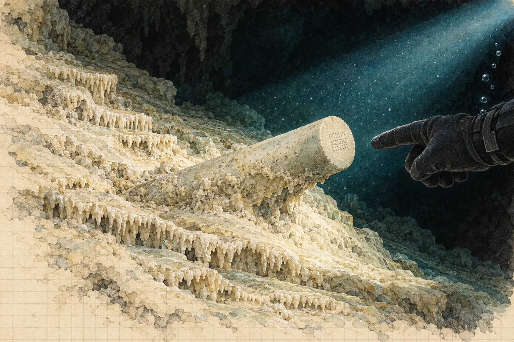

# Prolog. Studna

V lednu zamrzal byt odspodu. Nejdřív práh balkonových dveří, pak spára pod oknem, pak sklo v rozích, kde se mráz držel jako plíseň. Radiátor tikal a nehřál. Hana seděla u kuchyňského stolu ve svetru a ve dvojích ponožkách a psala posudek na archeologický dohled u obchvatu Ivančic. Tři sondy, dvě negativní, jedna s keramikou, kterou stavebník nechal zavézt dřív, než přijel archeolog. Psala to slušně. Věděla, že to nikdo nebude číst.

Od září měla na fakultě poloviční úvazek na dva roky. Poloviční úvazek znamenal celou výuku, polovinu výplaty a posudky, které docent Fiala rozděloval na poradách se slovy *to je přece vaše parketa*. Grant v prosinci zase neprošel. Tentokrát s hodnocením *velmi dobrý*, což je v jazyce grantových agentur nejzdvořilejší způsob, jak říct ne.

Telefon na stole zabzučel ve čtvrt na deset.

Viktor. Žádný text, jen soubor. Video, čtyřicet vteřin.

Hned za ním zpráva: *Pusť si to se zvukem. A sedni si.*

Hana si nesedla, protože už seděla. Pustila si to.

*

Nejdřív jen dech. Automat, nádech, dlouhý výdech a bublinky, které cvakaly kolem mikrofonu jako drobné kamínky v plechovce. Tma. Pak světlo baterky, úzký kužel, a v něm bílá.

Sintr. Poznala to dřív, než si to stihla pojmenovat. Sintrová poleva, krémová, zvlněná do teras, jako by se po svahu kdysi rozlilo mléko a ztuhlo v pohybu. Na okrajích teras drobné zuby krystalů. Voda byla tak čirá, že ji neviděla. Viděla jen, že se světlo nikde neodráží, že padá do prázdna a končí, až když narazí na kámen.

Kužel se posunul doleva a zastavil se.

Z polevy vystupovalo něco bledého. Válec, dlouhý asi jako předloktí, možná víc, zapuštěný šikmo do sintru jako kost do hlíny v profilu. Byl hladký. Hana neviděla žádný šev, žádnou spáru, nic, kde by se dvě části potkaly. Barvu na displeji telefonu nepoznala: šedobílá, pod světlem trochu dozelena, ale to mohl být čip kamery.

Ruka v rukavici vjela do záběru a ukázala na konec válce. Kužel se tam přesunul. Kamera zaostřila, rozostřila a zase zaostřila.

Na čele válce byly značky. Ryté, drobné, z rovných čar a teček, sestavené do pole, které vypadalo jako mřížka. Tři vteřiny ostré. Pak se záběr zachvěl, někdo vydechl, bublinky zacvakaly, světlo uhnulo a video skončilo.

Hana se dívala na černý displej.

Pustila si ho znovu.

*

Napočtvrté ho zastavila ve třicáté první vteřině, kde byl obraz nejostřejší, a zvětšila ho prsty, až se rozpadl na čtverečky.

Žádné měřítko. Samozřejmě.

Válec tedy mohl mít čtyřicet centimetrů, nebo devadesát. Značky mohly být hluboké milimetr, nebo deset. Ale jedna věc se zvětšením nezměnila a ta byla na tom videu nejdůležitější, víc než značky. Válec neležel na sintru. Ležel v něm. Poleva k němu dotekla, obtekla ho zespodu a z boku a na horní straně se ztenčila do povlaku, přes který jeho povrch prosvítal. Ten předmět tam ležel dřív, než ho voda začala obrůstat kamenem.

A ta voda nebyla ta, ve které se na videu vznášel Viktor. Sintr se pod vodou netvoří. Roste na vzduchu, z kapek a stružek, které stékají po skále do suché jeskyně. Když byla teď všude kolem voda, znamenalo to, že jeskyně bývala suchá a zatopila se později. A předmět v ní ležel už předtím.

Jak dlouho předtím, to z videa nikdo nepozná. Jak dlouho je ta jeskyně pod vodou, to by se dalo zjistit. Na to je datování uranem a thoriem.

Hana položila telefon na posudek, displejem dolů, jako by ho chtěla zakrýt.

Telefon za minutu zabzučel znovu. Tentokrát volal.

*

„Tak co?“ řekl Viktor. Bez pozdravu, jako vždycky, když byl nadšený. V pozadí byl slyšet vítr a nějaký pták, který neuměl mlčet. U něj byl den.

„Kde to je?“

„Yucatán. Vnitrozemí, dvě hodiny od Méridy. Cenote na pozemku jedné obce, nikdo tam nejezdí, žádní turisti. Boční síň pod haloklinou, třicet metrů, za zúžením, kterým by ses protáhla tak akorát.“ Odmlčel se. „Luis ji našel. Místní kluk, teda chlap, je mu třicet tři. Nejlepší jeskyňář, jakého jsem kdy viděl ve vodě, a to jsem viděl lidi v Hranicích.“

„Co to je, Viktore?“

„To se ptám já tebe.“

„Je to v sintrové polevě,“ řekla. „Zarostlé zespodu. Leželo to tam, když byla jeskyně suchá.“

„Já to věděl.“ Slyšela, jak se usmívá. Patnáct let ten úsměv slyšela v telefonu. Poprvé v Moravském krasu, když jí v Býčí skále podal ruku z vody a řekl *vy jste ta geoložka, co nám řekne, kudy dál*, a ona mu řekla, že tudy ne, a měla pravdu. Pak Hranická propast, tři sezony, jeho kamery, její vzorky a jeho dokument, ve kterém ji nazval *naše paní Země* a ona se tři dny nemohla podívat do zrcadla. „Proto volám. Potřebuju geoarcheoložku.“

„Máš tam INAH.“

„Mám povolení od INAH. Na dokumentaci. Natočit, změřit, nafotit, vzít pár gramů sintru na datování, a nic víc. Nic se nevyzvedává. Paní z INAH je na to jako pes, a dobře dělá.“ Nadechl se. „Proto potřebuju tebe. Někoho, kdo umí kámen a kdo nebude chtít nic vytahovat.“

„Kdo to platí?“

„Sponzor. Americká produkce, dokumenty pro jednu velkou platformu. Mají rádi záhady a ještě radši mají, když je záhada pořádně podložená. Zaplatí laboratoř na uran-thorium. Rychlou. A CT, kdyby bylo potřeba.“ Krátká pauza. „A zaplatí tebe. Normálně, Hanko. Ne za kafe a ne za jméno v titulcích. Šest týdnů, odlet na začátku března.“

Hana neřekla nic. Na stole ležel posudek z Ivančic a pod ním obálka od pronajímatele s novou zálohou na topení, kterou ještě neotevřela, protože věděla, co v ní je.

„Hranice,“ řekl Viktor. Už se neusmíval, jen mluvil tiše. „Pamatuješ, co jsi mi tam řekla? Ten první rok, když jsme se pohádali kvůli té zprávě pro kraj?“

„Že ti nebudu psát, co chceš slyšet.“

„Že mi řekneš, že je to kámen, když je to kámen.“

„A když to kámen nebude?“

„Tak mi řekneš i tohle.“ Vítr v pozadí zesílil a zase utichl. „Tentokrát to bude jinak, Hanko. Tentokrát to někdo zaplatí.“

„Zítra,“ řekla Hana.

„Zítra,“ řekl Viktor, jako by to bylo ano.

*

Složka *Mlýnec* stála na poličce nad lednicí mezi kuchařkou, kterou nikdy neotevřela, a krabicí s náhradními žárovkami. Byla to papírová složka, modrá, s gumičkou. Založila si ji v srpnu podle té v počítači, protože do papíru se dá psát tužkou a papír se dá položit vedle čehokoli jiného.

Uvnitř byl její posudek ke krystalu, doplněk z dubna, vytištěný regest jáchymovského spisu. A pracovní překlad kodexu, který jí Šindelářová nakonec v létě poslala poštou. Kancelářská sponka a lístek, napsaný rukou: *Nic necitujte. Ani mně.*

Na posledním listu výtisku byl černobílý náhled, jaký archiv přikládá k objednávkám reprodukcí. Malý, zrnitý, sotva větší než pohlednice. Poslední list kodexu. Text, pod ním kresba úlomku kosti a na úlomku značka. Rovné čáry a tečky v pravidelné mřížce. Pod tím věta, kterou Hana znala nazpaměť, i když latinu četla špatně.

*Hoc signum non est naturae.*

Položila telefon vedle náhledu. Zastavené video, třicátá první vteřina.

Dívala se dlouho.

Rovné čáry. Tečky. Pole, které mělo řádky. Na kosti byly čáry svislé a tečky mezi nimi, na válci byly čáry, tečky a ještě něco, co mohla být kratší čára, nebo stín. Náhled byl moc malý, aby spočítala tečky. Video bylo moc rozmazané, aby spočítala cokoli.

Podobnost byla zarážející.

A nic nedokazovala. Hana to věděla tak přesně, že se jí z toho skoro ulevilo. Rovná čára a tečka jsou nejjednodušší znamení, jaká lidská ruka udělá. Najdou se na kostech z mladého paleolitu, na kalendářních hůlkách, na hrncích, na dveřích stodol a na kamenech, které nikdo neryl, protože je tak poškrábal led. Člověk, který chce vidět podobnost, ji vidí. O tom jsou celé police knih. Stojí v antikvariátech v oddělení, kam ona nechodila.

Šindelářová tehdy řekla: *Asi viděl na relikvii rytinu.* A mnich, který ke všemu v knize připsal, jestli to viděl, nebo neviděl, k té kosti nepřipsal nic. Napsal tu větu, jako se píše, kolik je dva a dva.

Hana zavřela složku a zase ji otevřela, protože náhled chtěla mít před sebou, až bude psát.

*

Terénní deník ležel od srpna na stole, kde ho nechala. Obal měl ohlazený a jeden roh rozmočený od hrnku. Otevřela ho na čisté dvoustraně a vedla svislou čáru shora dolů, pravítkem, protože tahle čára měla být rovná.

Vlevo psala, co vidí.

*15. 1. 2026. Video V. B., 40 s, cenote, Yucatán, boční síň, hl. ~30 m (podle V. B.). Předmět válcovitý, bledý, bez viditelného švu, zapuštěný do sintrové polevy; poleva ho obrůstá zespodu a z boku. Na čele pole rytých značek: rovné čáry, tečky. Bez měřítka. Rozlišení nedostatečné.*

Pak, pod to, menším písmem, protože i tohle bylo pozorování:

*Sintr = vznik na vzduchu. Síň byla suchá, když tam předmět už ležel.*

Vpravo dlouho nic.

Venku přejela tramvaj a sklo v okně se jemně zachvělo. Hana se podívala na náhled, na telefon a zase na náhled.

Pak napsala doprava:

*Tatáž mřížka jako kost z Mlýnce?*

Podívala se na otazník. Nechala ho tam.

*

Viktorovi napsala ve tři čtvrtě na jedenáct. Jedno slovo.

*Ano.*

Telefon nechala ležet a vrátila se k posudku z Ivančic, protože ten musel být v pátek u Fialy a protože jí to pomáhalo myslet na sondy, ve kterých nic není. Napsala dva odstavce. Vzala telefon znovu a připsala druhou zprávu.

*A příště dej do záběru měřítko.*

Odpověď přišla hned, jako by Viktor držel telefon v ruce a čekal.

*Proto tě beru.*

Hana zhasla v kuchyni a chvíli stála ve tmě. Mráz na skle byl proti pouliční lampě vidět jako jemná mapa, plná řek, které nikam netečou. Myslela na tu bílou polevu a na to, že pod ní je ještě jedna vrstva a pod tou další a že každá z nich někdy byla povrchem, po kterém tekla voda.

Myslela taky na obálku od pronajímatele. Neotevřela ji ani teď.
