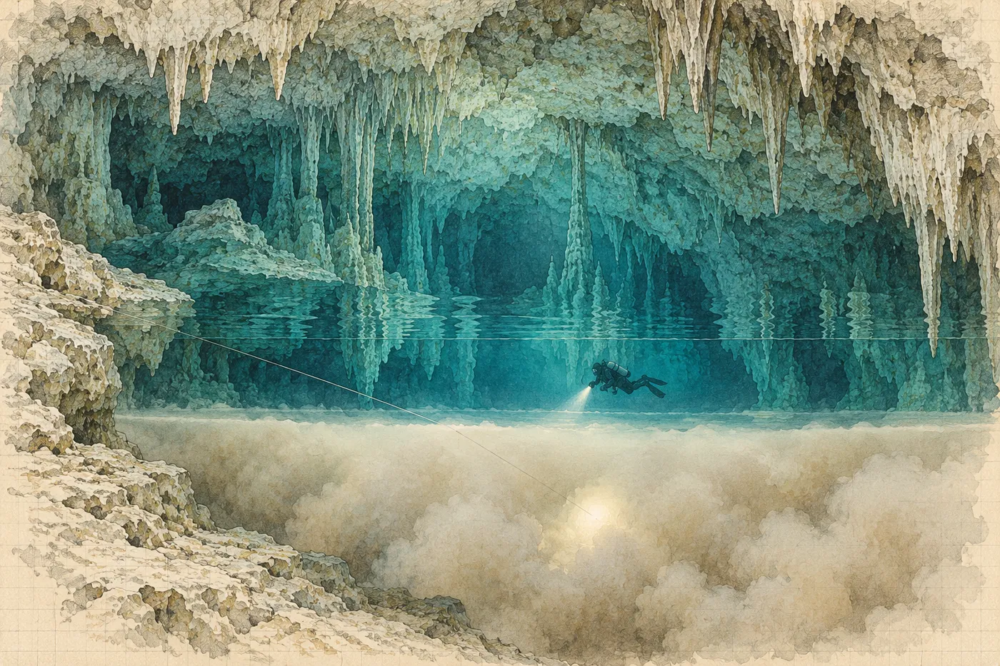

# 2. Haloklina

Analyzátor pípl a ukázal třicet celých čtyři.

Hana si číslo přečetla dvakrát, pak přiložila senzor k druhé lahvi a počkala, až se displej ustálí. Třicet celých dva. Napsala obě čísla fixou na pásku na hrdle lahví, k nim maximální hloubku a své iniciály, a totéž do sešitu plnění, který ležel na bedně vedle kompresoru. Ruce se jí nechvěly. Jen byly studené, i když bylo teprve půl sedmé a vzduch měl už dvacet šest stupňů.

„Třicítka,“ řekl Luis, který analyzoval vedle ní. Neptal se, jen to oznamoval. „Dobře.“

V sedm nakreslil Luis pod plachtou do hlíny svůj plán. Žádný papír. Klacek a udusaná hlína.

Kruh, to byla studna. Šikmá čára ze dna kruhu, to byla hlavní chodba ve dvaceti metrech. Křížek po sto čtyřiceti metrech, to bylo téčko. Doprava. Další čára, delší. Na jejím konci dva krátké souběžné škrty, blízko u sebe.

„La Garganta,“ řekl Luis. Hrdlo. „Devět metrů. Nízké. Levá láhev dopředu.“

Za hrdlem nakreslil čáru, která šla dolů. Přes ni tři vodorovné vlnovky.

„Tady je sladká voda.“ Ukázal nad vlnovky. „Tady se mísí.“ První vlnovka. „Tady je mlha.“ Druhá a třetí. „Pod ní slaná. Pod ní sala.“

„Hloubka?“

„Haloklina šestadvacet. Mlha od sedmadvaceti do devětadvaceti, podle dne. Sala jednatřicet, nejhlubší místo třicet čtyři. Nechoď tam. Tam nic není.“

„Pravidlo třetin,“ řekl Luis. „Otáčíme na sto třiceti. Kdo první dojde na sto třicet, ten otáčí. Jestli dáš signál, otáčíme. Neptám se proč.“

„A ty?“

„Já taky.“ Pokrčil rameny. „Ale já ho nedám.“

Jana seděla na bedně s kávou a poslouchala. Měla být ve dvaceti metrech u vstupu do chodby, s náhradní lahví, a čekat. Viktor stál za Luisem a měl na tváři výraz, jaký mají otcové před porodnicí. Chtěl jít taky. Luis řekl ne, dva lidi, kvůli sedimentu, a Viktor ustoupil s takovou ochotou, až to Hanu překvapilo.

„Natoč mi to, Hanko,“ řekl teď. „Aspoň foťák.“

„Nafotím.“

„A Luis má kameru.“ Viktor kývl k přilbě, která ležela na bedně. Byla na ní malá černá kamera v pouzdře. „Jen pamatuj, Luisi, co je ve smlouvě. Záběry jsou produkce.“

„To je pro Walta,“ řekl Luis. „Pro mapu.“

Viktor se usmál. „Jasně. Pro mapu.“

*

Po žebříku sestoupili ke dřevěné plošině, kterou si Luis s pomocníky z obce postavil těsně nad hladinou na dvou ocelových nosnících zavrtaných do stěny. Láhve za nimi spustili na laně kladkou. Shora byla hladina tyrkysová. Z plošiny to bylo sklo, a pod sklem modrá, a pod modrou kužel balvanů, tak jasný, že se Haně na okamžik zatočila hlava, jako by stála na střeše a dívala se dolů.

Voda měla čtyřiadvacet stupňů. První minutu byla teplá. Pak byla jen voda.

Zapnula si láhve po stranách, každou na dvě karabiny, jednu na hrudi a jednu na boku. Automaty si pověsila na krk. Hlavní světlo na pravou ruku, záložní dvě na hrudní popruhy. Tabulku na psaní a sešit do kapsy na stehně. Nůž. Druhý nůž. Cívka. Šipky. Foťák v pouzdře na krátké šňůře. Každou věc si osahala dvakrát, nejdřív od hlavy dolů a pak odspodu nahoru, jak ji to učila Jana. Ruce to znaly. Hlava se mezitím dívala na hladinu.

Luis byl hotový dřív. Vznášel se u plošiny, kolena pokrčená, ploutve nahoře, nehybně, jako by ho voda držela v dlani. Na přilbě mu svítila zelená dioda kamery.

„*¿Lista?*“

„Lista.“

Ponořili se.

*

Prvních dvacet metrů bylo světlo.

Padalo shora skrz hladinu v pruzích, které se pomalu kývaly, jak se nahoře hýbal vzduch. Stěny studny pokračovaly pod vodou, bílé, a kořeny stromu z protější strany tu končily v trsech jemných vláken, nehybných, jako by byly z vlasů. Kolem nich se drželo hejnko malých stříbrných rybek. Hana se nadechla a vydechla a poslouchala bublinky, jak stoupají a cvakají jí kolem uší, a pak se soustředila jen na dech. Dlouhý nádech. Delší výdech.

Na kuželu balvanů ve dvaceti metrech přivazovala Jana k laně náhradní láhev s padesátiprocentním nitroxem. Zvedla ruku. Palec a ukazovák do kroužku. Hana odpověděla stejně.

Vstup do chodby byl pod převisem na severozápadní straně. Oblouk, široký tak, že by se do něj vešlo auto, a nad ním strop, který se svažoval do tmy. Luis přivázal na skalní výčnělek začátek vodicí šňůry, ačkoli tu jedna šňůra už vedla, stará, Waltova, zarostlá jemným povlakem. Nová šňůra byla bílá. Luis ji vedl vedle staré, aby se nemuseli dotýkat povlaku.

Pak světlo skončilo.

Ne najednou. Nejdřív zmodralo, pak zešedlo, pak se z modrošedé stalo jen tušení za zády, a když se Hana po třiceti kopech ohlédla, byl vchod už jen bledý oblouk ve tmě, jako okno do vedlejší místnosti. Dál byl jen kužel jejího světla. A Luisova, před ní, které se kývalo ze strany na stranu, pomalu, pravidelně, jako by někdo houpal lucernou.

*

Chodba byla krásná. Hana se tomu slovu bránila, protože bylo nepřesné, a pak ho přijala, protože jiné neměla.

Ze stropu visely krápníky, tisíce, od tenkých brček, průsvitných jako skleněné trubičky, až po kmeny tlusté jako stehno. Ze dna proti nim rostly stalagmity. Kde se potkaly, spojily se do sloupů. Mezi sloupy visely záclony, tenké vlnité závěsy kamene, a když na ně Hana posvítila z boku, prosvítaly oranžově a měly v sobě proužky jako plátky slaniny.

Všechno to bylo pod vodou.

A nic z toho pod vodou nevzniklo. Krápník je kapka za kapkou, které stékaly, odkapávaly na vzduchu a zanechávaly za sebou tenoučký film kalcitu, rok po roce, tisíciletí po tisíciletí. Pod vodou se kapka neutrhne. Pod vodou krápníky nerostou, jen leží a čekají, až je voda zase pustí.

Hana plula lesem, který vyrostl, když tu ještě nebyla voda. Když bylo moře o sto metrů níž a celý tenhle kraj byl suchý a tyhle chodby byly jeskyně, kterými se dalo projít pěšky. A pak led na severu roztál, moře stouplo, podzemní voda stoupla s ním a les se ponořil.

Kdy, to věděla. Věděla to z knih, z článků, z Hranic. Konec doby ledové, poslední stoupání, deset, dvanáct, čtrnáct tisíc let podle hloubky. Tohle bylo jednoduché.

Tohle byla ta snadná část.

*

Téčko. Šipky na šňůře, plastové trojúhelníčky, ukazovaly ven, ke studni. Luis zahnul doprava. Chodba se zúžila, strop klesl, krápníků ubylo. Dno pokrýval jemný sediment, tak lehký, že se zvedl, když nad ním člověk jen silněji vydechl. Luis plul těsně pod stropem, kolena pokrčená, kopal jen kotníky, krátce, do stran, jako žába. Hana se snažila dělat totéž. Dařilo se jí to napůl. Za ní se zvedl obláček. Neohlížela se. Věděla, jak vypadá.

Zkontrolovala tlak. Sto devadesát a sto osmdesát pět. Dobře. Dýchala víc, než by měla. Věděla proč.

Hrdlo vypadalo, jako by chodba skončila a pak si to rozmyslela.

Strop sjel dolů a dno se zvedlo a mezi nimi zůstala štěrbina, vysoká sotva na dvě dlaně, široká na rozpětí paží. Luis zastavil před ní, ohlédl se a posvítil Haně do hrudi, ne do očí. Otázka. Hana zvedla ruku s palcem a ukazovákem do kroužku a ruka se jí přitom zachvěla, takže kroužek vypadal spíš jako otazník.

Luis odepnul levou láhev od boční karabiny, nechal ji viset jen na hrudní a postrčil ji před sebe. Položil se na bok. A zmizel.

Ne zmizel. Hana ho viděla. Jeho ploutve, jeho světlo, které se rozlévalo po stropu štěrbiny, jak se sunul dovnitř. Jen si najednou nedokázala představit, že je tam dost místa pro něj, natož pro ni.

Strach je v pořádku. Jen ho nesmíš dýchat.

Odepnula levou láhev. Ruce byly nemotorné, karabina se jí zasekla na popruhu a ona ji musela uvolnit dvakrát. Postrčila láhev před sebe. Položila se na bok. Strop byl deset centimetrů nad její hlavou, pak pět. Přilba o něj ťukla. Zastavila se. Dýchala. Nádech byl krátký, výdech ještě kratší a ona to slyšela, slyšela, jak dýchá jako pes po běhu, a věděla, co to znamená: oxid uhličitý, který nestíhala vydechovat, se jí hromadil v krvi a krev ho hlásila mozku jako dušení, a mozek chtěl nádech, další a další, a každý další nádech byl mělčí. Kdyby teď chtěla zrychlit, bylo by to horší.

Zastavila se úplně. Tváří ke kameni. Kámen měl ve světle drobné dírky a v jedné z nich se něco bíle zachvělo, nějaký drobný korýš, slepý, průhledný, a uteklo hlouběji.

Pomalu. Nádech na čtyři. Výdech na šest.

Výdech na šest.

Výdech na šest.

Někde před ní, ve štěrbině, se Luisovo světlo přestalo hýbat. Čekal. Nesvítil na ni. Svítil na strop, klidně, nehybně. Věděl, že je tam. Věděl, co dělá. Nespěchal.

Hana se odrazila prsty ode dna. Kousek. Láhev cinkla o kámen. Další kousek. Sediment se zvedl a světlo zhnědlo, a ona už nic neviděla, jen hnědou mlhu, ve které visela její vlastní ruka, a pak se strop nad ní zvedl a hnědá zřídla a ona byla venku.

Luis visel ve vodě dva metry před ní. Posvítil jí do hrudi. Otázka.

Hana zvedla ruku. Tentokrát byl kroužek kroužek.

*

Za hrdlem chodba klesala. Šikmo, jako staré schodiště ve sklepě, po hrubých stupních z napadaného kamene. Luis plul po šňůře dolů. Hana za ním, s rukou těsně nad šňůrou, aby ji mohla kdykoli chytit.

Ve dvaceti pěti metrech se voda začala chvět.

Nejdřív si myslela, že je to něco s maskou. Že se jí orosilo sklo, nebo že má v očích slzy. Luisovo světlo před ní se zvlnilo, rozpadlo se, složilo se a znovu rozpadlo, jako když se člověk dívá přes rozpálený asfalt v létě. Hana zamrkala. Nepomohlo to.

Pak to pochopila. Haloklina. Hranice. Nad ní sladká voda, která sem přitekla z deště po celém poloostrově, pod ní slaná, která sem natekla zespodu z moře, kilometry daleko, skrz vápenec, jako voda do houby. Sladká je lehčí a pluje na slané. Jen tady, kde se dotýkají, se míchají do tenké vrstvy, ve které se světlo láme na každém milimetru jinak. Svět se v ní roztekl.

Luis plul těsně nad hranicí, opatrně, aby ji nerozvířil víc, než musel. Pak vydechl a klesl skrz.

Hana šla za ním.

Bylo to jako proplout olejem. Obraz se rozbil, její vlastní ruka se roztekla do pěti rukou a pak se zase složila. Voda byla náhle teplejší. O stupeň, možná o dva. Cítila to na tvářích kolem masky. A byla lehčí. Ne voda. Ona. Slaná voda je hustší a nesla ji víc, a Hana se najednou zvedala, pomalu, nezadržitelně, zpátky ke hranici, nad kterou byla. Vypustila trochu vzduchu z křídla. Zastavila se. Vypustila ještě trochu. Visela.

Luis pod ní kývl.

*

Pod haloklinou byla mlha.

Ležela ve vodě jako kouř nad jezerem v listopadu. Bílá, nahnědlá, s ostrou horní hranou, tak ostrou, že Hana ve světle viděla, kde začíná, a pod ní neviděla nic. Luis do ní vplaval a jeho světlo se v ní rozsvítilo, celé, jako koule, jako lampa v mlze na nádraží. On sám zmizel. Zůstala jen ta koule.

Sirovodík. Věděla to. Bakterie, které na hranici sladké a slané vody rozkládají organickou hmotu, listí, kořeny, všechno, co sem shora spadne a dopluje, a když jim dojde kyslík, začnou místo něj dýchat síran z mořské vody. Vznikne plyn, který se rozpustí ve vodě a zbarví ji. Tahle mlha byla jejich výdech.

Vplavala do ní.

Najednou neviděla nic. Ani ruku před maskou. Jen bílou, osvětlenou zevnitř, rovnoměrnou, bez hloubky a bez směru. Nahoře, dole, vpravo, vlevo, všechno bylo stejné. Na chvíli ani nevěděla, jestli stoupá, nebo klesá. Hloubkoměr říkal dvacet osm. Pak dvacet osm a půl. Šňůra. Kde je šňůra. Levá ruka ji našla, dřív než se stihla vyděsit, protože se celou dobu držela tři centimetry nad ní, přesně jak ji to učili, a teď ji držela v dlani, tenkou, napjatou, jedinou věc v celém tom bílém světě, která měla směr.

Dvacet devět.

A pak byla venku.

*

Pod mlhou byla tma.

Ne taková jako v chodbě nahoře. Tam byla tma plná věcí, krápníků, sloupů, drobných korýšů v dírách, a světlo do ní vnikalo a vracelo se. Tady se nevracelo. Voda byla tak čirá, že ji Hana neviděla vůbec. Paprsek jejího světla v ní neměl hranu. Nebyla v ní ani jedna částečka, která by se zaleskla. Jen tam, kam dopadl na kámen, se kámen objevil, přesný a ostrý, a všude jinde bylo černo.

Nic se tu nehýbalo. Žádný korýš v dírách. Žádné rybky. Žádný povlak na šňůře. Kámen byl čistý, jako by ho někdo umyl.

Mrtvá voda, napadlo ji. Bez kyslíku. Tady nic nežije, protože tady nic nedýchá. A proto se tu nic nerozkládá.

Luis visel pod mlhou a čekal. Kývl hlavou dopředu.

Za dalších dvacet kopů se chodba otevřela.

*

Sala nebyla velká. Patnáct metrů na délku, možná osm na šířku, strop ve třech, čtyřech metrech. Ale když do ní Hana vplavala a posvítila kolem sebe, měla pocit, že je v kostele.

Byla bílá.

Celé dno pokrývala sintrová poleva, krémová, terasovitá, se stupínky a hrázkami, mezi kterými stávala jezírka, dokud tu stávala voda jiného druhu, ta, která přitékala shora po kapkách. Teď byla jezírka pod vodou jako všechno ostatní a jejich okraje vypadaly jako okraje talířů. Ze stropu visela brčka, tenká, desítky centimetrů dlouhá, nepoškozená. Nikdo tu nebyl. Nebo jen Luis, jednou nebo dvakrát, a Viktor, jednou, a Luis ho vedl tak, aby se ničeho nedotkl.

U vchodu stál stalagmit. Nízký, metr vysoký, zlomený nahoře, nakloněný, s hrbem na jedné straně. Ve světle vypadal jako sedící stařec s hlavou svěšenou na prsa. Luis k němu připlaval a ukázal na drobnou plastovou destičku přivázanou ke šňůře u jeho paty. Na destičce bylo vyškrábáno *LE* a šipka.

„*El Abuelo*,“ napsal Luis na tabulku. Dědeček.

Pod to napsal: *7 patadas izq. Bajo techo.* Sedm kopů doleva. Pod převis.

Sedm kopů. Ne metry, ne azimut. Kopy jeho ploutví. Kdokoli jiný by udělal sedm jiných kopů a doplaval jinam. Ale on to věděl. On by sem doplaval i potmě.

Luis vyrazil. Hana počítala s ním.

*

Ležel pod převisem, na svahu polevy, kde se dno stáčelo dolů k nejhlubšímu místu síně.

Hana se zastavila dva metry od něj a nehýbala se. Nevěděla, jak dlouho. Neopovažovala se přiblížit, dokud nevěděla, kam položí ruce, kam ploutve, kam hruď. Luis zůstal za ní, u okraje převisu, a nesvítil. Nechával jí to.

Válec.

Byl delší, než vypadal na videu, nebo kratší, to se pod vodou nedalo říct. Bledý. Šedobílý, a v jejím světle, teplejším než Viktorovo, víc dozelena, ale jen na horní straně, kde ho poleva nepokryla. Ležel šikmo, podél svahu. Spodní konec mizel v sintru. Horní konec, ten se značkami, trčel ven. Sintr kolem něj tvořil lem, jako když se kolem kořene stromu v kamenitém svahu nahrne hlína. Na spodní straně byl lem silný, na boku slabší, a nahoře se ztenčoval do průsvitného povlaku, přes který povrch válce prosvítal jako tvář přes závoj.

Hana k němu připlavala na metr. Opatrně. Ploutve nahoru, kolena pokrčená, ruce u těla. Dýchala pomalu, aby se nezvedla. Visela nad ním.

Žádný šev.

Hledala ho. Hledala spáru, hranu, místo, kde by se dvě části potkaly, kde by byl závit, šroub, svár, stopa po formě, po soustruhu, po čemkoli. Nic. Povrch byl hladký, ne lesklý, matný, jako stará kost, jako neglazovaný porcelán, a v celé délce, kterou viděla, se neměnil.

Vytáhla z kapsy kartu s měřítkem. Plastovou, bílou, s černými a bílými poli po centimetru, kterou si v únoru koupila v Brně za dvě stě korun a celou cestu ji vezla v obálce, aby se neohnula. Položila ji na hranu terasy vedle válce. Na válec ne. Na polevu. Dvacet centimetrů od něj, rovnoběžně.

Fotila. Shora. Z boku. Zespodu, pokud se dalo. Každý snímek s kartou. Pak bez karty, aby karta nic nezakryla. A znovu s kartou. Na displeji foťáku se válec objevil malý a bledý a ona se na displej skoro nedívala. Dívala se na válec.

Viditelná část měla přes čtyřicet centimetrů. Kolik je ještě pod sintrem, nepoznala.

*

Sintr.

Teď konečně, když se odtrhla od válce, ho viděla pořádně. Poleva, která válec obrostla, byla stejná jako poleva po celé síni, krémová, terasovitá. Nenarostla jen kolem válce. Narostla kolem všeho, kolem kamenů, kolem paty stalagmitu, kolem válce, rovnoměrně, jako sníh, který napadl na všechno, co leželo venku.

A narostla na vzduchu.

Pod převisem, metr od válce, stoupal strop k puklině, a z pukliny kdysi tekla voda. Hana viděla cestu, kudy tekla: hladký žlábek v polevě, který vedl od pukliny dolů, přes svah, kolem válce, a ztrácel se v hlubším místě. Voda stékala po kameni v tenké vrstvě, odpařovala se, uvolňovala oxid uhličitý a nechávala za sebou kalcit. Milimetr za desítky let. Někdy za staletí.

To se pod vodou nestane. Pod vodou se kalcit neusazuje takhle, ne v terasách, ne v krápnících. Tahle poleva rostla, když byla síň suchá. A válec tu ležel, když rostla. Ležel tu dřív, než narostla první vrstva, která se ho dotkla.

Hana to v duchu řekla ještě jednou, pomalu, aby to slyšela.

Nejstarší vrstva kůry, ta, která se dotýká válce, udává nejnižší možné stáří. Ne jak je válec starý. Jak dlouho tu nejméně leží. Mohl tu ležet už dávno předtím, než začala téct voda. Ale nemohl sem přijít potom, co se ta vrstva vytvořila, protože by ji musel prorazit, a kůra není proražená.

Pokud není.

Naklonila se a podívala se na lem kolem válce zblízka. Hledala trhlinu, prasklinu, místo, kde by kůra byla mladší než okolí, kde by se dalo vyčíst, že válec někdo zatlačil do starší dutiny. Neviděla nic. Ale to nic nebyl důkaz. Na to potřebovala řez, vzorky, laboratoř. Na to potřebovala udělat to pořádně.

Na hraně terasy pod válcem, kde polevu kdysi rozbil kámen ze stropu, byl vidět lom. Čerstvě to nevypadalo. Lom byl zaoblený, potažený tenkou novější vrstvou. Ale v lomu Hana viděla, jak je kůra uvnitř stavěná. Vrstvičky. Tenké, rovnoběžné, jedna na druhé, krémové a o něco tmavší, střídavě, jako letokruhy, jako stránky zavřené knihy z boku. Desítky. Možná stovky.

Každá z nich byla jednou povrch. Každá někdy byla dno, na kterém ležel válec a na které kapala voda.

Pod hranou, ve žlábku, ležely úlomky. Kousky polevy velké jako nehet, jako dlaň, které se odlomily, když dopadl ten kámen ze stropu, a teď ležely v prohlubni, napůl zarostlé. Některé byly krémové. Některé o něco tmavší. Hana je vyfotila taky, s kartou, protože to byl kontext a kontext se fotí. Jen dvakrát, přehledově, z hrany terasy. Pak se k nim už nevrátila.

*

Značky si nechala nakonec.

Na čele válce, které trčelo ze sintru, byl povlak tak tenký, že byl skoro průhledný. Pod ním byly rýhy. Hana nejdřív posvítila přímo a rýhy skoro zmizely. Pak držela světlo z boku, šikmo, téměř rovnoběžně s plochou, jak se svítí na pergamen nebo na seškrábaný papír, aby vystoupilo, co je do něj vyryté. A pole se objevilo.

Rovné čáry. Krátké a dlouhé. Mezi nimi tečky, drobné, kulaté, každá stejně velká. Seřazené do řad, které šly rovnoběžně, a do sloupců, které je křížily. Mřížka. Pole velké asi jako zápalková krabička. Hloubka rýh pod milimetr, možná desetina milimetru, nepoznala to.

Fotila. S kartou. Z boku. Z druhého boku. Shora, s bočním světlem. Ruce měla teď klidné, klidnější než kdykoli za celý ponor, protože tohle uměla. Tohle byla dokumentace. Tohle dělala celý život, nad hrnci a kostmi a profily.

Někde na okraji vědomí se ozvala myšlenka na modrou složku na poličce nad lednicí. Na zrnitý náhled. Na mnicha.

Hana ji odsunula doprava. Tam, kam patří. Ne sem, ne do vody, ne do třiceti jednoho metru s tlakem sto šedesát a sto padesát pět.

Sto padesát pět.

Podívala se na manometr ještě jednou a na hodinky. Dvaadvacet minut v síni. Připadalo jí to jako pět.

*

Luis jí posvítil do hrudi a zvedl ruku s palcem nahoru. Ne otázka. Oznámení.

Hana kývla. Ještě jeden snímek. Bez karty, jen válec, bledý, v bílé polevě, pod převisem, ve tmě, která neměla hranu.

Pak se otočila.

*

Cesta zpátky byla delší, i když to byla stejná cesta. Mlha, ve které neviděla nic, a šňůra v dlani. Haloklina, ve které se svět roztekl, a pak voda, která byla najednou o stupeň studenější a o kus lehčí, takže byla Hana těžší a musela dofouknout křídlo, aby neklesla. Stupně. Hrdlo.

Hrdlo bylo horší, protože věděla, jaké je. A lepší, protože věděla, jaké je. Láhev dopředu, bok, strop pět centimetrů nad přilbou. Dýchala na čtyři a šest. Nepočítala kopy. Počítala výdechy. Na druhé straně bylo zakaleno od jejich vlastního průjezdu, hnědo, a Luis tam visel a svítil do stropu.

Pak dlouhá chodba. Les pod vodou. Šipky na šňůře, které všechny ukazovaly jedním směrem.

Když se v dálce objevil modrý oblouk vchodu, Hana si všimla, že pláče. V masce to nevadilo. Nikdo to neviděl.

*

V jednadvaceti metrech jí Jana podala láhev s padesátkou. Hana si ji připnula, zkontrolovala nápis na pásce, zkontrolovala ho ještě jednou, vložila si do úst automat a nadechla se. Plyn chutnal suše a trochu kovově. Jana jí ukázala prsty: devět, šest, tři. Hana přikývla.

Dekomprese trvala dvacet osm minut.

Visela ve vodě u stěny studny, na šesti metrech a pak na třech, v pruzích světla, které padaly z hladiny a kývaly se. Nad hladinou letěl stín. Pak další. Toh, napadlo ji, a pak si uvědomila, že to nemůže vědět, byl to jen stín. Kořeny stromu z protější stěny visely vedle ní, jemné, nehybné, a v nich se držely rybky. Byla jí zima. Taková, která přijde po hodině a půl ve vodě, která má o třináct stupňů méně než tělo. Třásla se jí brada. Nechala ji.

Luis visel vedle ní. Napsal něco na tabulku a podal jí ji.

*¿Bien?*

Hana napsala pod to: *Sí. Gracias.*

Luis si tabulku vzal zpátky, připsal jedno slovo a podal jí ji znovu.

*Despacio.*

Pomalu.

Hana nevěděla, jestli tím myslí výstup, dech, nebo něco jiného. Luis se díval nahoru, k hladině, a jeho tvář za maskou byla stejně klidná jako v táboře, když namotával šňůru.

Na třech metrech, s plícemi plnými plynu, který jí chutnal po kovu, s bradou, která se třásla, a se třemi sty fotkami v pouzdře na šňůře, si Hana něco slíbila.

Neřekla to nahlas, protože pod vodou se nemluví. Nenapsala to na tabulku, protože tabulka patřila Luisovi a on by to četl. Jen si to řekla, jednou, zřetelně, tak, jak se říkají věci, o kterých člověk ví, že na ně bude vzpomínat.

*Tohle udělám pořádně.*

Celé. Fotogrammetrie, orientace, každý vzorek zaměřený, každá vrstva zapsaná. Kdyby to trvalo o tři týdny déle. Kdyby to stálo o tři ponory víc. Tohle udělá tak, aby se za to za dvacet let nemusela stydět, ať to bude cokoli.

Na hodinkách ještě čtyři minuty.

*

Viktor stál na plošině, když se vynořila. Vlastně klečel na okraji, s rukama na kolenou, a díval se na ni.

„Tak?“

Hana si vyndala automat z pusy. Chvíli nemohla mluvit, protože se jí třásla čelist. Pak to řekla.

„Je to v sintru.“

„To vím.“

„Ne. Je to *v* sintru.“ Plivla vodu. „Poleva ho obrostla. Leželo to tam, když byla síň na suchu. Dřív, než ji zatopila voda. Dřív, než narostla první vrstva.“

Viktorovi se na tváři pomalu roztahoval úsměv, ten, který Hana znala patnáct let, a pak ještě jiný, širší, který neznala.

„Kolik?“

„Nevím.“

„Hanko.“

„Nevím, Viktore. To řekne uran. Tisíce let. Možná desítky tisíc. Nevím.“ Chytila se okraje plošiny a vytáhla se do sedu, s láhvemi po stranách, těžká, s vodou, která z ní tekla. „A nejdřív to musíme celé nafotit. Celou síň. Fotogrammetrii, než se čehokoli dotknu.“

„Ríša to nafotí,“ řekl Viktor. „Ríša to nafotí, jak budeš chtít.“

Pak ji objal, mokrou, s láhvemi, se vším, a Hana cítila, jak se mu třese ruka. Nejdřív si myslela, že je to zima. Pak si uvědomila, že Viktorovi zima není.

*

Večer, pod plachtou, když generátor ještě běžel a nad světlem kroužily můry velké jako dlaň, otevřela deník.

Vlevo:

*4. 3. 2026. Ponor 1 do boční síně (H. V., L. E.; J. M. podpora ve 20 m). EAN 30, deko EAN 50. Runtime 106 min, max. hl. 31,4 m. Hlavní chodba 20 m, téčko 140 m, doprava; zúžení „Garganta“ ~9 m, sidemount, levá láhev dopředu. Haloklina 25–26 m (teplota +1–2 °C, změna vztlaku). Sirovodíková vrstva ~27–29 m, viditelnost 0. Pod ní slaná voda, čirá, bez viditelného života.*

*Síň ~15 × 8 m, strop 3–4 m. Sintrová poleva terasovitá po celém dně. Brčka neporušená. Orientační bod: zlomený stalagmit u vstupu („El Abuelo“), destička LE. Předmět: 7 kopů vlevo (L. E.), pod převisem, na svahu polevy.*

*Předmět válcovitý, viditelná délka > 40 cm, spodní konec v sintru. Barva šedobílá, horní strana do zelena (světlo 5000 K?). Povrch matný, hladký, bez viditelného švu nebo stopy nástroje. Poleva tvoří lem: zespodu silný, na boku slabší, nahoře průsvitný povlak. Na horním čele pole rytých značek (čáry, tečky v řadách a sloupcích), cca 4 × 3 cm, rýhy < 1 mm. 312 snímků, karta s měřítkem 1 cm.*

*Poleva kolem předmětu = táž generace jako v celé síni. Žlábek od pukliny pod převisem přes svah kolem předmětu. Na hraně terasy pod předmětem starý lom (kámen ze stropu), v lomu laminace – desítky až stovky vrstev. Ve žlábku pod hranou úlomky polevy, napůl zarostlé. Foceno.*

Vpravo:

*Poleva rostla na vzduchu → síň suchá, předmět už ležel. Nejstarší vrstva v kontaktu = minimální stáří uložení.*

*Je kůra v kontaktu neporušená? Nevidím trhlinu. Neznamená, že není. Možnost: předmět vsunut do starší dutiny? → řez, víc vzorků, víc míst.*

*Kdy byla síň naposledy suchá?*

Na levé straně bylo skoro všechno. Na pravé tři otázky.

Pod ně připsala ještě jednu řádku. Malým písmem, aby jí nezabrala místo.

*Despacio.*

Deník zavřela a šla se podívat, jestli Ríša už stáhl fotky do počítače. Stáhl. Seděl nad nimi s Viktorem a ani jeden z nich si nevšiml, že přišla. Na obrazovce bylo čelo válce v bočním světle, zvětšené přes celý monitor. Mřížka. Čáry a tečky.

„Ty vole,“ řekl Ríša tiše. „Ty vole.“

Viktor neřekl nic. Sáhl po telefonu a vyšel ven, do tmy, a Hana slyšela, jak za plachtou vytáčí číslo.
