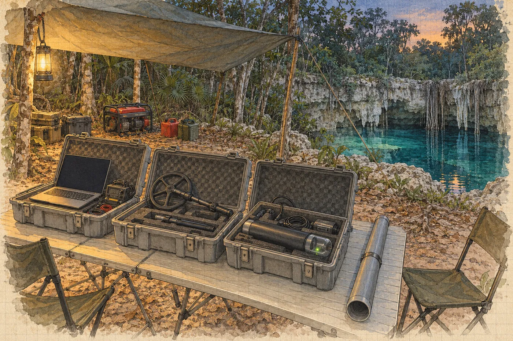

# 4. Kalina

Soupis vzorků podepsala na kapotě Salcedovy dodávky, protože jinde v táboře nebyla rovná plocha, na které by nestálo něco mokrého.

Byla sobota, půl osmé ráno. Kapota už byla teplá. Salcedo držel krabici s vystlanými přihrádkami, ve kterých ležely tři sáčky, každý v dalším sáčku, každý s číslem. Formulář měl dvě strany. Na první byly kolonky: číslo vzorku, popis, místo odběru, hmotnost, datum. Hana je vyplnila večer, přepsala je z deníku. Zkráceně, ale se stejným tvrzením.

*Vzorek 3: kontaktní kůra, spodní lem u horního čela předmětu. 2 fragmenty jednoho odběru.*

Podepsala se. Podruhé za dva dny pod touž větu. Slunce svítilo na papír tak ostře, že vlastní podpis viděla jako modrou čáru, která se rozpíjí do bílé.

„Laboratoř je zaplacená,“ řekl Salcedo. Zasunul formulář do desek a desky pod paži. „Papíry k vývozu vzorků vyřídím v Méridě. V úterý odletí kurýrem.“

Úterý. Viktor říkal nejpozději v pondělí.

„A ejido?“ zeptala se Hana.

„Pan Brabec to s donem Felipem vyřídil. Nebojte se, *doctora*. Takové věci dělám deset let.“

„Nebojím se,“ řekla Hana.

Salcedo se usmál, jako by věděl, že to není pravda, a že to nevadí. Pak nasedl a odjel, a za dodávkou se zvedl bílý prach a dlouho visel ve vzduchu nad cestou.

*

Kalina přijel ve čtyři odpoledne. Sám, v malém bílém autě z půjčovny, o hodinu později, než měl, protože navigace ho poslala na cestu, která končila v lese u kozí ohrady.

„Zeptal jsem se,“ řekl místo pozdravu, když vystoupil. „Pastevec mi poradil. Dobře. Jen mi to trvalo, než jsem pochopil, že mi radí doleva, a ne že mi ukazuje kozu.“

Byl vysoký a hubený, s bledou kůží, kterou si zjevně celou cestu chránil. Dlouhé rukávy, plátěný klobouk se širokou krempou, na ušních boltcích bílé šmouhy krému, který se nevstřebal. Brýle se mu při vystoupení z klimatizovaného auta zamlžily. Sundal je, otřel o košili a nasadil je zpátky, a celou tu dobu se díval na zem, jako by tam hledal něco, co upustil.

„Doktor Kalina,“ řekl Viktor a podal mu ruku. „Náš zaklínač.“

„Kalina.“ Kalina ruku stiskl a hned ji pustil. „Rušení se nezaklíná. Měří se.“

Hana ho poznala, až když promluvil. Před šesti nebo sedmi lety, v Moravském krasu, na jedné akci jeskyňářů, kteří hledali pokračování chodby pod lesem a potřebovali vědět, kde přesně kopat. Přijel tehdy s anténou na střeše auta, na chatě u stolu, kde se pilo, celý večer nepromluvil a pak celou noc chodil s cívkou po lese. Jeskyňáři mu říkali Tichý. Ráno jim na mapu nakreslil křížek a vedle něj číslo s chybou. Kopali tam. Chodba tam byla.

„My se známe,“ řekla Hana. „Holštejn. Před lety.“

Kalina se na ni podíval. Poprvé zvedl oči výš než k jejím ramenům.

„Vrbová,“ řekl. „Geoložka. Vy jste jim tehdy řekla, že pod tím svahem bude hlína, a ne chodba.“

„Měla jsem pravdu?“

„Napůl. Byla tam hlína. A pod ní chodba.“ Odmlčel se. „Měla jste pravdu, jen to nebyla celá pravda. To se stává.“

Otočil se ke kufru auta a začal vykládat bedny. Tři plastové, šedé, s kovovými přezkami. A dlouhý tubus z novodurové trubky, zalepený na obou koncích lepicí páskou, na které stálo fixou *NEOTVÍRAT VE VĚTRU*.

*

Problém byl jednoduchý, nebo aspoň Viktor si myslel, že je jednoduchý.

Expedice měla radiolokační maják. Koupil ho Viktor v zimě od firmy, která je dodává záchranným týmům a jeskyňářům. Maják je cívka v pouzdře. Potápěč ho položí v jeskyni na dno, vodorovně, a maják začne vysílat nízkofrekvenční magnetické pole. Pole projde skálou, vodou, hlínou, vším. Nahoře nad tím chodí člověk s přijímací cívkou a hledá místo, kde pole míří kolmo vzhůru. To místo je přímo nad majákem. Z tvaru pole kolem něj se pak dá spočítat hloubka. Tak se zjišťuje, kde přesně pod povrchem jeskyně vedou. Tak se vrtá k uvězněným.

Expedice měla taky jeskynní spojení, dvě krabičky, které si posílají krátké textové zprávy skrz skálu na stejném principu. Jedna byla na povrchu, druhá na skalní římse v horní suché chodbě nad cenotem, kde Luis držel zásobní láhve. Pojišťovna to chtěla. Civilní ochrana taky.

Ani jedno nefungovalo. Maják ve zkoušce na povrchu, padesát metrů od přijímače, zněl ve sluchátkách jako rádio mezi stanicemi. Krabičky si poslaly zprávu, a pak hodinu nic.

„Potřebuju jen, aby to pípalo,“ řekl Viktor.

„Ono to pípá,“ řekl Kalina. „Jen to pípá do něčeho, co pípá hlasitěji.“

Otevřel první bednu. Notebook, přijímač, malá skládací cívka na tyči. Druhá bedna: další cívka, větší, a černé pouzdro z plastové trubky, tlusté jako stehno, s průhledným víčkem, pod kterým blikala dioda. Třetí bedna: kabely, nářadí, baterie, stará krabička od bonbonů s pojistkami.

„Ten maják jsem si postavil s kolegou,“ řekl Kalina, když viděl, že se Hana dívá na černé pouzdro. „Na Holštejn. Krabicím, do kterých nevidím, nevěřím.“

Zapojil přijímač, rozložil cívku a poslal Ríšu s koupeným majákem na druhý konec mýtiny. Posadil se k notebooku pod plachtou a nějakou dobu jen koukal.

Hana si sedla vedle něj. Nikdo ji nepozval. Kalina ji nevyhodil.

Na obrazovce byl obraz, který znala z přednášek o seismice. Vodorovně frekvence, svisle čas, a barvy, které ukazují sílu. Čas tekl shora dolů, jako by obrazovku polévala voda. Většina plochy byla modrá, zrnitá. Ale přes celou výšku, odshora dolů, vedly svislé žluté čáry. Rovné, ostré, stejně daleko od sebe. Desítky. Jako zuby hřebenu.

„Šedesát hertzů,“ řekl Kalina. „Síť. A její násobky. Sto dvacet, sto osmdesát, dvě stě čtyřicet a dál, až nahoru. Tady je síť na šedesáti, ne na padesáti jako u nás. Harmonické leží jinde.“ Ukázal prstem, aniž by se dotkl displeje, na jednu z čar vpravo. Byla silnější než ostatní. „A tady sedí váš maják. Ten koupený. Tři tisíce čtyři sta sedmdesát pět hertzů. Osmapadesátá harmonická šedesáti je tři tisíce čtyři sta osmdesát. Pět hertzů vedle. V Evropě by seděl přesně mezi dvěma zuby. Tady sedí na jednom.“

„Odkud ta síť?“

„To zjistím.“ Kalina přepnul na jiné okno. Široký šedý pás, rozmazaný, přes polovinu obrazovky. „A tohle je váš generátor. Střídač, levný. Dělá šum přes celé pásmo, jako když někdo hází písek na plech.“

Hana se dívala na obrazovku. Na zuby hřebenu, na šedý pás, na zrnitou modrou mezi nimi.

„Jsou to vrstvy,“ řekla. Napůl sama pro sebe.

Kalina zvedl oči od obrazovky.

„Myslím,“ řekla Hana, „že je to jako profil. Musíte nejdřív poznat všechno, co tam je, abyste viděl, co tam být nemá.“

„Musím nejdřív vědět, co všechno to *není*,“ řekl Kalina. Řekl to pomalu, jako by to slovo zkoušel. „Teprve pak se můžu ptát, co to je.“

„To je celá moje práce.“

„To je celá práce kohokoli, kdo měří. Jen to většina lidí dělá obráceně.“

*

Večer přeladil svůj maják.

Seděl u stolu pod žárovkou, kolem které kroužily můry, s notebookem připojeným kabelem k černému pouzdru, a psal do terminálu čísla. Hana seděla naproti a přepisovala si do deníku odpolední odstřel. Patnáct dvanáct, slabý, zákal jen u kuželu.

„Tři tisíce pět set deset,“ řekl Kalina, aniž by vzhlédl. „Mezi osmapadesátou a devětapadesátou. Třicet hertzů od obou. To stačí.“

Pak psal dál.

„Co teď nastavujete?“

„Kdy bude vysílat.“ Kalina otočil notebook, aby viděla, i když Hana na obrazovce viděla jen řádky. „Ve dne to tu nemá smysl. Ve dne běží v lomu drtiče a vedení k lomu je jeden velký vysílač na šedesáti hertzích. Ale v noci lom stojí. Zůstane jen trafo a to je slabé. A generátor se o půlnoci vypíná. Takže budu měřit v noci.“

„A maják bude dole sám.“

„Maják bude dole sám. Deset minut každou celou hodinu. Pak padesát minut ticho, aby šetřil baterii. Kdykoli se v noci rozhodnu měřit, počkám na celou hodinu a on se ozve.“ Kalina zapsal poslední řádek a stiskl klávesu. Dioda pod víčkem pouzdra blikla dvakrát rychle a pak zhasla. „Na tenhle režim vydrží baterie zhruba měsíc.“

Viktor stál za ním s pivem a díval se mu přes rameno. Hana si nevšimla, kdy přišel.

„Jak dlouho to tam bude pípat?“ zeptal se Viktor.

„Dokud to někdo nevyndá, nebo dokud nedojde baterie. Měsíc. Řekněme do desátého dubna.“

„A kdo to uslyší?“

Kalina se otočil a podíval se na něj zdola, přes okraj brýlí.

„Kdo má přijímač, ví, na jakém kmitočtu poslouchat, a stojí nad tím místem do pár set metrů.“ Krátká pauza. „Takže já.“

Viktor se zasmál a poklepal mu na rameno. „Dobře. Tak to je náš soukromý rozhlas.“ A odešel k ohni, kde Ríša pouštěl Rose a dětem na telefonu záběry z prvního ponoru.

Kalina za ním chvíli hleděl a pak sklopil oči k notebooku.

„Proč ho to zajímá?“ řekl. Ne Haně. Spíš sám sobě.

Hana neodpověděla. Nevěděla. Neřekla mu, že ji nenapadlo se zeptat.

*

V neděli ráno šel Kalina po vedení.

Hana šla s ním. Řekla si, že kvůli lomu, protože ho chce vidět zblízka, a byla to pravda. Kalina nesl malou cívku na tyči a přijímač na popruhu přes rameno a každých sto metrů se zastavil, poslouchal ve sluchátkách a psal si do sešitu. Sešit byl obyčejný, linkovaný, v kroužkové vazbě. Psal tužkou.

Vedení začínalo u obce, kde odbočovalo z hlavní linky, a vedlo podél silnice na Méridu, na betonových sloupech, až k lomu. Mezi tím z něj nic nevedlo, jen jedna přípojka k čerpací stanici na vodu, malé budce z tvárnic s nádrží na střeše.

„Takže tohle vedení živí lom,“ řekla Hana.

„Tohle vedení je lom.“ Kalina sundal sluchátka. „Když se drtí, teče do lomu velký proud a ten proud není čistý. Drtiče, motory, regulátory. Každý přidá vlastní zub. Vedení je dva kilometry dlouhá anténa. Vysílá to všechno do krajiny.“

„A pod zem?“

„Pod zem taky. Nízké frekvence jdou do země dobře. Proto je používáme na majáky.“ Nasadil si sluchátka zpátky. „To je ta nepříjemná symetrie.“

U lomu se zastavili u plotu z vlnitého plechu. Pod jeho spodní hranou byla vyhrabaná díra, od zvířete nebo od člověka. Hana nahlédla dovnitř.

Bílá díra byla zblízka větší, než vypadala ze silnice. Stupně, každý vysoký tak pět metrů, vylámané do vápence jako schodiště pro obry. Na nejvyšším stupni stála vrtná souprava, malá, na pásech, a dva muži v helmách vrtali do skály řadu otvorů. Jeden vedle druhého, v pravidelných rozestupech, jako stehy.

„Vývrty na nálože,“ řekla Hana. „Na zítra. Nebo na úterý.“

Kalina se díval na soupravu a neřekl nic.

Stěna pod soupravou byla vápenec. Stejný jako ve stěnách studny, jen tady to byl čerstvý lom, bílý, ostrý, a v něm bylo vidět, jak hornina vypadá uvnitř. Vrstvy, téměř vodorovné. A přes ně, šikmo, pukliny. A v puklinách dutiny. Malé jako pěst, velké jako hlava, zarostlé krystaly. A jedna, ve čtvrtém stupni, velká jako dveře, černá, jejíž konec nebyl vidět.

„Jak se šíří otřes v krasu?“ zeptal se Kalina. Pořád se díval na soupravu.

„Nevím.“

Otočil se k ní.

„Nikdo to neví přesně,“ řekla Hana. „Závisí to na puklinách, na dutinách, na vodě. Vlna se láme na každém rozhraní. Někde se utlumí, někde zesílí. Dalo by se to měřit. Seismometry kolem lomu a v jeskyni, a pak porovnávat. Nikdo to tady nedělá.“

„Proto si zapisujete odstřely.“

„Proto si zapisuju odstřely.“

Kalina kývl. Jednou, krátce.

„To je dobrý důvod,“ řekl.

Cestou zpátky mlčel. U čerpací stanice se zastavil.

„Viktor říkal, že už máte vzorky.“

Hana cítila, jak se jí něco stáhlo pod žebry. Malý pohyb, jako když člověku na schodech ujede noha a on ji hned zase najde.

„Mám.“

„Máte kontrolní vzorek? Mimo předmět?“

„Mám.“

„Dobře,“ řekl Kalina. A šel dál.

Nic víc. Hana šla za ním po silnici, ve vedru, a myslela na to, že to byla ta správná otázka. Ta, kterou by položila sama. A že na ni odpověděla pravdivě.

*

V pondělí v sedm ráno napsala týdenní zprávu.

Psala ji anglicky, protože Marisol psala anglicky, a psala ji pomalu. Odstavec o prvním ponoru. Odstavec o odstřelech, s časy, se zákalem, se závalem za téčkem. A pak odstavec, který si slíbila.

*Odchylka od schválené metodiky: dne 6. 3. byly odebrány tři vzorky sintru (místa 1–3, viz příloha) před provedením fotogrammetrie síně. Důvody: riziko dalšího zřícení po odstřelu 5. 3. (zával v hlavní chodbě), časová omezení financování. Odběry byly zdokumentovány videozáznamem (V. Brabec) a fotografiemi s měřítkem před odběrem a po něm (H. Vrbová). Fotogrammetrie síně bude provedena před jakýmkoli dalším zásahem. Za odchylku odpovídám.*

Přečetla si to. Byla to pravda, každé slovo. Byla to celá pravda o pořadí.

Foto po odběru u vzorku tři neměla. Napsala *před odběrem a po něm*, jako by to platilo pro všechny tři.

Za tu větu nakonec připsala do závorky: *(u místa 3 pouze před odběrem; po odběru nebylo z důvodu plynu možné)*. Byla to tak malá věc. Bylo to tak snadné. A pak se na ni podívala a nechápala, proč tohle opravit dokáže a tamto ne.

Odeslala to v sedm čtyřicet.

*

Do síně šla s Janou a s Luisem.

Kalina jim maják předal na plošině s takovou péčí, jako by podával dítě. Černé pouzdro na třech krátkých nožičkách, s vodováhou na víčku, a kolem něj kruhová cívka, tenká, plochá, v průměru asi jako talíř na pizzu, zalitá do pryskyřice.

„Vodorovně,“ řekl. „Bublina uprostřed. Když bude cívka nakloněná, pole se nakloní s ní a já budu hledat bod nad majákem o pár metrů vedle. A ne blíž než půl metru od předmětu. Chci znát polohu předmětu, ne polohu majáku, který leží na předmětu. A změřte, kde přesně leží vůči němu. Pásmem. Vzdálenost a směr.“

„Zaměřím.“

„V jedenáct se zapne poprvé. Deset minut. Dioda bude blikat zeleně. Když nebude blikat, nevyndávejte ho, jen mi to řekněte.“

*

Viditelnost v hlavní chodbě byla lepší. Dvanáct metrů, možná patnáct. Za blokem u téčka se Hana podívala nahoru, na jizvu ve stropě. Byla pořád světlá. Pukliny kolem ní taky. Nic nového. Nebo nic, co by poznala.

Hrdlo. Haloklina. Mlha. Tma bez hrany.

V síni Luis tentokrát nezůstal u Abuela. Dva v sale, třetí u vchodu, a u vchodu zůstala Jana. Luis vedl Hanu sedm kopů doleva, pod převis, a pak ještě kus dál, k místu, které Hana ve středu neviděla, protože se dívala jen na válec.

Krápník. Pahýl, zlomený kdysi v polovině, s plochým vrškem, metr od převisu. Na jeho patě byla přivázaná destička. *LE 14*. Luisův měřicí bod. Odsud vedlo jeho měření síně, k němu se vztahovalo všechno, co věděl o tom, kde co leží. Vedle pahýlu byla terasa, plochá, téměř vodorovná, hladká jako stůl.

Hana položila maják na terasu. Nohy pouzdra se zabořily do tenkého povlaku, jen o milimetr. Bublina ve vodováze utekla doprava. Hana podložila jednu nohu kouskem olova ze své kapsy. Bublina se vrátila. Skoro do středu. Podložila ji ještě o chlup. Střed.

Vytáhla pásmo a Luis podržel jeho konec u středu cívky a Hana ho vedla k hraně lemu, k bodu na polevě těsně pod čelem válce. Válce samého se nedotkla. Osmdesát sedm centimetrů. Kompas. Směr. Zapsala to na tabulku, dvakrát, a Luis si to přečetl a kývl.

Věděla, že maják na terase je zásah do síně dřív, než ji Ríša nafotí. Jinak to nešlo: Kalina musel měřit teď, v noci, dokud lom mlčí, a fotogrammetrie byla odložená. Do modelu ho potom zapíše jako cizí předmět, ne jako součást nálezu. Věděla taky, že ráno v sedm čtyřicet napsala *před jakýmkoli dalším zásahem*. Proto před ponorem poslala Marisol ještě dva řádky: *Dnes v síni položíme cizí předmět, maják, necelý metr od předmětu. Předmětu se nedotkneme.* Odpověď nepřišla, než se zanořila. Byla to další malá odchylka a Hana ji tak i zapíše.

Teprve teď se podívala na válec.

Na lemu u horního čela byla jizva. Malá, bílá, ostrá, tam, kde v pátek tlouklo dláto. Druhá jizva, menší, na boku. Na svahu nad válcem třetí, u vzorku jedna. Pod vodou bez života se nic nezahojí. Ty jizvy tu budou bílé, dokud sem nepřijde někdo s větším dlátem, nebo dokud voda zase neopadne a ze stropu nezačne kapat. Tedy navždy, co se lidského času týče.

Podívala se do žlábku.

Úlomky ležely, kde ležely. Krémové a o něco tmavší. Vpravo, tam, kde v pátek ležel ten druhý kousek, o kterém se nerozhodla, ležel kousek s lomem. Hana na něj posvítila. Lom byl bílý. Ostrý.

Čerstvý?

Nevěděla. Věděla jen, že teď, v klidu, bez Viktorova manometru za zády, ten pravý kousek vypadá stejně čerstvě jako ten, který vzala.

Natáhla ruku. Zastavila se.

Třetí podmínka. Na válec se nikdo nesáhne, dokud Ríša neudělá model. A žlábek je *kolem*, řekla si, ačkoli tohle slovo u stolu neřekla. Sama si ji vymohla. Sama ji vyslovila u stolu, s Viktorovou teplou suchou dlaní v ruce.

Stáhla ruku zpátky.

Luis vedle ní visel ve vodě a díval se na ni. Možná nevěděl, na co se dívá ona. Možná věděl. Pod maskou to nepoznala.

*

V jedenáct nula nula se dioda pod víčkem rozblikala.

Zeleně, pomalu, jednou za vteřinu. Hana se na ni dívala a počítala bliknutí. Jedno. Dvě. Pět. Deset. Luis vedle ní zvedl palec a ukazovák do kroužku.

Na bílé polevě teď stály dvě věci, které tam nepatřily. Jedna z nich byla jejich. Černá, s blikajícím zeleným světýlkem, s cívkou jako talíř a s kouskem olova pod jednou nohou. Vedle ní, osmdesát sedm centimetrů daleko, ta druhá. Bledá, hladká, bez švu. Nehýbala se a neblikala a nic nedělala. Nikdy nic nedělala, napadlo ji, aspoň ne za ten čas, co ji obrůstal kámen.

Jana u vchodu ťukla na manometr.

*

Když se Hana vynořila z dekomprese, Kalina klečel na plošině s přijímačem v klíně a se sluchátky kolem krku.

„Zachytil jsem ho, ale jen slabě,“ řekl. „Vzduch je plný šedesáti hertzů z lomu. Tón se objevuje a mizí, jako když posloucháte hlas v sousední místnosti, kde hraje rádio. Směr mám. Oblast přibližně, v lese, čtyři sta metrů od cenotu na severovýchod. Víc ne.“ Sundal sluchátka. „V noci. Ve dne to tady nemá smysl. Tma, ticho, a pak to bude.“

Jana si sundala masku a podívala se na Hanu.

„Kde je Ríšův model?“ zeptala se. Tiše, aby to neslyšel nikdo jiný. „Viděla jsem jizvy. Viktor říkal, že model se udělá z tvých fotek a z jeho videa a že to tvoje metodika připouští.“

„Modelu není,“ řekla Hana. „Vzorkovali jsme bez něj. Dneska ráno jsem to napsala INAH.“

Jana chvíli mlčela.

„Aha,“ řekla.

Nic víc. Začala si sundávat láhve.

*

Marisol odpověděla v pět odpoledne. Tři řádky.

*Beru na vědomí. Fotogrammetrii proveďte před jakýmkoli dalším zásahem, jak píšete. Příště mi zavolejte předem, ne potom. M. C.*

Hana si to přečetla dvakrát. *Ne potom.* Pak zavřela telefon a šla pomoct Kalinovi nabíjet baterie do čelovek.

*

Generátor zhasl o půlnoci a tábor se ponořil do ticha, které nebylo ticho. Cvrčci. Žába, která cvrkala jako cvrček. Pták, který se ptal čtyřikrát. Kompresor stál, Viktor slíbil, že ho do rána nikdo nezapne. Lom stál. Trafo u obce bylo odsud kilometr.

Ve tři čtvrtě na jednu vyšli do lesa.

Kalina nesl cívku na tyči. Hana nesla GPS, sešit a dvě čelovky, jednu na hlavě, jednu v kapse. Šli po pěšině, kterou ve dne vysekali pomocníci z obce, a pak bez pěšiny, mezi stromy, kde kmeny ve světle čelovek vypadaly jako sloupy v síni a liány visely jako šňůry, které někdo zapomněl napnout. Pod nohama šustilo listí. Na kraji lesa začínala spálená milpa. Černá, s pahýly kukuřice a s pařezy, které ještě voněly kouřem.

Tři minuty před jednou se Kalina zastavil a nasadil si sluchátka.

V jednu nula nula zvedl ruku.

Sundal sluchátka a podal je Haně.

Ve sluchátkách byl šum. Tichý, praskavý, jako déšť na střeše z dálky. A pod ním, jasně, čistě, tón. Vysoký, rovný, nekonečný. Jako by někdo pod zemí, padesát metrů pod jejíma nohama, pod vápencem, pod vodou a pod bílou mlhou, držel na klavíru jednu klávesu a nepouštěl ji.

„To je on,“ řekl Kalina.

Hana mu sluchátka vrátila. Ruce se jí trochu třásly. Nevěděla proč.

Kalina chodil. Pomalu, s cívkou na tyči před sebou, a otáčel s ní, a poslouchal, kdy tón zeslábne a zmizí. Tam, kde zmizel, se zastavil a zapsal si směr. Šel jinam a zopakoval to. Hana mu svítila do sešitu a diktovala mu čísla z GPS. Bylo to pomalé. Bylo to tak pomalé, že po prvních deseti minutách maják zmlkl a oni museli čekat na druhou hodinu, sedět na pařezu ve spálené milpě a poslouchat les.

„Nevadí vám to?“ zeptala se Hana. „To čekání.“

„Nevadí.“ Kalina se díval na hvězdy. Nad lesem na východě vycházel ubývající měsíc, zatím nízko, a hvězd bylo pořád víc, než si Hana pamatovala odkudkoli. „Na čekání mám celý obor.“

Ve dvě maják zazněl znovu.

Ve dvě nula sedm stál Kalina na kraji spálené milpy, mezi dvěma pahýly kukuřice, s cívkou nastavenou svisle, a tón ve sluchátkách se při každém otočení cívky zmenšil na nulu ve stejném místě, ať se otočil kamkoli.

„Tady,“ řekl. „Tady je přímo nad ním.“

Hana zarazila do země kolík z kusu větve a obvázala ho reflexní páskou. Zapsala polohu. Kalina pak odměřil deset kroků na sever a deset na jih a zkoušel, pod jakým úhlem tam pole přichází, a dlouho počítal do sešitu, tužkou, s čelovkou nakloněnou nad papírem.

„Dvaapadesát metrů,“ řekl. „Řekněme plus minus šest.“

„Šest je hodně.“

„Šest je poctivé. Obvykle bych řekl plus minus tři.“ Zavřel sešit. „Ale nad majákem je slaná voda. Slaná voda vede proud, a co vede proud, to pole tlumí a ohýbá. Neumím přesně říct jak, protože nevím, jak silná ta vrstva je a jak se mísí. Takže šest.“ Pauza. „Rád bych měřil ještě tři noci. Zprůměruju to. Možná z toho bude pět.“

„Plus minus šest,“ zopakovala Hana. Líbilo se jí, jak to zní. „Nikdo mi za celý pobyt neřekl číslo i s chybou.“

Kalina na ni chvíli koukal, jako by nevěděl, jestli je to pochvala.

„Plus minus šest je to, co vím,“ řekl. „Číslo bez chyby je to, co si myslím.“

*

Ve tři ráno seděli pod plachtou. Kalina si uvařil čaj na vařiči, který nikdo jiný než Rosa nesměl používat, a nabídl i Haně. Hana kývla, i když jí bylo horko. Chtěla mít něco v rukou.

Kalina otevřel notebook. Hana čekala, že uvidí data z majáku. Místo toho se na obrazovce objevilo něco jiného. Šedý čtverec, zrnitý, jako starý film, plný drobných skvrn. Některé byly ostřejší, jasnější, většina jen šum. Uprostřed čtverce malý kroužek, nakreslený programem.

„Co to je?“

Kalina se zarazil. Pak, jako by si to rozmyslel, notebook nezavřel.

„Moje,“ řekl. „Ne vaše. S expedicí to nesouvisí.“

„To jsem si myslela.“

„Data z jedné evropské sítě nízkofrekvenčních antén. Na dálku. Každou noc se zpracují a já si je stahuju a dívám se.“ Ťukl do klávesnice a čtverec se změnil na jiný, podobný, se stejným kroužkem uprostřed. „Tohle je kus nebe. Šum, galaxie, kvasary, všechno, co tam má být, odečtené podle katalogu. Zbude tohle.“

V kroužku byla skvrna. Slabá. Tak slabá, že Hana nepoznala, jestli je ostřejší než šum kolem, nebo jestli ji tam vidí jen proto, že je kolem ní kroužek.

„Od října,“ řekl Kalina. „Třikrát. Pokaždé na hranici. Pokaždé jen trochu nad šumem.“

„A co to je?“

„Nejspíš nic.“

Řekl to bez zaváhání. Jako číslo s chybou.

„Ionosféra,“ pokračoval. „Ionosféra dělá s nízkými frekvencemi strašné věci. Chyba kalibrace. Slabý zdroj, který katalog nemá, protože ho ještě nikdo nehledal. Rušení, které se odrazí odněkud a vypadá, jako by přišlo shora. Moje chyba ve zpracování.“ Na chvíli se odmlčel. „Většinou to bude moje chyba ve zpracování.“

„Proč se na to tedy díváte?“

Kalina dlouho mlčel.

„Protože nevím, co to je,“ řekl. „A to mi vadí víc než všechno, co vím.“

„Ukázal jste to někomu?“

„Kdybych to někomu ukázal, řekl by mi, ať si zkontroluju kalibraci. A měl by pravdu.“ Kalina pokrčil rameny, malým, úsporným pohybem. „Tak si ji kontroluju. Až budu vědět všechno, co to není, ukážu to. Nebo to zahodím. Obojí je výsledek.“

Hana se dívala na tu skvrnu v kroužku. Na šedý zrnitý čtverec. Na Kalinu, který nad tím seděl ve tři ráno uprostřed yucatánského lesa, s čajem, který mu stydl, a s bílými šmouhami krému na uších, a nic z toho nechtěl. Nechtěl, aby to bylo něco. Jen chtěl vědět, jestli to něco je.

„A co když to něco je?“ zeptala se.

„Pak to bude něco, co jsem ještě nevyloučil.“

Kalina zavřel okno. Na obrazovce zůstala čísla z majáku. Padesát dva, plus minus šest.

„Píšete si to?“ zeptala se Hana.

„Píšu.“ Kalina ťukl prstem na sešit v kroužkové vazbě. „Tužkou. Co jsem změřil, a zvlášť, co si o tom myslím. Na každé straně zvlášť.“

Hana sáhla po batohu pod stolem. Ruka věděla, kde je deník. Chtěla ho vytáhnout a ukázat mu tu svislou čáru, která vede od horního okraje k dolnímu, na každé dvoustraně od roku, kdy jí bylo devatenáct. Chtěla mu říct: já taky. Chtěla, aby to viděl.

Prsty nahmataly hřbet deníku. A vedle něj tvrdý okraj tabulky z předloktí.

Ruka se zastavila.

V deníku byla dvoustrana z pátku. Levá půlka plná, pravá prázdná, a pod ní její podpis. Kdyby deník otevřela, otevřel by se možná jinde. Možná ne.

Vytáhla ruku z batohu prázdnou.

„To je dobrý zvyk,“ řekla.

„Je to jediný zvyk, který mám,“ řekl Kalina. A poprvé za celý den se trochu usmál, jen koutkem, a hned toho nechal, jako by si nebyl jistý, jestli se to smí.

*

V pět padesát dva začal v lomu běžet drtič.

Hana to neslyšela. Bylo to dva a půl kilometru a les mezi nimi. Ale Kalina usnul nad notebookem s hlavou na předloktí a sluchátka nechal na stole, zapojená do přijímače, a když se Hana naklonila, aby je odsunula od hrnku s čajem, uslyšela v nich tiché bzučení. Rovné, hluboké, rostoucí. Hřeben se vracel.

Otevřela deník. Ne na pátku. Na čisté straně.

Vlevo:

*9.–10. 3. Radiolokace (T. K.). Maják T. K. (3510 Hz, 10 min každou celou hodinu, baterie ~1 měsíc) na terase u měř. bodu LE 14, 0,87 m od horního čela předmětu, směr zapsán. Bublina na střed (podloženo olovem). Vysílá od 9. 3. 11:00. Bod nad majákem: SV od cenotu ~400 m, okraj spálené milpy, kolík s reflexní páskou. Hloubka 52 ± 6 m (slaná voda tlumí a ohýbá pole; T. K. chce měřit další 3 noci). 05:52 lom v provozu – rušení zpět.*

Vpravo dlouho nic. Pak:

*Číslo bez chyby je to, co si myslím. (T. K.)*

Byla to věta, která patřila doprava, a ona ji tam napsala. Bylo to tak snadné, když šlo o cizí větu.

Zavřela deník. Nad lesem šedlo nebe. Den, a s ním rušení.
