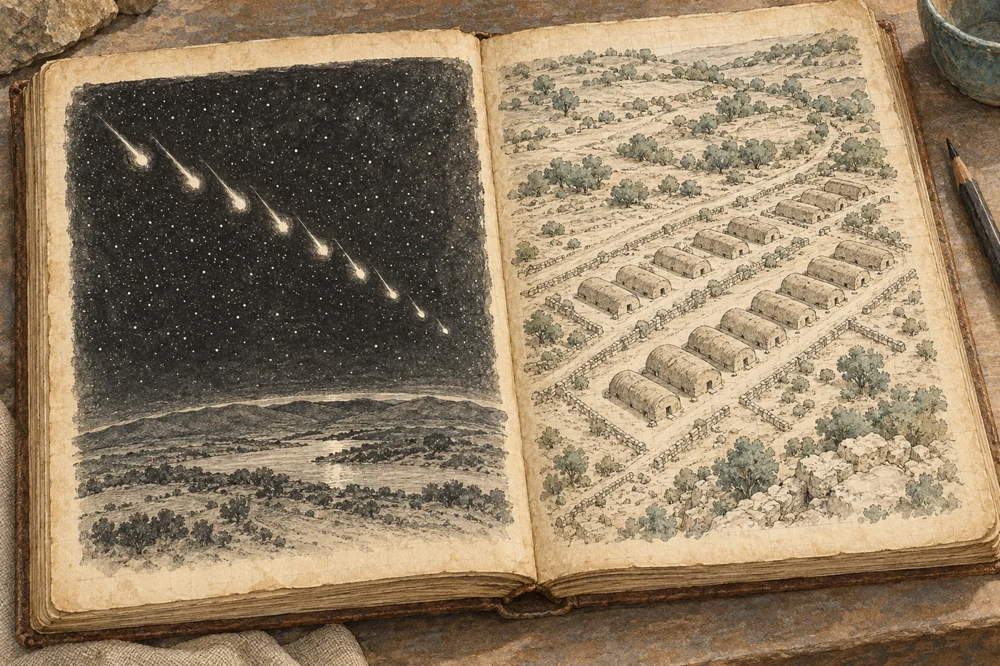

# 5. Pád z nebe

Vzorky odletí v úterý v devět dvacet.

Hana to ví z fotky, kterou jí Salcedo pošle z Méridy. Pult kurýrní firmy, na něm krabice obalená páskou, vedle ní lístek s čárovým kódem a Salcedův palec, zvednutý do záběru. Pod tím jedno slovo: *Listo.*

Zapíše si to vlevo. *10. 3. 9:20 vzorky 1–3 odeslány kurýrem (E. S., Mérida). Doklad foto.* Podle času na telefonu spala tři hodiny. Kalina spí ještě teď, pod plachtou na lehátku, s kloboukem přes obličej a se sešitem v kroužkové vazbě na hrudi.

*

Viktor přijde ve čtvrt na jedenáct a nese notebook otevřený. Tentokrát se usmívá.

„Tohle si přečti,“ řekne. „Tohle se ti bude líbit.“

Je to dokument z Los Angeles. Nadpis *Story Deck – Working Draft*, a pod ním dvanáct stran. Obrázky z Ríšova dronu, bílá studna shora jako oko. Fotka válce ze středy, ta, kde vedle něj leží Hanina karta s centimetry. Hana si všimne, že kartu někdo vyretušoval. Zůstal válec, poleva a tma.

Na třetí straně je text. Anglicky, velkým písmem, krátké řádky, jako by se měly číst nahlas.

*An ancient Maya legend tells of a stone that fell from the sky into a sacred well. When nine lights fell from the heavens, the elders say, the stone came down to the water – and waited.*

*Now, for the first time, science has found it.*

Hana to přečte jednou. Pak to přečte ještě jednou, pomaleji, protože poprvé četla jen slova a podruhé chce vidět, co dělají.

„No?“ řekne Viktor.

„Odkud to je?“

„Researcherka v LA. Hledala k tomu kontext. Mayská legenda, Hanko. Studna, hvězdy, kámen z nebe. Sedí to jak prdel na hrnec.“

„Ptám se, odkud to je. Kdo to vyprávěl. Kdo to zapsal. Kdy.“

Viktor se zarazí. Pak se zasměje, ne zle, spíš jako se člověk směje kolegovi, který na večírku začne mluvit o práci.

„Je to legenda. Legendy nemají poznámky pod čarou.“

„Mají. Proto se jim říká legendy, a ne reklamy.“ Hana posune notebook zpátky k němu. „Pošli mi, co ta researcherka našla. Všechno.“

Viktor jí to přepošle ještě před obědem. Odkaz na španělský web o mayských legendách, bez autora, s datem z roku 2011 a s obrázkem pyramidy, která stojí sto padesát kilometrů odsud a s cenoty nemá nic společného. Text je skoro stejný jako v dokumentu, jen delší a s víc přídavnými jmény. Pod ním nic. A pak sken jedné strany z americké knihy o záhadách starověku z devadesátých let. Tatáž legenda, ve dvou odstavcích, a za ní v závorce: *(tradición oral, Yucatán)*.

Ústní tradice. Yucatán. Hana se na tu závorku dívá dlouho. Je to přesně taková závorka, za jakou by studenta poslala přepsat seminárku.

*

Odpoledne v jednu nula šest se ozve lom. Středně silně. Zákal u severní stěny za dvě minuty, do hodiny pryč. Hana to zapíše a pak ještě chvíli sedí nad deníkem s perem v ruce.

Vpravo napíše:

*Legenda o „kameni z nebe“: pramen starší než web 2011 / kniha 199? – žádný. Hledat.*

A pod to, po chvíli:

*Kdyby přece – materiál meteoritický? → izotopy kyslíku. Dá se změřit.*

Je to druhá věta, která ji znepokojuje víc než ta první. Protože ji napadla sama a protože se jí líbí. Válec bez švu, bez stopy nástroje, z materiálu, který na fotkách vypadá jako keramika a na dotek možná jako kov. Dotek si zatím jen představuje. Kdyby byl z něčeho, co spadlo, z meteoritického železa nebo kamene, bylo by to divné, ale bylo by to vysvětlení. Meteority se dají poznat. Mají v izotopech kyslíku podpis, který na Zemi nevzniká. To je laboratoř, ne legenda. To se dá zjistit.

A přesně proto si to nesmí plést dohromady.

*

Ve čtyři Hana zavolá Marisol. Předtím dvakrát začala psát zprávu, krátkou, jestli by si mohly zavolat, až bude mít Marisol chvíli, a dvakrát ji smazala. V té první stálo *omlouvám se, že ruším*. Nakonec vytočí číslo rovnou. Nečeká, že to Marisol zvedne.

„Volám předem,“ řekne Hana, když to Marisol zvedne. „Ne potom.“

Na druhé straně je chvíli ticho. Pak něco, co by u jiného člověka mohl být smích.

„Předem čeho, doktorko?“

Hana jí to řekne. Story deck, legenda, web z roku 2011, závorka. Přečte jí anglický text ze třetí strany. Marisol ji nepřeruší.

„Nikdy jsem to neslyšela,“ řekne pak. „A to jsem z Méridy a babička byla z jižního kraje a vyprávěla mi o cenotech všechno, čeho se má dítě bát. O kameni z nebe nikdy.“ Odmlčí se. „To nic neznamená. Já nejsem pramen. Zeptám se kolegyně z etnohistorie, ta zná koloniální prameny i všechno, co se tu sbíralo ve dvacátém století. Kdyby to někde bylo, bude to vědět.“

„Děkuju.“

„A zeptejte se Walta.“

„Amese?“

„Walt četl všechno, co se o cenotech kdy napsalo. I to špatné. Hlavně to špatné.“ Další pauza. „Kdo to chce dát do oznámení?“

„Produkce. Viktor.“

„Vysvětlete jim jednu věc, doktorko. Až do světa napíšou *kámen z nebe*, přijedou sem lidi s detektory kovů. Ne vědci. Lidi s detektory a s lopatami, v noci, do každého cenotu v okruhu sta kilometrů. Viděla jsem to po jiném filmu. Jedna věta v titulku a já potom dva roky obcházím díry.“

„Řeknu jim to.“

„Řekněte jim to.“ A pak, než zavěsí: „Dobře, že jste volala.“

Hana drží telefon ještě chvíli u ucha, i když v něm už nic není. Zapíše si to. Vlevo, protože to slyšela. *M. C.: legendu nezná; ověří u etnohistorie. Doporučuje W. A.*

*

Kalina se probudí v pět a nejdřív se zeptá, jestli byl odstřel. Hana mu ukáže zápis. Kývne a jde si uvařit čaj.

V noci na středu měří znovu. Hana s ním nejde. Spí jako zabitá, poprvé od příjezdu, a ráno ho najde u stolu nad sešitem, stejně jako ho tam nechala, jen s jiným hrnkem.

„Padesát dva,“ řekne, než se Hana stačí zeptat.

„Plus minus?“

„Šest.“

*

Do Waltova domu je to čtyřicet minut Luisovým pick-upem. Luis řídí jednou rukou, druhou drží v otevřeném okně a pokaždé, když potkají někoho na kole, zvedne prsty z volantu. Na korbě drnčí prázdný kanystr.

„Proč nepřijede k nám?“ zeptá se Hana.

„Walt nechodí tam, kde se točí.“ Luis pokrčí rameny. „Když tady byla první velká televize, v devadesátých letech, Walt jim ukázal jeden cenote. Za rok tam byla cesta pro autobusy a stánky se suvenýry. Šňůru v jeskyni někdo přeřízl a dva Kanaďani se utopili, protože hledali východ podle šňůry, která vedla nikam.“ Odmlčí se. „Od té doby Walt nechodí tam, kde se točí.“

„Ale mapy ti dal.“

„Mně ano. Já jsem nebyl televize. Bylo mi deset a nosil jsem mu láhve.“

Městečko je jen o málo větší než X'Kanlum: dvě ulice místo jedné, benzinová pumpa, škola s nástěnnou malbou jaguára. Walt bydlí na jeho okraji, v nízkém domě s plechovou střechou a se zahradou, ve které kvete mango a pod ním leží na zemi stará kompresorová hlava, zarostlá svlačcem jako pomník.

Walt Ames je vysoký a tak vyhublý, že se zdá, jako by ho drželo pohromadě jen tričko. Kůži má hnědou a zvrásněnou jako staré sedlo, vlasy bílé a krátké, v pravém uchu naslouchátko a na rukou jizvy, malé a bílé, jakých má Luis jednu. Oči má světlé, skoro bezbarvé. Podá Haně ruku a nechá ji v ní o vteřinu déle, než je potřeba, jako by ji vážil.

„Ana,“ řekne. Luis mu o ní zřejmě vyprávěl. „Pojďte dál. Je tam chládek.“

Uvnitř chládek není, jen stín. Jedna velká místnost, na stěně police s knihami až ke stropu, anglické, španělské, několik německých, a mezi nimi cívky šňůry, staré masky a lahvičky s něčím, co vypadá jako vzorky vody. Uprostřed stojí plechová skříň se širokými plochými šuplíky, jakou mívají geodeti a archivy map. Na ní ventilátor, který se otáčí a nikoho neochladí.

Walt jim nalije vodu ze džbánu, sedne si a čeká.

„Luis vám asi řekl, proč jsem tady,“ řekne Hana.

„Luis mi řekl, že jste ta, co zapisuje odstřely.“ Walt se napije. „To je dobře. Nikdo jiný to nedělá. Já jsem to dělal patnáct let, než jsem přestal. Bylo mi z toho smutno.“

„Proč?“

„Protože jsem věděl, kolik jich bude.“

Hana vytáhne notebook. Ukáže mu fotky z minulé středy, ty s kartou, a Walt si nasadí brýle na čtení, které vytáhne z kapsy u košile, a dívá se. Dlouho. Na válec, na lem, na terasu, na žlábek. U snímku se značkami se zastaví. Hana čeká, že se zeptá na stáří, na materiál, na cokoli. Nezeptá se.

„Kdo všechno to viděl?“ řekne místo toho.

„Tým. Produkce v Los Angeles. INAH.“

„A za týden svět.“ Walt sundá brýle, položí je na stůl a natáhne ruku a sklopí víko notebooku, pomalu, tak opatrně, jako by zavíral oči mrtvému. „Stačí. Děkuju.“

Hana mlčí. Luis se dívá do sklenice.

„Měla bych se zeptat ještě na něco jiného,“ řekne Hana nakonec. „Produkce chce do oznámení legendu. O kameni, který spadl z nebe do studny. Když padalo devět světel.“

Walt se poprvé zasměje. Krátce, suše, jako když se zlomí větvička.

„Anaya,“ řekne. „Rodrigo Anaya Cervera. Ten se Studnou hvězd.“

„Kdo?“

Walt vstane. Jde k polici, nehledá, sáhne rovnou do třetí řady odspodu a vytáhne tenkou knihu v měkké vazbě. Položí ji před Hanu na stůl.

*El pozo de las estrellas.* Studna hvězd. Obálka kdysi modrá, teď vybledlá do barvy umyté džínoviny, na ní žluté hvězdy a černý kruh studny. Pod tím jméno autora a dole drobně: *Mérida, 1978. Edición del autor.*

Vlastním nákladem.

„Koupil jsem to v osmdesátém třetím na trhu v Méridě,“ řekne Walt. „Za pár pesos, od chlapa, který prodával staré časopisy. Kupoval jsem všechno, kde bylo slovo *cenote*. Chtěl jsem vědět, co lidi čtou, než přijdou ke mně se ptát.“ Sedne si zpátky. „Ten váš kámen z nebe je odtud. Kapitola sedm.“

„A odkud ho má Anaya?“

„To se ptáte správně.“ Walt se opře. „Píše, že to vyprávějí *los ancianos*. Starci. Kteří starci, kde, kdy, to nepíše. Já jsem se ptal. Třicet let jsem se ptal, ve vesnicích, kde jsem se potápěl, starých lidí, kteří mi vyprávěli o hadech v cenotech a o větru, který bere děti, o čemkoli. O kameni z nebe nikdo. Ani jeden.“ Pokrčí rameny. „Kniha vyšla a zmizela. Nikdo ji nečetl. Pak ji před patnácti lety někdo našel, nafotil a dal na internet, a od té doby je to stará mayská legenda.“

„Kdo byl Anaya?“

„Nevím. Nikdy jsem ho nepotkal. Na zadní straně není nic.“ Walt kývne ke knize. „Podívejte se sama. Ale je to nebezpečná kniha, Ana. Má hezké obrázky.“

*

Hana čte pomalu. Španělsky čte líp, než mluví, ale ne tak dobře, aby to stačilo, a dvakrát si musí vzít na pomoc telefon. Luis s Waltem mezitím mluví španělsky o šňůrách a o tom, čí kompresor v obci pouští do vzduchu olej. Ventilátor se otáčí.

Kniha má devadesát šest stran. Je psaná tak, jak se v sedmdesátých letech psaly knihy o tajemstvích: dlouhé věty, hodně otazníků, hodně slova *quizás*. Možná. Kapitoly o pyramidách, o hvězdách, o kalendáři, o tom, že mayští kněží znali věci, které moderní věda teprve objevuje. Žádné poznámky. Žádný seznam literatury. Na konci poděkování matce.

Kapitola sedm se jmenuje *La piedra que cayó del cielo*.

*Cuentan los ancianos que cuando cayeron las nueve luces, una piedra cayó al pozo, y el agua la guardó.*

Vyprávějí starci, že když padalo devět světel, spadl do studny kámen a voda ho uchovala.

A dvě strany o tom, co by to mohlo znamenat. Meteority, komety, Venuše. Kosmičtí návštěvníci, s otazníkem. A pak dvě kresby, každá přes celou stranu.

Hana se u první zastaví.

Je to kresba tuší, amatérská, ale přesná. Kreslil ji někdo, kdo neuměl kreslit lidi a uměl kreslit čáry. Černé nebe, husté tečky hvězd. A přes ně, šikmo shora dolů, řada světel. Devět. Spočítá je. Každé má za sebou tenkou stopu, jako ocas, a padají v řadě, jedno za druhým, k zakřivenému obzoru dole na okraji strany. Poslední je menší než ostatní a trochu pozadu.

Druhá kresba: krajina shora a v ní osada. Domy nízké a oblé, jako bochníky položené na prkno, a stojí v řadách. Rovně. Tak rovně, jak v krajině nic neroste. Tak stojí jen věci, které někdo narýsoval. Mezi nimi cesty a na cestách malé postavy, sotva čárky s hlavičkou.

Pod oběma stojí stejný popisek. *Según los ancianos.* Podle starců.

Druhá kresba. Řady oblých střech.

Něco se v ní zachytí. Nic určitého. Pocit, jako když na ulici v cizím městě zahlédne tvář a ví, že ji zná, a neví odkud, a než si vzpomene, tvář zmizí za rohem. Jako slovo na jazyku. Je to tak blízko, že se jí na vteřinu zastaví dech, a tak daleko, že neví, kam sáhnout.

Devět. Proč zrovna devět?

A pak to přijde. Ne tvář, řádek. Modrá složka nad lednicí, pracovní překlad kodexu, stránka, kterou loni v dubnu v Chebu četla dvakrát. *Devět jich pomalu padá. Kraj shora, hory a voda. Oblé domy v rovných řadách.* U anglických vět ze story decku jí to nedošlo. Došlo jí to až u obrázku.

Na vteřinu se jí to zdá jako něco. Pak udělá, co by udělala se studentem. Devítka je nejobyčejnější číslo, jaké legendy mají. Mayové mají devět pater podsvětí a devět pánů noci, mnich ve dvanáctém století měl devět kůrů andělských, a když starci nebo mniši nepočítají, řeknou devět, jako se řekne hodně. A oblé domy stojí v každé obci tady kolem, z kůlů a palmového listí, s oblými konci. Jedno číslo a jeden tvar. Z takových shod se plní ty police v antikvariátech, kam nechodí.

Nezapíše to. Ani doprava.

„Hezké, že?“ řekne Walt.

Hana zvedne hlavu. Walt se na ni dívá přes stůl. Luis taky.

„Ano,“ řekne. „Hezké.“

Podívá se zpátky na kresbu a pocit je pryč. Zbudou domy jako bochníky a tečky hvězd. Sedmdesátá léta, napadne ji. Každá kniha tohohle druhu tehdy měla nějaké kupole, nějaká světla na nebi, nějaké řady. Ty knihy se podobají jedna druhé, tak jako se navzájem podobají lidské sny. Proto je člověk pozná, i když je nikdy neviděl.

Zavře knihu. Na zadní straně obálky opravdu nic. Jen cena, přeškrtnutá tužkou, a pod ní jiná, nižší.

„Můžu si ji půjčit?“

„Vezměte si ji.“ Walt mávne rukou. „Vraťte mi ji, až odjedete. Nebo ne. Já ji znám.“

*

Walt otevře skříň s mapami.

Šuplíky jdou ztuha. Vytahuje jeden po druhém a v každém leží listy průsvitné kreslicí fólie, tuhé, zažloutlé na okrajích, každý s rohem popsaným tužkou: jméno cenotu, rok, iniciály. *WA 1984. WA + LE 2009.* Na listech chodby, kreslené tuší a tužkou, s čísly měřických bodů, s hloubkami, se šipkami proudu. Kužely balvanů jako drobné kroužky. Zúžení jako dvě čárky těsně u sebe. Haně se z toho tají dech. Ne kvůli tomu, co na nich je. Kvůli tomu, jak je to nakreslené. Čtyřicet let práce v rukopisu jednoho člověka, každá čára vedená tak, jako by se za každou chybu platilo.

Sak Ts'ono'ot má vlastní šuplík. Walt z něj vytáhne čtyři listy a rozloží je přes sebe na stole, aby navazovaly.

Hlavní chodba. Téčko. Doprava, k hrdlu, a za ním sestup, hloubky v metrech, drobná poznámka *haloclina 25* a vlnovka. Boční síň tu není. Luis ji našel nedávno; Walt ji ještě nekreslil, nebo ji kreslit nechce.

A pak si Hana všimne prázdných míst.

Nejdřív jen jednoho. Za hrdlem, kousek před sestupem, odbočuje z chodby čára doleva a nahoru. Krátká. Měřický bod číslo čtyřicet osm. A pak nic. Čára končí šipkou, která ukazuje do bílé fólie. Žádné hloubky, žádné stěny. Další bod, který je na listu nakreslený, má číslo šedesát jedna a leží už zase na hlavní šňůře, dole za sestupem.

Čtyřicet devět až šedesát chybí.

Projde i ostatní listy. Jiné cenoty, z jiných šuplíků, které Walt nechal otevřené. Tady chodba končí uprostřed, jako by ji někdo utnul nůžkami, a přitom čísla bodů za ní pokračují. Tady je síň nakreslená jen obrysem, bez jediné hloubky, jako dům bez oken. Tady chybí celý kus listu, prázdný obdélník, kolem kterého je všechno ostatní nakreslené s velkou péčí.

„Tady jste nemapoval?“ zeptá se a ukáže na odbočku za hrdlem.

Walt se podívá, kam ukazuje, a pak na ni.

„Co nenakreslíte, to vám nikdo nevykrade,“ řekne.

To je celá odpověď. Hana ji obrací v hlavě a rozumí jí. Viděla fotky cenotů, kde z kostí v síních zbyly jen otisky v sedimentu. Kde turisté vylámali krápníky na suvenýry. Kde někdo uřízl šňůru. Walt kreslí to, co je bezpečné ukázat. Zbytek nosí v hlavě.

Je to rozumné. Je to přesně to, co by na jeho místě dělala sama.

Luis se na prázdné místo nedívá. Dívá se na Walta.

„Půjčím vám kopie,“ řekne Walt. „Světlotisky, z devadesátých let. Originály ne. Originály tady zůstanou.“ Vytáhne z rohu kartonový tubus, otevře ho a vysype na stůl srolované listy, šedé, s modrými čarami. „Luis je zná. Kdybyste se v té jeskyni ztratila, Luis vás najde líp než papír.“

„Doufám, že se neztratím.“

„To doufá každý.“ Walt zabalí kopie zpátky do tubusu a podá jí ho. A pak, když už stojí ve dveřích, ještě řekne, tiše, jako by to říkal spíš mangu na zahradě:

„Nedávejte tam souřadnice, Ana. Do toho oznámení. Ať si myslí, co chtějí, ale souřadnice tam nedávejte.“

*

Cestou zpátky Luis mlčí, dokud nepřejedou koleje staré úzkokolejky, která už nikam nevede.

„Walt se do jeskyně nepotápí pro slávu,“ řekne pak. „Nikdy. Říká, že sláva je to jediné, co jeskyně nesnese.“

„A ty?“

Luis se na ni podívá od volantu. Dlouze, jako tehdy ráno u šňůry.

„Já se potápím, protože je to naše studna,“ řekne. „To je něco jiného.“

*

Večer zapíše do deníku Anayu.

Vlevo: *Anaya Cervera, R.: El pozo de las estrellas. Mérida 1978, vlastním nákladem, 96 s., bez poznámek a literatury. Kap. 7 „La piedra que cayó del cielo“: „cuando cayeron las nueve luces, una piedra cayó al pozo“. Zdroj uveden jen „los ancianos“ – bez jmen, míst, dat. 2 kresby (tuš): 9 padajících světel; osada oblých domů v řadách; obě „según los ancianos“. W. A.: kniha z trhu 1983, v obcích ji nikdy od nikoho neslyšel („třicet let jsem se ptal“). Pramen starší než 1978: zatím žádný.*

Pak se zastaví. Chtěla by napsat ještě něco o té kresbě, o Mlýnci. Ale co. Devět světel v Méridě, devět světel v kodexu. Shoda jednoho čísla nepatří doleva. A doprava ji nepustí, protože by to byla přesně ta věta, za kterou by studenta poslala přepsat seminárku.

Vpravo napíše: *Kniha o záhadách (199?) cituje „tradición oral“. Odkud ji měla, když Anaya byl na internetu až kolem 2011 a předtím ho podle W. A. nikdo nečetl?*

A pod to: *Waltovy mapy: prázdná místa i tam, kde čísla bodů pokračují (Sak Ts'ono'ot b. 49–60, odbočka za hrdlem). Ochrana lokalit?*

Oba otazníky tam nechá.

*

Ve čtvrtek ráno přijde e-mail od Marisol. Dva řádky, a pod nimi přeposlaná odpověď kolegyně, španělsky, s pozdravem a s titulem.

*Neznám ji ze žádného koloniálního ani etnografického pramene, který bych měla v ruce. Pokud existuje, je mladší než kniha, kterou zmiňuješ, nebo z ní vychází.*

Hana si to přeloží dvakrát, aby měla jistotu. Vytiskne to na Salcedově malé tiskárně, která tiskne šedě a nakřivo, a přidá k tomu fotku sedmé kapitoly a obě kresby.

Videohovor je v jedenáct. Producentka sedí v Los Angeles v kanceláři s bílou stěnou a s rostlinou v rohu, která je možná umělá, a je u ní deset dopoledne, a je usměvavá a čerstvá a v ruce drží kelímek s kávou, na kterém je napsané její jméno. Viktor sedí vedle Hany pod plachtou, s notebookem na bedně, a kolem jejich hlav krouží jedna moucha, kterou nikdo z nich neodežene.

Hana jí to řekne. Postupně, jako referát. Web z roku 2011, kniha z devadesátých let, závorka. Kniha z roku 1978, vlastním nákladem, bez pramenů. Walt, třicet let otázek. Marisol. Etnohistorička. *Neznám ji ze žádného pramene.*

„Není to mayská legenda,“ řekne nakonec. „Je to kapitola sedm z knihy amatéra z Méridy. Kdybychom ji dali do oznámení, budou lidi věřit, že ten nález a legenda patří k sobě. Že jedno potvrzuje druhé.“

Producentka kývá. Celou dobu kývá, s vlídným a pozorným výrazem, a Hana si v půlce uvědomí, že takový výraz zná z fakultních komisí. Výraz člověka, který už rozhodl a je ochoten vyslechnout, proč nerozhodl dobře.

„This is so valuable, Hana,“ řekne, když Hana domluví. „Really. Thank you.“

Vysvětlí, že nikdo neříká, že je legenda pravdivá. Že legenda je *framing*. Rámec. Že lidé nechtějí slyšet o uran-thoriové metodě, dokud nevědí, proč by o ní měli chtít slyšet. Že legenda je dveře. A že už je stejně na internetu, takže ji tam nedávají oni, jen ji *acknowledge*. Berou na vědomí.

„Řekněme tedy, že pochází z knihy z roku 1978,“ řekne Hana.

Producentka se usměje.

„We'll say *according to local legend*. That's accurate, right? It's local. It's a legend.“

Hana se podívá na Viktora. Viktor se dívá do obrazovky.

„Hanko,“ řekne česky, aniž by se na ni otočil. „Nikdo netvrdí, že je to pravda. Je to rámec. Dveře. Za dveřmi jsi ty a tvoje čísla.“

„Za dveřmi bude kámen z nebe. A já vedle něj.“

„A nepatří tam?“

Otázka zazní lehce, skoro žertem. Hana se nadechne, že odpoví, a zjistí, že neví, co přesně. Myslí na izotopy kyslíku. Na svou vlastní větu vpravo, tu, která se jí líbila.

„Nevím,“ řekne. „Proto to tam nepatří.“

„Okay,“ řekne producentka, která česky nerozumí, ale rozumí tónu. „Let's do this. Legend stays, Hana's name isn't next to it. Hana talks science. The legend is just the… the mood. Does that work for everyone?“

Hana by ráda řekla, že ne. Že *the mood* je přesně to, co si lidé zapamatují, a že z vědy jim zůstane jedno číslo, a i to číslo si budou pamatovat špatně. Že Marisol bude obcházet díry. Že Walt sklopil víko notebooku jako oči mrtvému.

Řekne to. Skoro všechno. Producentka kývá.

Legenda zůstane.

*

Po hovoru Viktor zavře notebook a chvíli sedí.

„Vyhrála jsi víc, než si myslíš,“ řekne. „Chtěli tam mít meteorit. Chtěli, abys na kameru řekla, že je to meteorit. Vymluvil jsem jim to.“

„Kdo jim řekl, že by to mohl být meteorit?“

Viktor se na ni podívá s úsměvem, který se snaží být nevinný.

„Ríša mi ukazoval tvůj deník. Fotky. Kvůli archivu.“ Pokrčí rameny. „Psala jsi tam izotopy. Líbilo se mi to. Řekl jsem to v LA a líbilo se to i jim.“

Hana chvíli nemluví. Pravá půlka stránky. Věděla, že fotky jdou do archivu. Nemyslela si, že je někdo čte.

„To byla otázka,“ řekne. „Ne tvrzení.“

„Já vím. Proto jsem jim to vymluvil.“ Viktor vstane a položí jí ruku na rameno, krátce, teple. „Řekneš na kameru, že se to dá změřit. To je pravda. To je dost.“

Odejde telefonovat. Hana se dívá na tubus s Waltovými mapami, opřený o nohu stolu, a na Anayovu knihu vedle něj. Na hřbetu je pořád vidět stopa po cenovce, kterou někdo kdysi odlepil.

*

V jedenáct padesát osm a v šestnáct čtyřicet střílí lom. Dvakrát. Poprvé silně. Hana stojí u cenotu, když přijde první, a dívá se, jak se ze severu zvedá mléko. Rosa vyjde z kuchyně pod plachtou s utěrkou přes rameno, podívá se na hodinky a zase zajde dovnitř. Večer Hana zjistí, že si Rosa v kalendáři u čtvrtka nakreslila malý křížek. Pátý talíř.

Kalina přijde k jejímu stolu v jedenáct večer se sešitem v ruce. Celý den v něm přepočítával čísla z další noci měření. Sedne si naproti a otevře ho na stránce, kde jsou tři sloupce čísel, tužkou, úhledně, a pod nimi čtvrtý.

„Pořád šest,“ řekne.

„Myslela jsem, že průměr pomůže.“

„Průměr pomáhá proti chybě, která se mění. Jednou je o kus vedle, podruhé o kus na druhou stranu, a když to sečtete, vyruší se.“ Kalina zavře sešit. „Tahle se nemění. Je pořád stejná a pořád stejným směrem. To dělá ta slaná voda, každou noc stejně. Takovou chybu nezprůměrujete. Tu musíte najít.“

„A když ji nenajdete?“

„Tak ji napíšete. Plus minus šest.“

Kalina se dívá na sešit.

„Viktor mluvil o meteoritu,“ řekne potom, jako by to s tím souviselo. Možná souvisí. „U večeře. Ptal se, jestli se meteority dají najít přijímačem.“

„Dají?“

„Ne.“ Kalina se zvedne. „Řekl jsem mu, že ne. Ptal se dvakrát.“

Odejde ke svým bednám. Hana zůstane u stolu. Otevře deník na čisté straně, udělá svislou čáru a vlevo zapíše dva odstřely. Časy, síla, zákal. Rosin pátý talíř. Pak Kalinovu větu, protože ji slyšela: *Systematickou chybu nezprůměrujete. Musíte ji najít. (T. K.)*

Vpravo nic. Pravá půlka teď patří Ríšovi a Los Angeles, napadne ji, a hned se za tu myšlenku zastydí. Deník je pořád její. Jen ví, kdo ho čte.

Než ho zavře, sáhne do batohu pro pero a nahmatá místo něj tvrdý hřbet Anayovy knihy. Vytáhne ji. Otevře se sama na sedmé kapitole, protože ji tam včera u Walta nechala otevřenou příliš dlouho.

Oblé domy. Řady.

Dívá se na ně, ale tentokrát se nic nezachytí. Jsou to jen čáry tuší na zažloutlém papíře, který voní jako všechny staré knihy na všech trzích světa. Zavře ji a zastrčí zpátky do batohu, mezi deník a tabulku z předloktí, ke dvěma věcem, které zatím z rukou nepustila víc než na fotku.

Generátor o půlnoci zhasne. Batoh si Hana vezme s sebou do stanu.
