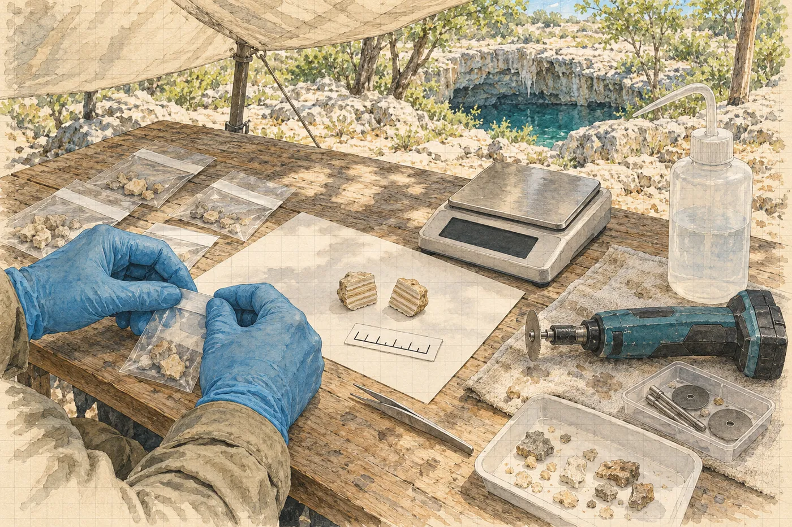

# 7. Dělené vzorky

Marisol přijede ve tři čtvrtě na šest, ještě za tmy, a nejdřív zase obejde tábor.

Tentokrát u toho svítí čelovkou. Kompresor, láhve, bedna s nářadím. Ríšovy terče na ručníku pod plachtou, srovnané do řad. Kufr, který přivezla, nechá v pick-upu. Je černý, plastový, s pěnou uvnitř a se dvěma zámky, a Hana ho uvidí, až když ho Marisol otevře na kapotě, aby z něj vyndala desky.

Změna povolení má jednu stranu. Dvě místa odběru navíc, kontaktní kůra, nejvýš pět gramů z místa, každý vzorek rozdělit na poloviny na místě, v přítomnosti zástupce ústavu. Polovina označená římskou dvojkou do úschovy INAH. Fotogrammetrie okolí předmětu před jakýmkoli zásahem. Pod tím razítko a dva podpisy, jeden Marisolin.

„V půl osmé jste dole,“ řekne Marisol. „Ve dvě podruhé. Já jsem tady celou dobu.“ Podívá se na Viktora, který stojí za Hanou s hrnkem kávy. „Celou dobu, *señor* Brabec.“

„Jsme rádi,“ řekne Viktor.

V šest dvacet zastaví u brány na pozemek ejida auto. Pak druhé. Hana je vidí, protože jde zrovna s kanystrem k umyvadlu a od umyvadla je přes keře vidět kus cesty. Tři mladí muži, jeden s batohem, ze kterého trčí tyč s kruhem na konci, jakou se hledá kov. Druhé auto je bílé, s logem televize, kterou Hana nezná. Mladík z obce, ten, co má klíč od řetězu, stojí u brány a nemluví s nimi.

Za deset minut nad lesem přeletí dron. Ne Ríšův. Ríšův leží v bedně. Zastaví se nad cenotem, chvíli visí, bzučí jako vosa v zavařenině, a pak odletí k silnici.

„Ti druzí,“ řekne Rosa u kuchyně. Nikomu. Pak jde dál krájet cibuli.

*

V hrdle Ríša ohne tyč.

Hana to nevidí. Slyší jen tupé ťuknutí kovu o skálu, když Ríšův vak s tyčemi uvízne ve štěrbině, a vidí, jak Luis před ní zastaví a otočí se. Ríša za ní vak uvolní, trhnutím, a proplave. Na druhé straně, na sestupu, jí ukáže palec a ona mu ho vrátí.

V síni vytáhne tyče z vaku a jedna z nich je prohnutá. Mírně, do oblouku, jako napnutý luk. Ríša se na ni dívá přes masku a Hana vidí, jak se mu za sklem stáhne obličej.

Tyč A. Na jejím konci stojí vyraženo *500,00*. Teď to není pravda.

Hana mu vezme tyč z ruky a položí ji stranou, na polevu u Abuela, mimo místo, které budou fotit. Pak ukáže na druhou tyč. Tu rovnou. Ríša kývne. Hana vytáhne z kapsy pásmo, to, kterým tu devátého měřila vzdálenost majáku od válce, a ukáže ho Ríšovi. A ukáže na dva terče, které už leží na terase. Kontrola. Ríša znovu kývne.

S jednou tyčí se měřítko modelu nedá ověřit. Program se jí zeptá, jak je tyč dlouhá, ona mu odpoví *pět set*, a on jí uvěří. Druhá tyč by mu odporovala, kdyby něco nesedělo. Druhá tyč teď leží u Abuela a odporovala by mu vždycky. Proto pásmo. Proto kontrolní vzdálenost změřená rukou. Do programu ji nezadá, jen si ji zapíše, a večer se podívá, jestli model s pásmem souhlasí.

Je to stará poctivá věc. Kalina by ji pochválil.

Luis čeká u Abuela. Ríša podrží konec pásma u terče číslo dvě. Hana ho vede k terči číslo pět a čte. Šest set dvanáct milimetrů. Přečte to dvakrát, pak to zapíše na tabulku na předloktí, velkými číslicemi. *T2–T5 612.*

Ríša se pustí do práce.

Pluje kolem válce v kruzích, pomalu, s fotoaparátem před sebou a se dvěma blesky na ramenou, a každou vteřinu cvakne. Kruh u dna. Kruh výš. Kruh nad převisem, kde se sotva vejde. Blesky síň rozsvěcují do bílé a zase ji zhasínají, bílá, tma, bílá, tma, jako by tu pod vodou někdo pracoval se svářečkou. Hana visí u LE 14 vedle majáku, aby mu nepřekážela, a dívá se, jak válec v záblescích mění tvar. Někdy je dlouhý a bledý. Někdy je to jen stín pod převisem.

V jednom záblesku z boku uvidí jeho spodní konec.

Není vidět, je pod polevou. Ale když světlo přijde nízko a šikmo, je vidět, kde končí. Poleva nad ním je tenká a obkresluje ho, oblý obrys těsně pod povrchem, jako prst pod prostěradlem. Ríša ho má na fotkách. Program ho z nich vymodeluje a Hana pak bude vědět, jak je válec dlouhý celý, ne jen jeho viditelná část.

Ukáže Ríšovi žlábek. Ríša nechápe. Ukáže znovu, prstem dolů pod hranu terasy, a pak udělá rukou kruh. Celý. Ríša pokrčí rameny a sjede s fotoaparátem dolů a fotí žlábek. Úlomky, krémové a o něco tmavší. A vpravo ten kousek s bílým lomem, o kterém se Hana šestého nerozhodla a devátého se ho nedotkla.

Bude v modelu. Bude změřený a nafocený ze šesti set úhlů. Nikdo ho už nebude muset vzít do ruky, aby se dalo říct, jak ležel.

Hana si uvědomí, že tohle je první věc, kterou kvůli vzorku tři udělala správně. A že o ní nikdo neví.

Ríša proplave kolem tyče B a ploutví zvedne ze dna obláček. Jemný, šedý, jen na vteřinu. Pak se kal zase usadí, pomalu, jako všechno tady dole, a Hana na něj zapomene, protože se dívá na hodinky.

Devatenáct minut. Šest set čtyřicet snímků.

*

Mezi ponory sedí s Ríšou u jeho notebooku.

Ríša nahraje fotky a spustí program a program chvíli přemýšlí a pak na obrazovku vysype mračno bodů. Šedé, řídké, jako písek rozfoukaný po skle. Z písku se postupně skládá okolí válce. Terasy, převis, LE 14. A uprostřed nich bledý stín.

„Terče našel,“ řekne Ríša. „Skoro všechny.“ Ukáže na seznam. U jednoho z terčů na tyči B svítí místo čísla otazník. „Tenhle ne. Na většině fotek ho nevidí.“

Hana se nakloní. Ríša zvětší jeden snímek. Konec tyče B, terč. Kruh s černým středem a s kódem po obvodu. Jenže polovina terče, ta vnější, je šedá. Ne černá, ne bílá. Pokrytá tenkou vrstvou kalu, jako prachem na skle, a pod ní není vidět ani kód, ani střed.

„Ploutev,“ řekne Ríša. „Promiň.“

„Dá se to dát ručně?“

„Dá. Klikneš na střed na každé fotce, kde ho vidíš. Je to opruz.“ Ríša si promne oči. Spal pět hodin a v hrdle ohnul tyč, která stojí víc než jeho výplata. „Dáš to? Já zatím zkontroluju zbytek.“

Hana si vezme myš.

Je to opruz. Patnáct fotek, na každé terč z jiného úhlu, a na každé je jeho vnitřní polovina vidět a vnější ne. Střed terče je pod šedou. Hana ho hledá, a protože ho nevidí, dá značku tam, kde by podle toho, co vidí, být mohl. Do středu viditelné části. O kousek dovnitř, k tyči. Na každé fotce stejně, aby to bylo aspoň důsledné.

„Dobrý,“ řekne Ríša přes rameno. „Teď mu řekni, že je to pět set.“

Hana napíše do kolonky *0,500*. Program se na chvíli zamyslí a pak model, který byl do té chvíle jen tvarem bez velikosti, dostane metry. Válec leží pod převisem. Všechno má svou míru.

V poledne, ve dvanáct čtrnáct, se ozve lom. Středně silně. Hana vstane od notebooku, jde k cenotu. Ze severu se zvedá mléko. Zapíše si čas. Ríša za ní spustí výpočet hustého modelu a program napíše, že to potrvá deset hodin.

*

Podruhé jdou dolů ve dvě. V hlavní chodbě je vidět na osm metrů, za hrdlem je zase čisto. Haloklina drží zákal nahoře jako poklice.

Ríša tentokrát nefotí, ale natáčí. Má Viktorovu menší kameru, tu bez ramen, a jedno světlo. Marisol to chtěla. *Každý odběr od začátku do konce, jedním záběrem, bez střihu.* Luis zůstane u Abuela. Dva v síni.

Vzorek čtyři. Kontaktní kůra u horního čela, na opačné straně, než je jizva po trojce, pět centimetrů od pole značek. Hana položí kartu. Fotí. Ukáže Ríšovi, aby si najel na kartu, a pak teprve nasadí dláto.

Kůra se uvolní celá. Najednou, jedním kusem, a zůstane jí v dlani. Hana ji nepustí. Otočí ji v prstech, aby Ríša viděl spodní stranu, tu, která seděla na válci, hladkou, téměř lesklou, s otiskem. Dá ji do sáčku se čtyřkou a zavře ho. Teprve potom vydechne. Foto po odběru. Karta. Jizva na lemu, čerstvá a bílá.

Vzorek pět. Kontaktní kůra níž, tam, kde válec mizí v polevě a kde je kůra nejsilnější, skoro centimetr a půl. Tady se drolí. Hana tluče krátce a mnohokrát a drží pod dlátem dlaň a kůra jí do ní padá po kouscích, tři, čtyři, a ona je chytá, všechny, a ví o každém, odkud spadl. Nic nesklouzne. Nic nespadne do žlábku.

Foto po odběru.

Šestnáct minut.

Na dekompresi visí ve třech metrech, dva sáčky na karabině u hrudi. Čtyřka, pětka. Na pohled stejné jako trojka. Stejně krémové, stejně malé.

Jenom o nich ví všechno.

*

Dělí je pod plachtou v půl páté.

Stůl je vytřený do sucha a pokrytý čistým papírem. Na něm digitální váha s přesností na setiny gramu z Marisolina černého kufru, která se v horku trochu chvěje a Hana ji musí dvakrát vynulovat. Malá bateriová bruska s diamantovým kotoučem, tenkým jako nehet. Střička s destilovanou vodou. Lupa. Karta s měřítkem. Sáčky ústavu s natištěnými kolonkami a s pečetními páskami, každá s vlastním číslem.

Marisol sedí naproti. Ríša stojí za Haninými zády s kamerou. Viktor stojí kousek dál, s rukama zkříženýma na prsou, a nic neříká. Salcedo přijel ve čtyři kvůli polovinám pro laboratoř a sedí na bedně s deskami na kolenou.

„Svědek,“ řekne Marisol a rozhlédne se. „Kdo tady nepracuje pro pana Brabce?“

Chvíli je ticho.

„Já pracuju pro pojišťovnu,“ řekne Kalina od svých beden. „Pan Brabec mě jen platí.“

Marisol se na něj podívá přes brýle. Jako se člověk dívá na vzorek, o kterém ještě neví, z jaké je vrstvy.

„To stačí,“ řekne.

Hana vezme vzorek čtyři do prstů a pod lupou si najde laminy. Jemné proužky, krémové a o odstín tmavší, rovnoběžné s kontaktní plochou. Bude řezat kolmo na ně. Tak, aby v každé půlce zůstala celá řada vrstev, od otisku na spodní straně až po povrch. Aby obě půlky byly totéž.

Bruska zavrčí. Hana pouští na kotouč vodu ze střičky, aby se kámen nezahříval, a vede řez pomalu, bez tlaku. Prach se jí lepí na prsty. Ríša se nakloní s kamerou blíž.

Dvě půlky. Hana je položí vedle sebe na papír s kartou a fotí. A každou zváží. *4/I – 2,14 g. 4/II – 2,03 g.* Marisol si čísla opíše do formuláře. Hana dá půlku označenou římskou jedničkou do sáčku, zapečetí ho, a Salcedo si ho převezme a podepíše. Půlku s dvojkou dá do sáčku ústavu. Marisol přetáhne přes uzávěr pečetní pásku, přečte nahlas její číslo a zapíše ho.

Pak formulář.

*Cadena de custodia.* Řetězec úschovy. Kolonky: číslo vzorku, popis, hmotnost, datum a čas, číslo pečeti. Předal, převzal, svědek. Hana se podepíše jako ta, která předává. Marisol jako ta, která přebírá. Kalina se podepíše jako svědek, pomalu, úhledně, celým jménem, jako by podepisoval něco, co si za deset let přečte znovu.

Vzorek pět je horší. Je ve čtyřech kusech a Hana musí každý řezat zvlášť a pak skládat půlky tak, aby v každé byl zastoupený každý kus. Trvá to hodinu. Viktor mezitím dvakrát odejde a vrátí se. Jednou řekne *zlatnice*, ne zle, spíš unaveně. Hana to neslyší. Večer jí to řekne Ríša.

*5/I – 2,41 g. 5/II – 2,33 g.*

Když Marisol zavře černý kufr, je skoro sedm. Zamkne ho oběma zámky, zastrčí klíček do kapsy košile a odnese kufr do pick-upu, kde ho zamkne podruhé.

„Do Méridy pojedu ráno,“ řekne. „Za tmy po té silnici nejezdím, když nemusím. Psi, krávy a *topes*.“ Poprvé za celý den se usměje, jen koutkem úst. „Spím u dona Felipa. Kdyby cokoli, víte, kde jsem.“

*

Rozhovor natočí v sedm dvacet, na okraji cenotu, pod Ríšovým světlem.

Hana sedí na kameni, kde sedává, s cenotem za zády, a Ríša jí připne na tričko mikrofon. Viktor stojí za kamerou a ptá se. Ptá se dobře. Patnáct let ví, na co se jí zeptat, aby odpověděla pěkně.

Odpovídá pomalu. Kůra rostla na suchu. Nejstarší vrstva, ta, která sedí na povrchu předmětu, ukazuje, jak dlouho tam předmět leží nejméně. Předběžný výsledek jednoho vzorku je sto jeden tisíc let. Nejméně. Další vzorky jsou dnes rozdělené na poloviny a polovina každého je v úschově mexického ústavu. Kdokoli je může změřit znovu.

„Skvělý,“ řekne Viktor. „Ještě jednou to číslo. A tentokrát bez *nejméně*. Je to tam potom dvakrát, je to těžký.“

Hana se podívá do kamery.

„Sto jeden tisíc let,“ řekne. „Nejméně.“

Viktor se zasměje. Mávne rukou.

„Dobře. Máme to.“

*

Model je hotový ve čtvrt na jedenáct.

Ríša ho na obrazovce otáčí, jako by držel v ruce hračku. Okolí válce je teď celé, šedé a hladké, s terasami a s převisem, s majákem na terase u LE 14 a s válcem. Válec je bledší než všechno kolem. Program mu dal barvu z fotek. U jeho spodního konce je na polevě vidět mírné vyboulení, oblé, jako prst pod prostěradlem.

„Krása,“ řekne Ríša. Myslí to vážně.

Vyexportuje to a pak vytáhne z kapsy disk. Viktor stojí za ním a natáhne ruku se svým, černým, s nálepkou firmy.

„Pro produkci,“ řekne. „Záloha. Kdyby ti v noci shořel počítač.“

Ríša nahraje kopii na Viktorův disk a natáhne ruku k Haně. Hana mu podá flešku.

„Ať to máš,“ řekne Ríša. „Měřítko jsi dělala ty, tak si ho zkontroluj.“

Vyfotí její deník, jako každý večer, jednou, dvakrát, potřetí s bleskem, a jde spát. Viktor jde taky. Generátor brumlá a nad žárovkou krouží můry.

Hana si otevře model na svém notebooku, v programu, který umí jen prohlížet a měřit. Najde terč číslo dvě. Najde terč číslo pět. Klikne na střed jednoho a pak na střed druhého a program jí ukáže vzdálenost.

*617 mm.*

Na tabulce, kterou má vedle sebe na stole, stojí velkými číslicemi *T2–T5 612*.

Pět milimetrů.

Klikne znovu, pečlivěji. Šest set sedmnáct. Šest set šestnáct. Šest set sedmnáct. Pásmo ve vodě se mohlo prověsit, napadne ji. Ne o pět milimetrů na šedesáti centimetrech, když ho Ríša držel napnuté. Mohla špatně přečíst číslo. Přečetla ho dvakrát.

Změří vzdálenost majáku od čela válce. Devátého ji měřila pásmem: osmdesát sedm centimetrů. Model říká osmdesát sedm sedm.

Ne pět milimetrů. Necelé procento. Všechno v modelu je o necelé procento větší, než má být.

Hana se opře o židli. Pak se nakloní zpátky a otevře si snímek tyče B, ten se šedivým terčem. Vnější polovina pod kalem. Vnitřní vidět. A značka v programu, kterou dala sama, do středu toho, co bylo vidět. O kousek dovnitř.

Takže vzdálenost mezi jejími dvěma značkami na tyči byla o kousek kratší než pět set milimetrů. A ona programu řekla, že je to pět set. Program jí uvěřil a natáhl podle toho celou síň.

Je to tak jednoduché, že by se mohla smát. Druhá tyč by to poznala. Druhá tyč leží ohnutá u Abuela.

Spočítá to. Šest set dvanáct děleno šesti sty sedmnácti. Nula celá devět devět dva. Délky z modelu násobit tímhle. Najde válec. Klikne na střed horního čela a na nejzazší bod oblého vyboulení u spodního konce, tam, kde pod polevou končí obrys.

*464 mm.*

Krát nula celá devět devět dva. Čtyři sta šedesát. Čtyřicet šest centimetrů.

Správně by se to mělo udělat znovu. Značku na terči smazat, nedávat ji vůbec, nebo ji dát jinam, přepočítat model, nechat program zase deset hodin přemýšlet. To jde jen na Ríšově notebooku, s jeho licencí. A je půl dvanácté a o půlnoci zhasne generátor.

Otevře deník. Ríša dnešní stránku už vyfotil. Hana pod poslední řádek připíše, menším písmem, aby se to vešlo:

*23:30 Model 18. 3. (R. H.), kontrola měřítka: T2–T5 pásmo 612 mm, model 617 mm (+0,8 %). Maják–čelo: pásmo 87 cm, model 87,7 cm. Příčina: ručně umístěná značka na zaneseném terči tyče B (H. V.), tyč A ohnutá, nepoužita. Délky z modelu násobit 0,992. Předmět: model 464 mm (vč. obrysu konce pod polevou) → opr. ~460 mm. Přepočítat (R. H.).*

Je to vlevo a patří to tam. Je to změřené.

Ríšovi to řekne ráno.

Zavře notebook. Generátor o půlnoci zhasne a ona sedí ve tmě a myslí na černý kufr v Marisolině pick-upu před domem dona Felipa, se dvěma zámky, na dvě půlky v něm a na to, že je Marisol převzala z jejích rukou a že u toho seděl svědek. Myslí na to, jak je to snadné, když se to udělá pořádně. Jak je to snadné, a jak to člověk přesto nedělá.

*

Ráno se probudí ve tři čtvrtě na sedm. Ríšův stan je zavřený a zevnitř je slyšet chrápání. Hana se rozhodne počkat, až vstane sám. Uvaří si kávu na Rosině vařiči. Rosa ještě nepřijela, takže to nikdo neuvidí. S hrnkem jde k cenotu.

Voda dole je čirá. Kužel balvanů je vidět až k patě.

Marisol přijede v půl osmé, aby se rozloučila. Zaparkuje pick-up u plachty, kufr zamčený vzadu, a přijde k okraji za Hanou. Postaví se vedle ní. Chvíli se obě dívají dolů a nemluví, a Hana si uvědomí, že je to poprvé, co spolu jen tak stojí.

„Hezky jste to včera dělala,“ řekne Marisol. „Tu brusku. Jako zubař.“

„Učila jsem se to na kostech.“

„Na kostech?“

„Na zvířecích. Ve sklepě fakulty. Každý rok s prváky.“

Marisol se usměje. Podruhé. Hana si to zapamatuje.

V sedm čtyřicet šest se ozve lom.

*

Nejdřív to není zvuk. Je to země.

Kámen pod chodidly sebou trhne, jednou, tvrdě, jako by do něj zespodu někdo udeřil palicí. Hana zavrávorá. Káva jí vyšplíchne na ruku a ona to necítí. Pak teprve dorazí zvuk, hluboký, dlouhý, mnohem hlubší než jindy, a za ním druhý, který nepřichází od silnice.

Přichází zespodu. Ze studny.

Praskne to. Suše a ostře, jako když se láme led na rybníce, jenže stokrát hlasitěji, a odráží se to od stěn, takže Hana nepozná odkud. Pak to pozná. Na severní straně, naproti nim, se od stěny odlupuje kus skály. Pomalu. Nejdřív jen čára, tmavá, šikmá, přes bílý vápenec. Pak se čára rozšíří a kus stěny velký jako dodávka se odkloní, chvíli visí, jako by se rozmýšlel, a padá.

Dopadne do vody na kraj kuželu. Voda vystříkne vzhůru, bílá, do výšky, a s ní hukot, který se ve studni nemá kam podít. Z kořenů stromu na protější stěně vyletí všichni tohové najednou. Z hloubky vylétnou netopýři, kteří se tam za svítání vrátili, celé hejno, jako černý dým.

Marisol chytí Hanu za paži a táhne ji dozadu. Hana se nebrání. Couvají od okraje, tři kroky, pět, a mezitím se ze studny ozve druhý, menší pád, a třetí, jen sypání, jako když se do kbelíku sype štěrk.

Pak je ticho.

Z cenotu stoupá bílý prach. Pomalu, jako pára z hrnce. Hana se odváží zpátky k okraji, na kolenou, a podívá se dolů.

Voda je bílá. Ne mléko u severní stěny. Celá. Od stěny ke stěně, neprůhledná, a pod ní, kde byl kužel balvanů, není vidět nic. Na severní stěně je nová jizva, světlá, čerstvá, široká jako dům, a pod ní, na kraji kuželu, z bílé vody trčí hrana skály, která tam ještě před minutou nebyla. Přímo nad místem, kde je pod převisem vstup do hlavní chodby.

Plošina visí na svých dvou nosnících. Jeden z nich se ohnul. Kladka se pomalu točí.

Nikdo není ve vodě. Hana to ví, a stejně to přepočítává. Ríša ve stanu. Viktor, Jana, Kalina pod plachtou. Luis v obci. Nikdo.

Za ní se tábor probouzí. Někdo křičí. Ríša vyběhne ze stanu bosý a s kamerou v ruce. Viktor stojí pod plachtou a je bílý jako ta voda.

„Toč,“ řekne Ríšovi. Pak ještě jednou, hlasitěji. „Toč to, Ríšo.“

Marisol už má telefon u ucha. Mluví španělsky, rychle a klidně, a Hana slyší slova *protección civil* a *derrumbe* a *nadie dentro*. Nikdo uvnitř.

Je sedm čtyřicet sedm. Vytáhne z kapsy deník a zapíše čas. Ruka se jí třese tak, že písmena jdou přes čáru.

*

Civilní ochrana přijede v jedenáct. Dvě auta, oranžová s majákem, a v nich čtyři muži v helmách a jeden starší, v civilu, s brýlemi posunutými do čela, kterého ostatní oslovují *ingeniero*. Natáhnou kolem cenotu pásku, pět metrů od okraje. Inženýr obejde studnu po obvodu, dvakrát, a dívá se na stěny dalekohledem.

Přijde k Haně.

„Vy zapisujete odstřely?“ zeptá se. Marisol mu to řekla.

Hana mu podá deník.

Inženýr listuje. Od třetího března. Každý odstřel, čas, síla, zákal, kde a jak dlouho. Zával za téčkem pátého. Rosiny talíře. Nuly z víkendu. Dnešek, sedm čtyřicet šest, písmena přes čáru. Inženýr se zastaví u několika stránek a vyfotí si je telefonem, levou půlku, jednu po druhé.

„Tohle nikdo nemá,“ řekne. „Lom nemá rozpis. My nemáme nic. Máme jen vás.“ Vrátí jí deník. „Děkuju.“

Hana deník zavře. Je to poprvé, kdy si od ní někdo něco vzal z levé půlky a poděkoval.

Z lomu přijede v poledne muž v košili s logem. Řekne, že odstřel byl v rámci povolení. Že otevírají novou stěnu a nálož byla o něco větší. Že se to už opakovat nebude. Inženýr ho poslouchá a nic neříká, a když muž odjede, inženýr si do bloku něco zapíše a podtrhne to dvakrát.

Potápět se dnes nesmí nikdo. Luis se s inženýrem hádá u pásky, tiše a dlouho, a Rosa stojí kousek za ním s dětmi a drží je za ruce. Luis prohraje. Zítra, řekne inženýr. Zítra uvidíme.

Ríša celé odpoledne stříhá. Producentka chce záběry zřícení na prezentaci, ještě dnes, nejlépe hned. Ríša sedí u notebooku se sluchátky, s rudýma očima, a znovu a znovu pouští čtyři vteřiny, kdy se kus stěny odklání a visí, a Hana ho vidí, jak sedí, a nejde k němu.

*

V šest večer se sejdou v komisariátu.

Stůl, šest židlí, na které se všichni nevejdou. Vlajka, kalendář ze železářství, fotka mužů z roku 1986. Don Felipe sedí v čele, vedle něj dva starší muži z ejida, které Hana zná jen od vidění. Inženýr. Marisol. Viktor a Salcedo. Hana stojí u zdi s deníkem.

Inženýr mluví španělsky, věcně, v krátkých větách. Marisol tlumočí do angličtiny jen to, co je potřeba. Severní stěna je porušená. Vstup do chodby je zčásti zavalený. Další odstřel může shodit zbytek. Systém je nestabilní a nikdo neví, jak daleko pukliny vedou, protože nikdo neví, jak se otřes šíří v krasu. Inženýr se při tom podívá na Hanu.

S lomem se jedná. Lom má povolení.

„Civilní ochrana by zavřela hned,“ řekne Marisol a obrátí se k Viktorovi, pak k Haně. „Dneska. Já jsem vyjednala dva týdny. Do Velkého pátku se smí dovnitř jen kvůli zajištění, pod mým dohledem a s jeho souhlasem, každý den znovu.“ Kývne k inženýrovi. „O Velikonocích tu nebude nikdo, kdo by cokoli podepsal. Od pátku třetího dubna se systém uzavírá. Vstup se zahradí a dovnitř nesmí nikdo. My ne, vy ne, Luis ne.“

„Patnáct dní,“ řekne don Felipe. Neřekne to nikomu. Jen to řekne nahlas.

„A předmět?“ zeptá se Viktor.

Je to jediná věc, kterou za celou schůzi řekne. Má ruce složené na stole, klidné, a dívá se na Marisol.

„Předmět zůstává, kde je,“ řekne Marisol. „Dokud nerozhodnu jinak.“

Viktor kývne. Jako by si poznamenal, co řekla, a ne jak to řekla.

*

V noci Ríša pořád stříhá. Producentka chce delší verzi a pak kratší a pak zase delší, a Ríšův notebook běží na baterii, protože generátor zhasl, a Ríša nad ním sedí s čelovkou na hlavě a s modrým světlem displeje v obličeji.

Hana sedí u svého stolu. Otevře deník na nové straně a udělá svislou čáru.

Vlevo zapíše odstřel. *19. 3. 7:46, nejsilnější od 3. 3.* Zřícení části severní stěny, kus velký jako dodávka, dva menší pády. Voda bílá celá. Vstup do chodby zčásti zavalený. Plošina: jeden nosník ohnutý. Nikdo ve vodě. Civilní ochrana, páska pět metrů od okraje, inženýr si vyfotil zápisy odstřelů. Lom: *v rámci povolení, nová stěna, větší nálož*. Uzavření systému od pátku 3. 4. Do té doby vstup jen kvůli zajištění, pod dohledem INAH a se souhlasem civilní ochrany, každý den znovu. Předmět zůstává na místě. *(M. C.)*

Vpravo napíše jedno číslo.

*15.*

Patnáct dní. Zítra čtrnáct. Napadne ji, že ho bude psát každý večer, do rohu pravé půlky, nahoru, menší a menší, jako se píše odpočet na tabuli ve škole před prázdninami.

Ríša za ní znovu pustí ty čtyři vteřiny. Kus stěny se odkloní, visí a padá. A znovu.

Hana zavře deník. Nad cenotem, za páskou, je tma bez měsíce. Stěny studny jsou vidět jen tam, kam dosáhne čelovka. Severní stěna má novou jizvu, a i ve tmě je bělejší než všechno ostatní.
