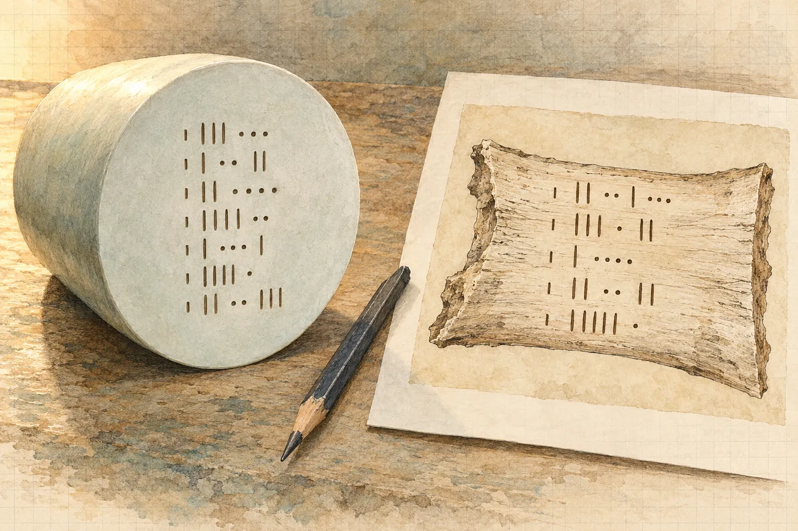

# 9. Pouzdro

Páska se trhá tiše.

Marisol ji vezme za roh u spodní hrany víka a táhne pomalu, rovnoměrně, jako se stahuje náplast z rány. Páska nejde v celku. Láme se na proužky a za každým proužkem zůstane na dřevě modrý nápis ústavu, rozsekaný, s mezerami, jako stín. Pod lampou je to vidět ostře. Na nehoblovaném prkně se modrá barva vpila do vláken a drží v nich.

„Takhle,“ řekne Marisol. Nikomu. Fotí si to.

Hana fotí taky. Nejdřív čelní stranu, kde páska ráno přecházela přes suk. Teď tam zbyl jen modrý stín, šikmý, přes horní třetinu tmavého oválu. Písmena *Couoh* zůstala na dřevě vpravo a vlevo od něj. Kousek, který ležel na pásce, odešel s páskou.

Je sedm čtyřicet. Bodega voní naftou a cementem a teď i mokrou pěnou. Ze stropu visí na kabelu od generátoru jedna žárovka. Druhé světlo přinesla Hana od Kaliny, plochý panel na stativu, který svítí bíle a nehřeje. Postavila ho stranou, nízko, aby šlo světlo přes víko šikmo.

Pan Chan stojí ve dveřích. Má na sobě tutéž čistou košili jako ráno a hůl drží v ruce, ne pod sebou. Za ním je tma a v ní cvrčci. Luis přinesl kbelík vody z cenotu a plastovou střičku a sedí na obráceném pytli cementu u zdi.

Marisol vyšroubuje šest šroubů. Hana je počítá. Marisol je skládá na papír vedle palety do řady, jak šly po obvodu.

Zvedne víko.

*

Pěna je pořád mokrá. Marisol ji odhrne a pod ní je fólie, průsvitná, mnohokrát ovinutá, a pod fólií tvar. Bledý, dlouhý. Marisol fólii odvíjí vrstvu po vrstvě a Luis jí podává střičku. Kdykoli se objeví kus povrchu, Marisol ho postříká vodou z cenotu.

„Čtyřicet minut,“ řekne. „Víc ne. Pak ho zase zabalím.“

Hana kývne. Má na stole rozložené, co si připravila odpoledne: kartu s měřítkem, dvě karty pro jistotu, pásmo, lupu, foťák. Závěsnou váhu na zavazadla. Koupila ji v Brně v drogerii za sto devadesát korun, aby na letišti nemusela platit za nadváhu. Celou cestu se za ni trochu styděla.

Válec leží na pěně, mokrý, pod dvěma světly, a Hana se na něj dívá poprvé na suchu a zblízka.

Dole ho viděla v kuželu baterky, v zákalu, přes masku a přes strach. Na plošině ho viděla z vody, s rukou na žebříku. Teď mezi nimi není nic. Jen vzduch, který voní naftou.

Je matný. Šedobílý, s tím nádechem do zelena, který na sluníčku vypadal jako mořská voda nad pískem. Pod žárovkou je teplejší, pod bílým panelem chladnější. Hana se nakloní s lupou.

Žádný šev. Hledá ho, protože ho hledat musí. Každý předmět, který kdy držela, měl někde místo, kde se dvě věci potkaly. Spoj formy, šev po odlévání, stopu po nástroji, rýhu po soustruhu, vlásečnici v glazuře. Tady nic. Povrch nemá zrno, jaké má kámen, a nemá ani póry, jaké má keramika. Nemá rýhy, jaké nechává broušení. Nemá nic, co by řeklo, jak vznikl.

Kapky po něm stékají. Nezůstávají.

U spodního konce je bílý prstenec. Tam ho dnes ráno obkreslovala dlátem a tam je ho vidět nejvíc. Zbytky polevy na něm sedí jako vápno na dlaždici, krémové, místy tlusté jako nehet, místy tenké jako papír. Na samém konci, na oblé špičce, skoro žádné. Výš na boku jsou čtyři jizvy po vzorcích. Pětka kousek nad prstencem, dvojka uprostřed délky, trojka a čtyřka u horního čela, z obou stran pole značek. Jizvy nejsou na válci. Jsou v kůře, v lemu, který z něj ještě nikdo neodloupl. Válec pod nimi je tentýž, hladký, šedobílý.

Na horním čele jsou značky.

Hana panel posune. Ještě níž, ještě víc do strany, až světlo jde přes čelo skoro naplocho. Značky vystoupí. Pod vodou je viděla jako stín. Tady jsou ostré, s hranami, jako by je někdo vyryl včera.

„Fotím,“ řekne.

„Fotíte,“ řekne Marisol.

*

Nejdřív fotí s kartou. Celý válec shora, s kartou podél boku. Pak čelo, s kartou u okraje. A každou stranu zvlášť. Marisol mezitím píše. Má na kolenou desky a v nich formulář ústavu a do kolonek píše rukou, drobně a rovně. Datum. Čas. Přítomní. Pan Chan, svědek ejida. Luis Ek. Hana Vrbová.

„Teď délka,“ řekne Hana.

Pásmo je to potápěčské, plastové, žluté. Ve vodě dobré, na suchu se prohýbá. Hana ho vezme do ruky a pak ho zase položí. Kvůli čtyřem milimetrům, které ji ve středu v noci stály půl hodiny spánku, chce něco lepšího.

„Luisi,“ řekne. „Kalina má v bedně ocelový metr. A dva úhelníky. Stříbrné, takhle.“ Ukáže prsty pravý úhel. „Doneseš je?“

Luis se zvedne z pytle a vyjde do tmy.

Vrátí se za tři minuty. Za ním jde Kalina. Nese metr i úhelníky a pod paží šedou krabici s držadlem.

„Půjčím vám to sám,“ řekne. Na Marisol. „Pokud smím. A pak bych chtěl o něco požádat.“

Marisol si ho změří přes brýle a kývne.

Hana přiloží úhelníky. Jeden k hornímu čelu, kolmo, plochou k oblé hraně. Druhý ke spodnímu konci, k té oblé špičce. Musí se dotýkat. Nesmí ho tlačit. Mezi nimi natáhne ocelový metr, hranou k desce stolu, a čte.

Čtyři sta šedesát.

Přečte to znovu, kolmo shora, bez paralaxy. Čtyři sta šedesát a možná půl milimetru navíc. A ještě jednou, z druhé strany, s metrem přiloženým obráceně. Čtyři sta šedesát.

Vyfotí to. Kolmo shora, oba úhelníky, metr mezi nimi a vedle karta. A zblízka každý konec. Úhelník, hrana válce, ryska na metru.

„Čtyři sta šedesát,“ řekne nahlas. „Plus minus milimetr.“

Marisol to zapíše. Hana jí vidí přes rameno do formuláře. *Longitud aprox. 46 cm.* Zaokrouhlila to. Do formuláře se to tak píše. Hana nic neřekne.

V hlavě má jiné číslo. Čtyři sta šedesát čtyři v modelu. Krát nula celá devět devět dva. Čtyři sta šedesát.

Sedí to.

Zarazí se, jak moc se jí ulevilo. Ve středu v noci si opravu spočítala a zapsala, a od té doby jí někde vzadu v hlavě sedělo, že je to jen výpočet. Že mohla udělat druhou chybu na první. Teď je oprava změřená. Předmět jí ji potvrdil sám.

Ríšovi to musí říct. Model se musí přepočítat. Chtěla to říct ve čtvrtek ráno a ve čtvrtek ráno se zřítila stěna.

Posuvné měřítko má Kalina v krabici taky. Hana změří průměr na třech místech, u čela, uprostřed a u spodního konce. Sto deset celá nula. Sto deset celá jedna. Sto deset celá nula. Zapíše to. Marisol zapíše *diámetro aprox. 11 cm*.

Pak váha.

Hana položí síťový vak, ten, ve kterém válec ráno vyjel z vody, na prázdný stůl a zváží ho. Tři sta deset gramů. Marisol do něj válec vloží, opatrně, s rukama v rukavicích, a Hana zvedne vak za ucho na háček váhy. Displej se rozbliká. Ustálí se.

Devět celých čtyři dvě.

Bez vaku devět celých jedenáct. Mokrý. Hana to řekne nahlas a Marisol píše. *Peso aprox. 9.1 kg.*

„Teď to položte,“ řekne Marisol. „Prosím.“

Hana ho položí. Ruce se jí trochu chvějí, ne strachem. Váhou. V hlavě si to spočítá, jak to dělá u každého vzorku. Přes čtyři litry. Vápenec by vážil skoro dvanáct kilo, železo přes třicet, plast pět. Devět je na tu velikost divná váha. Nesedí k ničemu, co zná.

*

„Luisi,“ řekne. „Podržíš mi ten konec? Chci ho vyfotit z boku, potřebuju, aby se neotočil.“

Luis se nehne.

Sedí zase na pytli s cementem, se střičkou v ruce, a dívá se na válec. Pak na ni.

„No, Ana.“

Řekne to tiše. Ne nepřátelsky. Jako by odpovídal na otázku, jestli chce ještě kafe.

„Proč?“

„Na to nikdo z obce nesáhne.“ Pokrčí rameny. „Není to naše.“

Pan Chan stojí ve dveřích, jak stál. Neřekne nic. Možná rozuměl, možná ne.

„Myslíš, že to patří Mexiku?“ zeptá se Hana. Je to věta dona Felipa. Neví, proč ji říká.

„Ne,“ řekne Luis. „Myslím, že to není naše.“

Odmlčí se a chvíli hledí do kbelíku. Na hladině vody z cenotu se leskne žárovka.

„A kdyby se něco stalo,“ řekne potom, „tak by to bylo naše.“

Hana neví, co na to říct. Dole, v síni, se válce nedotkl ani jednou. Všimla si toho a neměla čas o tom přemýšlet. Teď čas má a stejně neví, co si o tom myslet.

Konec podrží Marisol. V rukavicích, za pěnu, ne za válec.

*

„Smím?“ zeptá se Hana a zvedne pravou ruku. Ukazovák, nehet.

Marisol se dívá na válec a pak na Hanu.

„Jednou. Zlehka.“

Hana ťukne nehtem do boku válce, uprostřed délky.

Zvuk je krátký. Vysoký, suchý, bez dozvuku. Kámen by duněl. Keramika by zazvonila. Sklo by cinklo a chvíli by to v něm zůstalo. Tohle nezůstane. Je to, jako když člověk ťukne nehtem do zubu, jenže zvenku. Hned to skončí.

Napadne ji, že si to měla nahrát. Telefon leží na stole vedle karty a stačilo by ho zapnout. Nezapne ho. Řekla *jednou* a Marisol řekla *jednou*.

Zapíše si to slovy. Do levé půlky, protože to slyšela. *Poklep (nehet, 1×, střed délky): krátký, vysoký, suchý, bez dozvuku. Ne kámen, ne keramika?*

Otazník za keramikou tam nechá. Keramiku zná podle zvuku jen z hrnků.

*

Kalina celou dobu stál u zdi. Teď otevře šedou krabici.

Uvnitř je přístroj velikosti knihy s displejem a s anténou, krátkou, na kloubu. Vedle něj, v pěně, kruhová cívka menší než ta na majáku. A kompas, obyčejný, turistický, s průhlednou destičkou.

„O co jste chtěl požádat?“ zeptá se Marisol.

„Přeměřit ho. Nedotknu se ho.“ Kalina ukáže na válec, ale prstem ne, jen bradou. „Dva týdny u něj ležel můj maják. Osmdesát sedm centimetrů. A já mám v hloubce majáku chybu, kterou nedokážu vysvětlit. Plus minus šest metrů, a ne a ne se zmenšit. Svádím to na slanou vodu. Asi je to slaná voda.“ Zapne přístroj. Displej se rozsvítí zeleně. „Než to odjede, chci vědět, že to není tohle.“

„Co by to mohlo dělat?“ zeptá se Hana.

„Cokoli. Kus magnetitu by mi ohnul pole. Kov by ho stínil. Cokoli s baterií by mi do toho pípalo.“ Kalina si nasadí sluchátka na jedno ucho. „Musím nejdřív vědět, co všechno to není.“

Marisol se na Hanu podívá. Hana pokrčí rameny. Ona to slyšela už ve dne u generátoru, a pak v noci u milpy, a pokaždé to znělo stejně. Jako zásada, ne jako fráze.

Kalina pracuje pomalu. Přiloží kompas na desku stolu ve vzdálenosti půl metru od válce, pak dvaceti centimetrů, pak deseti. Střelka se nepohne. Pak ho posune podél celé délky. Nic.

„Železo to není,“ řekne. „Ani nic, co by se magnetovalo.“

Hana to zapíše doleva. Vpravo jí v deníku od desátého stojí *materiál meteoritický? → izotopy kyslíku*. Železné meteority střelku pohnou. Kamenné někdy taky. Tohle ji nepohne. Neříká to nic jistého, jen škrtá jednu z možností.

Kalina zvedne přístroj s anténou. Pomalu s ním obchází paletu a dívá se na displej. Na displeji je známý hřeben, ten, který Hana viděla první den. Zuby jeden vedle druhého, šedesát hertzů a jejich násobky, z generátoru venku a z vedení u obce. Pak širší šedý pás, levný střídač. A nahoře, když Kalina přepne, krátké výkmity, které přijdou a zmizí.

„Telefony,“ řekne Kalina. „Váš, můj, pana Chana.“ Pan Chan ve dveřích se podívá na kapsu košile. „A tady,“ přepne znovu, „vysílač na věži za lomem. Nic dalšího.“

Pak přiblíží cívku k válci. Na deset centimetrů. Na pět. Poslouchá. Hana vidí jeho obličej v bílém světle panelu, soustředěný a bez výrazu, jako když v noci na milpě čekal na celou hodinu.

Trvá to dvacet minut. Marisol se dvakrát podívá na hodinky a dvakrát postříká válec vodou.

Kalina sundá sluchátka.

„Nic,“ řekne. „Nevysílá nic. Od pár hertzů po gigahertzy, nic nad pozadím. Neohýbá pole. Nestíní. Je to ticho.“

„Jako kámen,“ řekne Hana.

„Kámen taky nevysílá.“ Kalina zavře krabici. „Proto je to dobré srovnání. Takže chyba v hloubce je moje. Nebo vody.“ Odmlčí se. „To je dobrá zpráva. Teď vím, kde hledat.“

Marisol zapíše, že si to přeměřil. Zeptá se ho na celé jméno a on ho nadiktuje. A dodá, aniž by se ho ptala:

„Pracuju pro pojišťovnu.“

Marisol poprvé za večer cukne koutkem úst.

„Já vím,“ řekne.

*

Zbývá deset minut. Hana se vrátí ke značkám.

Postaví panel tak, aby světlo šlo přes čelo zleva, pak zprava, pak shora a zdola, a z každé strany udělá šest snímků s kartou. Při každém úhlu vystoupí jiné hrany a jiné zapadnou do stínu. Tak se fotí nápisy na kamenech, které už skoro nejsou vidět. Ona to dělala jen jednou, v Mikulčicích, na studentské praxi, a na tom kamenu nakonec nebylo nic.

Tady něco je.

Pole má přes čtyři centimetry na šířku a necelé tři na výšku. Hana počítá řádky. Sedm. Každý řádek tvoří čáry a tečky. Čáry jsou rovné, svislé, stejně hluboké. Jsou dvojí délky, dlouhé a krátké. Tečky mezi nimi stojí ve skupinách, jedna, dvě, tři, čtyři. Každý řádek začíná krátkou čarou. Všech sedm. Ve čtvrtém řádku je jedna tečka posazená výš než ostatní, nad čárou, jako háček nad písmenem.

Hana se narovná. Bolí ji záda od toho, jak se skláněla.

Na telefonu má od tří odpoledne e-mail. Stáhla si ho na plošině, kde je signál, a přílohu otevřela jen na vteřinu, na malé obrazovce, se sluncem v displeji. Pak ho zavřela, protože se blížila Marisol s deskami, a už ho neotevřela.

Teď ho neotevře taky. Je tu Marisol, Luis, pan Chan, Kalina. Je tu válec, který za pět minut zmizí v pěně.

„Hotovo?“ zeptá se Marisol.

„Hotovo.“

*

Viktor přijde, když Marisol balí.

Stoupne si ve dveřích vedle pana Chana a pozdraví ho kývnutím. Pan Chan kývnutí vrátí. Viktor je čerstvě osprchovaný, má mokré vlasy a čisté tričko a v ruce telefon, displejem dolů. Prezentace v Los Angeles dopadla dobře. Hana to ví už od včerejška.

Viktor sleduje, jak Marisol válec obaluje. Pěna namočená v kbelíku. Fólie, vrstva po vrstvě. Zase pěna.

„Kolik vrstev té fólie?“ zeptá se.

„Proč?“ zeptá se Marisol. Nepřestane balit.

„Kvůli Méridě. Ať to tam nerozbalují naopak a neroztrhnou to.“ Viktor se usměje, unaveně. „Promiňte. Točili jsme to celý den. Mám v hlavě jen pořadí záběrů.“

„Šest,“ řekne Marisol. „Stejně jako ráno. Pěna, šest vrstev fólie, pěna. V Méridě to rozbalí lidé, kteří to dělají třicet let.“

„Jasně.“ Viktor zvedne dlaň. „Jasně.“

Pak se obrátí k Haně. „Dobrý?“

„Dobrý.“

„Kolik váží?“

„Devět kilo sto.“

Viktor hvízdne, tiše. „Jako malý dítě.“ Zasměje se. „Jako Matyáš, když se narodil. Ne, ten měl čtyři.“ Zavrtí hlavou. „Jdu spát. Zítra je neděle, zaplaťpánbůh.“

Odejde do tmy. Viktorův syn je na univerzitě v Praze a Viktor o něm mluví málokdy. Teď si na něj vzpomněl. Je unavený, pomyslí si. Všichni jsou unavení.

Marisol přišroubuje víko. Šest šroubů, tytéž, v témž pořadí, jak je skládala na papír.

Pak novou pásku.

Vytáhne kotouč z tašky, odvine kus a přiloží ho na spoj víka a bedny, přes modrý stín staré pásky. Páska ho zakryje. Marisol ji vede po obvodu kolem celé bedny, hladí ji palcem, aby přilnula k nerovnému dřevu, a na rozích ji přeloží. Vezme fixu a na každé straně napíše přes pásku a přes dřevo svůj podpis. *M. Couoh 21-III-26.* Pomalu. Podruhé za den.

Přečte nahlas číslo na začátku pásky a na konci a zapíše je do formuláře.

Hana fotí.

Každou stranu. S kartou, pak bez ní, pak zblízka. Na čelní straně je suk. Tmavý, oválný, velký jako palec. Páska přes něj přechází šikmo, v jeho horní třetině, skoro stejně jako ráno, jen o vlas víc vlevo. Písmeno *h* na konci podpisu leží na suku, na jeho horním okraji, tmavé na tmavém. Hana to vyfotí zpříma a pak z boku, aby bylo vidět, jak se páska nad sukem nepatrně zvedá. A ještě jednou, nejzblízka, až je na displeji vidět vlákno dřeva pod tahem fixy. Tah jde z pásky na dřevo bez přerušení, jedním pohybem ruky.

„Zase suky,“ řekne Marisol.

„Zase.“

„Ráno jste to fotila taky.“

„Ráno byla jiná páska.“

Marisol zaklapne fixu a dá ji do kapsy košile, ke klíčku od černého kufru, který už nemá u sebe.

„Klíč je pro dveře,“ řekne. „Páska je pro bednu. A vy jste pro suky.“

Je to vtip. Hana se zasměje, protože je unavená, a Marisol se zasměje taky, krátce, a pan Chan ve dveřích se na ně podívá, jako se dívá dospělý na děti.

Don Felipe přijde zamknout v půl desáté. Přinese si vlastní baterku. Luis s Kalinou postaví bednu zpátky na palety pod okénko. Don Felipe zavře kovové dveře, provlékne řetěz a zacvakne velký mosazný zámek. Zatahá za něj, dvakrát, jako se tahá za zámek, kterému člověk věří.

*

V deset sedí Hana pod plachtou u svého stolu sama. Generátor brumlá. Nad žárovkou krouží můry, tytéž nebo jiné.

Otevře deník. Vlevo zapíše, co změřila. Délku, úhelníky, metr, čtyři sta šedesát plus minus jedna. Průměr, tři místa. Váhu, vak, devět celých jedenáct. Poklep slovy. Kompas, nic. Analyzátor, nic. Značky, sedm řádků, každý začíná krátkou čarou, ve čtvrtém tečka nad čarou. Pásku, číslo začátku a konce, podpis, suk, *h* na horním okraji suku. Zámek.

Pod to připíše řádek, který jí udělá radost:

*Délka (ocelový metr) 460 ± 1 mm. Souhlasí s opravou modelu (464 × 0,992 = 460). Přepočítat (R. H.) – stále.*

Otevře notebook a v něm e-mail.

*Paní doktorko,*

*v sobotu se do archivu nechodí. Byla jsem tam. Posílám sken posledního listu v plném rozlišení a výřez kresby zvlášť. Kreslil to pomaleji než cokoli jiného v knize, uvidíte to na tahu. Proč to potřebujete v sobotu, nevím a nechci to vědět, dokud to nebudete vědět vy.*

*Nic necitujte. Ani mně.*

*L. Š.*

Hana napsala v pátek v noci, po shromáždění. Dvě věty. Jestli by mohla dostat skutečný sken posledního listu, ne náhled. Že ho potřebuje rychle. Nenapsala proč.

Otevře výřez.

Pergamen je nažloutlý, nerovný, s vlákny, která prosvítají i na skenu. Inkoust je hnědočerný, místy do rezava. Kresba je malá. Kus boku kosti, utnutý z obou stran rovnou čarou, jako se utíná kus listu, na kterém záleží. Nic víc. Žádný kloub, žádný zlomený konec. Jen ta plocha.

A na ní řádky.

Hana zvětšuje. Čáry jsou rovné a svislé. Dvojí délky, dlouhé a krátké. Mezi nimi tečky, ve skupinách. Jedna, dvě, tři, čtyři. Tečky jsou všechny stejně velké, jako by je dělal razidlem, ne brkem. Šindelářová má pravdu. Je to vidět na tahu. Člověk, který ostatní kresby v knize dělal rychle, tady dělal každou tečku zvlášť a pomalu.

Řádků je pět.

Každý začíná krátkou čarou.

Hana se opře a zase se nakloní. Ve druhém řádku, uprostřed, je jedna tečka posazená výš než ostatní. Nad čarou. Jako háček nad písmenem.

Otevře vedle výřezu svůj snímek čela válce, ten se světlem zleva. Sedm řádků. Krátká čára na začátku každého. Ve čtvrtém tečka nad čarou.

Není to totéž. Tohle si řekne nahlas, potichu, do brumlání generátoru. Není to totéž. Na kosti je pět řádků, na válci sedm. Skupiny teček jdou v jiném pořadí. Žádný řádek z kosti se nedá najít na válci. Žádný.

Jenže pravidla jsou stejná.

Řádek začíná krátkou čarou. Tečky jsou ve skupinách nejvýš po čtyřech. Čáry jsou dvojí délky, ne trojí. A tečka nad čarou, jedna, jednou, jako něco, co se píše jen výjimečně. Jako by to byly dva řádky textu ve stejném písmu. Jiná slova, stejná abeceda.

Hana cítí, jak se jí zrychlí tep. Nelíbí se jí to. Je to pocit, který zná od studentů. Vidí to na nich, když v profilu najdou první střep a začnou v každém kamínku vidět okraj nádoby.

Začne si to vyvracet. Počítá, jak to učí.

Rovná čára a tečka jsou nejjednodušší značky, jaké lidská ruka udělá. Je jich plný paleolit. Řádky vzniknou samy, jakmile se značek udělá víc než pár. Začátek řádku se dá označit jen málo způsoby. Tečka nad čarou může být chyba ryjce, nebo chyba mnicha, který kreslil brkem při svíčce. Kresba je kopie, ne předmět. Mnich ji udělal před osmi sty padesáti lety, z kosti, kterou nikdo dnes nemá, devět tisíc kilometrů odsud. Válec ležel pod polevou sto tisíc let. Nejméně.

A ona chce, aby to bylo totéž. To je na celé věci nejhorší. Ví, že to chce. Od ledna, od té chvíle v kuchyni, kdy zastavila video na jednatřicáté vteřině a vytáhla z poličky modrou složku.

Podobnost je to nejlacinější, co v oboru existuje. Na podobnostech stojí celé regály esoteriky v knihkupectvích.

Hana zavře oba obrázky. Pak je zase otevře.

Napadne ji, že by to měla někomu ukázat. Kalinovi. Ten by se díval dlouho a pak by řekl, co všechno to není. Marisol. Ta by se zeptala, co je to za kodex. A Hana by musela říct: kniha, kterou ve dvanáctém století napsal mnich, který psal o dracích. Kodex s drakem. Tak mu jednou v e-mailu řekla sama Šindelářová a myslela to jako vtip.

Pak by Marisol zavřela desky.

Viktorovi to neukáže. Ten by z toho měl do pondělka story deck.

Pravou půlku deníku Ríša fotí každý večer. Viktor ji čte. Ví to od dvanáctého a od dvanáctého se tam snaží psát jen to, co by snesla číst nahlas.

Tohle by nahlas nesnesla.

Napíše to stejně. Malým písmem, dole, pod odpočet.

*Tentýž znak? Kost, 1172. Válec, ?*

Pak dlouho sedí a dívá se na ten otazník za čárkou. Za válcem nemá kam napsat rok. Kdyby ho měla, nemusela by se ptát.

*

V jedenáct se ze stanu vyhrabe Ríša. Spal od odpoledne, poprvé za dva dny. Má vlasy na jedné straně přimáčknuté a na tváři otisk rukávu. V ruce telefon.

„Deník,“ řekne a zívne. „Viktor to chce do archivu. Každej den.“

Hana položí dlaň na otevřenou stránku. Nepřemýšlí o tom. Ruka to udělá sama.

„Dneska ne.“

Ríša se na ni podívá, ještě napůl ve spánku.

„Viktor…“

„Dneska ne, Ríšo.“

Ríša pokrčí rameny. Je mu to jedno. Je mu jedno skoro všechno kromě spánku a kromě toho, jestli ho v LA pochválí za čtyři vteřiny padající stěny.

„Jak chceš.“ Otočí se ke stanu.

„Ríšo.“

Zastaví se.

Chce mu říct o modelu. O tyči B, o šedém terči, o značce, kterou dala o kousek dovnitř. O čtyřech milimetrech, které dnes potvrdil ocelový metr. Že se model musí přepočítat, že to jde jen na jeho notebooku a s jeho licencí. Je to jedna věta. Dvě.

Jenže Ríša stojí rozespalý a ona má dlaň na stránce, pod kterou leží kost z roku 1172, a v hlavě má sedm řádků a pět řádků.

„Nic,“ řekne. „Zítra. Vyspi se.“

Ríša zmizí ve stanu. Zip zavrčí nahoru a dolů.

Hana sundá dlaň ze stránky. Pod ní je pravá půlka. Odpočet v rohu, třináct, napsaný odpoledne. Pod ním otázka, kterou nikdo nevyfotil.

Zavře deník a zasune ho do batohu, do vnitřní kapsy na zip, ke flešce s modelem.

Kalina sedí u svých beden na druhém konci plachty. Má na uších sluchátka a před sebou sešit v kroužkové vazbě a tužkou do něj píše. Hana ví, že píše dvakrát, zvlášť naměřené a zvlášť myšlené. Kdyby se ho zeptala, co má dnes na pravé straně, nejspíš by jí to řekl.

Neptá se.

Jde k cenotu, k pásce pět metrů od okraje, a postaví se k ní. Dole je tma. Severní stěna je i ve tmě bělejší než ostatní. Nad studnou jsou hvězdy, vykrojené do kruhu, jako dno jiné studny.

Válec leží sto kroků za ní, v bodeze, v šesti vrstvách fólie, za mosazným zámkem. Váží devět kilo sto. Měří čtyři sta šedesát milimetrů. Nevysílá nic.

To je všechno, co o něm ví.
