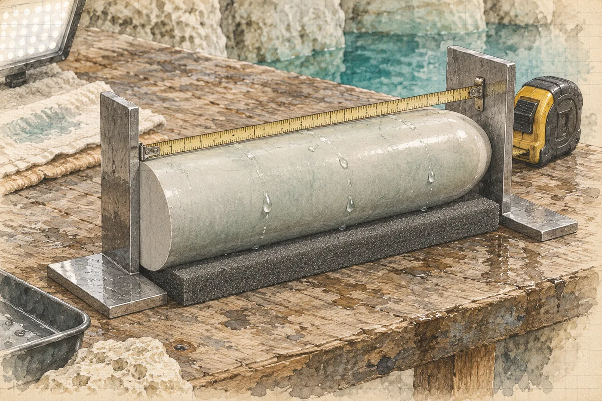

# 12. Čtyři milimetry

Ve tři čtvrtě na sedm sedí Hana u stolku pod oknem a píše čísla.

Jen čísla. Ne slova, ne dojmy, ne *měkčí* ani *zploštělý*. Na novou stránku deníku, vlevo, pod sebe, s jednotkou a s chybou, jak to učí prváky v prvním týdnu a jak to pak polovina z nich celý život nedělá.

*Předmět, bodega, 21. 3. večer (H. V.):*
*délka 460 ± 1 mm (ocelový metr, 2 úhelníky, 3 čtení)*
*průměr 110,0 / 110,1 / 110,0 mm (posuvné měřítko)*
*hmotnost 9,11 kg (závěsná váha, mokrý)*

*Model 18. 3. (R. H.):*
*délka 464 mm (střed čela – konec obrysu pod polevou)*
*měřítko +0,8 % (T2–T5: 617 vs. 612)*

Pod to udělá čáru a napíše třetí nadpis a za ním dlouho nic.

*Předmět, CT, 24. 3.:*

Radioložka ty rozměry měřila. Hana to viděla. Klikla na čelo a na spodní konec a pak na okraj kruhu a na obrazovce se rozsvítila čísla. *Do protokolu.* Protokol má Marisol a Marisol jí ho nedá.

Jenže Hana fotila obrazovku.

Otevře v notebooku složku z úterního rána. Dvaašedesát snímků. Přehledový snímek s bílou čárou. Kruhy s hvězdou. Bubliny. Spoj formy. Hana je projíždí rychle, protože se na ně nechce dívat, a pak zpomalí.

Snímek čtyřicet jedna. Podélný řez. Válec leží na obrazovce na boku a přes něj vede tenká žlutá čára od středu čela ke spodnímu konci. U ní v rámečku stojí číslo.

*464,2 mm.*

Na snímku čtyřicet dva je kruh a přes něj druhá žlutá čára, vedená po povrchu pryskyřice, pod vrstvou nalepené drti. *110,9 mm.*

Vstane, dojde ke dveřím, vrátí se a sedne si. Ruce si položí na stůl vedle notebooku, dlaněmi dolů, jako se kladou na stůl při zkoušce, aby bylo vidět, že pod nimi nic není.

Čtyři sta šedesát čtyři.

To číslo zná. Psala ho do deníku ve středu ve dvacet tři třicet, menším písmem pod již vyfocenou stránku, a pak za něj dala šipku a opravu. V sobotu večer ho měla v hlavě, když četla ocelový metr mezi dvěma úhelníky, a ulevilo se jí, protože metr říkal čtyři sta šedesát.

*

Nejdřív hledá chybu u sebe. Tak to dělá vždycky. A tak to dělá Kalina.

Radioložka mohla měřit přes fólii. Ne. Fólie je na CT skoro neviditelná a žlutá čára začíná na hraně šedé, ne na hraně fólie. A šest vrstev fólie nemá čtyři milimetry. Má desetinu.

Radioložka mohla měřit šikmo. Šikmá čára by byla delší a delší číslo by vysvětlila. Jenže na obrazovce je vidět, kudy čára jde. Jde po ose podélného řezu, rovně, od čela ke špičce.

Mohla měřit od nálitku. Hana snímek zvětší. Nálitek je na boku, ne na konci. Čára začíná na oblé špičce.

Ona sama mohla v sobotu špatně přečíst metr. Četla ho třikrát, jednou obráceně. Úhelníky se dotýkaly. Metr byl ocelový, Kalinův. Mohl být špatný. Jenže ocelový metr se na půl metru nemýlí o čtyři milimetry. A průměr měřila posuvným měřítkem, ne metrem. Dva různé přístroje by se nespletly o stejné procento.

Průměr.

Sto deset celá devět děleno sto deseti celá nula. Hana to spočítá na telefonu. Jedna celá nula nula osm. Délka: čtyři sta šedesát čtyři celá dva děleno čtyřmi sty šedesáti. Jedna celá nula nula devět.

A model byl větší o nula celá osm procenta. Šest set sedmnáct ku šesti stům dvanácti. Jedna celá nula nula osm.

Stejné číslo. Dvakrát. V délce i v průměru.

Hana si to zapíše pod třetí nadpis, pomalu, aby se nespletla.

*Předmět, CT, 24. 3. (foto obrazovky H. V., snímky 41, 42):*
*délka 464,2 mm*
*průměr 110,9 mm*
*poměr k předmětu 21. 3.: délka 1,009, průměr 1,008*
*poměr model / skutečnost: 1,008*

Čte to, jako by to psal někdo jiný. Jako posudek, který dostala na stůl a ke kterému má napsat, jestli z dat plyne závěr.

Plyne.

Předmět, který ležel v úterý na CT, je o čtyři milimetry delší než předmět, který v sobotu ležel v bodeze. A o necelý milimetr širší. Je tedy o necelé procento větší ve všech směrech. Přesně o tolik jako její model.

Replika zopakovala její chybu.

Neodlil ji nikdo podle předmětu. Kdo by ho měl v ruce, odlil by ji v jeho skutečné velikosti, čtyři sta šedesát. Odlil ji podle modelu. Podle šesti set čtyřiceti Ríšových fotek a jedné značky, kterou ona dala na šedivém terči o kousek dovnitř, k tyči.

Hana si vzpomene na spodní konec. Na klinice si ho všimla a v noci na fotce ústavu taky. Z jedné strany zploštělý, jako by ho někdo zmáčkl palcem. V modelu tam byla jen boule pod polevou, *jako prst pod prostěradlem*. Model nevěděl, jak ten konec vypadá zespodu, kde ležel v polevě. Nikdo to nevěděl. Až v sobotu ona, když ho vytáhla.

Je to vzpomínka, řekne si. Zploštění je vzpomínka a úhel fotky. Čtyři milimetry jsou číslo.

*

Model měli tři lidé.

Ríša na svém notebooku. Viktor na černém disku s nálepkou firmy, *pro produkci, záloha*. A ona na flešce.

Hana otevře batoh a sáhne do vnitřní kapsy na zip. Fleška je tam, vedle deníku a tabulky. Od středy večer ji nevytáhla. Vzpomene si na notebook. Ten ležel v táboře pod plachtou, když byla v pátek a v sobotu pod vodou. Má heslo. Heslo zná jen ona. Nebo si to aspoň myslí, jako si to myslí každý.

Nemůže to vyloučit. Zapíše to. *H. V.: fleška u sebe od 18. 3. Notebook v táboře během ponorů 20. 3. a 21. 3. (heslo). Nelze vyloučit.*

Otevře model na flešce a změří ho znovu, aby to neměla jen z deníku. Střed čela, konec obrysu pod polevou. *464 mm.* Průměr přes viditelnou část, na třech místech, vždy nahoře u čela, kde je poleva jen tenký průsvitný povlak. *110,8. 110,9. 110,9.*

Vedle snímku čtyřicet jedna vypadá to číslo jako dvojče.

Do pravého horního rohu napíše *9*, stejně jako za svítání na předchozí stránku. Jinak nechá pravou půlku prázdnou.

*

Jana přijede v osm. Auto je staré, zelené, a voní uvnitř kukuřičnou moukou a psem. Na zadním sedadle leží dětská bota.

„Rosin bratr,“ řekne Jana. „V neděli mu ho musím vrátit. Neptej se, kde je pes.“

Jedou z města stejnou silnicí, po které Hana v pondělí jela za dodávkou ústavu. Jana řídí rychle a mlčí. Teprve za Méridou, když se krajina srovná a začne les, se zeptá.

„Spala jsi?“

„Dvě hodiny.“

„Já taky ne.“ Jana přeřadí. „Salcedo tu nebyl od pondělka. Nebere telefon ani mně. Kompresor stojí. Bez něj nikdo nenaplní láhve, protože palivo a kyslík jsou v bodeze a klíč od bodegy má on. Teda měl. Teď je tam páska od policie.“

Za oknem je kamenolom tichý. Na stupních stojí bagr a nehýbe se.

„Víš něco?“ zeptá se Jana. Nedívá se na ni. Dívá se na silnici.

„Mám číslo.“

„A co říká?“

Hana chvíli mlčí.

„Ještě nevím,“ řekne. To není pravda. Ví, co říká. Neví jen, jestli to chce slyšet.

Jana kývne, jako by to stačilo.

„Tak až budeš vědět.“

*

U brány na pozemek ejida stojí mladík s klíčem. Když uvidí cizí zelené auto, chvíli se nehýbe. Pak pozná Janu a pak Hanu a jde odemknout. Pomalu. Nepozdraví.

U kostela v obci stála Rosa s dětmi. Hana ji viděla z okna, když projížděly náměstím. Rosa se dívala za autem a nezamávala.

Tábor je tichý. Plachta, stoly, bedny. Rosina kuchyň je zavřená, plynový vařič přikrytý hadrem, na stole prázdné kanystry. Na dveřích bodegy je přes mosazný zámek natažená žlutá páska s černým nápisem.

Ríša sedí pod plachtou a balí. Dron do kufru, kufr do bedny, objektivy do pěny. Vedle něj na stole stojí otevřený notebook a na displeji běží seznam souborů. Když Hana přijde, zvedne hlavu.

„Viktor mě poslal zabalit techniku,“ řekne. „Kdyby ji chtěla policie. Prý ať je pohromadě.“

„Ríšo. Potřebuju vidět model.“

Ríša pokrčí rameny a sedne si k notebooku.

Za minutu se na obrazovce objeví síň. Šedá, hladká, s terasami a s převisem, s Abuelem a s majákem na LE 14. A pod převisem válec, bledší než všechno kolem.

„Změř ho,“ řekne Hana. „Od středu čela po konec té boule.“

Ríša klikne. *464.*

Hana si sedne vedle něj na bednu.

„Ríšo. Tenhle model je o necelé procento větší, než má být.“

Řekne mu to. Tyč A, ohnutá v hrdle. Tyč B, šedý terč, kal od jeho ploutve. Značka, kterou dala o kousek dovnitř. Pásmo, šest set dvanáct, a model šest set sedmnáct. Středa, dvacet tři třicet, zápis v deníku. *Přepočítat (R. H.).*

Ríša poslouchá a nehýbe se.

„Proč jsi mi to neřekla?“

„Chtěla jsem. Ve čtvrtek ráno. Ve čtvrtek ráno spadla stěna.“ Hana se podívá na své ruce. „A v sobotu večer jsem to chtěla říct znova. A neřekla jsem to.“

Ríša si promne oči a zasměje se. Krátce, nevěřícně.

„To je dobrý,“ řekne. „Já ti dám kontrolu měřítka a ty mi to neřekneš. Bezva.“ Pak zvážní. „Proč to říkáš teď?“

Hana otevře na telefonu snímek čtyřicet jedna. Podélný řez z CT, žlutá čára a číslo v rámečku. Položí telefon na stůl vedle jeho notebooku.

*464,2 mm.*

Ríša se dívá na telefon, na obrazovku, zase na telefon.

Trvá to dlouho. Hana vidí, jak mu to dochází, po kouscích. Nejdřív číslo. Pak co je to za obrázek. Pak co to znamená, že je to číslo stejné.

„To je můj model,“ řekne potichu.

Hana mlčí.

„To je můj model.“ Ríša se otočí k ní. Obličej má bílý. „Hanko. To je můj model.“

*

Mluví dlouho a nepořádně, jako lidé, kteří o něčem nikdy nemluvili, protože to nepovažovali za důležité.

Ve čtvrtek v noci stříhal. Zřícení, čtyři vteřiny, delší verzi a kratší a zase delší. Generátor byl vypnutý a notebook jel na baterii. Někdy po jedné přišel Viktor, s kávou, a sedl si vedle něj.

„Řekl: když už sedíš u toho. Jednu věc. Vyřízni mi ten válec. Samotnej, bez síně. A uzavřenej, ať se dá otáčet dokola. Že chce do prezentace animaci, jak se točí. Že to v LA chtějí, že je to sexy.“ Ríša to slovo řekne s odporem. „Tak jsem ho vyřízl.“

„Uzavřenej.“

„Uzavřenej. Celej, dokola. Spodek nebyl vidět, ležel v polevě. Tam byla jen ta boule. Tak jsem ji nechal, jak byla, a zbytek jsem uzavřel. Dopočítal.“ Ríša se zarazí. „Proto je ten konec divnej. Z jedné strany. Tam, kde nic nebylo vidět.“

Hana nic neřekne. Zploštění, které je vzpomínka, právě dostalo vysvětlení.

„Chtěl to v STL,“ řekne Ríša. „Říkal, že to tak chce ten animátor v LA. Že jiný formát neotevře.“ Odmlčí se. „Já jsem si nic nemyslel. Byly dvě ráno a já stříhal tu stěnu už potřetí.“

Pak mu to dojde. Hana to vidí. Ríša zavře ústa a zase je otevře a nic neřekne.

„STL nemá texturu,“ řekne potom. Pomalu. „Je to holá síť, šedá. Animátor by chtěl OBJ s texturou. Uzavřená síť v STL je to, co pošleš do tiskárny.“

Hana se dívá na obrazovku, kde se v šedé síni bledě leskne válec.

„Byla v té prezentaci animace?“

„Ne.“ Ríša zavrtí hlavou. „Prý ji nestihli. Viktor mi to v pátek řekl. Že škoda, že ji nestihli.“

„Kdy jsi mu to poslal?“

Ríša otevře poštu. Odeslané. Jde dolů prstem po touchpadu a Hana vidí, jak se mu prst třese. Pak se zastaví.

*20. 3. 2026, 2:14.* Komu: Viktorova adresa, ta firemní. Předmět: *valec – closed – STL*. V těle zprávy odkaz na úložiště a jedno slovo, *tady*. Pod tím automatické potvrzení z úložiště: *Soubor byl stažen. 20. 3. 2026, 7:52.*

V pátek v sedm padesát dva. Marisol tou dobou vezla půlky do Méridy a Hana na mýtině chystala výstroj na kontrolní ponor.

„Vyfotím si to,“ řekne.

Ríša kývne. Hana vyfotí obrazovku. Odeslanou zprávu, čas, adresu. Potvrzení o stažení. A ještě jednou, aby bylo vidět datum v rohu obrazovky.

„Ríšo,“ řekne. „Nic nemaž.“

„Já nic nemažu.“ Ríša se skoro urazí. „Já nikdy nic nemažu. Mám na disku všechno od roku dvacet osmnáct. Nemazal bych ani tohle, i kdybych…“ Nedořekne to.

Odvrátí se k obrazovce.

„Kdybys mi to řekla,“ řekne. „Ve čtvrtek. Přepočítal bych to. A poslal bych mu správnej.“

Hana neodpoví. Myslí na to samé už od tří čtvrtí na sedm. Kdyby to Ríšovi řekla ve čtvrtek ráno, model by byl správně. Čtyři sta šedesát. Replika by byla správně. A nikdo na světě by nemohl dokázat, že nebyla odlitá podle předmětu.

Její chyba je to jediné, co tu repliku usvědčuje. Její chyba a to, že o ní mlčela.

„Co mám dělat?“ zeptá se Ríša.

„Nevím. Zatím nic.“

„Řekneš to Viktorovi?“

Hana se zvedne z bedny. Neodpoví ani na tohle.

*

Kalina sedí na druhém konci plachty u svých beden. Má sluchátka kolem krku a před sebou sešit. Celou dobu se nedíval jejich směrem, a Hana ví, že všechno slyšel.

Sedne si k němu a položí před něj deník, otevřený na ranní stránce.

Je to poprvé, co mu ho ukazuje.

Kalina čte. Pomalu, řádek po řádku, a prstem se papíru nedotkne. Vezme si tužku a do svého sešitu, na levou stranu, napíše čísla. Čtyři sta šedesát plus minus jedna. Čtyři sta šedesát čtyři celá dva. A zeptá se, s jakou přesností měří radioložčin program. Hana neví. Kalina napíše *± 0,5?* a otazník podtrhne.

„Rozdíl čtyři celá dvě plus minus jedna celá jedna,“ řekne. „Na dvou sigmách pořád skoro dva milimetry. A průměr…“ Píše. „Nula celá devět plus minus nula celá šest. To je slabší. Ale jde to stejným směrem a je to stejné procento. Není to šum.“

„Já vím.“

„Je to systematická chyba,“ řekne Kalina. „Ta se nezprůměruje.“

„Ta se musí najít,“ řekne Hana. Jeho slova. Má je v deníku od dvanáctého.

„Našla jste ji.“

„Udělala jsem ji.“

Kalina zavře sešit.

„To je totéž,“ řekne. „Jenom z druhé strany.“

*

Na kámen u cenotu si Hana sedne v poledne. Za páskou, kde se smí sedět. Voda dole je čirá. Severní jizva svítí na slunci, bílá. Odstřel dnes není. Lom od pondělka nestřílí, prý do odvolání. Jana to ví od inženýra.

Hana otevře na telefonu fotky bedny.

Nejdřív Méridu. Pondělí, depozitář, zářivka, čelní strana. Páska, podpis, suk. Zvětší ji.

Pak sobotní ráno. Plošina, slunce, Marisol s fixou. Zvětší ji taky a dá obě vedle sebe.

Jsou jiné. Hana to vidí hned. Na ranní fotce jde páska přes horní třetinu suku, šikmo, a *h* leží na suku. Na fotce z Méridy jde páska níž. Přes střed suku, skoro přes jeho nejširší místo. A *h*…

Srdce se jí rozbuší, a pak se Hana zarazí.

Srovnávat s ranní fotkou je chyba. Ranní pásku Marisol v sobotu večer strhla. Hana u toho stála a fotila modrý stín na dřevě. Pak Marisol nalepila novou. Je jasné, že nová páska jde jinudy. Kdo srovnává ranní fotku s Méridou, srovnává dvě různé pásky a najde, co chce najít.

Přesně tohle by udělal někdo, kdo chce, aby to vyšlo.

Hana zavře ranní fotku. Otevře večerní. Sobota, dvacet jedna nula pět, bodega, bílé světlo panelu ze strany. Nová páska. Zvětší ji na stejnou velikost jako Méridu. Dá ty dvě vedle sebe a dlouho se nehýbe.

Na večerní fotce jde páska přes horní třetinu suku. Skoro jako ráno, o vlas víc vlevo. Písmeno *h* leží na suku, na jeho horním okraji, tmavé na tmavém. A tah fixy jde z pásky na dřevo bez přerušení, jedním pohybem ruky. Na nejbližším snímku je vidět vlákno dřeva pod inkoustem.

Na fotce z Méridy jde páska níž. O tři milimetry. Přes střed suku. Písmeno *h* neleží na horním okraji. Leží uprostřed suku, a protože je tmavé na tmavém, skoro v něm zmizí. Hana musí fotku zesvětlit, aby ho vůbec našla.

A tah fixy. Ten, který na večerní fotce přechází z pásky na dřevo jedním pohybem, je na fotce z Méridy přerušený. Část na dřevě zůstala, kde byla. Část na pásce začíná o kus níž. Mezi nimi je schod. Malý, tři milimetry. Kdo se nedívá, ten ho nevidí. Ve tmě bodegy, s baterkou, v pondělí v šest padesát, ho nevidí nikdo.

A nad horním okrajem pásky, na dřevě, je na fotce z Méridy tenký proužek modré. Kousky písmen, rozsekané. Ranní stín, ten, který zůstal po strhnuté ranní pásce a který večerní páska přikryla. Teď z něj vykukuje horní okraj. Široký asi tři milimetry, přesně tolik, o kolik páska sjela dolů. Na večerní fotce tam není nic.

Na nehoblovaném prkně, kde se modrá vpíjí do vláken, vypadá ten proužek jako žilka dřeva nebo jako stín pod hranou pásky. V Méridě ho Hana vyfotila. Fotila, jako si člověk zapíná pás.

*Když ji strhnete, roztrhne se a nechá na dřevě nápis. Když ji přelepíte, je to vidět.*

Je to vidět. Jen se nikdo nedíval.

Hana položí telefon na kámen vedle sebe, displejem dolů. Pak ho zase zvedne, protože se bojí, že ho shodí do studny.

Někdo pásku sundal a nalepil zpátky. Ne novou. Tutéž, se stejným podpisem a se stejnými čísly, která Marisol v pondělí ráno přečetla nahlas a odškrtla ve formuláři. Jen o kousek níž. Vcelku ji strhnout nejde, to Hana viděla dvakrát. Ale kdo lepidlo nahřeje, fénem nebo horkým vzduchem, ten ji sloupne celou. Nová stopa po ní skoro nezůstane a co zůstane, schová zase páska. Jen ten starý stín pod ní se posunout nedá. Asi ji lepil podle spáry víka, protože spára je rovná a po ní se lepí dobře. Na suk se nejspíš nedíval.

Na suk se nedívá nikdo.

Mezi sobotou devět třicet večer, kdy don Felipe zacvakl mosazný zámek, a pondělím šest padesát ráno, kdy ho odemkl.

Tak by to řekla, kdyby věřila tomu, co si pamatuje. Záznam je delší. Poslední fotka pásky je ze soboty z devíti nula pět. Další je až z depozitáře. Marisol v pondělí s baterkou četla čísla a podpisy, ne to, kudy páska jde. A Hana v bodeze nefotila. *Páska je páska.* Cestu v dodávce ústavu, se dvěma muži v polokošilích a Hanou v pick-upu za nimi, nikdo nevyloučil. Jen to nedává smysl.

Klíče byly dva.

*

Hana sedí na kameni a čtyři milimetry a tři milimetry se jí v hlavě skládají dohromady.

Replika podle modelu. Model ve Viktorově poště, stažený v pátek ráno. Páska přelepená mezi sobotou večer a Méridou, nejspíš v bodeze. Klíč od bodegy u Salceda. Salcedo nebere telefon od pondělka. A jeho podpis, rychlý, se smyčkou, je na prohlášení, které Viktor sepsal až v úterý. Salcedo je Viktorův logistik.

Je to záznam. Všechno to je záznam. Fotky, čísla, čas odeslání, čas stažení.

A pak přijde to ostatní. To, co záznam není.

*Kolik vrstev té fólie? Kvůli Méridě.* Video na účtu, který někdo založil v neděli. *Dnes ráno CT* šest hodin po CT, o kterém věděli jen čtyři lidé za sklem a dva v čekárně. Hanko, co jsi to datovala? *O trojce mlč.* Deník máš u sebe? Nikomu ho nedávej. Ani mně ne.

Hana to všechno zastaví. Je to přesně to, co si zakázala. Výklad. Pravá půlka. Věci, které si pamatuje a do kterých vkládá, co už ví. Kdyby o tom večeru nevěděla nic dalšího, zněla by otázka o fólii jako starost dokumentaristy o pořadí záběrů. Taky tak tehdy zněla.

Viktor mohl model poslat dál. Animátorovi. Komukoli. Komukoli, kdo se do produkční pošty dostane. Salcedo mohl klíč půjčit. Komukoli. Don Felipe má druhý.

Hana se slyší, jak to všechno vymýšlí, a nelíbí se jí to.

Myslí na Hranice. Čtyřicet metrů, prasklá hadice, voda v ústech místo vzduchu. A Viktorova ruka, která jí podá automat, a dvanáct minut, kdy dýchali z jedné lahve, on klidně a pomalu, aby jí zbylo. Pak ji na hladině držel za límec obleku a neříkal nic, a ona se třásla. Tehdy si řekla, že tomu člověku bude věřit, i kdyby jí řekl, že kámen je chleba.

*Řekneš mi, že je to kámen, když je to kámen.*

Neřekla mu to. Řekla mu *devadesát procent*. A on to slyšel a zapamatoval si to.

Měla by zavolat Marisol. Ví to. Měla by jí poslat snímky čtyřicet jedna a čtyřicet dva, model, Ríšovu poštu a dvě fotky pásky. Marisol by se dívala dlouho a pak by se zeptala, odkud se ten model vzal a jak je možné, že je o necelé procento větší. A Hana by jí musela říct o terči, o kalu, o značce o kousek dovnitř. To by zvládla. Ta chyba je zapsaná, poctivě, vlevo.

Pak by se Marisol zeptala na deník. Celý.

A v deníku je šestý březen.

A je tu ještě jedna věc, horší, protože je slušná. Patnáct let. Dvanáct minut. Jestli to byl on, má to slyšet od ní. Ne od muže v tmavém obleku s americkou angličtinou. Od ní, do očí, aby mohl říct, že to není pravda. A ona aby slyšela, jak to říká.

Hana se podívá dolů do studny. Voda je čirá až ke kuželu balvanů. Pod ní, za mezerou u bloku, za hrdlem, pod haloklinou a pod mlhou, leží v síni prázdné lůžko. Nikdo ho nezdokumentoval. Kal, který nad ním visel, se už dávno usadil.

*

Viktor napíše v šestnáct deset.

*Jsem zpátky z Méridy. Večer u studny? Potřebuju s tebou mluvit. V.*

Hana se na tu zprávu dívá dlouho, než otevře deník.

Vlevo zapíše, co je. Snímky čtyřicet jedna a čtyřicet dva, rozměry, poměry. Model na flešce, přeměřený. Ríša: čtvrtek v noci, Viktor, *vyřízni mi ten válec, uzavřenej, kvůli animaci*. Odesláno 20. 3. ve 2:14, staženo v 7:52, adresa, předmět zprávy, foto obrazovky. Animace v prezentaci nebyla. Kalina: *4,2 ± 1,1 mm, není to šum*. Páska: večerní fotka 21. 3. proti fotce z Méridy 23. 3. Posun asi 3 mm dolů. Písmeno *h* uprostřed suku místo na horním okraji. Schod v tahu podpisu. Modrý proužek nad páskou. Klíče: don Felipe, E. S.

Pod to jeden řádek, kterým se zavazuje:

*Replika odpovídá modelu 18. 3. (chybné měřítko H. V.), ne předmětu. Páska na bedně byla mezi 21. 3. 21:05 (poslední foto) a 23. 3. dopoledne (foto v depozitáři) sejmuta a znovu nalepena. Marisol 23. 3. v 6:50 kontrolovala čísla a podpisy, ne polohu. V bodeze jsem nefotila.*

Je to vlevo a patří to tam. Je to změřené.

Nahoře v rohu stojí *9*. Pod tím je bílý papír.

Hana nasadí pero. Napíše *V* a tečku. Jedno písmeno, jako iniciála pod citátem. Tak píše Viktorovy věty, když je zapisuje doleva. *(V. B.)* Tady nemá být nic v závorce. Tady má být, co si myslí.

Nedopíše to. Písmeno přeškrtne, jednou čarou, tak, aby šlo přečíst, že tam bylo.

Šestého března nechala pravou půlku prázdnou, protože vlevo lhala. Dneska ji nechá prázdnou, protože se bojí, že by napravo napsala pravdu.

Zavře deník a vezme telefon.

*Ano.*

Odešle to. Pak se dívá na to jedno slovo v bublině na displeji. V lednu, v Brně, v kuchyni s mrazem na okně, napsala tomu člověku totéž.
