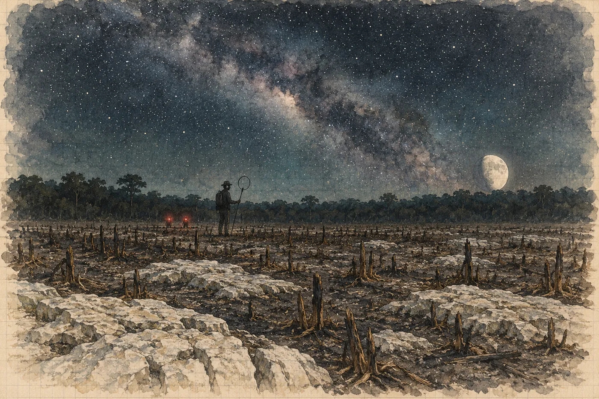

# 16. Rádiová stopa

„Všechno,“ řekne Hana. „Všechno, co má proud.“

Pod plachtou sedí inženýr, vedoucí záchranářů, don Felipe a Kalina. Kalina nic neříká. Má před sebou sešit a v něm seznam, a Hana ho čte nahlas, protože to tak chtěl.

Generátor záchranářů. Generátor civilní ochrany, ten žlutý na vozíku. Táborový generátor, i když stojí, ať ho nikdo nenapadne nastartovat. Reflektory. Kompresor. Čerpadlo, které civilní ochrana spouští do studny kvůli vzorkům vody. Auta. Nestartovat, nenechávat běžet kvůli klimatizaci, nenabíjet z nich telefony. Telefony vypnout, nebo do letadlového režimu, do pěti set metrů od přijímače. Vysílačky taky, kromě jedné, a ta jen na příjem.

A vedení.

„Vedení k lomu,“ řekne Hana. „Celé. Od obce po lom. Kalina říká, že dokud v něm teče proud, je to dvoukilometrová anténa. I když lom stojí. Na tom vedení visí čerpací stanice pro obec a trafo.“

Inženýr se podívá na dona Felipa.

„To je voda,“ řekne don Felipe. Ne jako námitku. Jako fakt, který je třeba vyslovit. „A světlo. A lednice v obchodě. A větráky.“

„Od kdy do kdy?“ zeptá se inženýr.

Hana se podívá na Kalinu. Kalina zvedne hlavu.

„Od deseti do čtyř,“ řekne. „Šest celých hodin. Šestkrát deset minut.“

„Proč šest?“

„Protože nevím, kde je. Jestli je.“ Kalina se podívá na inženýra a pak zase do sešitu. „Vysílá jen deset minut každou celou hodinu. Za deset minut udělám jedno měření, možná dvě. Pak padesát minut nic. Chodit, čekat, chodit. Kdybych věděl, kde je, stačila by hodina.“

Inženýr si promne bradu. Je to muž, kterého včera ráno lom podvedl a od té doby nespí. Hana to vidí na jeho očích.

„Elektrárna to vypne,“ řekne. „Když jim zavolám, že jde o záchranu života. Bude to trvat. Budou chtít papír.“

„Tak jim ho dejte,“ řekne vedoucí záchranářů.

Don Felipe vstane.

„Jdu do obce,“ řekne. „Lidé musí vědět, proč nebude světlo. Kdyby nevěděli, mysleli by si, že nám to zase někdo udělal.“

Nasadí si klobouk a jde ke kolu. Pak se otočí.

„Ana. Kolik je to? Tři procenta, pět?“

Hana neví, jak se o tom dozvěděl. Pak ví. Rosa. Lékař s ní mluvil u auta.

„Dnes večer možná tři,“ řekne. „Nevíme.“

Don Felipe kývne a odjede. V obci se o hodinu později rozezní zvon u kostela. Ne jako na mši. Krátce, třikrát, a znovu. Hana nikdy neslyšela, že by tu zvon zvonil jinak než v neděli.

*

Mezitím dělá mapu.

Na stole pod plachtou má Waltův originál, zatížený čtyřmi kameny, Waltovy kopie z devadesátých let, telefon s Marisolinými fotkami svých vlastních náčrtů a Kalinův sešit. A papír s mřížkou, který jí Ríša vytiskl z ortofota, ze svého dronu, druhého března. Celý okraj mýtiny, studna, tábor, pěšiny, kus lesa a kus spálené milpy na severovýchodě. Dál ortofoto nesahá. Dál Ríša nelétal, protože *to nikoho nezajímalo*.

Ríša sedí vedle ní a nic neříká. Od středy skoro nemluví. Když ho požádala o ortofoto, otevřel notebook tak rychle, jako by na to čekal.

Walt kreslil kompasem a pásmem. Pod vodou, v kalu, ze šňůry, po třiceti, po čtyřiceti metrech. Každé měření má malou chybu ve směru a malou chybu v délce, a ty chyby se sčítají. Na šesti stech metrech může být mapa pootočená o pár stupňů a o pár procent kratší nebo delší, než je les nad ní. Walt to ví. Proto řekl *mapa je pro jeskyni, ne pro les*.

Hana potřebuje dva body, které zná na mapě i v lese.

První je studna. Ta je na ortofotu i na mapě a nedá se splést.

Druhý je síň. Na Waltově mapě síň není. Ale na Waltově mapě je hrdlo a za ním sestup a Hana má ve svých náčrtech, co bylo za hrdlem dál. Na Marisoliných fotkách, stránka ze čtvrtého března: *za Gargantou sestup, šňůra, značky po 10 m: 6 značek do síně. Směr podle kompasu na zápěstí ~50°, pak ~70°.* Šedesát metrů od hrdla k síni. Ten zápis napsala vlevo, protože to viděla. Na kompasu, na šňůře, na vlastní ruce.

A nad síní je Kalinův kolík s reflexní páskou. Na okraji spálené milpy, čtyři sta metrů severovýchodně od studny. Kalina ho tam zatloukl devátého, podle majáku, s chybou ve hloubce, ale ne ve směru. Ve směru měl chybu pod metr.

Hana položí Waltovu mapu na ortofoto. Převede ji na stejné měřítko. Od hrdla přidá svých šedesát metrů na padesát a sedmdesát stupňů. Kde by podle Waltovy mapy a podle jejích poznámek měla být síň?

Ne u kolíku. Třicet osm metrů vedle. Jižněji a blíž ke studni.

Tak velká je chyba mapy na čtyři sta metrech. Hana ji změří. Mapa je pootočená asi o pět stupňů po směru hodin a o čtyři procenta kratší. Je to dobrá mapa. Kdo měří čtyři sta metrů pod vodou kompasem a pásmem a splete se o pět stupňů, ten měří pečlivě.

Pak tu chybu použije. Pootočí mapu o pět stupňů a natáhne ji o čtyři procenta. Teprve potom se podívá, kam padne zvon.

Šest set deset metrů od studny. Na východ, trochu k severu. Za okrajem ortofota, za kolíkem nad síní, dál, než Ríša kdy letěl.

„Tam je pole pana Chana,“ řekne Ríša potichu. Ukáže na okraj výtisku, kde končí ortofoto a začíná bílý papír. „Za tou kamennou zdí. Spálil ho v únoru. Fotil jsem ho z výšky, když jsme přijeli. Chtěl jsem záběr kouře z polí za ním.“

„Máš ty fotky?“

„Mám všechno,“ řekne Ríša. „Já nic nemažu.“

*

Kolem zvonu nakreslí elipsu. Ne kruh, elipsu, protože chyba ve směru je jiná než chyba v délce. Šedesát metrů dlouhou, čtyřicet širokou. Někde v ní je zvon, pokud ho Walt nakreslil, kde byl, a pokud ona správně opravila jeho chybu jedním bodem.

Jedním bodem. Hana to napíše k elipse. *Oprava podle 1 bodu (síň). Bez kontroly.* Jeden bod je málo. Jedna tyč místo dvou, to už jednou udělala.

Kalina si elipsu prohlédne. Nic neřekne. Překreslí si ji do svého sešitu, se souřadnicemi, a pod ni napíše *H. V., odhad*.

„Šedesát na čtyřicet,“ řekne pak. „To se dá obejít za noc.“

„A když tam nebude?“

„Tak tam nebude.“ Kalina zavře sešit. „To je taky výsledek. Pak budu vědět, kde není.“

*

Ve tři čtvrtě na deset zhasne mýtina.

Nejdřív reflektory. Bílé světlo, které dva dny viselo nad studnou, zmizí najednou, a stromy přestanou být černé sloupy a jsou zase stromy. Pak se zastaví žlutý generátor. A druhý. Hana neví, jak hlasité byly, dokud neztichnou. Ticho po nich je tak velké, že slyší vlastní tep v uších.

Pak cvrčci. Žáby u studny. Někde daleko pes.

V deset nula sedm, podle Kalinových hodinek, zhasne obec.

Hana to vidí přes stromy. Nad lesem na západě visela slabá oranžová záře, kterou si nikdy předtím neuvědomila, jako si člověk neuvědomuje vlastní oblečení. Teď zmizí. Nebe se v tom místě zatáhne tmou a pak, za chvíli, se v ní objeví hvězdy.

Kalina stojí vedle ní se sluchátky na uších. Smyčku na tyči drží nad hlavou.

Dlouho se nehýbe. Pak sundá jedno sluchátko z ucha.

„Teď,“ řekne.

„Co?“

„Nic.“ Kalina se skoro usměje. Hana to vidí ve slabém světle měsíce. „Poprvé za tři týdny nic. Žádný hřeben. Jen ionosféra a blesky někde nad Guatemalou.“

Hana vypne telefon. Úplně, ne letadlový režim. Podívá se ještě jednou na displej, než zhasne. Žádná zpráva. V Méridě se možná podepisuje příkaz k otevření bedny. Možná ne. Zjistí to ve čtyři.

Strčí telefon do batohu vedle panenky bez nohy.

*

V jedenáct stojí u kolíku nad síní.

Je jich pět. Kalina s přijímačem. Hana s mapou, s čelovkou přelepenou červenou fólií z Ríšových filtrů, aby viděla na papír, ale nesvítila do lesa. Jana s druhou čelovkou a s pásmem. Ríša s kolíky a s reflexní páskou. A Luisův bratranec z obce, mladík od brány, s mačetou, protože zná cesty přes milpy potmě a protože to tak don Felipe chtěl.

Měsíc je víc než v půlce a stojí na západě nad lesem. Spálená milpa pod ním je šedá, popel a pahýly, a mezi nimi bílé desky vápence, které vystupují z půdy jako hřbety zvířat.

V jedenáct nula nula si Kalina nasadí sluchátka.

Smyčka na tyči se Kalinovi v rukou pomalu otáčí. Zastaví se. Otočí se zpátky. Zastaví se.

Kalina zvedne ruku. Jeden prst.

Hana nedýchá.

Kalina otáčí smyčkou dál, pomalu, po stupních. Vytáhne z kapsy kompas, přiloží ho k tyči a dlouho na něj svítí červenou čelovkou. Napíše něco do sešitu. Otočí smyčku jinak, nastojato. Napíše další číslo.

V jedenáct deset sundá sluchátka.

„Je tam,“ řekne.

Jana řekne česky něco sprostého. Mladík s mačetou se na ni podívá a nerozumí.

„Slabý,“ řekne Kalina. „Mnohem slabší, než má být. Tady by měl řvát. Stojím nad ním.“ Podívá se do sešitu. „Nestojím nad ním. Pole tady není svislé. Jde šikmo. Odsud…“ Ukáže rukou. Na východ. Trochu k jihu. „Tam.“

Hana se podívá, kam ukazuje. Do tmy, přes milpu, k nízké kamenné zdi, která je ve světle měsíce vidět jako šedá čára.

Za tou zdí je pole pana Chana. A elipsa.

„Není v síni,“ řekne Hana.

„Není v síni,“ řekne Kalina. „Pokud to není něco jiného na tři tisíce pět set deset hertzů, co vysílá deset minut každou celou hodinu.“ Zavře sešit. „Nic jiného takového tady není. Postavil jsem ho sám.“

Maják není v síni.

Hana to říká v hlavě znovu, protože to musí pochopit celé. Maják ležel na terase u LE 14, jedenatřicet metrů pod hladinou, v síni za hrdlem. Teď je někde na východě. Maják nechodí. Maják neplave. Maják je černá trubka s cívkou velkou jako talíř a s olůvkem pod jednou nohou.

Někdo ho nesl.

Někdo ho nesl ze síně nahoru. Přes mlhu a haloklinu, po sestupu až pod hrdlo. A tam, kousek před hrdlem, odbočkou doleva nahoru, za bod čtyřicet osm.

„Pojďme,“ řekne Kalina.

*

Padesát minut jdou přes milpu.

Mladík s mačetou jde první a sem tam něco usekne, tiše, jedním pohybem. Pak Kalina se smyčkou přes rameno. A ostatní. Nikdo nesvítí, jen Hana na mapu a Jana na zem, když je tam kámen. Popel jim práší od bot, a když na něj dopadne měsíc, je bílý jako mouka.

U kamenné zdi se zastaví. Zeď je po pás, suchá, z kamenů, které někdo kdysi sebral z pole a naskládal na sebe bez malty. Mladík ukáže na místo, kde je nižší. Přelezou.

Pole pana Chana je stejné jako to předchozí. Popel, pahýly, bílé desky.

Ve dvanáct stojí sto padesát metrů od středu elipsy. Kalina si nasadí sluchátka.

Tentokrát zvedne ruku hned.

Měří deset minut. Hana mu svítí na sešit. Vidí čísla, kterým nerozumí, a šipky, kterým rozumí. Druhý směr. Kalina ho zakreslí do sešitu k prvnímu, a tam, kde se dvě čáry potkají, udělá křížek.

„Silnější,“ řekne. „Pětkrát. Možná víc.“

Ríša zatluče kolík. Jana změří pásmem vzdálenost k místu, kam ukazuje křížek. Sto dvacet metrů. Jdou.

Měsíc se sklání k lesu na západě, ale pořád svítí. Milpa je v něm šedá a stíny pahýlů jsou dlouhé.

Hana se nedívá nahoru. Dívá se na zem, kde svítí Jana.

*

V jednu stojí na místě, které ukazuje křížek.

Je to kus pole jako každý jiný. Pahýl stromu, ohořelý, po kolena. Dvě bílé desky vápence. Kolem popel.

Kalina sundá smyčku z ramene a postaví se k pahýlu. Ve dvanáct padesát devět si nasadí sluchátka. V jednu nula nula začne.

Teď už nehledá směr. Teď hledá místo, kde pole zmizí. Kde stojí přímo nad cívkou a magnetické pole jde svisle vzhůru, jako dým v bezvětří, a smyčka postavená nastojato neslyší nic, ať ji otočí kamkoli. Hana to ví z Holštejna. Jeskyňáři si to tehdy vysvětlovali jeden druhému, Kalina celý večer nepromluvil a ráno měl křížek. Ticho uprostřed hluku. Místo, kde je ten, kdo mluví, přímo pod tebou.

Kalina dělá krok. Poslouchá. Krok. Otočí se. Dva kroky zpátky, půl kroku do strany. Hana mu svítí na nohy, aby nezakopl, a do sešitu, když píše. Jana stojí opodál s pásmem. Ríša drží v ruce kolík a čeká.

V jednu nula šest se Kalina zastaví.

Stojí metr a půl od pahýlu, mezi dvěma deskami vápence, na popelu. Dlouho se nehýbe.

„Tady,“ řekne. „Kolík.“

Ríša ho zatluče. Ruce se mu třesou a kladivo dvakrát mine. Pak kolík stojí. Reflexní páska na něm zasvítí, když na ni Hana namíří čelovku.

„Hloubka?“ zeptá se Hana.

„Ve dvě,“ řekne Kalina. „Teď už mi zbývají čtyři minuty. Potřebuju vědět, jak stojí.“

Obejde kolík. Dokola, ve vzdálenosti, kterou mu odměřuje Jana pásmem. Čtyřikrát se zastaví a poslouchá. Do sešitu napíše čtyři čísla a čas. Jedna deset. Sundá sluchátka.

„Stojí rovně,“ řekne.

„Jak to víte?“

„Pole je souměrné. Všude stejně. Kdyby ležel na boku nebo šikmo, bylo by z jedné strany silnější a ticho by nebylo přímo nad ním.“ Kalina si sedne na desku vápence. Poprvé za celou noc si sedne. „Nespadl tam. Někdo ho postavil. Na rovné místo, cívkou nahoru. Bublina na střed, řekl bych. Jako tenkrát s Luisem.“

Devátého března. Terasa u LE 14, metr od převisu. Luis drží svítilnu. Hana pokládá maják na plochou terasu a pod jednu nožičku podkládá olovo, protože terasa se mírně svažuje. Luis jí svítí na vodováhu na víčku. Bublina na střed. Luis kývne. *Bien.*

Luis ví, co ten maják dělá. Byl na plošině, když Kalina vysvětloval, jak má stát a kdy se poprvé zapne. Zbytek mu Hana napsala v síni na tabulku. *Každou celou hodinu deset minut.* *Kdo má přijímač a stojí do pár set metrů.*

Nesl ho nahoru ze síně, za bod čtyřicet osm, do tmy. A pak ho postavil rovně, cívkou nahoru, na jediné místo, odkud by ho někdo nahoře mohl slyšet.

Hana si to říká celé, krok za krokem, a pak si řekne i to druhé, protože musí.

Maják stojí rovně. To neznamená, že Luis žije. Znamená to, že tam došel. A že ještě měl sílu ho postavit. Kdy to bylo, to maják neřekne. Maják vysílá stejně, ať u něj sedí kdokoli. Nebo nikdo.

Zapíše to tak. Vlevo, v červeném světle čelovky. Obě věty.

*

Ve dvě měří Kalina hloubku.

Hana mu na to drží světlo a Jana pásmo. Kalina chodí od kolíku ven, po přímce, s cívkou položenou naležato, a hledá místo, kde tón zmizí, protože pole se tam stočí do vodorovna. To samé na druhou stranu, na třetí, na čtvrtou. Čtyři čísla. Pak dlouho počítá v sešitě a nikdo na něj nemluví.

„Kde je pole vodorovné,“ řekne potom, spíš pro sebe než pro ně, „tam je vzdálenost od středu rovná hloubce krát odmocnina ze dvou. Dvacet čtyři celá jedna. Dvacet tři celá osm. Dvacet čtyři celá čtyři. Dvacet čtyři. Sedmnáct metrů. Plus minus jeden.“

„Plus minus jeden?“

„Tentokrát mezi námi není slaná voda,“ řekne Kalina. „Jenom kámen a vzduch. Kámen pole nepokřiví.“ Zavře sešit. „U síně jsem měl plus minus šest. Tady nemám důvod.“

Sedmnáct metrů.

Hana to porovná s tím, co ví. Hladina ve studni leží osmnáct, dvacet metrů pod okrajem. Pole pana Chana je ploché jako všechno tady, možná o kus níž. Hladina ve zvonu je tatáž hladina. Takže maják stojí dva, tři metry nad vodou. Na břehu z bloků a hlíny, který se podle Walta zvedá skoro ke stropu.

Na suchém. Nad vodou. Ve vzduchu.

Hana si sedne na popel vedle Kaliny. Najednou nemůže stát.

„Nevím, jestli žije,“ řekne. Nahlas, aby to slyšela.

„Já taky ne,“ řekne Kalina. „Vím, kde je maják.“ Pauza. „Je to víc, než jsme věděli ve dvanáct.“

*

Ve tři měří ještě jednou, aby to bylo dvakrát. Totéž. Sedmnáct, plus minus jeden, a ticho přesně nad kolíkem.

Ve čtyři nula dvě se nad lesem na západě rozsvítí oranžová záře. Obec. Pak se ozve vzdálený hukot, jak se rozjede čerpadlo na vodu. Kalina si nasadí sluchátka a za vteřinu je zase sundá. Hřeben je zpátky.

Hana zapne telefon.

Jedna zpráva. Marisol, dvacet tři čtyřicet. *Příkaz podepsán. Otevíráme zítra v osm. Máme vaše. M.*

*Máme vaše.* Její metr, její čísla, její jednu stránku. Ve čtyři hodiny osm minut ráno na spáleném poli pana Chana neví, jestli za čtyři hodiny bude v Progresu v bedně válec, nebo vápenec, nebo nic. Neví to a nemůže to vědět. Nemůže tam být.

Odepíše jedno slovo. *Díky.*

Telefon strčí do batohu.

*

Za svítání obejde pole.

Pomalu, ve spirále, od kolíku ven, jako se obchází sonda. Každé dva kroky se zastaví a dívá se pod nohy. Popel, pahýly, desky vápence. Ríša mezitím vzlétne s dronem. Bzučí nad polem jako první den nad mýtinou a fotí, nahoře, kolmo, s překryvem. Když dron přistane, Ríša sedne s notebookem na kamennou zeď.

Nejdřív ji Hana najde sama, pak na Ríšově obrazovce.

Puklina. Ve vápenci, který z pole vystupuje, šikmo přes dvě desky a přes popel mezi nimi. Úzká, na prst. Dlouhá dvacet metrů, možná víc. Jde od severozápadu k jihovýchodu a prochází dvanáct metrů západně od kolíku. Hrany má čerstvé. Bílé, ostré, bez lišejníku. Do pukliny napadal popel, ale jen nahoru, na okraje. Hlouběji je kámen čistý. Mravenci po ní lezou jako po silnici.

Pan Chan to pole spálil v únoru. Kdyby puklina byla starší, byl by popel i na jejím dně. Je mladší než oheň.

„Odstřel,“ řekne Hana.

Ríša na obrazovce přetáhne ortofoto z rána přes svou fotku kouře z druhého března, z výšky. Na snímku z druhého března puklina není. Na dnešním je.

„Kdy?“ zeptá se Ríša.

„Nevím. Po druhém březnu. Odstřelů jsem od té doby zapsala přes dvacet. Nejspíš ten poslední. Nebo ten devatenáctého.“

Patnáct metrů západně od kolíku je v poli mělká prohlubeň. Kruhová, se třemi stromy, které nikdo nespálil, protože rostou z dolíku. Takových je tu v polích hodně. Staré propady, kde kdysi sedl strop nějaké dutiny a nad ní se země prohnula. Tahle prohlubeň leží na puklině.

Hana se vrátí k Waltově mapě. Rozloží ji na kamenné zdi a zatíží ji kameny ze zdi.

Zvon. Tužkový obrys. Na západním konci, kde ústí chodba z hloubky, břeh z bloků a hlíny. Bloky jsou kus stropu, který kdysi spadl. Na východním konci voda až ke stěně, šrafovaná. Mezi tím klenba.

Položí na zvon mapu pole. Puklina a prohlubeň leží nad západním koncem. Nad bloky. Nad místem, kde už jednou strop sedl.

A maják pod Kalinovým kolíkem stojí na břehu. Kousek od bloků. Kde se dá sedět. Kde se dá ležet.

*

„Kde?“ zeptá se inženýr.

Přijel v šest a stojí s ní nad mapou. Vedoucí záchranářů vedle něj. Walt, kterého ráno přivezl jeho chlapec, sedí na zdi a dívá se na pole.

Hana jim to řekne. Pomalu, jako referát, protože tak to umí a protože se jí jinak bude třást hlas.

Vrt nesmí jít přes puklinu, ani blízko ní. Nad blokovým koncem je strop už jednou zřícený a teď je přes něj čerstvá trhlina od odstřelu. Kdyby se vrtalo tam, vibrace by mohly uvolnit, co tam drží jen vahou.

Vrt nesmí jít přímo nad majákem. Maják stojí na břehu. Kdo maják postavil, sedí nejspíš vedle něj, protože je to jediné suché místo. Vrt sype drť a ze vrtu teče voda. Kdyby šel na břeh, sypal by se na něj.

Vrt musí jít do vzduchu, ne do vody. Kdyby prorazil strop nad místem, kde je strop jen metr nad vodou, a pak dál do vody, nikdo by neviděl, jestli je ve zvonu. A kamera by se namočila.

„Tady,“ řekne. Ukáže na mapě a pak na poli. Šest metrů od kolíku na východ, mírně k jihu. „Nad vodou, ale ne nad krajem. Nad středem klenby, kde je podle Walta strop nejvýš. Daleko od pukliny. Drť a voda z vrtu spadnou do vody, ne na břeh. Na břeh to má šest metrů.“

Inženýr se podívá na Walta.

Walt se dlouho dívá na místo, kam Hana ukázala, na svou mapu, zase na pole.

„Nad vodou je strop hladký,“ řekne. „Jako vnitřek vajíčka. Nad bloky ne. Nad bloky visí kameny, jako když se loupe omítka.“ Pokrčí rameny. „Před sedmnácti lety. Teď nevím.“

„Jak hluboko?“ zeptá se vedoucí.

„Maják je v sedmnácti,“ řekne Hana. „Plus minus jeden. Stojí na břehu, dva, tři metry nad vodou. Strop nad středem klenby je nad vodou asi tři metry. Takže vrt prorazí někde mezi šestnácti a sedmnácti.“ Zaváhá. „Někde. Mapa je Waltova paměť a moje oprava podle jednoho bodu. Hloubka majáku je změřená. Strop není.“

„A když se to zřítí?“

Hana ví, že ta otázka přijde. Celou noc ví, že přijde.

Vrtná korunka, která se otáčí v kameni šestnáct metrů nad hlavou člověka. Vibrace jdou kamenem jako zvuk jde zdí. Pod puklinou, pod prohlubní, nad bloky visí strop, který už jednou spadl. Může spadnout znovu. Může spadnout i tam, kde je hladký jako vnitřek vajíčka. To nikdo neví. Seismometry tu nikdo nemá. Šíření otřesu v krasu nikdo přesně nezná. Řekla to Kalinovi v lomu osmého a Kalina řekl *to je dobrý důvod*. Tehdy důvod zapisovat.

Teď by to byl dobrý důvod nic nedělat. Jenže Luis, jestli tam je, nemá čas na dobré důvody. Má dny.

„Pak se to zřítí,“ řekne Hana. „A místo jsem určila já.“

Inženýr se na ni dívá.

„Kdo to podepíše?“

„Já.“

„Za koho?“

Hana se nadechne. Fakulta jí pozastavila zastupování navenek. Expedice neexistuje. Produkce se distancovala od *vědeckých poradců*. Viktor je u výslechu. Je to jen ona, na spáleném poli, v triku propoceném od noci, s cizí mapou a s cizím sešitem.

„Za sebe,“ řekne.

Inženýr kývne. Vytáhne z desek formulář a podá jí ho. Hana ho podepíše na kamenné zdi. Pod podpis napíše *geoarcheoložka*, bez fakulty, a vedle čas.

*

Don Felipe přijede v sedm na kole. Za ním jdou lidé.

Dvacet, třicet, pak víc. Muži, ženy, pár dětí. Jdou po cestě z obce a pak přes pole, přes popel. Hana nejdřív nechápe. Pak pochopí, že je to shromáždění, které se sešlo v šest ráno na náměstí, protože pole pana Chana patří ejidu a o ejidu rozhoduje shromáždění. Teď sem přišlo, aby vidělo, o čem rozhodlo.

Don Felipe sesedne z kola a jde k ní.

„Odhlasovali jsme to,“ řekne. „Na tomhle poli se smí vrtat. Na místě, které určíte vy, a jen tam.“

Za ním stojí pan Chan. S holí, v čisté košili, jako tehdy na plošině, když byl svědkem u pásky. Dívá se na kolík s reflexní páskou na svém poli.

„Chtěl tu sít po prvním dešti,“ řekne don Felipe. „Kukuřici a dýně. Řekl, že kukuřice počká. Že prší až v květnu.“

Pan Chan něco řekne maysky. Don Felipe kývne.

„Říká, že až budou vrtat, chce u toho stát.“

„Ano,“ řekne Hana.

Jeden z mužů za donem Felipem promluví. Španělsky, nahlas, aby to slyšeli všichni. Hana rozumí. *A když se to zřítí? Kdo za to bude odpovídat?* Pár lidí kývne. Jiní se dívají do země.

Don Felipe se k němu otočí. Odpoví maysky. Krátce. Pak to řekne ještě jednou španělsky, pro Hanu, nebo pro všechny.

„My. Je to naše pole. Rozhodli jsme my.“

„Místo jsem určila já,“ řekne Hana. „Podepsala jsem to.“

Don Felipe se na ni podívá. Dlouho, tím pohledem, kterým se na ni díval první večer v komisariátu, když řekl *vždycky to patří Mexiku. Ne nám.*

„Vy jste řekla kde,“ řekne. „My jsme řekli ano. To není totéž.“

Neusmívá se. Pak si nasadí klobouk.

„Studnař přijede v deset. Ze sousední obce. Vrtal nám obě studny a čerpadlo. Má soupravu na autě. Šest palců.“ Odmlčí se. „Cenu neřekl. Tady se za tohle cena neříká.“

*

Od osmi se seká cesta.

Muži z obce mačetami, od kamenné zdi k cestě, kudy přijede auto se soupravou. Nekácí, jen sekají křoví a odklízejí kameny ze staré zdi tam, kde se musí projet. Kameny skládají stranou, pečlivě, na hromádky, aby se zeď dala postavit znovu.

Rosa přijde v devět. S dětmi a se dvěma ženami, které nesou kbelík tortill zabalených v utěrkách a hrnec kávy. Postaví to na zeď. Dá tortillu mladíkovi s mačetou, Janě, Ríšovi, Kalinovi, který usnul vsedě na desce vápence a probudí se, teprve když mu ji strčí do ruky.

Pak dá tortillu Haně.

„Ana,“ řekne. Ukáže bradou na kolík. „¿Ahí?“

„Ahí,“ řekne Hana. „Tam je maják. Šest metrů vedle se bude vrtat.“

Rosa se dívá na kolík. Na popel kolem. Holčička jí stojí u nohy a dívá se taky, a Hana si vzpomene na panenku v batohu. Vytáhne ji a podá ji holčičce. Holčička ji vezme a přitiskne si ji k bradě.

Rosa nic neřekne. Postaví se ke kolíku, kousek od něj, a zůstane tam stát. Kluk vedle ní.

*

Studnař přijede v deset dvacet.

Je to starý nákladní vůz s rezavou kabinou a na korbě stožár složený naležato, hydraulika, buben s lanem, svazek tyčí a čerpadlo na výplach. Za ním pick-up se dvěma chlapci a s barelem vody. Studnař je malý, šedivý, s rukama černýma od oleje. Nepředstaví se. Don Felipe mu říká don Isidro.

Don Isidro vyleze z kabiny a nejdřív se podívá na pole, pak na kolík a na Hanu.

„¿La doctora?“

„Sí.“

„Co je pod tím?“

Hana mu to řekne. Laja, tvrdá vrchní kůra, metr, dva. Pod ní sascab, měkký, bílý. Pak zase tvrdší vápenec, vrstvy, některé rozpukané. A v šestnácti, sedmnácti metrech dutina. Vzduch. Strop, o kterém neví, jak drží.

Don Isidro kývne. Vypadá, že to všechno ví a že mu Hana jen potvrzuje, co si myslí.

„Vrtal jsem tu dvě stě studní,“ řekne. „Do vody je to všude osmnáct, dvacet. Pod lajou se vždycky propadne korunka do sascabu, jako do másla. Pak to zase drhne.“ Podívá se na kolík. „Do díry nad vodou jsem nevrtal nikdy.“

„Bez kladiva,“ řekne Hana. „Jen otáčení. S výplachem vodou. Pomalu. Poslední tři metry co nejpomaleji.“

„Pomalu je dlouho.“

„Já vím.“

Don Isidro se dívá na ni, na Rosu u kolíku, na pana Chana s holí.

„Pomalu,“ řekne. „Dobře.“

*

V jedenáct stojí stožár.

Zvedne se z korby na hydraulice, pomalu, se skřípěním, a postaví se svisle nad polem. Chlapci ho zajistí lany ke kolíkům. Don Isidro chodí kolem a kontroluje vodováhou. Inženýr kontroluje taky, svou. Chvíli spolu mluví a oba kývnou.

Korunka visí na tyči nad zemí. Šest palců. Patnáct centimetrů. Hana si pomyslí, kolik se do takové díry vejde. Kamera. Hadice. Láhev s vodou. Nic víc. Člověk ne.

Don Isidro se otočí k ní.

„¿Aquí?“

Hana se podívá na kolík pod korunkou, který ráno zatloukla sama. Na šest metrů pásma, které od něj natáhla Jana ke kolíku s reflexní páskou. Na puklinu, bílou, za kolíkem nad majákem. Na prohlubeň se třemi stromy. Na Waltovu mapu na zdi, pod kameny.

Na Rosu, která stojí u kolíku nad majákem a nehýbe se.

Ještě jednou si to probere. Jeden bod. Jedna oprava. Hloubka změřená, strop ne. Šest metrů od břehu. Osmnáct od pukliny. Nad vodou, nad klenbou. *Hladký jako vnitřek vajíčka. Před sedmnácti lety.*

Neví, jestli má pravdu. Ví, že nic lepšího nemá.

„Aquí,“ řekne.

Don Isidro kývne a jde ke kabině.

*

Hana si sedne na kamennou zeď a otevře Kalinův sešit.

Vpravo nahoře *6*.

Vlevo:

*27./28. 3. Vedení, generátory, telefony vypnuty 22:07–4:02 (elektrárna, CO, obec).*
*23:00 nad síní (kolík T. K.): maják slabě, pole šikmé, směr V–JV. Maják NENÍ v síni.*
*0:00 150 m od středu elipsy (oprava Waltovy mapy podle 1 bodu): silnější, 2. směr.*
*1:06 bod nad majákem, pole pana Chana. Kolík (R. H.).*
*1:10 pole souměrné → maják stojí rovně, cívkou nahoru. Postavil ho někdo.*
*2:00 a 3:00 hloubka 17 ± 1 m (T. K.). Bez slané vody v cestě.*
*Maják stojí rovně. To neznamená, že L. E. žije. Znamená to, že tam došel a měl sílu ho postavit.*
*Puklina NW–SE, čerstvá (mladší než únorový oheň), 12 m Z od kolíku. Prohlubeň 15 m Z. Obojí nad blokovým koncem zvonu (Walt).*
*Místo vrtu: 6 m V, mírně J od kolíku. Nad vodou, pod nejvyšším místem klenby (Walt, 2009). Hloubka průrazu odhadem 16–17 m (strop neměřen).*
*Vrt rotačně, s výplachem vodou, bez kladiva, poslední 3 m pomalu.*
*Podepsáno H. V., geoarcheoložka, za sebe, 6:40.*
*Shromáždění ejida: souhlas s vrtem na poli pana Chana, jen na určeném místě (don Felipe, 7:00).*
*M. C. 23:40: příkaz k otevření podepsán, Progreso 28. 3. v 8.*

Podívá se doprava.

Nad polem zavrčí motor. Stožár se zachvěje. Pan Chan se opře o hůl. Rosa se nehne.

Hana nasadí pero a napíše:

*Jestli se klenba zřítí, řekla jsem kde.*

Je to pravda a patří to vpravo, protože je to, co si myslí, ne to, co viděla. Pod to připíše, protože don Felipe to řekl a ona to slyšela:

*„Vy jste řekla kde. My jsme řekli ano. To není totéž.“*

To patří doleva. Napíše to doprava. Nechá to tam.
