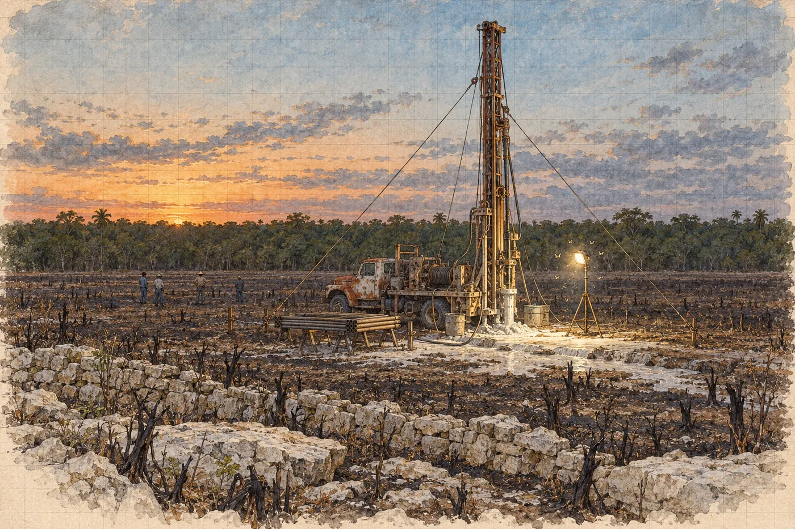

# 17. Vrt

Prvních třicet centimetrů jde korunka lajou jako nůž zmrzlým máslem. Drhne, piští, kouří se z ní bílý prach, dokud chlapci nepustí výplach. Pak z díry začne vytékat mléko. Řídká bílá kaše se rozlévá po popelu a stéká do spár mezi deskami vápence.

Hana stojí u stožáru. Z té díry celý den uvidí jen barvu výplachu a to, jestli teče, nebo ne.

Don Isidro stojí u páky a nedívá se na nic. Poslouchá. Motor bručí, buben s lanem se točí pomalu, tyč klesá. Když se tón motoru změní, don Isidro změní ruku na páce. Hana nerozumí, co slyší. Ví jen, že on to slyší.

V jedenáct čtyřicet je korunka v metru a půl. Laja skončí najednou. Tyč poskočí a sjede o deset centimetrů sama, bez tlaku, a don Isidro ji zastaví dřív, než Hana stačí zvednout ruku.

„Sascab,“ řekne. Ani se neotočí.

Výplach zbělá ještě víc. Teď je to hustá kaše jako vápno na zeď. Chlapci ji odhrnují lopatou do strany, aby netekla pod stožár.

*

V poledne se Hana podívá do telefonu.

Nic.

V Progresu otevírali v osm. Teď je dvanáct. Čtyři hodiny. Hana si představí místnost v přístavu, celníka, muže z prokuratury, Marisol s ocelovým metrem v ruce, protože ho Hana ve svém postupu napsala jako první věc. Představí si víko bedny a pod ním fólii. A pak si zakáže představovat si cokoli dalšího, protože to, co je pod fólií, si představit nedokáže. Každá varianta, kterou zkusí, je jen přání, nebo strach.

Mohla by zavolat. Marisol by pak stála v té místnosti s telefonem u ucha a lidé vedle ní by čekali, až domluví.

Hana telefon zastrčí do kapsy.

Poslala, co měla. Teď je to jejich.

Kalina sedí na kamenné zdi a v jednu hodinu si nasadí sluchátka. Smyčku drží nízko nad zemí, u kolíku s reflexní páskou. Deset minut. Pak sundá sluchátka a kývne na Hanu.

„Vysílá.“

Maják bude vysílat do desátého dubna, ať u něj někdo sedí, nebo ne. Kalina to ví. Ona taky. Ve dvě to Kalina udělá znovu. Ve tři taky.

*

Do sascabu jde vrt rychle. Pět metrů, šest, sedm. Don Isidro šroubuje další tyč, chlapci ji přidržují klíči velkými jako předloktí a stožár se pod tím chvěje jen málo, mnohem míň, než se Hana bála.

Pan Chan stojí s holí u kamenné zdi a od rána se nehnul. Někdo mu přinese židli z obce, kovovou, s vybledlým nápisem pivovaru na opěradle, a on si na ni nesedne. Postaví si ji vedle sebe a opře se o ni.

Rosa sedí na zemi u kolíku nad majákem. Děti odvedla babička do obce v poledne. Rosa zůstala.

V devíti metrech výplach přestane téct.

Ne pomalu. Najednou. Bílá kaše, která tekla z díry od rána, se zastaví, jako když se zavře kohoutek, a z díry se ozve zvuk, který Hana slyší poprvé v životě. Dlouhý, dutý, srkavý, jako když se vypouští vana.

Don Isidro zastaví motor.

Rosa vstane. Hana ví, co to znamená: devět metrů je moc mělko. Buď je špatně Kalinova hloubka, nebo všechno.

„Dutina,“ řekne don Isidro klidně. „Malá. Korunka nepropadla. Jenom voda.“

„Kameru,“ řekne Hana.

Vytahování tyčí trvá čtyřicet minut. Hana stojí u díry a počítá je. Rosa stojí za ní.

Kamera dona Isidra je černý válec velký jako svítilna, na kabelu navinutém na cívce, s kroužkem bílých diod kolem čočky. Obraz jde na malou obrazovku v kufříku, kterou don Isidro postaví na kapotu nákladního vozu. Takhle se dívá do studní, když se ucpou.

Kamera klesá. Bílé stěny vrtu, rýhované od korunky. Pět metrů. Sedm. Osm.

V devíti se stěna na jedné straně otevře. Ne do tmy. Do škvíry. Pukliny široké na dva prsty, která jde šikmo přes vrt, a do ní stéká zbytek bílé vody. Za puklinou kámen. Jen kámen.

„Puklina,“ řekne don Isidro.

Hana se dívá na obrazovku a cítí, jak jí povoluje něco v kolenou. Nevěděla, že ho drží.

V krasu nejsou pukliny samy.

„Utěsnit to umíte?“ zeptá se.

„Jílem,“ řekne don Isidro. „A pomaleji. Voda bude utíkat. Budeme jí dávat víc.“

„Pomaleji je dlouho.“

Don Isidro se na ni podívá, jako by mu vrátila jeho vlastní větu. Pak se skoro usměje.

„Sí,“ řekne. „Já vím.“

*

Ve čtyři je vrt zase v devíti metrech. Chlapci do výplachu míchají jíl z pytle a vody teče z díry míň, než do ní jde. Obec posílá další v cisterně za traktorem.

Deset metrů. Jedenáct.

Hana si sedne na zeď vedle Kaliny. Nohy ji bolí od rána. Nejedla od tortilly v devět. Kalina jí podá půlku banánu a ona ji sní a neví, že ji jí.

„Ve čtyři?“ zeptá se.

„Vysílá,“ řekne Kalina.

Ve dvanácti metrech se vrt dostane z měkkého do tvrdého. Hana to slyší sama, poprvé. Motor změní hlas, z bručení na hlubší, pomalejší. Tyč klesá po centimetrech. Výplach je zase bílý, ale jemnější, hladší.

Don Isidro na ni kývne přes rameno. *Tvrdé.*

Vápenec. Vrstvy, jak je Hana popsala ráno. Některé rozpukané. Tohle je kámen, který tvoří klenbu. Tím teď jde korunka. A každou otáčku, kterou korunka udělá, slyší ta klenba celá.

Hana se nemůže dívat na vrt. Dívá se na prohlubeň se třemi stromy a na puklinu v desce vápence. Kdyby se nad zvonem něco hnulo, uvidí to tam. Možná.

Ve třinácti metrech se zvedne vítr a listy na stromech v prohlubni se zachvějí. Hana vstane. Pak vidí, že se chvějí i stromy u cesty, a sedne si zpátky. Kalina se jí na chvíli dotkne loktem.

*

V pět se vrátí Walt.

Jde přes popel pomalu, s holí, kterou ráno neměl. Pan Chan mu nabídne židli s nápisem pivovaru a sám stojí dál.

V šest je vrt ve čtrnácti metrech. Slunce sedá do lesa a popel na poli zrůžoví.

V šest dvacet don Isidro zpomalí.

Ruka na páce. Motor skoro nebručí. Tyč klesá tak pomalu, že ji Hana nevidí klesat, jen to pozná na značkách, které si na ní udělal křídou. Poslední tři metry. Tak, jak to chtěla.

Teď se dívá na vrt. Nemůže se dívat jinam.

Výplach teče, bílý a stejnoměrný. Dokud teče, je korunka v kameni. Až přestane téct, bude buď další puklina, nebo vzduch.

Rosa stojí u kolíku nad majákem. Pan Chan u židle. Kalina vedle Hany. Jana sedí na zemi s rukama kolem kolen a nehýbe se. Ríša stojí s foťákem a nefotí. Inženýr civilní ochrany stojí u nákladního vozu s vysílačkou v ruce a nemluví do ní.

Patnáct metrů.

Setmí se. Ríša rozsvítí světlo na stativu, jedno, nasměrované na stožár a na díru. Kolem světla se hned rozkrouží můry.

Patnáct a půl.

V osm Kalina vstane a jde ke kolíku. Nasadí si sluchátka. Deset minut. Vrátí se.

„Vysílá,“ řekne.

Šestnáct.

Teď. Nebo za metr. Nebo nikdy, protože zvon je dvacet metrů jinde a ona ho opravila jedním bodem.

Šestnáct dvacet.

Výplach přestane téct.

Tentokrát se tyč pohne. Hana to vidí. Pod rukou dona Isidra sjede dolů o pár centimetrů a don Isidro ji chytí pákou. Z díry se ozve ten srkavý zvuk, dlouhý, dutý. A pak, když utichne, něco jiného. Slabé, chladné, jako když se v létě otevřou dveře do sklepa.

Hana si klekne k díře. Přiloží obličej k ústí, ke kovové pažnici, kterou chlapci zapustili do horních metrů.

Z díry jde vzduch. Ne proud, jen dech. Studený. Těžký. Voní kamenem a vodou a ještě něčím, co Hana nezná a co se jí okamžitě nelíbí. Zatuchlým, sladkým, jako místnost, kde někdo dlouho dýchal.

„Šestnáct dvacet čtyři,“ přečte don Isidro z tyče a vypne motor.

Je osm dvacet sedm.

*

Tyče ven. Znovu, jedna po druhé. Čtyřicet minut.

Nikdo nemluví. Lékař přijde od cesty se svým kufrem. Za ním dva muži nesou na tyči žluté dmychadlo, ventilátor, kterým se do šachet a jímek fouká čerstvý vzduch, než do nich někdo vleze. Další dva nesou na rameni hadici.

„Nejdřív kamera,“ řekne inženýr.

„Nejdřív vzduch,“ řekne Hana.

„Jestli tam je,“ řekne Hana, „tak v tom vzduchu, který teď cítím, dýchá tři dny. Kamera mu nic nedá. Hadice ano.“

„A jestli tam není?“

„Tak jsme tam zbytečně nafoukali čerstvý vzduch.“ Nadechne se. „To ho nezabije.“

Lékař kývne. Inženýr se podívá na lékaře a pak kývne taky.

Poslední tyč vyjede ve čtvrt na deset. Muži zasunou do pažnice hadici, ohebnou, širokou jako zápěstí, a spouštějí ji ručně, metr za metrem. Šestnáct metrů. Sedmnáct. Pak ještě metr, aby visela do prostoru. Dmychadlo naskočí. Řve.

Vedle hadice se do pažnice vejde kamera. Těsně. Don Isidro ji spouští sám. Pomalu. Pokaždé, když kabel o něco drhne, se zastaví.

Bílé stěny vrtu, pak šedé, pak tmavší. Šestnáct.

Stěna zmizí.

Obraz se otevře do černé. Kroužek diod svítí do prázdna a nic se v něm neodráží, jen prach, který se točí v proudu vzduchu z hadice jako sníh. Pod tím, daleko, cosi lesklého. Voda. Kamera se pomalu otáčí na kabelu.

„Hlavu do strany,“ řekne Hana.

Don Isidro stiskne tlačítko na kufříku. Obraz se nakloní. Strop. Hladký, šedobílý, těsně nad kamerou, a mokrý od vody z výplachu. Pak se kamera otočí dál a v kraji obrazu se objeví tvar. Svah. Bloky a hlína, zvedají se šikmo do tmy, mimo dosah diod.

Břeh.

Šest metrů od kamery, Hana to ví. Diody tam nedosvítí. Na obrazovce je jen šedá skvrna, která by mohla být čímkoli.

„Ještě,“ řekne. „Pomalu.“

Kamera se otáčí. Bloky. Hlína. Šedá. Rosa stojí za Haninými zády, Hana ji cítí, nedotýká se jí, ale stojí tak blízko, že slyší její dech.

Je deset nula nula.

V šedé skvrně na břehu se rozsvítí bod. Malý, zelený. Bliká. Jednou za vteřinu, pravidelně, jako srdce na monitoru v nemocnici.

„Dioda,“ řekne Kalina potichu. „Vysílá.“

Maják. Na břehu, dva tři metry nad vodou, rovně, cívkou nahoru. Zelené světlo pod ním dopadá na hlínu a na něco vedle. Na něco, co tam podle mapy nemá být. Na tvar, který není kámen.

Do zeleného světla vjede ruka.

Pomalu. Prsty. Hřbet ruky, na něm šrám. Ruka se zastaví nad majákem a pak se dlaň otočí nahoru, k nim, k té vzdálené bílé hvězdě diod šest metrů od ní a jen o kousek výš.

Rosa vykřikne. Jediné slovo, maysky. Hana mu nerozumí a rozumí mu úplně.

*

Hlas přijde z díry o minutu později. Přes řev dmychadla, který inženýr zastaví máchnutím ruky, a přes šestnáct metrů pažnice a skály. Slabý, rozbitý, jako z rádia, které nemůže chytit stanici.

„¿Quién?“

„Rosa,“ řekne Rosa do díry. Klečí u pažnice, obě ruce na kovu, a mluví dovnitř. Pak maysky. Hodně slov, rychle, a pak ani jedno, protože jí to nejde.

Z díry nic. Pak:

„…Rosa.“

Hana odejde dva kroky stranou. Neví proč. Pak to ví. Tohle není její.

Lékař si klekne vedle Rosy. Počká, až Rosa zvedne obličej, a pak se k díře nakloní sám.

„Luis. Soy médico. No hables. Escúchame.“

Nemluv. Poslouchej mě.

„Vzduch,“ řekne Hana. Nahlas, ke všem. „Pusťte to zpátky.“

Dmychadlo se znovu rozeřve. Lékař si přiloží dlaň k uchu, zakroutí hlavou. Takhle nic neuslyší. Hana se podívá na Kalinu.

Kalina už jde k nákladnímu vozu pro cívku kabelu a dvě krabičky, které pájel ve středu pod plachtou, když Hana šla za Viktorem ke studni. Jeskynní spojení. Dva telefony na drátě, vodotěsné.

„Ten dolní plave?“ zeptá se Hana.

„Ne,“ řekne Kalina. „Ale dá se zavázat do sáčku se vzduchem.“

*

Hana teprve teď pochopí, co udělala.

Vrt je nad vodou. Ona to tak chtěla. Šest metrů od břehu, aby drť a výplach nepadaly na toho, kdo na břehu sedí. A teď všechno, co do díry spustí, spadne do vody šest metrů od toho, kdo na břehu sedí. Telefon. Láhev s vodou. Cukr. Fólie, aby mu nebyla zima. Všechno.

A on pro to bude muset plavat.

Po třech dnech ve vzduchu, ve kterém se mu třese ruka. Každý pohyb ho bude stát víc vzduchu, než má.

„Hadice,“ řekne lékař. Taky na to přišel. „Hadici si může přitáhnout. Je dost dlouhá. Když bude ležet u hadice, bude dýchat čerstvý.“

„A když nedoplave?“

„Doplave,“ řekne Jana. Stojí za nimi, Hana neví, jak dlouho. „Je to Luis. Má tam láhev. Prázdnou. Prázdná láhev plave. Pověsí se na ni a dokope se.“ Odmlčí se. „Já bych to tak udělala.“

Lékař se nakloní k díře, až dmychadlo na chvíli zase zmlkne, a řekne to Luisovi krátkými větami. Hadice. Láhev. Pomalu.

Na obrazovce je dlouho jen zelené blikání. Pak se tvar na břehu pohne. Zvedne se. Sesune se po hlíně k vodě. Hladina se rozvlní a vlny doběhnou až pod kameru a rozbijí odraz diod na střepy.

Hana se dívá na obrazovku a nedýchá.

Tvar pluje. Pomalu, v kraji obrazu, kde je skoro tma. Něco světlého před ním. Láhev. Pak hlava, mokrá, černé vlasy přilepené k čelu. Obličej, který se zvedne do diod.

Luis.

Hubený tak, že ho Hana skoro nepozná. Oči zarudlé, rty rozpraskané. Dívá se do kamery, jako by se díval do slunce. Pak natáhne ruku a chytí hadici.

Pak plave zpátky. Pomalu. S hadicí v ruce.

Na břehu se zase sesune na hlínu a zůstane ležet. Konec hadice si přitáhne k obličeji.

Hana se otočí k inženýrovi.

„Teď,“ řekne. „Teď ať fouká. Pořád.“

*

Don Isidro vytáhne kameru. Telefon by se vedle ní a vedle hadice do pažnice nevešel.

Kalinův telefon spustí do díry v jedenáct čtyřicet, v nafouknutém igelitovém sáčku, a Kalina za ním povoluje kabel. Pod ním v pytli láhev s vodou, ve které lékař rozmíchal cukr a sůl, termofólie, čokoláda a svítilna s novými bateriemi.

Luis plave pro pytel podruhé. Pomaleji než poprvé. Hana ho počítá v sekundách, podle kabelu, který Kalina povoluje a zase přitahuje. Šedesát osm tam. Devadesát dva zpátky. Pak se kabel dlouho nehýbe, než Luis rozváže sáček s telefonem.

V dolním telefonu je mikrofon a reproduktor. V horním sluchátko. Kalina ho podá lékaři.

Lékař poslouchá a ptá se, krátce a španělsky. Hana slyší jen jeho otázky.

Jak se jmenuješ. Kde jsi. Bolí tě hlava. Kde tě bolí. Bolí tě klouby, lokty, ramena. Brní tě něco. Dělal jsi zastávky. Kolik je dnes.

Odpovědi neslyší. Vidí jen lékařův obličej. Při jedné otázce se zamračí. Při další kývne. Při poslední, *kolik je dnes*, se dlouho nehýbe a pak řekne *bien, bien, no importa*. To je jedno.

Zakryje sluchátko dlaní a otočí se k Haně a k inženýrovi.

„Hyperkapnie,“ řekne. Pomalu, aby mu rozuměli oba. „Těžká, ale ne nejhorší. Třese se. Hlava ho bolí tak, že nevidí. Pletou se mu dny. Myslí si, že je pátek. Mluví pomalu a ztrácí slova.“ Odmlčí se. „Dekompresi dělal, jak mohl. V chodbě nahoru, na zastávkách, s posledním plynem. Bolí ho levý loket. Od prvního dne. Nezhoršuje se to.“

„Loket je…“

„Možná nemoc z dekomprese. Lehká. Možná se uhodil. Teď to neřeším.“ Lékař se podívá na hadici, která mizí v pažnici. „Teď řeším tohle. Když bude ležet u hadice a dýchat a nehýbat se, bude mu za pár hodin líp. Za den, za dva o hodně líp. Vytáhnout ho odtud musí ale záchranáři. Touhle dírou ne.“

Ne touhle dírou. Patnáct centimetrů. Hana si to myslela ráno, když se dívala na korunku. Kamera. Hadice. Láhev. Nic víc. Člověk ne.

„Chce mluvit,“ řekne lékař. „Pořád chce mluvit. Říkám mu, ať nemluví.“

Podá sluchátko Rose.

*

Rosa mluví dlouho. Maysky, tiše. Hana odejde za stožár, kde je tma, a sedne si na zem zády k nákladnímu vozu. Ruce se jí třesou. Nevšimla si toho, dokud je neviděla ve světle Ríšova reflektoru.

Kalina si sedne vedle ní.

„V jedenáct vysílal,“ řekne. „Kdybyste se chtěla zeptat.“

Hana se zasměje. Neví, odkud ten smích přišel, je krátký a ošklivý a skoro se jím zakucká. Kalina počká, až přestane.

„Nevěděla jsem, jestli tam je,“ řekne. „Celý den jsem nevěděla, jestli tam je. A kdyby ne, tak jsem do toho pole vrtala jen proto, že jsem otočila mapu o pět stupňů.“

„Otočila jste ji správně.“

„To nevím. Vím jenom, že on tam je.“

Kalina na to nic neřekne. Za chvíli vstane a jde ke kolíku, protože je dvanáct.

*

Po půlnoci přijde lékař a podá sluchátko Haně.

„Chce vás,“ řekne. „Říká *Ana*. Už asi podesáté.“

Hana se podívá na Rosu. Rosa sedí u pažnice s rukama v klíně a kývne.

Hana si sluchátko přiloží k uchu. Plast je teplý od cizích dlaní.

Ve sluchátku je dech. Rychlý, mělký. Šum dmychadla, slabší, zezdola, jak hadice fouká do prostoru. A pak hlas, který zná, jen rozbitý na kusy.

„Ana.“

„Luisi.“ Snaží se mluvit klidně. Pomalu. „Neříkej nic. Dýchej. Despacio.“

Ticho. Pak něco, co by mohl být smích.

„Despacio,“ řekne Luis. „Sí.“

Dýchá. Hana poslouchá, jak dýchá. Počítá to. Nádech, výdech. Dvacet dva za minutu. Pak dvacet. Je to pořád moc.

„Ana. Tengo que…“

„Potom.“

„No. Ahora.“ Hlas se mu zlomí. „Ahora, porque luego no sé si…“ Nedořekne.

Teď. Protože potom neví, jestli.

Hana zavře oči. Lékař stojí u ní a nic jí nezakazuje. Nechává to na ní.

„Dobře,“ řekne. „Pomalu. A když se zadýcháš, přestaneš.“

*

Mluví čtyřicet minut. Kvůli dechu mu to trvá čtyřikrát déle, než by mělo. Někdy začne větu a skončí jinou. Někdy mu vypadne slovo a on ho hledá a nenajde a řekne ho maysky a pak, po chvíli, zase španělsky. Jednou se zarazí uprostřed a zeptá se, jestli je pátek. Hana mu řekne, že je neděle. Neděle začala před čtvrt hodinou.

Hana si to zapisuje. Do Kalinova sešitu, na koleni, ve světle čelovky. Doleva. Kde si je jistá slovy, dá uvozovky. Kde ne, napíše *(přibližně)*. Je toho víc *(přibližně)* než uvozovek.

Ve středu večer, pozdě. Po jedenácté. Luis neví přesně. Viktor přišel k jejich domu, k oknu do ulice, a zaklepal. Rosa spala. Luis vyšel ven. Stáli u plotu.

Viktor mu řekl, že noviny z něj udělají zloděje. Že už to začalo. Že policie bude chtít poslat do síně potápěče a v síni najde u prázdného lůžka štítky *LE*, jeho jméno, jeho čísla. Jeho bod čtrnáct. A Tomásův přístroj vedle. *Řeknou, že jsi tam kopal. Že jsi ho vytáhl ty a prodal. Kdo tam má jméno, ten to udělal.*

„Dijo que era por mí,“ řekne Luis. Řekl, že je to kvůli mně.

Viktor chtěl, aby sjel dolů a přinesl štítky a maják. Dokud se to dá. Dokud to nezavřou. A ještě jednu věc.

„Que lo arreglara,“ řekne Luis a pak dýchá. „La orilla. Del hueco.“

Okraj. Té díry.

Aby ten okraj srovnal. Lůžko, ze kterého Hana válec vyzvedla. Aby jeho okraj přejel dláty, ať *to nevypadá, že se tam páčilo*. Ať tam není otisk, podle kterého by někdo mohl říct, že tam něco leželo a někdo to vzal.

Hana píše a ruka se jí nezastaví. Neví, jak to dokáže. Píše přesně to, co Luis říká, a ne to, co ví. Ví, co je lůžko. Ví, že je to jediný otisk originálu, který zůstal v jeskyni. Že má tvar spodního konce, souměrného a oblého, a že replika má konec zploštělý, jako by ho někdo zmáčkl palcem. Ví, že se jí Viktor u studny ptal, jestli lůžko fotila, a ona mu odpověděla, že snímky jsou bílé.

Nic z toho nenapíše. Tohle není výpověď Hany Vrbové. Je to Luisova výpověď. Doleva patří jen to, co řekl.

Šel v noci na čtvrtek. Z domu v jednu. U studny seděl na plošině dlouho, nevěděl jak dlouho. Do vody vlezl kolem půl šesté. Měl dvě láhve od Walta.

V síni byl jedenáct minut.

Maják vzal hned. Ten Tomásův. Sundal ho z terasy, i s olovem. Myslel si, že ho Tomásovi vrátí.

Pak připlaval k lůžku.

„Y no pude,“ řekne Luis.

A nemohl.

Dlouhé ticho. Dech. Hana čeká.

„Es lo único que queda de él, Ana. Allá abajo. Lo único.“

Je to jediné, co tam dole po něm zůstalo. Jediné.

Nesrovnal ho. Nedotkl se ho. Měl na přilbě kameru. Tu svou, pro Walta, pro mapu. Rozsvítil ji. Vytáhl z kapsy na stehně tabulku, svou mapovací, plastovou, na jejímž okraji je pravítko v centimetrech, jako má každý, kdo měří chodby. Položil ji vedle lůžka. Pak ještě jednou, napříč. Pak na terasu, k bodu čtrnáct, ke štítku. A natočil to. Lůžko, okraje, dno, žlábek. Štítky nechal, kde byly.

„Son míos,“ řekne. „Están donde deben estar.“

Jsou moje. Jsou tam, kde mají být.

Pak plaval zpátky. Sestup, mlha, haloklina. Pod hrdlem byl, když přišel odstřel. Cítil ho v hrudi. Před ním se zvedla bílá zeď a dlouho nic. Když se usadila, hrdlo nebylo.

Plyn měl na půl cesty ven. Ven nebylo kudy.

Pak si vzpomněl na Walta. Na to, jak mu bylo šestnáct. Na chodbu, ve které se smál, protože ho to nadnášelo.

„Y el aparato de Tomás,“ řekne. „Cada hora. Diez minutos. Lo puse derecho.“

A Tomásův přístroj. Každou hodinu. Deset minut. Postavil jsem ho rovně.

U kolíku čeká Kalina na jednu hodinu. Neslyší, co Luis říká. Neví, že teď mluví o majáku.

„Ana.“

„Jsem tady.“

„La cámara. Está aquí. Conmigo. En la bolsa.“

Kamera je tady. S ním. V sáčku.

„Dobře,“ řekne Hana. „Nech ji tam. Ať je v suchu.“

„No. Súbela. Ahora. Por si…“

Pošli ji nahoru. Teď. Kdyby…

Hana mlčí. Dívá se na pažnici, na hadici, na kabel telefonu, na šňůru, po které šly dolů láhev a čokoláda.

Ví, co by se stalo, kdyby kameru vytáhla ona. Kamera by vyjela z díry v pytli a ona by ji vzala do ruky. Měla by ji v ruce dřív než kdokoli jiný. A pak by se každý, kdo kdy bude chtít, mohl zeptat, co s ní dělala mezi pytlem a policií. Cizí kontext v jejích rukou by přestal být cizí. Stal by se jejím.

„Luisi,“ řekne. „Pošli ji. Ale já ji nevezmu.“

Ticho. Pak:

„¿Por qué?“

„Protože to nesmí být moje,“ řekne. „Musí to být tvoje.“

Ticho. Dech, dvacet za minutu. Pak něco, co může být *ya*. Nebo *bueno*. Nebo jen výdech.

*

Policista, který od čtvrtka hlídá pásku u studny, přijde přes pole ve tři čtvrtě na dvě. Mladý, s puškou přes rameno, kterou si nesundá, a s plastovou krabičkou na formuláře. Přivedl ho inženýr. Hana za inženýrem zašla, protože sama neví, jak se tu taková věc dělá.

Luis plave potřetí. Pomaleji než předtím. Hana ho počítá podle šňůry v Kalinových rukou. Sto čtyři vteřiny tam, s pytlem na šňůře. Sto osmnáct zpátky. Pak leží na břehu u hadice a nehýbe se. Lékař drží sluchátko a poslouchá jeho dech.

Pytel vyjede z díry ve dvě hodiny dvě minuty. Mokrý, těžký od vody na povrchu. Uvnitř jiný sáček, zavázaný na dvakrát. Uvnitř malý černý tvar.

Hana stojí krok za policistou. Ruce má v kapsách.

Policista si natáhne rukavice a položí pytel na kapotu nákladního vozu do světla Ríšova reflektoru. Inženýr stojí vedle. Na druhé straně stojí pan Chan. Rosa ho vzbudila u zdi, kde podřimoval vestoje, opřený o hůl. Policista nechá vnitřní sáček zavázaný a celý ho vloží do svého sáčku s číslem. Zalepí ho. Napíše čas. Podepíše se. Podá pero inženýrovi, potom panu Chanovi. Pan Chan se podepíše pomalu, tiskacím písmem, celým jménem.

Policista se podívá na Hanu. Zvedne pero.

Hana zavrtí hlavou.

„Nesahala jsem na to,“ řekne. „Ať je to vidět.“

Policista chvíli váhá. Pak kývne a pero si zastrčí do kapsy.

Ríša stojí za reflektorem a fotí. Nikdo mu to neřekl. Ríša nic nemaže.

*

Ve dvě dvacet Hana zavolá Marisol.

Nevezme to. Hana mluví do schránky krátce, jako do deníku.

„Tady Vrbová. Je dvě dvacet. Luis Ek žije, je ve zvonu a dýchá vzduch z hadice. Ven ho dostanou záchranáři, touhle cestou ne. Měl na přilbě kameru. Kamera je od dvou nula dvě u policisty, který hlídá studnu, v zapečetěném sáčku. Svědci inženýr civilní ochrany a pan Chan. Nedotkla jsem se jí a nevím, co na ní je.“ Zaváhá. „Luis mluvil. Zapsala jsem jen to, co řekl. Sešit vám dám.“

Zavěsí a položí telefon na kamennou zeď displejem dolů.

*

Nikdo nespí. Dmychadlo řve a Haně ten hluk nevadí.

Ve tři hodiny řekne don Isidro, že by kamera mohla zůstat dole. Ať je vidět, jak Luis leží. Lékař souhlasí. Don Isidro ji spustí znovu, vedle hadice, a otočí hlavu k břehu. Obraz na obrazovce: zelené blikání, každou celou hodinu deset minut, a vedle něj, šedě, tvar, který se zvedá a klesá. Dýchá.

„Strop,“ řekne Hana.

„Strop nad břehem. Nad bloky. Jestli tam něco visí.“

Měla se na to zeptat hned, když kamera prošla stropem. Nezeptala se, protože hledala ruku.

Don Isidro otočí hlavu kamery nahoru a k západu, pomalu. Diody nedosvítí. Inženýr přinese z auta svítilnu, tu velkou, na dlouhém držadle, a spustí ji na šňůře vedle kamery. Světlo se ve tmě rozhoupe a pak se ustálí.

Strop nad vodou je hladký. Jako vnitřek vajíčka. Walt měl pravdu, i po sedmnácti letech.

Nad břehem ne.

Nad břehem se strop láme do stupňů. Šupiny, římsy, kameny, které visí za jednu hranu, jako když se loupe omítka. Mezi nimi trhliny. Některé šedé, staré. Jedna bílá.

Hana se na ni dívá. Bílá, ostrá, tenká jako vlas. Jde šikmo nad bloky, od severozápadu k jihovýchodu.

Možná puklina z pole, viděná zespodu. Pukliny nejdou do hloubky svisle. Možná jiná.

„Drží,“ řekne inženýr. Neptá se. Říká to, protože to vidí. Visí to, ale drží to.

„Teď ano,“ řekne Hana.

A pak, když se světlo na šňůře pootočí, uvidí něco jiného.

Na nejvyšším místě nad bloky, kde se strop zvedá do šikmého komínu, je skála černá. Ne mokrá. Černá jako dno hrnce. Saze. Vrstva sazí, starých, matných, která jde od kraje komínu přes strop jako stín.

A v sazích ruce.

Otisky dlaní. Hana jich napočítá pět, šest, pak se světlo pohne a ona přestane počítat. Jsou malé. Ale ne jako ruce dítěte. Jsou široké. Dlaň skoro čtvercová, prsty krátké, tlusté, palec posazený nízko. Otištěné do sazí, nebo vytlačené ze sazí, tak, že prsty vyšly světle a kolem nich zůstala černá.

Ví, co to je. Zná to z literatury, z fotek z jeskyní na celém Yucatánu a dál, z Belize, z Guatemaly. Jeskyně byly pro Maye vstupy do podsvětí. Chodilo se do nich s pochodněmi, obětovalo se v nich, malovalo se na stěny. Otisky rukou jsou v mayských jeskyních běžné. Často dětské. Četla o tom kdysi na fakultě článek v časopise, který už nevychází.

A bloky jsou kus stropu, který kdysi spadl. Prohlubeň se třemi stromy nahoře na poli je starý propad, a nad propadem mohla být kdysi díra. Vchod. Suchý, ze země, ne z vody. Tudy mohl někdo slézt dolů s pochodní. A potom se vchod zavalil.

To je výklad. Je dobrý. Je pravděpodobný.

Malé ruce. Široké. S krátkými prsty.

Dětské, řekne si. Dětské otisky. Děti mají široké dlaně a krátké prsty. Nemají. Mají. Nevím. Hana se na ně dívá a na chvilku zadrží dech, jako tenkrát u Waltova stolu nad kresbou oblých domů. Pocit, že viděla tvář, kterou zná, v cizím městě, a pak se tvář otočí a je cizí.

Ten pocit nepatří nikam. Ani vlevo, ani vpravo.

„Walte,“ řekne.

Walt sedí na židli s nápisem pivovaru. Celou noc tam sedí a nespí. Teď vstane, opře se o hůl a přijde k obrazovce. Hana čeká, že řekne *ty jsem tehdy neviděl*, nebo *svíčka hořela malá*. Nebo že neřekne nic.

Walt se dívá a nehýbe se.

„Nekreslete je,“ řekne pak.

Otočí se a jde zpátky k židli.

*Co nenakreslíte, to vám nikdo nevykrade.* Mayská jeskyně pod polem, kam po zprávách v novinách přijede každý s detektorem a s lopatou. Walt chrání lokality třicet let. Proto ta prázdná místa na mapách.

Hana to tak zapíše.

Doleva: *3:20, kamera dona Isidra, svítilna na šňůře. Strop nad Z koncem (bloky) stupňovitý, uvolněné šupiny, trhliny; jedna čerstvá (bílá), směr SZ–JV (puklina z povrchu?). Drží (inž. CO). V komínu nad bloky vrstva sazí, v ní otisky dlaní, ≥ 6, malé, široké, krátké prsty. Nefotografováno (jen záznam kamery D. I.). Nedatováno.*

Doprava: *Dětské otisky? Mayský rituál, vstup shora přes dnes zavalený propad (prohlubeň se 3 stromy). Běžné.*

Pod to: *Walt: „Nekreslete je.“*

Pak se podívá na slovo *Běžné*.

Nechá ho tam.

*

Zpráva přijde ve čtyři dvanáct.

Hana už skoro spí. Sedí na zemi zády ke kamenné zdi, se sešitem na kolenou. Telefon na zdi nad ní zabzučí a ona ho strhne dolů, jako by spadl.

*Vaši zprávu mám. Díky Bohu.*

*Bedna zadržena v 8:40. Uvnitř předmět. 460 mm, třikrát, ocelový metr mezi úhelníky. Průměr 110. Spodní konec souměrný. Jizvy 4 a 5 sedí na fotky z 18. 3. Udělala jsem to podle vás, krok za krokem. Nezaokrouhlila jsem.*

*E. S. zadržen v přístavu v 11:20, když přijel s papíry. V. B. od odpoledne znovu vyslýchán. Už ne jako svědek.*

*Kamera zůstane u policie. Nikdo ji nepouští, dokud nepřijede expert z prokuratury. Stránky s jeho slovy si ráno nafotím. Nic víc dnes. Nemůžu.*

*M.*

Hana si to přečte dvakrát. Pak telefon položí na sešit, displejem nahoru, a dívá se na něj, dokud nezhasne.

Válec byl v bedně. Má čtyři sta šedesát milimetrů. Marisol to změřila, ne ona. Třikrát. Podle jedné stránky, kterou napsala za čtyřicet minut na notebooku pod plachtou.

Čekala, že bude cítit, jak se jí vrací jméno. Necítí nic takového. Cítí únavu, která jí sedí na hrudi jako vzduch ve zvonu, a pod ní malou úlevu, která s jejím jménem nemá nic společného. Válec neodplul. Je změřený.

A Luis dýchá.

Odepíše jen: *Díky. Luis dýchá. H.*

Otevře sešit na nové stránce a nahoru doprava napíše *5*.

Vlevo zapíše den. Čísla, časy, jména. Průraz 20:27, 16,24 m. Luisova slova v uvozovkách. *Kamera L. E. v pytli 2:02, policista, inženýr, pan Chan. H. V. se kamery nedotkla.* Zprávu od Marisol opíše bez jediného slova navíc.

Vpravo, pod otisky, nepřipíše nic.

Jen se podívá k pažnici. Rosa tam pořád sedí, se sluchátkem u ucha, a neříká nic. Jen poslouchá, jak na druhém konci drátu někdo dýchá.
