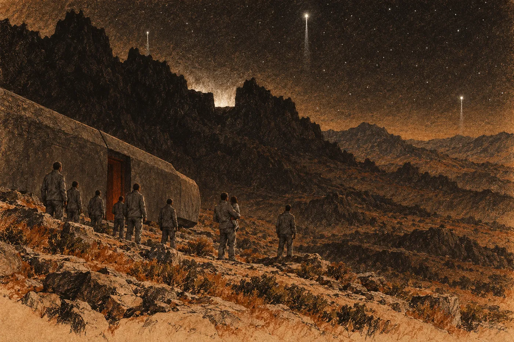

# 1. Ticho

Probudil se a první, co poznal, bylo, že ztichly ventilátory.

Tak to aspoň cítil. V habitatu je člověk neslyší celý život, protože hučí od chvíle, kdy se narodí. Slyší je teprve, když přestanou. Pak je to jediný zvuk na světě: díra, do které padá všechno ostatní. Eren to zažil třikrát. Pokaždé se lidé na chodbách zastavili uprostřed slova a dívali se ke stropu. A pokaždé to byl on, kdo se rozběhl k rozvaděči.

Teď ležel na zádech v úzké tmě a nemohl se rozběhnout nikam. A díra nebyla ve stropě. Byla v něm.

Hledal čas. Dělal to každé ráno, ještě než otevřel oči. V koutku mysli, tam, kam se člověk nedívá, ale ví, že tam něco je, svítil řádek: čas, teplota v bytě, stav sítě v jeho úseku. A pod tím menší řádek, jediný, na kterém záleželo. *Tio spí. Dech pravidelný.* Šest let tam svítil. Šest let nemusel v noci vstávat a chodit se dívat.

Řádek tam nebyl. Nebylo tam nic. Ne tma; tma by byla něco. Prázdno, jako když člověk ve tmě sáhne po zábradlí, které tam bylo vždycky, a ruka projde vzduchem.

Obrátil se k síti. Nahlas se k ní neobracel nikdo. Byl to malý pohyb uvnitř hlavy, tak zažitý, že ho dělal dřív, než na něj pomyslel, jako se polyká. Nic se neozvalo. Udělal ten pohyb znovu a silněji, jako se mačká tlačítko, které nefunguje, a za pravým uchem ucítil tupý tlak. Tam pod kůží měl implantát. Kus kovu. Studený jako všechno ostatní.

Vypnuli to. Věděl to. Řekli jim to v hale, kde je ukládali, stejným hlasem, jakým se ohlašují odjezdy: propojení bude po dobu hibernace deaktivováno a nebude obnoveno. Slyšel to a přikývl, jako přikyvovali všichni. Věděl to. Teď zjistil, že vědět něco a ležet v tom jsou dvě různé věci.

Pak přišla zima.

Nepřicházela zvenku. Vycházela z kostí, jako by v nich ležela celou cestu a probudila se dřív než on. Zuby mu cvakaly samy. Chtěl zatnout čelist a čelist neposlechla. Prsty na rukou necítil vůbec, prsty na nohou jako cizí. V ústech měl pachuť kovu a čehosi nasládlého, co mu na jazyku zůstalo po tekutině v žilách.

Kolik let? Šest set, víc. V procesu to řekli přesně, s desetinnou čárkou. Nezapamatoval si to, protože si to pamatovala síť.

Všichni, koho znal a kdo neležel tady s ním, byli mrtví. Dávno. A on měl pocit, že zavřel oči před chvílí.

*

Nad obličejem cvaklo. Víko se odsunulo s dlouhým syčením a do tmy vteklo světlo, nízké a rudé, nouzové. Eren ho znal. Takové světlo svítí v servisních chodbách, když hlavní okruh vypadne a záložní drží jen to nejnutnější. Uklidnilo ho to dřív, než stačil pochopit proč. Rudé světlo znamená, že něco ještě běží.

S víkem přišly zvuky.

Někdo zvracel, dlouze a namáhavě, s přestávkami na nádech. Někdo kašlal. Kovové lůžko kus dál zadrnčelo, jak o ně kdosi udeřil loktem. A přes to všechno, vysoko a ostře, plakalo dítě.

Ten pláč poznal. Poznal ho sám, bez řádku, bez sítě, ušima. Na okamžik ho to vyděsilo víc než ticho: že to jde. Že to celou dobu šlo.

Zkusil se posadit. Břicho se stáhlo, ale ramena zůstala ležet. Svaly měl jako z mokré látky. Napodruhé se překulil na bok, chytil se okraje lůžka a nohy přehodil přes hranu. Podlaha byla blíž, než čekal, a studenější. Dopadl na kolena. Ucítil to až po chvíli, jako zprávu, která přišla se zpožděním.

Prostor byl dlouhý a nízký. Po obou stranách stála lůžka ve třech patrech, jedno nad druhým, a z nich se teď soukali lidé. Vypadávali, jako vypadávají balíky z regálu, kterému povolila pojistka. Všichni v šedém a všichni ostříhaní nakrátko, stejně, takže v rudém světle nebylo poznat, kdo je kdo. Na kovových žebrech stropu ležela jinovatka. Dech se srážel v páru.

Tio ležela naproti, v dolním patře, v lůžku kratším než ostatní. Řemeny měla pořád zapnuté. Plakala se zavřenýma očima a volala mámu.

Eren se k ní doplazil po kolenou. Přezka byla jednoduchá, palcem dolů a od sebe; zapínal ji sám, v hale, a Tio se přitom smála, protože ji to lechtalo. Teď ji nemohl rozepnout. Prsty nedržely. Opřel o přezku celou dlaň a tlačil, až kov povolil. Pak druhou. Vytáhl Tio z lůžka a přitiskl si ji k hrudi. Byla studená a lehká. Lehčí, než si ji pamatoval.

„Mami,“ řekla mu do krku. „Mami.“

„Máma je tady,“ řekl. Nevěděl, jestli je to pravda.

Maela ležela nad Tio, v prostředním patře, a zvracela přes okraj. Nad ní stála starší žena, šedá a ostříhaná jako všichni, a držela jí hlavu oběma rukama.

„Na boku,“ řekla ta žena. Neříkala to Maele. Říkala to Erenovi, jako by ho znala. „Nesmí si lehnout na záda. Rozumíte? Na boku.“

Eren přikývl. Žena přikývla taky, jako by si sama potvrzovala, že tohle aspoň ví. Rozhlédla se po lidech, kteří padali z lůžek, a Eren v její tváři uviděl něco, co znal ze směn, kdy nebylo dost rukou. Kde začít.

Maela se přestala dávit a otočila hlavu. Oči měla zarudlé a pod nimi tmavé kruhy. Bez vlasů vypadala mladší, ostřejší, jako náčrt sebe sama. Podívala se na Tio v jeho náručí. Teprve potom na něj.

„Dýchá?“ zeptala se.

Doma by to věděla dřív, než by se zeptala. Oba by to věděli.

„Dýchá,“ řekl Eren. „Pláče.“

Maela natáhla ruku. Byla to ruka, která se třásla, a Eren do ní vložil dceřinu nohu, protože na nic jiného nedosáhla. Maela ji sevřela přes šedou látku, zavřela oči a zase se začala dávit.

*

Hlas přišel odevšad naráz.

Reproduktory byly ve stropě, v řadě mezi žebry, a Eren je předtím neviděl. Hlas byl klidný a příjemný, ani mužský, ani ženský. Takovým hlasem se mluví na nádražích a v nemocnicích.

„Modul čtyři. Oblast šest. Tři sta dvanáct osob. Přistání dokončeno.“

Pauza. Někdo se zasmál, krátce a divně.

„Na základě pravomocného rozsudku jste byli odsouzeni k trvalému vyhnanství bez přístupu k technologii. Konfederace lidských světů nepoužívá trest smrti. Vyhnanství je humanitární alternativou. Byli jste převezeni na Zemi, kolébku lidstva. Je to jediný známý svět, na kterém člověk může přežít bez techniky.“

„Vypněte to,“ řekl kdosi. Pak křičel: „Vypněte to!“

Hlas nepřestal. Nemohl přestat; byl to záznam. Eren to věděl a stejně se mu nechtělo věřit, že tomu člověku nikdo neodpoví.

„Oblast přistání byla prověřena. Jde o neobydlenou divočinu vhodnou k přežití. Výbava bude vydána za úsvitu. Modul poté opustí povrch. Nepokoušejte se modul poškodit ani do něj vniknout. Nepokoušejte se zdržet jeho odlet. Mějte na paměti, že každý z vás dostává příležitost začít znovu.“

Eren ten hlas znal. Ne ten konkrétní, ten byl vyrobený. Znal jeho stavbu, rytmus vět. Tak mluvil soud. Tak mluvila listina, kterou mu tehdy položili před oči. Krátké věty, na každém konci tečka, žádná věta, do které by šlo strčit prst a zeptat se.

„Opusťte modul. Dveře se otevřou po skončení tohoto oznámení.“

Ticho, a pak, stejným hlasem a stejně klidně: „Modul čtyři. Oblast šest. Tři sta dvanáct osob. Přistání dokončeno.“

Začalo to znovu od začátku.

Někdo začal počítat nahlas: jedna, dvě, tři. Eren nepochopil, co počítá, dokud nedošel ke dvanácti a nezačal znovu. Lidé po sobě pokukovali. Tři sta dvanáct. Kolik jich je tady, v téhle dlouhé rudé místnosti? Nikdo to nevěděl. Doma by to věděl každý, aniž by se díval.

Tio přestala plakat. Poslouchala hlas se staženými rameny a pak se zeptala, co je kolébka.

„Postýlka,“ řekl Eren. „Pro malé děti.“

„Já nejsem malá.“

„Ne.“

„Tak proč nás dali do postýlky?“

Na to neměl odpověď. Hlas mezitím došel k divočině vhodné k přežití a Tio se schoulila a strčila mu hlavu pod bradu.

*

Dveře se otevřely, když hlas skončil podruhé.

Nejdřív se otevřel pruh tmy v čelní stěně, úzký a svislý, a rozšiřoval se. Tlak se vyrovnal s tichým zasyčením a Erenovi zalehlo v uších. Plošina se sklopila ven a dolů, pomalu, až dosedla. Eren to cítil podlahou: jedno tupé ťuknutí, kov o něco, co nebyl kov.

Dovnitř vtekl vzduch.

Byl studenější než vzduch v modulu a byl plný věcí. To bylo první, co Erena zarazilo. Vzduch v habitatu nevoní. Je čistý, protože ho někdo čistí, a když voní, je to porucha. Tenhle voněl. Ostře, pryskyřičnatě, jako čerstvě rozříznutý izolační materiál, jen živěji. Pod tím prach. Pod prachem něco tlejícího a nasládlého, co se mu zvedlo v žaludku. A ještě hlouběji, sotva tušené, něco, co mohl být kouř.

Chtěl vědět, co to je. Ta pryskyřičnatá vůně. Obrátil se k síti, tím malým pohybem v hlavě, a zase narazil na nic. Jak se ta vůně jmenuje, nevěděl. Ani jestli nějaké jméno má.

U dveří stál muž. Byl vysoký a široký v ramenou a v rudém světle mu nebylo vidět do tváře. Stál bokem k otvoru, jednou rukou se opíral o rám a druhou zvedl, dlaní k lidem, kteří se tlačili za ním.

„Pomalu,“ řekl. Nemluvil nahlas, a přece ho bylo slyšet až dozadu. „Nikam nespěchejte. Nikdo na nás nečeká.“

Lidé zpomalili. Eren si toho všiml s malým, nepříjemným obdivem. Ten muž neměl žádné oprávnění, žádnou pásku, nic. Jen hlas, který věděl, kam jde. A lidé za ním šli, protože to bylo jednodušší než jít jinam.

Eren nesl Tio a vedle něj šla Maela. Opírala se o tu starší ženu, která jí předtím držela hlavu. Na plošině se Erenovi podlomila kolena. Chytil se zábradlí a to zábradlí tam opravdu bylo, kovové, studené, a Eren se ho držel déle, než potřeboval.

Pak sestoupil z plošiny a stál na Zemi.

Čekal něco rovného. Podlahu. Pod chodidly mu to uhnulo, chvíli měkce, pak tvrdě. Kámen pod tenkou podrážkou, a vedle něj něco pichlavého, co se otřelo o kotník a vydalo suchý zvuk. Udělal krok a noha dopadla níž, než čekal. Udělal další a kotník se mu vytočil na hraně kamene. Bolelo to tak obyčejně, až to bylo směšné. Stál tam s dítětem v náručí a nevěděl, jak se chodí.

Za ním vycházeli další lidé a stejně jako on se zastavovali hned za plošinou, protože nevěděli, kam šlápnout.

Pak se Eren podíval nahoru.

*

Nad ním nebylo nic.

Ne strop, ne kopule, ne žebroví. Ani okno. Celý život měl nad hlavou něco, co někdo postavil a někdo udržoval, a teď tam nebylo nic. Na okamžik se mu zatočila hlava, jako když se člověk nakloní přes zábradlí servisní šachty. Jenže tahle šachta vedla nahoru a neměla dno.

A v tom nic byly hvězdy.

Znal je z oken servisního prstence. Tam byly ostré a nehybné, jako vytištěné. Tyhle se chvěly. Mihotaly se, některé až do barvy, a Eren chvíli nechápal proč, než mu to došlo. Mezi ním a nimi byl vzduch. Celá ta vrstva vzduchu, který člověk dýchá a který tu nikdo nečistí, se hýbala a lámala jejich světlo. Byla jich spousta. Víc, než kdy viděl, a žádnou nepoznával. Jen na jedné straně, nad nízkým obzorem po pravé ruce, jich bylo méně. Tam visel veliký bledý kotouč, skoro kulatý, a jeho světlo leželo šedě na trávě. Eren ho znal z obrázků. Nikdy si nemyslel, že je tak velký.

„Tati,“ řekla Tio. „Tam.“

Ukazovala nahoru, kousek stranou od místa, kam se díval on.

Světla, která nebyla hvězdy. Byla tři a klesala.

Klesala tak pomalu, že se zdálo, že stojí, dokud je člověk nesrovnal s hvězdami. Každé viselo na tenkém bledém sloupku, jako by se o něj opíralo. Každé jinde: jedno skoro nad nimi, druhé daleko vpravo, třetí nízko nad horami po levé ruce.

Eren je počítal. Udělal to dřív, než si uvědomil, že to dělá; počítal všechno, co svítilo. Tři. Hlas říkal modul čtyři. Jeden, dva, tři už musely být dole, někde ve tmě, kterou neviděl. Čtyři byli oni. Tihle tři ještě ne.

Sedm, pomyslel si. Je nás sedm.

„Lodě,“ řekla Maela. Stála vedle něj a pořád se opírala o tu ženu. Hlas měla chraplavý od zvracení. „To jsou lodě jako naše.“

„Moduly,“ řekl Eren, protože tak se to jmenovalo.

„Kolik lidí je v jednom?“

Maela se ptala, protože se ptala vždycky. Počítala zásoby pro habitat o osmnácti tisících lidech a nikdy se nespokojila s číslem, které nebylo celé. Eren řekl, že tři sta, čtyři sta, a cítil, jak si to v hlavě násobí.

To světlo nad nimi kleslo za hřbet, který se černě rýsoval proti hvězdám, a zmizelo. Nebylo slyšet nic. Druhé, vpravo, kleslo až k zemi a krátce ozářilo kus kraje: svah, něco tmavého a zubatého na něm, něco, co se zalesklo jako voda. Pak zhaslo i to. Šla dolů tak, jak šli dolů oni, a Eren si vzpomněl, že sestup necítil. Spal. Stroj ho položil na zem jako balík a on se probudil, až když bylo hotovo.

Třetí nad horami nešlo dolů rovně.

Sloupek pod ním se ohnul, zlomil se a narovnal a zase zlomil, jako čára, kterou někdo kreslí v jedoucím voze. Světlo se stáčelo stranou, nejdřív málo, pak víc, ne k zemi, ale podél hor, a pak k nim.

„Tamto,“ řekl někdo za ním. „Co dělá tamto?“

Eren mlčel. Díval se. Hory teď viděl. Byly to hory, nic jiného to být nemohlo: veliká tma, která zakrývala hvězdy v zubaté čáře nad celým obzorem po levé ruce. Světlo nad nimi zakolísalo. Na chvíli zjasnělo, jako by se vzchopilo. Eren věděl, co to je, protože podobné věci viděl na diagnostice: motor na poslední chvíli zvyšuje tah, aby udržel let, který udržet nejde.

Pak zapadlo za hřeben a bylo pryč.

Na pár úderů srdce se nestalo nic. Lidé kolem něj začali dýchat.

Potom se hory rozsvítily zezadu.

Nejdřív bíle, krátce a ostře, takže hřeben na okamžik vystoupil z noci celý, každý zub a každý zářez, jako vystřižený. To bílé zhaslo a místo něj tam zůstala záře. Rudá, nízká, za jedním místem hřebene, kde byl zářez mezi dvěma vrcholy. Ta záře nezhasla. Chvěla se, slábla a sílila, jako by dýchala.

Eren začal počítat.

Nepočítal nahlas. Počítal v duchu, tak jak ho to kdysi naučili, ještě v učení, než měl implantát s hodinami: jedna, a dvě, a tři, každé číslo s tou malou výplní mezi sebou, aby trvalo vteřinu. Zvuk jde vzduchem, který se dá dýchat, asi tři sta čtyřicet metrů za vteřinu. To věděl. Tohle si nepamatovala síť. Tohle si pamatoval on.

Okolo něj se lidé hýbali a mluvili. Někdo plakal. Maela něco říkala té ženě. Eren počítal.

Při sto padesáti osmi to přišlo.

Nebyl to zvuk, aspoň ne takový, jaký čekal. Spíš tlak. Tupé převalení, které víc ucítil v hrudi a v zubech, než uslyšel ušima. Trvalo dlouho, mnohem déle než záblesk, a nakonec se rozpustilo v tichu. Někdo se zeptal: „Co to bylo?“ Nikdo neodpověděl.

Sto padesát osm vteřin. Padesát tři kilometry, možná padesát čtyři. Vzduch tu byl studený a v chladném vzduchu jde zvuk pomaleji. Spíš o kus blíž, než dál. Eren si to v hlavě přepočítal ještě jednou a pak potřetí, protože počítat bylo jediné, co mohl dělat.

Pak si zapamatoval zářez.

Stál na místě a hleděl na hřeben, dokud ten tvar neměl v očích. Dva vrcholy, levý vyšší a zaoblený, pravý užší. Mezi nimi zářez, hluboký a pravoúhlý. Vypadal jako mezera v ozubeném kole, kterému někdo vylomil zub. Ozubená kola viděl v muzeu techniky, když byl malý. Celé dopoledne tam stál u jednoho stroje, který nedělal nic jiného, než že točil koly za sklem, a otec ho odtamtud nemohl odtáhnout.

Pod nohama nahmatal kámen, velký jako pěst. Položil ho na zem špičkou boty. Druhý o dva kroky dál, tak, aby oba ležely v jedné čáře se zářezem. Musel se při tom předklonit s Tio v náručí a Tio si stěžovala, že ji mačká. Narovnal se a zaměřil to znovu. Kameny ležely v čáře. Záře za horami pořád dýchala.

Když zvedl hlavu, uviděl ještě jedno světlo. Vysoko, mnohem výš, než klesaly moduly, slabé jako hvězda, kterou člověk zahlédne jen koutkem oka. Nepadalo. Táhlo se mezi hvězdami napříč, pomalu a rovně, někam, kam nevedlo nic z toho, co tu znal. Eren ho sledoval, dokud ho neztratil. Pak si nebyl jistý, jestli ho viděl.

„Co to děláš?“ zeptala se Maela.

„Nic,“ řekl Eren.

„Tati,“ řekla Tio. „Co to bylo?“

„Loď.“

„Naše?“

„Jiná.“

Tio se dívala na tu rudou záři a Eren cítil, jak přemýšlí. Bylo to cítit; měla napjaté celé tělo.

„Je tam někdo?“

Tři sta lidí. Možná víc. Ležících na zádech v lůžkách, v řemenech, ve kterých se nedá pohnout. Spí. Stroj je měl položit na zem jako balík.

Eren neodpověděl. Tio se nezeptala znovu. Položila mu hlavu na rameno a nespouštěla ze záře oči.

*

Ten vysoký muž od dveří chodil mezi lidmi. Eren slyšel jeho hlas dřív, než ho uviděl: klidný, nespěchající, pořád stejně nahlas, ať mluvil k jednomu člověku, nebo k dvaceti.

„Ráno,“ říkal. „Ráno. Ne teď. Teď je tma a nevíme, kam šlapat.“

„Ale jestli tam jsou živí…“

„Jestli tam jsou živí, budou živí i ráno. A jestli ne, nepomůžeme jim tím, že si tady ve tmě zlámeme nohy.“

Muž, který se ptal, zmlkl. Eren si všiml, že to nebyla odpověď. Bylo to něco jiného: věta, za kterou se dalo schovat. A ten muž se za ni schoval rád.

Vysoký muž došel až k nim. Zastavil se a prohlédl si Tio, potom Erena. V rudém světle z otevřených dveří mu teď Eren viděl do tváře. Byla široká a vrásčitá, s hlubokými rýhami od nosu ke koutkům úst. Starší, než by se podle hlasu zdálo. Nad očima husté obočí, šedivé jako strniště na hlavě.

„Máte ji?“ zeptal se.

„Mám.“

„Dobře.“ Muž kývl, jako by si odškrtl položku. „Držte se u modulu. Zvenku je teplý. Do rána vydrží.“

A šel dál.

Eren se otočil. Muž měl pravdu. Plášť modulu, stěna vysoká jako dvě patra a zakřivená jako hřbet, sálala. Lidé se k ní už tiskli, zády i dlaněmi, celou délkou těla. Teplo zbylo v kovu ze sestupu. Eren věděl, že vydrží jen pár hodin, než kov vychladne.

Sedli si u paty stěny, mezi dva lidi, kteří tam už seděli. Maela se opřela zády o kov a zavřela oči. Starší žena, která ji vedla, si sedla vedle ní. Chvíli tak seděla s rukama v klíně, pak se otočila k Erenovi.

„Sefa,“ řekla.

„Eren.“

„Jsem lékařka.“ Řekla to, jako by předkládala doklad, a pak se odmlčela, jako by ten doklad nejdřív sama přečetla. „Ona bude v pořádku. To zvracení je po probuzení. Většina lidí to má. Děti míň.“ Zaváhala. „Myslím, že děti míň.“

„Děkuju.“

„Nemáte za co,“ řekla Sefa. „Nic jsem neudělala. Držela jsem ji za hlavu.“

Pak se opřela o stěnu a víc nemluvila.

Eren si posadil Tio do klína, zády k sobě, a obtočil ji rukama. Byla pořád studená. Rozepnul si šedou bundu a zapnul ji kolem ní, jak to šlo. Jeho bunda nebyla dělaná na dva. Látka byla tenká a hladká a hřála víc, než vypadalo, ale ruce měl venku a ruce mu mrzly. Strčil je Tio pod bundu na břicho. Tio se ošila a uvelebila.

Kov za jeho zády tikal.

Byl to drobný zvuk, nepravidelný: tik, a za chvíli tik, a pak dvakrát rychle za sebou. Kov chladl a smršťoval se. Eren ten zvuk znal z dílen, z potrubí po odstávce, z rozvodných skříní, které se po přetížení vracely k normální teplotě. Bylo to jediné, co tu znal. Poslouchal ho a počítal tiknutí, aby nemusel poslouchat nic jiného.

Ale ostatní zvuky přicházely stejně.

Vítr. Ten znal jen jako slovo a jako proud z vyústky. Tenhle nefoukal odnikud. Přicházel ze tmy, na chvíli zesílil a utichl, a zase se vrátil, a nesl s sebou suchý šelest, jako když se dvě fólie třou o sebe. Pak jiný zvuk, z dálky, z místa, kde ležely ty zubaté tmavé věci na svahu. Krátký a vysoký, skoro jako smích, a hned znovu, a pak ho opakovaly dva, tři hlasy, které nebyly lidské. Někdo vedle něj zatajil dech. Hlasy utichly. Za chvíli se ozvaly dál, pak už vůbec.

Eren se k síti obrátil, aniž chtěl. *Co to je?* Nic. Pak se obrátil znovu, protože mu byla zima a chtěl vědět, kolik stupňů. Nic. Pak se obrátil, protože se Tio zachvěla a on chtěl vědět, jestli má horečku. Nic, nic, nic. Do rána to udělal snad stokrát. Pokaždé ten malý pohyb v hlavě a pokaždé ruka, která projde vzduchem. Nedokázal s tím přestat. Ten pohyb byl starší než rozhodnutí.

Když se kvůli Tio obrátil počtvrté, přestal se ptát. Aspoň kvůli ní. Sklonil hlavu a poslouchal.

Dýchala. Krátce a mělce, jak dýchají děti, když usínají, a pak pomaleji. Nádech. Výdech. Ucítil, jak se jí pod jeho dlaněmi zvedá a klesá břicho. Začal to počítat, stejně jako tiknutí kovu, stejně jako vteřiny po záblesku. Patnáct nádechů. Dvacet. Napočítal jich sto a pak přestal, protože věděl, že by počítal do rána.

*Tio spí. Dech pravidelný.*

Řekl si to v duchu. Tím hlasem, kterým to dřív říkal řádek. Znělo to jinak. Bylo to jeho, a proto to nebylo jisté. Řádku věřil. Sobě musel věřit, protože nic jiného neměl.

*

Někdy k ránu se někdo vedle něj zeptal: „Co budeme dělat?“

Byl to mladý hlas, mužský, a nemířil na nikoho. Mohl ho říct do tmy kdokoli, komukoli. Eren se nepohnul.

V habitatu by věděl. To byla jeho práce. Když ztichly ventilátory, vstal a šel k rozvaděči, a cestou už věděl, které okruhy zkontroluje první, kde je záloha a kolik má času, než oxid uhličitý v uzavřených úsecích vystoupá k první hranici. Neptal se nikoho. Lidé uhýbali ke stěnám, aby ho pustili. Bylo to dobré. Byla to jediná chvíle, kdy přesně věděl, k čemu je.

Tady nebyl rozvaděč. Nebyla tu záloha. Nebyl tu ani strop, ke kterému by se dalo vzhlédnout.

„Nevím,“ řekl kdosi jiný, starší, ze tmy na druhé straně.

A ten mladý hlas řekl „aha“ a víc se neptal.

Eren seděl a díval se na hory. Záře za zářezem slábla. Už nedýchala; jen doutnala, rudá tečka nad černým hřebenem, menší než hvězda. Pak nebyla ani ta. Nebe na opačné straně než hory začalo šednout, jako když se na monitoru pomalu zvedá jas. Hvězdy se tam ztrácely jedna po druhé.

Kov za jeho zády už netikal. Byl studený.

Maela vedle něj spala, nebo dělala, že spí. Sefa měla hlavu na prsou. Tio dýchala. Eren ji držel a nedělal nic. Nerozhodl nic. Celou noc nerozhodl vůbec nic. Byla to první noc za mnoho let, kdy za něj nikdo nerozhodoval, a on nevěděl, co s tím.

Dva kameny ležely v trávě, kde je položil. Ještě je neviděl. Věděl ale, že tam jsou.
