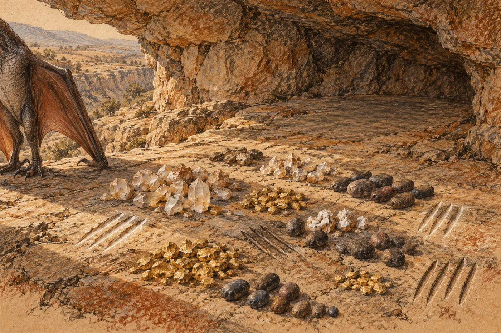

# Mezihra. Hnízdo

Skála je studená a pod křídlem je teplo.

Mládě spí. Srdce mu bije rychle, mnohem rychleji než její, a ona ho cítí přes blánu křídla, kterou ho přikrývá, drobné a neúnavné, jako kapky z převisu, když taje. Dýchá do jejího boku. Občas se ve spánku pohne a drápky mu sjedou po kameni. Ona se nepohne.

Noc je čistá. Vítr jde od hor a nese sníh, který ještě nepadá, jen je cítit. Dole v soutěsce šumí voda. Teplá voda dýchá vzhůru svou bílou párou a ta pára voní kamenem a hloubkou, tak jako voní každou noc, co ona pamatuje, a co pamatovala její matka.

Pak se nebe pohne.

Ne hvězdy. Hvězdy se hýbou pomalu a všechny spolu, a to ona zná. Tohle je jiné. Na nebi se rozsvítí světlo, které tam nebylo. A klesá. Klesá pomalu, mnohem pomaleji, než padá kámen, než padá pták se složenými křídly, než padá cokoli. Klesá, jako by ho něco drželo zespodu.

Zvedne hlavu. Mládě pod křídlem se probudí a zapiští a ona ho přitiskne k sobě.

Další světlo. A další. Každé jinde, každé pomalu, a pod každým se nebe rozzáří a zhasne a zase rozzáří, a ozve se zvuk. Je hluboký a trvá a nepodobá se hromu, protože hrom přijde a odejde. Tenhle zůstává. Skála pod ní ho cítí dřív než ona.

Pach přijde později. Je ostrý a suchý jako vzduch po blesku, a není v něm nic, co roste, a nic, co hnije.

Jedno světlo se láme.

Je vysoko nad horami za soutěskou a nejdřív klesá jako ostatní. Pak se pod ním něco přetrhne. Světlo se zakymácí a stočí podél hor, rychleji, a ona za ním otočí hlavu, protože všechno, co se tak stáčí, je raněné. Klesne za hřeben. Za hřebenem se rozsvítí bílo. Na okamžik je vidět každý kámen na hřebeni, ostře, jako ve dne. Potom rudo a potom tma.

Po dlouhé chvíli, tak dlouhé, že mládě stihne znovu usnout, přijde vzduchem tlak. Dotkne se útesu a útes se ozve. Nízko, v kameni. Jako když se uvnitř hory sesune sníh.

Pak se ještě jednou podívá vzhůru. Vysoko, tam, kde nic nelétá, kde je vzduch tak řídký, že by v něm křídlo nic neuneslo, se táhne napříč nebem tenké světlo. To nepadá. Jde jinam. Jde, jako jde pták, který ví, kam letí, a pak zmizí.

Oči má upřené do tmy ještě dlouho potom. Pak složí hlavu na kámen vedle mláděte. Nespí.

*

Dny jsou kratší. Slunce stojí níž a skála se přes poledne prohřeje jen na povrchu.

Dole u teplé vody je nový pach.

Cítí ho, kdykoli vítr jde soutěskou vzhůru. Je to pach mnoha těl. Teplých, potících se, nemocných: je v něm řídký trus a horečka a mléko. To všechno zná. Ale pod tím je ještě něco, co nezná, a to ji drží vzhůru, když by mohla spát. Ta těla nevoní zvířetem. Nevoní tukem ani kouřem ani rudou hlinkou. Voní jako ten vzduch po světlech. Suše. Bez života. Jako by na sobě nesla kůži, která nikdy nebyla kůží.

Je jich mnoho. Víc, než kdy u teplé vody bylo. Slyší je i nahoře. Jejich hlasy jsou vysoké a ozývají se pořád, ve dne i v noci, a ve tmě dole v soutěsce svítí mnoho malých ohňů, víc ohňů, než tam kdy hořelo.

Ty staré, ty od teplé vody, zná. Zná je, jak zná vítr. Voní kouřem a tukem a rudou hlinkou, kterou si mažou na tváře, a starou kůží. Chodí po své straně vody a nikdy nepřejdou na její. Když ona sletí k vodě, ustoupí a nehledí na ni. Když jsou hladové zimy, nechávají na plochém kameni pod útesem kozu, svázanou nebo mrtvou, a ona si ji vezme. Když ulovila ona a oni jsou blízko, vezmou si kus a nechají jí zbytek. Tak to je. Tak to bylo za její matky.

Ty od hloubky zná taky. Ti voní kamenem a tmou a vodou, která nikdy neviděla slunce. Ven chodí za šera. Ona je ráda nemá na očích, protože jejich oči ve tmě svítí jako její.

Tihle noví nejsou ani jedni, ani druzí.

*

Jednoho jasného rána letí za hory.

Vzlétne z útesu, se zkrčenými končetinami, s odrazem, který jí projede všemi klouby, a vítr ji vezme. Je studený a nese ji. Nechá se nést. Mládě zůstane v hnízdě a piští za ní. Ona to pištění slyší ještě dlouho, i když už ho slyšet nemůže.

Letí po pachu.

Ten pach po světlech je tady silnější, za hřebenem, ve vysokém kamenitém údolí. Smíchaný s jiným, spáleným a těžkým, a pod tím je to sladké, co táhne mrchožrouty. Ti tu jsou. Krouží nad svahem, velcí a tmaví, a když se k nim přiblíží, uhnou jí, jak se jí uhýbá.

Pod ní se svah třpytí.

Je to tak silné, že musí přivřít oči. Celý svah jiskří, keře a kameny a tráva, a jak vítr zafouká, jiskření se pohne, přeběhne, převrátí se. Lesk. Mnoho lesku, víc, než kdy viděla na jednom místě. Ani v řece, kde v písku leží žlutá těžká zrna, ani v puklinách, kde rostou průhledné kameny s hranami, ani na mokré skále v poledne.

Krouží nad tím a cítí, jak se jí v hrudi něco stahuje. Ten lesk volá. Volá stejně, jako volá žluté zrno v řece a průhledný kámen v puklině. To, co se leskne a nemění se, patří do hnízda. Na místo, kde leží, co se stalo.

Sníží let. Dole, uprostřed jiskření, leží něco velkého a mrtvého. Nevoní jako mrtvé zvíře. Voní jako ta světla. Kus od toho je šest malých postav. Jsou to ti noví. Nosí kameny, jeden po druhém, a kladou je na jedno místo pod balvanem, pořád na totéž, dokud z kamenů není hromada. Nic nežerou. Nic si neodnášejí. Jen nosí a kladou.

Ona krouží.

Pak se otočí a letí domů, protože mládě je samo a vítr se točí k horám. Lesk zůstane ležet za ní, na svahu, ve větru, a ona ho cítí v hrudi ještě dlouho, jako tah k místu, kam se musí vrátit.

Zatím ne.

*

Hnízdo je hluboko pod převisem, kam nedosáhne déšť.

Podlaha je hladká. Ohlazená jejím tělem, tělem její matky, tělem matky její matky, tolikrát, že kámen je v ní měkký jako kůže. A na té podlaze leží, co leží.

Žlutá zrna z řeky. Těžká, studená, jejich žlutá se nemění, ať je déšť, nebo sucho. Průhledné kameny s hranami, ve kterých se láme světlo, a některé obalené bílou krustou, tak staré jsou. Tmavé oblé kameny z potoka. Každý leží na svém místě. Ne náhodou, ne jak by je shodil vítr. V řadách, ve skupinách, s mezerami mezi sebou, a vedle nich, ve skále podlahy, jsou rýhy.

Rýhy jsou od drápů. Tři drápy vedle sebe, tah, a ještě jednou, a ještě. Rýhy ve skupinách. Některé jsou ostré a světlé, jak je udělala ona. Jiné jsou mělčí, ohlazené, tmavší. Ty udělala její matka. A některé jsou tak staré, že už nejsou rýhami, jen stínem v kameni, který je vidět jedině ráno, když slunce jde nízko a padá do hnízda.

Ona ví, co kde leží a proč.

Nemyslí to. Ví to, jak ví vítr a jak ví, kudy vede cesta k řece. Tady ta skupina, tři zrna a krátká rýha: to je zima, kdy zamrzla teplá voda. Nikdy předtím a nikdy potom. Tady průhledný kámen u stěny, sám: to je její první mládě, které nevzlétlo. Tady čtyři rýhy, prostřední kratší, a vedle žluté zrno a průhledný kámen. Ta skupina je v hnízdě vícekrát, na různých místech, některá stará, některá její. To jsou ti od teplé vody. Ti, kteří nechávají na kameni kozu a nepřejdou vodu. Jejich ohně. Jejich pach. Že jsou, a že je to tak v pořádku.

Je tam také mnoho, čemu nerozumí. Rýhy, které dělala matka, když ona byla malá, a které matka nikdy neukázala. Ty ví jen napůl. Ty leží a jsou, a ona je nemění.

Projde hnízdem, pomalu, s hlavou nízko. Nosem se dotkne zrna, kamene, rýhy. Mládě jde za ní a dělá totéž, nemotorně, a strčí do průhledného kamene, že se pohne. Ona ho vrátí. Přesně tam, kde ležel. Mládě se na to dívá.

Na kraji hnízda, u stěny, je místo, kde nic neleží.

Skála je tam hladká a prázdná. Ona se nad ním zastaví. Sklopí k němu hlavu, dlouho tak zůstane, a pak položí dráp na kámen. Jeden. Nepohne jím.

Ví, že sem něco patří. Ještě neví co. Ten pach dole u vody, ty hlasy ve dne v noci, světla, která padala pomalu, a lesk za horami. To všechno je. Ale ještě se to nestalo celé. Ještě to neleží.

Zvedne dráp. Rýha nezůstane.

*

Ráno je nebe bílé a hory za soutěskou jsou bílé taky. Napadl sníh. Ne tady, výš. Ale vzduch jím voní a voda dole v soutěsce kouří víc než jindy.

Mládě stojí na kraji útesu a roztahuje křídla do větru. Vítr se do nich opře a mládě zavrávorá a stáhne je. A roztáhne je znovu. Ona leží za ním a dívá se. Nepomůže mu. Tohle se nedá pomoct.

Dívá se dolů do soutěsky.

U teplé vody je dnes klid. Ti staří nosí dřevo do skály a pach sušícího se masa stoupá vzhůru až k ní. Noví stojí dole a dívají se k horám. Mnoho jich. Všichni najednou, nehybní, s hlavami zvednutými ke sněhu.

Jednoho z nich zná.

Viděla ho před několika nocemi. Vešel do horní vody, do té, kam nikdo nevstupuje, a vytáhl z ní něco malého, co křičelo. Vylezl a celou noc seděl na kameni u vody, mokrý, a nehýbal se. Ani když vítr přinesl mráz. Ti od hloubky kolem něj chodili a nosili vodu, sem a tam, celou noc, a on seděl a díval se. Ona se dívala na něj. Bylo to zvláštní, a co je zvláštní, si pamatuje.

Teď stojí dole jako ostatní a dívá se na sníh. Pak otočí hlavu jinam. Nahoru. Na útesy.

Na ni.

Nevidí ji. Je daleko a ona leží ve stínu převisu a nehýbe se. Ale hledí tím směrem, dlouho, jako zvíře, které ví, že tam něco je, a neví co.

Mládě za ní znovu roztáhne křídla. Vítr ho zvedne o kus, jen o kus, a pak ho zase položí na skálu. Mládě vykřikne. Je v tom radost.

Ona se nedívá na mládě. Dívá se dolů na toho, který se dívá nahoru.

Pak položí hlavu na studenou skálu a zavře oči. V hnízdě za ní, u stěny, je pořád to prázdné místo.
