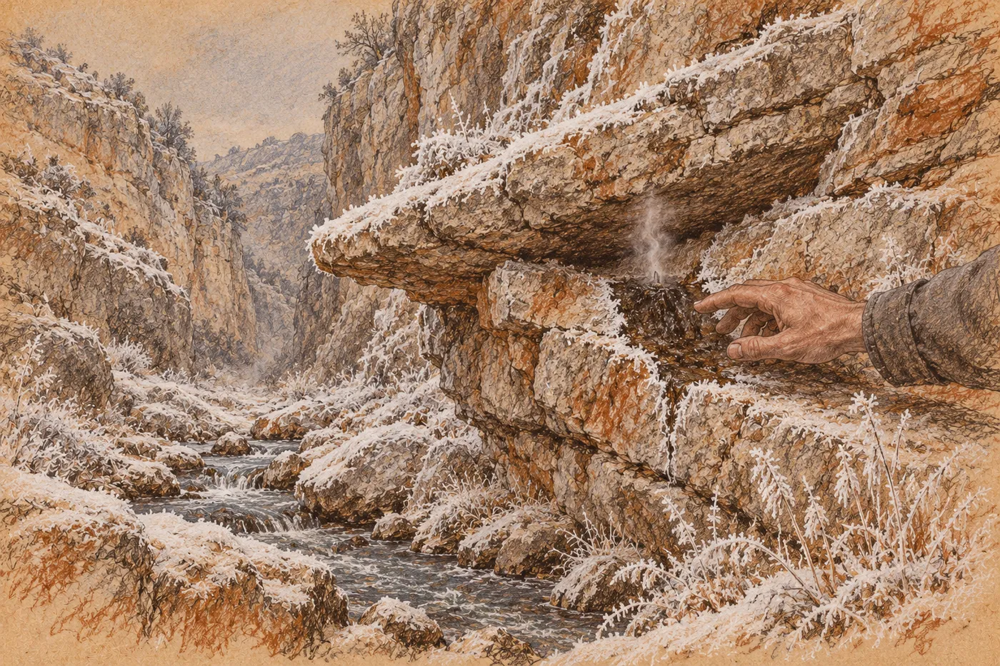

# 12. Teplá voda

Dvacátého šestého dne od sněhu klepal Haro do skály.

Eren ho slyšel dřív, než ho uviděl. Šel ráno k horní tůni, jako každé ráno, podíval se do vody a k zálivu pod převisem, jestli se pěna pořád stáčí do štěrbiny. Stáčela se. Když se otočil, ten zvuk tam byl. Kámen o kámen. Ne pravidelně jako u starého muže dole, který dělal misku. Tvrdě a nahodile, tady a pak o kus dál.

Haro stál pod terasou, tam, kde se skála kotle zvedala k ústí jeskyně, a v ruce měl kámen velký jako pěst. Uhodil do stěny. Přiložil k ní ucho. Popošel o dva kroky a uhodil znovu. Svit šel za ním a dělal na skálu uhlem čárky. Kus za nimi stál Kaj s rukama v podpaží a očima v zemi.

Na terase stál Ikku s oštěpem. Díval se dolů na ně. Tal seděla u ohně a nedívala se nikam.

Eren šel k nim. Když došel blíž, Haro se otočil a změřil si ho tak, jak si měřil všechno: zpříma a bez zájmu.

„Hledáme dřevo,“ řekl Haro.

Svit se zasmál. Kaj ne.

Čárky na skále byly všude stejné. Haro klepal všude stejně a skála všude stejně odpovídala, tupě, plně, jako kámen. Takhle se to nehledá, pomyslel si Eren. A hned se lekl, že si to pomyslel.

Haro uhodil do skály ještě jednou, pro něj, a šel dál podél stěny. Kaj šel za nimi. Na kraji kotle se ohlédl. Na okamžik, přes rameno, a zmizel za balvany.

*

Orrin přišel v poledne, když Eren rovnal dřevo pro síň.

Nesedl si. Postavil se k hromadě a vzal jedno poleno, potěžkal ho a položil zpátky, přesně tam, odkud ho vzal. Eren si všiml, že ho položil dobře. Rovně, aby se hromada nesesula.

„Haro říká, že skála zní všude stejně,“ řekl Orrin.

„Možná je všude stejná.“

„Možná.“ Orrin se díval na terasu, na ústí jeskyně, ze kterého šel kouř. „Ty to pořád nevíš.“

Eren položil na hromadu další poleno.

„Nevím,“ řekl.

Podruhé to šlo snáz. Všiml si toho. Slovo mu vyšlo z pusy hladce, bez zadrhnutí, jako by ho už znal.

Orrin kývl. Nic víc. Pak řekl, jako by si na to vzpomněl až teď: „Tio se ráno ptala, kdy přijdeš. Maela jí řekla, že máš práci.“ Podíval se na hromadu dřeva. „Vidím, že máš.“

Odešel nahoru, k přístřešku pod teplou skálou. Eren se za ním nedíval. Rovnal dřevo. Pak ho rovnal znovu, i když už bylo srovnané.

*

Tu noc nespal.

Plachta byla studená, ať se otočil jak chtěl. Zem pod ní zmrzla do hloubky a mráz z ní šel nahoru do zad, do kyčlí, do ramen. Tiino místo bylo vedle něj prázdné. Ležel na boku a neměl co počítat.

Myslel na Hara, jak klepe do skály.

Klepat se dá týden. Měsíc. Skála bude znít pořád stejně, protože i tenká skála zní jako skála, když je za ní voda. Orrinovi lidé najdou leda to, co jim někdo ukáže. A on jim to neukáže.

Jenže to nevěděl jistě. Věděl jen, jak to vypadá zevnitř. Hlínu velkou jako dvě dlaně. Tah kolem jejího okraje. Potok za ní. Jak to vypadá zvenku, nevěděl. Jestli to tam vůbec nějak vypadá. Jestli by to tam našel někdo, kdo by nehledal klepáním.

Kdo by věděl, jak se hledá únik.

Ležel ve tmě a viděl chodbu v habitatu, nejzazší úsek čtvrtého prstence, kde stěny nikdo nenatíral, protože tam nikdo nechodil. Únik se tam nehledal klepáním. Hledal se rukou. Na studeném potrubí se srážela voda všude kromě jednoho místa. Tam, kde unikalo teplo, zůstalo potrubí suché. Stačilo jít pomalu a dívat se, kde je jinak.

Ráno bude mráz. Bude jinovatka.

Vstal ještě za tmy.

*

Sešel suť pod terasou a šel podél potoka, po jeho proudu, kolem dolní tůně a dál, tam, kde se skála pod jeskyní stáčela až k vodě a kotel se zužoval do soutěsky. Měsíc nebyl. Hvězdy byly ostré a nad pramenem stála pára, šedá ve tmě. Voda v potoce byla jediná věc, která se hýbala. Uprostřed tekla černě a kouřila, u kraje stál led.

Šel pomalu. Počítal kroky, i když tady venku nebylo od čeho počítat.

Pak začalo svítat.

Nejdřív zešedla skála, pak tráva na suti, a pak bylo vidět, že je všechno bílé. Jinovatka ležela na kamenech, na trsech trávy, na suchých stoncích u vody, na každém výstupku stěny. Jemná, chlupatá, jako chmýří na dávkách v té bedně, která nabobtnala. Na stěně soutěsky nad ním se držela v každé spáře a dělala z ní bílou čáru. Celá stěna byla nakreslená bíle.

Eren šel podél ní a díval se.

Bílá. Bílá. Bílá.

Nad hlavou se mu ze stěny vysunulo skalní žebro. Dlouhé a úzké, šikmo dolů, jako výztuha na trupu modulu. Pod ním byl kout, kam ještě nedosáhlo světlo. Eren se do toho kouta podíval a zastavil se.

V koutě pod žebrem byla skála tmavá.

Ne bílá. Tmavá a mokrá, na kus velký jako dvě dlaně. Kolem bílá jinovatka, ostře, až k okraji té tmavé skvrny, a tam končila, jako by ji někdo odřízl. Nad skvrnou se ve studeném vzduchu chvěl dech. Tenký a skoro neviditelný, jako dech spícího dítěte, když je v kajutě zima.

Eren tam stál dlouho. Pak zvedl ruku a položil ji na tmavý kámen.

Byl teplý.

Ne horký. Teplý jako kůže. Jako Tiino čelo, když už horečka povolila. Pod prsty vlhký a hladký, a ten dech šel kolem jeho dlaně, kolem prstů, ven.

Přiložil k němu ucho.

Za zády měl potok, slyšel ho, jak teče a šumí kolem kamenů. Ale tohle bylo jiné. Tohle šlo zevnitř. Tichý a souvislý šum, který se neměnil, jako šum vody v korytu s ostrými hranami. Té, která kouřila ve tmě a na kterou nesměl sáhnout. Byla tam. Za kusem kamene, který by obejmul dvěma rukama.

Dabra mu tehdy položila dlaň na hlínu. Teď měl dlaň na druhé straně.

*

Odtáhl ruku. Ucítil, jak mu na ní chladne vlhkost.

Pak si sedl na kámen u potoka, protože ho nohy nechtěly držet, a díval se na tu tmavou skvrnu pod žebrem, jak se na ni pomalu snáší světlo.

Kdyby tu skála povolila.

Nedomyslel to. Nemusel. Bylo to celé najednou, jako schéma, které člověk vidí rozvinuté, než ho stačí přečíst. Voda z hloubky by šla ven. Sem. Do soutěsky, do potoka, pryč. Tři nádrže v síni dole by se nenaplnily. Starý muž s bílými vousy by sáhl do první nádrže a byla by suchá. Devadesát tři lidí, kteří vidí ve tmě a pijí jen vodu, která neviděla slunce, by museli vyjít nahoru, k horní tůni. Na světlo. A u horní tůně by stál někdo jiný.

Nebo by tu skála nepovolila. Nebo by povolila jen trochu. Nebo by se dala zase zalepit.

Kdo by stál tady, pod tímhle žebrem, ten by mohl rozhodnout, co z toho. Nemusel by nikam lézt. Nemusel by se prodírat úzkou chodbou, kde by ho pobili jednoho po druhém. Nemusel by nikoho zabít. Stačilo by, aby tu stál a aby ostatní věděli, že tu stojí.

*Nikdo nemusí umřít. Uvidí nás a odejdou.*

Eren seděl nad tmavou skvrnou a počítal.

Ne vodu. Na vodu neměl čísla a nechtěl je mít. Počítal lidi. Devadesát tři dole, u nádrží. Talini lidé, pětadvacet, třicet, kteří přes zimu spí ve vnější síni jen proto, že s těmi dole mají starou dohodu, a ta dohoda stojí na vodě. Dvanáct na kamenech u ústí. A kotel. Tři sta deset. Patnáct ze druhého, méně jeden. Všichni pili z teplé vody. Všichni se u ní myli, prali, ohřívali si u ní ruce. Na všech těch číslech byla jedna věc stejná.

Kdo bude mít tohle místo, bude mít všechny.

Pochopil to tak jednoduše, že se zastyděl, že to nepochopil dřív. Orrin chtěl řezákem udělat chodbu. Chtěl prořezat dvě stě kroků skály tím málem, co zbylo v článku, a Eren mu z bedny řekl, že to nejde, a byla to pravda. Ale Orrin nepotřeboval chodbu. Orrin potřeboval tohle. Kus kamene velký jako dvě dlaně. A někoho, kdo ví, kde je, a kdo umí probudit řezák.

Orrin to místo neznal. Řezák neuměl probudit.

Uměl to jen Eren.

Seděl na kameni a mráz mu lezl do stehen, a on necítil zimu. Viděl bednu s rozbitým rohem. Viděl se na ní, jak stojí a kotel se na něj dívá. Neříkal by nic zlého. Říkal by, kdo kde bude spát. Kolik míst bude v síni. Třináct. Patnáct. Dvacet. Tolik, kolik jich bude potřeba, protože ti dole by se uskrovnili, kdyby museli. Řekl by, kolik dřeva, kolik masa, kolik vody. Řekl by to spravedlivě. Počítal by pro všechny dohromady, tak jak to Orrinovi vyčetl, a nikdo by nestrádal víc, než musí.

Tio by spala v teple. Ne pod Orrinovou kůží. Pod jeho střechou.

A Maela by se vrátila. Ne k němu. K tomu, co by měl.

Byl by spravedlivý. Věděl, že by byl. A to na tom bylo to nejhorší.

Protože by o tom rozhodl sám. Za všechny. Za Dabru, za starého muže s miskou, za děti ve výklencích, které se na něj dívaly ze tmy. Za Tal, která ho pustila ke svému ohni. Za Maelu. Nikdo by se ho nemusel prosit. Ani ptát. Stačilo by, aby věděli, že tu stojí.

*Řezák máš ty. Tak to nedopusť.*

Myslel si, že to Maela řekla o Orrinovi.

*

Když vstal, bylo už světlo. Ne slunce, to sem dolů přicházelo až kolem poledne. Šedé světlo, ve kterém jinovatka modrala.

Do kotle se nevrátil. Šel podél potoka dál dolů, kolem jam pod zatáčkou, kde ještě nikdo nebyl, a pak roklí k rozštípnutému balvanu. Nikdo ho neviděl.

Řekl si, že jde zkontrolovat článek.

Řekl si to cestou dvakrát. Byl tu mráz, jaký tu ještě nebyl, a článek ležel pod převisem v hlíně. Články nesnášely mráz. To věděl. To nebyla síť, to věděl z dílny, z výpadků na nevytápěném patře, kde se články vybíjely samy, bez práce, jen tím, že byla zima. Musel se podívat. Musel vědět, kolik v něm zbylo. Bylo to rozumné.

Pod převisem odvalil plochý kámen. Odhrnul suť a hlínu, zmrzlou na povrchu, pod ním sypkou. Strčil ruku do pukliny až po rameno, nahmatal uzel z plachty, vytáhl ho a rozbalil.

Článek byl chladný. Ne zmrzlý, tak hluboko mráz nedosáhl, ale chladnější, než by Eren chtěl. Strčil si ho pod bundu, na břicho, a držel ho tam, dokud kov nezteplal, a teprve potom ho vytáhl a podíval se.

Rysky se rozsvítily. Jedna stála. Druhá blikala, jako blikala od sedmého. Pomalu, slabě.

Pořád tam byl.

Eren cítil úlevu, a ta úleva ho vyděsila víc než mráz. Měl článek zase zabalit a zasypat. Nebo ho vzít někam do tepla. To by bylo rozumné. Místo toho klečel pod převisem a držel ho v obou rukou jako něco živého.

Zabalil ho. Nezasypal. Zastrčil ho pod bundu a šel nahoru.

Bedna stála v rohu u skalní stěny, pod okrajem jeho plachty, tam, kde stála vždycky. Sefa spala u svého ohně, schoulená, s rukou pod tváří. Jinak u jeho plachty nikdo nebyl. Eren odhrnul plachtu a otevřel bednu.

Řezák ležel uvnitř zabalený v cárech. Těžký, studený, s tubusem delším než předloktí.

Nesáhl na něj hned.

*Jen se podívám, jestli ještě funguje.*

Slyšel tu větu ve své hlavě a poznal ji. Měla jiná slova. Ale poznal ji, tak jako poznáš hlas za stěnou dřív, než rozumíš, co říká. *Je to jen test, Erene. Neškodný test.* Byl to tentýž hlas. Přátelský, trochu netrpělivý, a nikdo mu nepatřil. Teď patřil jemu.

Vytáhl řezák z bedny. Rozpáral šev límce, kde měl háček, a vytáhl ho. Drát byl studený a malý a lehký. Nic nevážil.

Zavřel bednu. Přetáhl přes ni plachtu. Šel.

*

Pod žebrem už nebyla tma. Šedé světlo leželo v koutě a tmavá skvrna v jinovatce byla vidět ostře, jako by ji někdo nakreslil.

Eren poklekl. Zasunul článek do pouzdra pod tubusem. Ruce se mu netřásly. To si pamatoval potom nejvíc: že se mu netřásly. Dělaly, co uměly, a dělaly to dobře. Háček našel kontakty sám, po paměti prstů.

Zámek se rozsvítil žlutě.

A řezák se probudil. Nebyl to zvuk. Bylo to chvění, které šlo z rukojeti do dlaní, do zápěstí, do loktů, a usadilo se mu v zubech. Hluboké a tiché, jako chvění podlahy nad strojovnou. Od sedmého na řezák nesáhl a myslel si, že zapomněl, jaké to je. Teď si vzpomněl. Tělo si vzpomnělo dřív než on.

Podíval se na skálu. Na tmavou skvrnu velkou jako dvě dlaně. Na dech, který z ní šel.

Jen se dotknout. Jen vědět.

Stiskl.

Svět zbělel.

Jinovatka kolem něj se rozsvítila, celá najednou, tisíce bodů na trávě, na kamenech, na stěně soutěsky, a jeho stín vyskočil po skále nahoru, obrovský a černý, a třásl se. Do tváře mu udeřil žár. Ne teplo ohně. Žár, který se tu neměl kde vzít, suchý a ostrý, a zároveň s ním přišel zápach. Spálený kámen. Spálená voda. A pod tím ten pach, který znal z dílny, pach přetížené izolace, vzduchu po výboji. Pach domova.

Skála pod tryskou zasyčela. Jako únik v potrubí. Jako dech, který se zalkne.

Eren to slyšel. A za tím syčením, za stěnou, slyšel pořád tu vodu. Tekla dál, tiše a souvisle, jedním směrem, a nevěděla nic.

Viděl starého muže, jak sedí ve tmě s kamenem mezi koleny a klepe. Klep. Palec po kameni. Klep. Viděl světlé tečky ve výklencích, desítky, a dítě u Dabry, na jehož hlavu položila ruku, když počítala. Viděl Dabřinu ruku, tvrdou a teplou, jak drží jeho zápěstí a tiskne mu dlaň na hlínu.

*Na tohle se nesahá.*

Pustil spoušť.

Šero se vrátilo, tmavší, než bylo předtím. Před očima mu plavaly bílé skvrny a jeho stín byl pryč. Zůstal jen zvuk. Syčení, které sláblo, a kapání, a voda za stěnou.

Pak se mu vrátil zrak.

Ve skále byla rýha.

Krátká. Na délku prstu, ne víc. Okraje měla rudé, a jak se na ně díval, rudá z nich odcházela. Zůstaly tmavé a lesklé, jako by se kámen na tom místě rozpustil a zase ztuhl do skla. Z rýhy stoupala pára. Hustší než ten tenký dech předtím. Voda na skále kolem ní se vařila.

Malá rýha. Nic víc. Nic, o čem by se nedalo říct, že se nestalo.

Eren klečel a držel řezák a nemohl ho položit. Tryska žhnula do tmavě rudé a on věděl, že kdyby ji položil do jinovatky, praskla by. Tak ho držel v natažených rukou, daleko od těla, jako se drží něco, co se nesmí dotknout ničeho dalšího, a ruce se mu teď třásly. Teď ano. Třásly se tak, že tryska kreslila v šeru malé rudé kroužky.

Udělal to sám.

Nikdo ho o to nežádal. Orrin tu nebyl. Haro tu nebyl. Nikdo mu nedal ruku na rameno, nikdo neřekl *jen test*. Řekl si to sám, vlastním hlasem, a vlastníma rukama zasunul článek a vlastníma prsty našel kontakty. Kaj mu to vyřídil před týdnem u ohně. *Až bude Tio mít hlad, uděláš to sám. Zná tě.*

Znal ho.

Tio hlad neměla. Tio spala v teple. A on to udělal stejně.

Tryska vychladla. Pomalu, z rudé do tmavé, z tmavé do šedé. Eren ji položil na kámen, ne do trávy. Vytáhl háček z kontaktů. Zámek bliknul rudě a zhasl. Vysunul článek z pouzdra a zkontroloval rysky.

Jedna stála. Druhá blikala. Rychleji než předtím. Kratčeji.

Kolik to stálo, nevěděl. Na tohle neměl čísla. Věděl jen, že je to pryč a že se to nevrátí. Tady ani nikde, kam dojdou. Ten krátký nádech bílého světla byl vzatý z toho mála, co na této planetě zbylo, a za něj ve skále zůstala rýha dlouhá jako prst.

Zvedl se. Nohy měl ztuhlé.

U kraje potoka, kde tekla teplá voda a led tam nestál, byla hlína měkká. Šedá a lepkavá. Nabral ji do hrsti. Byla teplá od vody. Došel s ní k žebru a vtlačil ji do rýhy. Uhladil ji palcem, nabral další a uhladil ji znovu, dokud rýha nebyla plná a hlína v ní nebyla rovná se skálou.

Tak to dělali oni, dole. Se zářezy na stěně, které nepočítali. Nevyškrabali je. Zamazali je hlínou a nechali je tam.

Přejel po tom místě prsty. Rýha se pod hlínou ještě dala nahmatat. Vidět už ne.

Jinovatka kolem roztála v kruhu velkém jako jeho dvě roztažené paže. Tráva tam byla mokrá a zelená. Do večera to zase zamrzne. Nebo to někdo uvidí.

*

Nevěděl, jestli to světlo někdo viděl.

Šel podél potoka nahoru do kotle, s řezákem pod paží zabaleným v cárech, s článkem pod bundou, a myslel na to. Bílé světlo v páře nad soutěskou. Na celý kotel. Kdo by se zrovna díval, kdo by nespal, kdo by šel za šera močit za balvany, ten by ho viděl. Nevěděl by, co to je. Ale věděl by, kde.

Nemohl to vrátit.

Řezák zastrčil do bedny pod plachtou. Háček do límce, do rozpáraného švu, a šev zmáčkl prsty, protože neměl čím ho zašít. Sefa u svého ohně se pohnula a zase spala.

Článek nechal pod bundou.

Zpátky pod převis ho dát nemohl. Ne do toho chladu. A ne tam, odkud ho právě vzal, protože teď by ten balvan pokaždé, když by šel kolem, věděl, kam se dívá. Potřeboval jiné místo. Teplé. Kam nikdo nesahá.

Šel k pramenu.

U dolní tůně, na straně u skalní stěny, kam nikdo nechodil ani pro vodu, protože tam bylo kluzko, tvořila bílá usazenina u paty skály převis. Tvrdý okraj, jako lem misky, a pod ním tmavá štěrbina. Ze štěrbiny šel teplý vzduch. Ne voda. Jen teplo, které ze skály stoupalo celou noc a celý den, stejně jako pod Orrinovým přístřeškem o kus výš. Eren tam strčil ruku. Bylo tam sucho. A teplo jako pod kůží.

Zabalil článek do pruhu plachty dvakrát, jak to dělal pod balvanem. Zasunul ho do štěrbiny až po loket. Před něj nasypal hrst drobných kamínků, aby nebyl vidět. Na okraj položil plochý kámen.

Narovnal se.

Pára nad pramenem stoupala bílá a hustá, šedá v ranním světle. A v ní, nahoře, na horním kraji kotle, u Orrinova přístřešku, někdo stál.

Eren ztuhl.

Ta postava se nehýbala. Stála v páře a pára se kolem ní převalovala, takže chvíli byla vidět a chvíli ne. Nedalo se poznat, kam se dívá. Ale stála tak, jak stál jenom jeden člověk v celém kotli. S rukama v podpaží.

Kaj.

Eren na něj nezavolal. Kaj se nepohnul. Pak se pára zase převalila, a když se roztrhla, nikdo tam nebyl. Jen plachty přístřešku a slabé oranžové světlo za nimi.

Eren stál u dolní tůně a díval se na to místo.

Mohl článek vytáhnout a odnést jinam. Hned teď. Věděl to. Stál tam a věděl to a nepohnul se.

*Háček nemá,* pomyslel si. *Neví, kde je háček. Neví, jak se to dělá. Bez háčku je to kus studeného kovu.*

Bylo to pravda. A bylo to poprvé v jeho životě, kdy se spolehl na zámek. Na tu pojistku, kterou umí obejít jen on. Na tu, kterou tehdy obešel pro muže, jehož jméno si zakázal.

Jestli to je dost? Nechal to tak.

*

Když se docela rozednilo, četla Maela u beden, kdo včera co bral.

Eren stál vzadu, u skály, a poslouchal její hlas. Rovný, bez ničeho navíc. Desítka po desítce. Když dočetla, Orrin vedle ní kývl a lidé se rozešli. Maela se otočila a šla nahoru. Na půli cesty se zastavila. Jen na okamžik. Pak šla dál.

Eren se podíval na své ruce. Pod nehty měl šedou hlínu a na hřbetu pravé ruky rudý pruh, který nebolel, dokud ho neuviděl. Teď bolel.

Šel se umýt.

Ne do horní tůně. Ne do dolní. Do potoka, pod dolní tůň, za zatáčku, kde se smělo prát a mýt, jak to sám vyhlásil z bedny. Klekl si na kámen a strčil ruce do vody, která tu byla už jen vlažná, a myl si je. Dlouho. Hlína šla z prstů pomalu. Pach šel ještě pomaleji. Spálený kámen. Zůstal mu na rukávu, ve vlasech, v nose.

Dodržel pravidlo. Myl se tam, kde se smělo. Někdo by se tomu zasmál.

Když se zvedl, stála nahoře v zálivu pod převisem Dabra.

Bylo už světlo a ona měla dlaň nad očima. Dívala se dolů. Na něj, nebo na potok, nebo na nic. Na tu dálku nemohla cítit, čím voní. Nebo mohla. Kdo ví, co skalní lidé cítí.

Zvedl ruku. Možná pozdravit. Nebo udělat to gesto, dlaň plochou dolů, ze strany na stranu. *Ne.*

Nakonec neudělal nic. Ruka mu zůstala viset ve vzduchu, jako tehdy u Maelina zápěstí, a pak ji položil zpátky.

Dabra se otočila a zašla pod převis, do tmy.

*

Tio přiběhla odpoledne, když nesl první náruč do síně.

Byla sama. Ru čekal kus za ní, u plochého kamene, a házel do vzduchu oblázek. Tio měla na sobě Orrinovu kůži, převázanou v pase šňůrkou, aby se nevlekla po zemi, a tváře měla od mrazu rudé. Ne od horečky. Od mrazu a od běhu.

„Táto.“

Klekl si. Dřevo si opřel o koleno.

Tio se k němu naklonila a začichala. Nakrčila nos.

„Smrdíš,“ řekla. „Jako když jsi přišel od sedmého.“

Eren mlčel.

„Máma říká, že máš práci.“ Podívala se na dřevo. „Ještě pořád?“

„Ještě pořád.“

Tio se nad tím zamyslela a pak se na něj podívala zpříma, jako Maela, když chtěla číslo, a ne odpověď.

„Přijdeš zítra?“

Řekla to po našem, ale to poslední slovo řekla místně. To krátké, které ho učila u dolní tůně. Asi ani nevěděla, že to udělala. V její puse ty dvě řeči nestály vedle sebe. Tekly do sebe.

Eren to slovo zopakoval.

Tentokrát správně. Poznal to, protože se Tio rozzářila, otočila se a zavolala na Rua: „Už to umí!“ A Ru se zasmál a hodil oblázek a chytil ho.

„Zítra,“ řekl Eren ještě jednou. Po našem.

Tio kývla, jako by jí to stačilo. Objala ho kolem krku, krátce a silně, a utíkala zpátky k Ruovi. Kůže se jí pod šňůrkou houpala.

Eren zůstal klečet s dřevem na koleni.

Neřekl jí, co zítra. Ona se nezeptala. Vzala si to slovo, jak ho řekl, a odnesla si ho, a on nevěděl, co jí slíbil.

*

Dvanáct náručí. Do síně, kolem Talina ohně, a zpátky.

Tal seděla u ohně, jako každý večer, a sledovala, jak chodí. Při třetí náruči nakrčila nos. Neřekla nic. Při šesté se podívala dolů do soutěsky, tam, kde se kotel zužoval a kde pod skalním žebrem ležela ve skále hlína, kterou odsud nemohla vidět. Pak se vrátila očima k ohni.

Eren rovnal dřevo ke stěně. Za řadou plochých kamenů v zadní části síně byla tma a v té tmě, nízko, dvě světlé tečky. Dívaly se na něj, dokud nedorovnal. Pak zmizely.

V noci ležel pod plachtou a necítil mráz.

Cítil na dlani teplý kámen. Vlhký a hladký, a ten tenký dech kolem prstů. Cítil chvění v zubech. Cítil úlevu, když se rozsvítily rysky, a na tu úlevu myslel nejdéle. Ne na světlo. Ne na rýhu. Na úlevu, že tam ještě něco je.

Věděl teď, kde to místo je. To se nedalo zamazat hlínou. Bude to vědět zítra, a pozítří, a každé ráno, kdy bude mráz a kdy se v koutě pod žebrem nebude držet jinovatka. Bude to vědět, když bude Tio kašlat. Bude to vědět, až přijde sníh do kotle a Orrin se postaví na bednu a řekne *Já vím, kde budu já*.

*Není to moje,* řekl si do tmy. Nahlas a tiše, jako tehdy.

Pak řekl to druhé slovo. To krátké, místní, které teď uměl.

Zítra.

Zítra tam nepůjdu.

Řekl si to celé, v obou řečech. A nevěděl, jestli je to slib, nebo jen slovo, které se právě naučil vyslovit.
