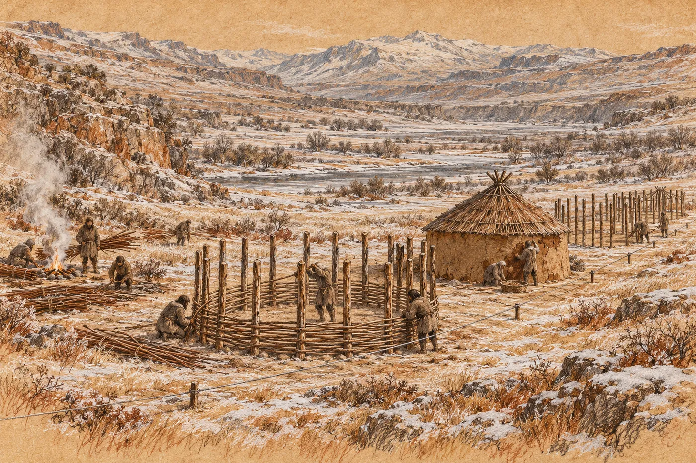

# 13. První mráz

Mráz tu byl už dlouho. Ležel na kamenech u potoka, na trávě na suti, na plachtách, které ráno praskaly, když je někdo odhrnul. Lidé si na něj zvykli tak, jak si zvykli na hlad. Nepřestal bolet. Jen se o něm přestalo mluvit.

Tohle byl první mráz, který si někoho vzal.

Mrtvého našel Eren, třicátého prvního dne od sněhu, na svahu pod planinou. Šel tam pro dřevo ještě za tmy, aby první náruč ležela u stěny síně dřív, než se kotel probudí. Svah byl strmý a rostly na něm nízké pokroucené stromy s tmavými tvrdými listy, které nepadaly ani v zimě. Suché větve pod nimi byly dávno sebrané. Kdo chtěl dřevo, musel jít výš.

Muž seděl pod jedním z těch stromů, zády ke kmeni. Vedle něj ležela náruč dřeva svázaná řemínkem, větve srovnané jedním směrem. Seděl s nohama nataženýma a s rukama v klíně a díval se dolů, do údolí, kde ještě nebylo nic vidět.

Eren na něj promluvil. Pak se ho dotkl.

Bunda byla rozepnutá. Až dolů, k pasu. Pod ní měl jen tenkou spodní vrstvu a na té ležela jinovatka, jemná jako chmýří, na hrudi, na krku, na řasách. Eren tomu nerozuměl. Kdo by si v takovém mrazu rozepínal bundu? Jako by mu na konci bylo horko.

Muž byl ztuhlý. Ruce v klíně měl sevřené a nedaly se rozevřít.

Eren ho znal od vidění. Byl z jedné ze dvou desítek, které po radě přešly k Orrinovu ohni. Středních let, úzký obličej, kašel, který Eren v noci slýchal přes celý kotel. Nosil dřevo Orrinovi. *Kdo nosí, musí jíst.* Řekl to tehdy Orrin a Maela mu dala za pravdu.

Ten muž nosil. Větve vedle něj byly srovnané tak pečlivě, že se Erenovi sevřelo hrdlo.

Sedl si k němu na zmrzlou zem. Až po chvíli si uvědomil, proč to dělá: počítal. Kolik kroků je to dolů. Kolik s nákladem, kolik s člověkem. Obojí najednou neunese.

Vzal muže. Dřevo nechal ležet.

Po padesáti krocích se zastavil, položil muže do trávy a vrátil se pro dřevo. Nesl kus cesty dřevo, vrátil se pro muže a nesl kus cesty jeho. Trvalo to do rozednění. Věděl jen, že ten muž to dřevo nesl a že ho nemůže nechat ležet na svahu, jako by ho nesl zbytečně.

*

Orrin vyšel z přístřešku, když Eren položil muže na zem pod teplou skálou.

Neřekl nic. Poklekl, sáhl muži na tvář a pak mu zapnul bundu, až ke krku, pomalu, jako by na tom ještě záleželo. Teprve potom se podíval na Erena.

„Lem,“ řekl. „Jmenoval se Lem. Dělal na třetím prstenci u vodního okruhu. Měl dvě sestry. Nevím, kde jsou.“

Eren to jméno slyšel poprvé. Bydleli spolu v kotli skoro padesát dní a on ho neznal. Orrin ano. Orrin znal jména všech.

Za Orrinem se pohnula plachta. Vyšla Maela. Podívala se na muže na zemi, pak na dřevo, které Eren složil vedle něj, a pak na Erenovy ruce. Byly odřené od řemínku a od kůry a od mrazu. Dívala se na ně dlouho, než se vrátila dovnitř. Eren ji slyšel, jak tam někomu tiše říká, ať spí dál.

Orrin vzal Lemovo dřevo. Rozvázal řemínek a přiložil první větev do ohně pod skálou. Potom druhou.

„Nesl ho sem,“ řekl. „Tak ať hoří tady.“

*

Pohřbili ho v poledne, na suti vedle ostatních. Zem byla zmrzlá tak, že by se do ní nedalo kopat, ani kdyby chtěli, a tak ho jen obložili kameny. Kamenů nanosili víc, než bylo třeba. To už byl zvyk. Hromady byly teď čtyři.

Orrin nad ním promluvil. Krátce. Řekl Lemovo jméno a řekl, co dělal. Pak řekl: „Nosil.“ A víc nic.

Ru přišel s rudou hlinkou v dlani a nakreslil na horní kámen čáru. Nikdo se ho už neptal, proč to dělá.

Na terase stála Tal, opřená o hůl, a shlížela na hromadu kamenů a na lidi kolem ní. Eren zvedl hlavu a jejich pohledy se potkaly. Tal neuhnula. Dívala se na něj tak dlouho, až se jinam podíval on.

*

Druhý den přišly ženy.

Eren byl s Ardem u druhého domu a zápasil s pruty. Byly dlouhé a tenké, nařezané u potoka pod roklí, a měly se proplétat mezi kůly, tak jak to viděli na terase. V mrazu se ale neohýbaly. Eren jeden prut ohnul kolem kůlu a prut praskl, suše, jako kost. Zkusil další. Praskl taky. Ardo stál vedle něj s hrstí zlámaných klacků a díval se na ně, jako by mu je někdo podstrčil.

„Doma se to dělalo jinak,“ řekl Ardo.

„Doma se to nedělalo vůbec.“

Pak uslyšeli hlasy. Z rokle sestupovaly čtyři ženy. Nesly svazky prutů na zádech, převázané řemenem přes čelo. Jedna z nich nesla místo prutů dítě. Za nimi šla pomalu, s holí, Tal.

Nikdo je nezval. Možná přišly kvůli muži pod stromem. Možná proto, že v síni leželo dvanáct cizích nemocných a každý den jich mohlo být víc. Možná proto, že kdo bude bydlet v údolí, nebude chtít do jeskyně. Možná ze všech těch důvodů, nebo ze žádného, který by uměl pojmenovat. Nezeptal se.

Tal si sedla na kámen u klacku, který tehdy zarazila do hlíny nad první řadou. Ženy složily pruty. Jedna z nich, ta s dítětem, se podívala na zlámané klacky v Ardových rukou a zasmála se. Krátce a bez zlé vůle. Vzala Ardovi z ruky jeden kus, ohnula ho a nechala ho prasknout, aby to viděli. Ukázala na mráz kolem. Pak ukázala na potok.

Na potok, ze kterého stoupala pára.

Vzala svazek prutů a odnesla ho k vodě. Ponořila ho do proudu, do toho černého a kouřícího uprostřed, kde nebyl led, a zatížila ho kameny. Vrátila se, posadila se na zem a čekala. Ostatní ženy taky. Čekaly a mluvily spolu a dítě na zádech té první spalo.

Eren se díval na potok. Teplá voda. Celé ty dny ji pili, myli se v ní, prali, ohřívali si v ní ruce. Na to, že by mohla ohnout dřevo, nepřišel.

Když žena pruty vytáhla, kouřily se. Ohnula jeden kolem kůlu a prut se ohnul, měkce, jako lano.

*

Učily je celý den.

Neříkaly nic, čemu by Eren rozuměl, a tak se díval na ruce. Prut se vede mezi kůly. Před jedním, za druhým, před třetím. Další prut naopak: za, před, za. A pak se oba stlačí dolů, k zemi, dlaní, až do sebe zapadnou. Další řada. Další. Stěna rostla odspodu nahoru, pomalu, jedna dlaň za druhou.

Eren to zkusil. Žena s dítětem ho sledovala a pak ho plácla přes ruku, ne silně, a prut vytáhla. Ukázala mu to znovu. Prut nesměl být napjatý. Musel jít volně a zapadnout sám, a kde ho Eren táhl silou, tam se zkroutil a nechal mezeru.

Zkusil to znovu. Žena kývla.

Při desáté řadě to Eren uviděl.

Byla to síť. Žádná jiná slova na to neměl. Každý prut držel jen díky ostatním a každý kůl nesl jen kus tahu. Kdyby se jeden prut zlomil, ostatní by ho podržely. Kdyby zatlačil vítr na jedno místo, tlak by se rozešel do celé stěny. Takhle se stavěly sítě, které Eren celý život udržoval. Žádný uzel nesměl nést všechno a žádná cesta nesměla být jediná.

Tady to nikdo nemusel spočítat. Ty ženy to věděly rukama.

Zasmál se. Nahlas, sám, s mokrým prutem v ruce. Žena s dítětem se na něj podívala a nevěděla proč. Pak se zasmála taky, protože se smál on.

Odpoledne přišla na řadu hlína.

Ženy ji vybíraly u břehu, šedou a lepkavou, a mísily ji s nasekanou trávou a s vodou z potoka, teplou, aby nezmrzla dřív, než ji nanesou. A s něčím ještě. Jedna z nich přinesla v kůži hromádku tmavého trusu, kulatých bobků, jaké po zvířatech vídal na stezkách, a vmísila ji do hlíny. Hela se odvrátila. Vesa ne. Vesa strčila zdravou ruku do hlíny až po loket a hnětla ji, jak to dělaly ženy, a nepodívala se, co v ní je.

Hlína se nanášela rukama, z obou stran stěny naráz, a vtlačovala se do mezer mezi pruty a uhlazovala se mokrou dlaní. Uvnitř rozdělaly ženy malý oheň, aby hlína vyschla dřív, než ji v noci chytí mráz. Kouř šel ven stěnou, dokud nebyla hotová. Potom už ne.

K večeru stál v údolí dům se stěnami. Bez střechy. Zevnitř byl vidět kruh nebe a v něm první hvězda.

Eren vešel dovnitř a stál uprostřed. Vítr šel kolem stěny. Ne skrz. Slyšel ho venku, jak se o ni opírá a obchází ji, a uvnitř bylo ticho a pach mokré hlíny a kouře.

Žena s dítětem stála ve dveřích. Ukázala na stěnu a pak na řadu kůlů dalšího domu vedle, a dalšího za ním, v jedné rovné čáře podél lana. Řekla něco ostatním a ty se rozesmály. Jedna z nich zvedla ruku a nechala dva prsty kráčet po vzduchu, jeden krok za druhým, v řadě. Pak druhou rukou. Za první.

Mravenci. Tak se Tal smála, když jí tehdy Eren řady nakreslil.

Eren se smál s nimi. Řady nechal, jak byly.

*

Tio přišla s Ruem třetí den stavby.

Přiběhli dolů roklí a Tio měla na sobě pořád Orrinovu kůži, převázanou šňůrkou. Když uviděla ženy, zastavila se, pak se rozběhla k té s dítětem a něco jí řekla. Žena odpověděla. Tio jí sundala dítě ze zad, jako by to dělala odjakživa, a posadila si ho na bok.

Kdy se to naučila?

„To je Ammu,“ řekla Tio, když k němu přišla, a kývla k ženě u hlíny. Dítě na jejím boku se dívalo na Erena velkýma tmavýma očima a cumlalo si pěst. „Ikkuova. Je to Ikkuova…“ Zarazila se. Hledala slovo, které v naší řeči neznala. Pak řekla to místní a přidala: „Žijou spolu. A tohle je jejich.“ Potřásla dítětem na boku. „Ještě nemá jméno. Dostane ho, až přejde zima.“

„Proč až potom?“

Tio pokrčila rameny. Zeptala se Rua. Ru odpověděl dlouze, s rukama, a Tio poslouchala a kývala.

„Protože v zimě se to nedává,“ řekla. „Kdyby umřelo.“

Řekla to jednoduše, jako když se říká, že oheň pálí. Eren se díval na dítě. Pak na Ammu, která se ohýbala nad hlínou a nedívala se na ně. Měla na krku šňůru s bílými provrtanými lasturami, jako Tal, a na předloktí dlouhou světlou jizvu.

Ikkuova žena. Ikkuovo dítě. Ikku stál každé ráno na kraji terasy s oštěpem a díval se dolů na kotel. A jeho žena mezitím přišla dolů a učila je stavět domy.

*

Děti vyhnanců přišly za Tio a Ruem. Nejdřív dvě, pak pět. Ty, které nebyly nemocné nebo které už nemocné nebyly. Pobíhaly mezi domy a tahaly pruty k potoku, a když se je ženy snažily odehnat od hlíny, smály se a utíkaly.

Hela pracovala u stěny třetího domu a najednou přestala.

Eren se na ni podíval. Stála s rukama v hlíně a poslouchala. Za domem si hrály tři děti z Heliny desítky a jedna holka z Ardovy a Tio s Ruem, a hádaly se. O prut, o něco. A hádaly se místně. Ne celé věty, ne jako Tio v horečce. Ale slova. Slovo pro *moje*. Slovo pro *ne*, to cvaknutí. Slovo pro *pojď*. Slovo, které Eren neznal, a holka z Ardovy desítky ho řekla tak rychle a tak samozřejmě, že ani nemrkla.

„Dvanáct let,“ řekla Hela tiše.

Eren mlčel.

„Dvanáct let jsem je učila mluvit.“ Hela se nepodívala na něj, ale za dům, kde se děti hádaly. „Psát, číst, správně skloňovat. A ony teď mluví, a já jim nerozumím.“

Zavolala na Tio. Tio přiběhla, s dítětem na boku.

„Jak se řekne dům?“ zeptala se Hela.

Tio jí to řekla. Hela to zopakovala. Tio zavrtěla hlavou a řekla to znovu, pomaleji. Hela to zopakovala znovu. Tio kývla, ale nebyla spokojená.

„Ještě jednou,“ řekla Hela.

Tio to řekla ještě jednou. A Hela, která dvanáct let učila děti, stála s rukama v hlíně a opakovala po šestileté holce jedno slovo, dokud ho neřekla správně.

*

Sefa ležela.

Začala kašlat ještě předtím, než Maela odešla, ale tehdy to nebylo nic. Teď to něco bylo. Měla horečku, která nepovolovala ani ráno, a když vstala, točila se jí hlava, takže si zase lehla. Nahoru k Tal nemohla. Nemohla ani k dolní tůni. Ležela u svého ohně pod plachtou a kolem ní ležely na kusu plachty kůry, kořeny a usušené listy, každá věc zvlášť, v řadě.

Nosil jí je Ru. Každé ráno, od Tal. Vyběhl s nimi po suti dolů, rozložil je na plachtu vedle Sefy a čekal, co řekne.

Eren se vrátil od domů za soumraku a u Sefina ohně seděla Maela.

Seděla trochu stranou, s rukama kolem kolen. Tio klečela vedle Sefy a Ru na druhé straně, a mezi nimi byla rozložená plachta s rostlinami. Eren se zastavil na kraji světla a nešel blíž.

„Tohle,“ řekla Sefa. Hlas měla hrubý a tichý. Ukázala na plát světlé kůry.

Ru řekl slovo.

„A po našem?“

Tio se zamyslela. „Na horko,“ řekla. „Ta, co jsi mi dávala.“

„Kolik?“

Ru ukázal dva prsty. Ne dva kusy. Dva prsty položené vedle sebe na kůru, tak velký kus. Tio to přeložila: „Dva prsty.“

„Na kolik vody?“

Ru sáhl Sefě k pasu, kde měla filtrační láhev, odšrouboval víčko a zvedl ho. Pak ukázal třikrát.

„Tři víčka,“ řekla Tio.

Sefa zavřela oči. Chvíli tak ležela. Eren myslel, že usnula. Pak řekla: „Víčko. To je dobře. Víčko je pořád stejné.“ Otevřela oči a podívala se na Tio. „Zopakuj to.“

„Světlá kůra na horko. Dva prsty na tři víčka.“

„A kdy ne?“

Tio se podívala na Rua. Ru se zamračil, pak udělal pohyb rukou přes břicho a nafoukl tváře.

„Když má někdo malé dítě v břiše,“ řekla Tio. „Myslím. Ru, je to tak?“

Ru kývl, vážně, jako dospělý.

Sefa se dívala na ty dva nad plachtou, na holku v cizí kůži a na kluka s rudou hlinkou za nehty. Potom na Maelu a zase na děti.

„Já zapomínám,“ řekla. Ne jim. Možná sobě. „Dřív jsem to měla v řádku. Teď to mám tady.“ Dotkla se čela. „A tady se to ztrácí.“ Podívala se na Tio. „Vy ne. Vy to ještě nemáte kam ztratit.“

Tio nevěděla, co na to říct, a tak sáhla po dalším kořenu a zvedla ho. „A tohle?“

Maela vstala. Uviděla Erena na kraji světla a zastavila se.

Nepromluvili spolu toho rána, kdy přinesl Lema, ani potom. Maela vypadala hubeněji. Nebo jen unaveněji. Měla na sobě pořád svou bundu a přes ramena kůži, kterou Eren neznal.

„Sefa si o ni řekla,“ řekla Maela. Bez úvodu. „Poslala Rua, ať jí ji pošlu. Že potřebuje ruce, které si to zapamatujou. Tak ji vodím.“

„Dobře.“

„Orrin o tom ví.“

Eren kývl. Proč mu to říká, pochopil až po chvíli. Říkala mu, že to nebylo Orrinovo rozhodnutí. Že bylo její.

„Kolik domů?“ zeptala se Maela.

„Dvě stěny. Třetí skoro.“

„Střechy?“

„Žádná.“

Maela kývla. Spočítala si to, viděl jí to na obličeji. „Dávky dojdou za tři dny. Možná za čtyři. Orrinovy bedny jsou na zimu. Na tu pravou. On to myslí vážně.“

„Já vím.“

„Já vím, že víš.“ Maela se obrátila k Tio. „Půjdeme,“ řekla. Tio vzdychla a vstala a Ru začal skládat rostliny zpátky do plachty, každou zvlášť.

Když odešli, sedl si Eren k Sefě. Sefa ležela se zavřenýma očima. Myslel si, že spí.

„Ukaž mi ruku,“ řekla.

Chvíli váhal, kterou. Pak natáhl pravou.

Sefa ji vzala do svých, horkých a suchých, a obrátila ji hřbetem nahoru, k ohni. Rudý pruh byl pořád vidět. Kůže kolem něj se loupala a uprostřed byla lesklá a napjatá.

Sefa se na to dívala dlouho.

„To není od ohně,“ řekla.

„Ne.“

Čekal, že se zeptá. Nezeptala se. Sáhla vedle sebe do misky, ve které měla trochu tuku, nabrala ho na prst a rozetřela mu ho po hřbetu ruky. Pomalu, opatrně, tak, aby se nedotkla lesklého místa uprostřed.

„Neptám se,“ řekla. „Nemám na to sílu. A nechci to vědět.“

Pustila jeho ruku a otočila se na bok, ke stěně, a za chvíli dýchala pomalu a chraptivě.

*

Hlad přišel dřív, než došly dávky.

Dávky byly pořád. Maela je každé ráno četla a každé ráno rozdělovala, a byly menší. Půl. Pak méně. Lidé je snědli hned ráno, najednou, protože čekat se nedalo, a pak byli hladoví celý den. Nebyl to hlad, jaký Eren znal z dílny, když přetáhl směnu a zapomněl jíst. Byl tupější a zůstával. Seděl za očima a zpomaloval myšlení. Eren se přistihl, že stojí u stěny domu s prutem v ruce a neví, jestli ho má dát před kůl, nebo za něj.

Ženy jim ukázaly, co se dá jíst.

Pod nízkými stromy s tvrdými listy ležely v suché trávě plody. Tvrdé a hnědé, s drsnou čepičkou na jednom konci, velké jako článek prstu. Eren je viděl celé týdny a myslel si, že jsou to šišky jiného druhu. Ammu jich nasbírala plnou kůži, hodila je do popela pod ohněm a nechala je tam, dokud nepraskly, a pak jednu vyloupla a podala ji Erenovi. Byla nasládlá, trochu hořká a moučná. Eren ji snědl a chtěl další.

Pak na svahu vyhrabávaly kostěnými bodci ze zmrzlé země hlízy. Bílé, vláknité, se zemitou chutí. Hlízy se pekly v popelu taky.

Bylo to málo. Ale bylo to.

Vesa jich nasbírala víc než kdokoli jiný. Nosila je v bundě se zavázanými rukávy a dávala je nahoru do síně, k dvanáctému kameni, pro tu holku. Pak dolů k Sefinu ohni. Sama jich snědla nejméně. Eren to viděl a nic neřekl.

*

Čtvrtý den stavby přišel ke stavbě Kaj.

Nikdo ho neposlal. Přišel odpoledne, sám, s rukama v podpaží, a stál na kraji a díval se. Pak se sehnul, vzal svazek namočených prutů a nesl ho k Ardovi, aniž se zeptal, jestli může. Ardo mu mlčky podal konec prutu. Kaj ho vzal.

Pracoval dobře. To Erena překvapilo. Na lovu dělal všechno špatně a tady ne. Měl mladé ruce, které se rychle učily, a když ho Ammu jednou plácla přes prsty, jako Erena první den, nezrudl a nezačal se bránit. Jen to udělal znovu, správně.

Eren pracoval u téže stěny, z druhé strany. Mezi nimi byly pruty a hlína a on Kaje viděl jen v mezerách. Bledý obličej, rty rozpraskané od mrazu.

„Je to jako síť,“ řekl Kaj najednou. Do stěny.

Eren se zarazil s hlínou v dlani.

„Viď?“ řekl Kaj. „Každý drží každého.“

„Ano.“

Kaj chvíli mlčel a vtlačoval hlínu do mezery. Pak řekl, pořád do stěny, ne Erenovi do očí: „Máš ho pořád v teple?“

Eren nanesl hlínu. Uhladil ji. Pak teprve odpověděl.

„Ano.“

Kaj kývl, jen jednou, krátce. Sklopil oči k prutům, pracoval dál a ani jednou se nepodíval přes stěnu.

Eren nemusel přemýšlet, co tím myslel. V bedně pod plachtou teplo nebylo, to věděl každý v kotli. Teplo bylo pod převisem bílé usazeniny u dolní tůně. Kaj to věděl. A chtěl, aby Eren věděl, že to ví. Nebo nechtěl a ujelo mu to. Eren neuměl poznat, co z toho.

Stál u stěny a mohl jít k dolní tůni hned. Vytáhnout článek, odnést ho jinam. Věděl, že to může udělat.

Bez háčku je to kus studeného kovu.

Z kotle se ozval Harův hlas, hluboký a krátký. Volal jméno. Kaj se narovnal, otřel si ruce o kalhoty a odešel, aniž se rozloučil. U rokle se ohlédl. Pak zmizel.

Eren dokončil stěnu, protože na stěně se dalo něco dokončit.

*

První střecha byla hotová třicátého šestého dne od sněhu.

Postavily ji ženy s pomocí všech, kdo zrovna byli u domů. Dlouhé tyče, opřené o horní okraj stěny a svázané nahoře pruhem kůže, takže vypadaly jako prsty sevřené do špičky. Na ně se kladla tráva. Svazky suché trávy a rákosu od velké vody v údolí, svázané a kladené zdola nahoru, každá řada přes tu pod ní, jako šupiny. Aby voda tekla po trávě dolů a nedostala se dovnitř. Nahoře nechaly ženy otvor na kouř, velký jako dvě pěsti.

Ammu lezla po tyčích až k vrcholu a Eren jí podával svazky. Tráva mu rozřezala dlaně. Tenké řezy, které nekrvácely hned, ale až večer.

Když Ammu slezla, stoupla si před dům a dívala se na něj. Tal přišla od svého kamene, opřená o hůl, a postavila se vedle ní. Obě mlčely. Pak Tal něco řekla a Ammu kývla.

Mohla to být pochvala. Nebo výtka.

Večer u Sefina ohně se rozhodovalo, kdo bude v domě spát.

Bylo jich tam patnáct, dvacet. Hela, Ardo, Bena, Vesa a její lidé, a pár dalších z desítek, které neodešly k Orrinovi. Dům pojal deset lidí, možná dvanáct, když se natlačí.

Eren seděl a mlčel.

Čekali na něj. Cítil to. Vždycky na něj čekali. Jako na bedně s rozbitým rohem. Jako na hlášení. On byl ten, kdo umí věci, a ten, kdo vyjednal dvanáct kamenů. Seděl a díval se do ohně a nic neříkal, a ticho se protahovalo.

Pak promluvila Hela.

„Děti s průjmem,“ řekla. „Ty, co se nevešly nahoru. A jejich matky.“

„Těch je sedm,“ řekla Bena. „S matkami jedenáct.“

„A Sefa,“ řekl Ardo.

Sefa ležela pod plachtou za nimi. Myslel si, že spí. Nespala.

„Já ne,“ řekla. Hrubě, tiše. „Já zůstanu u vody. Kdo tu bude, když se něco stane nahoře? Tady jsem blíž.“ Zakašlala. „Jedenáct je dobře.“

Nikdo se nepřel.

Vesa chvíli mlčela. „Já budu spát u dveří. Venku. Ať tam někdo je.“

Tím to bylo. Rozhodli to oni, u ohně, nahlas, kus po kusu. Eren seděl s nimi a nerozhodl nic. Uvědomil si to, až když vstávali. Nebylo to těžké. Ani lehké. Bylo to jen jiné, jako když člověk poprvé jde bez berle a čeká, kdy upadne.

Neupadl.

*

Třicátého sedmého dne od sněhu četla Maela u beden naposledy.

Bylo to ráno jako každé jiné. Šedé, studené, s párou nad tůněmi a s jinovatkou na plachtách. Lidé se shromáždili, desítka po desítce. Maela stála před nimi s kamínky v dlani a četla, kdo včera co bral. Rovným hlasem, ve kterém nebylo nic navíc.

Pak rozdělila to, co bylo v posledních dvou bednách.

Nebylo toho moc. Na každého kousek velký jako dvě spojené dlaně, pro děti stejně. Lidé si ho brali a nikdo nic neřekl. Ani Haro ne. Ani Dorn, který stál vedle Hara a levým okem hlídal prázdné bedny.

Když bylo rozdáno, Maela zavřela víko poslední bedny. Zůstala nad ní stát.

„Zítra nic,“ řekla.

Neřekla to hlasitěji než zbytek. Řekla to jako číslo.

Orrin stál vedle ní, jako každé ráno. Kývl, otočil se a odešel nahoru, k přístřešku pod teplou skálou, kde pod dvojitou plachtou stály čtyři bedny, které Maela nepočítala.

Lidé se nerozcházeli. Stáli u prázdných beden a dívali se na ně, jako by se mohly samy naplnit.

Maela se otočila a šla nahoru za Orrinem. Na půli cesty se zastavila. Ohlédla se. Ne na bedny. Na Erena, který stál vzadu u skály, kde stával vždycky.

Pak šla dál.

*

Tu noc nespal Eren pod plachtou. Šel dolů do údolí, k domům.

Byly čtyři. Jeden se střechou, dva se stěnami a jeden s kruhem kůlů a s první řadou prutů. Stály v řadě podél lana, jeden za druhým, a nad nimi ve tmě visel z kůlu na kůl šedý provaz z jiného světa a nehýbal se.

U dveří prvního domu seděla Vesa, zabalená do plachty, a spala vsedě. Zevnitř bylo slyšet děti. Kašel. Někdo tiše mluvil. Někdo plakal a přestal.

Eren se postavil ke stěně. Ze strany, kde foukal vítr. Položil na ni dlaň.

Hlína byla studená a tvrdá. Ale pod dlaní neprocházel žádný tah. Žádný únik. Vítr šel kolem stěny, opíral se o ni a obcházel ji, a za ní dýchalo jedenáct lidí.

Postavili to. Ne on. Ammu, Tal a ženy s pruty na zádech, Ardo s lanem, Vesa s rukama v hlíně až po lokty, Hela, která se učila slovo *dům* od šestileté holky. On přitom byl. Nosil pruty a hlínu a podával Ammu trávu a jednou se smál uprostřed stěny.

Kdyby to stavěl sám, stál by tu kruh kůlů. Rovný. Přesně změřený. A vítr by jím profukoval.

Stál u stěny dlouho. Dlaně ho pálily od trávy a hřbet pravé ruky pod Sefiným tukem. Nad údolím byly hvězdy. Měsíc vycházel nad horami, skoro kulatý, a sníh na hřebenech pod ním modral.

Zítra nic, řekla Maela.

Eren si to opakoval cestou zpátky do kotle a nebylo to tak těžké, jak čekal. Zítra nic. Zítra plody v popelu, hlízy ze zmrzlé země, pátý dům. Zítra Ammu na tyčích a Tio s dítětem na boku. Zítra nic z beden, a všechno ostatní ano.

Nevěděl, jestli to stačí, ani kolik ještě zbylo do sněhu v kotli. Ru říkal dva úplňky, a měsíc nad horami byl skoro kulatý.
