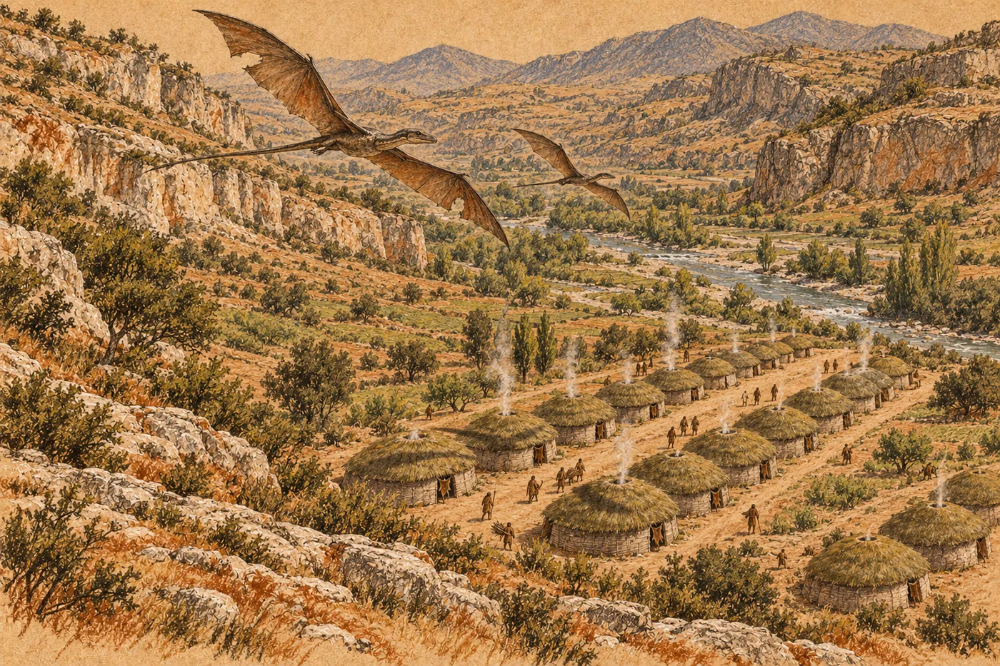

# 20. Oblé domy

Sníh slezl z údolí najednou.

Celou zimu ležel a pak za tři dny nebyl. Přišel teplý vítr od jihu, suchý a silný, a sníh pod ním zšedl a sesedl se a pak se z něj stala voda. Tekla odevšad. Ze svahů, ze střech, zpod kamenů. Potok pod kotlem, který celou zimu kouřil v ledu, se zvedl a zhnědl a hučel tak, že se u domů nedalo mluvit. A velká voda v údolí vystoupila z břehů a šla nahoru, k domům.

Eren se díval, jak jde.

Stál s Ardem na kraji dolní řady a voda se plížila po rovině, pomalu, hnědá a plná větví, a nesla na hladině kusy ledu a suchou trávu. Šla přes kamenné kruhy zarostlé mechem, ve kterých místní stávali v létě. Šla ke stromům u potoka a zvedala se po kmenech.

Pak se zastavila.

Na kmenech, ve výšce kolen, byl ten pás. Jinak zbarvená kůra a ve větvích nízkých keřů chuchvalce trávy, šedé a zplihlé, zachycené tam z minulých let. Voda vystoupila k pásu. A dál ne.

Dolní řada domů stála o kus výš. Tam, kam ji Eren tehdy posunul, když Tal zarazila do hlíny klacek.

„Rovně,“ řekl Ardo.

Myslel tím vodu. Hladina u stromů byla rovná jako jeho lano. Eren zvedl oči od hladiny nahoru, ke kotli, k terase. Tal tam stála. Na tu dálku byla malá a nebylo vidět, kam se dívá. Eren věděl kam.

*

Hela zapsala ten den rýhu, jako každý den, a zavolala ho do prvního domu.

Ve stěně u dveří, v mazanici, byly rýhy. Po deseti, v řadách, od podlahy až do výšky, kam Hela dosáhla. Celá zima. Dny začala rýt, když stál první dům; ty předtím jí řekl Eren. Eren je viděl každý den, když šel kolem. Nikdy se u nich nezastavil.

„Sto šedesát od sněhu,“ řekla Hela. „Podle mě.“

„A podle Rua?“

„Ru říká, že slunce je zpátky u velkého kamene.“ Hela pokrčila rameny. „Asi to je totéž.“

Ukázala na jiné rýhy. Níž, vedle dveří, kde mazanice byla čerstvější. Dlouhá řada. Dvě stě dvacet. Spočítala je na podzim, ten den, kdy Orrin odešel, každého jménem. Vedle některých tečky.

Eren je počítal. Nemusel. Hela je spočítala už ráno. Ale počítal je, protože to byli lidé a on je znal. Některé jménem.

Dvacet tři teček.

„Sto devadesát sedm,“ řekla Hela.

Sto devadesát sedm ze dvou set dvaceti. Tři sta dvanáct na svahu první den. Sto tři u velké vody, o kterých nikdo nic nevěděl. Čtyři sta čtyřicet šest pod průsmykem, které Ardo spočítal cestou dolů.

„To je hodně,“ řekla Hela.

Eren nevěděl, jestli to myslí jako *hodně živých*, nebo *hodně teček*. Nezeptal se. Obojí bylo pravda.

*

Kaj nosil vodu.

Každé ráno, od dolní tůně po suti nahoru do síně, v měchu přes rameno. Pro Ammu. Pak dřevo. Pak, když se lovilo, šel s lovci, a co dostal, podal Ammu, dřív než to pustil z ruky. Celou zimu. Nikdo ho nehlídal. Mladý lovec chodil s ním na lov a na terase u ohně spolu někdy seděli, a Eren je jednou slyšel smát se. Ne spolu. Každý zvlášť, té samé věci.

Jednou ráno, na jaře, se Kaj u Erena zastavil. S měchem přes rameno.

„Sedm,“ řekl. „Od podzimu. S Ikkuem.“

Eren chvíli nechápal. Pak to věděl. *Kolik jich tam nahoře je. Jejich.*

„Ammu mi to řekla,“ řekl Kaj. „Jménem. Všechny.“ Posunul si měch na rameni. „Neumím je zopakovat. Ještě ne.“

Šel dál nahoru.

Ze skalních lidí umřeli za zimu čtyři. To Erenovi neřekl nikdo. Ukázala mu to Dabra. Za šera, u horní tůně, kam chodil ráno a večer, i když tam nesměl brát vodu, jen se dívat. Stála na zálivu pod převisem. Zvedla ruku a ukázala mu čtyři prsty. Pak udělala dlaní pohyb, jako když se roztírá hlína.

Eren si vzpomněl na stěnu dole, v hloubce. Na zářezy po šesti a na ty zamazané, které nepočítala.

Kývl. Dabra kývla taky, otočila se a zmizela pod převisem, tam, kde voda odtékala štěrbinou do skály.

*

Ammuino dítě dostalo jméno, když se na svazích zazelenalo.

Eren u toho nebyl. Nikoho z vyhnanců nepozvali. Bylo to na terase, za svítání, a dole v kotli bylo slyšet jen jeden hlas. Tal. Říkala jedno slovo, pořád dokola, pomalu, jako se slovo učí. A pak ho řekli všichni najednou, celá terasa, a bylo ticho.

Tio to slovo přinesla dolů.

Řekla ho u ohně v druhém domě, pyšně, jako by to bylo její. Bylo krátké, místní, s hrdelním zvukem uprostřed, a Eren ho zkusil zopakovat a Tio se smála.

„Co znamená?“

Tio se zamyslela. „Nic,“ řekla. „Je to jméno.“

Eren to slovo opakoval celý den. Večer už ho uměl. Skoro.

Ráno potom šel Kaj zase s měchem k dolní tůni. Eren ho viděl z kotle. Dítě mělo jméno. *Dokud dítě nedostane jméno, a potom, dokud Ammu neřekne dost.* Ammu nic neřekla. Kaj se nikoho neptal. Nabral vodu a nesl ji nahoru.

*

Tio chodila ráno na kraj rokle.

Eren si toho všiml až po několika dnech. Vstávala dřív než ostatní děti, ještě než šly k tůním, a stoupla si na kraj, odkud byla vidět velká voda. Stála tam chvíli. Pak se vrátila.

Jednou šel s ní.

Údolí pod nimi bylo zelené a mokré. Velká voda se vracela do břehů a nechávala za sebou bahno a větve a na rovině lesklé louže, ve kterých se odráželo nebe. Dál, kde se údolí stáčelo za ohyb, nebylo nic. Žádný kouř. Žádná stopa. Jen voda a tráva a ptáci, kteří se tam spouštěli v hejnech a zase se zvedali.

„Řekl, až bude zima pryč,“ řekla Tio.

Eren věděl, o čem mluví. O kůži. Tmavé, se srstí dlouhou na prst, svázané na něčích zádech.

„Je zima pryč?“ zeptala se.

„Ano.“

Tio se dívala dolů, k ohybu.

„Tak přijde?“

Eren se díval tam, kam ona. Mohl říct ne. Mohl říct ano. Obojí by bylo snazší. Ani jedno nevěděl.

„Nevím,“ řekl.

Tio kývla. Nebyla zklamaná. Přijala to tak, jak přijímala všechno, co se v tomhle kraji nevědělo. Že se slunce zastaví. Že se vrátí. Že dítě dostane jméno, až bude zima pryč.

Ještě chvíli stála, než se otočila a běžela k potoku pod tůněmi, kde už křičely děti.

Druhý den na kraj rokle nešla. Třetí den ano. Pak už jen někdy.

*

Stavět začali, když vyschla zem.

Ardo napnul lano. Šedé, syntetické, to samé, které na podzim zpívalo mezi dvěma kůly nad zmrzlou zemí. Teď bylo zablácené a na dvou místech zauzlované, kde se přetrhlo a kde ho Ammu svázala uzlem, který nikdo z vyhnanců neuměl. Ardo ho natáhl od posledního domu druhé řady dál, po svahu. Třetí řada.

Ženy už nechodily každý den. Chodily, když chtěly. Vyhnanci pletli sami. Hela pletla nejrychleji. Bena mazala. Vesa kopala díry, obouruč, protože se jí ruka přes zimu zahojila. Zem se rozmrazovat nemusela. Byla měkká a voněla.

Eren pletl.

Před kůlem, za kůlem. Další naopak. Stlačit dlaní. Neřekl nikomu, kde má stát dům, ani kdo v něm bude spát. Zeptali se ho jednou. Bena, u kruhu kůlů, který právě dokopali. *Kdo sem půjde?* A Eren řekl *nevím* a myslel to tak, a Bena se otočila k Hele, a Hela řekla jména.

Domů bylo třináct. Pak čtrnáct. Po svahu nad nimi ležely v trávě kameny, kruh vedle kruhu, tam, kde budou stát další. Třicet jedna kruhů, tak jak je Eren na podzim nakreslil klackem do hlíny. Ženy se pořád smály.

*

Dřevo do síně nosil pořád.

Nikdo ho o to už nežádal. Dvanáct kamenů bylo na jaře prázdných, nemocní se vrátili do domů, a dřevo nosili do síně všichni, kdo šli kolem, místní i vyhnanci, jak se komu chtělo. Eren nosil dál. Ráno a večer, náruč za náručí, po suti nahoru, přes terasu, kolem Talina ohně.

Jednou večer ho Tal zastavila. Zvedla ruku, jen o kus, jako tehdy na podzim.

Ru seděl u ní. Tal mu něco řekla a Ru se usmál.

„Ona se ptá, jestli víš, jak ti říkají,“ řekl.

Eren položil dřevo. „Kdo?“

„Ženy. Děti. Všichni.“ Ru ukázal na terasu, na síň, dolů do údolí.

Erena nenapadlo, že by mu nějak říkali. Měl jméno. Říkali mu jménem. Dabra mu tak řekla první, u horní tůně.

Ru řekl slovo. Místní, krátké. Eren ho znal. Slyšel ho stokrát, na svahu pod planinou, u velké vody, v síni. Říkalo se tak tomu, kdo něco nese. Dřevo, vodu, dítě. Kdo nese a jde.

„Ten, co nosí,“ řekl Ru. Po našem, pyšně, jako by to sám vymyslel.

Eren stál nad dřevem a díval se na Tal.

První den na svahu u modulu stál u beden a řekl Orrinovi, že je ten, kdo umí věci. Řekl to sám. Nikdo ho k tomu nenutil. Celý podzim byl ten, kdo umí věci. Kdo rozchodil řezák. Kdo vyjednal dvanáct kamenů. Kdo spočítal, kolik síň unese.

Nikdo tady nevěděl, co umí. Věděli jen, co dělá.

Tal řekla ještě něco. Krátce.

„Ona říká, že to není moc,“ řekl Ru. „Ale že je to dobré jméno.“

„Ano,“ řekl Eren.

Narovnal dřevo ke stěně, aby se nesesulo, a šel pro další.

*

Jednou večer šel Eren nahoru na svah.

Po stezce, kterou se chodilo na dřevo. Pod planinou, kolem stromu, pod kterým na podzim našel Lema. Strom měl na větvích nové listy, drobné a světlé. Pod ním nebylo nic. Ani stopa.

Odtamtud bylo vidět celé údolí.

Eren se zastavil a otočil se.

Dole ležely domy. Nízké a oblé, s travnatými střechami, které se kladly zdola nahoru jako šupiny a teď na jaře zezelenaly, protože v trávě něco klíčilo. Z kouřových otvorů stoupal kouř. Čtrnáct sloupců, rovně vzhůru, protože večer bylo bezvětří. Domy stály ve dvou řadách a třetí řada začínala. Kruh vedle kruhu. Rovně. Mezi řadami uličky, vyšlapané do trávy, a v uličkách lidé. Malí. Na tu dálku nebylo poznat, kdo je kdo. Jen že chodí. Nosí dřevo. Nesou vodu. Dítě běží a za ním druhé.

Nebylo poznat, kdo z nich mluví kterou řečí.

Eren stál a díval se. Dlouho. Nepočítal je. Nemusel. Věděl, kolik jich je.

Takhle se kdysi díval na prstenec zvenčí. Ze servisního průlezu na plášti, kam se chodilo jen ve skafandru a jen ve dvou, a odkud bylo vidět všechno. Řady oken. Světla. Všechno rovně, protože jinak by to nedrželo. Eren tam byl několikrát za život a pokaždé měl pocit, že je to krásné, protože tomu rozuměl. Věděl, co kde nese. Kde je slabé místo.

Tady tomu nerozuměl. Věděl, kde stojí kůly a kde lano. Nevěděl, co to drží.

Nebylo to slabé místo. Bylo to, že tomu nerozuměl, a stálo to.

*

Křídlatá přiletěla druhý den v poledne.

Eren ji uslyšel dřív, než ji uviděl. Hvízdání. Vysoké a přerušované, jako když vítr prochází škvírou. Zvedl hlavu od stěny, kterou pletl.

Letěla od soutěsky. Nízko, nad kotlem, pak nad roklí, pak nad údolím. Křídla měla roztažená, široká, šedá a skoro průhledná proti slunci, a na jednom z nich, mezi kostmi, byla trhlina. Zacelená, ale ne docela. Vítr jí v ní hvízdal. Letěla nakřivo, s jedním křídlem níž, a každou chvíli s ním mávla, jako by si ho rovnala.

Za ní letěla menší.

Mládě. Eren ho viděl na podzim na římse, malé a neohrabané. Teď letělo. Nejistě, příliš rychle, s prudkými zatáčkami, a pak zase dohánělo matku, a matka na něj nečekala.

Lidé v uličkách se zastavili. Místní ženy u třetí řady položily pruty na zem a sklopily hlavy. Bez spěchu. Jak se to dělá.

Vyhnanci se dívali. Pak, jeden po druhém, sklopili hlavy taky. Ardo. Bena. Vesa. Děti, které to viděly u místních dětí. Hela se dívala nahoru ještě chvíli, s otevřenou pusou, a pak sklopila hlavu i ona.

Eren se díval.

Křídlatá přeletěla nad domy. Nízko, tak nízko, že její stín přeběhl přes střechy, jednu po druhé, v řadě. Přes první dům, přes druhý, přes pátý, kde bydlela Vesa s místní rodinou. Na okamžik padl na Erena. Byl studený.

Viděl její hlavu. Úzkou, dlouhou. Natočenou dolů. Na domy. Nebo na něj.

Nevěděl, jestli ho poznala, ani jestli křídlatí vůbec někoho poznávají. Na podzim jí přes vodu odnesl kýtu na plochý kámen a ráno byl kámen prázdný. Víc o ní nevěděl. Jen to, že má trhlinu v křídle, která hvízdá, a že ji tam má kvůli Dornovi.

Sklopil hlavu.

Hvízdání se vzdalovalo. Údolím dolů, k velké vodě, a pak zase nahoru, oblouk, a zpátky k soutěsce. Mládě za ní, pořád o kus pozadu, a pořád dohánělo.

Když Eren zvedl hlavu, byla nad útesem a vzápětí zmizela pod převisem.

Ženy zvedly pruty. Pletly dál.

*

Nika byla pořád tam, kde byla.

Eren chodil k horní tůni každé ráno. Ne pro vodu. Vodu bral z dolní, jako všichni. Chodil se umýt tam, kde se smělo, a cestou zpátky se podíval nahoru. Na skalní stupeň pod terasou. Na stěnu nad ním. Na tmavší skvrnu ve výšce dvou mužů.

Nic v ní nebylo vidět. Nikdy. Ani v noci.

Několik nocí po vydání chodil na suť a díval se, jestli neuvidí zelené světlo. Neuviděl. Článek byl zabalený v kůži od Dabry a ležel za hranou skály. Kdyby blikalo, nebylo by to vidět. Kdyby neblikalo, taky ne.

Nevěděl, jestli ještě bliká. Nikdy se to nedozví.

Jednou se zeptal Tal. Přes Rua, u ohně, v polovině zimy. Jestli se tam někdo díval.

Tal mu dlouho hleděla do tváře, než něco řekla a Ru to přeložil.

„Ona říká, že neví, co by tam viděla.“

*

Jednou ráno, v prvních teplých dnech, uviděl u horní tůně kluka.

Místního, asi osmiletého, z pátého domu. Klečel na kraji tůně, tam, kde se z vody kouřilo nejvíc, a nabíral si do dlaní. Pil. Pak se rozhlédl, svlékl si kůži z ramen a natáhl nohu nad vodu.

Eren se nepohnul. Stál u potoka pod dolní tůní a díval se.

Tio byla rychlejší. Přiběhla od potoka pod dolní tůní, mokrá do pasu, a zastavila se na kraji. Neřekla nic po našem. Řekla *nu* a ukázala dolů, k dolní tůni. Cvakla jazykem a plochou dlaní máchla dolů, ze strany na stranu. *Ne.*

Kluk se na ni podíval. Pak na záliv pod převisem, kde nikdo nestál. Pak zase na Tio.

Řekl něco, vzdorně. Tio mu odpověděla. Dlouze, rychle, s rukama. Eren poznal jen jedno slovo. To, kterým se říká *staré*. Když Tal ukázala na víčko a řekla, že to platí odjakživa.

Kluk si přetáhl kůži zpátky přes ramena. Sešel pod dolní tůň, k potoku, a skočil do vody, až to cáklo, a Tio skočila za ním.

Hladina horní tůně se uklidnila. Pára nad ní stoupala rovně a nikdo ji nerušil.

To pravidlo neplatilo odjakživa. Ne pro šedé bundy. Platilo od podzimu, od jednoho rána v síni, od víčka položeného na kámen. Tio to slyšela od něj. A přesto to klukovi řekla tím slovem. *Staré.*

Možná to tak bylo správně. Pravidlo, které je staré, se drží líp než pravidlo, které je nové. Eren to nevěděl. Věděl jen, že za pár let nikdo nebude vědět, které z nich bylo které.

*

Na stupni pod nikou ležely na jaře věci. Eren je uviděl, když roztál sníh. Lastura. Provrtaná, bílá, z těch, které nosily místní ženy na šňůrách. Kamínek natřený okrem. Hrst suchých plodů s čepičkou, srovnaných do řady. A malá miska z kamene, kterou tam musel položit někdo ze skalních lidí, protože takové hladké uměli dělat jen oni.

Nikdo mu neřekl, kdo to tam dává. Ani proč. Tio to nevěděla. Ru pokrčil rameny.

Eren se na ty věci díval a nechal je ležet.

*

Maela spala ve druhém domě.

S Tio, u ohně, na kůži, kterou dostala od staré ženy z boční síně. Eren spal na druhé straně ohně. Od Sefiny smrti. Nebylo to rozhodnutí. Nebo bylo, ale nikdo z nich ho nevyslovil.

Jednou v noci, na jaře, se probudil.

Oheň byl zahrnutý. Spal. Maela ležela na boku, tváří k němu, přes ohniště, a dívala se na něj. Nespala.

Natáhla ruku. Přes popel, přes kameny ohniště. Dotkla se jeho zápěstí. Tak, jak se on tehdy na podzim natáhl k jejímu, když řekla *teď rozhodnu já*, a ruku zase položil zpátky.

Maela ji zpátky nepoložila.

Neřekli nic. Ležela tak, s rukou na jeho zápěstí, a on se nehýbal, aby ji nevyplašil, a za chvíli usnula. Ruku nechala, kde byla.

Na to slovo se jí nikdy nezeptal. Na to modré světlo na spaní. Myslel na to několikrát. Pak už ne.

*

Tio se učila písmo.

Chtěla to sama. Přišla za ním k síni, kde večer seškraboval saze ze stěny a psal jména těch, kdo umřeli od slunovratu, a dívala se. Pak řekla: *Ukaž mi to.*

Učil ji na zemi. U dolní tůně, na mokrém bílém kalu u kraje, který byl hladký a měkký, dokud neztvrdl. Klackem. Jedno písmeno. Pak druhé.

Učila se rychle. Rychleji než slova. Za tři večery uměla napsat své jméno. *Tio.* Tři písmena, kostrbatá, ale čitelná. Dlouho je zkoumala a pak pod ně, klackem, udělala čáru. Rovnou, rudou, z okrové hlinky, kterou měla za nehty. Takovou, jakou kreslil Ru na hroby. Takovou, jakou měl Ru přes tvář, když umřel Ikku.

„To k tomu nepatří,“ řekl Eren.

„Patří,“ řekla Tio.

Eren se díval na to jméno a na tu čáru pod ním. Mohl jí to vysvětlit. Že písmo je písmo. Že čára pod jménem nic neznamená. Že kdyby to tak někdo v habitatu napsal do rejstříku, nikdo by to nepřečetl.

Nikdo v habitatu to číst nebude.

„Napiš *zítra*,“ řekla Tio.

Zkusil to. Písmem Konfederace. Nešlo to. To slovo se zapsat nedalo, ani v kotli, ani na kůře, ani na stěně. Ten zaražený dech na konci neměl v písmu žádné znaménko. Napsal, co šlo. Začátek. Zbytek nechal prázdný.

Tio vzala klacek a do prázdného místa udělala znak. Svůj. Krátkou rýhu s tečkou. Nic takového v písmu nebylo.

„Takhle,“ řekla.

Eren se díval na slovo, napůl jeho a napůl její. Pak na ni. Na holku v kůži, s okrem za nehty a s vlasy, které jí Ammu zapletla do copu po místním způsobu. Mluvila dvěma řečmi a v jedné z nich byla doma.

Tio se to písmo naučí. Bude ho umět. Možná ho bude psát na stěnu síně, až on už nebude. Možná ho naučí svoje děti, ta písmena, jak se jmenují a jak se kreslí.

Ale její děti ho číst nebudou. Ne doopravdy. Nebude co. Žádný list s pokyny, žádný záznam, žádný řádek, který by tím písmem někdo poslal odněkud zdaleka. Jen jména na černé stěně. A *dva prsty na tři víčka*. A kostrbatý znak s tečkou, který Tio vymyslela, protože písmo neumělo říct *zítra*.

Věděl to. Seděl na bobku u dolní tůně a věděl to tak jasně, jako věděl, kolik vydrží vložka.

„Ještě jednou,“ řekl. „Od začátku.“

Tio napsala své jméno. A čáru pod něj.

*

Večer bylo v údolí bezvětří.

Eren seděl u dveří druhého domu, venku, na kameni. Uličkou mezi řadami šly děti od potoka pod tůněmi, mokré a hlučné, a mezi nimi Ru a Tio. Ru něco vyprávěl a mával rukama a Tio se smála. Za nimi šel Kaj s měchem vody. Před pátým domem seděla Vesa a místní žena a loupaly kořeny, každá do jiného koše, a mluvily, každá svou řečí, a rozuměly si, nebo dělaly, že si rozumějí. Ardo napínal lano pro zítřek. Hela u prvního domu vyrývala do stěny dnešní rýhu.

Nad soutěskou se nic nehýbalo. Útes byl tmavý.

Nahoře, nad horní tůní, ve stěně nad skalním stupněm, byla nika. Odsud nebyla vidět. Eren věděl, že tam je.

V habitatu by dnešní den měl číslo, pomyslel si. Svítilo by v koutku mysli, v řádku, a on by se na něj ani nepodíval. Nevěděl ho. Nevěděl ho od chvíle, kdy se probudil v modulu a řádek s časem nesvítil. Tehdy to bylo jako zastavené ventilátory. Jako smrt.

Teď nevěděl, jaký je den, a nic se nestalo.

Tio přišla k domu. Mokrá, se špinavými koleny. Sedla si vedle něj na kámen, opřela se o něj a zívla.

„Už je…“ začal Eren.

Zarazil se. Tio se na něj podívala.

Pak to řekl. Místně. Krátké, se zaraženým dechem uprostřed. Tak, jak se to tu říká dětem, když je čas spát a oheň se zahrne popelem.

Oheň spí.

Tio kývla, jako by to bylo samozřejmé. Vlezla do domu, k Maele, a Eren slyšel, jak si lehá na kůži a jak se Maela pohnula, aby jí udělala místo.

Seděl venku ještě chvíli. Pak vstal a šel dovnitř a zahrnul oheň popelem.
