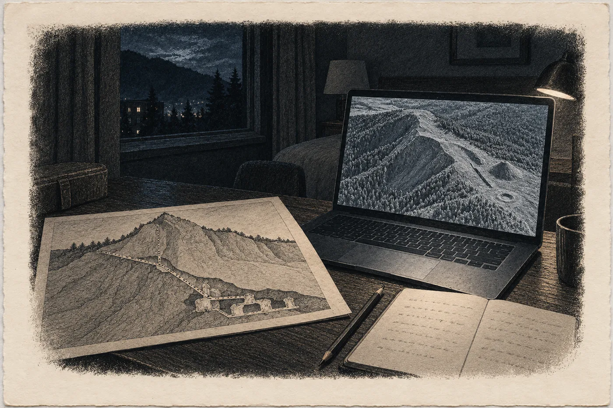

# 2. Mapa

Lampa nad pultem pořád nehřeje.

Hana to ví, protože si k ní v úterý v devět ráno nastaví dlaně, jako se nastavují ke kamnům. Má zmrzlé prsty od volantu. Octavia z Olomouce topí jen na nohy a celou cestu z Brna, šest hodin v pondělí večer, sněžilo. Lampa svítí bíle a studeně a dlaně zůstanou studené. Šindelářová se na ni dívá přes stůl.

„Říkala jsem to už tenkrát,“ řekne. „Je to lampa pro papír. Ne pro lidi.“

Je o pět let starší, než když ji Hana viděla naposledy, a je to na ní vidět jen na rukou. Brýle má jedny, na nose, jako tenkrát v dubnu.

„Restaurátorka tu bude za chvíli,“ řekne Šindelářová. „Kodex přinese sama. Je to její podmínka.“

„Proč?“

„Protože ho tři roky držela v rukou a nechce ho nikomu dát do rukou jen tak.“ Šindelářová pokrčí rameny. „Je pečlivá. Pečlivější než já. To se mi u restaurátorů nestává často.“

„Tři roky,“ řekne Hana.

„Hřbet byl horší, než vypadal.“

Hana kývne. Neřekne nic. Šindelářová chvíli čeká, jestli Hana řekne ještě něco, a když neřekne, vrátí se k protokolu.

*

Restaurátorka přijde v devět dvacet.

Hana ji pozná dřív, než promluví. Ne podle tváře, ale podle výšky a podle rukou.

Je vysoká. Vyšší než Hana o hlavu, štíhlá, v šedém vlněném svetru a tmavých kalhotách, s bílými vlasy staženými vzadu do uzlu, který drží dřevěná jehlice. Věk se jí nedá hádat. Šedesát? Sedmdesát? Pleť má bledou, skoro bez vrásek kolem úst, ale kolem očí jemné a husté jako krakelura na starém laku. Nese v náručí krabici z nekyselé lepenky a nese ji tak, jak Kalina nesl maják. Jako by v ní bylo něco živého.

A ruce. Dlouhé, úzké, s krátce střiženými nehty. Na prostředníku pravé ruky mozol, žlutý a tvrdý jako roh.

Hana si ho všimla už tenkrát. V lednu 2025, dva dny po první návštěvě, když se odebíral vzorek sintru. Restaurátorka ho odebírala sama, u stolu u okna, skalpelem. Krystal ležel v kolébce z pěny, kodex zavřený vedle, a ta žena ani nerozsvítila lampu. Pracovala v zimním světle z okna, které bylo šedé a slabé, a Hana tehdy držela lahvičku na vzorek a dívala se na ten mozol, protože nevěděla, kam jinam se dívat. Kdo dnes píše tolik perem, napadlo ji. Restaurátorka seškrábla zrnka do lahvičky a řekla: *Tolik. Víc ne.* Pak lahvičku zavřela sama. Víc nepromluvila. Jméno Hana slyšela jen jednou, od Šindelářové, ve dveřích. Sálová.

A v dubnu 2025, u téhož pultu, Šindelářová řekla, že restaurátorka musela odjet a že se rozhodla. Krystal nevyjme. *Patří to tam.*

„Paní Sálová,“ řekne Hana.

Restaurátorka postaví krabici na pult a obrátí se k Haně. Oči má světlé, šedé nebo zelenavé, v tom bílém světle se to nedá říct.

„Paní doktorko,“ řekne. Hlas má hlubší, než by Hana čekala, a mluví pomalu, jako by každé slovo nejdřív zvážila v ruce. „Pamatujete si mě.“

„Pamatuju si ten skalpel.“

„A já vaši lahvičku. Držela jste ji jako zkumavku s krví.“ Sálová si natáhne bavlněné rukavice. „Neřekla jsem vám tenkrát, že jste ji držela dobře.“

„Ne.“

„Držela jste ji dobře.“

Pak otevře krabici.

*

Kodex vypadá stejně a jinak. Bukové desky, ostrůvky kůže. Ve hřbetu, kde se vazba rozestupovala, je teď tenký pruh nového papíru, japonského, skoro průhledného, vlepený tak, že ho Hana vidí jen proto, že ho hledá. Přes něj, v rozestupu, pořád prosvítá hrana krystalu a zlatý lesk tenký jako nehet. A pod krystalem šedá nitka hrubého vlněného sukna.

„Nevyjmula jsem nic,“ řekne Sálová. „Jen jsem to podepřela. Aby se to nehýbalo, když se kniha otevře.“

„Tři roky.“

Sálová se na ni podívá. Ne dlouho. Asi tak dlouho, jak se Hana dívá na vrstvu, než ji pojmenuje.

„Ano,“ řekne.

Nic dalšího. Hana čeká. Sálová taky. Šindelářová chvíli přešlapuje a pak řekne, že jde pro kávu, a odejde. Asi proto, aby nemusela poslouchat ticho.

„Budu otáčet já,“ řekne Sálová. „Vy řekněte kdy.“

*

Hana čte list po listu.

V lednu 2025 hledala kámen. V dubnu hledala, kde je napsáno, odkud ten kámen je. Skoro pět let potom četla pracovní překlad a hledala v něm to, co se hodilo k válci, ke kosti, ke značkám. Teď si slíbila, že nebude hledat nic. Bude číst, co tam je. Kudy jde inkoust. Kde ruka přitlačila. Kde se zastavila.

Je to těžší, než si myslela. Oko chce hledat. Oko chce vždycky hledat.

Okraje. *Vidi. Non vidi. Audivi.* U každé věci, kterou mnich zapsal, stojí na kraji drobně, rychlou rukou, odkud ji má. Viděl. Neviděl. Slyšel, a od koho. Cítil. Vzal. Řekl. Hana to věděla, ale teprve teď to vidí jako celek, jako mřížku přes celou knihu. Každý řádek má svůj původ. Nic nepluje.

Zastaví se na listě, kde je slatina.

*Canis meus mortuus est.* Můj pes umřel. A na kraji *vidi*.

„Nemá jméno,“ řekne Hana.

Sálová se nakloní. „Kdo?“

„Ten pes. Všude jinde píše jména. Kdo to řekl, kdo to dělal. A tady jen *můj pes*.“ Hana se dívá na tu větu. Inkoust je v ní stejně hnědý jako všude a písmo stejně pravidelné. Jen konec slova *est* je malinko přetažený, jako by pero zůstalo chvíli ležet. „Bratra jmenuje. Psa ne.“

Sálová mlčí. Pak otočí list. Pomaleji, než otáčela ty předtím.

*

Mapa je na samostatné dvoustraně, hned za textem.

Hana ji zná ze skenu. Ze skenu ji zná tak dobře, že by ji nakreslila zpaměti. Teď ji vidí poprvé.

Řez horou. Hřbet, na jednom konci strmější. Šikmé vrstvy, nakreslené pečlivě, ale nejistě, čáry místy přetažené dvakrát. Puklina. Štola, vedená šikmo do hory a mírně nahoru, s čísly podél. Hana je čte. *XXX*, a u toho křížek. *LXX*, a u toho vlnovka, kterou kolegyně v překladu vyložila jako teplo. *CLXXX*, puklina. A na konci štoly číslo *CCXV*. Dvě stě patnáct.

Hana se zarazí.

„Dvě stě patnáct,“ řekne. „V textu je dvě stě třicet jedna.“

„Ano,“ řekne Sálová.

„Takže tu mapu kreslil dřív. Než štola došla ke skále.“ Hana se dívá na konec čáry, na místo, kde štola končí kus pod kruhem. „Kreslil, kam štola dojde. Ne kam došla.“

Sálová nic neřekne. Na mapu se nedívá. Dívá se na Hanu.

Vedle konce štoly rámeček se znaky. Kroužek, čtvereček, trojúhelník. To je dutina, kterou Hana zná z dvoustrany s mřížkou. Dole pod horou shluk několika malých komůrek, nakreslených tenčeji, a vedle drobně *non certum*. Nejisté. Nad komůrkami a vpravo nepravidelná plocha vyplněná vlnovkami. Voda. A těsně u vody, kus nad koncem štoly, kruh šrafovaný krátkými hustými vlnovkami, jako by z něj šly paprsky.

U kruhu *teplá skála*. Česky, starým pravopisem.

V lednu 2025 jí přišlo jen zvláštní, že ta dvě slova jsou česky, když všechno ostatní je latinsky. Pak si zvykla.

„Smím?“ řekne Sálová.

Nečeká na odpověď. Vytáhne z kapsy svetru malou baterku, plochou, s úzkým paprskem, a zhasne lampu nad pultem. Hana se nadechne, aby něco řekla. Archiv bez lampy je šerý jako sklep. Okno je daleko a únorové světlo z něj sotva dosáhne na pult.

Sálová přiloží baterku k pergamenu, skoro naplocho, a světlo přejede po listu jako voda po písku.

Pod slovy *teplá skála* se v bočním světle ukáže skvrna. Zdrsnělá, šedá, s jemnými rýhami, které jdou všechny stejným směrem. Rasura. Hana ji pozná, protože viděla pět rubů z jáchymovské lékárny ve stejném světle. Tam to byly celé strany. Tady jen kousek velký jako nehet.

A v té skvrně, když se Hana nakloní, zbytky písmen. Ne čitelné. Jen dolní konce tahů, kam nůž nedosáhl. Jeden oblouk. Jedna dlouhá svislá čára.

„Pod tím byla latina,“ řekne Sálová. „Dvě slova, podle délky. Podle toho, co zbylo, nejspíš *petra calida*. Seškrábal je a napsal to česky.“

„Proč?“

Sálová chvíli mlčí. Baterka v její ruce se nehne.

„Aby tomu rozuměl někdo, kdo tu žije,“ řekne.

Hana se dívá na zbytek oblouku pod českým slovem. Napadne ji Ilona. Pět rubů, které vdova po ranhojiči seškrábala tak dobře, že papír vypadá jako krajina z letadla, a pak to u soudu přiznala. Napadne ji mnich, který na pergamenu nemohl uhladit chybu jako ve vosku, a tak ji vyškrábal nožem. Dva lidé, čtyři sta let od sebe, a oba věděli, jak se ruší, co se napsalo. Oba to udělali tak, aby bylo vidět, že se to stalo.

„Ukazujete mi to,“ řekne Hana, „protože jsem se ptala na ty tři roky.“

„Ukazuju vám to, protože to je v protokolu o stavu,“ řekne Sálová. „Stav pergamenu, strana čtyřicet. Paní Šindelářová ho má.“ Rozsvítí lampu. Bílé studené světlo spadne na mapu a rasura zmizí, jako by tam nikdy nebyla. „A protože jste se dívala na to slovo jinak než na ostatní.“

*

Hana čte dál. Stará cesta.

Od komůrek dole doleva a dolů, dlouhým obloukem pod hřbetem, přerušovaně, čárka a mezera, čárka a mezera, až ven na strmějším konci hory. Na konci *exitus?* a pod tím menším písmem *vidi semel, non bene*. Viděl jsem jednou, ne dobře.

Hana se dívá na tu čáru dlouho. Pak na štolu. Pak zase na čáru.

„Tady,“ řekne a ukáže prstem do vzduchu, centimetr nad pergamenem. „Za puklinou. Kříží se se štolou.“

„Ano.“

„To nejde.“

Sálová se nakloní.

„Komůrky jsou nakreslené dole,“ řekne Hana. „Pod štolou. Cesta jde od nich doleva a dolů. Kdyby šla dolů celou dobu, nikdy by se k úrovni štoly nedostala. Musela by napřed stoupat. Na mapě nestoupá. Na mapě se jen kříží.“ Prst jí visí nad tím místem a ona ho stáhne, protože se jí začíná třást. Zima. „Je to řez. Všechno, co je v hoře vedle sebe, za sebou, pod sebou, se na řezu sejde do jedné roviny. Dvě chodby se na papíře kříží, a v hoře jde jedna dvacet metrů nad druhou. Nebo vedle. Studenti to dělají v prvním ročníku. Nakreslí profil a pak se diví, že jim vrt prošel jinudy.“

„Mnich to věděl?“

„Napsal *non bene*,“ řekne Hana. „Věděl, že ji neviděl dobře. Nevím, jestli věděl, kde je chyba. Ale napsal, že tam je.“

Sálová se narovná.

„Ta mapa je špatně,“ řekne.

Řekne to klidně. Ne jako otázku. Jako restaurátorka, která konstatuje díru v pergamenu.

„Píše to sám,“ řekne Hana.

„Ano,“ řekne Sálová.

A pak se poprvé za celé dopoledne nepatrně usměje. Ne ústy, jen kolem očí, v té jemné krakeluře.

*

Šindelářová se vrátí s kávou ve dvou papírových kelímcích. Jeden postaví Haně na kraj stolu, daleko od pultu, a druhý si nechá. Restaurátorce nenese nic.

„Ona nepije,“ řekne, když vidí Hanin pohled. „Ne v archivu.“

Hana čte do jedné. Dvoustrana s dutinou, kterou zná líp než cokoli jiného: mřížka osm na pět loktů, kroužky, čtverečky, trojúhelníky, sedm křížků s *a me*. *Hanc cavernam perfodit Iesek, frater meus.* Opis cizích tabulek. Poslední list s kostí, k němuž tentokrát Hana nic neřekne a jen se dívá. *Hoc signum non est naturae*, bez okraje.

U slova *Tacui*, které stojí samo vedle *exivimus*, se zastaví.

„Mlčel jsem,“ řekne Šindelářová přes rameno, jako tenkrát. „O čem, nenapsal.“

„Proto se tomu říká mlčet,“ řekne Hana.

Šindelářová se zasměje. Krátce. Poprvé, co ji Hana slyší se smát.

Sálová se nesměje. Dívá se na to slovo a pak zavře kodex. Pomalu, oběma rukama, desku na desku, a položí na ně dlaň, jako to tenkrát udělala Šindelářová. Kniha je velká jako dlaň. Pod její dlaní zmizí celá.

*

Večer v hotelu v Chebu si Hana otevře notebook a stáhne lidar.

Stát dal svůj nejpřesnější model terénu na internet zdarma před několika lety. Hana ho používá v posudcích, protože se v něm dají najít věci, které v lese pod listím nikdo neuvidí: zaniklé cesty, hradiště, náspy, jámy po těžbě. Laserový paprsek z letadla projde mezerami v korunách až k zemi a zpátky. Počítač z toho pak vymodeluje holou zem, jako by někdo z krajiny stáhl les jako ubrus. Přesnost na desítky centimetrů. Pod sněhem by to nešlo. Letěli v předjaří, kdy na stromech ještě nebylo listí a na zemi už nebyl sníh.

Mlýnec je malá ves pod první vlnou hor na sever od Ohře. Hana to vidí na stínovaném reliéfu jako šedou plastiku. Čtyřicet střech. Mlýnský náhon, rovná rýha podél potoka. A nad vsí hora.

Hřbet, na jednom konci strmější. Přesně jako na mapě.

Hana se zapře v židli. Tohle je první věc, kterou mnich nakreslil, a je správně. Hřbet stoupá od západu pozvolna a na východě padá prudce do údolí, kde se stáčí potok. Na svahu nad vsí, nad posledními domy, statek. Velká střecha, dvůr, sad. Pak les.

Kus na východ od statku, asi v třetině výšky svahu, něco jiného.

Kužel. Nízký, rozplizlý, s plochým vrcholem. Halda. Hana jich viděla v lidaru stovky, v Krušných horách, v Jeseníkách, kolem Jihlavy. Vypadají všechny stejně, protože hlušina se vždycky sype stejně. Tahle je stará, rozrušená deštěm a kořeny, ale je to halda. Nad ní, do svahu, krátká rovná rýha, která končí jamkou. Zasypané ústí. Kdo ho zasypal, nasypal hlínu do vchodu a nechal ji sednout. Po osmi stech letech je z toho žlábek a na konci prohlubeň.

Pod haldou, kousek po svahu, ještě jedna prohlubeň. Menší, kulatá. Hana ji zakroužkuje.

Pak si vezme mapu z kodexu. Sken. Položí ho vedle obrazovky.

Dvě stě třicet jedna kroků. Mnichových. Ve štole se chodí shrbeně a krok je kratší. Šedesát centimetrů, možná sedmdesát. Hana to spočítá dvakrát, protože nevěří prvnímu výsledku. Sto čtyřicet až sto šedesát metrů. Štola šla do hory šikmo a mírně nahoru. Kam, to z řezu nepozná. Řez neumí směr. Ale horníci razí do svahu kolmo, pokud nemají důvod jinak. A mnich psal, že se štola od jara stáčela doprava a nahoru, za teplem.

Hana nakreslí od ústí do hory oblouk. Pak kolem jeho konce kruh. Čtyřicet metrů poloměr, protože přesněji to neví.

Kruh leží pod hřbetem, pod lesem, osmdesát až sto metrů pod povrchem. Níž a na západ od něj statek.

Hana se na kruh dívá dlouho a pak ho obtáhne ještě jednou.

Do sešitu napíše vlevo:

*Lidar (stát. model terénu, předjaří): hřbet nad Mlýncem souhlasí s řezem v kodexu (strmější V konec). Svah nad vsí, V od statku: halda + rýha s prohlubní = zasypané ústí štoly (pravděp.). Pod haldou kulatá prohlubeň Ø ~6 m.*

*Mapa v kodexu: štola CCXV (215), text CCXXXI (231) → mapa kreslena před dosažením skály. Křížení staré cesty se štolou za puklinou: vnitřně nemožné (cesta klesá od komůrek pod štolou) → průmět řezu, cesta hlouběji nebo jinde. Mnich: „non bene“.*

*Odhad: konec štoly 140–160 m od ústí (krok 60–70 cm), „teplá skála“ v kruhu r = 40 m, 80–100 m pod povrchem. Nejisté: směr štoly, délka kroku.*

A vpravo:

*Proč restaurátorka zhasla lampu? Viděla v bočním světle bez lampy líp než já s ní.*

Pak to přeškrtne. Ne celé. Jen to, co je *líp než já*. To je dojem. Dojmy se nepíšou ani doprava.

*

Ve středu ráno je devět pod nulou a bezvětří.

Hana vyjede z Chebu v šest čtyřicet, za tmy, a do Mlýnce přijede, když se rozednívá. Silnice vede údolím podél potoka, pak mezi poli zavátými do bíla, pak přes most. Ves je menší, než vypadala v lidaru, a taky starší. Kamenný mlýn u náhonu má nad vchodem vývěsní štít *Penzion U Mlýna* a pod ním zamrzlou lavičku. Kostel na návsi je barokní, se šindelovou bání, a vedle něj hřbitov se zdí. Ze čtyřiceti komínů se kouří rovně nahoru, jak se kouří jen za mrazu, a kouř je modrý od dřeva.

Hana zastaví u autobusové zastávky na kraji vsi a vystoupí. Mráz ji štípne do nosu. Podívá se na horu.

Nad statkem a nad sadem, kde začíná les a svah se zvedá k hřbetu, stoupá z lesa sloup páry.

Bílý, tenký, rovný jako z komína. Ale není to z komína. Statek má komín svůj a kouří se z něj modře, jako ze všech ostatních. Pára jde z lesa, tři sta metrů nad statkem, možná víc. Nad místem, kde v lidaru ležela halda, z místa, kde lidar ukazoval na svahu zářez. Z rokle. Stoupá do bezvětří a nahoře, nad korunami buků, se rozplývá.

Na zastávce stojí žena v péřové bundě s taškou na kolečkách. Čeká na autobus a dívá se na Hanu, protože v Mlýnci v únoru v sedm ráno nikdo cizí nestojí.

„Dobrý den,“ řekne Hana. „Co se to tam kouří?“

Žena zvedne oči tam, kam Hana ukazuje. Nezdá se překvapená.

„To je od Ostrých,“ řekne. „Mají tam kotel na dřevo. Komín vedou nahoru po svahu, aby jim to nečadilo do sadu. Odjakživa.“

„Tři sta metrů?“

Žena pokrčí rameny. „Já tam nebyla. Já jsem tu jen čtyřicet let.“ Pak se podívá znovu, déle. „Letos se kouří víc. Asi víc topí. Je zima.“

Přijede autobus. Žena nastoupí a Hana zůstane na zastávce sama a dívá se, jak pára stoupá.

Vytáhne sešit a napíše vlevo čas, místo a co vidí. Svislý sloupec páry z lesa, SV nad statkem a nad haldou, odhad 300–400 m nad statkem, výška nad korunami desítky metrů, bezvětří, –9 °C, 7:38. Pak, pod to, menším písmem: *Místní (žena, zastávka): kotel Ostrých, komín po svahu, „odjakživa“, „letos víc“.*

Mnich psal *audivi* a k tomu od koho. Ona píše totéž, jen jinými slovy.

*

Studánka je na lesní cestě nad vsí, u odbočky k haldě. Kamenná skruž, dřevěná stříška, plechový hrnek na řetízku. Voda vytéká trubkou do korýtka a korýtko je z jedné strany porostlé rezavým povlakem, jak to u železitých pramenů bývá. Z vody stoupají drobné bublinky. Na Chebsku má bublinky skoro každý pramen. Kyselky. Oxid uhličitý z hloubky.

Na stříšce visí v plastovém obalu zalaminovaná karta. *Pramen pod Hřbetem. Měří spolek Prameny Chebska, 1× měsíčně.* Tabulka. Data, teplota, vydatnost. Hana čte odspodu. Duben 2027: 8,3 °C. Srpen 2028: 8,6 °C. Prosinec 2029: 8,4 °C. Poslední řádek: *12. 1. 2030 – 8,4 °C – 0,15 l/s.*

Pět let a teplota se nehne o půl stupně.

Hana sundá rukavici a dá ruku pod trubku.

Voda je teplá. Ne jako z kohoutku. Ale není to voda z pramene v únoru, která má člověku sevřít prsty, až to bolí. Je vlažná. Hana vytáhne z batohu digitální teploměr se sondou, ten, který vozí na sondy kvůli měření půdy, a podrží sondu v proudu, dokud se číslo neustálí.

14,6 °C.

Změří to ještě jednou. 14,6.

Hrnek na řetízku. Napije se. Železo, kov na jazyku, a štiplavost oxidu uhličitého, silnější, než čekala. Bublinky jí praskají na patře.

Vlevo: *Pramen pod Hřbetem, 13. 2. 2030, 8:20: 14,6 °C (2× měřeno, sonda kalibr. 1/2030). Karta spolku: 12. 1. 2030 8,4 °C, 2025–2029 rozmezí 8,2–8,7 °C. → +6,2 °C za ≤ 32 dní. Silně perlivá, železitá.*

Vyfotí kartu. Vyfotí teploměr v proudu s měřítkem. Vyfotí stříšku, cestu, odbočku. Telefon jí ke každé fotce zapíše čas a polohu.

Šest stupňů za měsíc. Pramen, který pět let teče se stejnou teplotou, se za měsíc oteplí o šest stupňů jen tehdy, když se změní voda, která ho živí. Když se do něj odněkud přimísí teplá. Nebo když se mělká voda, která do něj teče, ohřeje cestou o něco teplého.

Doprava Hana nenapíše nic. Ještě ne.

*

Halda je pod sněhem, ale pozná se. Kužel mezi mladými buky, s kameny, které vyčuhují ze závějí rezavé a ostrohranné. Hana vyleze nahoru a rozhlédne se po svahu.

Žlábek tam je, jak ho ukazoval lidar. Mělká rovná rýha zarostlá ostružiním. A na jejím konci, kde měla být jen stará zasedlá prohlubeň, je díra.

Čerstvá. Hana to pozná na první pohled. Okraje propadu jsou z holé hlíny, ostré, nezarostlé. Z boku visí utržené kořeny, světlé na lomu. Sníh do propadu napadal, ale jen na dno, na sutinu, a kolem okraje je mokrá hlína bez sněhu. Půl metru široký pruh bez sněhu. Buď tam vůbec nenapadal, nebo napadal a roztál.

Hana se zastaví dva metry od okraje. Vytáhne z batohu detektor.

Je to žlutá krabička velká jako dlaň, se sondou na hadičce. Firma s ní měří v hlubokých sondách, protože na Chebsku stačí rýha dva metry hluboká a za bezvětří se do ní může nalít oxid uhličitý. Hana ho zapne a počká, až se ustálí. Pak natáhne ruku se sondou nad okraj propadu.

Číslo poskočí. Nula celá čtyři procenta. Nula celá osm. Detektor tiše pípne. Varování, ne poplach.

Z propadu jde teplo. Hana ho cítí na tváři, slabé, jako dech ze dveří, které se otevřely do vytopené místnosti. Na kraji díry, na kořenech, visí jinovatka. Na odvrácené straně, kam teplý vzduch nedosáhne. Na straně, kam dosáhne, nic.

Hana nejde blíž. Za bezvětří se do jámy nesestupuje a nad jámou se člověk nesklání. Lidé na Chebsku to věděli dávno předtím, než věděli proč. Hana ví proč a nesklání se taky.

Vyfotí propad s měřítkem. Teploměr na okraji ukazuje plus tři. O dvanáct stupňů víc než vzduch na haldě.

*

Kulatá prohlubeň pod haldou, ta, kterou si v noci zakroužkovala, je pět kroků po svahu.

Hana k ní jde pomalu a se sondou detektoru nataženou před sebou jako slepec s holí. Dva metry od kraje detektor pípne. U kraje zapípá a nepřestane.

Prohlubeň je hluboká asi po pás. Dno nemá sníh. Leží tam listí, hnědé a mokré, a na listí ptáci.

Kos. Dvě sýkory, koňadry, se žlutými prsy, které jsou jediná barva v celé prohlubni. Strakapoud. Další dva menší, které Hana nepozná. Leží na boku, s nožkami skrčenými, jako by usnuli. Na kraji, s předními tlapami ještě na svahu a se zadními na dně, liška. Rezavá, s bílou špičkou ohonu. Nehnije. V mrazu nic nehnije.

Hana stojí na kraji a dívá se. Detektor pípá. Na displeji tři celá dvě procenta, u kolen. Sondu do prohlubně nespouští.

Liška šla pro ptáky. Ptáci sem slétli, protože na dně nebyl sníh a v listí bylo možná něco k jídlu, a bylo tam teplo. Teplo a ticho. Za bezvětří se oxid uhličitý drží u země a teče z propadu po svahu dolů jako voda. Do nejnižšího místa. Sem.

*Mrtvá zvířata v prohlubni na slatině*, napsal mnich. *Svíce zhasíná vždycky ve stejné výšce.*

Hana si sundá batoh. Na dně, pod náhradními rukavicemi, má svíčku. Obyčejnou bílou, ze supermarketu. Dala si ji tam v Brně, když si balila tašku, a připadala si přitom směšně. Nikomu to neřekla. Teď ji vytáhne, a taky kus drátu, který vozí na vzorky, a svíčku na drát připevní. Najde suchou větev. Drát přiváže na konec větve. Zapálí knot.

Plamen se zvedne, rovný a žlutý.

Pomalu spouští větev přes okraj prohlubně. Svíčka sestupuje. Půl metru nad dnem plamen zmodrá na kraji, ztenčí se. O deset centimetrů níž se zakymácí, jako by do něj někdo foukl, i když nikdo nefouká.

Zhasne.

Hana vytáhne větev. Knot doutná a z něj jde tenký šedý dým a ten dým nestoupá. Klesá. Plazí se dolů, do prohlubně, jako by ho tam něco táhlo.

Větev si označí nožem. Rýha tam, kde svíčka zhasla. Třicet osm centimetrů nad dnem.

*Svíce to pozná dřív než člověk.*

Hana se dívá na rýhu na větvi a na doutnající knot a ví, že je to zbytečné. Detektor jí to řekl přesněji. Tři celá dvě procenta, číslo, s chybou, kterou zná. Svíčka jí neřekla nic, co by nevěděla.

Ale svíčka jí řekla, kde je hladina. Detektor ne.

*

„Tady se nechodí.“

Hana se otočí.

Na cestě pod haldou stojí muž se psem. Pes je velký, černý, krátkosrstý, na vodítku, a nestojí, ale sedí, a dívá se na ni. Muž je malý. Hana to pozná, i když sama stojí níž na svahu, protože je to první, co na něm vidí: je malý a široký. Sotva sto čtyřicet, odhadne profesionálně, jako odhaduje hloubku sondy. Ramena jako dveře, krátký krk, krátké nohy v těžkých botách. V ruce drží vodítko a sekeru. Na sobě má zelenou mysliveckou bundu a pletenou čepici. Je mladý. Třicet, víc ne.

„Je tu plyn,“ řekne. „Minulý týden tu chcípla liška.“

„Vidím ji.“

Muž se podívá na detektor v její ruce, na větev s rýhou a na svíčku na drátu. Na svíčce mu oči zůstanou déle, než by zůstaly komukoli jinému.

„Tak to víte,“ řekne.

„Od kdy je tam ten propad?“ Hana ukáže nahoru, k haldě.

„Od ledna. Po tom zemětřesení.“

„Které myslíte?“

„Šestnáctého.“ Muž se nezarazí. Řekne to, jako by šlo o datum svatby. „Drnčely skleničky.“

„Vy jste odsud?“

„Od Ostrých. Dělám jim les.“

„A ta pára nahoře?“ Hana kývne k hřbetu. Odsud sloup páry není vidět, jen se nad korunami buků vlní vzduch.

„Kotel,“ řekne muž.

„V lese?“

Muž pokrčí rameny. Zvedne ruku, aby si posunul čepici, a Hana uvidí jeho ruku bez rukavice. Je široká. Dlaň skoro čtvercová, prsty krátké a tlusté, palec nasazený nízko. Ruka, která drží sekeru jako lžíci.

Něco se v Haně zastaví. Kde? Na co si vzpomněla? Na nějaký obraz, který viděla, a ne naživo, jen na displeji, v šeru, rozmazaný. Nemůže ho chytit. Vyklouzne.

Muž si stáhne čepici zpátky a ruku strčí do kapsy.

„Les je obecní,“ řekne. „Chodit tu můžete. Ale na vašem místě bych tu nechodil, když je takhle bezvětří. A po tmě vůbec. Pára je pára. Plyn neuvidíte.“

„Já vím.“

„Já vím, že víte.“ Pohlédne zase na svíčku. „Proto vám to říkám.“

Pak trhne vodítkem, pes se zvedne a jdou. Dolů po cestě, ke statku. Hana se za nimi dívá. Muž jde po zledovatělé cestě lehce, jistě, s váhou nízko, jako by si nohy samy hledaly, kam šlápnout.

*

Večer, v půl šesté, se vrátí.

Ví, že by neměla. Za bezvětří se plyn po setmění drží u země ještě víc, protože se nic nehýbe a nic ho nerozptýlí. Ale právě proto se vrátí. Chce vědět, kolik ho je v noci. Chce vědět, jestli se hladina v prohlubni zvedla.

Zvedla. Detektor pípá už tři metry od kraje. U kolen na kraji čtyři celá jedna. Hana spustí svíčku znovu, na stejné větvi. Zhasne o dvacet centimetrů výš než ráno. Hana udělá druhou rýhu.

Pak stojí ve tmě s čelovkou a dívá se na dvě rýhy na větvi.

Nad ní, na haldě, propad dýchá teplo. Pod ní plyn stoupá prohlubní, pomalu, neviditelně. V lese je úplné ticho. Žádný vítr. Žádný pták. Jen sníh, který jí v kuželu čelovky svítí bíle a modře.

Otočí se, aby šla k autu.

Čelovka přejede po kraji lesa nad cestou.

Mezi kmeny buků, nahoře na svahu, dvě světla. Malé, bledé body, těsně vedle sebe. Odraz. Hana se zastaví a světlo čelovky na nich zůstane. Dva body ve výšce, kam by sahala hlava stojícího člověka. Možná sto sedmdesát centimetrů. Možná víc.

Pak zhasnou, bez pohnutí. Prostě nejsou.

Hana stojí a nedýchá. Srnčí oči se v čelovce lesknou zeleně, liščí žlutě, a obojí nízko u země. Srna by tam musela stát na zadních. Hana posvítí na místo, kde body byly. Kmeny, sníh, tma mezi nimi. Žádný pohyb. Žádný zvuk.

Počká minutu. Dvě. Nic.

Jde k autu a nespěchá, protože spěchat by znamenalo, že se bojí.

*

V penzionu U Mlýna dostane pokoj pod střechou, s trámem nad postelí a s výhledem na náhon. Majitelka jí přinese čaj a řekne, že v únoru tu nikdo nebývá, a že jestli chce snídani, ať řekne do devíti. Na nic se nezeptá.

Hana sedí na posteli se sešitem na kolenou a dlouho nepíše.

Pak píše. Vlevo. Všechno. Čas, místo, číslo, chyba. Propad nad haldou, plus tři stupně, nula celá osm procenta u okraje. Prohlubeň, mrtví ptáci, šest a liška, tři celá dvě procenta ráno, čtyři celá jedna večer. Svíčka, dvě výšky. Rýhy na větvi, kterou si vzala s sebou a která teď stojí opřená v rohu pokoje jako hůl. Muž od Ostrých, malý, se psem, *dělám jim les*, propad *od ledna, po zemětřesení 16. 1.* Pak, na zvláštní řádek:

*17:41, kraj lesa SV od haldy: 2 odlesky v čelovce, výška ~170 cm, 2–3 s, bez pohybu. Zvíře? Neurčeno.*

Napíše to stejně suše jako teplotu pramene. Je to stejně pravdivé.

Pak všechny fotky zkopíruje z telefonu do počítače. Udělá z nich složku. Do složky přidá tabulku čísel, sken stránky ze sešitu a mapu z lidaru s kruhem. Zabalí to a pošle sobě na dvě adresy. A pak Kalinovi.

*Posílám, co jsem dnes změřila. Nic nevykládám. Uložte si to, prosím, tak, aby se nedalo změnit. Kdyby se mi s tím něco stalo, ať to má ještě někdo jiný. H.*

Odpověď přijde za čtyři minuty.

*Uloženo. S kontrolním součtem. Pára není rádio. Ale dobře. T. K.*

Nad tím *ale dobře* se Hana skoro usměje.

Vrátí se k sešitu. Na novou stránku napíše nahoru, přes obě půlky, přes svislou čáru, jednu větu. Velkými písmeny, jako se píše nadpis.

*CO JSEM ZMĚŘILA JÁ, PÍŠU JÁ. CO MI KDO ŘEKL, PÍŠU S JMÉNEM. NIC MEZI.*

V Mexiku jí Viktor řekl *zbytek dopíšeš*. A ona dopsala. Tentokrát nikdo nebude dopisovat nic, ani ona. Kalina má kopii. Ona má kopii. Kdo jí bude chtít něco ukázat, ať ukáže. Ona to zapíše vpravo, se jménem, a vlevo zapíše jen to, co si změřila sama.

Pod nadpis, do pravé půlky, pak napíše:

*Kdo kreslil tu mapu: mnich. Kdo ji tři roky držel: S.*

*Kdo dnes večer stál na kraji lesa?*

Venku pod oknem šumí náhon. Ani v mrazu nezamrzá. Z okna je vidět proč. Nad vodou se drží tenká bílá pára, nízko, sotva nad hladinou, a stoupá do tmy.

I potok, který teče z hory, je teplejší, než má být.

Napíše to doleva. *Náhon u mlýna nezamrzá, nad hladinou pára (–11 °C, 22:10). Neměřeno.*

Zítra to změří.
