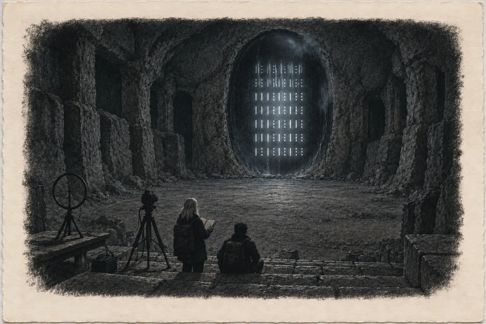

# 7. Světlo v hoře

V sobotu druhého března v osm nula tři měl Pramen pod Hřbetem sedmnáct celá jedna.

Hana to řekla nahlas, jako každý den. Tadeáš stál tři metry od ní, blíž než kdykoli předtím, a když to uslyšel, otočil se a rozběhl se do kopce. Mezi smrky, po sněhu, v gumákách, které se na běh nehodí. Nic neřekl. Ani se neohlédl.

Pes zůstal sedět u odbočky a díval se na Hanu.

„No,“ řekla Hana psovi. „To jsme dva.“

Vyfotila displej. Vyfotila hodinky. Zapsala si vlevo *17,1 °C, 8:03. T. odešel bez slova, běžel ke statku (L.: „17 = řekni mi“, poznámka na mém listu z 20. 2.)*. Pak stála u pramene a čekala, protože nevěděla, jestli má odejít, když pes neodešel.

Tadeáš se vrátil za dvacet minut. Zadýchaný, s čepicí v ruce.

„Paní Lada říká,“ řekl a polkl, „že rada je dneska v pět. Ve statku. Ať přijdete. S tím pánem.“

„S jakým pánem?“

„S tím, co má přijet.“ Tadeáš se zatvářil, jako by to bylo jasné. „S tím od antén.“

*

Kalinovi to řekla v pátek dvaadvacátého večer. Telefonem, protože se to nedalo napsat, a z auta na parkovišti nad Mlýncem, protože se to nedalo říct z penzionu, kde měla majitelka tenké stěny.

Řekla mu všechno. Ve stejném pořadí, v jakém to měla vlevo. Dílnu, protokol, tmu, telefon, světlo vrácené celou zornicí. Pak, se jménem Sálová před každou větou, všechno ostatní. Teplou skálu. Lidi pod horou. Osmdesát stupňů na vstupu do skleníku. Světlo, které svítí jako v kodexu, a tlukot ve skupinách tři, dva, čtyři.

Kalina celou dobu mlčel. Hana dvakrát řekla *jste tam?* a on dvakrát řekl *ano*.

Na konci mlčel tak dlouho, že si myslela, že vypadl signál.

„Víte,“ řekl pak, „co jsem si celé dva týdny myslel, že je nejhorší, co mi můžete říct? Že jste tam našla vysílač. Něčí krabičku s anténou. Že to celé bude jeden chytrý člověk v garáži.“

„A tohle je lepší?“

„Ne,“ řekl Kalina. „Krabička se dá vypnout. Lidi ne.“

Pak řekl, že přijede, až ho pustí. A že přiveze přijímač s časováním. A že čelovku si veze vlastní, protože tu svou mu nikdo nepůjčí.

*

V úterý šestadvacátého vezla Rybovy do genetické ambulance v Karlových Varech. Dvě hodiny čekala v autě na parkovišti před nemocnicí, s vypnutým motorem a se sešitem na kolenou, do kterého nic nenapsala. Klára vyšla první, s Jonášem v nosítku. Sedla si dozadu a řekla jen: „Chtěli krev nás obou. Dali jsme ji.“

Martin celou cestu mlčel. U domu se Klára naklonila dopředu, mezi sedadla.

„Minulý čtvrtek jsme Sokolové podepsali souhlas,“ řekla. „Oba. Martin taky.“

Pak vystoupila. Do deníku si Hana napsala datum a jedno slovo, *odvoz*. Nic víc tam nepatřilo.

*

Vlak z Prahy přijel do Chebu v jedenáct dvacet a Kalina z něj vystoupil s taškou přes rameno a s dlouhým černým pouzdrem, jaké nosí rybáři na pruty. Byl v té samé bundě jako v Brně a vypadal, že od té doby nespal.

„Smyčka,“ řekl, když Hana kývla k pouzdru. „A stativ. A přijímač, záznamník, náhradní baterie. A notebook.“ Odmlčel se. „A čaj.“

„Čaj?“

„V Mexiku jsem ho vařil já vám,“ řekl Kalina. „Tady nevím, kdo bude vařit komu.“

V autě mu Hana podala sešit otevřený na tabulce teplot. Kalina četl, celou cestu až do Mlýnce, a jen jednou zvedl hlavu, když projížděli kolem rokle a nad lesem stála pára.

„To je ono?“

„To je jejich komín. Řekla S.“

Kalina se díval na páru, dokud nezmizela za stromy.

„Píšete to takhle všechno?“ zeptal se. „*Řekla S.*?“

„Všechno, co jsem neviděla sama.“

Kalina kývl. Hana viděla, že se mu to líbí, a že se mu to líbí víc, než by chtěl dát najevo.

*

Rada se scházela ve velké světnici statku.

Hana tam vešla v pět, Kalina za ní. Bylo tu teplo a vonělo to dřevem a mlékem. Kachlová kamna v rohu, dlouhý stůl z tmavých prken a kolem něj lavice. Na lavicích sedělo jedenáct lidí.

Hana je spočítala dřív, než si to uvědomila. Snažila se je nepočítat a nedařilo se jí to.

Byli malí. Všichni. Největší z nich, šedovlasý muž v pleteném svetru na konci stolu, by Haně sahal sotva k bradě. Byli širocí v ramenou a měli silné krky a ruce položené na stole, velké, čtvercové, s krátkými prsty. Byli mezi nimi staří a dva mladší, žena kolem čtyřiceti s copem a Tadeáš. Nikdo z nich nevypadal jako z pohádky. Vypadali jako lidé, kteří celý život pracovali rukama a teď měli sedět a mluvit, a nebavilo je to.

Lada seděla uprostřed stolu. Hana ji poznala, i když ji nikdy neviděla. Před sebou měla šest listů složených na čtyřikrát, Hanin rukopis propsaný přes uhlový papír, a na špičce nosu brýle.

Sálová tu nebyla.

„Posaďte se,“ řekla Lada. Hlas měla hluboký a drsný. Mluvila česky, jen trochu jinak, tvrdě, se slovy, která Hana slyšela naposled od babičky. „Ten pán taky.“

Hana si sedla na kraj lavice. Kalina vedle ní.

„Řekněte jim to,“ řekla Lada. „Co jste naměřila.“

*

Hana otevřela sešit.

Mluvila stejně, jako by mluvila před komisí na stavebním úřadě nebo před starostou obce, které psala posudek. Pomalu, od začátku. Datum, místo, čím měřila a jak. Pramen pod Hřbetem: pět let osm stupňů a něco, dvanáctého ledna osm celá čtyři, třináctého února čtrnáct celá šest, toho rána sedmnáct celá jedna. Strouha od statku: dvacet tři celá čtyři čtrnáctého února, předchozího dne dvacet šest. Propad u ústí štoly: teplý, s oxidem uhličitým, každý týden víc. Prohlubeň pod haldou: plyn u kolen tři až čtyři procenta, večer víc než ráno. Od třináctého února tam přibyli čtyři mrtví ptáci a kuna. Otřesy u Nového Kostela: roj trvá, je přírodní, s tím, co se děje tady, nemusí mít nic společného.

„To je všechno, co jsem změřila,“ řekla. „Měřila jsem jen místa, kam může kdokoli. Kdyby přišel kdokoli jiný a změřil to po mně, muselo by mu vyjít totéž.“

U stolu bylo ticho.

„A co nevíte?“ zeptala se Lada.

Hana se na ni podívala.

„Nevím, co je dole,“ řekla. „Nevím, jak hluboko je plyn a kolik ho je. Nevím, odkud přichází teplo a proč ho přichází víc. Nevím, jestli se to zhorší, nebo přestane. Nevím, kdy.“ Zavřela sešit. „Vím jen tohle: co vychází ven, roste. Od ledna každý týden. Když roste to, co vychází ven, roste i to, co zůstává uvnitř. To je jediný závěr, který vám můžu podepsat.“

Šedovlasý muž na konci stolu zvedl ruku. Ne aby se hlásil. Jen ji zvedl a položil zpátky.

„Kdy to přestane?“ zeptal se.

„Nevím,“ řekla Hana. „Nikdo to neví. Kdo vám řekne, že to ví, ten lže.“

Lada si sundala brýle.

„Tak,“ řekla. Ne Haně. Ostatním. „Já jí věřím.“

*

Pak je poslala do kuchyně.

Kuchyně byla přes chodbu, s velkým stolem, na kterém ležely sešity a pastelky, a se dvěma dívkami, které nad nimi seděly a předstíraly, že se učí. A s holčičkou z okna. Bylo jí šest nebo sedm, byla kulatá a malá i na svůj věk, a dívala se na Kalinu, jako by nikdy neviděla nikoho tak vysokého a tak hubeného.

Kalina si sedl na židli, aby byl menší. Holčičku to zjevně zklamalo.

„Vy jste ta, co měří?“ zeptala se Hany.

„Ano.“

„Babička říká, že měříte líp než Tadeáš.“

„To není pravda,“ řekla Hana. „Tadeáš měří víc věcí.“

„Babička říká, že vy píšete, kdy to měříte.“

„To je pravda.“

Holčička kývla, jako by to bylo vyřízené. Vrátila se k pastelkám.

Za dveřmi do světnice se mluvilo. Hana nerozuměla slovům, jen tónu. Jeden ženský hlas, starý a ostrý, se zvedl nad ostatní. Hana zaslechla jen dvě slova, která prošla dveřmi celá.

*Mnich chodil.*

Pak jiný hlas, ještě hlasitěji. *Mnich byl denní!*

Pak ticho. Pak Ladin hlas, tichý, a nikdo ho nepřerušil.

Kalina zvedl obočí. Hana pokrčila rameny. Nevěděla, co to znamená. Zapsala si to do sešitu na pravou stranu, protože to neviděla. *Za dveřmi: „Mnich chodil.“ – „Mnich byl denní!“*

Za dvacet minut se dveře otevřely. Lada stála na prahu a za ní ve světnici se lidé zvedali z lavic.

„Sedm proti čtyřem,“ řekla. „Můžete dolů. Oba.“

„Děkuju.“

„Neděkujte. Podmínky.“ Lada je vypočítala na prstech, jako Hana v dílně. „Dolů jde Tadeáš první a vy za ním. Kde Tadeáš řekne stát, tam stojíte. Kde řekne jít, jdete. Nikoho nefotíte. Nikoho z nás, nikde. Chodby taky ne. Jen skálu.“

„Jen skálu.“

„A ten pán si tam může dát, co si přivezl.“ Lada kývla ke Kalinovu pouzdru. „Když to nebude dělat hluk.“

„Nebude,“ řekl Kalina.

„A já tam nejdu.“ Lada se otočila ke kamnům. „Na hořící skálu se dívat nebudu.“

*

V deset večer stála Hana ve sklepě statku.

Sklep byl klenutý a studený, voněl hlínou a jablky. Pod stropem visela jedna žárovka. Na konci, za regály se zavařeninami, byly dveře. Obyčejné dřevěné dveře se železnými pásy. Tadeáš je otevřel a za nimi byla tma a teplý vzduch.

Teplý. Hana to cítila na tváři jako dech.

Sálová stála za dveřmi, na prvním schodu dolů. Bez lampy. V šedém kabátě, s rukama v kapsách.

„Dobrý večer,“ řekla.

„Dobrý večer.“

Sálová se podívala na Kalinu. Dlouze, po celé tváři. Kalina se na ni podíval taky a Hana viděla, jak se mu sevřely prsty na popruhu pouzdra.

„Tomáš Kalina,“ řekla Hana.

„Já vím,“ řekla Sálová. „Teď už ano.“

Podala mu ruku. Kalina ji stiskl a podržel o vteřinu déle, než by musel. Hana věděla proč. Kalina měřil všechno, i ruku.

*

Schody vedly dolů rovně, vysekané ve skále, se žlábkem vyšlapaným uprostřed každého stupně. Hana je počítala. Neuměla to nepočítat. Čtyřicet dva. Pak chodba, tak nízká, že se Kalina musel shýbat a Hana skoro ne. Stěny nesly stopy po želízku, krátké šikmé rýhy, staré a ohlazené. Tadeáš svítil ruční lampou před sebe. Sálová šla poslední a nesvítila vůbec.

Bylo tu teplo jako v létě. Vlhko. Vonělo to mokrým kamenem a rzí a něčím, co Hana neznala, něčím jako starý papír.

Hana měla na bundě dva detektory. Firemní u hrudi a Tadeášův, půjčený na tu noc, přicvaknutý na koleni. Oba ukazovaly necelé procento.

Chodba se rozšířila do místnosti.

Hana ji viděla jen v kuželu čelovky, kterou musela na přání Sálové ztlumit na červenou. Dlouhý stůl. Lampa na něm, zhasnutá. Truhla pod stolem a vedle ní šedá plechová kazeta, jakou mívají v trafikách na tržby. Police u stěny a na nich balíky zabalené do papíru, svázané tkanicí. Na zdi vlhkoměr. Padesát sedm. V koutě hučel odvlhčovač. Nad stolem v klenbě černá díra, ze které šel studený vzduch.

Archiv. Hana to věděla, aniž by jí to kdo řekl. Věděla to podle vlhkoměru.

Sálová jím prošla a nezastavila se. Hana taky ne.

Na konci místnosti, v otesané stěně, byla dubová vrata. Velká, tmavá, okovaná. Dole, kolem prahu, bylo dřevo tmavší, jako by bylo nasáklé vodou. Tadeáš se zastavil, zkontroloval displej na zápěstí a pak je otevřel.

Zespodu na ně dýchlo horko.

*

Spodní síň byla větší, než čekala.

Schody do ní vedly podél stěny, deset stupňů, a končily na podlaze z udusané hlíny a kamene. Síň byla dlouhá, u schodů nízká, ke skále se strop zvedal. Klenbu neviděla, jen tmu nahoře. Na zdi u schodů bzučel ventilátor zapojený na kabel a v jeho proudu se kroutila pára. Tadeášovy přístroje stály na schodech a na lavici. Malé krabičky s blikajícími světýlky, propojené dráty.

A na konci síně skála.

Hana ji znala. Znala ji z mnichova zápisu, znala ji z vyprávění Sálové, znala ji z vlastních odhadů v lidaru: sto čtyřicet až sto šedesát metrů od ústí, osmdesát až sto pod povrchem. Teď ji viděla poprvé.

Byla to plocha. Hladká, skoro rovná, velká asi jako vrata do stodoly. Tmavší než skála kolem. Kolem ní byla hornina rezavá, rozpraskaná, s bělavými krustami. Plocha ne. Plocha byla čistá, jako by ji někdo každý den otíral. Pod ní byla kamenná lavice, dlouhá, hladká od sezení.

Hana se na ni dívala a cítila, jak se jí zrychlil dech, a zpomalila ho, protože tady se nedýchá zrychleně.

„Tři celá osm,“ řekl Tadeáš. „U lavice. Tady na schodech jedna celá šest. Ten pán tam může šest minut. Pak všichni sem.“

Kalina šel k lavici. Rychle a přesně, jako by to měl nacvičené, a možná to nacvičil v hotelu v Praze. Rozložil stativ. Nasadil na něj smyčku, černý kruh velký jako kolo dětského bicyklu. Zapojil kabel. Druhý konec kabelu natáhl ke schodům, k záznamníku, který položil na čtvrtý schod zespodu. Od záznamníku vedl tenký kabel po schodech nahoru, přes archiv až do sklepa, kde končil malou anténou na trámku. Na záznamníku svítilo zelené číslo. Čas z družic. Na desetiny vteřiny.

Vrátil se ke smyčce. Natočil ji. Podíval se do přijímače. Natočil ji jinak. Pak ji zvedl na prodlouženém rameni výš, ke stropu, nad plochu skály, a zůstal tak stát s rukou nahoře.

„Hm,“ řekl.

„Čtyři minuty,“ řekl Tadeáš.

Kalina posvítil čelovkou nahoru, nad skálu. Nad horním okrajem hladké plochy, ve stropě síně, byla černá škvíra. Úzká, šikmá, lemovaná bílou krustou, jako komín, který zarostl.

„Tam je to silnější,“ řekl Kalina. „Pod tím.“ Nic víc. Spustil rameno, zajistil stativ a vrátil se ke schodům. Do šesti minut mu zbývalo dvacet vteřin.

Hana si to zapsala. *T. K.: pole silnější pod puklinou nad skálou.* Vlevo. Řekl to, změřil to, bylo to jeho.

Svůj stativ si postavila na schody, třetí schod zespodu, kam ji Tadeáš pustil. Foťák nastavila na video. Do rohu záběru, na schod pod objektivem, položila Kalinův záznamník, aby zelená čísla byla vidět. Čas z družic na každém snímku. Udělala by to tak i v jeskyni. Udělala by to tak kdekoli.

Sálová stála na čtvrtém schodu shora. Měla v ruce blok a tužku. Vedle ní na schodu ležel druhý blok, otevřený, s listy popsanými tužkou.

*

Čekali.

Ventilátor bzučel. Skála hřála. Hana to cítila i ze schodů, jako sálání od kamen, když člověk stojí na druhé straně místnosti. Kalina seděl na schodu se sluchátky na uších a koukal do přijímače. Tadeáš stál u svých krabiček. Sálová se nehýbala.

Ve 23:38 Kalina zvedl ruku.

„Začalo to,“ zašeptal. „Venku. Pulzy.“

Hana se podívala na skálu. Nic. Tma.

Ve 23:47 se rozsvítila.

*

Nebylo to světlo, jaké znala. Nejdřív si myslela, že se jí to zdá, jako když se oči ve tmě unaví a začnou si vymýšlet. Pak to zesílilo. Bledé, rovnoměrné, ne z jednoho bodu. Celá plocha, zevnitř. Jako když se ve vývojce v temné komoře objevuje fotka, nejdřív šedá, pak ostřejší.

Tečky. Nespočet teček, bílých, drobných, jako hvězdy na snímku z dalekohledu.

*Vidi lumina multa, sicut stellas.*

Devět z nich se pohnulo. Klesaly. Pomalu, v řadě, jedna za druhou, jako korálky na šňůrce. Devátá byla slabší a trochu pozadu. *Ex eis novem cadebant, lente, ordine.* Hana znala ta slova nazpaměť. Nevěděla, jestli to, co vidí, vidí, protože to zná, nebo protože to tam je. Proto natáčela.

Pak kraj. Shora, jako z letadla, jako na leteckém snímku, který znala ze své práce. Hory, které nepoznala. Pobřeží. Voda, tmavá. Hana se profesně snažila najít cokoli, co by poznala, nějaký tvar, záliv, řeku. Nenašla nic.

Domy. Oblé, nízké, v řadách. Rovných, pravidelných, jako když se položí formy na pečení. Mezi nimi postavy, malé, nerozeznatelné.

A pak světlo. Jedno, odjinud. Ze strany, z okraje plochy, kde předtím nic nebylo. Přicházelo.

Tma.

Třicet osm vteřin. Zelená čísla: třicet osm celá dvě.

Pak znovu. Tečky, devět, kraj, domy, světlo. A potřetí.

Hana natáčela. Ruce měla studené, i když tu bylo horko jako v létě. Říkala polohlasem časy, pro zvuk na záznamu. *Druhé opakování, dvacet tři čtyřicet osm a třicet.* Hlas se jí nechvěl. Divila se tomu.

*

Potřetí světlo, které přicházelo, zhaslo. Hana čekala, že se světlo stáhne doprostřed a začne tlouct. Tak to Sálová řekla. Tři, dva, čtyři.

Místo toho se plocha rozjasnila jinak.

Rovnoměrně. Celá. Jako negatoskop v nemocnici, když se na něj připne snímek. A na tom světle čáry.

Svislé. Dvojí délky, krátké a dlouhé. Mezi nimi tečky, ve skupinách. Jedna. Dvě. Tři. Čtyři. Víc ne. Řádky pod sebou. Každý řádek začínal krátkou čarou.

Hana přestala dýchat.

Věděla to. Věděla to dřív, než to stačila pojmenovat, jako se pozná rukopis někoho blízkého na obálce, ještě než se přečte jméno. Bodega v ejidu, sobota večer, šikmé světlo Kalinova panelu na horním čele válce. Sedm řádků. Svislé čáry dvojí délky. Tečky ve skupinách po jedné až čtyřech. Každý řádek začínal krátkou čarou. A sken z Chebu, poslední list kodexu, kost a na ní pět řádků. Stejná pravidla.

Spočítala řádky na skále. Sedm.

Nohy se jí podlomily. Ne úplně. Jen v kolenou, jako tehdy v bodeze. Chytila se stativu. Foťák se zachvěl. Hana ho srovnala.

*Jiná slova, stejná abeceda.* Napsala si to v březnu před čtyřmi lety a hned to vyvracela, protože člověk, který v každé mřížce vidí písmo, píše romány. Teď to nevyvracela. Teď se dívala a natáčela.

Jedenáct vteřin. Mřížka se změnila. Jiné čáry, jiné skupiny teček. Pořád sedm řádků. Pořád krátká čára na začátku. Hana počítala. Jedenáct vteřin. Další. U šesté se zarazila. Osm řádků. Spočítala je znovu, než mřížka zmizela. Osm. Sedmá měla zase sedm.

A koutkem oka viděla Sálovou.

Sálová kreslila. Rychle, jistě. Ruka jí běhala po bloku. Nedívala se do bloku, dívala se na skálu, a ruka kreslila sama. Nezaváhala ani jednou. Neudivila se. A na schodu vedle ní, ve slabém odlesku ze skály, ležel ten druhý blok, otevřený. Hana na něm viděla mřížky. Nakreslené tužkou. Řádky, čáry, tečky. A v rohu listu dlouhým úzkým písmem datum.

*6. 2.*

Sedmá mřížka. Jedenáct vteřin. Tma.

Pak se světlo stáhlo doprostřed. Do skvrny velké jako dlaň. A tlouklo.

Tři. Pauza. Dva. Pauza. Čtyři.

„Teď,“ zašeptal Kalina. „Teď. Teď.“

Kalina měl oči na přijímači a rty se mu hýbaly. Na displeji, v zeleném, skákaly zuby. Ve skupinách. Tři. Dva. Čtyři. Přesně se skvrnou na skále, ve stejném okamžiku.

„Na desetinu,“ řekl Kalina. Skoro neslyšně.

Skvrna zhasla. Síň byla tmavá. Jen zelená čísla na schodu a červené světýlko Hanina foťáku.

*

Nejdřív to Hana uslyšela.

Z hloubky, odněkud zpod lavice, zpod podlahy, zvuk. Ne rána. Spíš výdech. Dlouhý, tichý, jako když se v kamnech sesune popel. Pak ucítila teplo na kotnících. Proud, zespodu, podél podlahy, teplý jako z otevřené trouby.

Ventilátor změnil tón. Zakašlal.

Detektor na koleni pípl.

Hana se podívala dolů. *5,2 %.* Pak *6,0*. Pípání se zrychlilo.

„Nahoru,“ řekl Tadeáš. Nahlas, poprvé za celý večer. „Hned. Pomalu a hned. Nedýchat zhluboka.“

Jeho krabička na lavici začala kvílet. Vysoko a pronikavě.

Kalina vstal. Udělal krok dolů, k lavici, ke stativu se smyčkou.

Hana ho chytila za rukáv.

„Nechte to tam.“

„Data…“

„Data máte tady.“ Ukázala na záznamník na schodu. Kalina se na něj podíval, jako by ho viděl poprvé. Vytrhl kabel. Strčil záznamník do kapsy. Hana sundala foťák ze stativu, stativ nechala stát.

*7,4.*

Šli nahoru. Tadeáš je pouštěl před sebe. Deset schodů do horní části síně, k vratům. Hana šla druhá, za Kalinou. Kalina se po pátém schodu zastavil a nadechl se.

„Nedýchejte,“ řekla Hana. „Jděte.“

„To se vylučuje.“

„Jděte.“

Za vraty byl archiv a v archivu byl vzduch chladnější, ale ne dobrý. Hana cítila ve spáncích tlak, jako když se potápěla a zadržela dech moc dlouho. Kalina se opřel o stůl. Zbledl. Sálová byla najednou u něj. Hana neviděla, jak tam došla. Vzala mu tašku z ramene, jako by nic nevážila, a položila mu dlaň mezi lopatky.

„Sedněte si,“ řekla. „Na zem. Hlavu dolů. Ne. Tady.“

Posadila ho pod tu černou díru v klenbě nad stolem. Natáhla se a za něco zatáhla, něco cvaklo, a z díry se vyvalil mráz. Venkovní, zimní, březnový vzduch. Kalina ho nasál, jako by pil vodu.

Tadeáš za nimi zavřel dubová vrata. Opřel se o ně zády, potom se sehnul k jejich prahu a do mezery u podlahy natlačil srolovanou deku.

Detektor: u kolen *1,9*. U hrudi *1,1*. Klesalo to.

„Kolik bylo dole?“ zeptala se Hana.

Tadeáš se podíval na zápěstí. „U lavice devět celá čtyři. Než to zhaslo.“

Hana si to zopakovala. Devět celá čtyři. Tam, kde večer stál Kalina a zvedal smyčku ke stropu.

*

V kuchyni statku bylo půl druhé ráno a Lada stála u kamen.

Nespala. Byla oblečená. Na plotně měla hrnec s mlékem a vedle čtyři hrnky. Když vešli, podívala se na Kalinu, na jeho bílou tvář, a pak na Tadeáše.

„Kolik?“

„Devět čtyři u lavice,“ řekl Tadeáš.

Lada nalila mléko do hrnků. Kalinovi první. Ten ho vzal oběma rukama a ruce se mu třásly.

Hana si sedla ke stolu. Pastelky tam ještě ležely. Holčiččin obrázek, dům s komínem, z komína kouř a pod domem kopec a v kopci žlutý obdélník.

„V lednu,“ řekla Lada, „tam spaly děti. Ve vedlejší síni. Než jsme je dali nahoru.“

Hana se podívala na obrázek. Na žlutý obdélník v kopci.

Pak se podívala na Ladu. Na Sálovou, která stála ve dveřích, vysoká, v šedém kabátě, a dívala se na ni. Na Tadeáše s čepicí v ruce. Na Kalinu nad mlékem.

„Tohle se musí vyklidit,“ řekla.

Nikdo nic neřekl.

„Všechno, co je dole. Všichni, kdo jsou dole. Ne za týden. Ne až rozhodne někdo jinde. Ať chce ta vaše Úmluva cokoli.“ Hana mluvila klidně. Slyšela se, jak mluví klidně, a nevěděla, odkud to bere. „Devět procent je hranice, kde člověk za pár minut přestane rozumně myslet. Ne za hodinu. Za minuty. A já nevím, kolik toho tam bude příště. Nevím, kdy to přijde. To je ten problém. Že to nevím.“

Lada se na ni dívala zdola, rovně.

„I já?“ zeptala se.

„I vy.“

Lada si sundala zástěru a pověsila ji na háček u kamen. Pečlivě, rovně.

„Tak to řekni radě,“ řekla. Poprvé Haně tykala. „Zítra. Stejně jako dneska. Čísla a co nevíš.“

„Řeknu.“

Ve dveřích se Sálová pohnula. Neřekla nic. Ale Hana viděla, že sklopila oči. Na vteřinu. Jako člověk, který dostal, co chtěl, a nelíbí se mu, kdo mu to dal.

*

Na chodbě před kuchyní ji Hana zastavila.

„Šestého února,“ řekla.

Sálová se zastavila. Neotočila se hned.

„Ano.“

„Ve čtvrtek čtrnáctého jste mi v dílně řekla tři, dva, čtyři. Mřížky ne.“

„Ne.“

„Proč?“

Sálová se otočila. V chodbě svítila jen žárovka nad schody a Sálová stála mimo její světlo, ve stínu. Hana jí neviděla do tváře. Sálová viděla Haninu tvář celou.

„Protože tlukot jsem znala,“ řekla. „Věděla jsem, co dělá. Tohle nevím, co je. A co nevím…“

„To není pravda.“

Ticho.

„Věděla jste, že to uvidím,“ řekla Hana. „Že když mě sem pustí, uvidím to. Tři týdny jste to kreslila.“

Sálová dlouho mlčela.

„Chtěla jsem vidět,“ řekla pak, „co uděláte, až to uvidíte.“

„A viděla jste.“

„Ano.“

„A co jsem udělala?“

„Zastavila jste se,“ řekla Sálová. „Chytila jste se stativu. Pak jste natáčela dál.“

Hana se na ni dívala do stínu. Zvedla ruku a pak ji spustila, protože nevěděla, co by s ní dělala.

„Příště mi to řekněte,“ řekla. „Než se to dozvím jinak.“

„Příště,“ řekla Sálová. Nebyl to slib. Hana to slyšela. Bylo to jen slovo, které Sálová vracela jako ozvěnu.

*

V penzionu se Kalina posadil na postel v Hanině pokoji, protože do svého by po schodech nedošel. Otevřel notebook. Hlava ho bolí, říkal, jako by mu ji někdo svíral kleštěmi, ale musí to vidět teď.

Hana mu uvařila jeho čaj. Ve varné konvici penzionu, do hrnku s nápisem *Mlýnec – obec s tradicí*.

Kalina stáhl data ze záznamníku. Pustil je vedle Hanina videa, snímek po snímku, zelená čísla na schodu proti zubům v jeho grafu.

„Každá skupina,“ řekl po dlouhé chvíli. „Každá. Tlukot na skále a pulzy na přijímači. Rozdíl pod desetinu vteřiny. To je moje chyba měření, ne jejich rozdíl.“

„A to venku? Ta čtyři celá dvě?“

„To porovnám doma. S daty ze zdroje. Tady to nemám.“ Kalina si sundal brýle a promnul si oči. „Ale tohle je ono. Tohle je ten vysílač. Ta škvíra nad skálou. Tudy to jde ven.“

„Krabička,“ řekla Hana.

„Ne,“ řekl Kalina. „Krabička ne.“ Nasadil si brýle zpátky. „Vy jste věděla, že tluče. Že to je ono.“

„Tušila jsem. Od čtrnáctého. Napsala jsem si to jen v duchu.“

Kalina měl únavou oči skoro zavřené.

„Tak to teď můžete napsat doleva,“ řekl.

*

Psala až za svítání. V autě, na parkovišti nad vsí, s topením na plný výkon a se sešitem na volantu.

Vlevo:

*2./3. 3. 2030, sídlo pod horou, spodní síň. Se souhlasem rady Ostrých (7:4, sděleno L.). Přítomni: T. K., T., S. Podmínka: natáčet jen skálu.*

*Schody ze sklepa statku 42, chodba, archiv (vlhkoměr 57 %, odvlhčovač), dubová vrata, 10 schodů do spodní síně. CO₂ na schodech 1,6 %, u lavice 3,8 % (T., 22:20).*

*Viděla jsem: teplá skála = hladká plocha jako vrata stodoly, tmavší, čistá, kolem rezavá rozpraskaná hornina s bílými krustami, pod ní kamenná lavice. Nad horním okrajem ve stropě šikmá úzká puklina s bílou krustou.*

*T. K.: pole silnější pod puklinou nad skálou.*

*23:38 T. K.: začátek pulzů. 23:47 světlo. Viděla jsem a natočila (video, čas GPS v záběru): tečky, 9 padá v řadě (9. slabší, pozadu), kraj shora (nepoznávám), oblé domy v řadách, postavy, světlo přichází z okraje. 3 × 38,2 s.*

*Pak 7 mřížek, každá ~11 s: svislé čáry 2 délek, tečky ve skupinách 1–4, každý řádek začíná krátkou čarou, 7 řádků; 6. mřížka 8 řádků (spočítáno 2×). Natočeno.*

*Pak tlukot uprostřed (skvrna jako dlaň), 3–2–4. T. K.: shoda s pulzy na přijímači, rozdíl pod 0,1 s.*

*Výron CO₂: zvuk zespodu, teplý proud u podlahy, u kolen 5,2 → 7,4 % během ~1 min (Tadeášův detektor u kolena), u lavice 9,4 % (T.). Odchod do archivu, šachta, pak statek.*

*Řekla jsem L., S., T. a T. K.: sídlo vyklidit, všichni, ať chce Úmluva cokoli. L.: „Řekni to radě. Zítra.“*

Vpravo dlouho nic. Pak:

*Stejná pravidla jako na válci a na kosti. Náznak. Ne důkaz. Kdo je napsal? Pro koho?*

*Proč sedm řádků? Válec sedm, kost pět.*

*Šestá osm. Proč jedna jinak? Chyba skály? Nebo je v ní víc něčeho, co se počítá?*

*S. viděla mřížky od 6. 2. (datum na jejím bloku). 14. 2. mi je neřekla. „Chtěla jsem vidět, co uděláte.“*

*Za dveřmi rady: „Mnich chodil.“ – „Mnich byl denní!“ Mnich chodil dolů? Kdy?*

A pod to, poslední řádek, menším písmem, protože to nebyla otázka a nebyl to ani fakt:

*V lednu tam spaly děti.*

Zavřela sešit. Na sedadle spolujezdce ležel foťák a v něm čtyřicet sedm minut záznamu. Poprvé v životě natočila něco, o čem nevěděla, co to je.

Nad roklí stála pára. Rovná, bílá, do světlého nebe.
