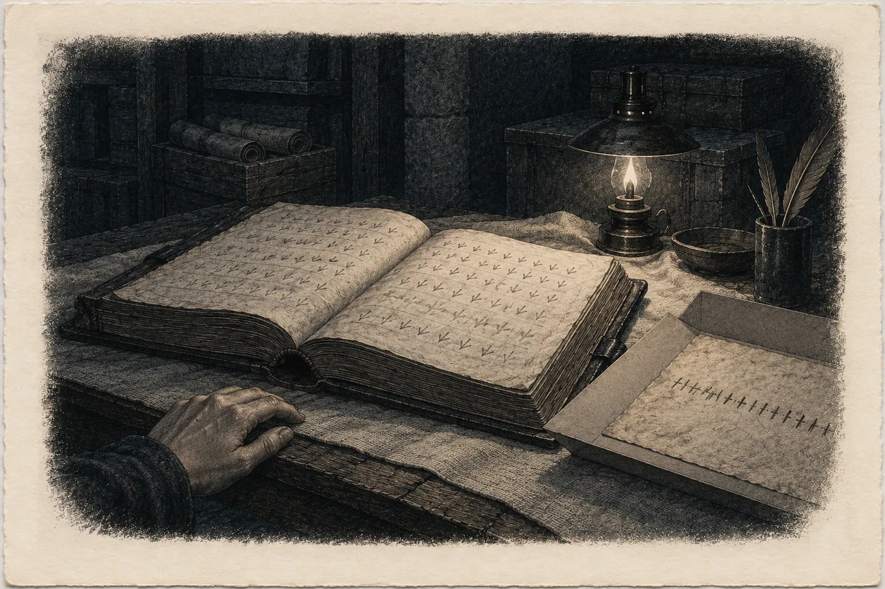

# 8. Genealogie

V pondělí večer ukazoval vlhkoměr v archivu padesát osm a Sael věděla, že tady už knihu dlouho otvírat nebude.

Odvlhčovač v koutě hučel celý den. Tadeáš ho přinesl v únoru a vyprazdňoval nádobku dvakrát denně. Voda z ní byla teplá. Sael ji jednou ochutnala, protože chtěla vědět, jestli je to voda ze vzduchu, nebo ze skály. Chutnala po železe. Bylo to obojí.

V neděli zasedala rada Ostrých podruhé za dva dny. Vrbová tam stála podruhé a zopakovala čísla, a pak řekla, co neví. Rada hlasovala šest proti pěti. Spodní síně se zavřou. Nikdo nebude spát níž než archiv. Děti a staří zůstanou nahoře ve statku a u příbuzných v síti. Skleník se opustí. Ostatní zůstanou dole, dokud skála nepřestane hořet, nebo dokud nepřijde další výron.

Lada hlasovala s menšinou. Pro to, aby šli nahoru všichni.

Sael to slyšela od Tadeáše. Lada jí to neřekla. Lada s ní od soboty mluvila jen o tom, co je třeba udělat, a dívala se přitom jinam.

*

Truhlu otevřela v osm.

Nejstarší list vyndala jako první, v obalu z nekyselého papíru, a položila ho na stůl na čisté plátno. Pak sundala z police balík se svazkem ze šestnáctého století. Ten se otevřel sám, u Doroty, jako vždycky. Sael ho zavřela a položila vedle listu.

Dlouho stála nad obojím.

Kdo nechá knihu otevřenou před denním, předá jméno. Rokyta jí to řekla v zimě po válce, když Sael bylo něco přes šedesát a poprvé směla sedět u stolu, zatímco se psalo. Rokyta to věděla od své předchůdkyně a ta od starších, až k Aurel a dál. *Kdo jednou ukázal, ukáže znovu.* Kniha nesmí mít strážce, jehož ruka si pamatuje, jak se otvírá.

Jíva to udělala jednou. Pro jednu denní ženu, která četla vzhůru nohama. Na podzim pak podala pero Svídě.

Sael to věděla. Věděla to celou neděli a celé pondělí. A přesto vyndala list a svazek a položila je na stůl.

Ta žena měla spis. Měla ho pět let. Měla desátou výpověď a skvrnu přes jméno a řádek *Víc jsem nezapsala*. A četla i to, co nehledala. Dřív nebo později by přišla na Dorotu sama. Z druhé strany, bez Sael, a četla by ji, jak by chtěla.

Kdo ukáže sám, ten určuje, jak se to čte. Sael si to řekla. Byla to pravda. Byla to taky jen polovina pravdy, a Sael to věděla stejně dobře jako tu první polovinu.

*

Ta žena přišla v devět, s Tadeášem, po schodech ze sklepa statku.

Tadeáš zůstal ve dveřích s čepicí v ruce. Sael mu kývla a on odešel nahoru. Slyšela, jak počítá schody, polohlasem, jako to dělal odmalička.

Ta žena se na prahu archivu zastavila. Sael rozsvítila lampu na stole. Kvůli ní. Žluté světlo dopadlo na stůl, na plátno, na list v obalu a na svazek v tmavé kůži.

Ta žena se nepodívala na knihu. Pohled jí padl na vlhkoměr.

„Padesát osm,“ řekla.

„Ano.“

„V sobotu padesát sedm.“

„Ano.“

„Tohle tady nevydrží.“ Neřekla to jako otázku. Řekla to jako to, co je.

„Já vím,“ řekla Sael. „Proto ji odsud odnesu.“

Ta žena pohlédla na Sael a potom, poprvé, na stůl.

„Pan Kalina vám vzkazuje,“ řekla, „že čtyři celá dvě platí i dole. Porovnal to v Praze. Tlukot na skále přichází čtyři celé dvě vteřiny po každé skupině signálu zdroje. Stejně jako to, co chytají ti lidé s anténami.“

Sael nevěděla, co je *signál zdroje*. Věděla, co znamená *stejně*. Kývla.

„A ještě vzkazuje, že vám děkuje za tu tašku.“

„Nic nevážila.“

„Pro něj vážila.“

Vrbová si sundala bundu a pověsila ji na opěradlo židle. Nesedla si. Stála u stolu a dívala se na tmavé desky svazku, a Sael viděla, jak ji svrbí prsty. Restaurátorka to pozná na každém, kdo stojí u knihy.

„Tenhle archiv,“ řekla, „byl tady vždycky?“

„Ne.“ Sael si sedla na židli u stolu. „Po vodě, v roce, o kterém psal váš mnich, odešli z hory všichni. Ostří i my. Ostří se vrátili v dalším pokolení. My jsme šli do hor nad Jáchymovem. Pod převis, k úlům. Tam byl archiv skoro šest set let.“ Odmlčela se. „Sem jsme se vrátili, když Ostří koupili statek nad vchodem. Kolem roku sedmnáct set sedmdesát. Já jsem se tu narodila.“

„Kdy?“

„Dřív, než stojí v občance.“

Ta žena se skoro usmála. Pak přestala.

„Nesmím fotit,“ řekla. „Předpokládám.“

„Nesmíte.“

„Tak to budu psát.“ Vytáhla sešit a propisku. „Co přečtu sama, napíšu, že jsem viděla. Co mi přečtete vy, napíšu, že jste řekla.“

„Já vím,“ řekla Sael. „Vy to tak píšete všechno.“

*

Nejdřív list.

Sael ho vyndala z obalu a položila na plátno. Neřekla nic. Ta žena se sklonila, ruce za zády, jak se to dělá v depozitáři, aby se člověk ničeho nedotkl.

Pergamen tmavý jako kůra. Kresba kopce, jeden oblouk se strmějším koncem. Uvnitř kruh s vlnovkami, pod kopcem šipka ven. Vedle kresby řada čárek. Pod čárkami znak s dlouhým tahem dolů. A u hřbetu jediné slovo.

Přečetla ho nahlas, pomalu.

„*Monachus.*“

Pak začala počítat. Sael to viděla na jejích rtech. Ne čárky najednou. Po jedné, prstem ve vzduchu, centimetr nad pergamenem, aby se ho nedotkla. Zleva doprava, celou řadu.

„Čtyřicet jedna,“ řekla.

„Ano.“

Narovnala se.

„*Exivimus,*“ řekla. Tiše. „Vyšli jsme. A na okraji *tacui*.“ Podívala se na Sael. „V kodexu žádné číslo není. Žádný počet. Napsal, že vyšli a že o tom mlčel.“

„Ostří říkají,“ řekla Sael, „že v komoře s kamennou deskou spočítal všechny, malé i velké. A to číslo nikam nenapsal.“

„Napsal to za něj někdo jiný.“

„Ano,“ řekla Sael. „My.“

Vrbová dlouho stála nad listem. Sael ji nechala. Viděla, jak se dívá na kresbu kopce, na strmější konec hřbetu, a jak jí oči na vteřinu odběhnou nahoru, ke klenbě, ke hřbetu nad nimi, který měla v lidaru na obrazovce.

Pak si sedla a začala psát. Rychle, drobně. Sael se nedívala do sešitu. Mohla. V tom světle by četla každé slovo. Nedívala se.

*

Pak svazek.

Sael ho otevřela tam, kde se otvíral sám. Vrbová se sklonila a Sael slyšela, jak se jí zadrhl dech. Ne kvůli Dorotě. Kvůli písmu.

Ptačí stopy. Řádek za řádkem, drobné, hnědé, jedna vedle druhé, jako stopy kosa v čerstvém sněhu, když jde od plotu ke krmítku a zase zpátky. Sael to viděla na její tváři. Viděla, jak se snaží najít v řádcích cokoli, co by poznala. Opakování. Pravidlo. Něco, co se dá spočítat.

„Neumím to číst,“ řekla ta žena.

„Nikdo z denních to neumí.“

„A tohle umím.“ Ukázala prstem nad řádek, kde mezi ptačími stopami stála latinka. Velká písmena, staré písmo, hnědý inkoust. „*Dorothea. MDXC. Ins Geschlecht angenommen.*“ Četla pomalu. „Dorota. Tisíc pět set devadesát. Přijatá do rodu.“

„Ano.“

„Proč latinkou?“

„Jména těch, kdo přišli zvenku, se píšou jejich písmem,“ řekla Sael. „Aby se vědělo, odkud přišli. I když se zapomene, kdo byli.“

Ta žena se podívala na kraj řádku. Na malý uzavřený znak. Na ptačí stopu, která tam stála sama.

„A tohle?“

Sael se nadechla.

„To je znak naší řeči,“ řekla. „Píše se u věcí, které se vezmou. Ne které se dají. U kořisti. U vody svedené z cizího potoka. U úlu, který se vyřízne ze stromu, když včely nejsou doma.“ Odmlčela se. „U jména je v celé knize jen tady.“

Ta žena se nepohnula.

Sael viděla, jak jí ztuhla ramena. Jako tehdy v dílně, když jí Sael řekla o svíčce. Ramena a nic jiného.

„Vzatá,“ řekla.

„Ano.“

„Řekla S.,“ řekla ta žena. Ne Sael. Sobě. A napsala to.

*

Pod Dorotiným řádkem stál další. Jívinou rukou, ale jiným inkoustem, připsaný až po letech. Latinkou, pomalými písmeny, aby to bylo čitelné i pro toho, kdo nebude znát ani jedno písmo.

Vrbová ho četla sama. Sael ji nechala.

„*Mater eius,*“ četla. „*Margaretha. Vidua Georgii Haupt. Metallici.*“ Zastavila se. „Její matka Markéta. Vdova po Jiřím… po Jörgovi Hauptovi. Havíři.“ Prst jí šel dál nad řádkem. „*In valle Sancti Ioachimi.*“

Zvedla hlavu.

„V údolí svatého Jáchyma,“ řekla.

„Ano.“

„Vdova po havíři.“

Ta žena se dívala na Sael a Sael viděla, jak se jí v očích něco skládá. Rychle, jako se skládá mapa, když se člověk konečně podívá, kde je sever.

Pak se sehnula k batohu. Vytáhla počítač. Otevřela ho na kraji stolu, daleko od plátna, daleko od knihy, jako by ji i světlo z obrazovky mohlo poškodit. Ťukala. Sael věděla, co hledá, ještě než to našla.

Na obrazovce se objevil sken. Hnědý list, drobné rovné písmo bez smyček, řádky jako zoraná pole. A v horním rohu skvrna. Velká jako dlaň, světle hnědá, s tmavším okrajem. Pod ní, kousek níž, jedno slovo černé.

*Wittib.* Vdova.

„Desátá výpověď,“ řekla ta žena. „Spis horního soudu, Jáchymov, 1595. Jméno je pod skvrnou. Paní doktorka mi přepsala, co šlo. Začátek je pod skvrnou a konec je *Víc jsem nezapsala*.“ Podívala se na Sael. „Já to neumím přečíst. Tu ruku jo, ale tu němčinu ne. Ne celou.“

„Já ano,“ řekla Sael.

„Já vím,“ řekla. „Přečtete mi to?“

*

Sael si přitáhla počítač.

Četla tu ruku jako svou. Znala ji. Viděla ji na papíře, ne na obrazovce, a na papíře byla ostřejší a hnědší a měla vůni. Na obrazovce byla plochá. Přesto ji četla bez zaváhání a překládala rovnou, česky, nahlas.

„*Jörg spadl do šachty dva roky po ní. Přetrhl se provaz u rumpálu. Říkali, že byl uzel špatně uvázaný. On vázal uzly dobře.*“ Sael četla dál. „*Dcera se jmenovala Dorota. Narodila se v únoru, na svatou Dorotu, v roce, kdy byla dlouhá zima a vlci chodili až k haldám. Měla vlasy jako len. Zpívala.*“

Ta žena psala. Sael slyšela propisku.

„*V srpnu, na svatého Vavřince, šla s Barborou Seidlovou na borůvky. Bylo jí deset.*“ Sael na okamžik zaváhala. Ne kvůli písmu. „*Bára přiběhla sama, k večeru. Ubrečená, bez košíku. Že se Dorota ztratila. Hledali ji tři dny. Muž a havíři a kluci z horního konce. Spouštěli se do šachtic na provaze. Nic. Ani botu. Jen košík. Plný borůvek. Postavený rovně.*“

Přestala psát.

„*Farář říkal, že Bůh dal a Bůh vzal. Babky říkaly, že ji vzali ti z hory a nechali místo ní polínko. Mně nenechali ani polínko.*“

Sael četla dál a hlas měla stejný. Hlídala si ho víc než ramena.

„*Ať jim vypálí všechny štoly. Ať je vykouří ven. Ať mi ji přivedou na světlo.*“

V archivu bylo ticho. Odvlhčovač hučel. Za zády hřála skála.

Sael ta slova znala. Četla je na jaře 2025 proti oknu v depozitáři a pak doma, v noci, ještě dvakrát. Matka chtěla oheň. Do štol, kde tenkrát žili jiní, ne vysocí, a kde potom na svatého Jana opravdu hořelo. Benedikt to na radě řekl jednou větou. *Pečetili je ohněm.* A Markéta to chtěla. Kvůli dceři, která v té době seděla v lese pod buky a zpívala. V lese se zpívalo vždycky. Sael to věděla od matky.

Sael četla dál.

„*Teď by jí bylo patnáct. Že by se už vdávala, za rok, za dva.*“

Pod tím mezera. Kudrlinka na konci, jako by pero začalo psát jiné písmeno a rozmyslelo si to. A o řádek níž, o kousek níž, než by měl být:

„*Víc jsem nezapsala,*“ řekla Sael.

*

Ta žena seděla a očima přecházela ze skenu na svazek a ze svazku zpátky na sken.

„Bylo jí deset a teď by jí bylo patnáct,“ řekla. „V květnu devadesát pět. Takže před pěti lety. Devadesát. *MDXC.*“

„Ano.“

„Dorota. Svatá Dorota. Havíř, který zemřel. Vdova. Údolí svatého Jáchyma.“ Každé slovo položila zvlášť, jako položky v soupisu. „Je to ona.“

„Ano.“

„Ta žena, co to psala, Ilona, věděla, kde Dorota je.“ Neptala se. „Vynechala to. Napsala *Víc jsem nezapsala*, aby bylo vidět, že něco vynechala. A pak ten list polila něčím přes jméno.“

„To nevím,“ řekla Sael. „Jestli schválně. To v knize není.“

„A jméno pod skvrnou?“

„*Margaretha, Jörgen Haupts, des Hauers, nachgelassene Wittib,*“ řekla Sael. „Markéta, pozůstalá vdova po Jörgovi Hauptovi, havíři.“

Nepohnula se.

„Na skenu to není vidět,“ řekla.

„Na skenu ne. Na originálu proti světlu ano. Inkoust pod skvrnou zešedl, ale nezmizel.“

„Vy jste ten originál měla v rukou.“

„Na jaře 2025,“ řekla Sael. „Kontrola stavu, než se spis digitalizoval. V depozitáři v Karlových Varech. Držela jsem ten list proti oknu.“

Vrbová dlouho mlčela.

„Ten sken,“ řekla potom pomalu, „mi v červnu 2025 poslala paní doktorka. Poslal jí ho kolega z jiného archivu. Protože věděl, že měla v zimě *ten kodex s drakem*.“

„Řekla jsem mu to,“ řekla Sael. „Že by ji to zajímalo. Jen tak, nad stolem. Jako restaurátorka, která ví, kdo co sbírá.“

„A v srpnu ty boční snímky. Ruby lékárníkovy knihy. *Restaurátorka si při kontrole stavu všimla něčeho na rubu.*“

„Ano.“

„To jste byla vy.“

„Ano.“

Ta žena se opřela v židli. Dívala se na Sael přes stůl, přes lampu, přes plátno s listem, na kterém bylo čtyřicet jedna čárek.

„Takže jste mi ho poslala vy,“ řekla.

„Poslala vám ho paní doktorka. Já jsem jen řekla komu.“

„To je totéž,“ řekla. „Jenom z druhé strany.“

Sael na to nic neřekla. Ta věta zněla, jako by ji ta žena odněkud znala. Jako by ji neříkala poprvé.

„Proč?“ zeptala se.

„Chtěla jsem vidět,“ řekla Sael, „jestli si všimnete toho řádku.“

„Zase.“

„Zase.“

„Všimla jsem si.“

„Já vím,“ řekla Sael. „Paní doktorka mi to řekla. V září, u kávy. Že jste se v prvním e-mailu ptala na desátou výpověď.“

*

Vrbová vstala. Došla k polici s balíky, k odvlhčovači, k vlhkoměru. Zase padesát osm. Postála tam zády k Sael. Pak se vrátila.

„V tom protokolu,“ řekla, „jste napsala devětkrát *pokračuje*. A tady se nic nemaže.“

„Tady se nic nemaže.“

„V protokolu ano.“

„Protokol není kniha.“

„Pro paní doktorku je,“ řekla ta žena. Nezlobila se. Řekla to jako rozdíl mezi dvěma čísly.

Sael se dívala na svazek. Na Dorotin řádek.

„Dorota byla moje praprababička,“ řekla.

Ta žena se zastavila uprostřed pohybu.

„Matka matky mé babičky,“ řekla Sael. „Znám ji jen z tohohle řádku. A z jednoho dalšího, o čtyřicet listů dál, kde se jí narodila dcera. A z jednoho o padesát let později, kde umřela. Mezi tím nic. Kniha zapisuje, co se stalo, ne jak to bylo.“

„A ten znak.“

„A ten znak.“ Sael se na něj podívala. „Celý život vím, že jsem z toho. Ne z Doroty. Z toho znaku.“

Vrbová si sedla. Pomalu. Nepsala.

„Byla tu šťastná?“ zeptala se.

Takovou otázku od ní Sael nečekala. Od ženy, která píše, kdy co změřila, na minutu.

„Kniha to nezapisuje,“ řekla.

„A co víte vy?“

„Že žila. Že měla dceru. Že umřela u nás, mezi námi, ne dole ve městě.“ Sael se odmlčela. „A že skládala plátno.“

Ta žena čekala.

„Moje matka,“ řekla Sael, „skládala každé plátno na čtyřikrát. Ubrus, utěrku, cokoli. A pak ho uhladila dlaní. Takhle.“ Položila dlaň na plátno vedle listu a přejela po něm. „Říkala, *aby se vědělo, že to nebyla liška*. Ona to měla od své matky, ta od své. A ta od Doroty. Nikdo už neví, co to znamená. Já taky ne.“

Ta žena se dívala na Saelinu dlaň na plátně.

„Já taky ne,“ řekla.

*

„Je jich víc?“ zeptala se po chvíli. „Takových jmen?“

„Víc než jedno.“

„Kolik?“

„To vám neřeknu.“

„Proč?“

„Protože jsem to neřekla nikomu,“ řekla Sael. „A nevím, jestli vám to chci říct první.“

Ta žena kývla. Nezapsala to. Nebo to napsala tak rychle, že to Sael neviděla.

„A co bylo na rubu?“ zeptala se pak. „Ta žena, Ilona, u soudu řekla, že seškrábala rub lékárníkovy knihy. *Byly tam jiné věci než vraždy. Ty jsem nezapsala.* Vy jste ty ruby držela proti oknu. Co tam bylo?“

„Nevím,“ řekla Sael. „Neviděla jsem to. Proti oknu je vidět jen to, co zbylo.“

Byla to pravda. Sael to věděla a věděla taky, že o pět řádků níž, na kraji téže stránky, leží řádek Jívinou rukou s jedním písmenem latinkou. Ten kraj měla od začátku přikrytý přeloženým cípem plátna, jako by jen chránil pergamen. Ruka ho pod plátnem cítila, těch pár řádků mezi Dorotou a létem 1595, a nechala ho přikrytý.

„Ale ta žena,“ řekla Sael, „napsala soudu víc, než soud vzal. Celé svědectví. Čtrnáct listů. Soud vzal čtyři.“

Vrbová zvedla hlavu.

„Odkud to víte?“

„Ze spisu. Stojí tam, že přísežní vzali jen to, co patří k věci.“ Sael se odmlčela. „A od lidí, kteří ten zbytek mají. Někdo to tenkrát v noci opsal. Ten opis existuje. Drží ho čtyři sta třicet pět let.“

„Kdo?“

Sael položila dlaně na plátno. Teď. Teď to řekne.

„To vám řeknu,“ řekla Sael, „až mi odpovíte.“

*

„Na co?“

„Potřebujete důkazy,“ řekla. „Takové, které neověříte jen u mě. Já je mám, nebo vím, kde jsou. Tenhle archiv. Osm set let zápisů o tom, kdo žil pod horami. Ten list s čárkami vedle vašeho kodexu. Svědectví té ženy z roku 1595, celé, v ruce, kterou můžete srovnat s jinými rukami. A skálu. Přístup, kdy budete chtít, s panem Kalinou, s přístroji, s kýmkoli, koho Ostří pustí.“ Odmlčela se. „Všechno to dostanete. Pro posudek, pro sněm, pro cokoli, co pak budete chtít říct.“

„A za to?“

„Dorota zůstane tady,“ řekla Sael. „V knize. A ostatní taky. Co se stalo v lese, zůstane v lese. Nikdo se to nedozví. Ani od vás, ani z ničeho, co vám dám.“

Ta žena se na ni dívala.

„Únosy,“ řekla.

Sael sebou trhla. Ne rukama. Někde uvnitř, tam, kde se nedá nic hlídat.

Sto čtyřicet sedm let to slovo v archivu nikdo nevyslovil. Rokyta ne. Sael ne. Jíva ho tam nakreslila jako ptačí stopu, malou a uzavřenou, a všichni po ní ho četli a nikdo ho neřekl nahlas. Teď tu leželo na stole, v řeči denních, mezi lampou a plátnem, a nedalo se vzít zpátky.

„Ano,“ řekla Sael. „To slovo.“

V prvních deseti letech úřadu jezdila Sael po archivech a národních výborech kolem hor. Měla v kabelce sešit a v sešitu dvaadvacet jmen latinkou. Seděla v archivních badatelnách a na obecních půdách nad matrikami denních a hledala děti, které se ztratily ve stejném roce, kdy se v knize objevilo jméno s *angenommen*. *In silva perditi.* Ztracené v lese. *Von Wölfen geholt.* Odnesené vlky. Jedenáct shod. Sael si je opsala, pečlivě, se signaturami, a pak ten sešit zamkla do truhly pod list s čárkami. Přes padesát let ho nikomu neukázala. Celou tu dobu si říkala, že ho zamkla, aby se to nikdo nedozvěděl.

Teď to slovo leželo na stole a Sael věděla, že ho zamkla, aby ho nemusela slyšet.

Ta žena dlouho mlčela.

Sael čekala, že řekne ne. Nebo že řekne ano. Nebo že začne mluvit o pravdě, o vědě, o tom, že se nesmí lhát. Neřekla nic z toho. Seděla a dívala se na plátno, na Saelinu dlaň vedle svazku, a pak na svůj sešit, na dvě strany a svislou čáru mezi nimi.

„Dnes vám neodpovím,“ řekla.

„Kdy?“

„Až budu vědět, co by moje odpověď stála,“ řekla. „A koho.“

*

Zbývala ještě ta druhá věc. Sael ji chtěla nechat být. Nenechala.

„Klára Rybová,“ řekla Sael. „Rozená Lindnerová. Karlovy Vary.“

Ta žena zvedla hlavu od sešitu.

„Rada slyšela, že matka má vědkyni,“ řekla Sael. „Ptám se vás.“

„To vám neřeknu.“

„Tím jste mi to řekla.“

„Ne,“ řekla. „Řekla jsem vám, že vám to neřeknu. To je rozdíl.“ Zavřela sešit. „Vy byste ten rozdíl měla znát nejlíp.“

Sael na to neměla odpověď. Ta žena na ni ani nečekala.

*

U dveří se zastavila. Otevřela sešit a napsala jeden řádek. Na pravou stranu. Sael to poznala podle toho, kam se pohnula ruka. Ve tmě chodby by ten řádek četla, kdyby se podívala.

Nepodívala se.

„Dobrou noc,“ řekla ta žena.

„Dobrou noc.“

Tadeáš na ni čekal na schodech. Sael slyšela jejich kroky nahoru, Tadeášovo tiché počítání a pak jeden jiný hlas, který počítal s ním. Ta žena počítala taky. Čtyřicet dva. Nahoře se zavřely dveře.

*

Sael seděla u stolu dlouho.

Vlhkoměr ukazoval padesát osm. Odvlhčovač hučel. Skála hřála a lampa svítila na prázdnou židli naproti, na které ještě před chvílí visela ta bunda.

Do knihy se zapisuje, co se stalo.

Ukázala knihu denní ženě. To se stalo.

Sael otevřela poslední svazek. Ten, který založila Rokyta v zimě po válce. Na poslední popsané stránce stál Václav, jeho úmrtí ptačím písmem a občanské jméno latinkou na kraji. Pod tím světlo ze čtrnáctého ledna, mnichovo *aliunde* a únorový řádek o Jonášovi.

Namočila pero.

Psala ptačím písmem, pomalu, aby to bylo čitelné. *Merin otevřela knihu před denní ženou, která měří. Ukázala jí list s čárkami a řádek Doroty. Žena přečetla, co se dá přečíst latinkou, a sama spočítala čárky. Žena se zeptala, kolik jich je. Merin neřekla. Žena odpověď na Merininu podmínku odložila.*

Jméno té ženy nenapsala. Jíva tenkrát taky nenapsala jméno té své. Nezapsat ji bylo to jediné, čím jí to mohla oplatit.

Pod to udělala znak úřadu. S dlouhým tahem dolů.

Tah se v ohybu nezdvojil. Ruka nezaváhala. Sael se na to dívala a nevěděla, jestli ji to má těšit.

*Kdo jednou ukázal, ukáže znovu.*

Zavřela poslední svazek. Svazek ze šestnáctého století zavřela taky, list s čárkami vrátila do obalu. Pak vzala plátno, na kterém ležel, a složila ho. Napůl, a ještě jednou napůl. Na čtyřikrát.

Uhladila ho dlaní.

Proč to dělá, nevěděla. Nikdy to nevěděla. Ruka to dělala sama, jako to dělala ruka její matky, babiččina ruka, ruka babiččiny matky a ruka té, o které stálo v knize jen jméno, rok a jeden malý znak.

Sael položila složené plátno na svazek a zhasla lampu. Potmě viděla stejně dobře. Seděla a dívala se na plátno, na čtyři vrstvy látky a na ohyb uprostřed, a čekala, jestli si vzpomene.

Nevzpomněla si.
