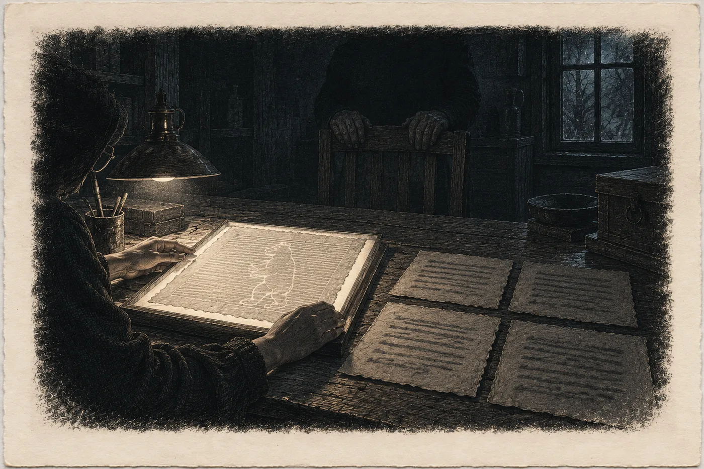

# 9. Opis

Ve středu ráno má Pramen pod Hřbetem sedmnáct celá čtyři a v dílně v Kozí uličce stojí trezor dokořán.

Hana to vidí z prahu. Zelená železná skříň, ve které ležel kodex, je plná. Na policích balíky v hnědém papíru, svázané tkanicí, s visačkami psanými dlouhým úzkým písmem. Hana je zná. Viděla je v sobotu v kuželu červeného světla na polici v archivu pod horou. Teď leží tady, mezi lisem a oknem s bílou roletou, a vlhkoměr na zdi ukazuje čtyřicet dva.

„Včera v noci,“ řekne Sálová. Stojí u pracovního stolu, v plátěné zástěře, a nevzhlédne. „Tadeáš je nesl nahoru. Já za ním.“

„Všechny?“

„Všechno, co je kniha.“

Hana se podívá na police. Spočítá balíky. Neumí to nepočítat. Jedenáct.

„A kazeta?“

Sálová teď vzhlédne. Ví, na co se Hana ptá. V sobotu ji Hana viděla pod stolem v archivu, šedou, plechovou, jakou mívají v trafikách na tržby.

„Zůstala dole,“ řekne Sálová. „Rada Ostrých chce, aby seznam rodin, které hora chrání, zůstal v hoře. Do sněmu.“

„A vy?“

„Já jsem byla proti.“ Sálová položí skalpel na podložku, rovnoběžně s okrajem. „To nestačí. Pod horou rozhodujou Ostří.“

Hana napíše jen *Řekla S.*, zavře sešit a čeká, protože Sálová jí nevolala kvůli trezoru.

Sálová vytáhne ze zástěry lístek. Obyčejný, vytržený z bloku. Na něm jméno, *Agnes*, telefonní číslo s německou předvolbou a pod tím: *sobota, po desáté večer*.

„Opis,“ řekne Sálová.

Hana lístek nevezme. Nechá ho ležet na stole.

„Neodpověděla jsem vám.“

„Ne.“

„V pondělí jste řekla, že mi to řeknete, až vám odpovím.“

„Řekla.“ Sálová si sundá zástěru. Pověsí ji na háček u dveří, pečlivě, rovně, a Hanu napadne Lada u kamen. „Na sněmu se vás budou ptát, odkud máte, co máte. Když řeknete, že z mého archivu, řeknou, že jste moje. Že jste viděla, co jsem vám ukázala, a napsala, co jsem chtěla.“ Odmlčí se. „Opis není můj. Nikdy nebyl. To potřebuju.“

„A podmínka?“

„Platí.“

„Tak vám nic neslíbím.“

„To jsem nechtěla.“

Hana vezme lístek. Je teplý, jako by ho Sálová držela v ruce dlouho.

„Kdo je Agnes?“

„Ta, kdo vás odveze,“ řekne Sálová. „Zbytek vám řeknou oni. Nebo ne.“

*

V sobotu v půl desáté večer zastaví Hana na náměstí v Jáchymově.

Nemusí. Cesta na Boží Dar vede kolem a ona má čas. Zastaví, protože tu nikdy nebyla. Pět let má ve složce *Mlýnec* spis, který se tady psal, a nikdy tu nebyla.

Náměstí je šikmé. Stoupá od řeky do kopce, dlouhé a úzké, a domy po obou stranách mají štíty jako schody. Je tu prázdno. Svítí lampy a v jedné hospodě nahoře. Z komínů jde kouř rovně, protože nefouká.

Radnice stojí na dolní straně. Hana ji pozná podle věže. Vystoupí z auta a chvíli stojí na chodníku s rukama v kapsách. Přízemí, řada oken, vchod uprostřed. Okno vlevo od vchodu má zataženou plastovou žaluzii a za ní je tma.

Neví, proč se dívá zrovna na to okno. Je to první, na které padne pohled, když člověk přijde od řeky. Nic víc v tom není.

Nad městem, na úbočí, jsou haldy. Ve tmě je nevidí, jen tuší, kde končí světla a začíná les. Někde tam nahoře psala žena jménem Ilona, kdo kolik krve prodal a kdo umřel. A pak napsala *Víc jsem nezapsala*.

Hana nastoupí a jede dál.

*

Za Božím Darem je sníh ještě všude. Hranice je jen cedule a změna barvy asfaltu. Dál je les, pak louky, pak zase les, a silnice klesá serpentinami do tmy na saské straně.

U autobusové zastávky na kraji vesnice, jejíž jméno si Hana nestačí přečíst, blikají výstražná světla. Malé auto, staré, se zamlženými skly. Vedle stojí žena v tmavém kabátě s kapucí.

Hana zastaví za tím autem. Žena přijde k okénku.

„Hana?“

„Ano.“

„Agnes.“ Žena mluví česky. Pomalu a trochu staromódně, jako lidé, kteří se jazyk naučili od babičky a pak s ním neměli kde mluvit. „Jeďte za mnou. Není to daleko. Světla potom zhasněte.“

Je jí kolem čtyřiceti. Bledá, s tmavými kruhy pod očima, vysoká. Hana si toho všimne a nic s tím nedělá.

Jedou deset minut. Lesní cestou, pak kolem hromady kamení, ve které Hana pozná starou haldu, porostlou břízami. U posledního stavení zastaví. Dům je dřevěný, nízký, s velkou střechou. Okna jsou tmavá.

„Zhasněte,“ řekne Agnes.

Hana zhasne. Chvíli nevidí nic. Agnes vidí. Vezme Hanu za loket a vede ji po kamenech ke dveřím, jako se vede slepý člověk, bez řečí a bez rozpaků.

„Já jsem sestra,“ řekne u dveří, jako by to vysvětlovalo všechno. „Na noční. V nemocnici dole ve městě. Dvacet let.“

„Na noční,“ zopakuje Hana.

„Vždycky,“ řekne Agnes. „Kolegyně mě mají rády.“

*

Uvnitř je teplo a tma a voní to dřevem a čímsi kyselým, jako kozí sýr.

V zadní místnosti svítí jedna lampa. Stojí nízko na stole a má stínítko z pergamenového papíru, staženého tak, že světlo padá jen dolů, na desku, a nikam jinam. Kolem lampy je kruh žlutého světla a mimo kruh tma.

Ve tmě sedí člověk. Hana ho nevidí. Vidí jen ruce na opěradle křesla, na okraji světla. Dlouhé, kostnaté, bílé. Kůže na hřbetech se leskne, jako by byla potřená voskem, a je na ní síť drobných jamek.

„Pan Benedikt,“ řekne Agnes. A pak německy, něco, čemu Hana nerozumí.

Ze tmy přijde hlas. Suchý, tichý, a každé slovo stojí samo, jako kámen v potoce, po kterém se jde.

„Říká, ať si sednete,“ překládá Agnes. „U lampy. Tam, kde je vidět.“

Hana si sedne. Kruh světla jí padá do klína a na ruce.

„Říká, že vás zná,“ pokračuje Agnes. „Že jste ta, co napsala, že si vymyslela datum.“

„Napsala jsem, že jsem zapsala něco, co nebyla pravda,“ řekne Hana. „To je jiná věta.“

Agnes to přeloží. Ze tmy se ozve zvuk. Hana chvíli neví, co to je. Pak pochopí, že se starý muž směje. Krátce, suše, jako když se zlomí větvička.

„Říká, že je to jiná věta,“ řekne Agnes. „Ano.“

*

Agnes donese ze sousední místnosti truhličku.

Je malá, z tmavého dřeva, okovaná na rozích. Položí ji na stůl do světla a otevře. Uvnitř je plátno, lněné, šedé stářím. V plátně kožené desky. V deskách papír.

Agnes listy vyndá a rozloží je na stůl, jeden vedle druhého, dva řádky po sedmi. Pohybuje se opatrně a jistě, jako by to dělala už mnohokrát. Hana si dá ruce za záda. Ani na to nemyslí. Ruce za záda, aby se ničeho nedotkla. Tak to dělá v depozitáři.

Papír je hnědožlutý, na okrajích tmavší. Husté písmo, drobné, rychlé, nakloněné doprava. Řádky jdou rovně. Ne jako po pravítku. Jako po provázku, který se trochu prověsil.

Hana se skloní nad první list.

Nepozná ruku. Ilonina ruka je drobnější a rovnější, bez smyček. Tahle má smyčky na horních tazích a velké *J* s dlouhým ocasem stočeným doleva. Jiná ruka.

Ale pozná list.

Pozná ho podle tvaru. Podle toho, kde končí první odstavec a kde začíná druhý. Podle toho, že čtvrtý řádek je kratší, protože Ilona na jeho konci zaváhala a začala novou větu na dalším. Viděla to na skenu tolikrát, že by ten list nakreslila po paměti, aniž by uměla přečíst jediné slovo.

Řádky jsou stejné. Všechny. Kdo tohle psal, opisoval list za listem a řádek za řádkem. Neměnil, kde řádek končí. Neopravoval.

Stejné řádky, jiná ruka.

Hana se narovná.

„Čtrnáct,“ řekne.

„Čtrnáct,“ řekne Agnes.

„Kdo to opsal?“

Agnes se otočí do tmy a zeptá se. Odpověď je dlouhá. Hana slyší jméno, *Jeremias*, a slovo *Rat*, a ještě jednou *Jeremias*.

„Jeremiáš,“ řekne Agnes. „Psal pro radu. Pro město, dole v údolí. Byl to jeden z nás. Snesl světlo líp než ostatní. Ne o moc.“ Poslouchá dál. „V tom létě opisoval pro soud spis do Prahy. V noci, protože starému písaři se třásla ruka. Její listy měl u sebe. Opsal je. Všechny. Pak jí je vrátil.“

„Věděla to?“

Agnes se zeptá. Ze tmy přijde jedno slovo.

„Neví,“ řekne Agnes. „Nikdo to neví. Jeremiáš psal pro radu ještě pět let. Pak přišel za námi přes hřeben. Je u nás v kronice.“

Hana zapisuje do sešitu na kolenou, mimo světlo, naslepo. *Opsal Jeremiáš, písař rady, 1595, v noci, při opisu spisu do Prahy. Pak ještě 5 let ve službě rady. Řekl B. (přes A.).*

*

„Říká,“ řekne Agnes, „jestli chcete, abych vám to přečetla.“

Hana se dívá na listy. Na čtrnáct hnědých obdélníků ve světle. Na osmém, prvním v dolní řadě, vidí mezi řádky velké písmeno, které do té ruky nepatří. Jako by ho někdo kreslil, ne psal.

Pět let čeká, co bylo na rubu. Možná to leží tady, metr od ní.

„Ne,“ řekne. „Ještě ne.“

Agnes to přeloží do tmy.

Chvíli je ticho.

„Proč?“ zeptá se Agnes. Hana neví, jestli to je otázka Benediktova, nebo její.

„Protože první čtyři listy mám,“ řekne Hana. „Jsou ve spisu. Mám je pět let, na skenu. Když budou stejné, slovo od slova, budu vědět, že ten, kdo tohle psal, měl v ruce to, co já. Když nebudou, budu vědět něco jiného.“ Odmlčí se. „Nejdřív to, co můžu porovnat. Pak to, co nemůžu.“

Agnes překládá. Pomaleji než předtím.

Ze tmy se ozve ten suchý zvuk. Smích.

„Říká,“ řekne Agnes, „že čtyři sta let nikdo nechtěl vědět, jestli je to pravé. Všichni chtěli vědět jen, co tam stojí.“

„To chci taky,“ řekne Hana. „Až potom.“

*

Benedikt mluví dlouho.

Agnes překládá po kusech. Hana píše. Ne všechno. Jen to, co se dá napsat s *řekl B.* před tím.

V údolí měli pro všechny jedno slovo, říká Benedikt. Pro ty, kdo kupovali krev, i pro ty, kdo si pouštěli krev kozám. Pro ty z Horní štoly i pro ty z olšové rokle. Jedno slovo. Pak to slovo napsali do knih. Pak z knih udělali divadla a pak filmy. A v každém je jen jeden druh.

„Ona napsala dva,“ překládá Agnes. „Ta žena. Nikdo jiný to nenapsal. Ani předtím, ani potom.“

Hana zvedne hlavu.

„Ve spisu to není,“ řekne. „Ve spisu je *gemeines Geschrei*. Obecná pověst.“

„Ve spisu ne,“ řekne Agnes za Benedikta. „Soud to nevzal. Proto to máme my.“

Benedikt řekne ještě něco krátkého. Agnes s tím chvíli otálí, než to přeloží.

„Hladoví hořeli,“ řekne. „Na svatého Jana. My jsme utekli. Ale v pověsti hoříme všichni.“

Ruce na opěradle se nepohnou.

„Říká, že vám to dá ověřit,“ pokračuje Agnes. „Že vám to dá fotografovat. A že chce jedno. Až to budete vykládat, nesmíte nás slít s nimi. S Hladovými.“

Hana se dívá do tmy, kam nevidí.

Ví, co by měla říct. Že to slíbí. Je to rozumná podmínka a stojí to v prameni. Nic by ji to nestálo.

„Nevím, kdo to bude vykládat,“ řekne. „Já napíšu, co stojí v opisu. Když tam stojí dva druhy, budou u mě dva druhy. Co napíšou jiní, za to ručit nemůžu. Nikdo nemůže.“

Agnes to přeloží.

Dlouhé ticho.

„Říká, že to je málo.“

„Je to všechno, co mám.“

Agnes to přeloží. Ze tmy přijde odpověď, krátká, a Agnes se poprvé za celý večer usměje. Jen koutkem.

„Říká: ona taky měla málo.“

*

Fotí papír.

Benedikt to dovolí s jednou větou, kterou Agnes přeloží doslova: *Fotografujte papír. Papír je náš doklad, ne naše adresa.*

Hana položí vedle každého listu kartu s měřítkem. Fotí kolmo shora, každý list dvakrát, v pořadí. Na displeji vidí, jak se jí trochu třesou ruce. Srovná je a zeptá se na druhou věc.

„Potřebuju, aby to viděl ještě jeden člověk,“ řekne. „Ne já. Ne paní Sálová.“

„Kdo?“ přeloží Agnes.

„Archivářka. Z Chebu. Čte ruce. Pozná papír a inkoust. Já to neumím. Umím jen srovnat, co je na fotce.“

Agnes překládá. Ze tmy přijde otázka.

„Bude se ptát?“

„Na papír,“ řekne Hana. „Na nic jiného.“

Ticho je tentokrát kratší.

„Ve čtvrtek,“ řekne Agnes. „Po desáté. Ať sedí u lampy a dívá se do papíru.“

*

Ve tři ráno sedí Hana v pokoji penzionu U Mlýna se dvěma okny na obrazovce.

Vlevo sken. Spis horního soudu, Jáchymov 1595, první list Ilonina vlastního svědectví. Drobná rovná ruka, zoraná pole. Vpravo fotka z dnešní noci. Jeremiášova ruka, smyčky, *J* s ocasem.

Číst tu ruku Hana umí. Rozumět ne, ne celé. Na srovnání to stačí. Nesrovnává věty. Srovnává slova, písmeno po písmenu, jako se srovnávají dva profily z vrtu. Vrstvu po vrstvě, odshora dolů. Kde je v jednom písek, musí být písek i ve druhém.

První řádek. *Ich schreib, was ich gesehen vnd was ich gethan hab.* Stejně vlevo i vpravo. *Vnd* s *v* na začátku, jak to Ilona píše vždycky.

Druhý řádek. Třetí.

Ve čtvrtém je slovo *pluet*. Krev. Šindelářová jí to před lety připsala do přepisu s poznámkou: *takhle to píše jen ona, jinde v kraji Blut, asi zvyk z Uher*. Na fotce stojí *pluet*. S *p*.

Hana jde dál. Zkratky. Čárka nad slovem místo *n*. Tečka za *d*. Všechno na stejném místě.

Na druhém listu je chyba. Hana ji zná dlouho. Uprostřed řádku o lázni napsala Ilona *am Mittwoch*, ve středu, pak to přeškrtla jednou rovnou čarou a hned za tím napsala *am Sonnabend*. V sobotu. Jedna čára, aby šlo přečíst, co tam bylo.

Hana zvětší fotku.

*Am Mittwoch*, přeškrtnuté jednou čarou. *Am Sonnabend.*

Jeremiáš opsal i chybu. I s čarou.

Hana se opře v židli. Za oknem je tma a pod oknem šumí náhon.

Opisovač, který opíše i škrt. Buď je poctivý, nebo chytrý. Ze škrtu se to nepozná.

Protože tohle dokazuje jen jedno: kdo psal opis, měl před sebou spis. Nebo sken spisu. Sken existuje od roku 2025. Má ho ona, má ho archiv, a kdo ví, kdo ještě. Šikovný člověk se starým papírem a dobrou rukou by tohle dokázal taky. Slovo od slova. I se škrtem.

Hana to napíše doprava. *Shoda 1.–2. listu úplná, i pravopis a škrt. Dokazuje: opisovač měl spis. Nedokazuje: kdy.*

Pak otevře třetí list.

Na skenu chybí dolní pravý roh. Je utržený, starý lom, okraje zhnědlé a roztřepené. Šindelářová k tomu v regestu napsala *poškození myší, starší*. Konce posledních tří řádků zmizely s rohem. Hana na to místo pět let nemyslela. Byl to jen roh. Tři kousky řádků, které chybějí, jako chybí kus každého starého papíru.

Na fotce roh je.

Tři řádky končí celé. *… vnd gieng nit haim.* A nešla domů. *… sagt sie.* Říká. A na posledním řádku ještě dvě slova, která Hana nepřečte, protože ruka tam spěchá.

Hana se dívá na ty tři konce řádků dlouho.

Kdo opisoval ze skenu, ten roh neměl. Musel by si ho vymyslet. A vymyslel by si ho tak, aby to sedělo s tím, co je kolem. To jde. Ale musel by vědět, že někdo jednou bude mít originál v ruce a podívá se, co zbylo na okraji lomu.

Roh je jediné místo, kde opis ví víc než sken.

Hana to napíše doleva. Pak to škrtne a napíše to znovu, přesněji. *3. list: v originálu spisu chybí dolní pravý roh (konce 3 řádků). V opisu jsou celé. Ověřit na originálu: zbytky tahů na hraně lomu.*

Ve čtvrt na osm zavře notebook. V osm nula dva stojí u pramene. Sedmnáct celá šest.

Tadeáš zvedne hlavu od sondy.

„Vy jste nespala.“

„Spala jsem rychle,“ řekne Hana.

*

V pondělí píše Šindelářové z parkoviště nad vsí.

Pošle jí čtyři fotky. Jen papír, jen ruku. Žádnou místnost, žádné ruce na opěradle, žádný stůl. Do e-mailu napíše dvě otázky a nic jiného.

*1. Vyskytuje se v jáchymovských městských knihách z let 1595–1600 pomocný písař rady jménem Jeremiáš? Pokud se podepisuje: je to tato ruka?*

*2. Spis horního soudu, Ilonino svědectví, 3. list, utržený dolní pravý roh. Mohl by se kolega v Karlových Varech podívat na originál v bočním světle, jestli na hraně lomu zbyly konce tahů? Přikládám, jaká slova by tam podle tohoto textu měla být.*

Šindelářová zavolá za dvacet minut.

„Odkud to je?“

„To vám teď neřeknu,“ řekne Hana. „Ve čtvrtek vám to ukážu. Jestli pojedete.“

Ticho.

„Kam?“

„Přes hory. V noci. Nebudete se smět ptát na nic, co není papír.“

Šindelářová dýchá do telefonu. Hana slyší, jak někde za ní cvakne zapalovač, a pak si uvědomí, že Šindelářová nekouří. Je to propiska. Cvaká propiskou.

„To se mi nelíbí,“ řekne Šindelářová.

„Já vím.“

„A udělám to.“ Pauza. „Nesnáším, když mi někdo něco ukazuje ve čtvrtek. Ve čtvrtek mám poradu.“

*

Ve středu ráno v sedm dvanáct zazvoní telefon.

Hana sedí v autě u pramene a čeká na osmou. Pes leží u odbočky. Tadeáš ještě nepřišel.

„Jeremias,“ řekne Šindelářová bez pozdravu. „Kniha smluv a kniha trhová, Jáchymov. Je tam od léta devadesát pět. Podepisuje se jako *Jeremias, des Raths Schreibers Gehülf*. Pomocník radního písaře. Bez příjmení. U pomocného písaře to nic neznamená. Naposled v listopadu 1600. Pak nikde.“

„Ruka?“

„Ruka je jeho.“ Šindelářová to řekne rychle, jako člověk, který si větu připravil a bojí se, že ji pokazí. „*J* s ocasem doleva, to je saský zvyk, tady ho nikdo jiný nedělá. *Sch* psané dohromady, jedním tahem. Smyčky na horních délkách. Na dvou místech v knize smluv opravuje číslo stejně jako na vaší fotce, přepisem přes staré, ne škrtem. Já bych to podepsala. Kdokoli z oboru by to podepsal. Ne s jistotou. Jako velmi pravděpodobné.“

„A roh?“

Ticho na lince je delší.

„Kolega se díval včera večer,“ řekne Šindelářová. „Nechtěl. Pak se díval hodinu. Na hraně lomu jsou konce tahů. Na prvním řádku spodní smyčka od *g*. Na druhém kus *s* a za ním oblouk, který může být *t*. Sedí to na vaše *gieng* a *sagt*. Na třetím nic, tam to vzala myš celé.“

Hana nic neřekne.

„Ten, kdo tohle opisoval,“ řekne Šindelářová, „měl v ruce list ještě celý. Před tou myší. Dávno před ní.“

„Ano.“

„Paní doktorko.“ Šindelářová si odkašle. „Kde to je?“

„Zítra,“ řekne Hana. „Vyzvednu vás v devět.“

*

Ve čtvrtek jedou přes hory mlčky.

Šindelářová sedí vedle Hany s taškou na klíně. V tašce má světelnou desku na baterky, tenkou jako kniha, lupu, bavlněné rukavice a sešit. Jednou, za Ostrovem, se zeptá:

„Mám si vzít rukavice?“

„Nevím,“ řekne Hana. „Zeptejte se tam.“

Pak už nic. Na náměstí v Jáchymově Hana nezastaví. Šindelářová se dívá z okna na radnici, dokud nezmizí za zatáčkou, a Hana si toho všimne a nic neřekne.

Agnes čeká u zastávky. Vede je obě po kamenech, každou za jeden loket.

V zadní místnosti svítí lampa. Kruh světla na stole. Mimo kruh tma a ruce na opěradle.

Šindelářová se zastaví na prahu. Hana vidí, jak střelí očima do tmy. Jen jednou, krátce. Potom ke stolu.

„Dobrý večer,“ řekne do tmy, česky.

Ze tmy přijde odpověď, německy.

„Říká dobrý večer,“ přeloží Agnes. „A že rukavice ne. Papír je zvyklý na ruce.“

Šindelářová si sedne k lampě a od té chvíle se nedívá nikam jinam.

*

Pracuje hodinu a půl.

Hana stojí za ní. Nic neříká, protože tohle neumí, a když něco neumí, mlčí. Dívá se, jak Šindelářová pokládá listy jeden po druhém na světelnou desku. Papír se rozsvítí zevnitř, jako teplá skála, a objeví se v něm to, co ve světle lampy vidět nebylo. Jemné rovnoběžné linky, husté. A přes ně silnější, řidší, kolmo. Síto, na kterém se papír čerpal.

A ve třetím listu, uprostřed jedné poloviny, stín. Zvíře. Na čtyřech nohou, s těžkou hlavou.

Šindelářová se nad ním skloní s lupou. Dlouho.

„Medvěd,“ řekne. „V regestu jsem napsala *nejspíš medvěd*. Teď už to vím.“ Otevře na telefonu sken spisu, list s vodoznakem, a položí telefon vedle desky. Dva stíny vedle sebe. „Stejný medvěd. Stejná vzdálenost linek. Stejné síto, nebo jeho dvojče. Papír je ze stejné zásoby jako spis.“

Pak inkoust. Šindelářová ho nepoužije na nic. Jen se dívá. Lupou, šikmo, proti světlu desky, a pak zase odshora.

„Vidíte tohle?“ řekne. Poprvé za celou dobu se otočí k Haně. Ukáže na osmý list, na dlouhý tah písmene. Kolem tahu je papír hnědší. Na jednom místě je tah prasklý a papír pod ním prosvítá, jako by ho inkoust prožral. „Inkoust se do papíru zakousl. Za staletí. Takhle to dělá jen železitoduběnkový. Žádný dnešní inkoust tohle za pět let neudělá. Ani za padesát.“

Do sešitu přibude: *Řekla L. Š.*

Šindelářová vrátí poslední list na místo. Sundá si brýle. Chvíli sedí a dívá se na čtrnáct listů ve světle lampy.

„Tak,“ řekne. A pak, jako by diktovala do protokolu: „Soudobý opis. Papír ze stejné zásoby jako spis horního soudu, vodoznak medvěd. Železitoduběnkový inkoust s korozí odpovídající stáří. Ruka je velmi pravděpodobně ruka Jeremiáše, pomocného písaře rady, doložená v městských knihách 1595 až 1600. Opis vznikl z originálu dřív, než se ve spisu utrhl roh třetího listu.“ Nasadí si brýle zpátky. „Víc vám nepodepíšu.“

„Víc nechci,“ řekne Hana.

*

Pak řekne tu druhou věc. Pět let ji nosí a teď ji řekne jednoduše, jako se říká, že je pozdě.

„Teď mi to přečtěte.“

„Celé?“ zeptá se Šindelářová.

„Osmý list.“

Šindelářová se otočí do tmy, k rukám na opěradle. Neřekne nic. Jen se dívá. Agnes něco tiše řekne německy a ze tmy přijde jedno slovo.

„Ano,“ přeloží Agnes.

Šindelářová si přitáhne osmý list do světla. Čte nejdřív potichu, jen rty, celý list odshora dolů. Pak začne nahlas. Česky, pomalu, a tam, kde si není jistá, zaváhá a řekne to slovo dvakrát.

„*V noci na devatenáctého června jsem z knihy lékárníka Röhricha vytrhla šest listů a dala je soudu. Pět z nich mělo na rubu zápisy o středečních cestách mezka do Horní štoly. Na stejném řádku jako ty cesty stálo, kolik soli, krup a koz koupili přes lékárníka lidé z prvního druhu, a kde žijí.*“

Hana stojí za její židlí. Nehýbe se.

„*A na stejném řádku, každou středu od Hromnic, stálo…*“ Šindelářová se zastaví. Skloní se. Prst jí jde nad řádek, centimetr nad papír. „Tady je to napsané jinak. Jiným písmem. Napodobené.“

Hana se nakloní. Uprostřed řádku velké *W* s kličkou na prostředním hrotu. Za ním čísla a zkratky.

„*W.: XX Gläser. Donn. – 4 fl.*,“ přečte Šindelářová. „W., dvacet sklenic, ve čtvrtek, čtyři zlaté.“ Odmlčí se. „*Psáno lékárníkovou rukou. Písmeno W s kličkou na prostředním hrotu.*“

Pak čte dál. Pomaleji.

„*Seškrábala jsem to britvou, všechno, celé strany. Věděla jsem, co je to W. Věděla jsem, že je to jediné písmo na světě, které dokazuje, že pan perkmistr věděl, co kupuje. Seškrábala jsem ho, protože nešlo oddělit od řádku, na kterém stáli ti druzí.*“

Šindelářová se nadechne.

„*A protože jsem ho tam chtěla nechat ze zlosti, a kdo vybírá ze zlosti, ten nevybírá pravdu.*“

*

V místnosti je ticho.

Hana slyší lampu. Tiché bzučení vlákna, které člověk neslyší, dokud je kolem jiný zvuk. Slyší, jak Agnes u dveří přešlápne. Ze tmy neslyší nic.

Pět rubů. Rýhy jako od hřebenu, uhlazené okraje, na pátém listu místo tak tenké, že přes něj prosvítal líc. Srpen 2025, otevřené okno, píseň z auta, které odjelo a vrátilo se. Dvoustrana v deníku, svislá čára a vpravo *Co bylo na rubu?*

Na rubu byl perkmistr. Každou středu od Hromnic. Dvacet sklenic za čtyři zlaté. A na stejném řádku ti, kdo kupovali sůl a kroupy a kozy, a kde žijí.

Ilona to nedokázala oddělit. Tak seškrábala všechno.

A pak to šla napsat soudu. Aby to věděl aspoň papír.

Hana čeká, jestli něco ucítí. Úlevu. Triumf. Něco, co by člověk měl cítit, když po pěti letech dostane odpověď. Necítí nic takového. Cítí jen, jak je pozdě, a že ji bolí záda od stání, a že pod tím vším je něco, co by nejradši nepojmenovala. Je to lítost. Ne nad sebou. Nad ženou, která stála v noci nad pěti listy s britvou v ruce a věděla, že ničí jediný důkaz, který má.

„Pět let,“ řekne Šindelářová tiše. Nikomu.

„Pět let,“ řekne Hana.

*

Ze tmy přijde hlas. Agnes poslouchá a pak se skloní k Šindelářové.

„Pan Benedikt prosí,“ řekne, „jestli byste přečetla ještě šestý. Prostředek.“

Šindelářová vezme šestý list. Najde místo, kam Agnes ukáže prstem, a čte.

„*Ve starých dílech nad městem žijí lidé, kteří nesnesou slunce. Kůže jim na něm za tři hodiny naběhne puchýři jako po opaření… Jedí kroupy, maso a polévku jako my, a krev jen tehdy, když jsou nemocní nebo slabí, a tu berou kozám.*“

Čte dál. *Jsou mezi nimi dva druhy, jako mezi námi.* Ti, kdo nikomu neublížili. Ti z Horní štoly, s jizvami jako příčky žebříku, chudokrevní, s dětmi, které kašlaly. *Ursulu ani Lene nezabili oni. Zabil je člověk z města, protože potřeboval krev, kterou by jim prodal.*

A pak poslední dvě věty odstavce.

„*Kde žijí ti první a kam odešli, nezapíšu. Jména jejich dětí nezapíšu.*“

Ruce na opěradle se poprvé pohnou. Jen prsty. Sevřou se a povolí.

„Říká,“ přeloží Agnes tiše, „tohle. Tohle držíme.“ Poslouchá dál. „Ona nás nezapsala. Proto ji máme.“

*

Hana má ještě jednu otázku. Nahlas ji nepoloží.

Šindelářová čte potichu dál, sama pro sebe, devátý list a desátý, a Hana stojí za ní a čte s ní ta slova, která pozná. Lázeň. Lene. Lékárna. A pak, na devátém listu, řádek, u kterého se Šindelářová zastaví a přečte ho nahlas, protože je krátký.

„*Zbytek knihy jsem spálila. Spálila jsem i úplnou výpověď desáté svědkyně. Co v ní bylo navíc, nezapíšu ani tady.*“

Hana čeká na jméno. Na *Dorothea*, na *Haupt*, na *svatý Vavřinec*. Šindelářová čte dál a jméno nepřijde. Na tom listu ani na dalších.

Ilona věděla, kde Dorota je. Hana o tom od večera v archivu nepochybuje. A nenapsala to. Ani soudu, ani tady, ani sama sobě na čtrnáctém listu, kde psala o vlastních lžích. *Víc jsem nezapsala.*

Hana si vzpomene na plátno složené na čtyřikrát pod dlaní Sálové.

Nic neřekne. Ani do sešitu, zatím.

*

Ve dvě ráno jedou zpátky přes hřeben.

Na Božím Daru sněží. Drobně, šikmo, a stěrače to stírají a sníh se vrací. Šindelářová drží tašku na klíně oběma rukama. Za hranicí, kde silnice začne klesat k Jáchymovu, promluví.

„Ten pán v tom křesle.“

Hana čeká.

„Neptám se,“ řekne Šindelářová. „Řekla jsem, že se budu ptát jen papíru. Ptala jsem se jen papíru.“ Odmlčí se. „Ale viděla jsem mu ruce. Když jsem pokládala list na desku a světlo šlo do strany.“

„Ano.“

„Takovou kůži jsem viděla jednou. U dítěte na popáleninovém. Po slunci.“

Hana mlčí.

„Neptám se,“ řekne Šindelářová znovu. „Ale až budete moct, řeknete mi to.“

„Až budu moct.“

Šindelářová kývne a otočí se k oknu. Pod nimi v údolí leží Jáchymov, pár světel, věž. Radnice odsud vidět není.

„Víte, co mě na tom štve?“ řekne po chvíli. „Že jsem to napsala. V tom e-mailu, v srpnu. *Taky mě to napadlo.* Napadlo mě to a pak jsem pět let dělala jinou práci.“

„Já taky.“

„Vy ne,“ řekne Šindelářová. „Vy jste to měla napsané vpravo.“

*

Píše až u pramene, v sedm ráno, v autě, s topením na plný výkon.

Vlevo:

*14./15. 3. 2030, Sasko (místo nezapisuji). Opis Ilonina úplného svědectví, 14 listů, list za list a řádek za řádkem. Přítomni: B., A., L. Š.*

*Ověření:*
*1. Listy 1–4 opisu = listy 1–4 Ilonina svědectví ve spisu horního soudu (sken 2025): shoda slovo od slova, i pravopis (pluet, vnd), zkratky a škrt na 2. listu (am Mittwoch → am Sonnabend). Srovnávala jsem sama.*
*2. 3. list: ve spisu chybí dolní pravý roh, v opisu jsou konce 3 řádků celé. Kolega L. Š. v KV našel na originálu na hraně lomu zbytky tahů (g, h, t?), sedí na text opisu. → opis vznikl z originálu před poškozením. (Řekla L. Š., 13. 3.)*
*3. Ruka: Jeremias, des Raths Schreibers Gehülf, Jáchymov, městské knihy 1595–XI/1600, podpisy; velmi pravděpodobně tatáž ruka (L. Š.).*
*4. Papír: vodoznak medvěd, stejný jako spis, stejné síto. Inkoust železitoduběnkový, koroze odpovídá stáří (L. Š.).*
*Závěr: soudobý opis (ruka doložena 1595–1600, opsáno před poškozením rohu; rok 1595 Řekl B.). Ne Ilonina ruka.*

A pod to, po vynechaném řádku:

*K otázce z 8/2025 (kopie deníku, sv. 1, srpen 2025): Co bylo na rubu?*

*Na rubu 5 listů z lékárníkovy knihy: středeční cesty mezka do Horní štoly. Na stejném řádku nákupy a místa „lidí z prvního druhu“. Na stejném řádku každou středu od Hromnic: „W.: XX Gläser. Donn. – 4 fl.“, ruka lékárníkova. W. = pan perkmistr (podle opisu). Ilona seškrábala vše, protože W. „nešlo oddělit od řádku, na kterém stáli ti druzí“. Pramen: opis, 8. list, přečetla L. Š.*

*Můj dohad z 8/2025 o nejtenčím místě na 5. rubu: neověřitelné. Otazník zůstává.*

Hana nad tou stránkou dlouho sedí. Je to nejdelší zápis vlevo za celý měsíc. Nepřipadá jí dlouhý.

Vpravo napíše:

*Ona to nedokázala oddělit. Tak seškrábala všechno.*

A pod to, menším písmem:

*Dá se to oddělit?*

A ještě níž, poslední řádek, který si slíbila nenapsat, a stejně ho napíše, protože vpravo se píše, co člověk ví a nemůže doložit:

*Opis Dorotu nejmenuje. Podmínku S. neporušuje. Já ji znám.*

V osm nula jedna má Pramen pod Hřbetem osmnáct celá nula.

Tadeáš to zapíše do své tabulky dřív než ona. Pak přejede očima po ní, po sešitu na kapotě, po jejích rukou.

„Zase jste spala rychle,“ řekne.

„Zase.“

Pes vstane od odbočky a jde k ní. Poprvé. Očichá jí kolena a lehne si k jejím nohám, do sněhu, jako by tam patřil.
