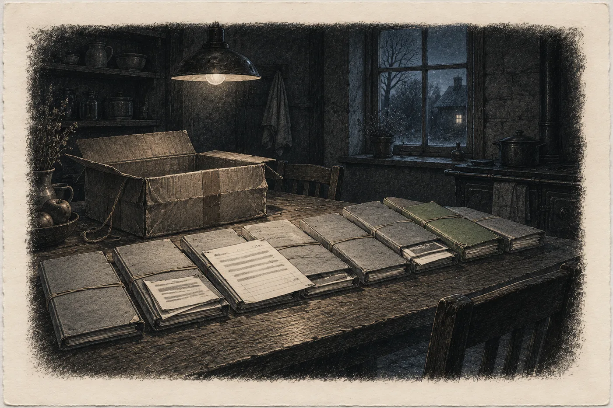

# 12. Studna hvězd

Luis zavolá v neděli večer, dva dny poté, co mu Hana napsala.

Napsala mu krátce, španělsky, jak to s Luisem dělá vždycky, protože její španělština se do dlouhých vět nevejde. *Jak se máš. Jak se má Rosa. Jak se má studna.* A pak: *Walt mi kdysi dal Anayovu knihu. Nevíš, odkud ji měl? Nenechal po sobě něco o Anayovi?*

Luis nepíše. Luis volá.

„Ana,“ řekne. V pozadí slyší Hana slepice a dětský křik a rádio. V X'Kanlumu je poledne. „Jsi v pořádku?“

„Jsem.“

„Ptáš se na Anayu.“

„Ano.“

Luis po chvíli řekne něco, co Hana nečeká.

„Walt nechal krabici. Pro tebe.“

Hana sedí na posteli v penzionu U Mlýna a dívá se na zeď. Na tapetě jsou drobné modré kvítky, které se opakují po dvaceti centimetrech. Spočítala je první večer. Neumí to nepočítat.

„Kdy?“

„V říjnu, když umřel. Stála u postele. Na víku napsané *Para Ana Vrbová*.“ Luis se odmlčí. „A pod tím: *Až se zeptá na Anayu podruhé.*“

„Podruhé?“

„Poprvé ses ptala jeho. V roce dvacet šest, když ti dával tu knihu. Řekl mi to. Že ses ptala a on ti neodpověděl.“ Luis se nadechne. „Teď ses zeptala mě. To je podruhé.“

Hana nic neřekne. Walt v houpací síti na verandě, s čísly bodů. Walt, který sklopil víko notebooku, když viděl fotky válce, a zeptal se jen *Kdo všechno to viděl?* Walt, který jí poslal pohlednici: *Nechte si ji. Nikdo jiný ji nečte.*

Počítal. Věděl, že se zeptá znovu. Jen nevěděl kdy.

„Otevřel jsi ji?“

„Ne.“ Luis to řekne skoro uraženě. „Je zalepená. Páskou. A přes pásku je jeho podpis. Jako to dělala ta paní z ústavu.“

*

Krabice přijde v úterý devátého dubna dopoledne.

Kurýr ji nese do penzionu v náručí, jako by byla těžší, než je. Majitelka podepíše převzetí, protože Hana je v tu chvíli u pramene. Dvacet celá čtyři. Tadeáš se na displej dívá dlouho a pak řekne jen: „Lada nespí.“

Na krabici je celní štítek, *papers, no commercial value*, a Luisova adresa odesílatele velkými písmeny. Krabice je od potápěčských bot. Lepenková, změklá na rozích, převázaná motouzem. Přes víko vede hnědá lepicí páska, stará, místy odlepená. A přes pásku, modrou propiskou, podpis. *W. Ames.* Jedním tahem, z kartonu na pásku a z pásky zase na karton.

Hana si krabici položí na stůl a nejdřív ji vyfotí. Ze všech stran. Pak se skloní k podpisu.

Tah je nepřerušený. Žádný schod. Páska je v místě podpisu odlepená jen na okrajích, kde se zvedla sama, stářím. Nikdo ji nesundal a nenalepil zpátky.

Hana si vzpomene na suk na borové bedně a na *h* z Couoh. Na Marisolin podpis se schodem.

*Na suk se nedívá nikdo.*

Vezme nůž a pásku přeřízne. Podél podpisu, ne přes něj.

*

Nahoře leží dopis.

Jeden list linkovaného papíru z bloku, popsaný tužkou, tiskacím písmem, anglicky. Walt nepsal psacím. Hana si to pamatuje z map: čísla bodů, šipky, *CAMPANA. Aire.* Všechno tiskacím, aby to přečetl každý.

*Paní Vrbová,*

*Luis vám tohle dá, až se zeptáte na Anayu podruhé. Poprvé jste se ptala v roce 2026 a já vám řekl, že nevím. Lhal jsem, protože jsem pořád patřil k nim. Teď už nepatřím k nikomu. Jsem mrtvý.*

*Většina toho, co je v té krabici, jsou lži, které jsme zaplatili. Chci, aby někdo věděl, které to byly.*

*Jména živých netiskněte. Mrtví si poradí.*

*Zelená složka je ta, kvůli které to posílám.*

*W. A.*

Hana čte dopis třikrát. Pak ho položí na stůl, vedle krabice, a dlouho nad ním sedí.

*Jména živých netiskněte.*

Napsal to před dvěma lety, v houpací síti, a nevěděl, co bude dělat ona. Nevěděl nic o hoře a o kazetě pod stolem v archivu. Napsal to, protože to věděl odjinud.

*

Složek je osm. Kartonové, s barevnými štítky, každá převázaná gumičkou, která se rozpadne, když na ni Hana sáhne.

Sedm je šedých. Jedna zelená.

Hana začne šedými. Zelenou si nechá na konec, i když ji to stojí víc sil, než by si přiznala. Nejdřív to, co může porovnat.

V šedých jsou papíry na hlavičce nadace pro výzkum podmořských jeskyní, s adresou v Miami. Strojopis, průklepy, pak fotokopie, pak počítačové výtisky na děrovaném papíře. Od roku 1972 do roku 1995. Memoranda, zápisy z porad, rozpočty. Jména jsou jen iniciály. Někde ani to ne. *Přítomni: čtyři.*

Hana čte pomalu. Angličtina je úřední, suchá, se zkratkami, které se musí domýšlet. Po hodině jim rozumí.

Rok 1974. *Rozpočet na šum*, tak tomu říkají. Šum. Tři články pro pánský časopis, šest set dolarů. Spisovateli na volné noze, který o oblasti už psal a „bude psát dál, ať zaplatíme, nebo ne“. Poznámka na okraji: *Proto jemu.*

Rok 1976. Svědectví kapitána rybářské lodi z Keys o „jasném světle pod hladinou“. Přepis, podpis, dvě stě padesát dolarů. Poznámka: *Použít. On tomu věří.*

Rok 1978. Fotografie. Černobílé, zvětšené, s průsvitkou nalepenou přes ně a s pokyny tužkou. *Přidat záři. Vodu ztmavit. Ne moc.* Hana tu fotku drží dlouho. Moře, loď, nic. Na další totéž moře se zářícím kruhem pod hladinou. Pod tím razítko laboratoře, která už dávno neexistuje.

Rok 1981. Zápis z porady, jedna věta podtržená dvakrát:

*Ke každému skutečnému nálezu v oblasti potřebujeme tři falešné.*

Hana to přepíše doleva. S datem a číslem složky.

Rok 1983. *Atlantida je levnější než mlčení.*

Rok 1987. *Trojúhelník se už udržuje sám. Snížit rozpočet.*

A jedno memorandum z téhož roku, krátké, nepodepsané, které tam Walt nechal, protože Walt nechal všechno:

*Nezačali jsme to. Jen to udržujeme teplé.*

Rok 1995. Poslední list v sedmé složce. *Program ukončen. Legenda nás už nepotřebuje.*

*

Hana se opře v židli.

Za oknem je odpoledne, slunce na mokré střeše mlýna, náhon pod oknem. Na stole sedm šedých složek a v nich dvacet tři let šumu.

Kalina měří šum dvacet let. Odfiltruje ho, aby slyšel, co je pod ním. Tady někdo šum vyráběl. Platil za něj, šest set dolarů za tři články, dvě stě padesát za kapitána, který věřil. Aby to, co je pod ním, neslyšel nikdo.

A fungovalo to. Hana to ví z vlastní kůže. V březnu 2026 jí producentka z Los Angeles poslala *story deck* s mayskou legendou o kameni, který spadl z nebe do studny. Hana tehdy řekla, že nechce mít jméno vedle legendy. Prohrála. Pak přišel podvrh a bulvár a *ATLANTOLOŽKA Z BRNA*. Bulvár nevěděl nic o válci. Věděl jen, že kde je Karibik, tam je Atlantida. To věděl každý. Někdo se o to postaral.

Zavolá Kalinovi. Ne proto, aby mu to vysvětlila. Proto, aby to slyšel někdo, kdo šum měří.

Přečte mu větu z roku 1981. Kalina dlouho mlčí. Hana slyší, jak u něj v pokoji běží větrák počítače.

„Tři falešné,“ řekne pak. „To je dobrý poměr. Kdybych chtěl schovat slabý signál, udělal bych to stejně. Slabý signál nepřehlušíte. Obklopíte ho podobnými, a kdo hledá, najde čtyři a vybere si ten nejhlasitější.“

„Vy byste to uměl?“

„Já to umím odfiltrovat. Proto vím, jak se to dělá.“ Odmlčí se. „Paní Vrbová. Až to jednou řeknu. To o zdroji.“

„Ano.“

„Udělají to znova. Ne tihle, jiní. Kolem každého mého čísla tři falešná. A vás postaví vedle mě, protože vás už znají.“

„Já vím.“

„Tak jen abyste věděla, že to vím taky.“

Zavěsí bez rozloučení, jako vždycky. Hana drží telefon v ruce a představí si titulek. *Atlantoložka a muž, který slyší hvězdy.* Je dobrý. Kdyby ho psala ona, napsala by ho taky.

Mezi šedými papíry najde Hana ještě dvě věci, které nejsou o šumu.

Memorandum z roku 1979, jeden odstavec: *Předměty z modré díry u Androsu: hermeticky uzavřené, starší než cokoli mayského. Nedatovat veřejně. Ať jsou Atlantida.*

A zápis z roku 1988, z Quintana Roo, z jeskyně bez jména: *Otisky v sazích v komíně nad vodou. Malé, široké dlaně, krátké prsty. Starší než Mayové. Před nimi. Nekreslit.*

A na okraji, tužkou, tiskacím písmem, pozdější:

*Totéž ve zvonu, 2009. WA.*

Haně se ruka na stole sevře.

Komín nad blokovým koncem zvonu. Svítilna na šňůře ve tři ráno, saze a v nich nejméně šest otisků. Malé široké dlaně s krátkými prsty. Vysvětlila si je tehdy jako dětské ruce z mayského obřadu. Walt jen řekl *Nekreslete je*.

A ve světnici statku nad Mlýncem, před pěti týdny, jedenáct lidí u dlouhého stolu. Ruce položené na desce. Velké, čtvercové, s krátkými prsty.

Hana to nenapíše doleva. Neviděla nic, co by mohla změřit. Viděla tvar dvakrát, v sazích a na stole, devět tisíc kilometrů a možná tisíce let od sebe.

Napíše to doprava. Celé, s otazníkem. A pak si vzpomene na Tadeášovu ruku u prohlubně pod haldou v únoru, když ji varoval před plynem, a na to, jak se jí tehdy na vteřinu něco vybavilo a ona to nechytila.

Teď to chytila. Neví, co s tím.

*

Pak otevře zelenou složku.

Na deskách je přilepený žlutý lístek. Waltovo tiskací písmo, propiska. Lístek nezežloutl, takže je mnohem mladší než složka.

*Tohle si přečte jen Vrbová.*

Uvnitř je dvanáct listů. Zpráva na hlavičce nadace z Miami, rok 1986, psaná na stroji anglicky, s přílohami ve španělštině. Nahoře: *Věc: R. Anaya Cervera, El pozo de las estrellas (Mérida 1978). Zdroj kreseb.* Podepsáno *R. M.* Pod tím tužkou, menším písmem: *řídil jsem auto – WA.*

Hana čte.

Kniha se v roce 1985 dostala do rukou „lidem v oblasti“. Kapitola sedm, devět padajících světel, oblé domy v řadách, a hlavně studna. *Studna, do které padaly hvězdy.* Moc blízko skutečných míst, píše R. M. Moc blízko, aby to byla náhoda. Je třeba zjistit, odkud to autor má.

Autor nebyl k nalezení. Rodrigo Anaya Cervera se nikde nevede. *No consta.* Hana se skoro usměje. Nakonec ho našli přes bývalého majitele zaniklé tiskárny, podle starého účtu za papír.

Na dalším řádku je jméno. Skutečné jméno muže, který psal jako Anaya. Je přeškrtnuté. Ne jednou čarou. Černou fixou, tlustě, několikrát, až je papír na tom místě zvlněný.

Vedle fixou, tiskacím písmem:

*Má vnuky v Méridě. Jméno nepotřebujete.*

Hana podrží začerněné místo proti lampě. Neprosvítá. Walt věděl, jak se to dělá.

Rodrigo Anaya Cervera tedy nebyl nikdo. Byl to pseudonym učitele v penzi, který tiskl knížky vlastním nákladem a prodával je v knihkupectví u katedrály. Proto *No consta*. Archiv v Méridě odpověděl pravdivě. Takový člověk se nenarodil.

*

Přílohou je přepis rozhovoru. Španělsky, strojem, s ručními opravami. R. M. se ptá, učitel odpovídá. Hana ho čte se slovníkem v telefonu, větu po větě.

Starci nebyli. *Los ancianos* si učitel vymyslel, protože kniha bez starců by se neprodala. Legendu nikdo neznal. Walt se třicet let ptal v obcích a nikdo ji neznal, protože žádná nebyla.

Kresby nevymyslel. Ty měl od někoho.

Pak je tam věta, kterou R. M. podtrhl. Hana ji přečte polohlasem, aby slyšela, jak zní.

„*Un señor alemán. H. Wehrle. Mérida, 1976.*“

Pán z Německa. Přijel v zimě sedmdesát šest, hledal průvodce k cenotům a učitel mu tlumočil. Pán hledal studnu, *kam padaly hvězdy*. Měl s sebou staré kresby, *dibujos viejos de un monasterio europeo*, kresby z evropského kláštera, a ukazoval je lidem po vesnicích. Nikdo nic nepoznal. Pán byl zklamaný a laskavý. Platil dobře. Když odjížděl, nechal učiteli fotokopie, protože učitel o ně požádal. Řekl, že kdo je jednou uvidí, bude je hledat celý život.

Učitel z nich udělal kapitolu sedm.

Na konci zprávy shrnutí. *Zdroj: evropská rodinná tradice, nikoli místní. Kniha neškodná. Nekontaktovat. Sledovat H. W.*

A poslední příloha.

*

Fotokopie fotokopie. Šedá, s černými okraji, jak to dělaly staré kopírky. Na ní stránka z knihy. Netištěná. Psaná starou rukou a kreslená perem.

Stránka je rozdělená svislou čarou na dvě půlky.

Hana se na ni dívá a cítí, jak se jí zastaví dech. Ne kvůli kresbě. Kvůli čáře.

Nahoře vlevo latinsky: *Quae vidit monachus.* Co viděl mnich.

Nahoře vpravo: *Quae scio ego.* Co vím já.

Pod levým nadpisem kresba. Devět teček v řadě, klesajících, deváté menší. Pod tím pár řádků. Hana je čte a nemusí je číst, protože je zná nazpaměť.

*Ex eis novem cadebant, lente, ordine.*

Slovo od slova. Z kodexu z Mlýnce. Mnichova věta.

Pod pravým nadpisem jiná ruka, pozdější, hustá, a kresba oblých domů v řadách. A slova, která Hana zná jen napůl: *patres nostri*. Naši otcové. A dole, velkými písmeny, jedno slovo samo na řádku: *Revertentur.*

Vrátí se.

*

Hana vstane od stolu a jde k oknu.

Pod oknem šumí náhon. Nezamrzá ani v lednu, protože je v něm teplá voda z hory. Nad roklí stojí pára.

Má to celé. Poprvé má celou řadu, od začátku do konce, a každý článek doložený.

Mnich v roce 1172 viděl světlo v hoře a zapsal ho. *Vidi.* Viděl tam i tvář pana Konráda a zapsal i ji. Někdo z Konrádova rodu pak ten zápis opsal a připsal k němu vpravo, co si o tom myslí. Že to jsou jejich otcové a že se vrátí. Čtyři sta let potom perkmistr Hans Wehrl kupoval krev a na rubu lékárníkovy knihy stálo *W.* s kličkou. Ilona ho seškrábala. V roce 1976 přijel do Méridy pán jménem H. Wehrle a ukazoval po vesnicích kresby z kláštera. Učitel z nich udělal knihu se starci. Z knihy si kapitolu opsala kniha o záhadách z devadesátých let, *tradición oral, Yucatán*, a z ní v roce 2011 anonymní web. Tak vznikla mayská legenda. V roce 2026 ji producentka z Los Angeles dala do oznámení, *according to local legend*, a Hana prohrála.

Legenda, kvůli které jí v roce 2026 nedali jméno vedle válce, vyšla z teplé skály čtyřicet dva schodů pod statkem Ostrých.

Hana se dívá na páru.

Neví, jestli se má smát. Je to legrační. Je to ten druh legrace, kterou člověk nikomu nevypráví, protože by to musel vysvětlovat od dvanáctého století.

*

Pak si sedne k počítači a napíše do vyhledávače dvě slova.

Nadace pro rodinnou historii, Mnichov. Webová stránka s fotkami starých rodokmenů, s tlačítkem *Darovat*. Předseda správní rady: Konrad Wehrle. Fotka. Muž kolem šedesáti, štíhlý, brýle bez obrouček, laskavý úsměv. Zakladatel: Heinrich Wehrle. V historii nadace jedna věta, kterou Hana přečte dvakrát: *Studijní cesty zakladatele vedly mimo jiné do Mexika a Guatemaly.*

Konrad.

Hana si vzpomene na mnicha. *Viděl jsem tvář pana Konráda.*

Polovina Německa se jmenuje Konrad. Hana to ví. Tohle jméno ale není jedna tečka. Je to další článek té řady.

*

V sedm večer stojí v dílně v Kozí uličce.

Sálová otevře hned. Jako by čekala, a Hana se nediví. Trezor je zavřený. Na stole leží list papíru s nějakým zkušebním vzorkem a vedle skalpel, rovnoběžně s okrajem.

Hana položí na stůl fotokopii. Svislou čáru, mnicha vlevo, Konrádovy dědice vpravo.

Sálová se na ni dívá dlouho.

„Odkud to máte?“

„Od mrtvého,“ řekne Hana. „Z Mexika. Kopie, kterou pán jménem H. Wehrle nechal v roce 1976 v Méridě jednomu učiteli.“ Odmlčí se. „Znáte jméno Wehrle?“

Sálová nezvedne oči od fotokopie.

„Konrad Wehrle sedí v radě Úmluvy,“ řekne. „S hlasem poradním. Od února. Je to dlouholetý dárce. Platí byty, do kterých nás chce pan Brandl přestěhovat.“ Odmlčí se. „Na radě nabídl, že uloží naše seznamy. Na server. Ve třech zemích.“

Hana zapisuje. *Řekla S.*

„Dědicové,“ řekne Sálová. „Tak si říkají. Řekl mi to minulý týden. Osobně. Nad čajem.“

„Vy jste s ním mluvila.“

„Ano.“

Hana čeká, jestli Sálová řekne víc. Neřekne.

*

Pak Sálová udělá něco, co Hana nečeká.

Vstane, odemkne trezor a vyndá jeden z balíků. Ten s visačkou *XVI–XVII*. Rozváže tkanici. Rozbalí papír. Na stůl položí plátno a na plátno svazek v tmavé kůži.

Kniha se otevře sama, u Doroty. Sálová otočí pět listů.

„*Kdo jednou ukázal, ukáže znovu*,“ řekne. Hana neví, komu to říká. „Tohle říkala moje předchůdkyně. Měla pravdu.“

Ukáže prstem nad řádek. Ptačí písmo, drobné, rychlé. A uprostřed jedno písmeno latinkou. Velké, se dvěma hroty dolů a dvěma nahoru.

*W.*

„Přečtu vám to,“ řekne Sálová. „Budete to psát s mým jménem.“

„Budu.“

„*W. Z horního města v údolí. Pán dolů. Kupuje od Hladových krev starších. Platí zlatem. Chce žít dlouho.* Léto 1595. Jívinou rukou.“ Sálová otočí dva listy. „*W. zemřel. Dole se říká: rtuť.* Únor 1596. Svídinou rukou.“ Pak ukáže na znak na kraji, otevřenou ptačí stopu s dlouhým tahem vpřed. „Tímhle znakem se u nás píšou lovci. Jen prvním písmenem. Aby se jejich jméno nevolalo.“

Hana stojí nad knihou a nedotkne se jí.

Spis horního soudu: *Soudu předsedal perkmistr Hans Wehrl.* Opis: *Věděla jsem, že je to jediné písmo na světě, které dokazuje, že pan perkmistr věděl, co kupuje.* Kniha pod rukou Sálové: *W. Kupuje od Hladových krev starších.* A zelená složka z Miami: *H. Wehrle, Mérida, 1976.*

Čtyři archivy. Horní soud, opis za hřebenem, rodová kniha starých rodů a složka americké sítě. Žádný z nich o ostatních nevěděl. A ve všech čtyřech stojí totéž písmeno.

„Tohle jste mi v březnu neukázala,“ řekne Hana.

„Ne.“

„Proč teď?“

Sálová zavře knihu. Pomalu, jako by zavírala okno.

„Protože jste k tomu došla sama,“ řekne. „Z druhé strany. Bez mě.“ Podívá se na Hanu. „Teď to můžu jen potvrdit. Ne vám to dát.“

*

„Co chce?“ zeptá se Hana.

„Seznamy. Řekl to na radě.“

„Ne na radě. Vám. Nad čajem.“

Sálová mlčí.

„Lidi,“ řekne pak. „Řekl, že ho zajímají lidi. Ti, kdo žijí. Ne mrtví.“

Hana se na ni dívá. Na ruce položené na desce svazku, na mozol na pravém prostředníku. Na tvář, ze které se nedá nic přečíst, protože Sálová se to učila celý svůj dlouhý život.

„Má je?“ zeptá se Hana.

„To vám neřeknu,“ řekne Sálová.

Ticho. Za roletou projede auto a světlo jeho reflektorů přejede po stropu dílny zleva doprava.

„Tím jste mi to řekla,“ řekne Hana.

„Ne,“ řekne Sálová. „Řekla jsem vám, že vám to neřeknu. To je rozdíl.“

Hana chvíli stojí. Pak se skoro usměje. Ne vesele.

„To je moje věta.“

„Já vím,“ řekne Sálová. „Naučila jsem se ji od vás.“

*

„Jestli je má,“ řekne Hana, „ti lidé to mají vědět.“

„A co udělají?“

„To je jejich věc.“

„Utečou,“ řekne Sálová. „Polovina. Druhá polovina zavolá vám. A vy zavoláte na policii.“

„Možná.“

„Ne možná. Řekla jste mi to v únoru. U tohohle stolu.“ Sálová položí dlaň na desky svazku. „*Jestli tam dole budou lidé, kterým jde o život, zavolám hasiče.* Já jsem vám nic neslíbila. Pamatuju si to.“

„Já taky.“

„Tak víte, proč vám to neřeknu.“

Hana se dívá na její dlaň na kůži svazku. Na knihu, ve které se nic nemaže. Na trezor, ve kterém tři roky ležel kodex a do protokolu se psalo *pokračuje*.

„Vím,“ řekne. „Rozhodujete za ně.“

Sálová se nepohne.

„Ano,“ řekne.

Neřekne nic dalšího. Neobhajuje se. Hana čeká na *protože* a žádné nepřijde. Sálová prostě sedí s dlaní na knize a dívá se na Hanu, a v její tváři je něco, co Hana viděla jen jednou, v archivu, když sama vyslovila slovo *únosy*. Jako by se ta žena o tolik let starší než ona něčeho bála a nevěděla, kam s tím.

„Neříkám vám,“ řekne Hana, „co máte udělat.“

„Ne.“

„Já ale vím, co udělám já. S tím, co vím sama.“

Sálová kývne. Pomalu, jednou.

„Já vím,“ řekne. „Proto jste nebezpečná. Řekl mi to taky. Že všechno zapíšete.“

„Kdo?“

„Pan Wehrle,“ řekne Sálová. „Vás zná. Říká vám *atlantoložka*. Laskavě.“

*

Píše v autě na parkovišti u kostela svatého Mikuláše, s vypnutým motorem, protože nemá kam spěchat.

Vlevo:

*9. 4. 2030. Krabice po W. A. (od Luise, zalepená, podpis přes pásku nepřerušený, otevřela jsem já). Dopis W. A.: „Jména živých netiskněte.“*

*7 šedých složek, 1972–1995, americká síť (nadace pro výzkum podmořských jeskyní, Miami): „rozpočet na šum“, placené články, placený svědek, retušované fotky. 1981: „Ke každému skutečnému nálezu v oblasti potřebujeme tři falešné.“ 1987: „Nezačali jsme to. Jen to udržujeme teplé.“ 1995: „Legenda nás už nepotřebuje.“ → síť vědomě přiživovala legendu Bermudského trojúhelníku.*

*Zelená složka, 1986: Anaya = pseudonym učitele z Méridy (jméno začerněno W. A.). Starci vymyšlení. Kresby: „un señor alemán, H. Wehrle, Mérida, 1976“, staré kresby „z evropského kláštera“. Fotokopie stránky: svislá čára, vlevo „Quae vidit monachus“ + 9 světel + věta z kodexu „Ex eis novem cadebant, lente, ordine“, vpravo „Quae scio ego“, „patres nostri“, „Revertentur“.*

*K. Wehrle (nadace pro rodinnou historii, Mnichov; zakladatel Heinrich W., cesty do Mexika – web) – rada Úmluvy, hlas poradní, od 2/2030; nabídl uložit seznamy; „Dědicové“. (Řekla S.)*

*Genealogie, sv. XVI–XVII (četla S., viděla jsem latinkou „W.“): Jíva 1595, W. kupuje od Hladových krev starších; Svída 2/1596, W. zemřel, rtuť. Znak lovce.*

*W.: spis (Hans Wehrl, perkmistr) – opis (pan perkmistr) – genealogie (lovec) – síť (H. Wehrle 1976). Čtyři archivy, které o sobě nevěděly.*

A pod to, na samostatný řádek, odpověď na otázku, kterou má vpravo od roku 2026:

*Kdo byl Rodrigo Anaya? Učitel v penzi z Méridy. Jméno nepotřebuju.*

Vpravo:

*Otisky v sazích ve zvonu, 2026. Malé široké dlaně, krátké prsty. W. A.: „Totéž ve zvonu, 2009.“ Síť 1988: „Starší než Mayové.“ Ruce rady Ostrých?*

*Proč devět? – Pořád nevím. Vím, odkud to Anaya měl.*

*Wehrle chce lidi. Ne mrtvé. (S.)*

*S.: „To vám neřeknu.“ = seznam venku?*

A poslední řádek, který není otázka:

*Zítra Kláře. Co vím a co nevím.*

*

Zavře sešit a chvíli sedí.

Na sedadle spolujezdce leží Anayova kniha. Vzala si ji s sebou z penzionu, ani neví proč. *El pozo de las estrellas.* Studna hvězd. Žluté hvězdy na vybledlé obálce.

Učitel z Méridy psal o studni, do které padaly hvězdy, a myslel si, že píše o Yucatánu. Pán z Německa hledal tu studnu po vesnicích a nikdo mu nic neřekl, protože tam žádná nebyla.

Byla tady. Čtyřicet dva schodů pod sklepem s jablky. Pod horou, kde teď v noci svítí skála, kde za každou z osmi mřížek stojí číslo a kde v lednu spaly děti.

Hana nastartuje. Nad Chebem je jasno. Nad kostelem svatého Mikuláše se objevují první hvězdy, pomalu, jedna po druhé. Žádná nepadá.

Pokaždé se na to podívá. Od března.
