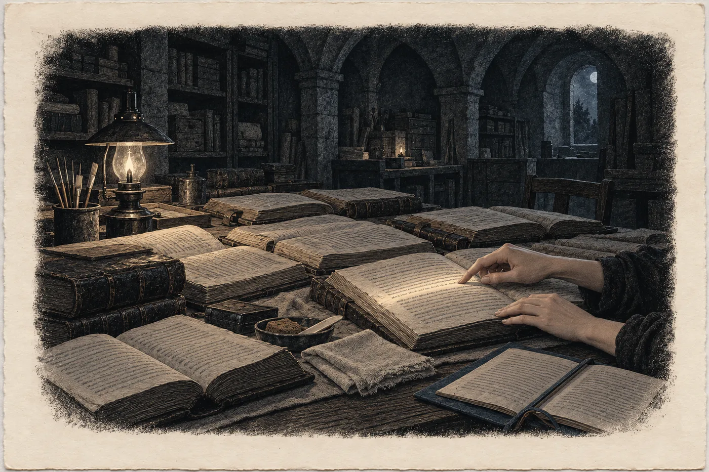

# 16. Dorota

Když ta žena odešla, Javor přinesl čaj a postavil ho na kraj stolu, daleko od matriky. Sael na něj nesáhla. Javor věděl, že nesáhne, a přinesl ho stejně, protože tak se to dělá. Pak se vrátil do kuchyně a zavřel za sebou dveře.

Tlustá složka ležela na stole, kam ji ta žena položila. Sael ji neotevřela. Věděla, co v ní je. Bylo v ní všechno, co se svět dozví. O ní nic.

Odsunula matriku. Uklidila štětec, misky, sklo, vstala, odemkla trezor a začala vyndávat balíky.

Jedenáct. Jeden po druhém, v hnědém papíru, svázané tkanicí, s visačkami jejím písmem. Kladla je na pracovní stůl vedle sebe, od nejstaršího k nejmladšímu, jak ležely v archivu na polici. Pod každý rozprostřela čisté plátno a rozvázala tkanice.

Nikdy je neměla venku všechny najednou. V archivu ležely na polici a sundávala je po jednom, když bylo co zapsat nebo co najít. Kniha se nečte celá. Kniha se otvírá na místě, které je potřeba.

Dnes nebylo potřeba žádné místo. Dnes chtěla vidět celou knihu.

*

Začala u Doroty, protože tam se kniha otvírala sama.

*Dorothea. MDXC. Ins Geschlecht angenommen.*

Jívina latinka, pomalá, aby ji přečetl i ten, kdo nezná ani jedno písmo. A vedle, na kraji, malý uzavřený znak. Ptačí stopa, která neznamenala *přijatá*. Kořist. Voda svedená z cizího potoka. Úl vyříznutý ze stromu, když včely nejsou doma.

*Mater eius: Margaretha, vidua Georgii Haupt, metallici, in valle Sancti Ioachimi.*

A pod tím Svídin znak úřadu, poprvé. Řádek o matce a znak na kraji připsala Jíva až na podzim devadesát pět, když předávala pero. Svídin znak pod nimi byl prvním zápisem jejího úřadu. Dlouhý tah dolů, v ohybu zdvojený.

Sael otočila čtyřicet listů. Narození. Dorotina dcera, ptačím písmem, protože se narodila pod skálou, ne v lese. Jmenovala se Líska. Otec vysoký, z Javorova rodu, Sael ho znala jen z tohoto řádku. Pak dalších padesát let listů a smrt. *Dorota zemřela v zimě. Bylo jí sedmdesát pět. Denní, ale žila s námi. Pohřbena pod bukem nad roklí.* Jiná ruka, kterou Sael neznala jménem. Ta ruka napsala *denní, ale žila s námi*, a víc nic.

Mezi těmi třemi řádky nic. Pětašedesát let života a v knize tři řádky.

Kniha zapisuje, co se stalo. Ne jak to bylo.

Sael položila dlaň vedle řádku. Ne na něj. Vedle, na plátno.

Pětašedesát let žila Dorota pod převisem nad Jáchymovem mezi vysokými. Denní dítě, které vidělo ve tmě hůř než všichni kolem, a v zimě, když se nesvítilo, chodilo po síních s rukou na zdi. Mluvila jejich řečí? Musela. Pamatovala si matku? Bylo jí deset. Pamatovala. Komu to říkala? Nikomu. Nebo dceři. A dcera své dceři. A pak už to nikdo nevěděl, jen ruce skládaly plátno na čtyřikrát a nikdo nevěděl proč.

*Aby se vědělo, že to nebyla liška.*

Sael se na tu větu nikdy neptala. Babička ji řekla, když jí bylo šest, a Sael ji přijala, jako děti přijímají věty, které se jim říkají u práce. Teď ji v sobě obrátila a podívala se na ni z druhé strany.

Nevěděla, co znamená. Nevěděla to ani teď.

*

Pak udělala něco, co nikdy neudělala.

Prošla celou knihu jen podle znaku.

Začala u nejstaršího listu. Truhla zůstala v hoře, ale list s čárkami Sael přenesla v březnu v obalu z nekyselého papíru, v balíku s nejstaršími svazky, a sešit z matrik s ním. Vytáhla ho z obalu a položila na plátno.

Kopec, kruh, čtyřicet jedna čárek. Pod nimi první znak úřadu. Dlouhý tah dolů, nejistý, jako když se písmo teprve rozhoduje, jaké bude. Ruka, která ho kreslila, nevěděla, jak má vypadat. Kreslila ho poprvé na světě.

Pak první svazek. Pergamen, tvrdý a tmavý. Znaky ve střídajících se rukou, každá jiná. Jedna ho dělala krátký a tlustý. Jedna dlouhý a tenký jako vlas. Jedna vždycky trochu doleva, jako by ji někdo strčil do lokte. Sael neznala jejich jména. Nikdo je neznal. Zbyl po nich jen znak a ruka, která ho držela.

Aurel. Ta dělala znak rychle, jedním pohybem, s malým háčkem na konci, jako by chtěla mít hotovo.

Jíva. Ta se třásla. Sael to viděla, protože to věděla z celého svazku. Když se Jíva bála, psala rychle a znak jí ujel. Pod řádkem o *W.* jí ujel nejvíc.

Svída. Zdvojený ohyb, poprvé pod Dorotou. Pak už nikdy. Svída se naučila držet ruku.

Další ruce, další svazky. Sael je otvírala a zavírala. Jedna ruka dělala znak se skvrnou, protože nikdy neotřela pero. Jedna ho dělala tak malý, že se dal přehlédnout.

Rokyta. Široký, jistý, bez zaváhání. Šedesát let pod každým řádkem stejný. Stejně jistě psala i glosy ve složce mimo knihu, k cizím znakům z listů, které nikdo nečetl. Pod těmi znak úřadu nestál. Patřily archivu, ne Merin.

A pak její. Poprvé v osmdesáti šesti, v ohybu zdvojený, jako u Svídy. Pak šedesát let rovný. Pak čtvrtého března, pod řádkem *Merin otevřela knihu před denní ženou*, rovný taky. Ruka nezaváhala. Sael tehdy nevěděla, jestli ji to má těšit.

Teď to věděla.

Rozložila ty listy vedle sebe, jak to šlo, otevřené svazky na plátnech, a dívala se na ten jeden znak ve dvaceti rukou. Stejný tah, jiná ruka. Každá kreslila totéž. Žádná nekreslila totéž.

Znak znamenal *Merin*. Merin zapsala. Merin rozhodla. Merin věděla.

Nikdy nestálo *Jíva rozhodla*. Nikdy *Rokyta věděla*. Nikdy *Sael mlčela*.

Kdo rozhodoval pod tím znakem, nerozhodoval sám za sebe. Rozhodoval za úřad, a úřad nikomu neodpovídal, protože úřad nebyl nikdo. Byl to tah dolů. Jíva se pod ním třásla, Rokyta pod ním byla jistá, a obě byly Merin, a ani jedna nemusela říct *já*.

Sael si to uvědomila celé a najednou, jako si člověk uvědomí, že stojí na ledě.

*

Sešit z matrik ležel v balíku pod nejstarším listem, jako ležel v truhle od sedmdesátých let.

Obyčejný sešit s modrými deskami, linkovaný. Její písmo z doby, kdy psala ještě úzce a opatrně. Signatury, roky, farnosti. A jména.

Nikdy je nečetla nahlas. Ani když je opisovala v sakristiích, nad matrikami denních, v zimě, s rukama v rukavicích bez prstů. Opisovala je potichu, jak se opisuje.

Teď je přečetla nahlas.

„*Barbara, des Köhlers Veit Tochter, im Wald verloren.* Léto 1567.“

Hlas zněl v dílně jinak než v archivu. Vyšší. Bez skály kolem.

„*Hänsel, sechs Jahr, von Wölfen geholt.* Podzim 1609.“

„*Anna, filia Michaelis textoris, in silva perdita.* 1624.“

Četla dál. Jedenáct jmen. U každého rok a farnost a u každého o jednu stránku dál, v jejím vlastním sloupci, řádek z knihy. Stejný rok. *Angenommen. Aufgenommen. In familiam recepta.* Jméno, které děti dostaly pod horou, ptačím písmem. A latinkou to, které měly předtím.

Když přečetla poslední, bylo v dílně ticho.

Za dveřmi do kuchyně ticho taky. Javor neposlouchal. Nebo poslouchal tak, že ho nebylo slyšet.

*Im Wald verloren. Von Wölfen geholt.*

V lese ztracená. Odnesený vlky. Tak to tehdy napsali farářové do knih. Tak to řekli matkám. Matky to přijaly, protože co jiného.

Nebyli to vlci.

Sael to neřekla nahlas. Ta věta zůstala v ní, rovná a krátká jako řádek v knize, a nedala se vzít zpátky.

*

Pak vytáhla ze šuplíku složku s protokolem o stavu kodexu. Kopii. Originál měla Šindelářová.

*Zpevnění hřbetu dokončeno. VII/2027. A. Sálová.*

*Pokračuje. X/2027. A. Sálová.*

*Pokračuje. I/2028. A. Sálová.*

Devětkrát. Čtvrtletně, pečlivě, rovným písmem, které nikdy nezaváhalo. Tady nebyl žádný znak úřadu. Tady bylo jméno. Občanské, ale její. A pod ním lež.

Rozložila protokol vedle Svídina zdvojeného znaku.

A pak, protože už neměla co rozložit, vzala čistý list papíru a napsala na něj rukou dvě data. *3. 4.* a *12. 4.* Mezi ně devět čárek. Položila ho vedle protokolu.

Dívala se na to všechno do tří hodin ráno. Na dvacet rukou, jedenáct jmen, devět lží a devět dní.

Nakonec otevřela poslední svazek. Ten, který založila Rokyta v zimě po válce. Na poslední popsané stránce stál Václav, světlo ze čtrnáctého ledna, mnichovo *aliunde* a řádek ze čtvrtého března.

Namočila pero.

Psala ptačím písmem, pomalu, aby to bylo čitelné.

*Merin věděla třetího dubna, že jména třiceti rodin jsou u lovce. Nikomu to neřekla. Rodiny se to dozvěděly dvanáctého dubna, od cizích. Devět dní.*

Za slovem *lovce* udělala znak. Otevřenou ptačí stopu s dlouhým tahem vpřed. A vedle jedno písmeno latinkou, velké, se dvěma hroty dolů a dvěma nahoru.

*W.*

Čtyři sta třicet pět let po Jívě. Stejné písmeno. Jiná ruka.

Pod řádek udělala znak úřadu. Dlouhý tah dolů.

V ohybu se zdvojil.

Sael se na to dívala dlouho. Pero jí zůstalo viset nad stránkou, kousek vedle znaku, kde by se dalo něco připsat drobně, latinkou, jako se v knize píšou ti, kdo přišli zvenku.

Jméno. Její vlastní.

V celé knize nestálo pod znakem úřadu nikdy. Merin se nepodepisovala jménem. Sael chvíli držela pero nad papírem a cítila, jak inkoust na hrotu pomalu schne.

Nenapsala to. Ne proto, že by se bála. Protože to ještě nebylo její. Pod tímhle řádkem stála pořád Merin a Merin měla odpovídat za to, co Merin udělala.

Položila pero.

*

Javor seděl v kuchyni, když v šest ráno vyšla z dílny. Neměl na stole nic. Seděl a díval se na okno, za kterým se rozednívalo.

„Četlas nahlas,“ řekl.

„Ano.“

„Ta jména nikdo nečetl nahlas. Ani Rokyta. Já jsem je slyšel poprvé.“ Javor zvedl hlavu. Bylo mu sto šedesát let a v šedém ranním světle vypadal na všech sto šedesát. „Věděl jsem, že v knize jsou. Všichni jsme věděli. Neslyšel jsem je.“

Sael si sedla naproti.

„Komu to řekneš první?“ zeptal se Javor.

„Věře Lindnerové,“ řekla Sael. „V sedm.“

*

Věra to vzala po druhém zazvonění. Byla vzhůru. Sael to slyšela v jejím hlase, který byl hlasem člověka, co nespí dva týdny.

„Věro,“ řekla Sael. „Věděla jsem to. Že vaše jména někdo má. Od třetího dubna.“

Ticho. Dlouhé.

„Proč jste nic neřekla?“

Sael měla připravené odpovědi. Celou noc. Že by to nic nezměnilo. Že by se rodiny balily a někdo by zavolal do novin. Že nevěděla, co ten člověk se jmény udělá. Všechno to byla pravda.

„Protože jsem si myslela, že to rozhodnu líp než vy,“ řekla.

Věra Lindnerová dlouho nic neříkala. Sael slyšela, jak v kuchyni v Ostrově teče voda z kohoutku a pak přestane.

„Klára šla na policii,“ řekla Věra. „S tou paní. Už v pondělí. Říkala jsem jí, ať nechodí, že paní Alžběta říká, ať nikam nechodíme.“

„Já vím.“

„Já půjdu taky,“ řekla Věra. „Dneska. Zavolám Kláře, ať mi dá číslo na toho policajta.“ Odmlčela se. „Nevolejte mi, paní Alžběto. Teď ne. Já vám zavolám, až budu chtít.“

„Dobře,“ řekla Sael.

Věra zavěsila první.

*

V osm stála Sael u pramene.

Nebyla tu nikdy ve dne. Chodila sem v noci, za soumraku, kdy se dalo stát za bukem a nebýt vidět. Teď bylo slunce a ona viděla barvy. Zelená mokré trávy, šedá kamene, hnědá staré bukové kůry. Pára nad roklí byla v ranním světle skoro modrá.

Ta žena klečela u vývěru se sondou v ruce. Vedle ní na kameni ležel batoh a druhý teploměr. Tadeáš stál dva kroky stranou, s rukama v kapsách, a pes ležel v trávě.

Tadeáš ji uviděl první. Přejel očima z ní na tu ženu, hvízdl na psa a odešel k lesu, bez slova, a nezastavil se, dokud nebyl mezi kmeny.

Vrbová vstala.

„Dvacet jedna celá devět,“ řekla. Ne jako pozdrav. Jako fakt, který řekla, protože ho měla v ruce.

„Třetího dubna,“ řekla Sael.

Ta žena se nepohnula.

„Wehrle mi v kavárně v Karlových Varech řekl číslo listu. Třicet jedna. Dva řádky dopsané rukou. Ty řádky jsem psala já. To číslo nemohl znát nikdo, kdo ten list neměl v ruce.“ Sael mluvila rovně. Připravovala si to cestou a teď to říkala jinak, než si to připravila. „Večer jsem byla na klinice u lékaře, který má zálohu seznamu. Osmnáctého března tam byl Brandlův člověk. Pohl. S Brandlovým podpisem. Čtyřicet minut sám. Brandl mi pak do telefonu řekl, že vzal zálohu zálohy. Třicet rodin, nejvíc ohrožených. A že ji uložil u pana Wehrleho. Ve třech zemích.“

Ta žena poslouchala. Nepsala.

„Pak jsem seděla v dílně a měla v telefonu čísla třiceti rodin,“ řekla Sael. „A otočila jsem ho displejem dolů. Rozhodla jsem, že nikomu nezavolám. Ani jim. Ani vám. Devět dní.“

Pára nad roklí stoupala rovně. Bylo bezvětří.

„Proč mi to říkáte?“ zeptala se Vrbová.

„Protože jste to měla napsané vpravo,“ řekla Sael. „S otazníkem. Ať to můžete dát doleva.“

*

Ta žena dlouho nic neříkala, než otevřela sešit. Byl nový, Sael si toho všimla, se svislou čarou narýsovanou propiskou podle pravítka. Psala. Sael viděla, kam jde ruka. Doleva.

Když dopsala, nezavřela ho.

„Nic to nespraví,“ řekla.

„Ne,“ řekla Sael. „To se jen zapíše.“

„Věra Lindnerová?“

„V sedm. Půjde dnes na policii.“

„A Klára?“

„Řeknu jí to dnes. Sama.“

Kývla. Pak řekla věc, kterou Sael čekala, a přesto ji zasáhla.

„Pohl. Klinika. Osmnáctý březen. To patří kapitánu Kubešovi.“

„Ano,“ řekla Sael. „Řeknu mu to já. Ne vy.“ Odmlčela se. „Doktor Kříž to potvrdí, jestli bude chtít. Zeptám se ho. Nebudu za něj rozhodovat.“

Ta žena se na ni podívala jinak. Sael věděla, že si tu poslední větu zapíše taky. Možná vpravo.

„Tu obálku,“ řekla Vrbová a vytáhla z vnitřní kapsy bundy bílou obálku, „mám pro kapitána. Je v ní, co vím o Wehrlovi a odkud. Čekala jsem, až to budu moct doložit.“ Podržela ji chvíli v ruce. „Teď to doložené bude. Až mu to řeknete vy.“

„Řeknu,“ řekla Sael.

*

Rada Ostrých se sešla ve čtvrtek večer ve světnici statku.

Jedenáct lidí kolem dlouhého stolu. Ruce na desce, velké, čtvercové, s krátkými prsty. Lada v čele, s brýlemi v kapse zástěry. Šedovlasý muž v pleteném svetru u okna. Lampa nad stolem a za oknem tma, ve které se nic nehýbalo.

Sael stála. Ostří ji pozvali ke stolu, ale nesedla si. Stála u dveří, kde stála ta žena v březnu, když jim přednášela svá čísla.

Řekla jim to celé. Wehrle, kavárna, list třicet jedna. Klinika, Pohl, Brandl. Telefon displejem dolů. Devět dní.

Nikdo ji nepřerušil. Ostří nepřerušují. Nechají člověka domluvit a pak mlčí tak dlouho, že každé slovo, které řekl, slyší ještě jednou.

Mlčeli dlouho.

„Ty jsi to věděla,“ řekla Lada.

„Ano.“

„A já jsem ti tenkrát ve strojovně řekla, že hora to ohlídá.“ Lada nezvýšila hlas. Ostří ho nezvyšují. Ztišují ho. „A ty jsi kývla. Věděla jsi to deset dní a kývla jsi, jako bych řekla něco chytrého.“

„Ano.“

„My jsme tu spali,“ řekla Lada. „Pod tou kazetou. Pod tím, co je venku. Moje vnučky spaly ve statku, než jsem je poslala do Saska, a ty jsi věděla, že někdo má i tenhle dům.“

„Ten dům na listech, které unikly, není,“ řekla Sael. „Ostří nejsou v té části.“

„To jsi věděla taky?“

„Věděla jsem, které rodiny vzal Brandl. Ne které z nich pustil Wehrle.“

Lada se na ni dívala přes stůl. Sael si všimla, že nemá brýle na nose. Lada nosila brýle, jen když opravdu četla.

„Ty jsi rozhodla za nás,“ řekla Lada. „Zase.“

„Ano,“ řekla Sael. „Proto to říkám.“

*

Šedovlasý muž u okna se zeptal, co chce Sael od rady.

Ne odpuštění. To řekla hned. Ostří to slovo nepoužívají a ona ho nechtěla.

Chtěla dvě věci.

„Do noci na třicátého,“ řekla, „tady nesmí být nikdo. Lada to řekla ve strojovně. Já to říkám s ní.“

„To jsme odhlasovali v neděli,“ řekla Lada. „Bez tebe. Deset proti jednomu. Do neděle před svátkem budou všichni nahoře a pak pryč.“ Podívala se na šedovlasého muže. Ten jeden byl on. „A ta denní sem přivede hasiče. Na dvůr. Dolů je pustíme, až tu nebudem. Ať se dívají na plyn, ne na nás.“

„Ona to ví?“

„Řekne jí to Tadeáš. Zítra v osm.“

Sael kývla.

„A kazeta,“ řekla.

„Kazeta zůstane dole,“ řekla Lada. „Rozhodli jsme to v březnu a nic se nezměnilo. Jen to, že teď víme, proč jsme měli pravdu. Papír v hoře nikdo neodnesl. Kopii na klinice ano.“ Odmlčela se. „Zůstane dole, dokud tam bude poslední z nás. A vyneseš ji ty. Poslední. Když jsi ji psala, poneseš ji.“

„Dobře.“

„Neříkej dobře. Řekni, že to uděláš.“

„Udělám to.“

*

„A druhá věc?“ zeptal se šedovlasý muž.

Sael se nadechla.

„Kniha,“ řekla. „Archiv. Nechci ho dál držet sama. Chci udělat kopie a dát je do úschovy. Ne Úmluvě. Ne Wehrlovi. Čtyřem, z nichž žádný je nesmí otevřít bez ostatních.“ Vyjmenovala je. Kancelář veřejné ochránkyně práv. Chebský archiv. Benediktova komunita za hřebenem. „A vy.“

Ve světnici bylo ticho.

„My knihu číst neumíme,“ řekla Lada. „Ptačí písmo. To umíte jen vy.“

„Nemusíte ji číst. Musíte ji držet.“

„Proč?“

„Aby ji nikdo nedržel sám,“ řekla Sael.

Lada se na ni dívala dlouho.

„Ani ty,“ řekla.

„Ani já.“

Lada pomalu kývla a přejela očima kolem stolu, po jedenácti párech rukou na desce.

„Hlasujem,“ řekla.

Devět rukou se zvedlo. Šedovlasý muž svou nechal na stole a řekl: „Je to jejich kniha. Ať si ji drží sami.“ A pak, po chvíli: „Ale jestli to tak chcou, nebudu bránit.“ Ruku nezvedl. Druhý, kdo ji nezvedl, byl mladý muž, kterého Sael neznala jménem. Neřekl nic.

„Devět,“ řekla Lada. „Hora bude držet kus vaší knihy. Kdo by to řekl.“

Sael chtěla poděkovat. Neudělala to. Ostří neděkují za hlasování. Hlasování není dar.

*

V pátek večer seděla v kanceláři Šindelářové.

Archiv byl zavřený od pěti. Šindelářová ji pustila zadním vchodem, jako vždycky, když Sael nosila restaurované svazky zpátky. Kancelář byla malá, s oknem do dvora, s regálem plným krabic a s hrnkem propisek, které Šindelářová cvakala, když přemýšlela. Nekouřila. Cvakala.

„Paní doktorka Vrbová mi řekla, že mi to nevysvětlí ona,“ řekla Šindelářová. „Že to vysvětlení patří někomu, koho znám dvacet let.“

„Dvacet dva,“ řekla Sael.

„Dvacet dva.“ Šindelářová cvakla propiskou. „Tak.“

Sael jí to řekla.

Ne všechno. Ne seznam, ne hora, ne Ostří. To nebylo její. Řekla jí, co bylo její. Že patří ke starým rodům, které nežijí tak dlouho jako hory, ale déle než lidé. Že je jí sto čtyřicet sedm let. Že ruce, které Šindelářová viděla v březnu u lampy, patří jiné linii, sousední, která nesnese slunce, a že ta linie drží opis čtyři sta třicet pět let. Že kniha, kterou drží ona, je rodová kniha. Že v ní jsou i jména dětí, které nebyly jejich.

Šindelářová poslouchala a necvakala.

„Víte, co je nejhorší?“ řekla, když Sael domluvila. „Že mě to nepřekvapilo. Ne to, co jste. To mě překvapilo. Ale že jste mi to neřekla. To mě nepřekvapilo vůbec.“

Sael neřekla nic.

„A pak je tu ještě jedna věc,“ řekla Sael. „Ta je vaše.“

*

Šindelářová vytáhla z regálu krabici a z krabice desky. Originál protokolu o stavu kodexu. Sael ho znala. Psala ho.

„Zpevnění hřbetu,“ řekla Sael. „Dokončila jsem ho v červenci 2027. Pak jsem kodex dva a půl roku držela v trezoru. Kvůli mapě. Kvůli tomu, co originál ukáže v bočním světle. A každé čtvrtletí jsem vám do protokolu napsala *pokračuje*.“

Šindelářová sklopila oči do desek.

„Devětkrát,“ řekla Sael. „Pod svým jménem.“

Šindelářová dlouho nic neříkala. Pak zavřela desky a položila na ně ruce.

„Já jsem ten kodex hájila před ředitelem,“ řekla. „Třikrát. On chtěl vědět, proč restaurování trvá tři roky. Já jsem mu řekla: restaurátorka ví, co dělá. Paní Sálová nikdy nic neuspěchala.“ Hlas se jí nezměnil, jen trochu ztišil. „Podepsala jsem mu to. Že ručím.“

„Já vím.“

„Ne. Vy to nevíte. Vy jste to *věděla*. To je jiné.“

Sael přijala i to.

*

„A teď mi něco chcete dát,“ řekla Šindelářová. „Paní doktorka mi to neřekla, ale poznala jsem to na ní. Na tom, jak říkala *není to moje*.“

„Kopii knihy,“ řekla Sael. „Nebo část kopie. Do úschovy. Spolu s dalšími třemi. Nikdo ji neotevře sám.“

Šindelářová se opřela. Cvakla propiskou. Jednou, dvakrát.

„Archiv nic neschovává,“ řekla. „Archiv uchovává. A zpřístupňuje. Podle pravidel. Kdo mi něco dá, nedostane úkryt. Dostane pravidla. A ta pravidla nebudou vaše.“

„Proto to dávám vám.“

Šindelářová se na ni podívala dlouze.

„Ne mně,“ řekla. „Archivu. Já jsem tu jen zaměstnaná. Musí to vědět ředitel. Musí to být napsané. Kdo to dal, kdy, za jakých podmínek, kdo smí otevřít a kdo ne. A ty podmínky musíte domluvit všichni čtyři, ne vy sama.“

„Ano.“

„A ještě něco.“ Šindelářová otevřela desky. Vytáhla z hrnku propisku a položila ji na protokol. „Napíšete opravu. Sem. Vlastní rukou. Co byla pravda, co jste psala a proč. Datum. Podpis.“

Sael se dívala na propisku. Byla modrá.

„A pak to podepíšu já,“ řekla Šindelářová. „Že jsem to viděla. A pak to ponesu řediteli, a co s tím udělá on, nevím.“

Sael vzala propisku.

Psala dlouho. Rovným písmem, které nezaváhalo, protože jinak psát neuměla. *Oprava. Záznamy „pokračuje“ z X/2027 až X/2029 jsou nepravdivé. Restaurátorské práce byly dokončeny v VII/2027. Kodex jsem úmyslně zadržela v trezoru dílny z důvodů, které nesouvisely s jeho stavem. Rozhodla jsem to sama, bez vědomí správce fondu.* Datum. *A. Sálová.*

Pak se zastavila.

Nad *A. Sálová* připsala, drobně, ještě jedno slovo. Šindelářová si toho všimla a nezeptala se.

*Sael.*

Šindelářová podepsala pod to svým jménem, zavřela desky a dlouho nad nimi nic neříkala.

„Víte,“ řekla nakonec, „já jsem v roce dvacet šest četla opravu jedné ženy z Brna. Chtěla jsem ji tenkrát dát studentům. Jako vzor. Pak jsem si řekla, že to je moc osobní.“ Cvakla propiskou. „Teď jich mám dvě.“

*

V noci volala Agnes. Benedikt chtěl mluvit sám.

Jeho hlas byl suchý a tichý, stará saská němčina, ve které Sael rozuměla každému slovu, protože ji slyšela od dětství u lidí, kteří k nim chodili přes hřeben v noci, se stínítky na lampách.

„Paní Merin,“ řekl.

„Sael,“ řekla Sael.

Benedikt chvíli mlčel.

„Sael,“ řekl pak. Jako by to slovo zkoušel. „Agnes mi říkala, co chcete. Část knihy u nás. Spolu s ostatními.“

„Ano.“

„Drželi jsme cizí papír čtyři sta třicet pět let,“ řekl Benedikt. „Ještě jeden udržíme.“ Odmlčel se. „Ale ne sami. Sami jsme ho drželi dost dlouho. Ať ho drží i ti, kdo ho můžou ukázat na světle.“

„Proto je jich čtyři.“

„Já vím. Proto říkám ano.“

A pak, než zavěsil, řekl ještě jednu věc.

„Ona nás nezapsala. Ta s britvou. Zapsala jen sebe a to, co udělala sama.“ Odmlčel se. „Vy to budete chtít taky. Zapsat jen sebe.“

„Zkusím to.“

„Zkuste,“ řekl Benedikt. „Ona to taky zkoušela. A stejně nakonec musela vzít britvu.“

*

Pak seděla u stolu sama.

Balíky ležely zase na polici v trezoru, svázané, s visačkami. Na stole jen lampa, čistý list a pero. A sešit s modrými deskami, otevřený na jedenácti jménech.

Kniha se nedala zveřejnit. To věděla. Byli v ní živí, a ta žena měla pravdu, že to nesmí zaplatit nikdo, kdo si to nevybral. Ale to, co udělali mrtví, nebyla kniha. To byly činy. A činy mohla říct jen ona, protože jen ona je četla v jejich ruce.

Ne ta žena. Ne fórum. Ne pan Wehrle, laskavě, přes šálek čaje.

Ona.

Zveřejní to, až bude hora prázdná. Až poslední z Ostrých vyjde nahoru a ona za nimi s kazetou. Až žádná rodina nebude na cestě, ve dne ani v noci. Do té doby to napíše. Celé. A dá to přečíst každému, koho se to týká, jak to dělala ta žena se svým balíkem. Ladě. Benediktovi. Věře Lindnerové, jestli bude chtít. Javorovi, protože jeho rod je v knize vedle Doroty.

Namočila pero. Pak ho položila a vzala obyčejnou propisku, protože tohle nebylo pro knihu.

Psala česky, latinkou, pomalu.

*Jmenuji se Sael. Šedesát let jsem vedla rodovou knihu jedné komunity v Krušných horách a na Chebsku. Moje praprababička Dorota se narodila v údolí svatého Jáchyma jako dcera havíře Jörga Haupta a jeho ženy Markéty. V roce 1590, když jí bylo deset let, ji moji předkové vzali v lese a zapsali do knihy jako přijatou.*

*V knize je dvaadvacet takových jmen, od třináctého do sedmnáctého století. U jedenácti z nich jsem v matrikách okolních farností našla záznam o dítěti, které se v tom roce ztratilo. Faráři tehdy psali: ztracené v lese. Odnesené vlky.*

*Nebyli to vlci.*

Zastavila se.

Dál to nešlo. Ne dnes. Zbytek se napíše, až bude čas a až to každý přečte. Ale tyhle tři odstavce byly pravda a byly hotové, a nedaly se vzít zpátky, ani kdyby chtěla.

Nechtěla.

Vzala z police čistý kus plátna. Složila ho napůl. Ještě jednou napůl. Na čtyřikrát. Uhladila ho dlaní a položila ho na list, na ty tři odstavce, jako se pokládá plátno na svazek, aby se nezaprášil.

Tentokrát se neptala proč. Ani pro koho.

Věděla, že pro Dorotu. Nevěděla nic dalšího. Stačilo to.

*

Vzala telefon.

V seznamu stálo *H. Vrbová*. Sael nad tím jménem chvíli seděla a pak napsala zprávu. Krátkou, jak psala vždycky.

*Hano, vezmete mě k paní Hronkové? Jestli bude chtít ona. S.*

Poslala to. Bylo čtvrt na tři.

Odpověď přišla za minutu. Ta žena nespala. Nebo spala rychle.

*Ano. Jestli bude chtít.*

Sael položila telefon na stůl. Displejem nahoru.
