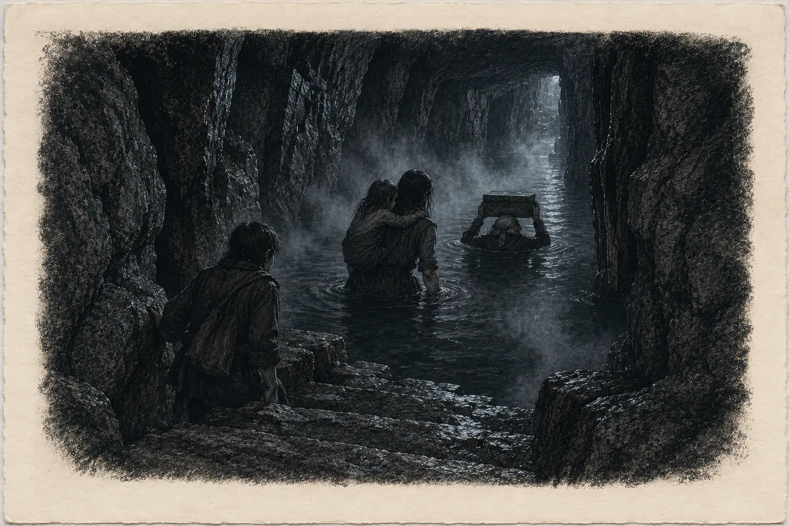

# 18. Noc

Ve sklepě statku voněla jablka, která už nikdo nesní.

Tadeáš stál u dveří se železnými pásy a držel je pootevřené na šířku ruky. Za nimi bylo teplo a tma. Sael ho minula a on se na ni podíval tak, jak se díval celý život. Jako by ještě nevěděl, jestli smí něco říct.

„Kabel od kamery jde pod vraty do archivu,“ řekl nakonec. „Mám ho tady nahoře na notebooku. Kdyby se tam něco hnulo, uvidím to.“

„Dobře.“

„Paní Sael.“ Nikdy jí tak neříkal. Vždycky *paní Alžběto*, jako děti ze statku, nebo nic. „Lada nepůjde, dokud jí to nezazvoní. Vy ji znáte.“

„Znám.“

„Tak ať jí to zazvoní,“ řekl Tadeáš a pustil ji dovnitř.

*

Čtyřicet dva schodů. Sael je nepočítala. Znala je nohama, jako je znaly nohy Ostrých, i když jinak. Ostří slyšeli skálu chodidly. Ona jen věděla, kde je každý schod, protože po nich chodila sto čtyřicet let. Na dvacátém třetím byl vyšlapaný žlábek hlubší než jinde. Na třicátém prvním chyběl kus hrany. Na posledním bylo vždycky chladněji.

Dnes ne.

Dnes šlo teplo proti ní, zdola, jako dech z pece, když se otevřou dvířka. Detektor pod límcem jednou krátce pípl a ztichl.

Archiv byl prázdný.

Věděla to. Svazky odnesla v březnu, jeden balík po druhém, v noci, s Tadeášem. Přesto se zastavila ve dveřích, jako se člověk zastaví v pokoji po mrtvém. Police holé. Na prknech světlejší obdélníky bez prachu, kde ležely balíky. Truhla pod stolem, prázdná. Odvlhčovač v koutě, vypnutý, protože proti tomuhle už nic nezmohl. Vlhkoměr na stěně ukazoval šedesát šest.

A pod stolem kazeta.

Šedý plech, rohy otlučené, víko s malým zámkem, který by otevřelo dítě s vlásenkou. Nikdy na něm nezáleželo. Kazetu nechránil zámek. Chránila ji hora.

Sael si klekla a vytáhla ji. Byla těžší, než si pamatovala. Čtyřicet dva listů a v nich jména, adresy, roky narození, kdo s kým, kdo u kterého lékaře. Většinu těch řádků psala sama. Na psacím stroji, který poskakoval na *e*. A modrou propiskou, když nebyl čas.

Vložila ji do plátěné tašky a tašku si přetáhla přes hlavu, aby jí visela na prsou, ne na zádech. Kdo nese něco na zádech, nevidí, kdy o to přijde.

Pak se opřela dlaní o stěnu, za kterou byla skála.

Hřála jako kamna, do kterých se přikládá celý den.

*

Strojovna ležela pod skleníkem, na konci dolní chodby. Sael tam šla po schodech pod archivem a pak podél žlabu. Voda ve žlabu tekla rychle a mlčky a nad ní stála pára. Přetékala. Na kamenech chodby stála na dva prsty, teplá jako polévka, která se nechala chvíli vychladnout.

Ve strojovně svítila jedna žárovka.

Lada seděla na bedně u zdi, pod Tadeášovou tabulkou, s brýlemi na nose. Četla. Ne papír. Tři kola ventilů na trubkách u stropu, jedno vedle druhého, a ručičky manometrů pod nimi. Kryštof stál u dveří s lampou v ruce, nezapálenou. A stará Apolena seděla na zemi, opřená zády o skálu, s oběma dlaněmi na kameni vedle sebe.

„Dva jsou zavřený,“ řekla Lada, aniž vzhlédla. „Třetí nechám. Kdybych ho zavřela, praskne u skály a pak teče všechno najednou.“

„Kolik máš?“

Lada sklopila oči ke žluté krabičce na koleni. „Jedna a půl. Nahoře na schodech dvě. Ty to máš na krku taky.“

„Mám.“

„Tak se na to dívej ty. Já se dívám na tohle.“

Sael si sedla na schod u dveří, kde seděla v dubnu, když jí Tadeáš ukazoval křivky. Taška s kazetou ji tlačila do žeber.

Krátce po půl jedenácté přišlo světlo.

Neviděli ho. Skála byla na druhém konci chodby, za ohybem, ve spodní síni, odkud žlab vedl dolů. Ale voda ve žlabu ho přinesla. Bledé, jako list proti oknu, teklo po hladině od skály až k nim, a v páře nad žlabem se rozsvítila mlha. Na chvíli. Pak zhasla. Pak se rozsvítila znovu.

Kryštof se podíval na Ladu. Lada na vodu.

„Dole dobrý,“ řekla do vysílačky. „Svítí. Hřeje.“

Vysílačka zachrčela a velitelův hlas se zeptal kolik. Lada odpověděla. Sael ji poslouchala a myslela na to, že Lada mluví do vysílačky stejně jako do telefonu. Bez pozdravu. Jen čísla a co z nich plyne.

Apolena pohnula dlaněmi po kameni. Sael viděla, jak jí prsty sjedou o kousek níž a zastaví se. Jako když člověk v posteli hledá ve tmě ruku toho, kdo leží vedle.

„Tluče,“ řekla Apolena. Byla to první slova, která od neděle řekla. „Dlouho.“

*

Ve tři čtvrtě na dvanáct zvedla Apolena hlavu.

Neřekla nic. Odtáhla jednu dlaň od skály a položila ji na podlahu a otočila hlavu k Ladě. Lada sundala brýle.

„Někdo jde,“ řekla Lada.

Sael nic neslyšela. Kryštof už stál u žárovky a zhasl ji. Ve strojovně byla tma, jen manometry slabě svítily zelenými ručičkami, a pára nad žlabem venku bledla a zase se rozjasňovala s tlukotem, který k nim nesla voda.

Sael vstala a přistoupila ke dveřím.

Viděla je dřív, než je slyšela. Tři světla, nízko, na konci chodby, tam, kde chodba zatáčela ke komorám. Ne odsud. Ne od schodů z archivu. Zespodu. Od staré cesty.

Pak kroky. Těžké, v botách, které nejsou zvyklé na kámen. Někdo zakopl, zaklel česky. Někdo jiný mu odpověděl německy, krátce a tiše.

Šli podél žlabu. Tři muži s čelovkami. Dva v tmavých bundách, jeden s velkou prázdnou taškou přes rameno. Třetí šel trochu stranou. Na zádech měl černý kruh, velký jako kolo dětského kola, a v ruce kufřík.

Sael je viděla ve tmě, jak je denní nevidí. Celé. Tváře pod čelovkami, mokré od páry, a kalhoty mokré po pás. Korytem prošli. Mladšího z těch dvou nikdy neviděla, a přesto věděla, že je to Pohl. Poznala to podle toho, jak šel. Jako člověk, který tu cestu nakreslenou viděl, ale nikdy po ní nešel.

Brandl kreslil plán evakuace téhle lokality před osmi lety. Seděl s ní u stolu v dílně v Kozí uličce, s laptopem a s tužkou, a ptal se: *A kdyby se nedalo nahoru?* A ona mu ukázala starou cestu. Na jeho mapě. Svým prstem.

U schodů z archivu se ti dva zastavili. Mladší ukázal nahoru. *Pohl, tudy*, řekl ten druhý a šli. Třetí s kruhem na zádech se otočil a šel dál podél žlabu, proti vodě. Ke skále.

Sael zvedla vysílačku.

„Jsou tu tři,“ řekla tiše. „Přišli zdola, starou cestou. Dva jdou nahoru do archivu. Jeden ke skále. Má kufřík a anténu.“

Chvíli bylo ticho. Pak velitel.

„Zůstaňte, kde jste. Nehýbejte se. Volám policii.“ A pak, jiným hlasem: „Paní Sálová. Kolik máte?“

Sael sáhla po detektoru pod límcem. Od jedenácti ho nekontrolovala.

„Dvě,“ řekla.

„Ve dvanáct jdeme dolů,“ řekl velitel. „Ať je tam, kdo chce.“

*

Z archivu nad nimi nic neslyšela. Mezi nimi a archivem byla celá dolní chodba, dva ohyby skály a čtyřicet čtyři schodů druhého schodiště, které vedlo z archivu dolů. Ale věděla, co tam ti dva vidí.

Holé police. Prázdnou truhlu. Odvlhčovač. Vlhkoměr na šedesáti šesti. Stůl, u kterého sedělo dvacet rukou, a pod stolem nic. Obdélník v prachu, kde stála kazeta.

Pak to slyšela přece. Kov o kámen. Někdo převrhl truhlu. Dutý úder dřeva, a hned potom hlas, zvýšený, jak se zvyšují hlasy lidí, kteří přišli pro něco a našli jen místo, kde to bylo.

Lada stála vedle ní u dveří. Sahala jí sotva po prsa. V té tmě viděla Sael její tvář líp než vlastní ruce, a na té tváři nebyl strach. Bylo tam něco staršího.

„V mým domě,“ řekla Lada.

„Ano.“

„Co tu jsem, nebyl tu nikdo cizí. Kromě tý denní a toho jejího z Prahy.“

„A mnicha,“ řekla Sael.

„Mnich chodil,“ řekla Lada. Bylo to skoro jako smích. „Mnich se ptal.“

Pak se kroky vrátily. Shora, po schodech pod archivem, rychlé. Dvě čelovky. Ne nahoru ke statku, tam, kam by šel každý, kdo by chtěl odejít. Dolů. Sem. Hledali dál.

Kryštof potichu postavil lampu na zem a narovnal se. Byl malý a starý a v té chvíli Sael viděla, že je to taky muž, který celý život zvedal kámen.

Světla se blížila podél žlabu. Mladší šel první. Čelovka mu přeběhla po stropu, po trubkách, po tabulce na zdi a po dveřích strojovny, a zastavila se na Ladiných očích.

A hora vydechla.

*

Nejdřív zvuk. Hluboko pod nimi, jako když se v kamnech sesune popel. Pak zvuk blíž, ze skály, z konce chodby, dlouhý a měkký, jako dech, který se zadržel moc dlouho.

Pak voda.

Žlab ji nestačil pobrat. Přišla z ohybu chodby vlnou na šířku celé podlahy, ne vysokou, po kotníky, a horkou. Sael ji ucítila přes boty dřív, než ji uviděla. Pára se zvedla ode dna jako bílá stěna a světla obou mužů v ní uvízla.

Detektor pod límcem začal pípat a nepřestal.

Žlutá krabička na Ladině koleni taky.

Mladší muž vykřikl. Ne slovo. Jen hlas. Pak se oba otočili a utíkali. Proti páře, proti vodě, ke schodům pod archivem a nahoru. Každý by utíkal nahoru. Sael slyšela, jak jeden z nich upadl a vstal, jak kašle, jak se oba drápou po schodech, a pak už je neslyšela.

Plyn šel s vodou. Těžký, neviditelný, dolů. Chodba klesala od skály ke skleníku, žlab po ní tekl, a co teklo žlabem, teklo k nim. Do strojovny. Na nejnižší místo dolní chodby.

„Lado.“

Lada přejela očima z krabičky na ventily a z ventilů na Sael.

„Zazvonilo to,“ řekla. „Nepřestává.“

„Nahoru se nedá.“

„Já vím, že ne. Nahoru je proti tomu.“

Sael to věděla taky. Schody pod archivem ležely v ohybu chodby blíž ke skále, v nejhustší páře. Dva mladí muži to proběhli se zadrženým dechem. Apolena by to neprošla. Kryštof s ní na zádech taky ne.

Lada sáhla po třetím kole ventilu a nechala ho, jak bylo. Otevřené. Pak sundala ze zdi Tadeášovu tabulku a strčila si ji pod zástěru. „Stará cesta.“

„Odtud přišli.“

„Odtud přišli a odtud tahá.“ Lada zvedla ruku do tmy, dlaní ke dveřím, směrem ke komorám. Podržela ji. „Cítíš? Z lesa. Celej večer to sem tahá. Teplo leze nahoru šachtou a zespodu se nasává les.“

Sael zvedla ruku taky. Nic necítila. Pak ano. Slabý, studený proud vzduchu na kůži, z druhé strany než pára. Vonělo to listím.

„Kryštofe,“ řekla Lada. „Vem ji.“

Kryštof se sehnul k Apoleně. Stará žena se ho chytila kolem krku jako dítě a on ji zvedl, i když mu bylo skoro sto a jí víc. Sael zvedla vysílačku.

„Jdeme starou cestou,“ řekla. „Ven na východním konci. Čtyři. Nahoru nemůžeme.“

Šum. Pak kus velitelova hlasu, roztrhaný skálou. *…rozumím… východ…* Pak už jen šum.

*

Komory byly prázdné.

Šli kolem nich v řadě, Sael první, za ní Kryštof s Apolenou, Lada poslední s lampou, kterou si zapálila, když byli z páry venku. Dveře komor otevřené. Postele bez matrací. Na jedné stěně obrázek přišpendlený nad postelí, dům se sadem. Lada se na něj nepodívala. Sael ano.

Pak chodba klesla doleva.

Sael šla po staré cestě poprvé po devatenácti letech. Naposledy tu šla po povodni, kdy voda v dolní chodbě stála po kolena a rada chtěla vědět, jestli je stará cesta pořád průchozí. Byla. Byla vždycky. Stará cesta šla pod horou dlouhým obloukem, vysoká jako dveře pro Ostré, Sael se musela sklánět. V kameni vyšlapané kroky. Ve stěnách niky na kahany, prázdné, začouzené tak dávno, že saze zkameněly. Při stěně žlábek, kterým odtékala voda, když nějaká přišla.

A průvan. Teď ho cítila celou tváří. Studený, živý, s vůní bukového listí a mokré hlíny. Detektor pod límcem pípal pomaleji. Pak už jen jednou za čas. Pak přestal.

Kryštof za ní dýchal těžce. Apolena mu visela na zádech a mlčela.

U jednoho místa se Lada zastavila. Sael to poznala podle toho, že lampa za ní se přestala kývat.

Byla tam úzká boční chodbička, jen na jednoho, a na jejím konci, na dosah světla, kus stěny ohlazený jako kámen v potoce. Velký jako dvě dlaně.

„Tady Ostra poslouchala,“ řekla Lada. „Celou zimu. Když kopali.“

Položila na to místo dlaň. Na chvíli. Pak ji odtáhla a šla dál.

Sael nic neřekla. V knize to nestálo. Ostří to věděli bez knihy osm set let.

*

Krk, jak Ostří říkali té strmině, byl takový, jak ho pamatovala. Schody dolů, strmé jako žebřík, vytesané pro malé nohy. Pod nimi koryto, kde chodba klesla do mísy a zase stoupala. Ostří tu kdysi, za Ladina pradědečka, prosekali odtok, aby se koryto neplnilo až ke stropu, jak se plnilo za mnicha. Stála v něm vždycky voda. Do kolen. Tak to bylo.

Dnes jí bylo po pás.

A byla teplá. Ne horká, ne jako voda ve žlabu. Teplá jako koupel. Hora hnala teplo do všech svých cest.

Sael stála na posledním schodu a dívala se na černou hladinu. Pro ni po pás. Pro Kryštofa po prsa. Pro Ladu po bradu. Pro Apolenu nad hlavu.

„Já ji ponesu,“ řekla Sael.

Kryštof opatrně sundal Apolenu ze zad. Stará žena stála na schodu, drobná, celá od páry mokrá, a podívala se na Sael zespodu, odkud se na ni díval celý život každý Ostrý.

„Vysoká,“ řekla Apolena. Jako zjištění, ne jako oslovení.

Sael si klekla. Apolena se jí chytila kolem krku. Byla lehká. Lehčí, než čekala.

Kazeta.

Visela jí na prsou v plátěné tašce, a když Sael vstala s Apolenou na zádech, taška se zhoupla nad hladinou. Po pás. Plechu by to nevadilo. Ale uvnitř byl papír, čtyřicet dva listů, a víko kazety netěsnilo nikdy.

Kryštof stál na schodu, jednou rukou se držel stěny a dýchal krátce a mělce. Na víc než na sebe už neměl.

„Dej to sem,“ řekla Lada.

„Rada řekla…“

„Rada řekla, že ji vyneseš ty.“ Lada natáhla ruce. „Já ji nesu jenom přes vodu. Pak je zas tvoje.“

Sael přetáhla tašku přes hlavu. Apolena se jí přitom držela kolem krku a nepustila. Lada vzala tašku za ucha, vytáhla z ní kazetu a zvedla ji nad hlavu, oběma rukama, jako se nese něco přes brod.

Pak vstoupila do vody první.

Sael viděla, jak jí voda stoupá. Ke kolenům. K pasu. K prsům. Lada šla pomalu, nohama hledala dno, a když jí voda došla k bradě, zaklonila hlavu. Poprvé. Sael Ladu nikdy neviděla zaklánět hlavu. Kazeta nad ní byla rovně, ani se nenaklonila.

Kryštof šel za ní.

Sael vstoupila poslední. Teplo se jí zavřelo kolem nohou, kolem boků. Apolena jí na zádech zvedla kolena, aby si nenamočila nohy, a Sael si vzpomněla na něco, co neviděla nikdy a co znala z vyprávění Ostrých líp než ze své knihy. Mnich, který nesl starou Ostru korytem, s vodou po bradu.

Na druhé straně koryta Lada vylezla na první schod a postavila kazetu na suchý kámen, sedla si vedle ní a dlouho dýchala.

„Je tvoje,“ řekla, když Sael vystoupila z vody.

Sael posadila Apolenu na schod a vzala kazetu. Byla suchá. A teplá. Od Ladiných dlaní.

*

Chodba se rozšířila a pak skončila.

Komora s kamennou deskou místo dveří. Sael ji znala jen z vyprávění a z toho jednoho dne po povodni. Deska byla odsunutá. Na šířku člověka. A ve škvíře byla noc. Opravdová, venkovní, s lesem a s vlhkým vzduchem a s měsícem někde za mraky.

A ve škvíře byl kouř z cigarety.

Sael se zastavila. Lada za ní zhasla lampu.

Venku, na kameni pod bukem, seděl muž. Měl u nohou malou baterku položenou na zemi, svítila do mechu. Neviděl je. Denní nevidí do tmy. Ale slyšel je. Zvedl hlavu.

„Pohle?“

Sael vyšla ven.

Byla vysoká a byla mokrá do pasu a nesla na prsou plechovou kazetu. Brandl to všechno viděl, když zvedl baterku. Světlo jí šlo do očí a ona věděla, co v nich vidí. Neuhnula.

„Paní Sálová,“ řekl.

„Pane Brandle.“

Brandl vstal. Byl větší, než si ho pamatovala. Ne vysoký. Široký. Starý policista v bundě, se šedými vlasy přilepenými potem k čelu. Baterku sklopil do země.

„Kde jsou?“

„Vaši lidé?“ Sael se nadechla. Venku byl vzduch tak studený, že ho cítila v plicích. „Šli nahoru. Po schodech do statku. Kvůli plynu. Na dvoře stojí hasiči a policie.“

Brandl chvíli nic neříkal.

„Živí?“

„Když jsem je viděla naposledy, utíkali.“

Brandl pomalu kývl a podíval se za ni, na škvíru v kameni. Vyšel z ní Kryštof s Apolenou na zádech, pak Lada s lampou. Všichni tři mokří, všichni tři malí. Brandl je viděl ve světle baterky a Sael viděla, že je vidí poprvé. Za dvaadvacet let ve funkci koordinátora bezpečnosti je viděl jen na papíře. Čísla, lokality, počty lůžek.

Stará Apolena se mu podívala do světla a nezamžourala.

„Dejte mi ji,“ řekl Brandl.

Sael nic neřekla.

„Paní Sálová. Dejte mi ji.“ Hlas měl pomalý a rovný, jako vždycky. Jako policista, který ví, že se to bude jednou číst nahlas. „Zapečetím ji. Nikdo ji neotevře. Ani on. Ani já. Přísahám vám to.“

„To jste říkal o klinice.“

„Na klinice jsem udělal chybu.“ Řekl to rychle, jako by to měl dlouho připravené. „Věřil jsem mu. Dal mi byty, auta, lékaře. Úmluva nemá na nic. Kdybyste viděla, co…“

„Viděla jsem,“ řekla Sael. „Vy jste dav viděl jednou, v devadesátém třetím. Já ho mám v knize šestkrát. A pokaždé přišel, když o nás věděl jen jeden. Jeden úřad. Jeden soupis. Jeden pán, který měl seznam a pak ho dal někomu dalšímu.“

Brandl se na ni díval.

„A vy ho chcete dát všem,“ řekl.

„Ne. Nechci ho dát nikomu samotnému.“ Sael položila dlaň na kazetu. „Ani sobě.“

*

Brandl dlouho stál a nic neříkal. Sael viděla, jak se mu hýbe čelist. Viděla, jak se mu ruka zvedne k bundě a zase klesne. Nevěděla, co v bundě má. Nechtěla to vědět.

Lada vedle ní udělala krok dopředu. Jeden. Postavila se mezi Sael a Brandla, jako by to bylo samozřejmé. Sahala mu k prsům.

„Pusť nás,“ řekla Lada. „Jsme mokrý.“

Brandl na ni pohlédl shora, potom na Kryštofa, na Apolenu, která Kryštofovi na zádech usínala, a nakonec na kazetu.

Pak sklopil baterku úplně, až svítila do vlastních bot.

Dole pod svahem, mezi kmeny, se objevila světla. Dvě, tři. Kývala se, jak lidé šli do kopce. Někdo zavolal. Ne jméno. *Policie. Stůjte, kde jste.*

Brandl se neotočil. Sedl si zpátky na kámen pod bukem a baterku položil vedle sebe do mechu.

„Tak,“ řekl.

Sael čekala.

„Řekněte jim,“ řekl Brandl, „že jsem nikoho dovnitř nepustil. Šli sami.“

„Šli s vaší mapou,“ řekla Sael.

Brandl se na ni podíval zespodu. Na chvíli vypadal jako Václav Ostrý v posledních týdnech, v posteli u okna. Starý muž, který ví, že už nic nezmění.

„S naší,“ řekl. „Ukazovala jste mi ji vy.“

Sael na to neměla odpověď. Tak žádnou nedala.

*

Policista, který k nim došel první, byl mladý a zadýchaný a svítil jim všem do tváří. Sael zvedla ruku proti světlu. Ne obě. Jednu. V druhé držela kazetu.

„Jsme čtyři,“ řekla. „Šli jsme zespodu kvůli plynu. Tahle paní potřebuje do tepla. Ten pán na kameni čekal na dva muže, kteří šli nahoru do statku.“

Policista se otočil k Brandlovi. Brandl zvedl obě ruce, pomalu, dlaněmi ven, jako to dělají lidé, kteří vědí, jak se to dělá.

Pak přišli další.

Do statku je odvezli autem po lesní cestě. Sael seděla vzadu, Apolena jí ležela s hlavou v klíně a spala. Kazetu měla Sael na kolenou, pod Apoleninou hlavou. Lada seděla vedle ní a dívala se z okna do tmy, kterou viděla hůř než ona.

„Čtyři,“ řekla Lada najednou.

„Co?“

„Spočítala jsi nás?“

Sael zavřela oči. Ve vyprávění Ostrých mnich spočítal všechny v komoře s deskou. Malé i velké, bez rozdílu. A číslo pak nezapsal.

„Ano,“ řekla Sael. „Čtyři.“

„Dobře,“ řekla Lada. „Tak to nezapisuj.“

*

Na dvoře statku svítila světla a nikdo nespal.

Hasičská auta stála, kde stála. Vedle nich sanitka se zadními dveřmi dokořán. Policejní auta, tři, jedno s majákem, který se točil a nesvítil. Ve světle reflektorů se kouřilo z lidí. Z hasičů, kteří si sundali masky. Z vrat sklepa.

Ta žena stála u kapoty prvního auta. Když je uviděla vystupovat, nepohnula se. Jen zavřela sešit, který držela, a zastrčila do něj tužku.

Pak přišla.

„Paní Ostrá,“ řekla nejdřív Ladě. Pak pozdravila Kryštofa a Apolenu, kterou Kryštof nesl ke dveřím statku. Pak se podívala na Sael. Na mokrý kabát, na kazetu.

„Tadeáš viděl na notebooku toho s anténou u skály,“ řekla. Rovně, jako fakt, který měla v ruce. „Ve dvanáct bez dvou. Hned to hlásil. Velitel nečekal na dvanáctou a šel dolů se dvěma muži. Tadeáš s nimi. K vratům. Bez něj by je nenašli.“ Odmlčela se. „Ve dvanáct sedmnáct jim na schodech do sklepa vyběhli do náruče dva muži. Kašlali. Policie je má. Jeden je Pohl.“

„A třetí?“

„Ležel ve spodní síni u lavice. V bezvědomí. Vynesli ho. Žije.“ Ta žena se nadechla. „Kamera ho má. Celého. Od jedenácti padesát osm. Co dělal u skály a s čím.“

Sael čekala. Věděla, že to není všechno. Viděla to na tom, jak ta žena drží sešit.

„Tadeáš,“ řekla.

„Když ho vytahovali přes práh, přišla druhá vlna vody. Tadeáš držel vrata. Má opařené nohy po kolena a levou ruku.“ Ta žena kývla k sanitce, která už byla zavřená. „Odvezli ho do Karlových Varů. Je při vědomí. Nadával. Řekl, že kamera dole běží dál a že ji nikdo nesmí vypnout.“

Levou ruku. Sael si vzpomněla na noc v lednu. Na propisku a hřbet ruky, na čas, který si tam napsal, protože jiný papír u sebe neměl. Nevěděla, kterou rukou psal. Napadlo ji, že to bylo na levé.

„A Brandl?“ zeptala se ta žena.

„Seděl na kameni,“ řekla Sael. „U východu. Čekal na ně.“

Ta žena otevřela sešit a napsala to. Doleva. Sael to viděla.

„Hlídka na tom konci stála u lesní cesty, u auta s mnichovskou značkou,“ řekla pak. „Kde přesně je východ, nevěděl nikdo. Mnich ho viděl jednou, ne dobře. Nahoru šli, až když velitel ohlásil vaši starou cestu.“

*

Svítalo pomalu, protože nad Mlýncem visely mraky.

Sael seděla na lavici u zdi statku, vedle Lady. Obě měly přes ramena deky od hasičů, stříbrné a šustivé. Lada vypadala v té své jako balík. Kazeta ležela Sael na kolenou. Nikdo ji o ni nežádal. Policista se zeptal, co to je, a Sael řekla: *Rodinné papíry. Ty, pro které sem ti dva přišli.* Policista si to zapsal a nechal ji být.

Kubeš přijel ve čtyři. Mluvil s tou ženou, s velitelem, s Brandlem v autě. Se Sael ne. Jen jednou k ní přišel, podíval se na kazetu a řekl: „Tohle si nechte, kde to je. Až budu potřebovat vědět, co v tom je, zeptám se vás. A vy mi řeknete, co budete moct.“

„Řeknu,“ řekla Sael.

Ta žena stála u auta s telefonem u ucha. Kalina. Sael to poznala podle toho, jak ta žena poslouchala. Nekývala. Psala.

Pak zavěsila a přišla k lavici.

„Pulzy se zkracují,“ řekla. „Od jedné. Kalina říká, že vrchol je za námi.“ Odmlčela se. „Na skálu to nevidí.“

„Skála svítí dál,“ řekla Lada. Nedívala se na ni. Dívala se na vrata sklepa, ze kterých se pořád kouřilo. „Teplo nedozní. Jenom bude míň.“

Nikdo na to nic neřekl.

Telefon v Saelině kapse zabzučel. Byl suchý, protože ho měla v náprsní kapse kabátu, nad vodou. Na displeji zpráva, německy, od Ines z Lipska.

*Je pravda, co se říká o Brandlovi? Sněm je zítra. Co jim mám říct?*

Sael se na to dlouho dívala. Ines byla v Úmluvě dvacet let, v radě teprve druhý rok, a celou tu dobu tou, která chtěla, aby se to řeklo nahlas. Dvacet let jí odpovídali *ne teď*. Sael taky.

Napsala odpověď. Krátkou, jak psala vždycky.

*Pravda. Řekněte jim všechno. Nahlas. S.*

Poslala to a položila telefon na kazetu, displejem nahoru.

Za mraky vyšlo slunce. Ve čtvrtek. Nanebevstoupení. Sael si vzpomněla, že ten svátek Rokyta nikdy neslavila, protože se to pod horou neslavilo, a že matka Sael říkala, že ten den se nesmí nic nést přes vodu. Nevěděla proč. Nikdo nevěděl.

Na dvoře kokrhal kohout, kterého nikdo nenakrmil.
