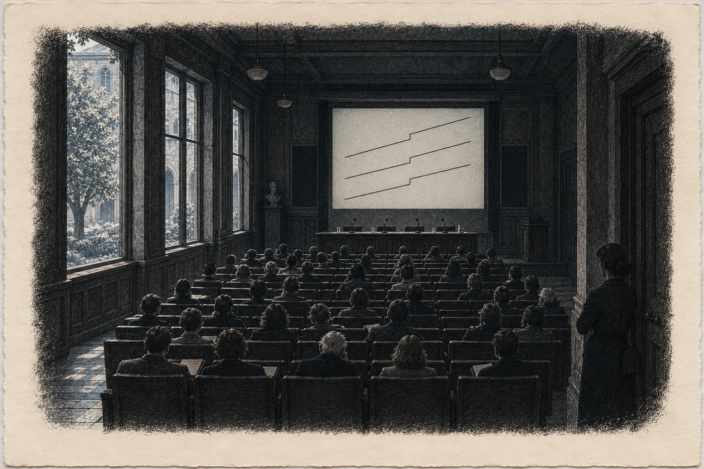

# Epilog II. Přílet

V sedm ráno měla Hana v telefonu krátkou zprávu.

*Jméno doplněno. T. K.*

Otevřela server, kde od desátého června ležel její balík, a našla tu položku. Zpoždění čtyři celá dvě sekundy po každé skupině signálů zdroje, změřené u skály v noci na třetího března. Pod tím, kde stálo *nezávislý radioastronom, jméno bude doplněno*, teď stálo *Tomáš Kalina* a odkaz. Odkaz vedl na preprint, který byl zveřejněn o půlnoci.

Hana ho nečetla. Ještě ne. Zavřela telefon a šla se osprchovat, protože věděla, že kdyby ho začala číst teď, nepřestala by a přijela by pozdě.

Vlak do Prahy jel v osm dvacet.

*

Sál byl menší, než čekala. Dvanáct řad židlí, plátno, stůl se čtyřmi mikrofony a se sklenicemi vody, na které nikdo nesáhl. Okna do dvora s lípou. Ústav, ve kterém Kalina dvacet let počítal šum.

V jedenáct padesát bylo plno. Novináři, kameramani, lidé s visačkami, které Hana neznala, a několik starých pánů v sakách, kteří seděli v první řadě s rukama na kolenou a vypadali jako lidé, kteří sem přišli zjistit, jestli se jejich kolega nezbláznil.

Hana stála vzadu, u zdi vedle dveří. Nikdo ji nepoznal. Nebo poznal a nic neřekl.

Kalina přišel ve dvanáct nula nula. Ve stejné bundě jako v Brně v únoru, jako na nádraží v Chebu, jako v jídelně penzionu. Pod bundou košile, kterou zjevně koupil den předtím. Za ním žena z ústavu, která měla na starosti tisk, a dva lidé, které Hana neznala. Muž a žena. Spoluautoři. Jeden přiletěl z jižní polokoule, druhá z observatoře v Evropě, a oba vypadali stejně nevyspale jako Kalina.

Kalina si sedl. Upravil si mikrofon a přelétl očima sál.

Hanu našel za tři vteřiny. Nekývl. Jen se na ni podíval, krátce, a pak se díval jinam.

„Dobrý den,“ řekl. „Budu mluvit krátce. Pak se ptejte. Na co nebudu vědět odpověď, to vám řeknu.“

*

Mluvil dvanáct minut. Hana je počítala.

Zdroj, který sledoval od podzimu dvacet pět. Poloha, která se posouvala v řadě. Úzkopásmové strukturované signály od září dvacet devět. Frekvence, která klesala. Pak plátno a na něm čára, rovná jako pravítko, a v jednom místě zlom. Dvacátého devátého dubna, v nula třicet jedna světového času. A pod ní dvě další čáry, jiné barvy, z jiných přístrojů, z jiných konců světa. Zlom ve stejné minutě.

„Kámen nebrzdí ve krocích,“ řekl Kalina. „Kometa ani planetka nemění, jak zpomaluje. Přirozený jev, který by to dělal, neznám. Moji kolegové taky ne, a hledali jsme ho čtyři měsíce.“ Odmlčel se. „Proto říkáme, co říkáme. Je to technologický objekt. Pohybuje se k nám a brzdí. A to, jak brzdí, je řízené.“

Sál byl tichý. Hana slyšela, jak za oknem někdo zametá dvůr.

„Pokud bude brzdit dál tak jako teď,“ řekl Kalina, „dostane se do vnitřních částí naší soustavy za několik let. Kolik přesně, nevím. Nevím, jestli bude brzdit dál takhle. Nevím, kam přesně letí.“ Podíval se na papír před sebou, i když z něj nečetl. „A nevím, proč.“

Řekl to stejně, jako řekl všechno ostatní. Rovně, bez důrazu. Hana si uvědomila, že takhle to říkal i jí, v Brně, nad devíti listy na dvou stolech. *Nevím, jakou chybu jsem nevyloučil.*

Teď ji vyloučil. Všechny, které znal.

*

Ptali se dlouho.

Jestli jsou to mimozemšťané. *Nevím, kdo to řídí. Vím, že se to řídí.* Jestli jsou nebezpeční. *Nevím. Nic, co jsem změřil, neříká ani ano, ani ne.* Jestli s nimi někdo mluvil. *Ne. Pokud vím, ne.* Jestli jsou signály zpráva. *Jsou strukturované. To je všechno, co o nich můžu říct. Co znamenají, neumím přečíst a nebudu předstírat, že umím.* Jak dlouho to věděl. *Že je to objekt, od dubna. Že je to řízené, od května, kdy to změřily obě observatoře. Neřekl jsem to dřív, protože jsem si nebyl jistý. Teď jsem si jistý tím, co tady stojí. Ničím víc.*

Zvedla se ruka uprostřed sálu. Mladý muž s mikrofonem s logem jednoho zpravodajského kanálu.

„Pane doktore. Ve vašem článku je jedna věc, která není z vesmíru. Pulzy ze země. Z Chebska. Souvisí to?“

Kalina se na něj chvíli díval.

„Na Chebsku je zařízení, které vysílá slabé pulzy,“ řekl. „Pod zemí. Pulzy jsou časované na tento zdroj. Přicházejí čtyři celá dvě sekundy po každé skupině jeho signálu. Dvacátého devátého dubna se změnily ve stejné minutě jako zdroj. To jsem změřil. Data jsou veřejná, už od června, v jednom souboru, který zveřejnila geoarcheoložka, se kterou jsem spolupracoval.“

„Paní Vrbová,“ řekl mladý muž.

„Paní doktorka Vrbová,“ řekl Kalina.

V sále to zašumělo. Několik hlav se otočilo. Hana stála u zdi a nehnula se. Je to zvláštní, myslela si, jak dobře člověk slyší vlastní jméno v sále, kde ho řekl někdo jiný.

„Kdo to zařízení postavil?“ zeptal se mladý muž.

„Nevím,“ řekl Kalina.

„Je to stejná technologie?“

„Nevím. Vím, že to zařízení poslouchá stejný zdroj jako já. A že na něj reaguje rychleji, než bych to uměl já.“ Kalina se odmlčel. „Paní doktorka Vrbová měřila u toho místa teplotu pramene. Od února do června. Skoro každé ráno v osm. Měřila dobře. Víc vám k tomu neřeknu, protože víc nevím, a co vím o tom místě, není moje.“

Pak ukázal na jinou ruku.

*

Když konference skončila, Hana odešla první. Dveře byly hned vedle ní.

Na chodbě ji dohnala žena s visačkou a diktafonem. Středních let, unavená, slušná.

„Paní Vrbová? Jen jednu otázku. Vy jste ta… atlantoložka?“

Hana se zastavila.

Věděla, co by mohla říct. Že ten válec v roce dvacet šest nebyl její podvrh. Že ho odhalila ona. Že oprava byla její. Že od února do června měřila skoro každé ráno v osm, že čtení mřížek z jejího balíku zopakovali tři cizí lidé a vyšlo jim to, že o ní ten den mluvil radioastronom se dvěma observatořemi za zády.

Nic z toho by nezměnilo, co je v titulcích.

„Ano,“ řekla. „Jsem ta, co měřila pramen.“

Žena s diktafonem ho po chvíli vypnula.

„Moje máma bydlí v Chebu,“ řekla. „Říká, že ta pára nad Mlýncem je vidět až od přehrady.“

„Je,“ řekla Hana.

Žena kývla, jako by to stačilo, a odešla zpátky do sálu.

*

Kalina jí zavolal v pět odpoledne. Bylo slyšet, že je venku, na ulici, a že jde rychle.

„Utekl jsem,“ řekl. „Pozvali mě do tří televizí. Řekl jsem jim, že jsem všechno řekl ráno. Nevěřili mi.“

„Řekl jste všechno.“

„Řekl jsem všechno, co vím.“ Kalina se zastavil. Hana slyšela tramvaj. „To není totéž. Ale je to jediné, co podepíšu.“

Chvíli mlčel.

„Ten pán z Mnichova,“ řekl pak. „Jeho nadace vydala ve dvě odpoledne prohlášení. Jedna věta. *Čekali jsme na tento den.* Nic víc.“

„Viděla jsem to.“

„Udělají z toho něco,“ řekl Kalina. „Ke každému číslu tři falešná. Na tohle budou mít připravených deset.“

„Já vím.“

„Tak dobře.“ A pak, jinak, skoro nesměle, jak Kalina nikdy nemluvil: „Paní Vrbová. Děkuju vám, že jste stála vzadu.“

„Proč?“

„Protože kdybyste stála vepředu, ptali by se na vás. A takhle se ptali na data.“

Zavěsil dřív, než Hana stihla odpovědět. Kalina vždycky zavěsil dřív.

*

Večer seděla doma v Brně, v kuchyni, ze které bylo přes dvůr vidět na zeď domu naproti. Na zdi bylo ještě světlo, oranžové, poslední.

Na stole ležel sešit. Ten nový, od dubna, se svislou čarou narýsovanou propiskou podle pravítka. Byl skoro plný. Vedle něj na poličce stála hnědá obálka s podpisem přes pásku, nepřerušeným. A v ní všechno od února, co Hana nikdy nikomu neukáže, pokud o to nepožádá soud.

Mezi stránkami sešitu, v levé půlce, ležela kresba. Kopec, dům se sadem. Žlutý obdélník uvnitř kopce a malé postavy s rukama nahoře. *PRO PANÍ CO MĚŘÍ.* S jedním písmenem obráceně.

Hana sešit otevřela na čisté dvojstraně.

Vlevo psala dlouho. Pečlivě, tiskacím písmem tam, kde šlo o čísla, a psacím tam, kde šlo o věty, které někdo řekl.

*22. 8. 2030, Praha. Tisková konference T. K. a dvou spoluautorů (observatoř na jižní polokouli, observatoř v Evropě). Preprint od 0:00.*

*Zdroj = technologický objekt. Pohybuje se k nám, brzdí. Brzdění se mění ve krocích – řízené (T. K.: „Kámen nebrzdí ve krocích.“). Zlom 29. 4., 0:31 UT, ve třech nezávislých záznamech.*

*Do vnitřní soustavy „za několik let“, pokud bude brzdit takto. Kam, neznámo. Úmysl neznámý.*

*Pulzy z Chebska časované na zdroj (4,2 s), změna 29. 4. ve stejné minutě. Data veřejná od 10. 6. Kalinovo jméno doplněno dnes v 7:00.*

*Nadace v Mnichově, 14:00: „Čekali jsme na tento den.“*

*Na chodbě: „Vy jste ta atlantoložka?“ – „Ano. Jsem ta, co měřila pramen.“*

Pak se zastavila.

Listovala dozadu. Přes červenec, přes červen, přes noc na dvoře s hasiči, přes Kalinova slova o krocích v jídelně penzionu. Až k první stránce, ke konci dubna. Březen byl v tom druhém sešitu, zalepeném, ale Hana si pamatovala, co tam stálo vpravo. Pamatovala si všechno, co napsala. Neuměla to zapomenout.

*Přivezli je. A nechali je tam.*

*vyhnanství?*

Otazník tam zůstal. Nikdo ho nevymazal. Nikdo neměl čím. Nic z toho, co ten den řekl Kalina, ho neodstranilo. Kalina mluvil o tom, co přichází. Ne o tom, co bylo.

Hana se vrátila na čistou dvojstranu.

Vpravo napsala tři otázky. Pod sebe, s mezerou za každou, aby bylo kam připsat, až bude co.

*Kdo jsou?*

*Proč přesně sem?*

Pak dlouho držela tužku nad papírem. Za oknem na zdi domu naproti zhaslo poslední světlo a dvůr byl modrý. Někde dole někdo zavřel okno, dřevěný úder rámu o rám.

Hana myslela na teplou skálu. Na bledé světlo ve skále, na devět padajících, z nichž deváté nepřistane. Na kraj shora s horami, které nikdo nezná. Na osm protáhlých strojů a řady lidí s prázdnýma rukama. Na mřížky, které počítaly a nikomu neříkaly co. A na to, co Sael viděla v lednu poprvé za svůj život a co mnich viděl roku 1172: jedno světlo, které nepadá. Které přichází. Odjinud.

Skála to ukázala před osmi sty lety a nikdo nevěděl komu. Teď to ukazovala každou noc prázdné hoře a jedné kameře, které zbývalo místo do září.

Hana napsala třetí otázku.

*Co skála ukazovala, když je viděla přicházet?*

Neodpověděla na ni. Nikdo na ni ten den odpovědět neuměl, a ona to věděla, a napsala to vlevo, malým písmem, pod čáru, aby to tam stálo taky:

*Nevím.*

Pak sešit zavřela. Nechala ho ležet na stole, vedle kresby, kterou do něj zase vloží, a zhasla.

V kuchyni byla tma. Hana stála u okna a dívala se nahoru, přes dvůr, mezi střechy. Byl tam kus nebe. Pár hvězd, které jsou vidět i nad městem.

Žádná se nepohnula.
