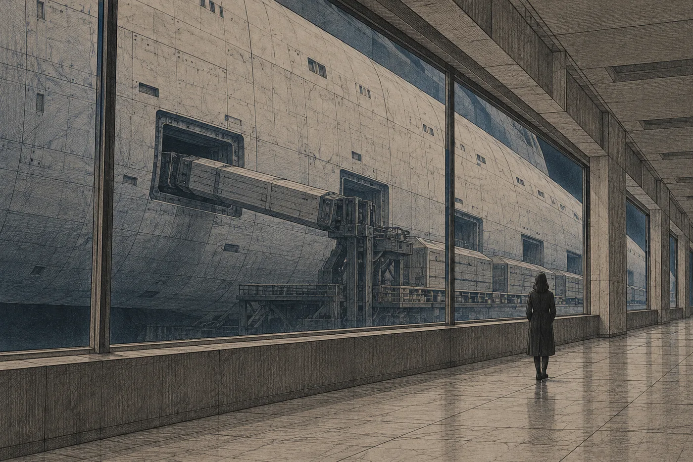

# 2. Ilan

Kyvadlo k Sedmé loděnici jelo podél vnějšího okraje prstence a mělo jeden průzor.

Byl kulatý, velký jako dlaň, a seděl ve stěně u zadních sedadel, kam si nikdo nesedal. Nara si sedla tam. Nebylo to kvůli výhledu. Vepředu seděli dva technici z loděnice a mluvili o směnách a ona nechtěla, aby se jí síť ptala, jestli chce jejich rozhovor ztlumit. Síť se ptala pořád. Od včerejška se ptala na všechno, opatrně a laskavě, jako se ptá sestra u lůžka.

Průzorem byla vidět tma a v ní hvězdy. Ostré a nehybné, jako by je někdo vytiskl na sklo. Jednou za několik minut se do průzoru zespodu vsunul okraj planety, široký pruh barvy rzi a krému. Pomalu přejel průzorem a zmizel nahoře. Rotace kyvadla. Nara to sledovala, dokud ji z toho nezačala bolet hlava, a pak se dívala na vlastní ruce.

Sedmá loděnice ležela na vnějším okraji, tam, kde už nebylo nic jiného než doky. Měla menší poloměr než Orsa a točila se rychleji. Nara to věděla, protože to věděl každý, kdo tam někdy jel. Uvědomila si to ale až ve vstupní hale, když se otočila za zvukem. Hlava se jí otočila a svět se otočil s ní, jenže o kousek dál a o kousek později. Na okamžik nevěděla, kde je podlaha. Chytila se zábradlí.

„Pomalu,“ řekl strážný u vstupu. Neznělo to nevlídně. „Tady se hlava otáčí pomalu. Za den si zvyknete.“

„Nebudu tu den.“

Strážný pokrčil rameny. Síť ho Naře představila: jméno, služební číslo, oddělení. Jeho síť zase představila jemu ji: totožnost ověřena, účel návštěvy, vztah k odsouzenému. Strážný krátce kývl, jako by si odškrtl řádek, který viděl jen on, a pustil ji dál.

*

Cestou k návštěvním místnostem vedla chodba podél dlouhého okna do doku.

Nara nechtěla zpomalit, ale zpomalila. Za oknem byla loď. Nebo spíš kus lodi. Byla tak velká, že nebyla vidět celá, jen plášť, šedobílý, posetý řadami otvorů a svárů, který se táhl doleva i doprava daleko za okraje okna. Nebylo poznat, kde začíná a kde končí. U jednoho z otvorů stálo nákladní rameno a pomalu do lodi zasouvalo dlouhou bednu. Za ní další. Bedny byly všechny stejné, úzké a delší než člověk.

Síť jí nabídla popis: *Transportní loď, druhý transport, nakládka hibernačních lůžek, fáze 3 z 5.*

Nara popis zavřela, aniž ho dočetla.

Šla dál a nedívala se doleva, dokud okno neskončilo.

*

Návštěvní místnost byla malá a čistá. Stůl, dvě židle po obou stranách, žádné sklo mezi nimi. Na stěně světlý pruh, který měl připomínat okno a nepřipomínal nic. U dveří stála strážná, starší žena s krátkými šedými vlasy, a dívala se do zdi.

*Návštěva: záznam probíhá.*

Nara si sedla. Na stůl nepoložila nic, protože neměla co. Všechno, co potřebovala, měla v síti, a nic z toho tu nebylo k ničemu.

Pak otevřeli dveře na druhé straně a přivedli Ilana.

*Osoba bez spojení. Totožnost potvrzena personálem.*

Byl hubenější. To bylo první. Za ten měsíc se mu propadly tváře a pod nimi se ukázaly kosti, které Nara neznala, protože je měl po někom jiném, po Davenově matce nebo po někom, koho nikdy neviděla. Vlasy měl delší a nikdo mu je nestříhal. Šedý čtvereček za uchem byl pryč. Na jeho místě měl drobnou zarudlou skvrnu, jako po náplasti, která se strhla příliš rychle. Na levém zápěstí měl pořád bílý provázek. Už nebyl bílý. Byl šedý od praní a byl na něm řádek drobných uzlíků, těsně vedle sebe, jako korálky.

Sedl si. Nedíval se na ni tak, jak se dívají lidé. Lidé se na sebe dívají krátce, protože to ostatní jim řekne síť. Ilan se díval dlouho. Na její oči, na ústa, na ruce na stole. Jako by si ji musel přečíst.

„Kolikátého je?“ zeptal se.

Řekla mu to. Ilan kývl a palcem pravé ruky přejel po uzlících na zápěstí, jeden po druhém. Rty se mu přitom nepatrně hýbaly.

„Třicet dva,“ řekl.

„Třicet dva čeho?“

„Dní. Od náměstí.“ Pustil provázek. „Každé ráno jeden. Jinak to tady nejde poznat. Svítí to pořád stejně.“

Nara se dívala na ty uzlíky. Třicet dva. Spočítala si to sama, protože si to spočítat chtěla, a vyšlo to. Pak si uvědomila, že v koutku vědomí má jiné číslo, menší a šedé, a že ta dvě čísla jdou proti sobě.

„Ilane,“ řekla. „Včera vyšel rozsudek.“

„Já vím. Strážný říkal, že je rozhodnuto.“

„Řekl ti, jak to dopadlo?“

„Ne. Řekl, že je to v síti.“ Ilan se pousmál, jen jedním koutkem. „Že si to můžu přečíst.“

Nara mu to tedy řekla. Řekla to tak, jak to říkala klientům: celé, přesně, bez přívlastků a v pořadí, v jakém to stálo v textu. Trestní soud prstence. Řízení písemné. Jeden obhájce. Čtyři sta jedna osob. Člen. Přiznání odmítnuto. Trvalé vyhnanství bez přístupu k technologii. Druhý transport. Odlet za čtyřicet pět dní, v šest ráno. Ilan poslouchal a nepřerušoval ji. Díval se jí na ústa. Jednou, u slova *vyhnanství*, mu ztuhly prsty na stole. Pak se zase uvolnily.

„A doručili mi to?“ zeptal se, když skončila.

„Vyvěšením. Protože jsi bez spojení.“

„Takže mi to doručili.“

„Včera v devět čtyřicet.“

Ilan se zasmál. Nahlas, krátce, a strážná u dveří se poprvé podívala na ně místo do zdi. Nara se nesmála. Chtěla, ale nešlo to, a tak jen seděla a dívala se, jak se směje její syn, kterému včera v devět čtyřicet doručili vyhnanství na místo, kam nevidí.

„Je tam Kesi?“ zeptal se.

„Kdo?“

„Kesi Amar. Seděla vedle mě.“

Nara se obrátila k síti a hledala. Nemusela dlouho. *Amar, Kesi, 16 let. Člen. Účast na shromáždění, veřejné odpojení. Přiznání: nepodepsáno.* Drobná dívka s vlasy staženými dozadu. Posunula se, aby vedle Ilana zbylo místo. Pak ho vzala za ruku.

„Je,“ řekla Nara.

Ilan kývl. Neptal se, jak to ví. Neptal se na nic dalšího. Díval se na stůl a jeho palec znovu našel provázek.

„Jak ses to dozvěděla ty?“ zeptal se po chvíli.

„Po jednání. Na chodbě.“

„Kdo ti to řekl?“

„Síť.“ Nara zaváhala. Pak mu to řekla celé, protože si umínila, že mu dnes řekne všechno celé. „Nejdřív mi zrušila odpoledne. Pak mi zarezervovala tuhle návštěvu. Pak mi ukázala, kolik dní zbývá do odletu. A až potom rozsudek.“

Ilan se na ni díval. Pak se pomalu, potichu zasmál, ne zle.

„Věděla, že tě to bude bolet,“ řekl. „Tak ti napřed uklidila den.“

„Je to tak nastavené.“

„Já vím, že je to tak nastavené. Já to neříkám jako výčitku. To je na tom právě to.“ Opřel se lokty o stůl. „Ona je hodná, mami. Ona je strašně hodná. Ví o tobě všechno a chce, abys byla v pořádku. Proto se od ní nedá odejít. Od zlého se odchází snadno.“

*

„Jaké to je?“ zeptala se Nara.

Nevěděla, proč se ptá. Neměla to v plánu. V kyvadle si srovnala, co mu řekne a v jakém pořadí, a tahle otázka v tom pořadí nebyla. Ilan zvedl obočí, jako by ho to překvapilo stejně jako ji.

„Bez sítě?“

„Bez sítě.“

Chvíli přemýšlel. Nedíval se při tom kousek vedle, jak se dívají lidé, kteří si něco ověřují. Díval se do stolu, a Nara si uvědomila, že přemýšlí sám, bez ničeho, a že to trvá déle.

„První tři dny je to hrozné,“ řekl. „Pořád se k ní obracíš. Chceš vědět, kolik je hodin, a obrátíš se, a nic. Chceš vědět, kdo to jde po chodbě, a obrátíš se, a nic. Je to jako… jako když ti v puse chybí zub a jazyk tam pořád jezdí.“ Pokrčil rameny. „Pak to přestane. Ne úplně. Ale přestane.“

„A pak?“

„Pak začneš slyšet věci.“ Ukázal bradou ke stropu. „Ventilaci. Celý život jsem ji neslyšel. Tady ji slyším pořád. Má dva tóny, jeden nízký a jeden, co se zvedá. Strážné poznám podle kroků. Ta, co tu stojí, šoupe levou nohou.“

Strážná u dveří se nepohnula. Nara by přísahala, že se pohnout chtěla.

„A zdají se mi zase sny,“ řekl Ilan.

Řekl to lehce, jako jednu z věcí v řadě. Pak se na ni podíval a Nara pochopila, že to lehce neřekl.

„Jaké?“ zeptala se.

„Normální. Blbé. Že jdu po chodbě a ona nikde nekončí.“ Odmlčel se. „Ale jsou moje, víš? Ráno se probudím a vím, že se mi něco zdálo, a nikdo mi to nevzal.“

Nara mlčela. Ilan ji nechal mlčet. Nepřidal k tomu výčitku ani vysvětlení. Nemusel.

„Ví to táta?“ zeptal se potom.

„Ví. Včera mi třikrát volal.“

„A tys to nevzala.“

„Nevzala.“

„To je dobře,“ řekl Ilan. „Táta by brečel. A ty bys nevěděla, co s tím.“

Řekl to jako fakt, bez úsměvu, a Nara neodporovala, protože to fakt byl.

*

„Podám návrh,“ řekla Nara.

„Na co?“

„Na zastavení transportu. Ke Spolkovému soudu.“

„Celého?“

„Celého.“

Ilan zvedl hlavu. Poprvé se na ni podíval, jako by nečekal, že to řekne.

„Rozsudek, podle kterého tě odsoudili, nestojí sám,“ řekla. „Stojí na jiném rozsudku. Na Terře. Bez Terry by nebylo členství, kolektivní trest ani transport. Kdo chce zastavit transport, musí jít po Terře. Kolektivní trest odporuje ústavě. Každý odpovídá za vlastní čin. Nikdo za čin jiného. To stojí v ústavě od začátku a Terra je s tím v rozporu od začátku. Jen se na to devět set let nikdo nedíval, protože nebylo proč.“

„A teď se podívají.“

„Teď je musím donutit, aby se podívali.“

Ilan mlčel. Nara znala to mlčení. Uměl ho od deseti let. Nebylo to mlčení, kterým se souhlasí, ani to, kterým se odporuje. Bylo to mlčení někoho, kdo čeká, kdy přijde druhá polovina věty.

„Potřebuju od tebe jednu věc,“ řekla.

„Jakou?“

„Plnou moc.“

Ilan se nepohnul.

„Návrh podám tak jako tak,“ řekla Nara. „Jako osoba dotčená. Jsem matka odsouzeného, to stačí, abych mohla napadnout výkon. Ale jako osoba dotčená můžu jen proti precedentu. Nemůžu žádat nic pro tebe. Nemůžu napadnout vady tvého řízení jako tvoje advokátka, nemůžu mluvit za tebe, nemůžu…“

„Nemůžeš mě vyjmout.“

„Nemůžu dělat nic, co bych dělat měla.“

„A s plnou mocí bys mohla.“

„S plnou mocí bych mohla všechno.“

Ilan se na ni díval dlouho. Pak se podíval na strážnou u dveří. Pak zase na ni.

„Jak se podepisuje plná moc?“ zeptal se.

Věděl to. Oba věděli, že to ví. Přesto se zeptal, a Nara chvíli zvažovala, jestli mu má odpovědět, nebo jestli je to past. Byla to past. Odpověděla.

„Totožností. V síti.“

„Já nejsem v síti.“

„Implantát máš v pořádku. Je jen zamčený. Po třech dnech bez spojení se zamkne sám, aby ho nikdo nemohl zneužít. Lékař s oprávněním ho odemkne za čtvrt hodiny. Připojí tě na minutu, ty potvrdíš plnou moc a on tě zase odpojí. Na minutu, Ilane. Nic víc.“

„Nic víc,“ řekl Ilan.

„Je to lékařský úkon. Potřebuje tvůj souhlas. Nikdo ti to neudělá bez tebe.“

„To je od nich hezké.“

„Ilane…“

„Ne,“ řekl.

Řekl to tiše. Nebylo v tom nic z toho, na co se Nara po cestě připravovala, žádná zlost, žádné poučování. Jen to jedno slovo, položené na stůl mezi ně jako předmět.

„Podepíšu to rukou,“ řekl potom. „Napiš to, já to podepíšu. Jménem. Rukou. Tady.“ Položil dlaň na stůl. „Dej mi něco, na co se dá psát.“

„Ruka tu nic neznamená.“

„Pro mě jo.“

„Pro soud ne. Soud nezná podpis rukou. Neexistuje. Kdybych donesla papír s tvým jménem, soud by ani nevěděl, kam ho založit.“

„Tak ať se to naučí.“

„Za čtyřicet pět dní?“

Ilan se usmál. Byl to ošklivý a smutný úsměv a Nara by dala hodně za to, aby ho neviděla.

„Za devět set let se to nenaučil,“ řekl. „Já vím. Já vím, mami. Za čtyřicet pět dní ne.“

Pak stáhl ruku ze stolu a dal si ji do klína.

*

Tak to bylo vždycky. Nara by si to přála jinak, ale přiznávala si to: tak to bylo vždycky, od chvíle, kdy Ilan začal mluvit celými větami.

Ve dvanácti zjistil, že má v síti rodičovský řádek a že ona vidí, kde je. Nekřičel. Přišel za ní do kuchyně a zeptal se, jestli je pravda, že ho vidí. Řekla, že je. Zeptal se, jestli to může vypnout. Řekla, že nemůže, že to stanoví zákon pro všechny nezletilé a že je to tak správně. Ilan chvíli stál a pak řekl: „Tak se nedívej.“ A ona slíbila, že se nebude dívat. A nedívala se. Jenže řádek tam byl. Pět let tam svítil a Ilan pět let věděl, že svítí, a ani jednou jí nevěřil, že se nedívá.

Ve čtrnácti se u večeře hádali o kamaráda z jeho třídy, kterému rodiče nechali vyměnit implantát za nový, s delším záznamem. Ilan řekl, že je to jako dát někomu do hlavy kameru, a ona řekla, že kamera tam je odjakživa a nový implantát má jen lepší objektiv. Myslela to jako vtip. Ilan to nepochopil jako vtip. Řekl, že s ní nemá cenu mluvit, protože ona všechno vždycky obhájí. Řekla, že to je její práce. Řekl: „Já vím. Proto.“

V patnácti se mu v noci zdály sny, ze kterých se budil s křikem. Nara tehdy v nastavení rodičovského přístupu našla zklidnění. Automatické, podle tepu a dechu. Pro nezletilé ho mohl zapnout rodič. Zapnula ho. Sny ustaly a Ilan přestal křičet ve spánku. Přestal se i hádat u večeře. Stal se z něj tichý, rozumný kluk, který na všechno odpovídal „možná“. Nara si myslela, že dospívá.

V šestnácti na to přišel. Nastavení rodičovského přístupu bylo vidět, když člověk věděl, kde hledat, a Ilan věděl, kde hledat, protože už tehdy chodil na schůzky, kde se o takových věcech mluvilo. Přišel za ní, tentokrát ne do kuchyně, ale do její pracovny, kam nechodil nikdy. Stál ve dveřích a nebyl rozzlobený. To si pamatovala nejlíp. Nebyl vůbec rozzlobený, protože zklidnění bylo ještě zapnuté.

„Rok jsem si myslel, že jsem klidný člověk,“ řekl.

Vypnula to ještě ten večer. Za týden se odstěhoval.

A pak Tavi. Loni na podzim. Tavi Sen, o rok starší než Ilan, se odpojil na tři dny, doma, sám, jen aby zjistil, jaké to je. Byl to přestupek, nic víc, ale k přestupku se přidal dohled: šest měsíců povinného připojení se zvýšeným záznamem. Ilan za ní přišel, poprvé od té doby, co odešel, a požádal ji, aby to vzala. Vzala to. Našla vadu v doručení výzvy a dohodla s úřadem, že od dohledu upustí, když Tavi podepíše prohlášení o lítosti. Bylo to standardní. Tavi podepsal. Nara to považovala za dobrou práci a řekla to Ilanovi.

„Vyhrálas mu to tak, že musel podepsat, že se mýlil,“ řekl Ilan.

„Vyhrála jsem mu to tak, že nemá dohled.“

„Má záznam. Má v záznamu, že se mýlil. Do smrti.“

„Je mu sedmnáct. Za rok si na to nevzpomene.“

„Ty si na to vzpomeneš,“ řekl Ilan. „Ty si to přehraješ, kdykoli budeš chtít.“

Tehdy se viděli naposledy před náměstím.

*

„O co ti jde?“ zeptal se Ilan teď. Seděl s rukama v klíně a díval se na ni přes stůl. „Doopravdy. Ne co napíšeš do návrhu.“

„O to, abys neodletěl.“

„A ostatní?“

„Ostatní taky. Proto návrh na zastavení celého transportu. Kdybych chtěla jen tebe, podám žádost o výjimku. Nezletilost. Bylo by to rychlejší.“

„Proč to tedy neuděláš?“

„Protože bys ji nepřijal.“

Ilan se na ni podíval tak, že Nara pochopila, že řekla něco špatně.

„To je zajímavé,“ řekl. „Že víš, co bych nepřijal.“

„Ilane.“

„Ne, vážně. Já se neptal, co bych přijal. Ptal jsem se, proč to neuděláš ty.“ Naklonil se dopředu. „Protože kdybys mě vyňala, nemohla bys vyhrát Terru. Že jo? Výjimku dostane jeden kluk, o tom nikdo psát nebude. Terra je devět set let stará. Tu by si pamatovali.“

„To není pravda.“

„Možná ne,“ řekl Ilan. „Já nevím, co je v tobě pravda. Nikdy jsem to nevěděl. Ty ses vždycky naučila to, co bylo potřeba, a pak jsi to obhájila.“

Nara mlčela. Cítila, jak se jí vzadu na krku napíná kůže, a čekala, kdy přijde to, co dřív přicházelo vždycky: chlad, uvolnění, pomalejší dech. Nepřišlo. Nebo přišlo a ona to nepoznala.

„Nechci být tvůj případ,“ řekl Ilan.

Řekl to bez důrazu. Jako větu, kterou si připravil dávno a kterou teď jen položil vedle té první, vedle toho *ne*. Pak se opřel o židli.

„Nejsi můj případ,“ řekla Nara. „Jsi můj syn.“

„Já vím. To je právě to.“

Chtěla se zeptat, co tím myslí. Neudělala to. Věděla, co tím myslí. Věděla to od Taviho, od rodičovského řádku, od zklidnění, od všech těch večeří, kdy Ilan něco řekl a ona to obhájila. Tvůj syn je ten, za koho rozhoduješ. Tvůj případ je ten, za koho mluvíš. Ilan nechtěl ani jedno.

„A co tedy chceš?“ zeptala se.

Ilan otevřel ústa. Pak je zase zavřel.

Dlouho se díval na stůl. Palec mu jezdil po uzlících na zápěstí, tam a zpátky, a Nara viděla, že je nepočítá. Jen se jich drží.

„Jak dlouho se letí?“ zeptal se nakonec.

„Šest set let. Něco přes.“

„A celou dobu se spí.“

„Celou dobu.“

„To je jako spát? Doopravdy spát? Nebo…“ Zarazil se. „Ví se, jestli se při tom něco zdá?“

„Nevím,“ řekla Nara. Znala text zákona o výkonu trestu, celý. Znala lhůty, formality, pravomoci Koloniálního úřadu, výjimky. Nevěděla, jestli se při hibernaci něco zdá. Nikdy ji nenapadlo se zeptat.

„A ví se, jestli dorazili? Ti první?“

„Ne.“

„Devět set let a nikdo to neví.“

„Je to daleko. Zprávy jdou dlouho.“

„Kolik?“

„Nevím přesně. Dlouho.“

Ilan kývl. Pak se zasmál, tentokrát potichu, skoro jen dechem.

„Ty to taky nevíš,“ řekl. „To je zvláštní. Ty vždycky všechno víš.“

*

Strážná u dveří se pohnula. *Návštěva: zbývá 5 minut.*

Nara se k síti obrátila a zeptala se, jestli lze návštěvu prodloužit. Síť odpověděla, že návštěvní řád to neumožňuje a že další volný termín je za pět dní. Zarezervovala ho. Neptala se Ilana, jestli chce. Uvědomila si to až ve chvíli, kdy bylo hotovo.

„Přijdu za pět dní,“ řekla.

„Dobře.“

„Ilane. Poslouchej mě.“ Položila ruce na stůl, dlaněmi dolů, tak jak je pokládala v síni, když chtěla, aby ji senát poslouchal. „Udělám všechno.“

Ilan se na její ruce podíval. Pak na ni.

„Všechno, co jde podle pravidel,“ řekl.

„Všechno, co jde.“

„To je totéž. U tebe.“ Řekl to bez zloby. Byla to jen oprava, jako by opravoval číslo. „To není výčitka, mami. Já vím, že uděláš všechno, co jde. Ty vždycky uděláš všechno, co jde. Jen ti nevěřím, že to stačí.“

„Tak mi věř, že se pokusím.“

„Tomu věřím.“

Nebylo to totéž. Oba to věděli.

Strážná otevřela dveře na jeho straně. Ilan vstal. Pomalu, celým tělem najednou, a hlavu otočil ke dveřím až potom, když už stál. Naučil se to. Pár týdnů v Sedmé loděnici a naučil se, jak se tady otáčí hlava.

Ve dveřích se zastavil.

„Kolik dní?“ zeptal se. „Podle tebe.“

„Čtyřicet pět. Dnes je čtyřicet pět.“

„Já mám třicet dva.“

Zvedl ruku a ukázal jí zápěstí s provázkem, jako by jí ukazoval hodinky. Pak odešel.

*

Strážná ji doprovodila ke vstupní hale. Šla půl kroku před ní a Nara poslouchala její kroky. Levá noha opravdu šoupala. Tiše, sotva slyšitelně, jako by podrážka pokaždé o kousek přejela po podlaze, než se zvedla. Nara by si toho nikdy nevšimla.

„Kdy je ukládají?“ zeptala se.

Strážná se neotočila. „Posledních pět dní. Nejdřív stříhání, pak hala. V hale už se návštěvy nepřijímají.“

„Takže čtyřicátý první den.“

„Čtyřicátý první je poslední den návštěv. Na vašem místě bych si ho zarezervovala hned. Bude plno.“ Odmlčela se. Pak dodala, stejným hlasem, jakým říkala čísla: „Jí. Většina jich ze začátku nejí. On jí.“

Nara nevěděla, co na to říct. Poděkovala. Strážná kývla a vrátila se do chodby, šoupavým krokem, který Nara teď slyšela, i když nechtěla.

Zarezervovala si čtyřicátý první den. Síť jí potvrdila termín a nabídla připomínku.

*

V chodbě podél doku šla Nara rychleji než předtím a dívala se doleva, na stěnu. Za oknem nakládací rameno zasouvalo do lodi další dlouhou bednu. Slyšela to: tupé zadrnčení, které přišlo podlahou, a pak táhlé zasyčení. Nedívala se.

Ve vstupní hale se otočila moc rychle a svět se zase posunul o kousek dál a o kousek později. Tentokrát se nechytila zábradlí. Stála, dokud se podlaha nevrátila na místo.

Síť jí nabídla záznam návštěvy. Celý, čtyřicet minut, s přepisem. Nara ho mohla otevřít v kyvadle a pustit si znovu každé slovo, každou odmlku, Ilanovo *ne*, Ilanovo *nechci být tvůj případ*, Ilanův palec na uzlících. Mohla ho zpomalit. Mohla se podívat, jak se tvářil, když řekla *nezletilost*, protože to si nepamatovala.

Nechala záznam zavřený. Celou cestu zpátky.

Nebylo to rozhodnutí. Nevěděla přesně, co to bylo. Seděla u kulatého průzoru, za sklem se pomalu převalovala planeta, a Nara poprvé po mnoha letech nechtěla vědět, jak něco doopravdy proběhlo. Chtěla si to pamatovat sama. I s chybami.

Na Orse vystoupila a šla rovnou do kanceláře.
